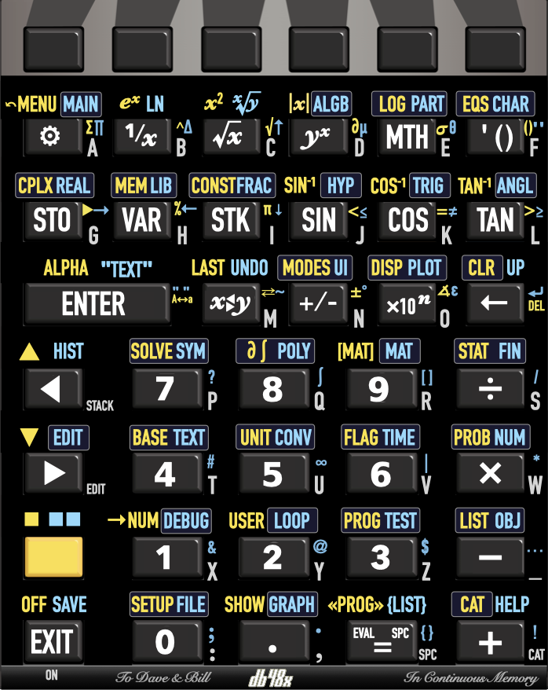

# Overview

## DB50X on DM32

The DB50X project intends to rebuild and improve the user experience of the
legendary HP48 family of calculators, notably their *"Reverse Polish Lisp"*
 [(RPL)](#Introduction-to-RPL)
language with its rich set of data types and built-in functions.

This project is presently targeting the **SwissMicro DM32 calculator**
and leveraging its built-in software platform, known as **DMCP**. This is
presumably the calculator you are currently running this software on.
You can also [try it in your browser](http://48calc.org).

## Table of contents

* [Using the on-line help](#help)
* [Quickstart guide](#quickstart-guide)
* [Programming examples](#rpl-programming-examples)
* [State of the project](#state-of-the-project)
* [Design overview](#design-overview)
* [Keyboard interaction](#keyboard-interaction)
* [Soft menus](#soft-menus)
* [Differences with other RPLs](#differences-with-other-RPLs)
* [Built-in help](#help)
* [Acknowledgements and credits](#acknowledgements-and-credits)
* [Release notes](#release-notes)
* [Performance](#performance-measurements)
* [Keyboard overlays](https://www.hpmuseum.org/forum/thread-20113.html)


## State of the project

This is currently **SEMI-STABLE** software, meaning that the implemented
features appear to work somewhat reliably, but that some features are still
being added with each new release. This is **NOT PRODUCTION READY** and should
not be used for any mission-critical computation.

At this point in time, you should only install this if you are interested in
contributing to the project, whether it is in the form of code, feedback or
documentation changes. Please refer to the web site of the project on GitHub or
GitLab for details and updates. The best way to
[report an issue](https://github.com/c3d/db48x/issues),
[request an improvement](https://github.com/c3d/db48x/issues/new)
or [submit a proposed change](https://github.com/c3d/db48x/pulls) is
on the project's [GitHub page](https://github.com/c3d/db48x).

The [implementation status](#implementation-status) section categorizes all the
RPL commands in the HP50G and in DB50X into
[implemented](#implemented-commands),
[not implemented yet](#unimplemented-commands),
[unapplicable commands](#unapplicable-commands) and
[DB50X only](#additional-commands) lists.

## Design overview

The objective is to re-create an RPL-like experience, but to optimize it for the
existing DM32 physical hardware.
The DM32 keyboard layout is really different compared to the DB50X expected
layout. For example, the DM32 does not have unshifted arrow keys, and has two
shift keys. For that reason, when running DB50X on a DM32, it is highly
recommended to use a
[keyboard overlay](https://github.com/c3d/db48x/blob/stable/Keyboard-Layout.png).

Compared to the original HP48, the DM32 has a much larger screen, but no
annunciators (it is a fully bitmap screen). It has a keyboard with dedicated
soft-menu (function) keys, but no arrow keys (whereas the HP48 has four),
lacks a dedicated alpha key, and has no space key (_SPC_ on the HP48).


## Keyboard interaction

The keyboard differences force us to revisit the user interaction with the
calculator compared to the HP48:


* When running DB50X on the DM32, the blue shift key cycles between three
  states, *Shift* (shown in the documentation as 🟨), *Right Shift* (shown in
  the documentation as 🟦) and no shift. The physical yellow shift key is
  actually used as a down/right cursor key, and will be shown as _▶︎_ in the rest
  of this document. Similarly, the _XEQ_ key is used as an up/left cursor key,
  and will be shown as _◀︎_ in the rest of this document. This remapping of keys
  appears necessary because RPL calculators like the HP48 are command-line
  oriented and absolutely need at least two unshifted cursor keys. Sacrificing a
  physical shift key while preserving two shifted function seems like the best
  compromise.

* A first press on the shift key is shown as 🟨 in the documentation, and
  activates functions shown in yellow in the keyboard overlay. A second press is
  shown as 🟦 in the documentation, and activates functions shown in blue in the
  keyboard overlay. On the screen, the shift state is indicated in the header
  area. When a [soft menu](#soft-menus) is visible on the screen, the selected
row of functions is highlighted.

In the rest of this document, the shift key is referred to as 🟨, and pressing
it twice is referred to as 🟦, irrespective of the appearance of the physical
shift key on your particular hardware. While running the firmware, this will display in the annunciator area as follows:


Other aspects of the keyboard interaction are fine-tuned for RPL usage:

* Since RPL uses alphabetic entry (also called *Alpha* mode) a lot more
  frequently than on RPN models like the HP41 or HP42, making it quickly
  accessible seems important, so there are
  [three distinct ways to activate it](#alpha-mode).


* Using 🟨 _◀︎_ and 🟨 _▶︎_ moves the cursor up and down.  When not editing, _◀︎_
  and _▶︎_ behave like _▲_ and _▼_ on the HP48, i.e. _◀︎_ enters the *interactive
  stack*  and _▶︎_ edits the object on the first level of the stack.

* Long-pressing arrow keys, the _←_ (also known as *Backspace*) or text entry
  keys in Alpha mode activates auto-repeat.

* Long-pressing keys that would directly trigger a function (e.g. _SIN_),
  including function keys associated with a soft-menu, will show up the
  [built-in help](#help) for the corresponding function.


### Alpha mode

Entering alphabetic characters is done using *Alpha* mode. These alphabetic
characters are labeled on the right of each key on the DM32's keyboard.

When *Alpha* mode is active, an _ABC_ indicator shows up in the annunciator area
at the top of the screen. For lowercase entry, the indicator changes to
_abc_.

There are three ways to enter *Alpha* mode:

* The first method is to use 🟨 _ENTER_ as indicated by the _ALPHA_ yellow label
  on the DM32 ENTER key. This cycles between *Alpha* _ABC_, *Lowercase* _abc_
  and *Normal* entry modes.

* The second method is to hold 🟨 for more than half a second. This cycles
  between *Alpha* _ABC_ and *Normal* entry modes, and cannot be used to type
  lowercase characters.

* The third method is to hold one of the arrow keys _◀︎_ or _▶︎_ *while* typing on
  the keyboard. This is called *transient alpha mode* because *Alpha* mode ends
  as soon as the arrow key is released. Using _◀︎_ enters uppercase characters,
  while _▶︎_ uses lowercase characters.

There is no equivalent of the HP48's "single-Alpha" mode. Alpha mode is either
_transient_ (when you hold one of the arrow keys) or _sticky_ (with 🟨 _ENTER_
or by holding 🟨).

Alpha mode is cancelled when pressing _ENTER_ or _EXIT_.

Since the DM32's alphabetic keys overlap with the numeric keys (unlike the
HP48), as well as with operations such as _×_ and _÷_, using 🟨 in Alpha mode
brings back numbers. This means 🟨 cannot be used for lowercase, but as
indicated above, there are two other methods to enter lowercase
characters.

Using 🟨 or 🟦 in combination with keys other than the numeric keypad gives a
variety of special characters. The `CharactersMenu` and `Catalog` can be used to
enter special characters in a more comfortable way.


### Key mapping

The layout of keys on DB50X was carefully chosen to offer a good compromise
between immediate applicability for calculations and giving access to numerous
advanced functions through menus.

DB50X keyboard overlays for DM-42 and DM-32 SwissMicros calculators are
[already available](https://www.hpmuseum.org/forum/thread-20113.html).



In the rest of this document, keys bindings will usually be described using the
alphabetic key, to make it easier to locate on the keyboard, followed by the
standard label on the DB50X layout. For example, the assignment for the `sin`
function will be described as _J_ (_SIN_). The shifted functions of the same key
will be described as 🟨 _J_ (_SIN⁻¹_) or 🟦 _J_ (_HYP_) respectively.

In some cases, the label between parentheses may refer to another calculator
model, which will be indicated as follows. For example, the _A_ key can be
described as _A_ (_⚙️_, DM-42 _Σ+_, DM-32 _√x_).


Using DB50X with the DM32 is quite difficult without a keyboard overlay.

In particular, an unfortunate difference between the DM32 and the keyboard
layout used by DB50X is that the placement of all letters after `M` is shifted
by one position on the keyboard, and the first row of scientific functions
(starting with square root and ending with _Σ+_) is inconsistent. The reason is
that the layout for DB50X is heavily based on the DM-42 model.

Also, while the DM32 has two shift keys, a blue and a yellow one, it lacks
dedicated cursor movement arrow keys, a limitation that is visible in the
calculator's firmware menus.  While the two arrow shift keys would be welcome,
not having arrow keys for cursor movement is just not an option. As a result,
only the blue shift key is kept as a shift key, and the yellow shift key is
converted to an arrow key, along with the DM32 _XEQ_ key.

Here are a few of the interesting RPL-specific key mappings:

* _A_ (_⚙️_, DM-42 _Σ+_, DM-32 _√x_) is used to invoke a context-sensitive
  [ToolsMenu](#ToolsMenu), which selects a softkey menu based on what is on the
  stack and other context.

* 🟨 _A_ (_←MENU_, DM-42 _Σ-_, DM-32 _x²_) selects the [LastMenu](#LastMenu)
  command, which displays the previously selected menu.

* 🟦 _A_ (_MAIN_, DM-32 _PARTS_) selects the [MainMenu](#MainMenu), a top-level
  menu giving indirect access to all other menus and features in DB50X (see
  also the [Catalog](#Catalog) feature).

* _F_ (_' ()_, DM-42 _XEQ_, DM-32 _Σ+_) opens an algebraic expression, i.e. it
  shows `''` on the command-line and switches to equation entry. If already
  inside an equation, it inserts a pair of parentheses. This can be used to
  evaluate expressions in [algebraic mode](#algebraic-mode) instead of
  RPN.

* 🟨 _G_ (_CPLX_, DM-42 _COMPLEX_, DM-32 _CMPLX_) lets you work with complex
  numbers. It opens the [ComplexMenu](#ComplexMenu), which can be used to enter
  complex numbers in rectangular or polar form, and perform common operations on
  these numbers. The same menu can be accessed without shift using _A_ (_⚙️_)
  when there is a complex number on the stack.

* _H_ (_VAR_, DM-42 and DM-32 _RCL_) opens the [VariablesMenu](#VariablesMenu)
  showing user variables in the current directory.

* _I_ (_STK_, DM-42 and DM-32 _R↓_) will open the [StackMenu](#StackMenu),
  giving access to stack operations.

* 🟨 _I_ (_CONST_, DM-42 _π_, DM-32 _HYP_) shows a
  [ConstantsMenu](#ConstantsMenu) giving access to various constants. You can
  provide your own constants in a `config/constants.csv` file on disk.

* _M_ (_X⇆Y_) executes the RPL [Swap](#swap) function

* 🟨 _M_ (_LAST_, DM-42 _LAST x_, DM-32 _MEM_) is [LastArg](#LastArguments),
  which recalls the arguments of the last command.

* 🟦 _M_ (_Undo_, DM-32 _X⇆_) restores the previous state of the stack. This is
  like `Last Stack` on the HP48, but on DB50X, it is a real command that can be
  used in programs.

* _N_ (_+/-_) executes the equivalent RPL `Negate` function. While editing, it
  changes the sign of the current number on the command-line.

* _O_ (_×10ⁿ_, _EEX_ or _E_ depending on keyboard labeling, referred to as
  _×10ⁿ_ in the rest of this document) is used to enter the exponent of a number
  in scientific notation. However, when not entering or editing values, it
  invokes the [Cycle](#Cycle) command, which cycles between various
  representations of a number, for example polar and rectangular for a complex
  number, or fraction and decimal for a decimal number.

* _EXIT_ (DM-32 _ON_) corresponds to what the HP48 manual calls _Attn_, and
  typically cancels the current activity. It can also be used to interrupt a
  running program.

* 🟨 _EXIT_ (_OFF_) shuts down the calculator. The state of the calculator is
  preserved.

* 🟦 _EXIT_ (_SAVE_) saves the current state of the calculator to disk. This
  state can be transferred to another machine, and survives system reset or
  firmware upgrades.

* 🟨 _0_ (_SETUP_) shows the firmware's [SystemMenu](#SystemMenu), for example
  to load the original DM-42 or DM-32 program, activate USB disk, and to access
  some calculator preferences.

* The _R/S_ keys inserts a space in the editor, an `=` sign inside equations,
 and maps to [Evaluate](#evaluate) otherwise.

* 🟨 _R/S_ (_«PROG»_, DM-42 and DM-32 _PRGM_) inserts the delimiters for an RPL
  program, `«` and `»`, while 🟦 _R/S_ (_{LIST}_) inserts the list delimiters,
  `{` and `}`.

* 🟨 _+_ (_CAT_, DM-42 _CATALOG_, DM-32 _LBL_) shows a complete
  context-sensitive [catalog](#Catalog) of all available functions, and
  enables auto-completion using the soft-menu keys. Note that the `+` key alone
  (without shift) activates the catalog while in *Alpha* mode. When inside text,
  the catalog presents alternates for the character at the left of the cursor,
  providing a convenient way to select diacritics and accents..

* 🟦 _+_ (_HELP_, DM-32 _RTN_) activates the context-sensitive help system.


## Soft menus

The DM32 has 6 dedicated soft-menu keys at the top of the keyboard. Most of the
advanced features of DB50X can be accessed through these soft menus. Soft menu
keys have no label on the physical calculator, but in this documentation, they
may sometimes be referred to as _F1_ through _F6_.

All built-in soft-key menus are named, with names ending in [Menu](#Menu). For
example, the [VariablesMenu](#VariablesMenu) is the menu listing global
variables in the current directory. Unlike HP RPL calculators, menus cannot be
accessed by number, but they can be accessed by name. In a future version of the
firmware, a [Menu](#Menu) special variable will return the name of the current
menu. The [LastMenu](#LastMenu) command selects the previous menu.

Menus are organized internally as a hierarchy, where menus can refer to other
menus. A special menu, [MainMenu](#MainMenu), accessible via the 🟦 _A_,
contains all other menus.

Menus can contain up to 18 entries at once, 6 being directly accessible, 6
more being shown when using the 🟨 key, and 6 more with 🟦. Three rows of
functions are shown on screen, with the active row highlighted.

A long press on a function key invokes the on-line help for the associated
function.

When a menu contains more than 18 entries, then the _F6_ function key turns into
a `▶︎`, and 🟨 _F6_ turns into `◀`︎. These keys can be used to
navigate across the available menu entries. This replaces the _NXT_ and _PREV_
keys on HP calculators.

The [VariablesMenu](#VariablesMenu) is used to access global variables. It is
invoked using the _H_ key, which is labeled _RCL_ on SwissMicros hardware. This
menu is special in the sense that:

* Selecting an entry *evaluates* that menu entry, for example to run a program

* The 🟨 function *recalls* its name without evaluating it.

* The 🟦 function *stores* into the variable.

### Menu Tree

The complete hierarchy of all built-in menus is documented in the
[Menu Tree](#soft-menus-tree).


## Differences with other RPLs

Multiple implementations of RPL exist, most of them from Hewlett-Packard.
A good reference to understand the differences between the various existing
implementations from HP is the
[HP50G Advanced User's Reference Manual](https://www.hpcalc.org/details/7141).

There are a number of intentional differences in design between DB50X and the
HP48, HP49 or HP50G's implementations of RPL. There are also a number of
unintentional differences, since the implementation is completely new.

### User interface

* DB50X features an extensive built-in help system, which you are presently
  using. Information for that help system is stored using a regular *markdown*
  file named `/help/db50x.md`, stored in the calculator's flash storage.

* DB50X features auto-completion for commands while typing, through
  the  _CAT_ key (a [catalog](#catalog) of all commands).

* Many RPL words exist in short and long form, and a user preference selects how
  a program shows. For example, the ` Negate ` command, which the HP48 calls
  ` NEG `, can display, based on [user preferences](#command-display), as
  ` NEG `, ` neg `, ` Neg ` or ` Negate `. In the help, commands are shown using
  the current spelling preference, and all possible aliases are shown on the
  right of the default spelling.

* The DB50X dialect of RPL is not case sensitive, but it is case-respecting.
  For example, if your preference is to display built-in functions in long form,
  typing ` inv ` or ` INV ` will show up as `Invert` in the resulting program.
  This means that the space of "reserved words" is larger in DB50X than in other
  RPL implementations. Notably, on HP's implementations, ` DUP ` is a keyword
  but you can use ` DuP ` as a valid variable name. This is not possible in
  DB50X.

* The saving of the stack arguments for the `LastArg` command is controled
  independently by two distinct settings, `SaveLastArguments` and
  `ProgramLastArguments`. The first one controls if `LastArg` is saved for
  interactive operations, and is enabled by default. The second one controls if
  `LastArg` is saved before executing commands while running a program or
  evaluating an expression, and is disabled by default. This impacts commands
  that evaluate programs, such as `ROOT`. On the HP48, `LastArg` after running
  `ROOT` interactively gives arguments used by some operation within `ROOT`,
  whereas on DB50X with the default settings, it returns the arguments to
  `ROOT`.

* When parsing the `Σ` or `∏` functions (HP calculators only have `Σ`), all
  arguments are separated by semi-colons like for all other functions. HP
  calculators have a special syntax in that case, where an `=` sign separates
  the index and its initial value. In other words, where an HP calculator would
  show `Σ(i=1;10;i^2)`, which corresponds to the 4-argument sequence `i 1 10
  'i^2' Σ`, the DB50X implementation shows and requires the `Σ(i;1;10;i^2)`
  syntax. Note that an `=` sign may appear inside an expression, but it always
  denotes equality.


### Evaluation

* Local names are evaluated on DB50X, unlike in the HP versions of RPL. This
  makes it easier to use local subprograms in larger programs as if they were
  normal operations. In the less frequent case where you do not want evaluation,
  you need to quote the name and use `RCL` like for global variables. However,
  as a convenience in algebraic mode, expressions are not evaluated. See the
  `Quote` command for details.

* Lists do not evaluate as programs by default, like on the HP28, but unlike on
  the HP48 and later HP models. This can be controlled using the
  `ListEvaluation` setting. Note that a list can be converted to a program using
  the `→Program` command, which makes it easy to build programs from lists.
  See also the differences regarding quoted names in
  [Representation of objects](#representation-of-objects)

* The `case` statement can contain `when` clauses as a shortcut for the frequent
  combination of duplicating the value and testing against a reference. For
  example, `case dup "A" = then "Alpha" end` can be replaced with
  `case "A" when "Alpha" end`.

* There are no _compiled local variables_. A program like `→ ←x « Prog »`
  may perform incorrectly if `Prog` attempts to access `←x`. Compiled local
  variables are a rather obscure feature with a very limited use, and might be
  replaced with true closures (which have a well-defined meaning) if there is
  enough demand.

* Logical operations such as `AND` or `NOT` will apply bitwise when given
  integer arguments. For example, `42 4 AND` returns `0` on DB48x, but `1.`
  (logical truth) on HP calculators. Both DB48x and HP calculators will perform
  bitwise operations when given based numbers, e.g. `#42d #4d AND` returns `#0`
  in the two implementations. This can be changed using `TruthLogicForIntegers`,
  which restores the HP-like behaviour.


### Numbers

* DB50X has several separate representations for numbers:
  [integers](#integers), [fractions](#fractions),
  [decimal](#decimal-numbers) and [complex](#complex-numbers) in polar or
  rectangular form.Notably, this implementation of RPL keeps integer values
  and fractions in exact form for as long as possible to optimize both
  performance and memory usage.  This is closer to the HP50G in exact mode than
  to the HP48. Like the HP50G, DB50X will distinguish `1` (an integer) from `1.`
  (a decimal value), and the `TYPE` or `TypeName` commands will return distinct
  values.

* Integer and fraction arithmetic can be performed with arbitrary
  precision, similar to the HP50G. The `MaxNumberBits` setting controls how much
  memory can be used for integer arithmetic.

* DB50X has true fractions. From a user's perspective, this is somewhat similar
  to fractions on the HP50G, except that fractions are first-class numbers,
  whereas the HP50G treats them like expressions. On the HP50G, `1 3 / TYPE`
  returns `9.`, like for `'A + B'`. On DB50X, the `TYPE` for fractions is
  different than for expressions. Fractions can be shown either as
  `MixedFractions` or `ImproperFractions`.

* On HP50G, decimal numbers often outperform integers or fractions, and
  benchmark code will contain `1.` instead of `1` for that reason. On DB50X,
  arithmetic on integers and fractions is generally faster.

* Like the HP Prime, DB50X displays a leading zero for decimal values by
  default, whereas HP RPL calculators do not. For example, DB48x with default
  settings will display `0.5` and not `.5`. This is controlled by the
  `LeadingZero` flag.

* DB50X has two distinct representations for complex numbers, polar and
  rectangular, and transparently converts between the two formats as needed.
  The polar representation internally uses fractions of pi for the
  angle, which allows exact computations. By contrast, HP RPL implementations
  always represent complex numbers in rectangular form internally, possibly
  converting it to polar form at display time.

* DB50X features arbitrary-precision decimal floating-point. The `Precision`
  command (in the `DisplayModesMenu`) can be used to select the precision for
  numerical operations. In addition, it supports 32-bit and 64-bit
  hardware-accelerated binary floating-point.

* Based numbers with an explicit base, like `#123h`, keep their base, which makes
  it possible to show on stack binary and decimal numbers side by side. Mixed
  operations convert to the base in stack level X, so that `#10d #A0h +`
  evaluates as `#AAh`. Based numbers without an explicit base change base
  depending on the [base](#base) setting, much like based numbers on the HP48,
  but with the option to any base between 2 and 36. In addition to the
  HP-compatible trailing letter syntax (e.g. `#1Ah`), the base can be given
  before the number (e.g. `16#1A`), which works for all supported bases.

### Representation of objects

* The storage of data in memory uses a denser format than on the HP48.
  Therefore, objects will almost always use less space on DB50X. Notably, the
  most frequently used functions and data types consume only one byte on DB50X,
  as opposed to 5 nibbles (2.5 bytes) on the HP48. A number like `123` consumes
  2 bytes on DB50X vs. 7 on the HP50 and 10.5 on the HP48.

* Numerical equality can be tested with `=`,  whereas object equality is tested
  using `==`. For example, `0=0.0` is true, but `0==0.0` is false, because `0`
  is an integer whereas `0.0` is a floating-point.

* Because of differences in internal representation that would require expensive
  computations to mimic the HP50G behaviour with limited benefit, `Size` returns
  1 for integers, algebraic expressions and unit objects.

* The `Type` command can return HP-compatible values that are sometimes
  imprecise (e.g. it cannot distinguish between polar and rectangular complex
  values), or numerical values that distinguish all the types in DB50X. This is
  controlled by the `CompatibleTypes` setting. The `TypeName` command is a
  DB50X-only extension that returns more precise textual information, and should
  be preferred both for readability and future compatibility.

* Expressions between quotes are always algebraic expressions, unlike on HP
  calculators, where a number or a name in quotes is parsed as a number or
  name. The `Type` for `'N'` is `9` on DB48x vs. `6` on HP calculators.
  Parsing names always behaves like in programs, and is consistent for arrays
  and lists as well. By contrast, on HP calculators, if you enter `« 'N' N »`
  and edit it, you get a quoted name followed by an unquote, but if you enter
  `{ 'N' N }`, you get `{ N N }` as a resulting object, which is not very
  consistent, and makes it harder to programmatically use lists to create
  programs (e.g. using `→Program`).

* DB50X has a dedicated data type to represent multi-variate polynomials, in
  addition to the classical RPL-based algebraic expressions.


### Alignment with SwissMicros calculators

* DB50X will borrow to the DM-42 the idea of _special variables_ for settings,
  which are variables with a special meaning. For example, the `Precision`
  special variable is the current operating precision for floating point, in
  number of digits. While there is a `Precision` command that sets the value, it
  is also possible to use `'Precision' STO` to set it, and `'Precision' RCL` to
  fetch the current value. This does not imply that there is an internal
  `Precision` variable somewhere. This applies to all settings and
  flags. Additionally, binary settings can be set with `SF` and `CF`, and
  queried with `SF?` and `CF?`. For example, `'HideDate' CF` will clear the
  `HideDate` flag, meaning that the date will show in the header.

* The DB50X also provides full-screen setup menus, taking advantage of the DM32
  existing system menus. It is likely that the same menu objects used for
  softkey menus will be able to control system menus, with a different function
  to start the interaction.

* The whole banking and flash access storage mechanism of the HP48 will be
  replaced with a system that works well with FAT USB storage. It is possible to
  directly use a part of the flash storage to store RPL programs or data, either
  in source or compiled form. Using a text argument to `STO` and `RCL` accesses
  files on the USB disk, e.g. `1 "FOO.TXT" STO` stores the text representation
  of `1` in a file named `DATA/FOO.TXT` on the USB flash storage.

### List operation differences

The application of a same operation on arrays or matrices has never been very
consistent nor logical across RPL models from HP.

* On HP48 and HP50, `{1 2 3} 4 +` gives `{1 2 3 4}`. However, `{1 2 3} 4 *`
  gives a type error on the HP48 but applies the operation to list elements on
  the HP50, yielding `{4 8 12}`. Finally, `{1 2 3} 4 add` will give `{5 6 7}` on
  the HP50, but that command does not exist on HP48.

* For arrays, `[ 1 2 3 ] 4 +` fails on both the HP48 and HP50, but
  `[ 1 2 3 ] 4 *` works.

* The HP50 has a `MAP` function, which works both for list and matrices.
  `[ 1 2 3 ] « 3 + »` will return `[ 4 5 6 ]`, and `{ 1 2 3 } « 3 * »` will
  return `{ 3 6 9 }`. That function has no direct equivalent on the HP48.

DB50X considers lists as bags of items and treat them as a whole when it makes
sense, whereas arrays are focusing more on the values they contain, and will
operate on these items when it makes sense. Therefore:

* `{ 1 2 3 } 4 +` gives `{ 1 2 3 4 }`, `{ 1 2 3 } 2 -` gives `{ 1 3 }` (not yet
  implemented), and `{ 1 2 3 } 3 ×` gives `{ 1 2 3 1 2 3 1 2 3 }`. The `÷`
  operator is equivalent to the `ListDivide` function, and partitions a list in
  chunks of the given size and returns the number of partitions so generated
  (the last partition being possibly shorter), i.e. `{ 1 2 3 4 5 } 2 ÷` will
  generate `{1 2} {3 4} {5} 3` on the stack (this is not yet implemented).

* `[ 1 2 3 ] 4 +` gives `[ 5 6 7 ]`, `[ 1 2 3 ] 2 -` gives `[ -1 0 1 ]`,
  `[ 1 2 3 ] 3 ×` gives `[ 3 6 9 ]` and `[ 1 2 3 ] 5 ÷` gives
  `[ 1/5 2/5 3/5 ]`.

* Two lists can be compared using lexicographic order. This also applies to the
  `Min` and `Max` functions, which compares the entire lists, whereas on HP50G,
  it compares element by element (element-wise comparison applies to arrays).

* The `|` operator to apply variables to an expression can be used without
  parentheses and chained. For example, `'A+B|A=X|B=Y+Z|Z=42'` evaluates as
  `'X+Y+42'`. This differs from the way the HP50G evaluates it, where the last
  substitution `Z=42` would not be applied since `Z` was not part of the
  original expression. In other words, on HP50G, `'A+B|(A=X;B=Y+Z;Z=42)'`
  evaluates as `'X+Y+Z'`, not as `'X+Y+42'`.The HP-style parenthesized notation
  is accepted, but is converted to the DB50X sequence of `|` form during
  parsing.

* On HP calculators, the behavior on tagged lists is not very consistent.
  For example, `{ 1 2 } :A:{ 3 4 } +` gives `{ 1 2 :A:{ 3 4 } }` but
  `:A:{ 1 2 } :B:{ 3 4 } +` gives `{ 1 2 3 4 }`, and so does
  `:A:{ 1 2 } { 3 4 } +`. DB48x strips the tags in all cases, i.e. the first
  case gives the same `{ 1 2 3 4 }` as the other two.

* As indicated [earlier](#representation-of-objects), quoted names in lists
  remain quoted, whereas on HP calculators, the quotes are removed.

* The `MAP` operation on the HP50G recurses on inner lists. On DB48x, it does
  not by default. This is controlled by the `ListDepthIteration` setting.
  A value of `0` restores HP50G-style infinite recursion.

### Vectors and matrices differences

* On DB50X, vectors like `[ 1 2 3 ]` are very similar to lists. The primary
  difference is the behavior in the presence of arithmetic operators.
  On lists, addition is concatenation, e.g. `{ 1 2 3} { 4 5 6} +` is
  `{ 1 2 3 4 5 6 }`, whereas on vectors represents vector addition, e.g.
  `[1 2 3] [4 5 6] +` is `[5 7 9]`. However, unlike on the HP original
  implementation, a vector can contain any type of object, so that you can
  do `[ "ABC" "DEF" ] [ "GHI" "JKL" ] +` and obtain `[ "ABCGHI" "DEFJKL" ]`.

* Size enforcement on vectors only happens _during these operations_, not while
  you enter vectors from the command line. It is legal in DB50X to have a
  non-rectangular array like `[[1 2 3] [4 5]]`, or even an array with mixed
  objects like `[ "ABC" 3 ]`. Size or type errors on such objects may occur
  if/when arithmetic operations are performed.

* In particular, a matrix is nothing but a vector of vectors. DB50X also
  supports arrays with dimensions higher than 2, like `[[[1 2 3]]]`.

* As a consequence, The `GET` and `GETI` functions work differently on
  matrices. Consider a matrix like `[[ 7 8 9 ][ 4 5 6 ][ 1 2 3 ]]`. On the HP48,
  running `1 GET` on this object gives `7`, and the valid range of index values
  is 1 through 9. On DB50X, that object is considered as an array of vectors, so
  `1 GET` returns `[7 8 9]`.  This is intentional. The behavior of `{ 1 1 } GET`
  is identical on both platforms, and is extended to multi-dimensional arrays,
  so that `[[[4 5 6]]] { 1 1 2 } GET` returns `5`.

* Matrices and vectors can contain integer values or fractions. This is closer
  to the HP50G implementation than the HP48's. In some cases, this leads to
  different results between the implementations. If you compute the inverse of
  `[[1 2 3][4 5 6][7 8 9]` on the HP48, you get a matrix with large values, and
  the HP48 finds a small, but non-zero determinant for that matrix. The HP50G
  produces a matrix with infinities. DB50X by default produces a `Divide by
  zero` error.

* DB50X accepts matrices and vectors as input to algebraic functions, and returns
  a matrix or vector with the function applied to all elements. For example,
  `[a b c] sin ` returns `[ 'sin a' 'sin b' 'sin c' ]`.

* Similarly, DB50X accepts operations between a constant and a vector or matrix.
  This applies the same binary operation to all components of the vector or
  matrix. `[ a b c ] x +` returns `[ 'a+x' 'b+x' 'c+x' ]`. Consistent with that
  logic, `inv` works on vectors, and inverts each component, so that
  `[1 2 3] inv` gives `[1/1 1/2 1/3]`.

* The `Min` and `Max` operations on arrays apply element by element, in a way
  similar to how these operations apply to lists on the HP50G (which seems to
  be undocumented).

* The `^` operation performs matrix operations if given an integer value as the
  right argument, but will perform element-wise otherwise. For example,
  `[[a b][c d] 2 ^` is the same as multiplying the array by itself, in other
  words it returns `[[ 'a²+b·c' 'a·b+b·d' ] [ 'c·a+d·c' 'c·b+d²' ]]`. However,
  `[[a b][c d] 2. ^` performs the operation element-wise and returns
  `[[ 'a↑2.' 'b↑2.' ] [ 'c↑2.' 'd↑2.' ]]`.

* When applied to a matrix or vector, `abs` returns a matrix or vector with the
  `abs` of elements, whereas HP calcualtors compute the Euclidean norm. The
  `norm` command performs like `abs` on HP calculators, computing the absolute
  value for real numbers, the modulus for complex numbers, and the Euclidean
  norm for arrays and vectors

### Mathematics

* The `Σ` operation behaves differently between the HP48 and the HP50. On the
  HP48, `I A B 'I^3' Σ` gives an expression, `Σ(I=A;B;I^3)`, and an empty range
  like `I 10 1 'I^3' Σ` gives `0` as a value. On the HP50, this sum is
  simplified as a polynomial expression, so that you get a negative value if
  `A>B`. The HP50G behaviour seems surprising and undesirable. DB50X follows the
  HP48 approach.

* The `↑Match` and `↓Match` operations return the number of replacement
  performed, not just a binary `0` or `1` value. In addition, the patterns can
  identify specific kinds of values based on the first letter of the pattern
  variable name, e.g. `i` or `j` for positive integers, or `u` and `v` for
  unique terms, i.e. terms that are only matched once in the expression.

* When differentiating a user-defined function, HP calculators would replace `F`
  with `d1F`. The HP50G advanced reference manual suggests it should be `derF`.
  Thanks to Unicode support, DB50X will instead use `F′` as the name
  for the derivative function, making it closer to the standard mathematical
  notation. If `F` has multiple parameters, then the partial derivative relative
  to the first argument will be denoted as `F′₁`, the partial derivative
  relative to the second argument will be denoted as `F′₂` and so on.

* For built-in functions that have no known derivative, such as `GAMMA`, the
  HP50G would generate `d1GAMMA`, whereas DB50X will generate an
  `Unknown derivative` error.

* HP calculators would also accept `d1` for standard functions, which is only
  the name of the derivative relative to the first argument, but does not
  actually compute a partial derivative. For example, `d1SIN(2*X)` gives
  `COS(2*X)`, whereas `∂X(SIN(2*X))` evaluates as `2*COS(2*X)`. DB50X does not
  recognize this `dn` notation.

* The behaviour of the HP derivative function `∂` depends on whether it is in an
  algebraic object (stepwise differentiation) or whether it is used in stack
  syntax (full differentiation). The DB50X variant always perform full
  differentiation irrespective of the syntax used.

* The _HP50G advanced reference manual_ indicates that `∂` substitutes the value
  of global variables. For example, if `Y` contains `X+3*X^2`, `'Y' 'X' ∂` is
  expected to return `1+6*X`. It actually returns `0`, unless you evaluate `Y`
  first. DB50X matches the actual behaviour of the HP50G and not the documented
  one.


### Unicode support

DB50X has almost complete support for Unicode, and stores text internally using
the UTF-8 encoding. The built-in font has minor deviations in appearance for a
few RPL-specific glyphs.

Overall, a text file produced by DB50X should appear reliably in your
favorite text editor, which should normally be GNU Emacs. This is notably the
case for state files with extension `.48S` which you can find in the `STATE`
directory on the calculator.

The `Size` operation when applying to text counts the number of Unicode
characters, not the number of bytes. The number of bytes can be computed using
the `Bytes` command.

The `Num` and `Chr` commands deal with Unicode codepoints, and do not use the
special HP characters codes. In addition, `Num` return `-1` for an empty string,
not `0`. `0` is only returned for a string that begins with a ` NUL ` codepoint.

The `Code→Char` command can also be spelled as `Code→Text`, and take a list of
Unicode codepoints as input. Conversely, `Text→Code` will generate a list of all
the codepoints in a text.

## Help

The DB50X project includes an extensive built-in help, which you are presently
reading. This help is stored as a `help/db50x.md` file on the calculator. You
can also read it from a web browser directly on the GitHub page of the project.

The `Help` command makes it possible to access the built-in help in a contextual
way. It is bound to 🟦 _+_. If the first level of the stack contains a text
corresponding to a valid help topic, this topic will be shown in the help
viewer. Otherwise, a help topic corresponding to the type of data in the stack
will be selected.

The DB50X help viewer works roughly similarly to the DM32's, but with history
tracking and the ability to directly access help about a given function by
holding a key for more than half a second.

To navigate the help on the calculator, use the following keys:

* The soft menu keys at the top of the keyboard, references as _F1_ through
  _F6_, correspond to the functions shown in the six labels at the bottom of the
  screen.

* While the help is shown, the keys _◀︎_ and _▶︎_ on the keyboard scroll
  through the text.

* The _F1_ key returns to the [Home](#overview) of the help file, which gives an
  overview of the project and top-down navigation links.

* The _F2_ and _F3_ keys (labels `Page▲` and `Page▼`) scroll the text one full
  page at a time.

* The _F4_ and _F5_ keys (labels `Link▲` and `Link▼`) select the previous and
  next link respectively. The keys _÷_ and _9_ also select the previous
  link, while the keys _×_ and _3_ can also be used to select the next link.

* The _F6_ key corresponds to the `←Menu` label, and returns one step back in
  the help history. The _←_ key achieves the same effect.

* To follow a highlighted link, click on the _ENTER_ key.


## Acknowledgements and credits

DB50X is Free Software, see the LICENSE file for details.
You can obtain the source code for this software at the following URL:
https://github.com/c3d/db48x.


### Authors

This software is (C) 2022-2025 Christophe de Dinechin and the DB50X team.

Additional contributors to the project include (in order of appearance):

* Jeff, aka spiff72 (keyboard overlay)
* Camille Wormser (complex number fixes)
* Conrado Seibel (help file fix)
* Kjell Christenson (simulator fix)
* Václav Kadlčík (documentation fix)
* Franco Trimboli (WASM port)
* Jean Wilson (Equation Library and associated documentation)
* GitHub user mipa83 (Windows documentation)
* Philippe Martens (be.philippe@icloud.com)
* LdBeth (andpuke@foxmail.com) (Bug fixes)
* Thomas Eberhardt (sneakywumpus@gmail.com) (Bug fixes)
* Ed van Gasteren (Ed@vanGasteren.net) (Bug fixes)
* Jerome Ibanes (jibanes@gmail.com) (Dockerfile)
* Jesus Cano (jcanovel@gmail.com) (bug fixes)
* Riccardo Lucatuorto (gnuduncan@gmail.com)
* Ralf Ahlbrink (raprism@users.noreply.github.com)
* Mikael Djurfeldt (mikael@djurfeldt.com)
* Pasquale Pigazzini (pasquale.pigazzini@gmail.com)
* Wolf (wolfwings@wolfwings.us)
- Alex Sergeev (alexander.sergeev@live.com)
- George Campbell (geocolumbus@gmail.com)

The authors would like to acknowledge

* [Hewlett and Packard](#hewlett-and-packard)
* [The Maubert Team](#the-maubert-team)
* [Museum of HP calculators](#hp-museum)
* [HPCalc](#hpcalc)
* [The newRPL project](#newrpl-project)
* [The WP43 and C47 projects](#wp43-and-c47-projects)
* [SwissMicro's DMCP](#swissmicros-dmcp)

This work was placed by Christophe de Dinechin under the patronage of
[Saint Carlo Acutis](http://www.miracolieucaristici.org/en/Liste/list.html)


### Hewlett and Packard

Hand-held scientific calculators changed forever when Bill Hewlett and Dave Packard asked
their engineers to design and produce the HP35, then again when their company
introduced the first programmable hand-held calculator with the HP65, and
finally when they introduced the RPL programming language with the HP28.

Christophe de Dinechin, the primary author of DB50X, was lucky enough to meet
both Bill Hewlett and Dave Packard in person, and this was a truly inspiring experience.
Launching the Silicon Valley is certainly no small achievement, but this pales
in comparison to bringing RPN and RPL to the world.


### The Maubert Team

Back in the late 1980s and early 1990s, a team of young students with a passion
for HP calculators began meeting on a regular basis at or around a particular
electronics shop in Paris called "Maubert Electronique", exchanging
tips about how to program the HP28 or HP48 in assembly language or where to get
precious technical documentation.

It started with Paul Courbis, who carefully reverse-engineered and documented
[the internals of RPL calculators](https://literature.hpcalc.org/items/1584),
encouraging his readers to boldly cut open these wonderful little machines
to solder IR receivers acting as makeshift PC connection tools, or to waste
countless hours debugging [video games](https://www.hpcalc.org/hp48/games).

There were more serious efforts as well, notably the
[HP48 Metakernel](https://www.hpcalc.org/hp48/apps/mk/), which completely
reinvented the HP48 user interface, making it both much faster and better.  It
is fair to see DB50X as a distant descendent from such efforts. The Metakernel
was the work of many now well-known names in the HP community, such as Cyrille
de Brébisson, Jean-Yves Avenard, Gerald Squelart and Étienne de Foras. Many of
these early heroes would go on to actually change the [history of
Hewlett-Packard calculators](https://www.hpcalc.org/goodbyeaco.php) for the
better.

The original author of DB50X, Christophe de Dinechin, was part of this loose
team, focusing on [cross-development tools](https://github.com/c3d/HPDS),
which he used at the time to write several games for the HP48, notably
[PacMan](https://www.hpcalc.org/details/553) or
[Lemmings](https://www.hpcalc.org/details/530) clones. If DB50X exists, it's
largely because of that community.


### HP Museum

The [HP Museum](https://www.hpmuseum.org) not only extensively documents the
history of RPN and RPL calculators, it also provides a
[very active forum](https://www.hpmuseum.org/forum/) for calculator enthusiasts
all over the world.


### HPCalc

Much of the work from [early enthusiasts](#the-maubert-team) can still be found
on [hpcalc.org](https://www.hpcalc.org) to this day.

Back in the 1990s, long before Internet was widely available, HP48 programs were
busily swapped over floppy disks, or propagated from machine to machine using
the built-in infrared ports. This may have been the first case of large-scale
viral distribution of software. This is probably the reason why all this
software. which originated from all over the world, can still be downloaded
and used today.


### newRPL project

[newRPL](https://newrpl.wiki.hpgcc3.org/doku.php) is a project initiated by
Claudio Lapilli to implement a native version of RPL, initially targeting
ARM-based HP calculators such as the HP50G.

DB50X inherits many ideas from newRPL, including, but not limited to:

* Implementing RPL natively for ARM CPUs
* Adding indicators in the cursor to indicate current status
* Integrating a [catalog](#catalog) of functions to the command line

A first iteration of DB50X started as a
[branch of newRPL](https://github.com/c3d/db48x/), although the
current implementation had to restart from scratch due to heavy space
constraints on the DM32.


### WP43 and C47 projects

The DB50X took several ideas and some inspiration from the
[WP43](https://gitlab.com/rpncalculators/wp43) and
[C47](https://47calc.com) projects.

Walter Bonin initiated the WP43 firmware for the DM32 as a "superset of the
legendary HP42S RPN Scientific".

C47 (initially called C43) is a variant of that firmware initiated by Jaco
Mostert, which focuses on compatibility with the existing DM32, notably with
respect to keyboard layout.

DB50X borrowed at least the following from these projects:

* The very idea of writing a new firmware for the DM32
* The idea of converting standard Unicode TrueType fonts into bitmaps
  (with some additional contributions from newRPL)
* How to recompute the CRC for QSPI images so that the DM32 loads them,
  thanks to Ben Titmus
* At least some aspects of the double-shift logic and three-level menus
* The original keyboard layout template and styling, with special thanks
  to DA MacDonald.


### SwissMicros DMCP

[SwissMicros](https://www.swissmicros.com/products) offers a range of
RPN calculators that emulate well-known models from Hewlett-Packard.
This includes the [DM32](https://www.swissmicros.com/product/dm42),
which is currently the primary target for the DB50X firmware.

Special thanks and kudos to Michael Steinmann and his team for keeping
the shining spirit of HP RPN calculators alive.

The DM32 version of the DB50X software relies on
[SwissMicro's DMCP SDK](https://github.com/swissmicros/SDKdemo), which
is released under the following BSD 3-Clause License:

Copyright (c) 2015-2022, SwissMicros
All rights reserved.

Redistribution and use in source and binary forms, with or without
modification, are permitted provided that the following conditions are met:

* Redistributions of source code must retain the above copyright notice, this
  list of conditions and the following disclaimer.

* Redistributions in binary form must reproduce the above copyright notice,
  this list of conditions and the following disclaimer in the documentation
  and/or other materials provided with the distribution.

* Neither the name of the copyright holder nor the names of its
  contributors may be used to endorse or promote products derived from
  this software without specific prior written permission.

THIS SOFTWARE IS PROVIDED BY THE COPYRIGHT HOLDERS AND CONTRIBUTORS "AS IS"
AND ANY EXPRESS OR IMPLIED WARRANTIES, INCLUDING, BUT NOT LIMITED TO, THE
IMPLIED WARRANTIES OF MERCHANTABILITY AND FITNESS FOR A PARTICULAR PURPOSE ARE
DISCLAIMED. IN NO EVENT SHALL THE COPYRIGHT HOLDER OR CONTRIBUTORS BE LIABLE
FOR ANY DIRECT, INDIRECT, INCIDENTAL, SPECIAL, EXEMPLARY, OR CONSEQUENTIAL
DAMAGES (INCLUDING, BUT NOT LIMITED TO, PROCUREMENT OF SUBSTITUTE GOODS OR
SERVICES; LOSS OF USE, DATA, OR PROFITS; OR BUSINESS INTERRUPTION) HOWEVER
CAUSED AND ON ANY THEORY OF LIABILITY, WHETHER IN CONTRACT, STRICT LIABILITY,
OR TORT (INCLUDING NEGLIGENCE OR OTHERWISE) ARISING IN ANY WAY OUT OF THE USE
OF THIS SOFTWARE, EVEN IF ADVISED OF THE POSSIBILITY OF SUCH DAMAGE.
# Introduction to RPL

The original RPL (*Reverse Polish Lisp*) programming language was designed and
implemented by Hewlett-Packard for their calculators from the mid-1980s until
2015 (the year the HP50g was discontinued). It is based on older calculators
that used RPN (*Reverse Polish Notation*). Whereas RPN had a limited stack size
of 4, RPL has a stack size only limited by memory and also incorporates
programmatic concepts from the Lisp and Forth programming languages.

The first implementation of RPL accessible by the user was on the HP28C, circa
1987, which had an HP Saturn processor. More recent implementations (e.g., HP49,
HP50g) run through a Saturn emulation layer on an ARM based processor. These
ARM-based HP calculators would be good targets for a long-term port of DB50X.

DB50X is a fresh implementation of RPL on ARM, initially targeting the
SwissMicros DM32 calculator.
This has [consequences on the design](#design-overview) of this particular
implementation of RPL.

## The RPL stack

The RPL stack can grow arbitrarily in size.

By convention, and following RPN usage, this document gives the names `X`, `Y`,
`Z` and `T` to the first four levels of the stack. This is used to describe the
operations on the stack with synthetic stack diagrams showing the state of the
stack before and after the operation.

For example, the addition of two objects in levels 1 and 2 with the result
deposited in stack level 1 can be described in synthetic form using the
following stack diagram:

`Y` `X` ▶ `Y+X`

The duplication operation `Duplicate` can be described in synthetic form
using the following synthetic stack diagram:

`X` ▶ `X` `X`


## Algebraic mode

Unlike earlier RPN calculators from Hewlett-Packard, RPL calculators from HP
include complete support for algebraic objects written using the standard
precedence rules in mathematics. This gives you the best of both worlds,
i.e. the keyboard efficiency of RPN, requiring less keystrokes for a given
operation, as well as the mathematical readability of the algebraic
notation. Better yet, it is possible and easy to build an algebraic expression
from RPN keystrokes. These nice properties are also true for DB50X.

In RPL, algebraic expressions are placed between ticks. For
example, `'2+3×5'` will evaluate as `17`: the multiplication `3×5`, giving `15`,
is performed before the addition `2+15`, which gives `17`. An algebraic
expression can also be symbolic and contain unevaluated variables. For example,
`2+x` is a valid algebraic operation. If, having this expression on the stack,
you type `3` and then hit the `×` key, you will end up with `(2+x)×3`, showing
how the algebraic expression was built from RPN keystrokes.

Algebraic expressions are not evaluated automatically. The _R/S_ key (bound to
the [Run](#run) command) will compute their value as needed. On the
DB50X keyboard overlay, this key is also marked as `=` for that reason. The
overlay labels also include `Eval` and `Spc`, since this key changes purpose
depending on the context.

## Rich data types

Since introducing the first scientific pocket calculator, the HP-35, in 1972,
and with it the reverse polish notation (RPN), Hewlett-Packard perfected its
line-up for decades. This led to such powerhouse pocket computers as
the HP-41C series, or tiny wonders of pocket efficiency such as the HP-15C. Many
of these calculators, including the models we just cited, were capable of
advanced mathematics, including dealing with complex numbers, matrix operations,
root finding or numeric integration.

Then in 1986, everything changed with the HP-28C, which introduced a new user
interface called RPL. While the most evidently visible change was an unlimited
stack, what instantly made it both more powerful and easier to use than all its
RPN predecessors was the introduction of [data types](#types). Every value
on the stack, instead of having to be a number, could be a text, a name or an
equation. This made operations completely uniform irrespective of the data being
operated on. The same `+` operation that adds numbers can also add complex
numbers, vectors, matrices, or concatenate text. The exact same logic applies in
all case. This solved a decade-long struggle to extend the capabilities of
pocket calculators.

For example, whereas the HP-41C had some support for text, with an "Alpha" mode
and an alpha register, text operations were following their own logic, with for
example `ARCL` and `ASTO` dealing with at most 6 characters at a time, because
they were artificially fitted in a register designed to hold a numerical value.
Dealing with complex numbers on the HP-41C was
[similarly clunky](https://coertvonk.com/sw/hp41/complex-arithmetic-xmem-4426).
Even the HP-15C, which had built-in support for complex numbers, remained a bit
awkward to use in "complex mode" because its display could only show one half of
a complex number, e.g. the real or imaginary part. Similarly, matrix or
statistic operations had non-obvious interactions with numbered data registers.

All this was solved with RPL, because now a complex number, a matrix or a text
would occupy a single entry on the stack. So whereas adding two integers would
require a sequence like _1_ _ENTER_ _2_ _+_ like in RPN, a very similar sequence
would add two texts: `"ABC"` _ENTER_ `"DEF"` _+_, and the exact same logic would
also add two vectors in `[1 2 3]` _ENTER_ `[4 5 6]` _+_.

DB50X adopts this extremely powerful idea, with a focus on making it as
efficient as possible for interactive calculations as well as for custom
programmed solution.
# Quickstart guide

This quickstart guide will rapidly give you an overview of the capabilities of
DB50X, and show you how to use it efficiently. Make sure that you have
[installed the latest version](#installation).

The _ON_ / _EXIT_ button is at the bottom left of the calculator. It can be used
to power the calculator on, but also to exit operations, for example aborting a
data entry.

DB50X is a RPL calculator, which means that:

* It inherits the stack-based "reverse polish" approach to operations that has
  been a central feature of practically all Hewlett-Packard scientific
  calculators since the HP-35. You enter arguments to a functions by pushing
  them on the stack, and the operation removes its arguments from the stack
  before putting its result(s). In contrast to earlier HP calculators, the RPL
  stack is practically unlimited.


* Unlike simpler earlier calculators, DB48x uses a _command line_ for data
  entry, with advanced text editing capabilities, and a rich text-based command
  language. One way to access the hundreds of available commands is by simply
  typing their name.


[](https://www.youtube.com/watch?v=kzkjE8BZW10&list=PLz1qkflzABy-Cs1R07zGB8A9K5Yjolmlf "Long demo of v0.7.0")


## Arithmetic operations

Let's compute the area of a room made of a main section that is 6 meters by 8.3
meters, with an additional smaller section that is 3.5 meters by 2.8.

A first way to do it is to use the reverse polish stack-based approach, by
typing the following sequence of keys: _6_, _ENTER_, _8_, _._, _3_, _×_, _3_,
_._, _5_, _ENTER_, _2_, _._, _8_, _×_, _+_. The result, `59.6`, shows on the
stack. Prior to pressing the _+_ key, the intermediate results for the two
multiplications, `49.8` and `9.8`, could be seen on the stack.

<video src="https://github.com/c3d/db48x/assets/1695924/e185f3e8-dd36-4beb-a6c5-03bf489d91a7"></video>

RPL also supports the standard algebraic notation. Begin the computation with
the _'()_ key. The editor contains quotes, `''` with the cursor between
them. The cursor shows the letter `A`, indicating algebraic entry. Type _6_,
_×_, _8_, _._, _3_, _+_, _3_, _._, _5_, _×_, _2_, _._, _8_. At this point,
the text editor should show the whole expression, `'6·8.3+3.5·2.8'`
or `'6×8.3+3.5×2.8'`. Press `ENTER` and the expression shows up on the
stack. Hitting the _=_ / _EVAL_ / _SPC_ key (located between the _._ and _+_
keys) evaluates the expression, to get the result `59.6`.

<video src="https://github.com/c3d/db48x/assets/1695924/ba81f9f0-ec4d-4619-bf95-c56c14210fc3"></video>

Algebraic and reverse-polish computations are equivalent, and can be mixed and
matched during computations. Using one or the other is strictly a matter of
preference. Algebraic data entry makes it easier to view the entire
expression. Reverse-polish makes it easier to see intermediate results.


## Using Fractions

Let us now compute how many pies we need to feed 22 kids if we divide each pie
in 8 slices. Using the RPL approach, we would type _2_, _2_, _ENTER_, _8_,
_÷_. Using the algebraic notation, we would type _'()_, _2_, _2_, _÷_, _8_,
_ENTER_ and then use the _=_ to perform the computation.

<video src="https://github.com/c3d/db48x/assets/1695924/89ebbf7a-f331-4729-a1b9-1527287daa3e"></video>

With the default settings, you should see a mixed fraction, `2 ³/₄`. Unlike many
calculators, DB50X by default perform exact computations on fractions instead of
using approximate decimal numbers.

You can convert that fraction to a decimal value and back using the `Cycle`
command, which is bound to the _×10ⁿ_ key. A first press will show `2.75`, and a
second press will show the value again as fraction `2 ³/₄`.


## Mathematical functions

DB50X features a number of mathematical functions. Some of the functions are
directly available on the keyboard.

We can compute the length of the diagonal of a rectangle with sides 2m and 3m
using the Pythagorean theorem, and display it in millimeters.

<video src="https://github.com/c3d/db48x/assets/1695924/899ad5f3-fd0b-4695-86bb-0b682a191422"></video>

In RPL, we can type the following sequence: _2_, _x²_ (🟨 _C_), _3_, _x²_,
_+_, _√x_ (_C_), _1_, _0_, _0_, _0_, _×_. The decimal result,
`3 605.55127 546`, is shown on the stack. The digits in the whole part of the
decimal number are grouped 3 by 3, while the digits in the fractional part are
grouped 5 by 5.

In algebraic mode, we can type the following sequence:
_'()_, _1_, _0_, _0_, _0_, _×_, _√x_,
_2_, _x²_ (🟨 _C_), _+_, _3_, _x²_, _ENTER_. The mathematical
expression shows up on the stack graphically. It can then be evaluated using
the _=_ key, and shows the same result as for RPL mode.


## Mixing algebraic and reverse-polish operations

In the algebraic expression, we have multiplied by 1000 first, whereas in the
RPL case, we multiplied by 1000 last. We can also multiply by 1000 last in
algebraic mode. There are at least two ways to do it.

<video src="https://github.com/c3d/db48x/assets/1695924/88cb7865-87cb-427e-b18b-33086bcbabd5"></video>

A first method is to use the arrow key to exit the parentheses around the
argument of the square root function, as follows: _'()_, _√x_,
_2_, _x²_, _+_, _3_, _x²_, _▶︎_, _×_, _1_, _0_, _0_, _0_,
_ENTER_. The expression with the multiplication is then shown on the stack, and
can then be evaluated with the _=_ key.

A second method is to mix and match algebraic and RPL, by typing
the following sequence: _'()_, _√x_, _2_, _x²_, _+_,
_3_, _x²_, _ENTER_. At this point, the expression without the
multiplication is on the stack. We can then multiply it by 1000 by typing
_1_, _0_, _0_, _0_, _×_. The expression with the multiplication is then shown on
the stack, and can then be evaluated with the _=_ key.


## Trigonometric functions

Consider that we need to build a plank ramp. We can ask a number of questions,
like:

* If the plank is 5 meters in length, and the slope is 10 degrees, how high
  will it reach?

* If we need to reach 60 cm above ground, what is the required slope?

<video src="https://github.com/c3d/db48x/assets/1695924/a90b32c4-a903-4421-a768-c6b6b2afddec"></video>

In RPL, can answer the first question by typing _1_, _0_, _SIN_, _5_,
_×_. The result is shown in scientific format as `8.68240 88833 5×₁₀⁻¹`.
In algebraic mode, we would type _'()_, _5_, _×_, _SIN_, _1_, _0_, _ENTER_
and then evaluating the expression with _=_. This shows the same result.

We can answer the second question using RPL by typing _6_, _0_, _ENTER_, _5_,
_ENTER_, _1_, _0_, _0_, _×_, _÷_, _sin⁻¹_ (🟨 _J_). The result is shown as
`6.89210 25793 5 °`. This is an example of *unit object*: the value is
associated with a unit, in that case the `°` symbol indicating that we use
degrees. DB50X supports three other angle modes, radians, grads and fractions of
pi (piradians).

Answering the same question using algebraic mode introduces a new little
keyboard trick. Type _'()_,  _sin⁻¹_, _6_, _0_, _÷_, _'()_,
 _5_, _×_, _1_, _0_, _0_, _ENTER_, and then evaluating the expression with the
 _=_ key. Observe how the second use of the _'()_ key, which inserts parentheses
 when used inside an expression.


## Selecting display modes

The scientific notation may not be the most readable in that case. How do we
display this result with three digits? We will use a *menu* for that. Menus are
an essential component of the DB50X user interface.

<video src="https://github.com/c3d/db48x/assets/1695924/be997041-74f9-489b-9583-b94036b9dc33"></video>

Let us type 🟨 _O_ (_Disp_). This shows the `DisplayModesMenu`. The menu
occupies three rows at the bottom of the screen, with six columns. Menus can
give a quick access to 18 functions directly, six more with a single shift 🟨,
and yet another six with the second shift 🟦. Hitting the shift key 🟨
repeatedly will highlight the different rows of the menu.

On the lower row of the menu, the second entry from the left is labeled `Fix`.
The `Fix` display mode shows a fixed number of digits after the decimal
separator. There are other modes, `Sci` to display in scientific notation, `Eng`
to display with engineering multiples (the exponent is a multiple of three), and
`Sig` to display at most a given number of digits.

We can type _3_, _F2_, where _F2_ is the second key from the left on the top row
of the keyboard. This activates the `Fix 3` mode, which shows three digits after
the decimal separator. The display changes to `0.868` for the answer to the
first question, and `6.892 °` for the answer to the second question.


## Displaying the on-line help for a function

Since the number of available commands in DB50X is quite high, it is useful to
be able to consult the built-in help. In order to get help on a command, simply
hold the corresponding key until the help shows up. For instance, to get
[help about the command](#std) under the `Std` label, simply hold the _F1_ key.

This also works for normal keyboard operations. For instance, if you hold the
_SIN_ key, you will get the [help about the sine command](#sin).

<video src="https://github.com/c3d/db48x/assets/1695924/55d312a4-3977-421e-9cdf-65d8b5ff5036"></video>

You should refer to the on-line help whenever you have a question about a
specific command.


## Angle operations

The _sin⁻¹_ command we used previously returns an *angle* which was shown in
degrees, the default angle mode for DB50X. When applied to angles, the `Cycle`
command on the _×10ⁿ_ key cycles between various angle units: degrees, radians,
grads and pi-radians, i.e. a number of radians shown as a multiple of π.

<video src="https://github.com/c3d/db48x/assets/1695924/5d23f388-b034-45cd-9d4d-7685b7f211f0"></video>

The function also alternates between decimal and fractional representations of
angles.

In order to access angle-related functions, we can use the Tools key _⚙️_ which
invokes the `ToolsMenu` command. That command picks up a menu that is suited for
the value on the stack. For angles, this shows the `AnglesMenu`, which can be
used to perform angle conversions directly.

We can select the `→Deg` command to convert an angle to degrees by hitting the
🟨 _F1_ key while the `AnglesMenu` is active, and similarly for `→Rad` with
🟨 _F2_, and so on. To convert the angle to a Degrees/Minutes/Seconds (DMS)
representation, we can select the `→DMS` using the 🟦 _F1_ key, since that
function is on the second level of the menu.

There is a quick way to manually enter angles in DMS format by using the _._
more than once during data entry. For example, to enter 10°20′30″, you simply
need to type _1_, _0_, _._, _2_, _0_, _._, _3_, _0_, _ENTER_.

On the command-line, this shows up as `10°20′30_dms`. Once you hit the _ENTER_
key, this shows on the stack as `10°20′30″`.

Using _._ more while on the command-line lets you add fractions of a second, for
example _1_, _0_, _._, _2_, _0_, _._, _3_, _0_, _._, _4_, _0_, _._, _5_, _0_,
_ENTER_, which will show on the stack as `10°20′30″4/5`.

You can add or subtract angles directly using normal arithmetic functions. For
example, hitting the _+_ key will add angles, correctly adjusting the angle
units as necessary.


## Complex number operations

DB50X support complex numbers both in rectangular and polar (phasor) form.
For example, in our effort to build a plank ramp, we may need more than one
plank. How far and how high can you reach if you have a 5 meter plank with a
slope of 10 degrees, followed by a 3 meters plank with a slope of 30 degrees?

<video src="https://github.com/c3d/db48x/assets/1695924/a17d5404-ad05-4a4d-8c62-069f327b3428"></video>

We can add two complex numbers in phasor form to answer that question.
In order to enter the complex number representing the first plank, we need the
`ComplexMenu`, which is activated with the _CPLX_ key (🟨 _G_). The _F1_ key
will be used to enter complex numbers in rectangular form, and the _F2_ key to
enter complex numbers in polar form.

To solve our problem, we simply need to enter _CMPLX_ (🟨 _G_), then _5_, _F2_,
_1_, _0_, _ENTER_ to enter the first complex number. The stack shows the complex
value as `5∡10°`. We can enter the second complex number using _3_, _F2_, _3_,
_0_, and add the two values using the _+_ key. The result shows as
`7.522+2.368ⅈ`, which means that we can reach about 7.5 meters ahead and 2.3
meters above ground.


## Unit conversions

If you are living in the United States, having the results in meters might not
be convenient. You can use the DB50X built-in units in order to convert the
result above into feet, yards or inches.

<video src="https://github.com/c3d/db48x/assets/1695924/1fd54b22-5d1e-42bc-ac3a-2be5770422cf"></video>

Select the `UnitMenu` with 🟨 _5_. This shows a catalog of unit categories. We
can select the `Length` category using the _F4_ key. In order to indicate that
our result is in meters, we select the `m` unit by hitting _F1_. Our result now
shows as `7.522+2.368ⅈ m` We can then convert that result in yards by selecting
the `→yd` command with the 🟨 _F2_ key.

You can convert to other units in the `Length` units menu the same way. This
menu is too large to fit on the screen, so the _F6_ key can be use to select the
next page in the menu with more units, such as `in` or `mm`. Note that DB50X
does not have a `NXT` key unlike HP calculators. Instead, when necessary, the
`NXT` and `PREV` features appear in the menu itself as _F6_ and 🟨 _F6_.


## Operations on whole numbers

[](https://www.youtube.com/watch?v=tT5az2CIcnk&list=PLz1qkflzABy-Cs1R07zGB8A9K5Yjolmlf)

DB50X supports exact arithmetic on whole numbers, allowing you to perform calculations with arbitrary precision without rounding errors.

### Entering whole numbers

Whole numbers are entered directly using the numeric keys. For example, type _1_, _2_, _3_, _ENTER_ to enter the number 123. Large numbers can be entered without any special notation - DB50X handles them automatically.

### Arithmetic on integers

Basic arithmetic operations work exactly as you'd expect. Type _1_, _2_, _3_, _ENTER_, _4_, _5_, _6_, _+_ to add 123 and 456, giving you 579. The result is always exact when working with integers.

### Changing the sign of a number with +/-

Use the _+/-_ key to change the sign of a number. Type _1_, _2_, _3_, _ENTER_, then _+/-_ to get -123. This works on any number type, including integers, fractions, and decimals.

### Exact division

When you divide two integers, DB50X creates a fraction by default. Type _1_, _0_, _ENTER_, _3_, _÷_ to get `3¹/₃` (3 and 1/3). This preserves exact arithmetic without rounding errors.

### Computing on large numbers: 2^40, 25!

DB50X can handle very large numbers. Type _2_, _ENTER_, _4_, _0_, _↑_ to compute 2^40, which gives you 1,099,511,627,776. For factorials, type _2_, _5_, _ENTER_, then use the factorial function (🟨 _F3_ in the Math menu) to compute 25!, which is approximately 1.551121×10^25.

### Separators to make large numbers more readable

Large numbers are automatically formatted with separators for readability. The number 1,099,511,627,776 is displayed with commas or spaces separating groups of digits, making it easier to read.

### Built-in functions: example of 1/x

Many mathematical functions work on integers. Type _2_, _ENTER_, then _1/x_ (🟨 _F1_) to get `¹/₂` (1/2). This maintains exact arithmetic by creating fractions rather than decimal approximations.


## Using the shift key

The shift key on DB50X provides access to multiple functions on each key. Understanding how the shift key works is essential for efficient use of the calculator.

### Primary function: 1/x

The primary function is accessed without pressing the shift key. For example, the _1/x_ key directly performs the reciprocal operation. Type _2_, _ENTER_, then _1/x_ to get `¹/₂`.

### First shifted function: y^x and square

Press the shift key once (🟨) to access the first shifted function. For example, with the _1/x_ key, pressing 🟨 _1/x_ gives you the power function (y^x). Type _2_, _ENTER_, _3_, then 🟨 _1/x_ to compute 2^3 = 8.

### Second shifted function: Help

Press the shift key twice (🟦) to access the second shifted function. With the _1/x_ key, pressing 🟦 _1/x_ provides help about the reciprocal function. This is a quick way to get context-sensitive help for any function.

### The shift annunciator

The current shift state is displayed in the annunciator area at the top of the screen. You'll see indicators for:
 * No shift: Normal operation
 * 🟨: First shift (yellow functions)
 * 🟦: Second shift (blue functions)

This helps you keep track of which shift level is active and what functions are available.


## Invoking the on-line Help

DB50X provides comprehensive built-in help that can be accessed in multiple ways. The help system is context-sensitive and provides detailed information about functions, commands, and features.

### Long-press on a function key

The easiest way to get help is to long-press any function key. Hold down a key for about half a second, and the help for that function will appear. For example, long-press the _SIN_ key to see help about the sine function.

### Moving up and down

Once in the help system, use the arrow keys _◀︎_ and _▶︎_ to navigate through the help text. These keys move the cursor up and down through the help content, allowing you to read through longer help entries.

### Following links

Help entries often contain links to related topics. Use the _ENTER_ key to follow a link, which will take you to the help for that related function or concept. This creates a web-like navigation experience within the help system.

### Navigating back to a previous topic

Use the _EXIT_ key to go back to the previous help topic you were viewing. This allows you to retrace your steps through the help system and return to earlier topics.

### Exiting the on-line help

Press _EXIT_ when you're done reading help to return to the calculator's normal operation. The help system preserves your current stack state, so you can continue your calculations exactly where you left off.

### Contextual help

The help system is context-sensitive, meaning it provides relevant information based on what you're currently doing. For example, if you're working with complex numbers, the help will include information about complex number operations.


## The annunciator area

The annunciator area at the top of the screen provides important status information about the calculator's current state and operation.

### Battery level

The battery level is displayed as a battery icon in the annunciator area. The icon shows the current charge level and indicates when the battery is low. When the battery is critically low, a warning will appear.

### USB vs. battery power

When the calculator is connected to USB power, a USB icon appears in the annunciator area. This indicates that the calculator is being powered by USB rather than the internal battery, which can affect performance and power management.

### Showing or hiding the date and time

The current date and time are displayed in the annunciator area by default. You can hide this information using the settings menu if you prefer a cleaner display. The time format can also be customized.

### Current state file name

When a state file is loaded, its name appears in the annunciator area. This helps you keep track of which state file is currently active, especially when working with multiple saved states.

### Future direction

The annunciator area is designed to be expandable, with plans to include additional status indicators such as:
 * Current angle mode (degrees, radians, grads)
 * Active flags and settings
 * Memory usage indicators
 * Network connectivity status (if applicable)


## Decimal values

DB50X supports decimal arithmetic with high precision, allowing you to work with real numbers efficiently while maintaining accuracy.

### Entering a decimal number

To enter a decimal number, type the digits, press the decimal point key _._, then continue with the fractional digits. For example, type _3_, _._, _1_, _4_, _1_, _5_, _9_, _ENTER_ to enter π as a decimal approximation.

### Entering a number in scientific notation with _×10ⁿ_

For very large or small numbers, use scientific notation. Type the mantissa, then press _×10ⁿ_ (🟨 _F4_), then enter the exponent. For example, type _1_, _._, _5_, _×10ⁿ_, _2_, _3_, _ENTER_ to enter 1.5×10^23.

### Arithmetic on decimal values

Decimal arithmetic works exactly like integer arithmetic. Type _3_, _._, _1_, _4_, _ENTER_, _2_, _._, _7_, _1_, _+_ to add 3.14 and 2.71, giving you 5.85. All standard arithmetic operations are supported.

### Arithmetic on fractions

Fractions are handled automatically. Type _1_, _ENTER_, _3_, _÷_ to get `¹/₃`, then _2_, _×_ to multiply by 2, giving you `²/₃`. DB50X maintains exact arithmetic with fractions.

### Cycling between decimal and fraction with _×10ⁿ_

Use the _×10ⁿ_ key to cycle between different representations of the same number. For example, with `²/₃` on the stack, press _×10ⁿ_ to convert to decimal (0.666666666667), press it again to return to fraction form.

### Separators for the fractional part

Large decimal numbers are automatically formatted with separators for readability. For example, 1234567.890123 is displayed as 1,234,567.890123, making it easier to read.

### Live separators during number editing

When entering numbers, separators appear in real-time as you type, helping you keep track of the number's magnitude. This is especially useful when entering very large or very small numbers.


## Soft keys and menus

DB50X uses a menu system with soft keys that provide quick access to functions and commands. Understanding how to navigate menus efficiently is key to using the calculator effectively.

### Soft keys

The six function keys (_F1_ through _F6_) at the top of the keyboard are soft keys that change their function based on the current menu. The labels for these keys appear on the screen above each key, showing you what function each key will perform.

### The DISP menu

Press 🟨 _O_ to access the Display menu (DISP). This menu provides quick access to display mode settings like FIX, SCI, ENG, and SIG. Each soft key corresponds to a different display mode, making it easy to switch between them.

### Effect of shift state on the menu

The shift state affects which menu is displayed. Pressing 🟨 cycles through different menu levels, each with different functions available on the soft keys. This multiplies the number of functions accessible through the menu system.

### Submenus

Many menus have submenus that provide additional functions. For example, the DISP menu might have submenus for different categories of display settings. Use the arrow keys or soft keys to navigate between submenus.

### Menu history (Last Menu)

DB50X remembers the last menu you were using. You can quickly return to the previous menu using the _EXIT_ key or by pressing the appropriate menu key again. This makes it easy to switch between related functions.


## Displaying decimal values

DB50X offers multiple display modes to suit different types of calculations and user preferences. Each mode has specific advantages for different scenarios.

### Standard display mode

Standard mode (STD) displays numbers using full precision. All significant digits are shown, up to the calculator's maximum precision. This is the default mode and is ideal for most calculations.

### FIX display mode

Fixed mode (FIX) displays a specified number of decimal places. Press _3_, _FIX_ to show 3 decimal places. For example, π displays as 3.142. This mode is useful when you need consistent decimal precision.

### Switching to scientific mode

Scientific mode (SCI) displays numbers in scientific notation with a specified number of decimal places. Press _3_, _SCI_ to show 3 decimal places in scientific notation. For example, 1234.567 displays as 1.235×10^3.

### Digits to show for small values

The minimum significant digits setting controls when to switch to scientific notation for small values. With 3 minimum digits, 0.00123 displays as 1.23×10^-3 instead of 0.001.

### SCI display mode

Scientific mode is ideal for very large or very small numbers. It automatically adjusts the exponent to keep the mantissa between 1 and 10, making it easy to compare magnitudes.

### ENG display mode

Engineering mode (ENG) is similar to scientific mode but uses exponents that are multiples of 3. This makes it easier to work with engineering units like kilo, mega, milli, etc.

### SIG display mode

Significant digits mode (SIG) shows a specified number of significant digits. Press _4_, _SIG_ to show 4 significant digits. For example, 123.456 displays as 123.5.

### Emulating HP48 standard display

DB50X can emulate the HP48's standard display mode by setting significant digits to 12. This provides compatibility with HP48 programs and user expectations.


## Scientific functions

DB50X provides a comprehensive set of scientific functions for mathematical calculations. These functions are accessible both directly from the keyboard and through menus.

### Square and power

Use _x²_ (🟨 _C_) to square a number. Type _5_, _ENTER_, then _x²_ to get 25. For other powers, use _↑_ (🟨 _1/x_). Type _2_, _ENTER_, _3_, _↑_ to compute 2^3 = 8.

### Square root and xroot

Use _√x_ (_C_) to compute the square root. Type _1_, _6_, _ENTER_, then _√x_ to get 4. For other roots, use _xroot_. Type _8_, _ENTER_, _3_, _xroot_ to compute the cube root of 8 = 2.

### Exponential and Log

Use _EXP_ (_E_) to compute e^x. Type _1_, _ENTER_, then _EXP_ to get e ≈ 2.718. Use _LN_ (_L_) for the natural logarithm. Type _2_, _ENTER_, then _LN_ to get ln(2) ≈ 0.693.

### Exponential and log in base 10

Use _EXP10_ (🟨 _E_) to compute 10^x. Type _2_, _ENTER_, then _EXP10_ to get 100. Use _LOG10_ (🟨 _L_) for the base-10 logarithm. Type _1_, _0_, _0_, _ENTER_, then _LOG10_ to get 2.

### DM32 layout difference: EXP LN instead of LOG LN

The DB50X layout uses EXP and LN keys instead of the traditional LOG and LN arrangement. This provides more direct access to the most commonly used exponential and logarithmic functions.

### Trigonometric functions and their inverse

Use _SIN_, _COS_, and _TAN_ for trigonometric functions. Type _3_, _0_, _ENTER_, then _SIN_ to get sin(30°) = 0.5. For inverse functions, use _sin⁻¹_ (🟨 _J_), _cos⁻¹_ (🟨 _K_), and _tan⁻¹_ (🟨 _L_).

### Functions in menus: example of hyperbolic functions

Hyperbolic functions are available through menus. Press _MATH_ (🟨 _F3_) to access the Math menu, then use the soft keys to access hyperbolic functions like sinh, cosh, and tanh.


## Using an infinite stack

Unlike traditional calculators with limited stack depth, DB50X provides an unlimited stack that can hold as many values as memory allows. This enables complex calculations and program execution.

### Showing multiple stack levels

The stack display shows multiple levels simultaneously. You can see the top few levels of the stack at all times, making it easy to track your calculations. Use the arrow keys to scroll through more stack levels if needed.

### Result vs. other levels

The result of a calculation appears in level 1 (the top of the stack), while the previous values are pushed down. This allows you to see both the result and the values that led to it, making it easier to verify your work.

### When a result is too large

When a result is too large to display completely, DB50X shows a truncated version with an indicator. You can use the _Show_ command to view the complete result in a full-screen display.

### An example of complicated calculation - The Mach number benchmark

The Mach number calculation demonstrates the power of the infinite stack. This complex calculation involves multiple intermediate results that can all be kept on the stack simultaneously.

### How to proceed with that computation

For complex calculations, work step by step, keeping intermediate results on the stack. Use _Duplicate_ to copy values you'll need later, and use _Drop_ to remove values you no longer need.

### Correcting an error in the middle

If you make an error in the middle of a calculation, you can use _Undo_ to restore the previous stack state. This is much more convenient than starting over from the beginning.

### Saving results for later with Duplicate

Use _Duplicate_ (🟨 _ENTER_) to copy the top value on the stack. This is useful when you need a value for multiple calculations or want to preserve it for later use.

### Dropping results and cleaning up with Drop

Use _Drop_ (_EXIT_) to remove the top value from the stack. This helps keep the stack organized and prevents it from becoming cluttered with intermediate results.

### LastArg to recall last arguments

Use _LastArg_ (🟦 _ENTER_) to recall the arguments of the last operation. This is useful when you want to repeat a calculation with different parameters.

### Undo to restore previous stack state

Use _Undo_ (🟦 _EXIT_) to restore the stack to its previous state. This is invaluable for recovering from mistakes or exploring different calculation paths.


## The command line

The command line in DB50X provides powerful text editing capabilities for entering expressions, commands, and data. Understanding how to use it effectively will greatly improve your productivity.

### Editing an object on the stack with Right key

Press the _Right_ arrow key to edit the top object on the stack. This opens the command line with the object's text representation, allowing you to modify it before re-entering it.

### Moving left and right on the command line

Use the _Left_ and _Right_ arrow keys to move the cursor within the command line. This allows you to position the cursor anywhere in the text for editing or insertion.

### Repeating keys: Insert, left, right, delete

Hold down keys like _Insert_, _Left_, _Right_, or _Delete_ to repeat their actions. This is useful for moving quickly through text or deleting multiple characters at once.

### Inserting characters in the middle

Position the cursor where you want to insert text, then type the new characters. They will be inserted at the cursor position, pushing existing text to the right.

### Deleting characters left and right

Use _Delete_ to remove the character to the right of the cursor, or _Backspace_ to remove the character to the left. This allows precise editing of text.

### Space key on R/S

The _Space_ key (R/S) can be used to insert spaces in the command line. This is useful when entering expressions or commands that require spacing.

### Command line: entering three numbers at once

You can enter multiple numbers on a single command line by separating them with spaces. For example, type "1 2 3" and press _ENTER_ to enter three numbers at once.


## The editor menu

The editor menu provides advanced text editing capabilities that go beyond basic command line editing. These features are essential for working with complex expressions and programs.

### Selecting the editor menu

Press _EDIT_ (🟨 _F6_) to access the editor menu. This provides access to advanced editing functions like text selection, cut/copy/paste, and search operations.

### Moving word by word

Use _Word Left_ and _Word Right_ to move the cursor word by word instead of character by character. This makes navigation much faster when editing long expressions or text.

### Moving to beginning and end

Use _Home_ and _End_ keys to jump to the beginning or end of the current line. This is useful for quickly positioning the cursor at the start or end of text.

### Selecting text

Hold down _Shift_ while using arrow keys to select text. Selected text is highlighted, allowing you to perform operations on the entire selection.

### Cut, copy and paste

Use _Cut_ to remove selected text and store it in the clipboard, _Copy_ to duplicate selected text, and _Paste_ to insert clipboard content at the cursor position.

### Incremental search

Use _Find_ to search for text within the current line. The search is incremental, meaning it finds matches as you type, making it easy to locate specific text quickly.

### Search and replace

Use _Replace_ to find and replace text. You can replace individual occurrences or all occurrences at once, making bulk editing operations efficient.


## Command line history

DB50X maintains a history of your command line entries, making it easy to recall and reuse previous commands or expressions.

### Recalling a previous command line

Use the _Up_ arrow key to recall previous command line entries. Each press of _Up_ goes further back in your history. Use _Down_ to move forward in the history.

### Optimization of command-line space

The command line history is optimized to use memory efficiently. Older entries may be automatically removed to preserve memory for current calculations and programs.

### Exiting the command line

Press _EXIT_ to cancel the current command line entry and return to normal calculator operation. The current entry is discarded and not added to history.

## Entering letters and symbols

DB50X provides multiple ways to enter letters and symbols, making it easy to work with text, variable names, and symbolic expressions.

### Alpha mode with Shift Enter

Press _Shift_ + _ENTER_ to enter Alpha mode. In this mode, the numeric keys produce letters instead of numbers. For example, pressing _2_ produces 'A', _3_ produces 'D', etc.

### Alpha mode with Long Shift

Hold down _Shift_ for a longer time to enter a temporary Alpha mode. This allows you to enter a few letters without permanently switching to Alpha mode.

### Transient Alpha mode, upper and lowercase

Use _Shift_ + _Alpha_ to toggle between uppercase and lowercase letters. This is useful when entering variable names that follow different naming conventions.

### Shift on digits and operations while in Alpha mode

While in Alpha mode, you can still access numbers and operations by using the shift key. This allows you to mix letters and numbers in your input.

### Shifted characters

Many keys have shifted characters available. For example, pressing _Shift_ + _1_ might produce '!', _Shift_ + _2_ might produce '@', etc.

### 2nd shifted characters

Some keys have second-level shifted characters accessed with the second shift key. These provide additional symbols and special characters.

### White cursor for Alpha mode

When in Alpha mode, the cursor changes to white to indicate that you're entering text rather than numbers. This visual feedback helps you know the current input mode.

### C and L cursor indicators in text

The cursor shows different indicators when editing text:
 * 'C' indicates command mode
 * 'L' indicates line editing mode

These indicators help you understand the current editing context and available operations.


## Entering names

DB50X allows you to execute commands by typing their names directly. This provides quick access to hundreds of functions without memorizing key combinations.

### Executing a command by typing its name

Simply type the name of any command and press _ENTER_ to execute it. For example, type "SIN" and press _ENTER_ to execute the sine function on the top value of the stack.

### Catalog with + key

Press _+_ to access the catalog of all available commands. This shows a searchable list of commands, making it easy to find and execute functions you might not remember.

### Auto-completion

As you type command names, DB50X provides auto-completion suggestions. This helps you find the right command quickly and reduces typing errors.

### Example: VERSION

Type "VERSION" and press _ENTER_ to display the current version of DB50X. This is a simple example of how command names work.

### What happens if the name is not a command

If you type a name that doesn't correspond to a command, DB50X will create a variable with that name and store the current stack value in it. This is useful for creating custom variables.


## Multi-line text editor

DB50X includes a powerful multi-line text editor for working with longer text, programs, and complex expressions.

### Multi-line Text editor

Press _EDIT_ (🟨 _F6_) to access the multi-line editor. This provides a full-screen editing environment for working with text that spans multiple lines.

### Up and down by shifting

Use the _Up_ and _Down_ arrow keys to navigate between lines in the multi-line editor. This allows you to move through longer documents efficiently.

### Repeat up and down by holding key

Hold down the _Up_ or _Down_ arrow keys to scroll through multiple lines quickly. This is useful for navigating through long programs or text documents.


## Entering text

DB50X provides comprehensive text handling capabilities, allowing you to work with strings, labels, and text-based data.

### Entering text with 2nd shift ENTER

Press 🟦 _ENTER_ to enter text mode. This allows you to type text that will be treated as a string object rather than a command or expression.

### The C and L cursors

When editing text, the cursor shows different indicators:
 * 'C' indicates you're in command mode
 * 'L' indicates you're in line editing mode

These help you understand the current editing context.

### Mixed operations, e.g. adding text

You can perform operations on text objects. For example, you can concatenate strings by adding them together, or extract substrings using various text functions.

### Multiplying text by a number

You can repeat text by multiplying it by a number. For example, if you have the text "Hello" and multiply it by 3, you get "HelloHelloHello".


## Entering an algebraic expression

DB50X supports algebraic notation, allowing you to enter mathematical expressions in a natural, readable format similar to traditional mathematical notation.

### The `' ()` key

Press the _'()_ key to begin entering an algebraic expression. This opens the algebraic editor with quotes and parentheses, ready for you to type your expression.

### Entering an expression

Type your mathematical expression using standard notation. For example, type _2_, _×_, _3_, _+_, _4_ to create the expression `'2×3+4'`. The expression appears between quotes to indicate it's algebraic.

### Evaluating an expression with `=`

Press the _=_ key (or _SPC_ or _EVAL_) to evaluate the algebraic expression. The result appears on the stack, and the expression is replaced by its computed value.

### Cursor in algebraic mode

When in algebraic mode, the cursor shows an 'A' indicator, letting you know you're entering an algebraic expression rather than RPN operations.

### Comparing the `sin` key in direct and algebraic mode

In direct mode, pressing _SIN_ immediately computes the sine of the top stack value. In algebraic mode, pressing _SIN_ inserts the sine function into your expression, which is evaluated later when you press _=_.

### Entering parentheses

Use the _'()_ key to insert parentheses within an algebraic expression. This allows you to control the order of operations and create complex nested expressions.

### Automatic elimination of parentheses

DB50X automatically simplifies expressions by removing unnecessary parentheses. For example, `'((2+3))'` becomes `'(2+3)'` when you press _ENTER_.

### Symbolic algebraic expressions

Algebraic expressions can contain variables and symbolic elements. For example, you can enter `'x^2 + 2*x + 1'` as a symbolic expression that can be manipulated or evaluated for specific values of x.

### Performing RPN operations on algebraic expressions

You can perform RPN operations on algebraic expressions. For example, you can add two expressions together, or apply functions to expressions before evaluating them.

### Automatic simplification of `0+x`, `1*x`, etc.

DB50X automatically simplifies expressions by removing trivial operations. For example, `'0+x'` becomes `'x'`, and `'1*x'` becomes `'x'`. This makes expressions cleaner and more readable.


## The Tools menu

The Tools menu (⚙️) provides context-sensitive access to functions and operations that are relevant to the current data type on the stack.

### Tools menu on empty stack

When the stack is empty, the Tools menu shows general system functions like settings, help, and system information. This provides access to calculator-wide features.

### Tools menu for a decimal value

When a decimal number is on the stack, the Tools menu shows mathematical functions like rounding, absolute value, sign, and number formatting options.

### Tools menu for an integer

For integers, the Tools menu provides functions like factorization, primality testing, and base conversion operations.

### Tools menu for a text

When text is on the stack, the Tools menu offers string manipulation functions like case conversion, length calculation, and text formatting options.

### Tools menu for an expression

For algebraic expressions, the Tools menu provides symbolic manipulation functions like expansion, factoring, and simplification tools.


## Computations on complex numbers

DB50X provides comprehensive support for complex number arithmetic and functions, supporting both rectangular and polar forms.

### The complex menu

Press _CPLX_ (🟨 _G_) to access the complex number menu. This provides quick access to complex number operations and conversions.

### Entering numbers in rectangular form

Use _F1_ in the complex menu to enter numbers in rectangular form (a + bi). Type the real part, press _F1_, then type the imaginary part.

### Entering numbers in polar form

Use _F2_ in the complex menu to enter numbers in polar form (r∠θ). Type the magnitude, press _F2_, then type the angle in the current angle mode.

### Switching between polar and rectangular with Cycle key

Use the _×10ⁿ_ key to cycle between polar and rectangular representations of complex numbers. This allows you to view the same complex number in different forms.

### Arithmetic on complex numbers

All standard arithmetic operations work on complex numbers. Addition, subtraction, multiplication, and division are performed using complex arithmetic rules.

### Exact angles and exact computations: 2<45 * 3<90 ^ 8

DB50X can perform exact computations with complex numbers. For example, `2∠45° × 3∠90°` gives an exact result, and you can raise complex numbers to powers while maintaining exact arithmetic.

### Functions on complex numbers, e.g. `sin` and `log`.

Most mathematical functions work on complex numbers. Trigonometric functions, logarithms, exponentials, and others are extended to the complex domain.

### Effect of angle mode on display in polar form

The current angle mode (degrees, radians, grads) affects how angles are displayed in polar form. The angle is always shown in the current mode for consistency.


## Computations on vectors

DB50X supports vector operations, allowing you to work with mathematical vectors for physics, engineering, and mathematical applications.

### Entering a vector

Use the _VECTOR_ key or menu to enter vectors. You can enter vectors as lists of components, or create them using vector-specific functions.

### The M cursor

When working with vectors, the cursor shows an 'M' indicator to indicate you're in matrix/vector mode. This helps you understand the current data type context.

### Adding and subtracting vectors

Vectors can be added and subtracted component-wise. The vectors must have the same dimensions for these operations to work.

### Component-wise multiplication and division

Use component-wise operations to multiply or divide corresponding elements of vectors. This is useful for scaling vectors or applying transformations.

### Operations between vector and a constant

You can perform operations between a vector and a scalar constant. For example, multiplying a vector by a scalar scales all components.

### Component-wise functions: 1/x

Many functions can be applied component-wise to vectors. For example, taking the reciprocal of a vector applies 1/x to each component.

### The tools menu on vectors

When a vector is on the stack, the Tools menu provides vector-specific functions like norm calculation, dot product, cross product, and vector manipulation tools.

### Computing the norm of a vector

Use the _NORM_ function to compute the magnitude (length) of a vector. This is the square root of the sum of the squared components.

### The Matrix menu

Press _MATRIX_ to access the matrix menu, which provides functions for matrix operations, vector operations, and linear algebra computations.


## Computations on matrices

DB50X provides comprehensive matrix operations for linear algebra, engineering calculations, and mathematical modeling.

### Entering a matrix

Use the _MATRIX_ menu to enter matrices. You can specify the dimensions and then enter the elements row by row, or create matrices using matrix construction functions.

### Adding and subtracting matrices

Matrices can be added and subtracted element-wise, provided they have the same dimensions. The result is a matrix with the same dimensions.

### Multiplication and division by a constant

You can multiply or divide a matrix by a scalar constant. This scales all elements of the matrix by the same factor.

### Multiplying square matrices

Matrix multiplication is performed using the standard mathematical rules. For square matrices, this involves computing dot products of rows and columns.

### Multiplying a matrix and a vector

You can multiply a matrix by a vector (or vice versa) to perform linear transformations. The dimensions must be compatible for the operation to succeed.

### Computing a determinant

Use the _DET_ function to compute the determinant of a square matrix. This is useful for determining if a matrix is invertible and for solving systems of equations.

### Computing an inverse with 1/x

Use the _1/x_ function on a square matrix to compute its inverse. This is equivalent to matrix division and is useful for solving matrix equations.


## Advanced matrix operations

DB50X supports advanced matrix operations that go beyond basic arithmetic, including complex matrices and symbolic manipulation.

### Matrix of complex numbers

Matrices can contain complex numbers as elements. This is useful for electrical engineering, quantum mechanics, and other applications where complex-valued matrices are needed.

### Symbolic matrix

You can create matrices with symbolic elements (variables) instead of numeric values. This allows for symbolic matrix algebra and manipulation of matrix expressions.

### Inverse and determinant of 2x2 symbolic matrix

For symbolic matrices, DB50X can compute exact symbolic expressions for determinants and inverses. For example, a 2×2 symbolic matrix will have its determinant and inverse expressed in terms of the symbolic elements.


## Entering data in lists

DB50X supports list operations, allowing you to work with collections of data efficiently for statistical analysis, data processing, and programming.

### Entering a list

Use the _LIST_ key or menu to create lists. You can enter lists by specifying the elements, or create them using list construction functions.

### Adding elements to a list

You can add elements to existing lists using list manipulation functions. This allows you to build lists dynamically as you collect data.

### Applying a function to a list

Many functions can be applied to lists, operating on each element. For example, applying a mathematical function to a list applies it to each element individually.

### Repeating a list (multiply)

You can repeat a list by multiplying it by a number. This creates a new list with the original elements repeated the specified number of times.

### Lists containing lists

Lists can contain other lists as elements, creating nested data structures. This is useful for representing complex data relationships and hierarchical information.


## Computations with based numbers

DB50X supports number systems in different bases, making it useful for computer science, digital electronics, and programming applications.

### Entering based numbers

Use the _BASE_ menu to enter numbers in different bases. You can specify the base and then enter the digits in that base.

### Entering hexadecimal directly with A-F

You can enter hexadecimal numbers directly using the A-F keys. The calculator automatically recognizes these as hexadecimal digits when in hexadecimal mode.

### Logical operations

Based numbers support logical operations like AND, OR, XOR, and NOT. These operations are performed bit-wise on the binary representation of the numbers.

### Setting the word size

You can set the word size for based number operations. This determines how many bits are used to represent numbers and affects the range of values.

### Changing to common bases (2, 8, 10, 16)

Quick access is provided for common bases: binary (2), octal (8), decimal (10), and hexadecimal (16). These are the most frequently used bases in computing.

### Changing to an arbitrary base

You can work with numbers in any base from 2 to 36. This allows for specialized applications and educational purposes.

### Entering number in arbitrary base

When in a specific base mode, you can enter numbers directly in that base. The calculator automatically interprets the digits according to the current base.

### The tools menu on based number

When a based number is on the stack, the Tools menu provides base-specific functions like base conversion, bit manipulation, and logical operations.

### Binary operations

Binary numbers support specialized operations like bit shifting, rotation, and bit counting. These are essential for low-level programming and digital design.

### Emulating a 16-bit or 256-bit CPU

You can set the word size to emulate different CPU architectures. This is useful for understanding how different processors handle numbers.

### The Cycle key on based numbers

Use the _×10ⁿ_ key to cycle between different representations of the same number in various bases. This provides quick conversion between number systems.

### Adding a suffix to force a base (DM32 only)

On the DM32, you can add suffixes to numbers to force interpretation in a specific base, regardless of the current base setting.


## Unit objects

DB50X supports physical units, making it ideal for engineering, physics, and scientific calculations where dimensional analysis is important.

### Entering a value with a unit

You can enter values with units using the _UNIT_ menu. Type the numeric value, then select the appropriate unit from the menu to attach it to the value.

### The units menus

The units system is organized into categories like Length, Mass, Time, etc. Each category contains relevant units, making it easy to find the unit you need.

### Applying a unit

You can apply units to existing values using the unit conversion functions. This allows you to add units to dimensionless numbers or change units.

### Converting to a unit

Use the conversion functions to change from one unit to another within the same category. For example, convert meters to feet or kilograms to pounds.

### Dividing by a unit

You can divide by a unit to remove it from a value, leaving just the numeric part. This is useful for extracting the magnitude from a unit object.


## Entering a program

DB50X supports RPL programming, allowing you to create custom functions and automate complex calculations.

### Computing a VAT

As an example, let's create a program to compute VAT (Value Added Tax). Enter the program editor and type the sequence of operations needed to calculate VAT on a given amount.

### Evaluating a program with `Evaluate`

Use the _Evaluate_ function to run a program. This executes the program with the current stack contents as input and places the result on the stack.

### Modifying a program with LastArg

Use _LastArg_ to recall the arguments of the last operation, which is useful when debugging or modifying programs to work with different inputs.

### Modifying a program with Undo

Use _Undo_ to restore the previous state when testing program modifications. This allows you to experiment with changes without losing your work.

### Modifying a program with command-line history

The command line history can be used to recall and modify previous program entries, making it easier to iterate on program development.

### The three roles of the R/S key: Space, =, EVAL

The R/S key serves multiple functions:
 * As a space character in text entry
 * As the equals sign (=) in algebraic expressions
 * As the Evaluate function for programs and expressions


## Storing values in global variables

DB50X allows you to store values in variables for later use, making complex calculations more manageable and programs more readable.

### Storing a value in a new variable 'VATRate'

To store a value in a variable, first put the value on the stack, then use the _STO_ command followed by the variable name. For example, store 0.20 in a variable called 'VATRate'.

### Evaluating a variable

To retrieve a variable's value, use the _RCL_ command followed by the variable name. This places the variable's value on the stack.

### Case insensitivity

Variable names are case-insensitive, so 'VATRate', 'vatrate', and 'VatRate' all refer to the same variable.

### Naming a variable on the command line

You can type variable names directly on the command line. If the name doesn't correspond to a command, DB50X will create a variable with that name.

### Using quotes to avoid evaluation

Use quotes around variable names to prevent immediate evaluation. This is useful when you want to work with the variable name as text rather than its value.

### Overwriting a variable value

You can overwrite an existing variable's value by storing a new value with the same name. The old value is replaced with the new one.

### Expressions containing variables

Algebraic expressions can contain variables. When evaluated, the variables are replaced with their current values, allowing for dynamic calculations.


## Storing and modifying programs

DB50X allows you to store programs as named functions, making them easily accessible and reusable.

### Creating a new `VAT` command

Create a program to compute VAT and store it with the name 'VAT'. This creates a custom command that you can call by name, just like built-in functions.

### Evaluating a program by name

Once stored, you can execute a program by typing its name and pressing _ENTER_. This is the same way you execute built-in commands.

### Evaluating a program from variables menu

You can also execute programs from the variables menu, which shows all your stored variables and programs in an organized list.

### Taking input and computing output

Programs can take input from the stack and produce output on the stack. This makes them work seamlessly with the RPL paradigm and other functions.


## The variables menu

The variables menu provides quick access to all your stored variables and programs, making it easy to manage and use your custom functions.

### Showing the variables menu

Press _VARS_ (🟨 _F5_) to display the variables menu. This shows all your stored variables and programs in an organized list.

### Evaluating a variable with F1

Press _F1_ to evaluate (execute) the selected variable or program. This places the result on the stack or executes the program.

### Recalling a variable with shift F1

Press 🟨 _F1_ to recall the selected variable's value without evaluating it. This is useful when you want to see the variable's contents.

### Storing in an existing variable with xshift F1

Press 🟦 _F1_ to store the current stack value in the selected variable. This overwrites the variable's previous value.

### Rationale for the difference with HP48

The DB50X variables menu differs from the HP48 to provide more intuitive access to variables and better integration with the modern interface.

### Using variables menu while editing a program

You can access the variables menu while editing a program to insert variable references or program calls into your code.


## Menus with too many entries

When menus have more entries than can fit on the screen, DB50X provides navigation controls to access all available options.

### Adding more variables overflows

As you add more variables and programs, they may exceed the space available on a single menu screen. When this happens, navigation controls appear.

### Going from 6 to 7 entries

When you have more than 6 entries in a menu, the display automatically shows navigation options to access additional entries.

### No next key, using F6 and shift F6 for next and previous

Instead of a dedicated NEXT key, DB50X uses _F6_ to go to the next page and 🟨 _F6_ to go to the previous page. This keeps the interface consistent and efficient.


## Saving your state to disk

DB50X allows you to save your current state (variables, programs, settings) to disk for later restoration or backup purposes.

### The system menu

Access the system menu through the setup options to manage state files and system operations.

### Saving the calculator state

Use the save state function to store your current calculator state, including all variables, programs, and settings, to a file on the calculator's storage.

### Restoring another state

You can load a previously saved state file to restore your calculator to a previous configuration, including all variables and programs that were saved.

### Merging states

The merge state function allows you to combine the contents of a saved state file with your current state, adding new variables and programs without overwriting existing ones.

### Returning to the calculator

After performing state operations, you can return to normal calculator operation to continue your work with the restored or merged state.

### Saving state quickly with xshift-EXIT

Use 🟦 _EXIT_ as a quick shortcut to save the current state without going through the full menu system.


## Plotting a function

DB50X includes powerful graphing capabilities for visualizing mathematical functions and data.

### Plotting a wave function sin(x * a) * cos(x * b)

You can plot complex functions like wave combinations. Enter the function in algebraic form and use the plotting functions to display it on the calculator's screen.

### Plotting a polar function

Polar functions can be plotted to show relationships in polar coordinates. This is useful for circular and spiral patterns.

### Plotting a parametric function

Parametric functions allow you to plot curves defined by x and y as functions of a parameter t. This enables plotting of complex curves and shapes.

### Drawing two functions on the same screen

You can plot multiple functions simultaneously on the same graph, making it easy to compare different functions or see their relationships.

### Changing line width

The line width can be adjusted to make plots more visible or to distinguish between different functions on the same graph.

### Changing line pattern

Different line patterns (solid, dashed, dotted) can be used to distinguish between multiple functions plotted on the same screen.

## Plotting data

In addition to plotting functions, DB48x can also plot data:
* `ScatterPlot` draw points in an array from x and y coordinates
* `BarPlot` plots a vector of values as a series of bars
* `HistogramPlot` shows the distribution of values along the x axis.


## The numerical solver

DB50X includes a powerful numerical solver that can find solutions to equations and systems of equations.

### Solving an equation

Use the solver to find numerical solutions to equations. Enter the equation in algebraic form and specify which variable to solve for.

### Expressions that must be zero

The solver works by finding values that make an expression equal to zero. You can enter any expression, and the solver will find where it equals zero.

### Equations A=B

For equations in the form A=B, you can rewrite them as A-B=0 and use the solver to find where this expression equals zero.

### Solving for different variables

You can solve for any variable in an equation. The solver will find values of the specified variable that satisfy the equation.


## Numerical integration

DB50X provides numerical integration capabilities for computing definite integrals of functions.

### Integrating x^2 from 0 to 1 (exact results)

For simple functions like x², DB50X can compute exact results. The integral of x² from 0 to 1 gives the exact result 1/3.

### What happens with 0.0 to 1.0

When using decimal bounds (0.0 to 1.0 instead of 0 to 1), the integration uses numerical methods and may give approximate results.

### Integration 1/x from 2 to 22

For functions like 1/x, numerical integration gives approximate results. The integral from 2 to 22 gives ln(22) - ln(2) ≈ 2.3979.

### Comparing with LN(2) - LN(2)

You can verify integration results by comparing them with known analytical solutions. For example, the integral of 1/x from a to b equals ln(b) - ln(a).


## Symbolic expression manipulation

DB50X includes symbolic algebra capabilities for manipulating mathematical expressions without evaluating them numerically.

### Collecting terms

Use the collect function to combine like terms in an expression. For example, x + 2x + 3x becomes 6x.

### Expanding terms

Use the expand function to multiply out expressions. For example, (x + 2)(x + 3) becomes x² + 5x + 6.

### General expression rewriting facility

DB50X provides a general expression rewriting system that can simplify, factor, and transform mathematical expressions using algebraic rules.


## Adding Local variables

Local variables provide a way to store temporary values within programs and expressions without affecting global variables.

### Why use local variables

Local variables are useful for storing intermediate results in programs without cluttering the global variable space. They are automatically cleaned up when the program finishes.

### Inserting local variables in a program

Use the local variable syntax within programs to create variables that exist only during program execution. This keeps programs self-contained and prevents variable name conflicts.

### Inserting local variables in equations

Local variables can also be used in algebraic expressions to store intermediate values during complex calculations.


## Localized number display preferences

DB50X allows you to customize number display to match your regional preferences and conventions.

### Changing the decimal separator

You can change the decimal separator from a period (.) to a comma (,) to match European number formatting conventions.

### Changing the spacing for numbers

The spacing used to group digits in large numbers can be customized. You can choose between different grouping patterns or disable grouping entirely.

### Changing the character used for spacing

You can select which character is used for digit grouping, such as spaces, commas, or periods, depending on your regional preferences.


## User interface preferences

DB50X provides extensive customization options for the user interface to suit different preferences and usage patterns.

### Square and rounded menu styles

You can choose between square and rounded menu styles to match your visual preferences. This affects the appearance of menu borders and buttons.

### 3-level, 1-level and flat menu styles

Menu organization can be customized with different levels of hierarchy. You can choose between 3-level menus (with multiple shift states), 1-level menus, or flat menus for simpler navigation.

### Changing result font size

The font size used to display calculation results can be adjusted to improve readability or fit more information on the screen.

### Changing stack font size

The font size for stack display can be customized independently of result display, allowing you to optimize the layout for your needs.

### Changing editor font size

The font size in the command line editor can be adjusted to make text entry more comfortable or to fit longer expressions.

### Changing multi-line editor font size

The multi-line editor font size can be set independently to optimize the display of longer text and programs.


## Comparisons and tests

DB50X provides comprehensive comparison and logical operations for programming and conditional calculations.

### Truth: True, False, 0, 1

DB50X uses 1 to represent true and 0 to represent false. These values can be used in logical operations and conditional statements.

### Equality tests

Use equality operators to compare values. The result is 1 (true) if the values are equal, 0 (false) otherwise.

### Differences between = and ==

The = operator is used for assignment and algebraic equality, while == is used for comparison testing. Understanding this distinction is important for programming.

### Relational operators

Use relational operators like <, >, ≤, ≥ to compare values. These return 1 for true and 0 for false, making them useful in conditional expressions.

### Logical operations (AND, OR, NOT)

Logical operations combine boolean values. AND returns 1 only if both operands are 1, OR returns 1 if either operand is 1, and NOT inverts the truth value.


## More sophisticated programming

DB50X provides advanced programming constructs for creating complex algorithms and automated calculations.

### Testing with IF THEN ELSE END

Use IF-THEN-ELSE-END structures for conditional execution. This allows programs to make decisions based on test conditions.

### Conditional expression with IFTE

IFTE (If-Then-Else) is a compact conditional expression that returns one value if a condition is true, another if it's false.

### Counted loop with START NEXT

Use START-NEXT loops for counted iterations. This executes a block of code a specified number of times.

### Stepping loop with START STEP

START-STEP loops allow you to specify a step size for iterations, useful for creating sequences with non-unit increments.

### Named loop with FOR NEXT

FOR-NEXT loops provide named loop variables that can be used within the loop body, making it easier to track iteration progress.

### Named loop with FOR STEP

FOR-STEP loops combine named variables with custom step sizes, providing maximum flexibility for loop control.

### WHILE conditional loop

WHILE loops continue executing as long as a condition remains true, useful for loops where the number of iterations is not known in advance.

### UNTIL conditional loop

UNTIL loops continue until a condition becomes true, providing an alternative way to express conditional looping.


## Enjoy the calculator!

Congratulations! You've now learned the fundamentals of using DB50X. This powerful calculator combines the best features of traditional RPL calculators with modern enhancements, providing you with:

 * **Exact arithmetic** with fractions and symbolic computation
 * **Multiple input modes** including RPN and algebraic notation
 * **Comprehensive scientific functions** for mathematics, physics, and engineering
 * **Advanced programming capabilities** with RPL
 * **Flexible display options** and user interface customization
 * **Powerful graphing and visualization** tools
 * **Extensive unit support** for dimensional analysis

The more you use DB50X, the more you'll discover its capabilities. Don't hesitate to explore the built-in help system, experiment with different features, and create your own programs to automate repetitive calculations.

Happy calculating!


<!-- ====================================================================== -->
<!--                                                                        -->
<!--   Installation guide                                                   -->
<!--                                                                        -->
<!-- ====================================================================== -->

## Installation

[](https://www.youtube.com/watch?v=rVWy4N0lBOI&list=PLz1qkflzABy-Cs1R07zGB8A9K5Yjolmlf)


### Downloading the software

You can download pre-built versions of the firmware from the releases page of
the project (https://github.com/c3d/db48x/releases), or alternatively,
you can download the source code and build it yourself.


The pre-built firmware for the DM-32 is split into two components, `db50x.pg5`
and `db50x_qspi.bin`. The built-in help is stored in a file called `db50x.md`.

In addition, a file called `Demo.48s` contains a few sample RPL programs to
illustrate the capabilities of this new firmware, two comma-separated values
files `units.csv` and `constants.csv`, which define the units and constants
respectively.

### Connecting the calculator to a computer


The DM-32 calculator connects to your computer using a standard USB-C cable.


### System menu

The `Setup` menu is displayed by using 🟨 _0_. This key combination is the same
on the stock DM32 firmware and on the new DB50X firmware, and it contains
similar entries. However, the setup menu entries are not necessarily in the same
order.

On the stock firmware, you need to successively select:

* `System`

* `Enter System Menu`

* `Reset to DMCP menu`

On the DB50X firmware, the required options are both directly available from the
`Setup` menu.


### Exposing internal storage as a USB disk

The `Activate USB Disk` option enables the calculator's USB disk mode, and
exposes 6MB of its internal storage as a regular flash disk that you can access
from your computer as an external disk.


### Copying DB50X installation files

The files should be copied as follows:


* `db50x.pg5` and `db50x_qspi.bin` in the root directory of the calculator's USB
  disk.

* `db50x.md` should be placed in a directory called `help`.

* `units.csv` and `constants.csv` should be placed in a directory called
  `config`. You can customize these files to add your own [units](#units) and
  [constants](#constants).


### Copying DM32 installation files

Refer to the SwissMicros installation instructions to install or reinstall the
original calculator firmware.


### Installing the DB50X QSPI file

To install the QSPI file, [select the system menu](#system-menu) and then select
the `Load QSPI from FAT` menu entry.

The `QSPI` in the menu label refers to the file ending with `_qspi.bin`. When
upgrading, you should load the new QSPI file first, and only then load the
program file.


### Installing the DB50X program file

To install the program file file, [select the system menu](#system-menu) and
then select the `Load program` menu entry.

After loading the DB50X program, the firmware loaded asks you to press a key,
and the new firmware automatically runs.


## Switching between DM32 and DB50X

Early releases of the DB50X firmware produced a QSPI image file that was capable
of running the stock DM32 program file. Unfortunately, this is no longer the
case due to space constraints.

Unfortunately, the installation procedure for the QSPI file erases the file
from the flash storage. This makes it relatively inconvenient to switch back and
forth between DB50X and original firmware, since that requires copying the
`_qspi.bin` file from your computer every time.


### Saving and restoring DB50X state

The DB50X `Setup` menu is displayed by using 🟨 _0_. It contains a `State` menu
entry to manage the DB50X state, which includes variables, programs and
preferences.

The `State` submenu includes the following options:

* `Load state`
* `Save state`
* `Clear state`
* `Merge state`
* `Activate USB Disk`
* `Show Disk Info`
# Types

DB50X, [like HP RPL](#rich-data-types), supports a wide variety of data types.


## Integers

The DB50X version of RPL distinguishes between integer values, like `123`, and
[decimal values](#decimal-numbers), like `123.` Integer values are represented
internally in a compact and efficient format, saving memory and making
computations faster. All values between -127 and 127 can be stored in two bytes.
All values between -16383 and 16383 in three bytes.

Integers can be [as large as memory permits](#big-integers). They represent
values in the mathematical sets known as ℕ (natural numbers, i.e. positive
integers) and ℤ (positive and negative integers).


## Big integers

The DB50X version of RPL can perform computations on arbitrarily large integers,
limited only by available memory, enabling for example the exact computation of
`100!` and making it possible to address problems that require exact integer
computations, like exploring the Syracuse conjecture.

## Fractions

Fractions represent a ratio between two integers, like `2/3`. They represent
values in the mathematical set known as ℚ. In DB50X, fractions are first-class
objects, allowing exact and relatively inexpensive operations in many common
cases.


## Decimal numbers

Decimal numbers are used to represent values with a fractional part.
DB50X supports three internal representations for decimal numbers:

* Hardware accelerated 32-bit IEEE-754 with a binary representation. This is
  similar to the `float` type in a programming language like C.

* Hardware accelerated 64-bit IEEE-754 with a binary representation. This is
  similar to the `double` type in a programming language like C.

* Software variable-precision decimal representation, which is much slower.
  The default configuration selects 24 digits of precision.

Decimal numbers of various size and formats can be mixed and matched
transparently. It is valid and safe to adjust `Precision` settings along a
computation to only pay the cost of increased precision where it matters.

For example, you can compute the following expression at various precisions:

```rpl
'(SQRT(2)-1)^10-(3363-2378*SQRT(2))' DUP
512 Precision EVAL 'Precision' PURGE
@ Expecting 5.99488 3⁳⁻⁵⁰⁹
```

In a calculator, decimal numbers are always part of the mathematical set known
as ℚ, and more precisely of a subset sometimes written as 𝔻. However, they are
often improperly considered as an approximation of the set of *real* numbers, ℝ.


### Variable-precision decimal

DB50X features a variable-precision decimal implementation of floating point,
like [newRPL](#newRPL-project).

The [Precision](#precision) command selects the precision for computations,
given as a number of digits.

Internally, computations are not done in base 10, but in base 1000, which allows
a more compact decimal representation. Each base-1000 "kigit" uses 10 bits in
memory. As a result:

* From a performance point of view, the cost of computations is determined by
  the `Precision` divided by 3 and rounded up to the next integer, corresponding
  to one new base-1000 kigit being added.

* From a memory point of view, `Precision` values that are multiples of 12 are
  optimal, because four base-1000 kigit require 40 bits, which line up perfectly
  with five 8-bit bytes. `Precision` values that are not multiples of 12 will
  contain a few unused bits.

The `typename` command returns `"decimal"` for variable-precision decimal
floating-point values.

When `HardwareFloatingPoint` is disabled, numerical values entered on the command
line or in a program are always stored internally with all the digits entered,
and only those. For example, if you enter a decial number with 3 digits or less,
it will only use 5 bytes:

```rpl
1.23 BYTES
@ Expecting 5
```

On the other hand, if you enter a constant with a high number of digits, then
all the digits will be preserved internally irrespective of the `Precision`
setting:

```rpl
3.141592653589793238462643383279502884197169399375105820974944592307816406286208
BYTES
@ Expecting 37
```

Computations are performed according to the `Precision` setting, irrespective of
the precision of input values. For example, the following computation is
guaranteed to gives `0.` irrespective of `Precision`, even if one of the inputs
to `+` has a larger number of digits stored internally:

```rpl
3.141592653589793238462643383279502884197169399375105820974944592307816406286208
DUP 0 SWAP - +
@ Expecting 0.
```

If desired, the larger number of digits in the user-entered constant can be
exploited by setting `Precision` before the digit-cancelling operation, as
shown below:

```rpl
3.141592653589793238462643383279502884197169399375105820974944592307816406286208
DUP 0 SWAP -     @ Recompute value at 24 digits
60 Precision +   @ Computation at 60 digits
'Precision' PURGE
@ Expecting 3.38327 95028 8⁳⁻²⁴
```


### Binary floating-point

The 32-bit format offers a 7 digits mantissa and has a maximum exponent of 96.
The 64-bit format offers a 16 digits mantissa and has a maximum exponent of 384.

The benefits of the binary floating-point representation are:

* It delivers higher performance using hardware acceleration.
* It is compatible with the IEEE-754 representation used in most computers.
  If you need to replicate results computed by a desktop computer, this may be
  the best format to use for that reason.

The primary drawback of this representation is that it cannot represent some
decimal values exactly, in the same way as `1/3` cannot be represented exactly
in decimal. For example, `0.2` cannot be represented exactly using a binary
floating-point representation.

Using a binary format is not recommended if you need exact results on decimal
values, for example adding monetary amounts. As an illustration, if you enable
16-digit hardware binary floating-point and add `0.20` and `0.45`, the result is
`0.65000 00000 00000 022`. This is not a bug, but a limitation of the
floating-point representation. The same computation with `SoftwareFloatingPoint`
gives the exact expected result `0.65`.

The `typename` command returns `"hwfloat"` for 32-bit binary floating-point
numbers, and `"hwdouble"` for 64-bit binary floating-point numbers.

### HardwareFloatingPoint

This command enables IEEE-754 accelerated binary floating point. It is the
opposite of `SoftwareFloatingPoint`.

When this setting is active, a 32-bit IEEE-754 format is used for `Precision`
values below 7, and a 64-bit IEEE-754 format is used for `Precision` values
below 16. Variable-precision decimal computations are used for `Precision`
settings of 17 and higher.

The `HardwareFloatingPoint` setting is disabled by default because of the
inherent precision loss incurred by the binary format when dealing with decimal
numbers. For example, `0.2` cannot be represented exactly using a binary format.

### SoftwareFloatingPoint

This command disables accelerated binary floating point, and ensures that the
variable-precision decimal floating-point format is used even for `Precision`
values below 16.. This setting is the opposite of `HardwareFloatingPoint`.


## Based numbers

Based numbers are used to perform computations in any base. The most common
bases used in computer science, 2, 8, 10 and 16, have special shortcuts.
The `BasesMenu` list operations on based numbers.

Like integers, based numbers can be [arbitrary large](#big-integers).
However, operations on based numbers can be truncated to a specific number of
bits using the `WordSize` setting. This makes it possible to perform
computations simulating a 16-bit or 256-bit processor.


## Boolean values

DB50X has two boolean values, `True` and `False`. These values are typically
returned by operations such as tests that return a truth value.

In addition, numerical values are interpreted as being `False` if the value is
0, and `True` otherwise. This applies to conditional tests, conditional loops,
and other operations that consume a truth value.

## Complex numbers

Complex numbers can be represented in rectangular form or polar form.
The rectangular form will show as something like `2+3ⅈ` on the display, where
`2` is the real part and `3` is the imaginary part. The polar form will show as
something like `1∡90°` on the display, where `1` is the modulus and `90°` is the
argument. The two forms can be mixed and matched in operations. The calculator
typically selects the most efficient form for a given operation.

Available operations on complex numbers include basic arithmetic, trigonometric,
logarithms, exponential and hyperbolic functions, as well as a few specific
functions such as `conj` or `arg`. These functions are available in
the `ComplexMenu`.

## Ranges

Ranges (also called *intervals*) represent a range of numbers that show as `x…y`
and represent any value that is known to be between `x` and `y`. There are three range types that differ in the way they display:

* Explicit ranges show the lower and upper bounds, e.g. `2…4` to represent
  the range of numbers between `2` and `4`.
* Delta ranges show the middle point and the distance between that middle point
  and the lower or upper bounds. For example `3±1` also represents values
  between `2` and `4`.
* Percent ranges show the middle point and a percentage of that middle value to
  the lower and upper bound. For example, `2±50%` represents values between `1`
  and `3`, the distance between `1` and `2` being `50%` of `2`. Note that if the
  central value is `0`, the percentage will be shown relative to `1` and not
  `0`, so that `-3…3` will show as `0±300%`

The `Cycle` command (bound to the _EEX_ key) will cycle between the three range
formats.

Operations on ranges will compute the upper and lower bound of the result to
create a new range. This applies to arithmetic operations:

```rpl
1…3 2…6 ÷
@ Expecting ¹/₆…1 ¹/₂
```


## Uncertain numbers

Uncertainties represent a range of numbers that show as `a±σs` and represent a
value using its average `a` and a standard deviation `s`.

Computations on uncertain numbers will [propagate uncertainty](https://en.wikipedia.org/wiki/Propagation_of_uncertainty) using generalized quadratic superposition.

The value of the variable `ρ` determines the correlation between the two
variables. If the variable is not set, a value of `0` is assumed
(no correlation):

```rpl
4±σ3 7±σ5 *
@ Expecting 28±σ29.
```

When `ρ` is set to 1, we have correlation:

```rpl
ρ=1 4±σ3 7±σ5 *
@ Expecting 28±σ41.
```

When `ρ` is set to -1, we have anti-correlation:

```rpl
ρ=-1 4±σ3 7±σ5 *
@ Expecting 28±σ1.
```

## Expressions

Algebraic expressions and equations are represented between quotes, for example
`X+1` or `A+B=C`. Many functions such as circular functions, exponential, logs
or hyperbolic functions can apply to algebraic expressions.

An expression that contains an equal sign, e.g. `sin X + 1 = cos X`, is called
an *equation*. It can be given as an argument to the solver.


## Symbols

A symbol is a sequence of characters such as `Hello` or `A→B` that can be used
ot identify variables. Evaluating a symbol evaluates the underlying variable if
it exists, or evaluates as itself otherwise.

## Text

Text is represented as a sequence of Unicode characters placed between double
quotes, such as `"Hello"`. Operations on text include concatenation using the
`+` operator, and multiplication by a positive integer to repeat a text.

## Programs

Programs are represented as RPL objects enclosed between the `«` and `»`
delimiters, and containing a sequence of RPL objects. Running (or evaluating) a
program is done using the `Run` (the _=_ key) or `Eval` commands, which evaluate
each RPL object in the program in turn.

See [RPL Programming](#rpl-programming) for more details and examples about
programming your DB48x.

## Lists

Lists are sequence of items between curly braces, such as `{ 1 'A' "Hello" }`.
They can contain an arbitrary number of elements, and can be nested.

Operations such as `sin` apply to all elements on a list.


## Vectors and matrices

Vector and matrices represent tables of numbers, and are represented between
square brackets, for example `[1 2 3]` for a vector and `[[1 2] [3 4]` for a 2x2
matrix.

Vector and matrices follow their own arithmetic rules. Vectors are
one-dimensional, matrices are two-dimensional. DB50X also supports tables with a
higher number of dimensions, but only offers limited operations on them.

DB50X implements vector addition, subtraction, multiplication and division,
which apply component-wise. Multiplication and division are an extension
compared to the HP48.

DB50X also implements matrix addition, subtraction, multiplication and
division. Like on the HP48, the division of matrix `A` by matrix `B` is
interpreted as left-multiplying `A` by the inverse of `B`.

As another extension, algebraic functions such as `sin` apply to all elements in
a vector or matrix in turn.


## Units

Unit objects represent values with an associated unit. They are represented
using the `_` operator, e.g. `1_km/s`, although on display this operator is
shown as a thin space, e.g. `1 km/s`.

Units as implemented in DB50X are modernized compared to what the HP48
implements, and differ from the HP RPL implementation in the following ways:

* Add [recent SI prefixes](https://www.nist.gov/pml/owm/metric-si-prefixes),
  Z (zetta), Y (yotta), R (ronna) and Q (quetta) for large scale,
  z (zepto), y (yocto), r (ronto) and q (quecto) for small scale.

* Take into account the impact on unit conversions of the
  [revised 2023 definition of the foot](https://www.nist.gov/pml/us-surveyfoot/revised-unit-conversion-factors).

* Use exact (fraction-based) conversions wherever possible. This notably matters
  for the conversions of pre-2023 US Survey units, where the ratio is
  `1_ft = 1200/3937_m`, which is not well represented using decimal values.

* Add computer-related units, like the `byte`, the `bit`, the `baud`, as well
  as a menu supporting these units.

* In order to support the computer-related units better, also recognize the
  [power-of-two variants](https://en.wikipedia.org/wiki/Kilobyte),
  e.g. `1_kiB` is `1024_B`. Also recogize the `K` prefix in addition to `k`.

### Units file

The built-in units can be overriden by your own set of units, which is defined
in a CSV file called `config/units.csv` in the calculator. CSV stands for "Comma
separated values, and is a common interchange format for spreadsheet data.

Here is an example of file that would let you have a units menu called `Money`
to convert between various monetary units:

```
"Money"
"USD", "1_USD"
"EUR", "1.07_USD"
"GBP", "1.24_USD"
"CAD", "0.73_USD"
"AUD", "0.65_USD"
"CHF", "1.11_USD"
```

* All values must be placed between quotes. Separators between text values are
  mostly ignored.

* Rows in a file containing a single value denote unit menus, unless the value
  begins with an `=` sign.

* Rows in a file containing two ore more values denote unit menu entries, which
  will be added to the previous menu.

* The first column in these rows give the name of the unit as shown in the menu.

* The second column in these rows gives the definition of the unit.

* The definition should be reduced to `=` if the first column contains what
  would be a valid unit expression. For example, to place `km/h` in a menu, use
  `"km/h", "="` since `km` can be deduced from existing unit `m` using the
  standard "kilo" unit prefix, and `h` is an existing unit.

A unit where the value is `1` of the same unit is a base unit. This is the case
for `USD` in the example above, which is considered the base units for monetary
exchanges. Units that refer to the same base unit can be converted with one
another. For example, you can convert between `GBP` and `AUD` because they both
have the same `USD` base unit.

The commands `ShowBuiltinUnits` and `HideBuiltinUnits` indicate if the built-in
uits should be shown after the units loaded from the file. The default is that
when a units file is present, the built-in units are hidden. This only affects
the menus. Built-in units can always be used in expressions if they are typed
manually. However, units loaded from file will be looked up first, so that a
built-in unit can be overriden by the units file, which can be useful if a
definition changes like the US Survey foot changed on January 1st, 2023.

If you build a units file, it is recommended that you do not exceed 17 unit
submenus so that all unit categories fit on a single screen.


### Cycle command customization

The menu name `"=Cycle"` is reserved to define sequences of units that the
`Cycle` command (bound to the _×10ⁿ_ key) will recognize as special. For
example, you can ensure that `mm` and `in` convert to one another as follows:

```
"=Cycle"
"in", "mm"
"mm", "in"
"USD", "EUR"
"EUR", "CHF"
"CHF", "USD"
```

If you do provide a `Cycle` customization for a unit, other normal behaviours of
the `Cycle` command for units are disabled, notably conversion between various
relevant scales and conversion between fractions and decimal. To force a
particular conversion to happen in decimal, you can override the definition of
the corresponding unit in the units file, for example:

```
"in",   "25.4_mm"
```


## Constants

Constant objects represent named values like Euler's constant `e`, the ratio
between circumference and diameter of a circle `π`, or the speed of light `c`.
They are represented by a name, and have an associated value.

Like units, there are some built-in constants, and additional constants can be
provided by a `config/constants.csv` file, which has the same format as
for the units file.

On the command-line, constant names are prefixed with _CST_, which is a way to
distinguish them from normal symbols.

You can edit the additional constants by recalling the content of that file on
the stack using `"config:constants.csv" RCL`, editing the values, and then
storing the content back to disk using `"config:constants.csv" STO`.


## Infinite results

Some operations such as `1/0` or `tan 90 °` are said to produce an
*infinite result*. Like HP calculators, DB50X can either generate an error or
produce a special result in these cases.

* If the `InfinityValue` (-22) flag is clear, corresponding to the
  `InfinityError` setting, then the operation generates a
  `Division by zero` error. Note that the text of the error is different than
  for Hewlett-Packard calculators, which generate an `Infinite result` error.

* If the `InfinityValue` flag is set and `NumericalConstants` (-2) flag
  is clear, corresponding to the `SymbolicConstants` setting, then the operation
  generates the `∞` (infinity) constant with the appropriate sign for the
  result, and the `InfiniteResultIndicator` (-26) flag is set.

* If the `InfinityValue` flag is set and `NumericalConstants` flag is set,
  then the operation generates the numerical value associated to the `∞`
  constant with the appropriate sign for the result, and set the
  `InfiniteResultIndicator` flag.

By default, the numerical value of the `∞` constant is set to `9.99999E999999`,
which is significantly smaller than what would actually cause a numerical
[overflow](#overflow-and-underflow), but is easy to read. This value can be
changed in the `config/constants.csv` file.


## Overflow and underflow

There is a maximum representable value for [decimal numbers](#decimal-numbers).
This value is significantly larger than on HP calculators. Whereas HP RPL
implementations could not represent decimal numbers with an exponent bigger than
499 or smaller than -499, DB50X supports exponents ranging from -2^60 to 2^60
(±1 152 921 504 606 846 976).

An *overflow* happens if the result would have an exponent higher than the
maximum. An *underflow* happens if the result would have an exponent lower than
the minimum. Like HP calculators, DB50X can either generate an error or
produce a special result in these cases.

* If the `UnderflowValue` (-20) or `OverflowValue` (-21) is clear,
  corresponding to the `UnderflowError` or `OverflowError`
  setting, then the operation generates a `Positive numerical underflow`,
  `Negative numerical underflow` or `Numerical overflow` error depending on the
  computation. Note that the text of the error is different than for
  Hewlett-Packard calculators, which generate an `Overflow`, `Positive
  Underflow` or `Negative Underflow` error.

* If the `UnderflowValue` or `OverflowValue` is set,
  and `NumericalConstants` (-2) flag is clear, corresponding to the
  `SymbolicConstants` setting, then overflowing operations generate the `∞`
  (infinity) constant with the appropriate sign for the result, and underflowing
  operations generate a zero value. The operation also sets the
  `NegativeUnderflowIndicator` (-23), `PositiveOverflowIndicator` (-24) or
  `OverflowIndicator` (-25) flag.

* If the `UnderflowValue` or `OverflowValue` is set, and
  `NumericalConstants` flag is set, then overflowing operations generate the
  numerical value associated to the  `∞` constant, and underflowing operations
  generate a zero value. The operation also sets the
  `NegativeUnderflowIndicator` (-23), `PositiveOverflowIndicator` (-24) or
  `OverflowIndicator` (-25) flag.


## Undefined

Some operations such as `0/0` are *undefined*, meaning that there isn't a single
possible answer.

If the `UndefinedValue` flag is set, such operations return the constant
`?`, and further operations on the value will keep returning the same undefined
result.

If the `UndefinedValue` flag is is clear, which corresponds to `UndefinedError`
being set, such operations will generate an `Undefined operation` error.


## Library

The `Library` is a catalog of frequently used and rarely modified objects that
are stored on disk in the `config/library.csv` file.

You can edit the library content by recalling its content on the stack using
`"config:library.csv" RCL`, editing the values, and then storing the content
back to disk using `"config:library.csv" STO`.

Library entries are cached in memory for efficiency.
See [library management](#library-management) for operations to use when you
update the library content.


## Equations Library

The equations library is a catalog of common equations covering mathematics,
physics, chemistry and computer science. Like the constants, the equations are
built in, and additional equations can be provided by a
`config/equations.csv` file.

You can edit the additional equations by recalling the content of that file on
the stack using `"config:equations.csv" RCL`, editing the values, and then
storing the content back to disk using `"config:equations.csv" STO`.
# RPL Programming

If you’ve used a calculator or computer before, you’re probably familiar with
the idea of programs. Generally speaking, a program is something that gets the
calculator or computer to do certain tasks for you — more than a built-in
command might do. In DB48x, like in the HP 48gII, HP 49g+, and HP 50g
calculators, a program is an object that does the same thing.

## Understanding programming

A calculator program is an object with `«` `»` delimiters containing a sequence
of numbers, commands, and other objects you want to execute automatically to
perform a task.

For example, a program that takes a number from the stack, finds its factorial,
and divides the result by 2 would look like this: `« ! 2 / »`:

```rpl
6
«
	!  2 /
»
EVAL
@ Expecting 360
```

### The Contents of a Program

As mentioned above, a program contains a sequence of objects. As each object is
processed in a program, the action depends on the type of object, as summarized
below:

* Commands like `sin` are executed
* Numbers like `12.34` are put on the stack
* Quoted names and algebraics like `'A'` or `'X+Y'` are put on the stack
* Texts like `"Hello"` are put on the stack
* Lists and arrays like `{ 1 2 3}` or `[ A B C]` are put on the stack
* Programs like `« 1 + »` are put on the stack
* Unquoted names like `Foo` are evaluated. Programs and commands in variables
  are executed, names are evaluated, directories become current, other objects
  are put on the stack.

Note that on DB48x, the behaviour is identical for local and global names. This
is a [difference](#differences-with-other-RPLs) relative to HP calculators.

As you can see from this list, most types of objects are simply put on the
stack, but built-in commands and programs called by name cause *execution*. The
following examples show the results of executing programs containing different
sequences of objects.


### Program Structures

Programs can also contain structures. A structure is a program segment with a
defined organization. Two basic kinds of structure are available:

* *Local variable structure*. The `→` operator defines
  [local variables](#local-variables), followed by an algebraic or
  program object that’s evaluated using those variables.
* *Branching structures*. Structure words (like `DO`…`UNTIL`…`END`) define
  [conditional](#conditionals) or [loop](#loops) structures to control the order
  of execution within a program.


### Local variables

A local variable structure has `→` followed by local names, followed by either a
program or an algebraic. This removes values from the stack, puts them in the
local variables, and then evaluates the algebraic or program.

For example, the following program takes two numbers from the stack and returns
the absolute value of their difference:

```rpl
3 5
« → a b 'ABS(a-b)' »
EVAL
@ Expecting 2
```

When evaluating the algebraic expression `'ABS(a-b)'`, the value `3` is put in
local variable `a` and the value `5` is put in local variable `b`.


### Calculations in a program

Many calculations in programs take data from the stack. Two typical ways to
manipulate stack data are:

* *Stack commands* that operate directly on the objects on the stack.
* *Local variable structures* that store the stack objects in temporary local
  variables, then use the variable names to represent the data in the following
  algebraic or program object.

Numeric calculations provide convenient examples of these methods. The following
programs use two numbers from the stack to calculate the hypotenuse of a right
triangle using the square root of the sum of the squares (Pythagorean theorem).

The first program uses stack commands to manipulate the numbers on the stack,
and the calculation uses stack syntax.

```rpl
3 4
« SQ SWAP SQ + √ »
EVAL
@ Expecting 5.
```

The second program uses a local variable structure to store and retrieve the
numbers, while the calculation uses stack syntax. In that case, the value `3` is
stored in local variable `x`, and the value `4` is stored in local variable
`y`.

```rpl
3 4
« → x y « x SQ y SQ + √ » »
EVAL
@ Expecting 5.
```

The third program also uses a local variable structure, but this time the
calculation uses algebraic syntax.

```rpl
« → x y '√(x^2+y^2)' »
```

Note that the underlying formula is most apparent in the third program. This
third method is often the easiest to write, read, and debug.


### Efficiency vs. readability

Programmers should be be aware that the DB48x implementation of local variables
makes accessing them as efficient as accessing a stack value. Furthermore, using
local variables often makes it possible to avoid stack manipulation commands.

Consequently, this programming style can often lead to an implementation that is
both more readable and more efficient than using complicated stack manipulations
with commands such as `Swap`, `Rot` or `Over`.

This is particularly true when a value is used multiple times, as shown in the
following example:

```rpl
2 3
« → x y 'x^y-(x+y)/(x^2-y^2)' »
EVAL
@ Expecting 9
```

An equivalent program using stack operations could be written as follows:

```rpl
2 3
« DUP2 POW UNROT DUP2 + UNROT SQ SWAP SQ SWAP - / - »
EVAL
@ Expecting 9
```

The first program is more readable. Both implementations run at almost exactly
the same speed. However, the second version uses half the number of bytes in
program memory (17 vs. 34), primarily because each local variable reference uses
at least two bytes, whereas most stack manipulation operations only use
one. This difference may become lower as the program grows larger, since the
program may require more complicated stack operations such as `Pick`.

## Entering and running programs

The programs in this section demonstrate basic programming concepts in
[RPL](#introduction-to-rpl). They are intended to develop and improve your
programming skills, and to provide supplementary functions for your
calculator. The DB50X calculator features a library of introductory programs
covering mathematics, physics and computer science, which is accessible using
the `Library` command, 🟦 _H_ (_LIB_).

### What defines a RPL program?

A RPL program is a regular [RPL object](#programs) describing a procedure
consisting in a space-separated sequence of RPL objects such as numbers,
algebraic and RPN instructions. The whole sequence is enclosed between the `«`
and `»` delimiters.

### Entering a program

To enter a program, use the 🟨 _=_ (`«PROG»`) key, which puts `« »` in the text
editor, with the cursor in the middle. One enters the sequence of instructions
defining the procedure at the position indicated by the cursor. The _Enter_ key
then enters the sequence as an object on the stack. If there is an error in the
program, it will be reported, and the cursor will be positioned next to it.

### Naming programs

Programs can be stored in variables, like any RPL object. To store a program in
a variable, enter the program to put it on the stack, then use the _'()_ key and
alphabetic mode to enter a name, and store the program on the stack using the
`Store` command (_STO_).

### Running programs

A program can be executed by evaluating it, typically using the _=_ key, which
is bound to the `Run` command. The `Run` and `Eval` commands also execute
programs.

Evaluating the name of the variable evaluates the program. The program can also
be executed quickly using function keys while the `VariablesMenu` (_VAR_ key) is
active.

There are four ways to run a program:

* Press the _VAR_ key, and then the menu key for the program name
* Enter the program name without delimiters, then press _Enter_
* Put the program on the stack and press _=_ to activate the `Run` command
* Put the program name on the stack and press _=_ to activate the `Run` command

### Stopping a program

A program can be interrupted while it's running using the _EXIT_ key.
If `DebugOnError` is active, then the program can be single-stepped with `Step`,
and execution can be resumed using `Continue`. These commands are available from
the `DebugMenu`.


## Volume of a sphere

The following program computes the volume of a sphere given the radius put on
the stack, using stack-based programming, and stores it in a variable named
`VOL`:

```rpl
« 3 ^ Ⓒπ * 4 3 / * →NUM »
'VOL' STO
4 VOL
@ Expecting 268.08257 3106
```

We need the `→NUM` command in this program to get a numerical result, because
the `Ⓒπ` constant, by default, evaluates symbolically.
This can be changed using the `NumericalConstants` or `NumericalResults`
settings, or, for compatibility with the HP48 calculator, using the `SF` command
on flags `-2` or `-3` respectively.

The following is the same program using an algebraic expression for readability:

```rpl
« → r '4/3*Ⓒπ*r^3' →NUM »
'VOL' STO
4 VOL
@ Expecting 268.08257 3106
```


## Volume of a spherical cap

Instead of local variables, a program can take input from global variables.
The following program, `SPH`, calculates the volume of a spherical cap of height
*h* within a sphere of radius *R* using values stored in variables `H` and `R`.

We can use the `STO` command sto initialize the values for `R` and `H`:

```rpl
10 'R' STO
3 'H' STO
@ Keep these variables for the next step
```

Once this is done, we can enter the `SPH` program to compute the volume of a
epherical cap:


```rpl
« '1/3*Ⓒπ*H^2*(3*R-H)' →NUM »
'SPH' STO
@ Keep this variable for the next step
```

Finally, we can execute that program using its name:

```rpl
SPH
@ Expecting 254.46900 4941
@ Keep SPH for the next step
```

We can also use assignments such as `R=20` or `H=18` to change the value of global variables, and then evaluate the `SPHP` program with the new values:

```rpl
R=20 H=18 SPH
@ Expecting 14 250.26427 67
```

Note that `R` is also the name of a built-in constant. If you type `R` and there
is no variable by that name, this will be interpreted as the constant `ⒸR`.
Setting the `ExplicitConstants` flag disables that automatic lookup of
constants. Alternatively, you can use `Ⓥ` as a prefix to ensure that the
following name is interpreted as a variable name. For example, while `Clone` is
a built-in command, you can use a global variable named `ⓋClone`. In quotes,
`'R'` will always reference the variable name.


## Viewing and editing programs

You view and edit programs the same way you view and edit other objects, using
the command line.

### Edit from level 1

To view or edit a program placed in level 1 on the stack, use the _▶_ key to
place the program in the text editor. Then edit it normally, and press _ENTER_
to put it back on the stack, or _EXIT_ to close the text editor leaving the
program unmodified on the stack.

### Edit from the stack

To view or edit a program placed at some other level on the stack, first enter
the [interactive stack](#interactive-stack) using the _◀︎_ key, and then moving
up and down using the _◀︎_ and _▶_ keys. Then use the _F6_ key to edit the
program. After editing the program, you can validate the modifications with the
_ENTER_ key, or cancel the changes with the _EXIT_ key.

### Edit from variables

When a program is placed in a variable, you need to recall it first to place
it on the stack, and then store it back. To that effect, you can use the
`Recall` and `Store` commands with a name on the stack. A faster way is to use
the `VariablesMenu`, which you can access using the _VAR_ key. Using 🟨 and a
function key recalls the corresponding variable. Using 🟦 and a function key
stores into the corresponding variable.

## Creating programs on a computer

It is convenient to create programs and other objects on a computer and then
load them into the calculator. This is typically done by editing a text file
with extension `.48s`, and then storing them on the internal storage of DM32.
The state files stored under `STATE` are such files, and example being the file
named `STATE/Demo.48s` that comes with the DB48x distribution.


### Comments

If you are creating programs on a computer, you can include *comments* in the
computer version of the program. Comments are free text annotations that a
programmer can add to document a program.

Comments in a DB48x program begin with `@` or `@@`, and finish at the end of a
line.  Comments that begin with `@` are preserved in a program, while comments
that begin with `@@` are removed while loading a program.

The following program is the program from an
[earlier section](#calculations-in-a-program) computing the hypothenuse of a
square rectangle, with comments added:

```rpl
«
@@ Compute the hypothenuse of a square rectangle
@@ Input is from the two levels of the stack
@@ Output is left on the first level of the stack
@@ These comment will be removed from the program
@@ The comments below will remain the program

@ Square first side
SQ

@ Get second side and square it
SWAP SQ

@ Add the two squares
+

@ Take the square root
√
»
```

You can check when you enter this program from the help file that all the
`@@` comments at the top are removed, while the `@` comments in the middle
remain in the resulting program.


## Using local variables

The program SPH in the previous example uses global variables for data storage
and recall. There are disadvantages to using global variables in programs:

* After program execution, global variables that you no longer need to use must
be purged if you want to clear the `VariablesMenu` (_VAR_ key) and free user
memory.

* You must explicitly store data in global variables prior to program execution,
  or have the program execute `STO`.

*Local variables* address the disadvantages of global variables in
programs. Local variables are temporary variables *created by a program*.
They exist only while the program is being executed and cannot be used outside
the program.  They never appear in the `VariablesMenu` (_VAR_ key).
In addition, local variables are accessed faster than global variables, with a
cost very similar to a stack access, and they generally require use less memory.

### Creating Local Variables

In a program, a [local variable structure](#local-variable) creates local
variables.  To enter a local variable structure in a program, the fastest method
is to use the `ProgramMenu` (🟨 _3_), and then the `→  «»` data entry key
(_F4_). To enter a local variable structure for an algebraic expression, use the
`→  ''` data entry key instead (_F5_).

On the right of the `→` symbol, use the names of the local variables, separated
by spaces. Then, inside `«»`, enter an RPL program that uses the local
variables, or alternatively, inside `''`, enter an algebraic expression.

For example, if the stack contains `10` in level 3, `6` in level 2 and `20` in
level 1, then:

* `→ a « a a ^ »` or `→ a 'a^a'` will execute with `a` containing `20`, and then
  compute evaluate `20^20`, i.e. `104 857 600 000 000 000 000 000 000`.

* `→ a b « a b ^ »` or `→ a b 'a^b'` will execute with `a` containing `6`, and
  `b` containing `20`, then compute evaluate `6^20`, i.e.
  `3 656 158 440 062 976`.

* `→ a b c « a b ^ c + »` or `→ a b c 'a^b+c'` will execute with `a` containing
  `10`, `b` containing `6` and `c` containing `20`, then compute evaluate
  `10^6+20`, i.e.  `1 000 020`.

### Advantages of Local Variables

Local variable structures have these advantages:

* The `→` command stores the values from the stack in the corresponding
  variables: you don’t need to explicitly execute `STO`.

* Local variables automatically disappear when the defining procedure for which
  they are created has completed execution. Consequently, local variables don’t
  appear in the `VariablesMenu`, and they occupy user memory only during program
  execution.
* Local variables exist only within their defining structure. Different local
  variable structures can use the same variable names without conflict,
  including in the same program.
* Local variables consume less memory than a global variable, both in a program
  and in memory.

### Memory Usage Comparison

Each global variable name with `n` characters uses `n+2` bytes (assuming `n` is
less than 128). An additional `n+2` bytes are also used in the directory
containing the global variable. If a program uses a global variable `VOLUME`
three times, that's 24 bytes of memory in the program, and 8 additional bytes
in the directory.

Each local variable name with `n` characters uses `n+1` bytes in the local
variables structure, an additional 4 bytes of temporary storage, and each
reference in a program uses two bytes (assuming there are less than 128 local
variables). If a program uses a local variable `volume` three times, that's 13
bytes of memory in the program (insstead of 24) and 4 bytes in temporary storage
(instead of 8).


### Spherical cap using local variables

The following program SPHLV calculates the volume of a spherical cap using local
variables. The defining procedure is an algebraic expression.

```rpl
«
  @@ Creates local variables r and h for the radius
  @@ of the sphere and height of the cap.
  @@ Expresses the defining procedure. In this
  @@ program, the defining procedure for the local
  @@ variable structure is an algebraic expression.
  → r h
  '1/3*Ⓒπ*h^2*(3*r-h)'

  @@ Converts expression to a number.
  →NUM
»
'SPHLV' STO
@ Save for later use
```

Now, we can use `SPHLV` to calculate the volume of a spherical cap of radius
`r=10` and height `h=3`. We enter the data on the stack in the correct order,
then execute the program either by name or by pressing the corresponding
unshifted key in the `VariablesMenu`:

```rpl
10 3 SPHLV
@ Expecting 254.46900 4941
```


### Evaluating Local Names

On DB48x, local names evaluate just like global names.

By contrast, on HP calculators, local names are evaluated differently from
global names. When a global name is evaluated, the object stored in the
corresponding variable is itself evaluated. When a local name is evaluated on HP
calculators, the object stored in the corresponding variable is returned to the
stack but is not evaluated. When a local variable contains a number, the effect
is identical to evaluation of a global name, since putting a number on the stack
is equivalent to evaluating it. However, if a local variable contains a program,
algebraic expression, or global variable name, and if you want it evaluated,
programs on HP calculators would typically execute `EVAL` after the object is
put on the stack. This is not necessary on DB48x.


### Defining the Scope of Local Variables

Local variables exist *only* inside the defining procedure.

The following program excerpt illustrates the availability of local variables in
nested defining procedures (procedures within procedures). Because local
variables `a`, `b`, and `c` already exist when the defining procedure for local
variables `d`, `e`, and `f` is executed, they’re available for use in that
procedure.

```rpl
«
  → a b c «
    a b + c +
    → d e f 'a/(d*e+f)'
    a c / -
 »
»
'Nested' STO

'X' 'Y' 'Z' 'T' 'U' Nested
@ Expecting 'Z÷(X·Y+(Z+T+U))-Z÷U'
```

In the following program excerpt, the defining procedure for local variables
`d`, `e`, and `f` calls a program that you previously created and stored in
global variable `P1`.


```rpl
«
  a b - c * → d e f '(a+d)/(d*e+f)' a c / -
»
'P1' STO

«
  → a b c « a b + c + → d e f 'P1+a/(d*e+f)' a c / - »
»
'Nested' STO

'X' 'Y' 'Z' 'T' 'U' 'V' 'W' Nested
@ Expecting '(a+X)÷(X·Y+(a-b)·c)-a÷c+U÷(Z·T+(U+V+W))-U÷W'
```

The six local variables `a`, `b`, `c`, `d`, `e` and `f` are not available in
program `P1` because they didn’t exist when you created `P1`. Consequently, `a`
in `P1` evaluates as itself. The objects stored in the local variables are
available to program `P1` only if you put those objects on the stack for `P1` to
use or store those objects in global variables.  Conversely, program `P1` can
create its own local variable structure (with any names, such as `d`, `e`, and
`f`, for example) without conflicting with the local variables of the same name
in the procedure that calls `P1`.


### User-defined functions

A program that consists solely of a local variable structure whose defining
procedure is an algebraic expression is a user-defined function. It can be used
in an algebraic expression like a built-in function.

```rpl
« → x y 'x+2*y/x'» 'MyFN' STO
'MyFN(A;B)' EVAL
@ Expecting 'A+2·B÷A'
```

### Compiled Local Variables

DB48x does not support compiled local variables.

On the HP50G, it is possible to create a special type of local variable that can
be used in other programs or subroutines. This type of local variable is called
a *compiled local variable*.

Compiled local variables have a special naming convention: they must begin with
a `←`. For example, in the code below, the variable `←y` is a compiled local
variable that can be used in the two programs `BELOW` and `ABOVE`.

```rpl
« ←y " is negative" + »
'BELOW' STO
« ←y " is positive" + »
'ABOVE' STO

« → ←y 'IFTE(←y<0;BELOW;ABOVE)' »
'Incompatible' STO
-33 Incompatible

@ Expecting "'←y' is negative"
@ HP50G: "-33 is negative"
```

The rationale for not supporting them is that they sound like a complex
non-solution to a simple non-problem, encouraging a terrible programming style.
The above example is trivially rewritten using user-defined functions as
follows:

```rpl
« → y « y " is negative" + » »
'BELOW' STO
« → y « y " is positive" + » »
'ABOVE' STO

« → y 'IFTE(y<0;BELOW(y);ABOVE(y))' »
'Compatible' STO
-33 Compatible

@ Expecting "-33 is negative"
```

## Volume of a cylinder

The following programs take the values of the radius `r` and the height `h` of a
cylinder to compute the total area of the corresponding cylinder according to
the equation `ACyl=2·π·R↑2+2·π·R·H`. We use the symbolic constant `Ⓒπ`,
which we convert to its numerical value using the `→Num` function.

The following code stores the program in the `ACyl` variable, and then supplies
the value for `R` and `H` on level 1 and 2 of the stack respectively. In the
examples, we will use `R=2_m` and `H=3_m`.

See also the [cylinder](#cylinder) entry in the equation library.

### ACyl: RPN style

The following code computes the cylinder area using *stack RPN instructions*,
i.e. manipulating values on the stack directly. This approach is the most
similar to traditional HP calculators.

```rpl
« Duplicate Rot + * 2 * Ⓒπ →Num * »
'ACyl' Store

3_m 2_m ACyl
@ Expecting 62.83185 30718 m↑2
```

### ACyl: Using global variables

The following implementation computes the cylinder area using *RPN instructions*
and global variables to store `R` and `H`. It then stores the result in a global
variable named `A`, using the `Copy` command that copies the result from the
stack into global variable `A` without removing it from the stack..

Using global variables is rarely the most efficient, but it has the benefit that
it leaves the inputs and output of the program avaiable for later use. This can
be useful if these values are precious and should be preserved.

```rpl
«
  'R' Store 'H' Store
  2 Ⓒπ →Num * r * r H + *
  'A' Copy
»
'ACyl' Store

3_m 2_m ACyl
@ Expecting 62.83185 30718 m↑2
```

Note that global variables stick around in the current directory after the
program executes. They can be purged using `{ r H A } Purge`.

Also note that we can retrieve the value stored in `R` using `r`. Unlike the
HP50G, DB48x is case-independent by default. Set the `DistinguishSymbolCase`
flag if you prefer the HP50G behavior of distinguishing `r` from `R`.

Furthermore, `R` is also the name of a [built-in constant](#r-constant).  If no
global by that name exists, `R` will be interpreted as that constant, unless you
set the flag `ExplicitConstants`. This matches the behaviour of the HP50G with
constants such as `e` or `π`. Unlike for variables, case always matters for
constants. For example, `ⒸG` is the gravitational constant, whereas`Ⓒg` is the
gravity acceleration on Earth.


### ACyl: Using algebraic expressions

The following example computes the cylinder area using an *algebraic expression*
and global variables. Using algebraic expressions can make programs easier to
read, since the operations look similar to normal mathematical expressions.

```rpl
« 'r' Store 'H' Store
'2*Ⓒπ*r*(r+H)' →Num 'A' Copy »
'ACyl' Store

3_m 2_m ACyl
@ Expecting 62.83185 30718 m↑2
```

### ACyl: Using local variables

The following example computes the cylinder area using *local variables*, which
make it easier to reuse the same value multiple times, and do so much faster
than global variables. The code otherwise uses regular RPN instructions.

```rpl
« → H R « 2 Ⓒπ →Num * R * R H + * » »
'ACyl' Store

3_m 2_m ACyl
@ Expecting 62.83185 30718 m↑2
```

Notice that when we declare local variables, the order of the arguments is the
order in which they are given on the command line, not the order in which they
appear on the stack. In that case, we enter `H` first, and `R` second, meaning
that `R` is on level 1 of the stack and `H` on level 2, yet we must use the
`→ H R` notation instead of `→ R H`. This is the opposite order compared to the
`Store` commands we used for global variables.

### ACyl: Local algebraics

The following example computes the cylinder area using *local variables*, along
with an *algebraic expression*.

```rpl
« → H R '2*→Num(Ⓒπ)*R*(R+H)' »
'ACyl' Store

3_m 2_m ACyl
@ Expecting 62.83185 30718 m↑2
```


## Tests and Conditional Structures

You can use commands and branching structures that let programs ask questions
and make decisions. *Comparison functions* and *logical functions* test whether
or not specified conditions exist. *Conditional structures* and
*conditional commands* use test results to make decisions.

### Testing conditions

A test is an algebraic or a command sequence that returns a test result to the
stack. A test result is either `True` or `False`. Alternatively, a non-zero
numerical value is interpreted as `True`, and a zero numerical value is
interpreted as `False`.

Note: This is a difference from HP calculators, where a test returns `0` or `1`.

#### To include a test in a program

Tests can be entered using the stack or algebraic syntax.

To use the stack syntax, enter the two arguments then enter the test command.

```rpl
2 3 >
@ Expecting False
```

To use algebraic syntax, enter the test expression between single quotes:

```rpl
'2<3'
@ Expecting True
```

You often use test results in conditional structures to determine which clause
of the structure to execute.  Conditional structures are described under
[Using Conditional Structures and Commands](#using-conditional-structures-and-commands).


### Comparison Functions

Comparision functions compare two objects, and are most easily accessed from the
`TestsMenu` (🟦 _3_):

* `=`: value equality
* `==`: representation equality
* `≠`: value inequality
* `<`: less than
* `≤`: less than or equal to
* `>`: greater than
* `≥`: greater than or equal to
* `Same`: object identity

When used in stack syntax, the order of comparison is `level2` *test* `level1`,
where *test* is the comparison function, and where `level2` and `level1`
represent the values in stack levels 2 and 1 respectively. Inside algebraic
expressions, the test is placed between the two values, e.g. `'X<5'`.

The comparison commands all return `True` or `False`, although when used for
testing purpose, e.g. in an `IFTE` command, non-zero numerical values are
interpreted as `True`, and zero numerical values are interpreted as false. For
example, the following code will interpret `42` as `True` and `0+0ⅈ` as `False`.

```rpl
IF 42 THEN
    'IFTE(0+0ⅈ;"KO";"OK")' EVAL
ELSE
    "WRONG!"
END
@ Expecting "OK"
```

All comparisons except `Same` return the following:

* If neither object is an algebraic or a name, return `True` if the two objects
  are the same type and have values that compare according to the operation, or
  `False` otherwise. Lists, arrays and text are compared in lexicographic order.
  Programs can only be compared with `==` or `Same`, order comparisons will
  error out with `Bad argument type`.
* If one object is algebraic or name, and the other object is an algebraic, name
  or number, then the command returns an expression that must be evaluated to
  get a test result based on numeric value. This evalution is automatic if the
  resulting expression is used as a test in a conditional statement such as
  `IF THEN ELSE END`.

For example, `'X' 5 <` returns `'X<5'`:

```rpl
'X' 5 <
@ Expecting 'X<5'
```

if `6` is stored in `X`, then this evaluates as `False`:

```rpl
X=6
'X' 5 < EVAL
@ Expecting False
```

This evaluation is automatic inside a conditional statement:

```rpl
X=6
IF 'X' 5 > THEN "OK" ELSE "KO" END
@ Expecting "OK"
```

### Equality comparisons

There are three functions that compare if two objects are equal, `=`, `==` and
`same`. They play slightly different roles, corresponding to different use
cases.

Inside an algebraic expression, `=` creates an equation that can be
used in the solver or in `Isol`, but also evaluates as numerical equality
(unlike HP calculators). This would be the case for `'sin X=0.5'`. Finally, the
`==` command is used for non-numerical comparisons.

Note that `=` on the command-line creates an [assignment object](#assignment),
e.g. `X=6`, which is a DB48x extension to RPL used notably in the examples for
the [equations library](#equations-library).

The `=` function tests *value* equality of two objects, irrespective of their
representation. This is typically the operation you would use if you are
interested in the mathematical aspect of equality. For example, integer and
decimal numbers with the same values are considered as equal by `=` if their
value is the same.

```rpl
'1=1.'
@ Expecting True
```

The `==` function, by contrast, tests *representation* equality of two objects,
i.e. that two objects have the same internal structure. This function will
distinguish two objects that do not have the same type, even if their numerical
value is the same.

```rpl
'1==1.'
@ Expecting False
```

The `same` function, finally, tests *identity* of two objects. It differs from
`==` in that it does not even attempt to evaluate names.

```rpl
2 'A' STO
2 'B' STO
'A' 'B' == EVAL
'A==B' EVAL
'A' 'B' SAME EVAL
3 →List
@ Expecting { True True False }
```

#### Equality: Differences with HP

The DB48x `=` operator differs from HP calculators, that use `=` only to build
equations. As a result, `2=3` returns `False` on DB48x, but evaluates as `2=3`
on HP50G, and as `-1` (i.e. `2-3`) if using `→Num`. For numerical values, `=`
on DB48x behaves roughly like `==` on HP50G, e.g. `1=1.` returns `True` just
like `1==1.` returns `1` on HP50G.

The DB48x `==` comparison is roughly equivalent to `SAME`, except that it
evaluates names. In other words, `A==B` returns `True` if variables `A` and `B`
contain identical objects, whereas `SAME(A,B)` returns `False` because the names
are different.


### Using Logical Functions

Logical functions return a test result based on the outcomes of one or two
previously executed tests. Note that these functions interpret any
*nonzero numerical argument* as a true result, with the important exception that
if the two arguments are integers, then the operation is performed bitwise.
For non-based integers, this [deviates from HP calculators](#evaluation), and
can be changed with the `TruthLogicForIntegers` flag.

* `and` returns `True` only if both arguments are true
* `or` returns `True` if either or both arguments are true
* `xor` returns `True` if either argument, but not both, is true
* `not` returns `True` if its argument is false
* `nand` returns the `not` of `and`
* `nor` returns the `not` of `and`
* `implies` returns `True` if `not` the first argument `or` the other
  (i.e. if the first result logically implies the other)
* `equiv` returns the `not` of `xor`, i.e. it returns `True` iff the two
  arguments are logically equivalent.
* `excludes` returns `True` if the first one is true and `not` the second one,
  i.e. if the first result excludes the second one.

`AND`, `OR`, and `XOR` combine two test results. For example, if `4` is stored
in `Y`, `Y 8 < 5 AND` returns `True`. First, `Y 8 <` returns `True`, then `AND`
removes `True` and `5` from the stack, interpreting both as true results, and
returns `True` to the stack.

```rpl
Y=4
Y 8 < 5 AND
@ Expecting True
```

`NOT` returns the logical inverse of a test result. For example, if `1` is
stored in `X` and `2` is stored in `Y`, `X Y < NOT` returns `False`:

```rpl
X=1 Y=2
X Y < NOT
@ Expecting False
```

You can use `AND`, `OR`, and `XOR` in algebraics as infix functions,
for example the following code returns `True`:

```rpl
'3<5 XOR 4>7'
@ Expecting True
```

You can use `NOT` as a prefix function in algebraics.
For example, the following code returns `False`:

```rpl
Z=2
'NOT(Z≤4)'
@ Expecting False
```

### Logical Functions on Integers

When given integer or based numbers as input, logical operations applies
bitwise, where each bit set is interpreted as `True` and each bit clear is
interpreted as `False`.

For example, the `Xor` operation will apply bit by bit in the following:

```rpl
16#32 16#F24 XOR
@ Expecting #F16₁₆
```

This can be made more explicity visible using binary operations:

```rpl
                 2#11 0010
           2#111 0010 0100 XOR
@ Expecting #111 0001 0110₂
```

Unless the `TruthLogicForIntegers` flag is set, this is also true for integer
values:

```rpl
42 7 XOR
@ Expecting 45
```

## Testing Object Types

The `Type` command takes any object as an argument and returns a number that
identifies that object type. You can find it in the `ObjectsMenu` (🟦 _-_),
using the _Type_ (_F2_) softkey.

### DB48x detailed types

In DB48x detailed type mode (`DetailedTypes`), the returned value is a negative
value that uniquely identifies each DB48x type. For example:

```rpl
DetailedTypes
"Hello" TYPE
@ Expecting -3
```

### HP-compatible types

In HP compatibility mode (`CompatibleTypes`), the returned value is a positive
integer that matches the value returned by HP's implementation of RPL, and may
group distinct DB48x types under the same number. For example:

```rpl
CompatibleTypes
"Hello" TYPE
@ Expecting 2
```

See the description of the `Type` command for a list of the returned values.

### Type names

The `TypeName` command is a DB48x-only command that returns a text describing
the type. For example:

```rpl
"Hello" TYPENAME
@ Expecting "text"
```

Using `TypeName` can make code easier to read.

You can find `TypeName` in the `ObjectsMenu` (🟦 _-_), using the
_TypeName_ (_F3_) softkey.


## Conditional Structures & Commands

*Conditional structures* let a program make a decision based on the result of
tests.

*Conditional commands* let you execute a true-clause or a false-clause, each of
which are a *single* command or object.

These conditional structures and commands are contained in the `TestsMenu`
(🟦 _3_):

* `IF…THEN…END` structure
* `IF…THEN…ELSE…END` structure
* `CASE…END` structure
* `IFT` command (if-then)
* `IFTE` function (if-then-else)

### The IF…THEN…END Structure

The syntax for this structure is:
`IF` *test-clause* `THEN` *true-clause* `END`

```rpl
Condition='1<2'
IF Condition THEN Success END
@ Expecting 'Success'
```

`IF…THEN…END` executes the sequence of commands in the *true-clause* only if the
*test-clause* evaluates to a true value, i.e. `True` or a non-zero numerical
value. The test-clause can be a command sequence, for example, `A B <`, or an
algebraic expression, for example, `'A<B'`. If the *test-clause* is an
algebraic expression, it’s *automatically evaluated* — you don’t need `→NUM` or
`EVAL`.

`IF` begins the *test-clause*, which leaves a test result on the stack.
`THEN` conceptually removes the test result from the stack. If the value is
`True` or a non-zero numerical value, the *true-clause* is executed. Otherwise,
program execution resumes following `END`.

To enter `IF…THEN…END` in a program, select the  `TestsMenu` (🟦 _3_) and then
the _IfThen_ command (🟨 _F1_).

### The IFT Command

The `IFT` command takes two arguments: a *test-result* in level 2 and a
*true-clause* object in level 1. If the *test-result* is true, the *true-clause*
object is executed:

```rpl
Condition='2<3'
Condition Success IFT
@ Expecting 'Success'
```

Otherwise, the two arguments are removed from the stack:

```rpl
Condition='2>3'
Success
Condition Failure IFT
@ Expecting 'Success'
```

To enter `IFT` in a program, select the `TestsMenu` (🟦 _3_) and then the _IFT_
command (🟨 _F5_).


### The IF…THEN…ELSE…END Structure

The syntax for this structure is:
`IF` *test-clause* `THEN` *true-clause* `ELSE` *false-clause* `END`

```rpl
Condition='1<2'
IF Condition THEN Success END
@ Expecting 'Success'
```

`IF…THEN…END` executes either the *true-clause* sequence of commands if the
*test-clause* is `True` or a non-zero numerical value, or the *false-clause*
if the *test-clause* is `False` or a zero numerical value. If the *test-clause*
is an algebraic expression, it is automatically evaluated.

the sequence of commands in the *true-clause* only if the
*test-clause* evaluates to a true value, i.e. `True` or a non-zero numerical
value. The test-clause can be a command sequence, for example, `A B <`, or an
algebraic expression, for example, `'A<B'`. If the *test-clause* is an
algebraic expression, it’s *automatically evaluated* — you don’t need `→NUM` or
`EVAL`.

`IF` begins the *test-clause*, which leaves a test result on the stack.
`THEN` conceptually removes the test result from the stack. If the value is
`True` or a non-zero numerical value, the *true-clause* is executed. Otherwise,
program execution resumes following `END`.

To enter `IF…THEN…ELSE…END` in a program, select the `TestsMenu` (🟦 _3_) and
then the _IfElse_ command (🟨 _F2_).

### The IFTE Function

The `IFTE` command takes three arguments: a *test-result* in level 3, a
*true-clause* object in level 2 and a *false-clause* in level 1. It can also be
entered in an algebraic expression as
`'IFTE(test-result;true-clause;false-clause)'.

If the *test-result* is `True` or a non-zero number, the *true-clause* object is
executed and left on the stack:

```rpl
Condition='2<3'
Condition Success Failure IFTE
@ Expecting 'Success'
```

Otherwise, the arguments are removed from the stack, and the *false-clause*
object is executed and left on the stack:

```rpl
Condition='2>3'
Condition Failure Success IFTE
@ Expecting 'Success'
```

In an algebraic expression, `IFTE` is used as a function that returns its first
second if the condition in the first argument is `True` or a non-zero number:

```rpl
'IFTE(0<1;Success;Failure)'
@ Expection 'Success'
```

If the condition is `False` or a zero number, the `IFTE` function returns its
third argument:

```rpl
'IFTE(0.0;Failure;Success)'
@ Expection 'Success'
```

To enter `IFTE` in a program, select the `TestsMenu` (🟦 _3_) and then
the _IFTE_ command (🟨 _F6_).
# Release notes

## Release 0.10.0 "Cosmic Labs" - Equation libraries, uncertainty, fixes

This release is the largest since the beginning of the project.
It adds major equation and function libraries for probability,
uncertainty, aeronautics, astronautics, rocketry, and navigation,
along with dozens of bug fixes across the calculator engine.

This release marks a significant shift towards a community-built project:
* Jean Wilson outdid himself, with many new additions to the library
* As a result, this marks the first release with more features released as
  user-visible RPL code than with C++
* We also welcome a new prolific contributor, George Campbell, who fixed a lot
  of bugs, from crashes to improving compatibility wth HP calculators
* Ed van Gasteren also contributed quite a bit.

In addition, several people were involved in Android testing.

### New equation and function libraries

* Probability section with thirty distributions as equations and functions
* Eleven statistical tests on Student, chi-square and Fisher distributions
* `UTPC`, `UTPF`, `UTPN`, `UTPT` upper tail probability functions (HP50G compat)
* `GammaP` and `BetaI`, regularised incomplete gamma and beta functions
* Uncertainty section with Monte Carlo propagation (`MCPropagate`)
* Uncertainty propagation without lists (`σRf`, `σRFxjxi`)
* Interval arithmetic for multivariate functions (`ΔRf`, `ΔRFxjxi`)
* Function extrema examination (`Exmnf`, `ExmnFxjxi`, `ExmnF2D` with contours)
* `σROOT` and `ΔROOT`, uncertainty/range of unknowns found by `ROOT`
* `Cycling` between equivalent uncertainty representations
* `Compare`, concordance of two measurements
* `StudentRand` by Bailey's polar method
* Worked examples: projectile experiment, calorimetry, beam Young's modulus,
  weak acid pH, GUM Supplement 1
* Demonstrations: histograms, random walks, Markov chains, pendulum
* Aeronautics/Navigation section with geodesy on the WGS-84 ellipsoid
* Route planning with waypoints, ETA and flight plan along the wind
* `TAS3GS`, true airspeed from three GPS ground speeds
* Aeronautics/Performance with `PolarFit`, `ClimbVxVy` and `TORoll`
* Flight Management section: weight and balance, airspeeds, climb/descent,
  decision points, wind, time and fuel
* Rocketry subsection with 33 simulations including the Barrowman method
* Astronautics section with 57 RPL functions
* Missions suite: Earth to Mars and back, with light-time examples
* `PeriSel` lunar perigee function (Meeus ch. 50)
* Navigation section with great-circle routes on a sphere

### New constants

* WGS-84/GPS Earth reference values and calendar years
* Orbital periods (`Porb`) for the nine planets
* Planet and Moon perihelion/perigee passage times (`T₀`), computed live
* Planetary and lunar masses `M = GM/G`
* Rotation angular velocity `wrot = 2π/Prot`
* Anomalistic month `Porb☽` via `PeriSel`
* Fix Andromeda/Milky-Way galaxy values and references (#1707)
* Reclassify astronomy sources into numbered references (#1706)

### New commands and features

* `PartFrac` command for partial fraction decomposition (#1806)
* `SelfTest` / `SelfTests` commands to run test suites from RPL
* `KEYEVAL` and `KEYCODE` commands
* `RecorderTrace` and `RecorderDump` commands to control the recorder
* Watt-hour and kilowatt-hour units (#1769)
* Parse date, complex and range functions in algebraic expressions
* `COLLECT` and `EXPAND` collect like terms using polynomials (#1806)
* Accept `,` in builtin function calls, e.g. `Σ(I=1,10,I)` (#1811)
* Accept name-first argument order in `STO+`, `STO-`, `STO×`, `STO÷`
* Simulator `-Z` option for clean-slate (zero initial state)
* Help topics for every menu key that previously had none (#1768)
* `ShowAmbiguousNames` highlights names that conflict with library/commands
* Optimize name-chain evaluation, with `MaxChainNameLength` limit
* Detect unbounded recursive calls with `MaxCallRecursion` limit
* Limit stack depth during recursive calls with `MaxStackDepth` limit

### Bug fixes

#### Crashes and corruption

* `PCoef` segfault on bad input (#1790)
* Nested `PUT` crash into a non-list item (#1808)
* `→LIST` and recursive calls producing malformed lists (#1808)
* Circular name references causing infinite loops (#1808)
* Complex crashes at poles, negative powers and angle units (#1810)
* Storing a directory into itself corrupting memory (#1807)
* `atan(-ⅈ)` crash
* Purging a list could leave the directory corrupted
* Crash when nested `PUT` indices do not fit in 32 bits
* Text/list concatenation unsafe across garbage collection (#1779)
* Several GC-unsafe pointers in datetime, constants, grobs and `object::at`
* OOM during loop body allocation now returns a parse error, not a crash
* Detach libraries gracefully when running out of memory
* `scribble` refactor to prevent junk in constructed objects
* Stale pointer protection in constant lookup and menu scanning
* Stack cache invalidation after runtime cleanup
* Polynomial variable insertion fix when merging polynomials
* units: check for scratchpad allocation failure in unit_file
* list: Avoid comparison with stale pointers after evaluation
* unique: Avoid comparision with a stale object in the list
* error: Avoid crash if out of memory displaying an error
* partfrac: Check growth, use GC-safe pointer, avoid redundancy

#### Wrong results

* Never produce or compare negative zero (#1812)
* `REF`/`RREF`/`RREFP` pivot row exchange broken (#1793)
* `PRoot` fails for irrational, complex and repeated roots (#1801)
* `DFC` type-check, `XROOT` symbolic wrapping, hyperbolic precision (#1802)
* Complex equality, `-ⅈ` parsing, error handling in comparisons (#1802)
* `DET` of 1×1 and symbolic matrices, `M^0` identity, complex `NORM` (#1813)
* Fraction normalization: unit denominator → integer (#1813)
* Range/uncertain integer powers, `abs` and self-cancellation (#1804)
* Solver: verify solutions and use guess to pick root (#1803)
* `COLLECT`/`EXPAND` like-term collection (#1806)
* Angle mode in symbolic derivative and primitive (#1805)
* `Zeros`: complete and simplify general solutions (#1792)
* `0^y` for positive non-integer `y` now returns 0
* Tiny operand no longer treated as negligible next to zero
* Incorrect Laguerre sign-change detection in polynomial root finding
* Integer power falling back to decimal no longer leaves a stale error
* Range power with even exponent crossing zero
* Symbolic `==` comparisons kept symbolic instead of forced numeric (#1811)
* `ShowAsDecimal` now correctly formats equations
* Redraw the status bar when one of its settings changes (#1772)
* Fix simulator parsing when not using spaces after options

#### Parser and evaluation

* Bare `ⅈ` swallowing what follows it in an expression (#1796)
* Undefined function calls kept symbolic instead of error (#1795)
* `√` and `∛` rejected as name characters (#1794)
* `PEval` error on invalid input (#1791)
* Reject numbers with two decimal dots (#1811)
* Reject an operand directly following another operand (#1811)
* Improved parsing of constants and library items (#1809)
* Symbolic flags in algebraic expressions (#1814)
* Exponential re-evaluation of symbolic sums
* Evaluate function calls without C recursion
* Rewrite matching tries each position only once (performance)
* `CrDir` with a list is now atomic and GC-safe
* Do not put numbered menus on the stack (#1819)
* Help Page Up across topics lands where it should (#1818)

### Platform and build

* Android file access and resource extraction (#1816)
* Android haptic feedback, back key, long-press help, foreground refresh
* Android splash screen, 16K page alignment, black screen fix
* Windows installation instructions fix (#1777)
* Windows help file corruption fixed (LF normalization, `rfind` fixes)
* Windows: switch from MinGW to UCRT, fix 32-bit masks and `SIZE_MAX`
* Windows: fix RGB565 color packing for DM32 screenshots
* Linux: fix build with GCC 16
* Help: follow links with non-ASCII anchors, Page Up across topics
* Simulator: key map measured on keyboard image, press goes to nearest key
* GitHub CI and Windows builds back to green (Qt 6.9.2, macOS 26,
  test timeouts, artifact retention, Fedora/Arch builds)
* GitLab CI uses shared runners
* Update recorder and make-it-quick submodules
* Cache the install dependencies to accelerate CI
* Generte QRC files more efficiently to fit Windows limits
* Fix WASM image match linker error

### Improvements

* Reorganize demo programs into `library/Demo/` with library references
* `Demo.48s` now uses `Ⓛ` library references instead of inline code,
  making it a lightweight default state for uninitialized calculators
* `cleaner purge` idiom for logical, stats and comparison operations
* `MCPropagate` uses Welford's algorithm with O(1) memory
* `recorder_dump()` on `object_error()` for easier debugging
* GC pointer adapter for the recorder (`%t` format)
* Open files in binary mode so seeks land where intended
* Deterministic `Sort` across platforms for tied values
* `char32_t` literals instead of `wchar_t` for Unicode codepoints
* Documentation for constants library hierarchy and library configuration
* Updated Quick Start Guide
* Refreshed implementation status
* Added George Campbell and Ed van Gasteren to AUTHORS
* Add `-Dall` option to dump all traces on test failure
* Optimize evaluation of names containing names, `MaxNameChainLength` setting
* Many CI improvements to finally get an "all-green" reasonably fast test
* Update agent guidelines

## Release 0.9.20 "Corpus" - Polynomials and algebraic expressions

This release focuses on support for polynomial, root finding and algebraic
expressions, and on making evaluation of algebraic expressions behave closer to
algebraic mode on the HP50G, i.e. treat `'` like the HP50G treats a backquote
expression or an expression entered in algebraic mode.

### New features

* `LU` command generating LU-decomposition for matrices
* `REF`, `RREF` and `RREFP` commands to put matrices in Echelon form
* `Order` command to reorder variables in the current directory
* `PEval`, `PRoot` and `Zeros` commands for polynomials and expressions
* `Unique` and `QuickUnique` commands to keep unique values in a list
* `DEPND` and `INDEP` commands to set dependent/independent variables
* Implicitly recognize `xlib` and `constants` by name, e.g. `c` or `Dedicace`
* Flags to control the above, `AutomaticConstants` and `AutomaticXLibs`
* Preserve symbol case for existing variables
* Creating symbols matching builtin names using the `Ⓥ` prefix, e.g. `ⓋHelp`
* Value comparison for `Sort` or `Unique` now works with expressions
* Simplification now factors common ratios, e.g. `A*X+B*X`
* Primitive and derivative of a polynomial
* Several new constants lifted from the R47 constant catalog
* Hyperbolic secant functions `sech`,`csch`, `coth`, and their inverse
* `CrDir` can now take a list as input to create multiple directories

### Bug fixes

* Crash in solver in case of error evaluating some intermediate step
* Correctly put parentheses in `'sin(x+1)'` rendered in text mode
* Occasional `object_error` in `as_text()` on simulator
* Crash in `IFT` / `IFTE` if given invalid input
* Detection of expression vs. RPL programs during evaluation
* Crash in quotient or decimal conversions given erroneous input
* Parsing of `0+ⅈ`, was incorrectly parsed as `0ⅈ`
* Negating `0` no longer shows `-0`
* No longer allow incorrect mixing of ranges and uncertain numbers
* Dividing a polynomial by a number now divides constant terms
* Correctly split expressions that contain a single term when testing equations
* Fix simulator race condition while loading the keymap
* `STO` will no longer overwrite a directory with a non-directory value
* `Purge` will no longer erase non-empty directories, `PGDir` is now needed
* `RAr` constant uncertainty was incorrectly set to 0
* Swap keyboard legacy and 42k keymaps in simulator

### Improvements

* Purely imaginary values such as `0+3ⅈ` now render as `3ⅈ`
* The `LNAME` command now returns a list in algebraic expressions
* `Σ`, `∏`, `∂` and `∫`, `COMB` and `PERM` now partially evaluate as on HP50G
* Refactor detection of symbolic arguments in functions for scalability
* Refactor detection of algebraic functions for scalability
* Signal when `ui_refresh()` takes too long due to internal race condition
* Do not drop input in multisolver when a wrong value is given
* Quick exit when parsing empty commands
* Rounding for `→ℚ` more accurately respects displayed precision
* Internal factoring with square roots and fractions `to_sqrt`, used in `PRoot`
* Internal integer and fraction square root, used in simplification
* Reorganize the polynomials menu to bring useful functions at first level
* Accept polynomials and tagged expressions in plotting commands
* Do not default imaginary part to 1 in `complex::make` (was error prone)
* Optimize the integer power case for range objects
* Zero detection for expressions and polynomials in simplifications
* Makefiles no longer emit confusing `mv` output in `make compare`
* New `stack_buffer` facility in the runtime to keep multiple exansions on stack
* Add `ISOL` tests for `sec`, `csc`, `cot` functions
* Consolidate project guidance into `AGENTS.md`
* Simplify simulator beep control logic: `-N` blocks beeps, `-n` restores them
* Refresh implementation status
* Update documentation for `PGDIR`, `STO` and `RCL` new capabilties
* Internal facility to swap arbitrary stack levels
* Update man page
* Add recorder_scope-compatible instrumentation for GC and available memory
* Accelerate display of constants/equations/library menus


## Release 0.9.19 "Spirit" - More constants, more space left

This release includes a larger-than-usual number of changes, mostly to
make room for more constants. A side effect is that we gained a lot of
additional space for the DM32, giving us a lot of headroom for future
developments. On the other hand, this may cause unexpected bugs. If
you run DB48x on a DM32, please check for anything out of the ordinary
and report it.

### New features

* Hierarchical constants library, with astronomy data for planets
* fonts: Add astronomy-related glyphs and a few more
* simulator: RPL evaluation with -e, to preload the calculator
* simulator: RPL console evaluation mode with -E (prints to console)
* simulator: RPL evaluation from file with -f and -F
* simulator: headless mode with -H (no window showing)
* simulator: screen capture with -C for scripting
* simulator: Persist window geometry across runs
* simulator: Persist calculator state on exit
* ui: Enhanced behaviour for EEX key (skips to exponent)
* variables: Store and recall to path
* GCD (GreatestCommonDenominator) and LCM (LeastCommonMultiple)
* Quote command
* Hitting EXIT while editing clears menu

### Bug fixes

* variables: Memory corruption when replacing object with subobject
* Fix parsing bug causing partial load of .48k keymaps beyond "@"
* arrays: Strip tags from array and index in `get` and `put`
* solver: Improve solver precision in Std mode
* constants: Correcting the standard uncertainty of several constants.
* constants: Correct the Tau mass relative uncertainty.
* Make sure simulators get the correct help file (distinct .qrc files)
* Show empty menu when entering empty directory in 1-line mode
* Accept decimal / fraction conversions for arrays containing names
* Make it possible to reload `Demo.48s` after initial run on DM32
* Correctly show error message while loading files
* ui: Do not remove `-` when using CHS in an expression like `5-3`.
* bignum: Remove leftover printf statement
* menu: Refresh `CustomMenu` if updated while active
* simulator: Fix race condition in Paste command
* ci: keep Android AABs under `android/`
* ci: package db50x Windows simulator from the correct path
* wasm: bootstrap recorder and host tools correctly
* ci: use libsystre in Windows packaging
* doc: Fix description of simulator -m option
* ids: Fix aliases for EquationValue and XLibValue
* menus: Connect menu entries incorrectly marked as unimplemented
* Fix help topics for various constants / constant groups

### Improvements

* fw: Move all C / C++ strings to the QSPI on DM32 (save >80K flash)
* tests: Replace `LSHIFT, I` with `ID_ConstantsMenu` for readaibility
* tests: Run cstlib / eqlib tests beyond first error
* tests: Use `STD` instead of `12 SIG`
* tests: Do not save state file after running the test suite
* Do not waste memory while converting`<<`, `>>` and `->`
* Improve rebuild in case of QSPI CRC mismatch
* Enable `make TAR_EXTRA_FILES= install` to install only binaries
* makefile: Generate listing files like the old makefiles
* makefile: Add image comparison targets like in old makefile
* makefile: Avoid extraneous / in paths
* makefile: Pass DB50X_VERSION through the command-line
* debug: Change debug_printf to use all 12 rows
* commands: micro-optimize factorization of cmp == 0 test
* chuck: Make the CHUCK command optional for repeatable builds
* install: Add `DISK_NAME` variables to specify volume name
* ui: Simplify display of alpha and user indicators
* doc: Add information on how to start Fedora on WSL
* ui: Fix misspelling in comment
* doc: Make the age-verification LEGAL-NOTICE more general
* chore(ci): bump packages versions
* doc: Add Pasquale Pigazzini as an author
* solver: Fix compiler warning about signed vs unsigned
* library: Fix comment and remove duplicate entry
* commands: Add `Γ` alias for `Gamma`
* menus: Update and reorganize parts menu
* locals: Detect incorrect argument count in algebraic function calls
* locals: Do not evaluate algebraic expression passed as argument
* version: Update copyright year to 2026
* parser: Accept `,` as a separator in algebraic function calls
* Reorder the constants menu for efficiency


## Release 0.9.18 "Chuck" - Sucess begins inside

This release includes a number of under-the-hood improvements that
will make the life of maintainers easier in the long run.

### New features

* Implement the `Chuck` command
* Make `xq` recognize more patterns during simplification
* List the menus in the help file
* Support for tables in the help file
* `ListRecursionDepth` setting for `map`, `reduce`, `filter`

### Bug fixes

* Remove `-fsanitize` option on macOS (hangs on macOS 26.4)
* Fix incorrect evaluation of constants during simplification

### Improvements

* Switch to the make-it-quick build system
* Shared cross-platorm clipboard code
* Automate the build of releases
* Put the variables naming expression patterns in a namespace
* Improved instructions for AI agents
* Repair GitHub actions
* Improve solver shuffle around singularities and errors
* Fix path for grep testing in case of example test failure

## Release 0.9.17 - Rational approximation, indexing, Android fixes

This incremental release delivers new features and fixes a number of bugs.

### New features

* Add `→Qπ` command for rational approximation with π, √n, ln(n) and e
* Apply `→Q` and `→Qπ` to numbers in expressions
* Add array/list indexing support in algebraic expressions e.g. `'L(1)'`
* Add ability to `Store` / `Copy` to `L(1)`
* Add "real" `ConstantName` and `ConstantValue` commands

### Bug fixes

* Fix parentheses around exponents in graph rendering of `'(a+b)^(c+d)'`
* Fix label for `ToRelativeUncertainty`, `→RelRnd` instead of `→RelUnc`
* Fix command alias mapping for `RNrm`
* Improve parsing of implicit multiplication for a number of edge cases
* Fix `utf8_next` for garbage bytes following ASCII characters
* Fix unsatisfied symbol errors with gcc/emcc in the WASM build
* Save Android system state when app is suspended or hidden
* Ensure Android help resources are extracted and available at runtime
* Restore image testing functionality in the test framework
* Updated test images that had become obsolete
* Report errors when saving reference files in tests
* Avoid stack corruption / crash when parsing malformed help index
* Fix computation of `DFC(2.3)`
* Fix null-pointer crash if the multiple equation solver fails


### Enhancements

* Constrain `→Q` and `→Qπ` behavior to FIX/SCI/ENG setting (like HPs)
* Minor optimization for `program::run`
* Save about 3.4K of RAM on physical devices
* Speed up test runs while increasing default wait time for stability
* Documentation cleanup and additions, add more RPL examples
* Add clear build-time error message when a help topic exceeds 80 characters
* Add demo for interactive menu use
* Optimize away redundant argument checking
* Documentation for DCF and DCF2F


## Release 0.9.16 - Factorization, precision fixes, and documentation

This release adds prime and factorization features, improves numeric precision,
and expands simulator and user documentation.

### New features

* Add `IsPrime`, `Factors`, `PrevPrime` and `NextPrime` commands
* Add `MaxFactorsBits` and `MaxFactorIterations` settings for factorization
* Add `TRIGSIN` command for Pythagorean identity rewrites
* Add a Unix man page and simulator documentation
* Add simulator recorder dump on `F16`; move demo playback to `F13`-`F15`
* Paint navigation arrows in `SHOW`
* Accept `CR/LF` line endings when reading Windows files
* Display keyboard access paths in help for commands

### Bug fixes

* Fix `expm1` precision loss for small arguments, including complex values
* Fix `ln1p` precision loss for small arguments
* Fix shift behavior after transient alpha, support shift/xshift for transalpha
* Reset `show_x` and `show_y` when exiting `SHOW`
* Ensure the simulator creates the `screens` directory when needed
* Fix an infinity optimization regression in arithmetic
* Add missing null-dereference checks in factorization code
* Treat `^` as right-associative like on the HP50G

### Enhancements

* Refactor and optimize the decimal factorization code path, with expanded tests
* Add conversion support to `float` and `double` in algebraic code
* Update to recorder v1.2.3
* Add documentation updates (DeepWiki reference, legal notice updates)
* Add build preparation for upcoming make-it-quick integration
* Welcome several new authors to the team, see AUTHORS file
* Add LEGAL-NOTICE.md about compliance with California and Colorado laws
* Add menu entries for `hypot` and `atan2`

## Release 0.9.15 "Myriam" - GitHub automation, portability

This release focused on GitHub and GitLab automation

### New features

* GitHub automation automatically builds various packages
* Preparation for GitLab automation (still largely untested)
* Windows simulator
* Android package
* WebAssembly application (WASM) now has help and configuration files
* DM32n build (differs from DM32 only in the help files)
* Dockerfile to create a container with the simulator
* Add `ρ` in `RangesMenu`
* Accept units when creating a range from components
* Add `Range→` command that expands ranges with units

### Bug fixes

* Corrected typos in some builtin constants
* Spelling and grammar fixes in documentation
* Build failure for wasm due to use of `source`, a `bash`-only syntax
* WebAssembly application no longer uses 100% CPU
* The simulator can now be launched from any directory
* The macOS simulator correctly launches from the Finder or Dock
* Portability bug fixes in the DMCP emulation
* The Settings menu is now correctly refreshed after `ResetModes`
* Fix double-shifted arrow keys
* Correctly show help for `Swap`, `Negate`, and `Cycle`
* Fix order on stack for `Explode` on a range value
* Android build bug fixes

### Enhancements

* Add osx program in lauch.json
* The simulator no longer overwrites configuration files by default
* Builds that use `gcc` now enable more warnings
* Simplify shift-handling logic


## Release 0.9.14 "Latran" - Android preparation

This is a very minor release with bug fixes notably for Android

### New features

* The screen updates when rendering and `PICT` is set

### Bug fixes

* `Wait` for durations longer than 1 second now works in simulator
* `→%Range`, `→∆Range` and `Range→` now use displayed values
* 0.9.13 regression, leftover input value after error during plotting

### Improvements

* Semi-working Android build


## Release 0.9.13 "Saints" - Truth plot, colors, and bug fixes

This release focuses on graphics and a few user-reported bug fixes

### New features

* `bins` computes frequency bins from statistics data
* `Res` sets the resolution when plotting
* `HistogramPlot` draws a histogram (frequency) plot from an array
* `HSV` generates a color pattern from hue, saturation and value
* `Color` generates a color pattern from an object, including names
* `TruthPlot` renders a truth value plot, with grayscale and color options
* Add a new `XYPlots` demo illustrating `TruthPlot` variants

### Bug fixes

* Update the screen in `Show` when `Pict` is set
* Fix crash in `Date+` when adding invalid dates
* Correctly update the `UserModeMenu` and annunciator when changing User mode
* The `STO` operation now works sensibly on flags
* Fixed a rare on-startup crash running tests in the debugger
* Invalidate the font cache when changing settings (notably `FixedWidthDigits`)
* Fix transient `Input` validation errors after text-editor errors
* Remove two extra parentheses in the documentation for settings

### Improvements

* Transient Alpha now preserves existing Alpha / Lowercase mode
* Remove dependency on external `crc32` utility, now use a local implementation
* Remove dependency on `tac`, replace it with `tail -r`
* Rendered graphics are now preserved in case of auto-power-off
* Avoid transient build errors on missing help directory
* Add documentation for `ResetModes` and usage example for `Modes`
* Negative dates now show as `BC` instead of with a minus sign


## Release 0.9.12 "Alive" - Return to active duty

This release focuses on simulator improvements, bug fixes, and enhanced
mathematical functionality, marking a return to active development and
maintenance after the hiatus caused by Christophe de Dinechin's move.

### New features

* Enhanced trigonometric functions with exact angle reduction when possible
* Improved simulator graphics by smoothing the output when rescaling

### Bug fixes

* Compute Julian day number conversion with negative Gregorian years
* Fixed crash in `lgamma` function on DM32 / DM32n platforms
* Fixed undefined symbol issue in WASM builds
* Fixed platform-specific compilation errors on Android
* Fixed incorrect simplification for `sqrt` function
* Fixed display of checksum in the `Info` box
* Fixed hang when reading CSV files containing unit objects
* Do not reorder mean and standard deviation parts in uncertain numbers
* Avoid possible null-dereference in several statistical functions

### Improvements

* The simulator now preserves a fixed aspect ratio while resizing
* The simulator now builds cleanly on Qt5
* Added 2 new tests for Julian day number conversion
* Updated copyright year in About message
* Improved description of "Julian day number" commands in documentation
* Improved build system to select qmake6 on Arch Linux
* Show `→Num` spelling in compatibility mode
* Updated AUTHORS list
* Remove documentation for newRPL commands UDEFINE and UPURGE
* Improve implementation status section of the documentation

## Release 0.9.11 "Prayer" - Uncertain number

This release implements arithmetic and basic functions on uncertain numbers.
This propagates uncertainty using quadradic superposition, in a way similar to
OpenRPNCalc, with a generalization for correlated variables.

### New features

* Arithmetic and basic functions on uncertain numbers
* Add support for complex-valued unit objects, e.g. `5+3ⅈ Ω`
* Add support for range-valued unit objects, e.g. `1…3 Ω`
* Support arithmetic operation on infinities, e.g. `∞ 42 +`
* Add commands to generate mathematical constants (π, ℮, ∞ and −∞)
* Parsing and editing of ranges containing infinities
* Accept infinities in `→Range` and variants
* Comparison of infinite values and finite values
* Add union and intersection commands for ranges
* Add operations to build ranges and uncertain numbers from components
* Add derivative for `erf` and `erfc`

### Bug fixes

* Do not leave bad expressions behind after errors on ranges
* Obey the `InfinityError` flag when detecting divide-by-zero in ranges
* Avoid crash pushing null pointer after unit evaluation error
* Avoid spurious inconsistent units error due to date computations
* Null-protection in variadic `list::make`, fixes null-deref crash

### Improvements

* Accelerate error exit from arithmetic operations
* Render uncertain numbers as `110±σ15` instead of `110±15σ`
* Accept `−` as valid input in constants (for `−∞`)
* Record performance data for iPhone 16
* Change spelling to `→σRange` in `RangeMenu`
* Use `ASSERT` for divide by zero inner checks (remove dead code)


## Release 0.9.10  "Best" - Ranges and documentation

This release is primarily a refinement of ranges and a documentation update.

### New features

* Always display infinity ranges with range notation
* Add constant for `-∞`
* Add support for ranges in `Explode` / `Obj→`
* Add support for delta and percent ranges in `ToDecimal`
* Allow `Copy` to target a local variable or setting
* Support `True` and `False` in  `→Num`

### Bug fixes

* Replace `log` with `ln`, make `log` be base-10 logarithm
* Check zero-divide in ranges
* Fix the implementation of trig functions for ranges
* Fix incorrect command associated to the `%T` alias (should be `%Total`)
* Adjust help for `log10` and `ln`
* Avoid pushing a null pointer on the stack on error evaluating constants
* Add missing `Ⓒ` sign in uncertainty for `Epl`
* Fix constant evaluation referencing `this` after it may have moved
* Report missing current directory in `Purge`
* Report errors when purging invalid objects in `Purge` and `PurgeAll`
* Avoid `ClearThingsMenu` in tests, the key maps to forward delete in editor

### Improvements

* keyboard: Update layout to include `σ` character
* Remove the `state/Test.48S` file, it's not longer relevant
* Add `constant` case to `object::is_negative`
* Add `DATE-` as an alias for `DDAYS`
* Add `PgAll` as an alias for `PurgeAll`
* More systematic purging of environment and variables between tests
* Add check in test suite that we actually purged special variables
* Refresh authors list
* Move documentation for `PPAR` to `plot.md`
* Avoid date conversions during constant evaluation
* Accelerate and improve the display of constant values in menus
* Add `launch.json` and `tasks.json` build configuration generated by Cursor
* Send a `START_TEST` command at start of test, refresh simulated battery
* Cursor-assisted review of missing command documentation
* Cursor-assisted generation of content in the Quickstart guide
* Cursor-assisted improvements to grammar and spelling
* Documentation and examples for `Blank` variants
* Documentation and examples for `Gray` and `RGB`
* Documentation and examples for `PMIN`, `PMAX`, `XRNG`, `YRNG`
* Documentation and examples for `Eq` and equations
* Add examples for list sum, product and difference commands

## Release 0.9.9 "Headrest" - Ranges

This release introduces four range types to perform computations on ranges, and
fixes serious graphical regressions that remained undetected by the test suite.

### New features

* Three range types, known as _interval_ (`1…3`), _delta range_ (`2±1`) and
  _percent range_ (`2±50%`), for which arithmetic and most operations have been
# Implementation status

This section documents the implementation status for all HP50 RPL commands as
listed in the HP50G Advanced Reference Manual. This is a strict superset of the
HP48 implementation.

* [Implemented](#implemented-commands)
* [Not implemented](#unimplemented-commands)
* [Unapplicable commands](#unapplicable-commands)


## Implemented commands

The following is an extensive list of implemented commands, some with multiple
spellings.

* `!`
* `%`
* `%Ch`
* `%T`
* `*`
* `+`
* `-`
* `/`
* `<`
* `=`
* `==`
* `>`
* `^`
* `abs`
* `acos`
* `acosh`
* `acot`
* `acoth`
* `acsc`
* `acsch`
* `AlarmMenu`
* `AlgebraMenu`
* `AllEquationVariables`
* `AllSolutions`
* `alog`
* `AlphaForeground`
* `Amort`
* `AmortTable`
* `and`
* `AngleMode`
* `AnglesMenu`
* `Apply`
* `ApplyInverseUnit`
* `ApplyUnit`
* `arg`
* `ArithmeticMenu`
* `Arry→`
* `asec`
* `asech`
* `asin`
* `asinh`
* `Asn`
* `ASR`
* `ASRB`
* `ASRC`
* `atan`
* `atanh`
* `Attach`
* `AutomaticConstants`
* `AutomaticTemporariesCleanup`
* `AutomaticXLibs`
* `AutoScaleStack`
* `AutoSimplify`
* `Avg`
* `Background`
* `Bar`
* `Base`
* `BasedDotOrComma`
* `BasedSeparatorCommand`
* `BasedSpaces`
* `BasedSpacing`
* `BasedTicks`
* `BasedUnderscore`
* `BasesMenu`
* `BatteryBackground`
* `BatteryForeground`
* `BatteryLevelForeground`
* `BatteryRefresh`
* `BatteryVoltage`
* `Beep`
* `BeepOff`
* `BeepOn`
* `BestFit`
* `BetaI`
* `BigFractions`
* `Bin`
* `Bins`
* `BitwiseLogicForIntegers`
* `Blank`
* `BlankBitmap`
* `BlankGrob`
* `BusyIndicatorRefresh`
* `Bytes`
* `B→R`
* `CalculationMenu`
* `Capitalized`
* `CapitalizedNames`
* `CarefulEvaluation`
* `Catalog`
* `ceil`
* `Centr`
* `CF`
* `CharactersMenu`
* `ChargingForeground`
* `Chr`
* `ChronoTime`
* `Circle`
* `CircularMenu`
* `ClassicExponent`
* `Clear`
* `ClearBit`
* `ClearThingsMenu`
* `Clip`
* `ClLCD`
* `Clone`
* `ClΣ`
* `CNrm`
* `Col+`
* `Col-`
* `Collect`
* `Color`
* `ColΣ`
* `Col→`
* `comb`
* `CommandBackground`
* `CommandDisplayMode`
* `CommandForeground`
* `CompareMenu`
* `CompatibleBasedNumbers`
* `CompatibleGROBs`
* `CompatiblePolynomials`
* `CompatibleTypes`
* `ComplexIAfterImaginary`
* `ComplexIBeforeImaginary`
* `ComplexMenu`
* `ComplexResults`
* `Con`
* `conj`
* `ConLib`
* `Const`
* `ConstantRange`
* `Constants`
* `cont`
* `Convert`
* `ConvertToUnit`
* `ConvertToUnitPrefix`
* `Corr`
* `cos`
* `cosh`
* `cot`
* `coth`
* `CountBits`
* `Cov`
* `CrDir`
* `csc`
* `csch`
* `Cst`
* `CstRU`
* `CstSU`
* `CSwp`
* `CurrentClip`
* `CurrentDirectory`
* `CurrentEquationVariables`
* `CurrentFitSums`
* `CursorAlphaBackground`
* `CursorAlphaBorder`
* `CursorAlphaForeground`
* `CursorBackground`
* `CursorBlinkRate`
* `CursorBorder`
* `CursorFont`
* `CursorForeground`
* `CursorSelBackground`
* `CurveFilling`
* `CustomHeaderRefresh`
* `Cycle`
* `C→R`
* `Date`
* `Date+`
* `Date-`
* `DateDash`
* `DateDot`
* `DateForeground`
* `DateMenu`
* `DateSeparatorCommand`
* `DateSlash`
* `DateSpace`
* `DateTime`
* `DayBeforeMonth`
* `dbug`
* `DebugMenu`
* `DebugOnError`
* `Dec`
* `DecimalComma`
* `DecimalDot`
* `Decr`
* `Deg`
* `DelKeys`
* `Depnd`
* `Depth`
* `det`
* `Detach`
* `DetailedTypes`
* `DFC`
* `DFC2F`
* `DifferentialSolverMenu`
* `Disp`
* `DisplayDigits`
* `DisplayMode`
* `DisplayModesMenu`
* `DispXY`
* `DistinguishSymbolCase`
* `Div2`
* `DMCPDisplayRefresh`
* `DMCPLowBattery`
* `DMS+`
* `DMS-`
* `DMS→`
* `doerr`
* `DoList`
* `DoSubs`
* `dot`
* `Draw`
* `DrawPlotAxes`
* `Drax`
* `Drop`
* `Drop2`
* `DropN`
* `DTag`
* `Dup`
* `Dup2`
* `DupDup`
* `DupN`
* `D→R`
* `EchelonFormKeepLastColumn`
* `EchelonFormReduceLastColumn`
* `Edit`
* `EditMenu`
* `EditorBackground`
* `EditorBegin`
* `EditorClear`
* `EditorCopy`
* `EditorCut`
* `EditorEnd`
* `EditorFlip`
* `EditorFont`
* `EditorForeground`
* `EditorHistory`
* `EditorHistoryBack`
* `EditorLineForeground`
* `EditorPaste`
* `EditorReplace`
* `EditorSearch`
* `EditorSelect`
* `EditorWordLeft`
* `EditorWordRight`
* `EditorWrapColumn`
* `Ellipse`
* `EndSub`
* `Eng`
* `Eq`
* `EqnLib`
* `Equiv`
* `erf`
* `erfc`
* `err0`
* `errm`
* `errn`
* `ErrorBackground`
* `ErrorBeepDuration`
* `ErrorBeepFrequency`
* `ErrorBorder`
* `ErrorForeground`
* `Eval`
* `EvalEq`
* `excludes`
* `ExitClearsMenu`
* `ExitKeepsMenu`
* `exp`
* `exp2`
* `Expan`
* `ExpFit`
* `ExplicitConstants`
* `ExplicitWildcards`
* `ExplicitXLibs`
* `ExpLogIdentitiesMenu`
* `ExpLogMenu`
* `expm`
* `Factors`
* `False`
* `FancyExponent`
* `FC?`
* `FC?C`
* `FC?S`
* `FF`
* `FilesMenu`
* `Filter`
* `FinalAlgebraResults`
* `FinanceRounding`
* `FirstBitSet`
* `Fix`
* `FixedWidthDigits`
* `FlagsMenu`
* `FlatMenus`
* `FlipBit`
* `FlightRecorderConfigure`
* `FlightRecorderDump`
* `FlightRecorderDumpSome`
* `floor`
* `FoldConstants`
* `FolderCornerForeground`
* `Foreground`
* `FourDigitYear`
* `FP`
* `FractionsMenu`
* `FractionSpacing`
* `FreeMemory`
* `Freeze`
* `FS?`
* `FS?C`
* `FS?S`
* `Function`
* `GAnd`
* `GammaP`
* `GC`
* `GCD`
* `GCIconForeground`
* `GCStats`
* `GCStatsClearAfterRead`
* `GCStatsKeepAfterRead`
* `GCTemporariesCleanup`
* `Get`
* `GetI`
* `GOr`
* `Grad`
* `GraphicAppend`
* `GraphicExponent`
* `GraphicIntegral`
* `GraphicNorm`
* `GraphicParentheses`
* `GraphicProduct`
* `GraphicRatio`
* `GraphicResultDisplay`
* `GraphicRoot`
* `GraphicsMenu`
* `GraphicStackDisplay`
* `GraphicSubscript`
* `GraphicSum`
* `GraphingTimeLimit`
* `GraphRenderingSizeLimit`
* `Gray`
* `GrobAdd`
* `GXor`
* `HalfBatteryForeground`
* `Halt`
* `HaltedIconForeground`
* `Hdr`
* `Head`
* `HeaderBackground`
* `HeaderFont`
* `HeaderForeground`
* `Help`
* `Hex`
* `HFP`
* `HideBuiltinCharacters`
* `HideBuiltinConstants`
* `HideBuiltinEquations`
* `HideBuiltinLibrary`
* `HideBuiltinUnits`
* `HideDate`
* `HideDayOfWeek`
* `HideEmptyMenu`
* `HideEquationBody`
* `HideMonthName`
* `HideSeconds`
* `HideTime`
* `HideVoltage`
* `Histogram`
* `HMS+`
* `HMS-`
* `HMS→`
* `Home`
* `HorizontalLists`
* `HorizontalProgramRendering`
* `HorizontalVectors`
* `HSV`
* `HyperbolicMenu`
* `Idn`
* `IFT`
* `IFTE`
* `IgnorePrecisionLoss`
* `IgnoreSymbolCase`
* `im`
* `ImplicitWildcards`
* `implies`
* `ImproperFractions`
* `Incr`
* `INDEP`
* `IndexDidNotWrap`
* `IndexWrapped`
* `InfiniteResultIndicator`
* `InfinityError`
* `InfinityValue`
* `Input`
* `IntegrationImprecision`
* `IntegrationIterations`
* `IntegrationMenu`
* `Intercept`
* `inv`
* `IOMenu`
* `IP`
* `Isol`
* `IsPrime`
* `JDN`
* `JDN→`
* `KeyCode`
* `KeyEval`
* `Keys`
* `Kill`
* `KillOnError`
* `LastArg`
* `LastBitSet`
* `LastMenu`
* `LastX`
* `LaxArrayResizing`
* `LazyEvaluation`
* `LCD→`
* `LCM`
* `LeadingZero`
* `LeftShiftBackground`
* `LeftShiftForeground`
* `LibEq`
* `Library`
* `Libs`
* `Line`
* `LinearFitSums`
* `LinearSolverMenu`
* `LineWidth`
* `LinFit`
* `ListAsData`
* `ListAsProgram`
* `ListMenu`
* `ListRecursionDepth`
* `List→`
* `ln`
* `ln1p`
* `LName`
* `lnΓ`
* `log`
* `log2`
* `LogFit`
* `LongForm`
* `LongFormNames`
* `LoopsMenu`
* `LowBattery`
* `LowBatteryForeground`
* `LowerAlphaForeground`
* `LowerCase`
* `LowerCaseNames`
* `LR`
* `LU`
* `MainMenu`
* `mant`
* `MantissaSpacing`
* `Map`
* `MatchUp`
* `MathMenu`
* `MathModesMenu`
* `MatrixMenu`
* `Max`
* `MaxFactorIterations`
* `MaxFactorsBits`
* `MaxFlags`
* `MaxH`
* `MaximumDecimalExponent`
* `MaxLaguerreIterations`
* `MaxNumberBits`
* `MaxPolynomialDegree`
* `MaxRewrites`
* `MaxRootDivisor`
* `MaxW`
* `MaxΣ`
* `Median`
* `Mem`
* `MemoryMenu`
* `Menu`
* `MenuAppearance`
* `MenuBackground`
* `Min`
* `MinimumBatteryVoltage`
* `MinimumSignificantDigits`
* `MinΣ`
* `MixedFractions`
* `mod`
* `ModernBasedNumbers`
* `Modes`
* `ModesMenu`
* `MonthBeforeDay`
* `MRoot`
* `MSlv`
* `MSolvr`
* `MultilineCursorFont`
* `MultilineEditorFont`
* `MultiLineResult`
* `MultiLineStack`
* `MultipleSteps`
* `MultiSolverMenu`
* `NameDisplayMode`
* `nand`
* `NDupN`
* `NeedToClearErrors`
* `neg`
* `NegativeUnderflowIndicator`
* `NewStylePolynomials`
* `NextEq`
* `NextPr`
* `Nip`
* `NoAngleUnits`
* `NoAutoSimplify`
* `NoCurveFilling`
* `NoErrorForTooManyDigits`
* `NoInfiniteResult`
* `NoLastArguments`
* `NoLeadingZero`
* `NoNeedToClearErrors`
* `NoNegativeUnderflow`
* `NoNumberedVariables`
* `NoOverflow`
* `NoPlotAxes`
* `NoPositiveUnderflow`
* `NoProgramLastArguments`
* `nor`
* `norm`
* `NormalPolynomialRender`
* `NoStackAutoScale`
* `NoStackSave`
* `Not`
* `NoTrailingDecimal`
* `NoUndefinedResult`
* `NSub`
* `Num`
* `NumberDotOrComma`
* `NumberedVariables`
* `NumberSeparatorCommand`
* `NumbersMenu`
* `NumberSpaces`
* `NumberTicks`
* `NumberUnderscore`
* `NumericalConstants`
* `NumericalIntegration`
* `NumericalResults`
* `NumericalSolver`
* `NumericalSolverMenu`
* `NΣ`
* `ObjectMenu`
* `Obj→`
* `Oct`
* `Off`
* `OffWithImage`
* `OnesComplement`
* `Or`
* `Order`
* `Over`
* `OverflowError`
* `OverflowIndicator`
* `OverflowValue`
* `PackedBitmaps`
* `Parametric`
* `PartFrac`
* `PartsMenu`
* `Path`
* `PCoef`
* `PCov`
* `perm`
* `PEval`
* `PgAll`
* `PgDir`
* `Pi`
* `Pick`
* `Pick3`
* `Pict`
* `PiRadians`
* `Pix?`
* `PixC?`
* `PixOff`
* `PixOn`
* `PlotErrorBackground`
* `PlotMenu`
* `PlotRefreshRate`
* `PMax`
* `PMin`
* `Polar`
* `PolynomialsMenu`
* `PolynomialSolverMenu`
* `Poly→`
* `PositiveUnderflowIndicator`
* `PowerVoltage`
* `PPar`
* `PrcRnd`
* `Prec`
* `PredX`
* `PredY`
* `PrefixPolynomialRender`
* `PrevPr`
* `PrincipalSolution`
* `PrintingMenu`
* `ProbabilitiesMenu`
* `ProgramLastArguments`
* `ProgramMenu`
* `Prompt`
* `PRoot`
* `PSDev`
* `Purge`
* `PushEvaluatedAssignment`
* `PushOriginalAssignment`
* `Put`
* `PutI`
* `PVar`
* `PwrFit`
* `P→R`
* `QSort`
* `QuickUnique`
* `Quote`
* `Rad`
* `rand`
* `Random`
* `RandomGeneratorBits`
* `RandomGeneratorOrder`
* `RangeMenu`
* `Range→`
* `RanM`
* `RcEq`
* `Rcl`
* `Rcl*`
* `Rcl+`
* `Rcl-`
* `Rcl/`
* `RclF`
* `RclKeys`
* `RclMenu`
* `RclΣ`
* `rcws`
* `rdz`
* `re`
* `RealMenu`
* `RealResults`
* `Rect`
* `Reduce`
* `REF`
* `RelRnd`
* `rem`
* `ReorderTerms`
* `ReportPrecisionLoss`
* `Res`
* `ResetModes`
* `ResultBackground`
* `ResultFont`
* `ResultForeground`
* `ResultGraphingTimeLimit`
* `ReverseQuickSort`
* `ReverseSort`
* `RevList`
* `RGB`
* `RightShiftBackground`
* `RightShiftForeground`
* `Risch`
* `RL`
* `RLB`
* `RLC`
* `Rnd`
* `RNrm`
* `Roll`
* `RollD`
* `Root`
* `Rot`
* `RoundedMenus`
* `RoundMenuBackground`
* `RoundMenuForeground`
* `Row+`
* `Row-`
* `Row→`
* `RR`
* `RRB`
* `RRC`
* `RRect`
* `RREF`
* `RREFMOD`
* `RREFP`
* `RSwp`
* `Run`
* `RunningIconForeground`
* `RunStats`
* `RunStatsClearAfterRead`
* `RunStatsKeepAfterRead`
* `R→B`
* `R→C`
* `R→D`
* `R→I`
* `R→P`
* `same`
* `SaveLastArguments`
* `SaveStack`
* `SaveState`
* `Scale`
* `ScaleH`
* `ScaleW`
* `Scatter`
* `Sci`
* `ScreenCapture`
* `SDev`
* `SearchBackground`
* `SearchForeground`
* `sec`
* `sech`
* `SelfTest`
* `SelfTests`
* `SelectedMenuForeground`
* `SelectionBackground`
* `SelectionForeground`
* `SeparatorModesMenu`
* `SetAngleUnits`
* `SetBit`
* `SetDate`
* `SetTime`
* `SF`
* `SFP`
* `Show`
* `ShowAsDecimal`
* `ShowBuiltinCharacters`
* `ShowBuiltinConstants`
* `ShowBuiltinEquations`
* `ShowBuiltinLibrary`
* `ShowBuiltinUnits`
* `ShowDate`
* `ShowDayOfWeek`
* `ShowEmptyMenu`
* `ShowEquationBody`
* `ShowIntegersAndFractions`
* `ShowMonthName`
* `ShowSeconds`
* `ShowTime`
* `ShowTimeLimit`
* `ShowVoltage`
* `Sig`
* `SigDig`
* `sign`
* `SignalProcessingMenu`
* `SilentBeepOff`
* `SilentBeepOn`
* `Simplify`
* `sin`
* `SingleLineResult`
* `SingleLineStack`
* `SingleRowMenus`
* `sinh`
* `Size`
* `SKey`
* `SkippedMenuBackground`
* `SL`
* `SLB`
* `SLC`
* `Slope`
* `SmallFractions`
* `SoftwareDisplayRefresh`
* `SolverImprecision`
* `SolverIterations`
* `SolverShuffles`
* `SolvingMenu`
* `Sort`
* `sq`
* `SquareMenuBackground`
* `SquareMenuForeground`
* `SquareMenus`
* `SR`
* `SRB`
* `SRC`
* `sst`
* `StackBackground`
* `StackEditor`
* `StackFont`
* `StackForeground`
* `StackGraphingTimeLimit`
* `StackLevelBackground`
* `StackLevelForeground`
* `StackLineForeground`
* `StackMenu`
* `StandardExponent`
* `StateNameForeground`
* `StatisticsMenu`
* `StatsPlotBins`
* `Std`
* `StdRnd`
* `StepByStepAlgebraResults`
* `StepOut`
* `StepOver`
* `SteppingIconForeground`
* `StEq`
* `Sto`
* `Sto*`
* `Sto+`
* `Sto-`
* `Sto/`
* `StoF`
* `StoKeys`
* `StoreAtEnd`
* `StoreAtStart`
* `StoVX`
* `StoΣ`
* `StrictArrayResizing`
* `Str→`
* `stws`
* `Sub`
* `Subst`
* `Swap`
* `SymbolicConstants`
* `SymbolicIntegration`
* `SymbolicMenu`
* `SymbolicResults`
* `SymbolicSolver`
* `SymbolicSolverMenu`
* `SystemMemory`
* `SystemSetup`
* `TabWidth`
* `Tag→`
* `Tail`
* `tan`
* `tanh`
* `TestsMenu`
* `TEval`
* `TextMenu`
* `TextRenderingSizeLimit`
* `TextResultDisplay`
* `TextStackDisplay`
* `Text→Algebraic`
* `Text→Code`
* `Text→Expression`
* `Text→Integer`
* `Text→Number`
* `Text→Object`
* `Text→Positive`
* `Text→Real`
* `ThreeRowsMenus`
* `Ticks`
* `Time`
* `Time12H`
* `Time24H`
* `TimeForeground`
* `TimeMenu`
* `TMenu`
* `ToArray`
* `ToBitmap`
* `ToCylindrical`
* `ToDMS`
* `ToggleCustomMenu`
* `ToggleUserMode`
* `ToGrads`
* `ToGrob`
* `ToHMS`
* `ToHPGrob`
* `ToLCD`
* `ToList`
* `ToolsMenu`
* `TooManyDigitsErrors`
* `ToPolar`
* `ToRange`
* `ToSpherical`
* `ToStr`
* `Tot`
* `ToTag`
* `ToUnit`
* `TrailingDecimal`
* `Tran`
* `TrigIdentitiesMenu`
* `TRIGSIN`
* `Trn`
* `Trnc`
* `True`
* `Truth`
* `TruthLogicForIntegers`
* `TVars`
* `TVM`
* `TVMBeg`
* `TVMEnd`
* `TVMEquation`
* `TVMRoot`
* `TwoDigitYear`
* `TwosComplement`
* `Type`
* `TypeName`
* `UBase`
* `UFact`
* `UIAlgebraic`
* `UIAlpha`
* `UIBackspace`
* `UIDecimal`
* `UIDelete`
* `UIDown`
* `UIEnter`
* `UIExit`
* `UILeft`
* `UILeftShift`
* `UILowercase`
* `UINoAlpha`
* `UINoShift`
* `UIRight`
* `UIRightShift`
* `UIText`
* `UIUp`
* `UndefinedError`
* `UndefinedResultIndicator`
* `UndefinedValue`
* `UnderflowError`
* `UnderflowValue`
* `Undo`
* `Unimplemented`
* `UnimplementedForeground`
* `Unique`
* `UnitsConversionsMenu`
* `UnitsMenu`
* `UnitsSIPrefixCycle`
* `UnPick`
* `UnRot`
* `UpDir`
* `UpperCase`
* `UpperCaseNames`
* `USBPowered`
* `UTPC`
* `UTPF`
* `UTPN`
* `UTPT`
* `UseCrossForMultiplication`
* `UseDotForMultiplication`
* `UserCommandBackground`
* `UserCommandBorder`
* `UserCommandForeground`
* `UserInterfaceModesMenu`
* `UserMode`
* `UserModeLock`
* `UserModeMenu`
* `UserModeOff`
* `UserModeOnce`
* `UVal`
* `Var`
* `VariablesMenu`
* `VariableWidthDigits`
* `Vars`
* `VectorMenu`
* `Version`
* `VerticalLists`
* `VerticalProgramRendering`
* `VerticalVectors`
* `VoltageForeground`
* `VX`
* `V→`
* `Wait`
* `XCol`
* `XLib`
* `XLibName`
* `XLibValue`
* `Xor`
* `xpon`
* `XQ`
* `XRng`
* `xroot`
* `XVars`
* `XYPlotBins`
* `x³`
* `YCol`
* `YearFirst`
* `YearLast`
* `YRng`
* `ZeroOverZeroIsError`
* `ZeroOverZeroIsUndefined`
* `ZeroPowerZeroIsOne`
* `ZeroPowerZeroIsUndefined`
* `Zeros`
* `|`
* `Γ`
* `Σ`
* `Σ+`
* `Σ-`
* `ΣDat`
* `ΣLine`
* `ΣList`
* `ΣPar`
* `ΣX`
* `ΣX2`
* `ΣXY`
* `ΣY`
* `ΣY2`
* `℮`
* `→%Range`
* `→2D`
* `→3D`
* `→Cartesian`
* `→Col`
* `→Deg`
* `→Num`
* `→Poly`
* `→Prg`
* `→Q`
* `→QDigits`
* `→QIterations`
* `→QπMaxPrime`
* `→Rad`
* `→Row`
* `→Un`
* `→Ur`
* `→Us`
* `→πr`
* `→∆Range`
* `↓Match`
* `∂`
* `∆List`
* `∏`
* `∏List`
* `−∞`
* `√`
* `∛`
* `∞`
* `∠`
* `∩`
* `∪`
* `∫`
* `≠`
* `≤`
* `≥`
* `⊿`
* `Ⓓ`
* `▶`
* `⨯`

## Unimplemented commands

The following is a list of unimplemented HP50G RPL commands which should be
implemented by the time the project reaches version 1.0.

* `ABCUV`
* `ACK`
* `ACKALL`
* `ACOS2S`
* `ADDTMOD`
* `ADDTOREAL`
* `ALGB`
* `ANIMATE`
* `ANS`
* `ARC`
* `ARCHIVE`
* `ARIT`
* `ASIN2C`
* `ASIN2T`
* `ASSUME`
* `ATAN2S`
* `ATICK`
* `AUGMENT`
* `AUTO`
* `AXL`
* `AXM`
* `AXQ`
* `BASIS`
* `BOX`
* `C2P`
* `CASCFG`
* `CASCMD`
* `CHINREM`
* `CHOLESKY`
* `CHOOSE`
* `CIRC`
* `CLUSR`
* `CLVAR`
* `CMPLX`
* `COLCT`
* `COND`
* `CONIC`
* `CURL`
* `CYCLOTOMIC`
* `CYLIN`
* `C→PX`
* `DARCY`
* `DEF`
* `DEFINE`
* `DEGREE`
* `DELALARM`
* `DERIV`
* `DERVX`
* `DESOLVE`
* `DIAG→`
* `→DIAG`
* `DIAGMAP`
* `DIFF`
* `DIFFEQ`
* `DISTRIB`
* `DIV`
* `DIV2MOD`
* `DIVIS`
* `DIVMOD`
* `DIVPC`
* `dn`
* `DOMAIN`
* `DRAW3DMATRIX`
* `DROITE`
* `EDITB`
* `EGCD`
* `EGV`
* `EGVL`
* `EPSX0`
* `EQW`
* `EQ→`
* `ERASE`
* `EULER`
* `EXLR`
* `EXP&LN`
* `EXP2HYP`
* `EXP2POW`
* `EXPANDMOD`
* `EXPLN`
* `EYEPT`
* `F0λ`
* `FACTOR`
* `FACTORMOD`
* `FANNING`
* `FAST3D`
* `FCOEF`
* `FDISTRIB`
* `FFT`
* `FINDALARM`
* `FONT6`
* `FONT7`
* `FONT8`
* `FONT→`
* `→FONT`
* `FOURIER`
* `FROOTS`
* `FXND`
* `GAUSS`
* `GBASIS`
* `GCDMOD`
* `GRAD`
* `GRAMSCHMIDT`
* `GRAPH`
* `GREDUCE`
* `GRIDMAP`
* `*H`
* `HADAMARD`
* `HALFTAN`
* `HEADER→`
* `→HEADER`
* `HERMITE`
* `HESS`
* `HILBERT`
* `HORNER`
* `IABCUV`
* `IBASIS`
* `IBERNOULLI`
* `IBP`
* `ICHINREM`
* `IEGCD`
* `IFFT`
* `ILAP`
* `IMAGE`
* `INFORM`
* `INT`
* `INTEGER`
* `INTVX`
* `INVMOD`
* `IQUOT`
* `IREMAINDER`
* `ISOM`
* `I→R`
* `JORDAN`
* `KER`
* `KEY`
* `LABEL`
* `LAGRANGE`
* `LAP`
* `LAPL`
* `LAST`
* `LCXM`
* `LDEC`
* `LEGENDRE`
* `LGCD`
* `lim`
* `LIMIT`
* `LIN`
* `LININ`
* `LINSOLVE`
* `LNCOLLECT`
* `LOCAL`
* `LQ`
* `LSQ`
* `LVAR`
* `MAD`
* `MAIN`
* `MATHS`
* `MATR`
* `MAXR`
* `MCALC`
* `MENUXY`
* `MINIFONT→`
* `→MINIFONT`
* `MINIT`
* `MINR`
* `MITM`
* `MKISOM`
* `MODSTO`
* `MODULAR`
* `MOLWT`
* `MSGBOX`
* `MULTMOD`
* `MUSER`
* `NDIST`
* `NOVAL`
* `NUMX`
* `NUMY`
* `P2C`
* `PA2B2`
* `PARSURFACE`
* `PCAR`
* `PCONTOUR`
* `PDIM`
* `PERINFO`
* `PERTBL`
* `PICTURE`
* `PLOT`
* `PLOTADD`
* `PMINI`
* `POLYNOMIAL`
* `POP`
* `POS`
* `POTENTIAL`
* `POWEXPAND`
* `POWMOD`
* `PREDV`
* `PREVAL`
* `PROMPTSTO`
* `PROPFRAC`
* `PSI`
* `Psi`
* `PTAYL`
* `PTPROP`
* `PUSH`
* `PVIEW`
* `PX→C`
* `qr`
* `QR`
* `QUAD`
* `QUOT`
* `QXA`
* `RANK`
* `RATIO`
* `RCI`
* `RCIJ`
* `RCLALARM`
* `RDM`
* `REMAINDER`
* `RENAME`
* `REORDER`
* `REPL`
* `RESULTANT`
* `RKF`
* `RKFERR`
* `RKFSTEP`
* `RRK`
* `RRKSTEP`
* `RSBERR`
* `RSD`
* `RULES`
* `SCATRPLOT`
* `SCHUR`
* `SCLΣ`
* `SCONJ`
* `SCROLL`
* `SEQ`
* `SERIES`
* `SEVAL`
* `SIDENS`
* `SIGMA`
* `SIGMAVX`
* `SIGNTAB`
* `SIMP2`
* `SINCOS`
* `SINV`
* `SLOPEFIELD`
* `SNEG`
* `SNRM`
* `SOLVE`
* `SOLVEQN`
* `SOLVER`
* `SOLVEVX`
* `SPHERE`
* `SRAD`
* `SREPL`
* `STOALARM`
* `STURM`
* `STURMAB`
* `SUBTMOD`
* `SVD`
* `SVL`
* `SYLVESTER`
* `SYST2MAT`
* `TABVAL`
* `TABVAR`
* `TAN2CS2`
* `TAN2SC`
* `TAN2SC2`
* `TAYLOR0`
* `TAYLR`
* `TCHEBYCHEFF`
* `TCOLLECT`
* `TDELTA`
* `TESTS`
* `TEXPAND`
* `TEXT`
* `TINC`
* `TLIN`
* `TLINE`
* `TRACE`
* `TRIG`
* `TRIGCOS`
* `TRIGO`
* `TRIGTAN`
* `TRUNC` (series truncation; planned under `TRNC`)
* `TSIMP`
* `TSTR`
* `UNASSIGN`
* `UNASSUME`
* `UNBIND`
* `VANDERMONDE`
* `VER`
* `VISIT`
* `VISITB`
* `VPOTENTIAL`
* `VTYPE`
* `*W`
* `WIREFRAME`
* `XNUM`
* `XVOL`
* `XXRNG`
* `YSLICE`
* `YVOL`
* `YYRNG`
* `ZFACTOR`
* `ZVOL`
* `;` (Semicolon)

## Unapplicable commands

The following commands are not applicable to the DB50X implementation of RPL,
for example because they are dealing with hardware details or system-level
features that have no equivalent on the hardware DB50X runs on.
As a result, they behave like normal names on DB50X.

* `BAUD`
* `BUFLEN`
* `C$`
* `CKSM`
* `CLKADJ`
* `CLOSEIO`
* `CR`
* `DELAY`
* `FILER`
* `FINISH`
* `FLASHEVAL`
* `FREE`
* `KERRM`
* `→KEYTIME`
* `KEYTIME→`
* `KGET`
* `LANGUAGE→`
* `→LANGUAGE`
* `LIBEVAL`
* `LIBS`
* `MERGE`
* `MINEHUNT`
* `→NDISP`
* `OLDPRT`
* `OPENIO`
* `PARITY`
* `PINIT`
* `PKT`
* `PR1`
* `PRLCD`
* `PRST`
* `PRSTC`
* `PRVAR`
* `PVARS`
* `RECN`
* `RECV`
* `RESTORE`
* `ROMUPLOAD`
* `RPL>`
* `SBRK`
* `SEND`
* `SERVER`
* `SRECV`
* `STIME`
* `STRM`
* `SYSEVAL`
* `TRANSIO`
* `UFL1→MINIF`
* `XGET`
* `XMIT`
* `XPUT`
* `XRECV`
* `XSEND`
* `XSERV`
# Performance measurements

This sections tracks some performance measurements across releases.

# Aeronautics functions

## AeronauticsLibrary

The Aeronautics section of the library holds programs for the calculations of
aircraft operation that need lists, loops or comparisons, and do not fit the
equation solver. Its equations are in the Aeronautics section of the Equation
Library.

* [Flight Management](#flight-managementlibrary): weight and balance, and
  the flight plan, and the check of the airspeed indicator.
* [Aircraft Performance](#aircraft-performancelibrary): the drag polar
  from measurements, the speeds of best climb, and the takeoff roll.

## Flight ManagementLibrary

Weight and balance, from the load sheet to the envelope, and the flight
plan along a route:

* [WBLoad](#wbload): the total weight, moment and center of gravity of a
  loading, station by station;
* [WBEnv](#wbenv): whether a loading lies within the center of gravity
  envelope, and the forward and aft limits at its weight;
* [FPlan](#fplan): the flight plan along the route, leg by leg, with the
  wind: courses, headings, ground speeds, times and fuel;
* [TAS3GS](#tas3gs): the true airspeed and the wind from three GPS ground
  speeds, to check the airspeed indicator.

## WBLoad

The weight and balance of a loading: the total weight `Wt`, the total moment
`Mom` and the center of gravity `CG = Mom/Wt`.

Stack: a list of stations, one `{ "name" weight arm }` list each ▶ `Wt` `Mom`
`CG`, tagged. Arms are measured from the datum, positive aft, and may be
negative. A negative weight removes a load, for instance the fuel burnt
before landing. Weights and arms may carry units, or be plain numbers in
consistent units.

The loading of the FAA example: empty aircraft 2 100 lb at 78.3 in, front
seats 340 lb at 85 in, rear seats 350 lb at 121 in, 75 gal of fuel, that is
450 lb, at 75 in, and 80 lb of baggage at 150 in. The book finds 3 320 lb and
a CG of 84.8 in (*Pilot's Handbook of Aeronautical Knowledge*, FAA-H-8083-25C,
chapter 10):

```rpl
{ { "Empty" 2100_lb 78.3_in } { "Front" 340_lb 85_in } { "Rear" 350_lb 121_in } { "Fuel" 450_lb 75_in } { "Baggage" 80_lb 150_in } } ⓁWBLoad
@ Expecting CG:84.76807 22892 in
```

With plain numbers, and the negative arm of an oil tank ahead of the datum.
The book prints a moment of 122 086 and a CG of 74.0, because its moment of
the empty aircraft, 69 393, differs from 1 011.9 × 68.6 = 69 416.34 (same
handbook):

```rpl
{ { "Empty" 1011.9 68.6 } { "Oil" 11 -31 } { "Fuel" 108 84 } { "Aux" 108 84 } { "Pilot" 170 81 } { "Pax" 170 81 } { "Bag" 70 105 } } ⓁWBLoad
@ Expecting CG:74.05503 06265
```

See also: [WBEnv](#wbenv), and the equations Weight Shift, Weight Change and
CG in % MAC of the Equation Library.

## WBEnv

Whether a loading lies within the center of gravity envelope, and the forward
and aft limits at its weight.

Stack: the envelope, a list of `{ CG weight }` points in order around it, the
weight `W` and the center of gravity `CG` of the loading ▶ `Fwd` `Aft`
`Inside`, tagged, with `Inside` 1 when `CG` lies between the limits and 0
otherwise.

The limits are where the envelope crosses the weight `W`, interpolated
linearly between its points: the envelope must be convex, as center of
gravity envelopes are. A weight above or below the envelope is an error.

The envelope of the FAA example: from 77.0 to 85.7 in up to 2 475 lb, then a
forward limit rising to 77.5 in at 2 525 lb and to 82.1 in at 2 950 lb, and
an aft limit of 85.7 in at 2 525 lb and 84.7 in at 2 950 lb; the lower edge,
1 500 lb, is chosen for the example. At 2 799 lb, the limits are 80.47 and
85.06 in, and a CG of 81.39 in is within them (*Pilot's Handbook of
Aeronautical Knowledge*, chapter 10):

```rpl
{ { 77.0 1500 } { 77.0 2475 } { 77.5 2525 } { 82.1 2950 } { 84.7 2950 } { 85.7 2525 } { 85.7 1500 } } 2799 81.3862 ⓁWBEnv
@ Expecting Inside:1
```

The same loading with its CG at 80 in is too far forward:

```rpl
{ { 77.0 1500 } { 77.0 2475 } { 77.5 2525 } { 82.1 2950 } { 84.7 2950 } { 85.7 2525 } { 85.7 1500 } } 2799 80 ⓁWBEnv
@ Expecting Inside:0
```

See also: [WBLoad](#wbload).

## FPlan

The flight plan along the route, leg by leg: for each leg, its distance, its
course, the heading to fly and the ground speed with the wind, the time en
route and the fuel; then the totals.

Stack: `TAS` `FFR` `wind` ▶ the list of legs, `Dist`, `ETE` and `Fuel`,
tagged. `TAS` is the true airspeed, in knots if a plain number. `FFR` is the
fuel flow, per hour if a plain number, for instance `12_gal/h`. The wind is
one `{ WD WS }` list for the whole route, or a list with one `{ WD WS }` per
leg, `WD` being where the wind comes from, in degrees if a plain number, and
`WS` its speed, in knots if a plain number. Each leg is a list
`{ "A→B" D TC TH GS ETE fuel }`.

The route is the variable `Route`, built with the Route functions of the
Navigation section, and its distances and courses are those of the WGS-84
ellipsoid. On a long leg the course changes along the way: the wind is
corrected on the mean course of each leg, the average of its initial and
final courses. From Albuquerque to New York the course goes from 67.9° to
88.4°, and the mean, 78.2°, gives 1.8 gal less than the initial course. The
fuel for taxi and the reserve are in the Fuel Required equation of the
Equation Library; `→HMS` shows a time in hours, minutes and seconds.

From Los Angeles to New York through Albuquerque, at 250 kt and 12 gal/h,
with a wind from 270° at 30 kt on the first leg and from 300° at 50 kt on
the second:

```rpl
{ { "LAX" 33.9425 -118.4081 } { "ABQ" 35.0402 -106.6090 } { "JFK" 40.6398 -73.7789 } } 'Route' STO
250 12_gal/h { { 270 30 } { 300 50 } } ⓁFPlan
@ Expecting Fuel:92.02427 83446 gal
```

The same route with one wind, from 270° at 30 kt, for the whole flight:

```rpl
{ { "LAX" 33.9425 -118.4081 } { "ABQ" 35.0402 -106.6090 } { "JFK" 40.6398 -73.7789 } } 'Route' STO
250_knot 12 { 270 30 } ⓁFPlan
@ Expecting Fuel:93.39856 62566
```

See also: [WPLegs](#wplegs), the legs of the route without the wind.

## TAS3GS

The true airspeed and the wind from three GPS ground speeds: a way to check
the airspeed indicator in flight, with nothing but a GPS. Fly three legs at
the same indicated airspeed and altitude, on headings 120° apart, and note
the ground speed of each.

Stack: `H1` `GS1` `GS2` `GS3` ▶ `TAS` `WD` `WS`, tagged. `H1` is the first
heading, in degrees if a plain number, and `GS1`, `GS2`, `GS3` the ground
speeds on `H1`, `H1+120°` and `H1+240°`, in knots if plain numbers. `TAS` is
the true airspeed, `WD` the direction the wind comes from and `WS` its
speed.

The true airspeed and the wind speed come from the method of Ed Williams
(*Aviation Formulary*); the wind direction then follows from the ground
speed along each heading. Ground speeds too far from each other to come
from one airspeed and one wind are an error.

At 120 kt, with a wind from 040° at 20 kt, the ground speeds on 000°, 120°
and 240° are 105.47, 118.18 and 138.96 kt:

```rpl
0 105.4659 118.17975 138.96218 ⓁTAS3GS
@ Expecting WS:19.99976 68283 knot
```

The same flight on 030°, 150° and 270°:

```rpl
30_° 100.36395 128.22518 133.73623 ⓁTAS3GS
@ Expecting WS:19.99999 89702 knot
```

## Aircraft PerformanceLibrary

The performance of the aircraft from its drag polar, where the equation
solver is not enough: a least squares fit, an optimum, an integration.

* [PolarFit](#polarfit): the drag polar fitted to measured points;
* [ClimbVxVy](#climbvxvy): the speeds of best rate and of best angle of
  climb of a propeller airplane;
* [TORoll](#toroll): the takeoff ground roll, integrated step by step, with
  the wind and a thrust that falls with the speed.

## PolarFit

The parabolic drag polar `CD = CD0 + Kind·CL²` that best fits a list of
measured lift and drag coefficients, by least squares on `CL²`, and the
maximum lift to drag ratio that follows.

Stack: a list of points, one `{ CL CD }` list each ▶ `CD0` `Kind` `LDmax`
`CLmd`, tagged. At least two points must have different lift coefficients.
Flight test measurements give the coefficients through the Lift and Drag
Polar equations of the Equation Library: the lift is the weight, the drag is
the thrust in level flight.

Three points taken exactly on the polar `CD = 0.03 + 0.055·CL²` of a
textbook example give it back (J. G. Leishman, *Introduction to Aerospace
Flight Vehicles*, Embry-Riddle Aeronautical University, *Takeoff & Landing
Performance*):

```rpl
{ { 0.2 0.0322 } { 0.4 0.0388 } { 0.6 0.0498 } } ⓁPolarFit
@ Expecting CLmd:0.73854 89458 76
```

Five points of a light airplane, read to three significant digits:

```rpl
{ { 0.3 0.0248 } { 0.5 0.0332 } { 0.7 0.0459 } { 0.9 0.0628 } { 1.1 0.0839 } } ⓁPolarFit
@ Expecting CLmd:0.61600 61969 29
```

See also: the Drag Polar and Characteristic Speeds equations of the Equation
Library.

## ClimbVxVy

The speed `Vy` of the best rate of climb, which gains the most height in a
given time, and the speed Vx of the best angle of climb, which gains the
most height in a given distance, for a propeller airplane whose engine gives
a constant power.


Stack: `CD0` `Kind` `Wt` `Sw` `ρa` `Pav` `ηp` `CLmax` ▶ `Vy` `VSmax` Vx
`FPAmax`, tagged: the drag polar, the mass, the wing area, the air density,
the shaft power available, the propeller efficiency and the maximum lift
coefficient. Values with units are converted; plain numbers are in SI units.

`Vy` is the speed of minimum power. Vx is the root of
`2·a·Vx⁴ + ηp·Pav·Vx − 2·b = 0`, where the drag is `a·V² + b/V²`. With this
model, Vx often falls below the stall speed: the result is then the stall
speed, tagged `VxStall`, as the handbook says that Vx is frequently just
above the stall speed (*Pilot's Handbook of Aeronautical Knowledge*,
FAA-H-8083-25C, chapter 11).

An airplane of 2 550 lb, with a wing of 174 ft², a polar of `CD0` 0.0319 and
`Kind` 0.0610515, 180 hp at 0.8 of efficiency, at sea level. The source finds
1 257 ft/min at 58.8 kt (J. G. Leishman, *Climbing, Ceiling & Gliding*); the
best angle is at the stall speed:

```rpl
0.0319 0.0610515 2550_lb 174_ft^2 1.225 180_hp 0.8 1.6 ⓁClimbVxVy
@ Expecting FPAmax:13.66030 53597 °
```

The same airplane with half the power, in air of 0.9 kg/m³: Vx is now
above the stall speed of 60.7 kt:

```rpl
0.0319 0.0610515 2550_lb 174_ft^2 0.9 90_hp 0.8 1.6 ⓁClimbVxVy
DROP SWAP DROP
@ Expecting Vx:61.43051 8191 knot
```

See also: the Rate & Angle of Climb and Characteristic Speeds equations of
the Equation Library.

## TORoll

The takeoff ground roll, integrated step by step over the ground speed, with
the wind and a thrust that changes with the airspeed, as a propeller thrust
does.

Stack: `Wt` `Sw` `ρa` `CL` `CD` `μr` `Thr` `VLO` `HW` ▶ `GSLO` `tLO` `sLO`,
tagged: the mass, the wing area, the air density, the lift and drag
coefficients during the roll, the rolling friction, the thrust, the liftoff
airspeed and the headwind, negative for a tailwind. `Thr` is a thrust, or a
list `{ T0 TLO }` of the thrust at rest and at liftoff. Values with units are
converted; plain numbers are in SI units. The results are the ground speed
at liftoff, the duration and the length of the roll.

The acceleration is `(T − D − μr·(W − L))/m`; the distance and the time are
the integrals of `GS/a` and `1/a` over the ground speed, by Simpson's rule.
The Takeoff Ground Roll equation estimates the same distance with the forces
averaged at 70 % of the liftoff speed.

An airplane of 6 600 lb with 1 200 lbf of thrust, a wing of 160 ft², rolling
at a `CL` of 0.4 and a `CD` of 0.0388 on a dry runway, lifting off at
176.7 ft/s. The exact solution for a constant thrust is 3 289.2 ft and
36.1 s:

```rpl
6600_lb 160_ft^2 0.002378_slug/ft^3 0.4 0.0388 0.02 1200_lbf 176.702_ft/s 0_knot ⓁTORoll
@ Expecting sLO:3 289.14666 856 ft
```

The same takeoff against a headwind of 10 kt. The rule of the square of the
speed ratio gives 2 678 ft:

```rpl
6600_lb 160_ft^2 0.002378_slug/ft^3 0.4 0.0388 0.02 1200_lbf 176.702_ft/s 10_knot ⓁTORoll
@ Expecting sLO:2 707.12691 754 ft
```

With a propeller thrust falling from 1 300 lbf at rest to 1 000 lbf at
liftoff, at sea level:

```rpl
6600_lb 160_ft^2 1.225 0.4 0.0388 0.02 { 1300_lbf 1000_lbf } 104.7_knot 0 ⓁTORoll
@ Expecting sLO:3 725.45580 94 ft
```

See also: the Takeoff Ground Roll and Wind on Runway Distances equations of
the Equation Library.
mple # Constants library

The DB50X calculator features a library of constants covering mathematics,
physics, chemistry, astronomy, materials science and computer science.
The built-in constants can be extended using the `config/constants.csv`
configuration file.

## Configuration file

Using the `config/constants.csv` file, users can add their own constants,
or overrule built in constants.

The first column is interpreted as either:
* a menu label (when there is no second column);
* a constant name.

The second column is interpreted as the constant value.

A hierarchy of menus is created by using a forward slash as separator between
the levels in the menu label.

```
"Dates"

"Dates/America"
"IndigenousPeoplesDay",		"14921012_date"
```

Only the deepest menu level may contain constants.
Constants on intermediate levels are ignored.


The constant value can be a single value, as above, or an array containing:
* value;
* standard uncertainty;
* relative uncertainty;
* optionally a label (defaults to the value).

```
"Sample"

"C1",	"[ 3 0.5 0.16667 aLabel ]"
"C2",	"[ '1+2' 0.5 1/6 ]"
"C3",	"[ v sv 'sv / v' ]"
```

As shown in the example above, algebraic expressions can be used, which may
refer to other constants, as long as definitions are not circular. Although you
can have user-defined variables in a constant definition, this is not
recommended, in particular because for performance reasons the calculator will
cache the value of constants on first use.


## Mathematics constants

### π constant

The ratio between the circumference and the diameter of a circle.


### e constant

Euler's constant is the base for the natural logarithm.


### ⅈ constant

The imaginary unit, such that ⅈ²=-1.

The picture below shows imaginary unit ⅈ in the complex plane: Real numbers are
conventionally drawn on the horizontal axis, and imaginary numbers on the
vertical axis.


### ⅉ constant

An alternative notation, often preferred by physicists, for the imaginary unit ⅈ, verifying ⅉ²=-1.

### ∞ constant

Infinity is something that is larger than any natural number.
Its numerical value is an arbitrary large number that is not really infinite.

### ? constant

The undefined constant is used to represent undefined values, such as the result of undefined operations.

### rad constant

This constant defines corresponds to one radian.

### twoπ constant

This constant holds the value of two times [π](#π-constant).

### τ constant

The circle constant tau, equal to 2π (approximately 6.28318). An alias for
[twoπ](#twoπ-constant), tau represents the ratio of a circle's circumference
to its radius. Some mathematicians argue that τ is more natural than π for many
formulas, particularly in trigonometry and angular mathematics.

### angl constant

This constants holds one half-turn expressed in degrees.

### −∞ constant

Minus infinity, the negative counterpart of ∞.
Its numerical value is an arbitrary large negative number that
is not really infinite.

### γ constant

The Euler-Mascheroni constant is a mathematical constant
approximately equal to 0.5772, appearing in analysis and
number theory, notably in the Laurent expansion of the Riemann
zeta function and in integrals involving the natural logarithm.
Its exact nature (rational or irrational) remains unknown.

### ϕ constant

The golden ratio, approximately 1.618033988749895. This is the positive solution
to the equation x² = x + 1, which can also be expressed as (1 + √5)/2. The golden
ratio appears frequently in geometry, art, architecture, and nature. It is the
most irrational of all irrational numbers in the sense that it has the slowest
converging continued fraction expansion.

### Gⓒ constant

Catalan's constant, approximately 0.9159655941772191. This constant appears in
combinatorics and is defined as the alternating sum: G = 1 - 1/9 + 1/25 - 1/49 + ...
= Σ((-1)ⁿ/(2n+1)²). It appears in various mathematical contexts including the
evaluation of certain integrals and series.

### K₀ constant

Khinchin's constant, approximately 2.6854520010653. For almost all real numbers,
the geometric mean of the first n terms in the continued fraction representation
tends to Khinchin's constant as n approaches infinity. This is a remarkable result
in number theory discovered by Aleksandr Khinchin.

### Fα constant

Feigenbaum's alpha constant, approximately 2.5029078750959. This is the
ratio between the diameters of successive circles in the bifurcation diagram
of the logistic map. It is one of the two Feigenbaum constants in chaos theory.

### Fδ constant

Feigenbaum's delta constant, approximately 4.6692016091030. This is the
limiting ratio of each bifurcation interval to the next in the period-doubling
cascade of the logistic map. Together with Fα, this universal constant appears
in many chaotic systems, not just the logistic map.

### δₛ constant

The silver ratio, approximately 2.4142135623731, equal to 1 + √2. Like the golden
ratio, the silver ratio appears in various geometric and mathematical contexts.
It is the positive solution to x² = 2x + 1 and represents the ratio of sides in
a silver rectangle.


## Chemistry constants

### NA constant

Avogradro constant is the number of constituent particles per mole.

Since the redefinition of the mole in 2019, the `NA` constant is therefore
defined as an exact value. [CODATA](#codata)

### k constant

The Boltzmann constant is the proportionality factor that relates the average relative thermal
energy of particles in a gas with the thermodynamic temperature of the gas.

Since the 2019 redefinition of the SI units, the `k` constant is therefore
defined as an exact value. [CODATA](#codata)

### Vm constant

Molar volume of an ideal gas at 1 atmosphere of pressure and 0°C.

By convention, it is chosen as to be the exact result of `R·StdT/StdP`.

### R constant

The universal gas constant is the molar equivalent to the Boltzmann constant,
expressed in units of energy per temperature increment per amount of substance,
rather than energy per temperature increment per particle.

Since the 2019 redefinition of the SI units, the `R` constant is therefore
defined as an exact quantity.

Since the 2019 redefinition of the SI units, the `σ` constant is defined as an
exact result. [CODATA](#codata)

### F constant

Faraday constant. In physical chemistry, the Faraday constant is a
physical constant defined as the quotient of the total electric charge
(`qe`) by the amount (`n`) of elementary charge carriers in any given
sample of matter. It's an exact constant. [CODATA](#codata)

### StdT constant

Standard temperature as defined by IUPAC in 1982.

Standard temperature and pressure (STP) or Standard conditions for temperature
and pressure are various standard sets of conditions for experimental
measurements used to allow comparisons to be made between different sets of
data. The most used standards are those of the International Union of Pure and
Applied Chemistry (IUPAC, used by DB50X) and the National Institute of Standards
and Technology (NIST). Other organizations have established a variety of other
definitions. By convention, it is chosen as the exact value `StdT=273.15_K`.

### StdP constant

Standard pressure as defined by IUPAC in 1982, corresponding to 1 atm

Standard temperature and pressure (STP) or Standard conditions for temperature
and pressure are various standard sets of conditions for experimental
measurements used to allow comparisons to be made between different sets of
data. The most used standards are those of the International Union of Pure and
Applied Chemistry (IUPAC, used by DB50X) and the National Institute of Standards
and Technology (NIST). Other organizations have established a variety of other
definitions. By convention, it is chosen as the exact value `StdP=101.325_kPa`.

### Mu constant

Molar mass constant, defined as one twelfth of the molar mass of carbon-12.

The molar mass of an element or compound is its relative atomic mass (or atomic
weight, noted `Ar`) or relative molecular mass multiplied by the molar mass
constant.

Following the 2019 revision of the SI system, the
[Avogadro constant](#NA-constant) became exact. As a result the molar mass
constant is no longer exactly `1_g/mol`. For internal consistency this value
depends therefore on the mass unit `u` [u-constant](#u-constant) and is
calculated by the following expression: `NA·u`. [CODATA](#codata)

### MC12 constant

Molar mass of carbon-12. Since 1960, mole is the amount of substance of
a system which contains as many elementary entities as there are atoms in
12 gram of carbon-12. Since 2019, the SI definition of mole changed such
that the molar mass of carbone-12 remains nearly but no longer exactly
12 g/mol. For internal consistency this value depends therefore on the
mass unit `u` [u-constant](#u-constant) and is calculated by the following
expression: `12·Mu`. [CODATA](#codata)

### Da constant

The Dalton constant is the unit mass defined as one twelfth the mass of an
unbound neutral atom of carbon-12 in its nuclear and electronic ground state and
at rest. [CODATA](#codata)

### n0 constant

Loschmidt constant or Loschmidt's number is the number of particles
(atoms or molecules) of an ideal gas per volume (the number density),
and usually quoted at standard temperature and pressure. Since 2019 with
the redifinition of the mole, it is calculated exactly as: `NA·Vm`. [CODATA](#codata)

### SoR constant

Sakur-Tetrode constant gives the absolute entropy at an absolute temperature
of `T=1_K` and standard atmospheric pressure `StdP` for one mole of an ideal
monoatomic gas composed of particles of mass equal to the atomic mass constant.

This constant is used in the Sakur-Tetrode equation expression the entropy of a
monoatomic ideal gas in terms of its thermodynamic state. [CODATA](#codata)

### kq constant

This constant expresses the ratio of Boltzmann constant [k](#k-constant) to the
elementary charge [qe](#qe-constant). It has the exact value `kq=k/qe`.


## Physics constants

### ⅉ constant

Notation often used in physics for the imaginary verifying  `ⅉ²=-1`.

### c constant

Speed of light in vaccuum, a universal physical constant that is exactly equal
to 299,792,458 metres per second (by definition of the metre).

According to the [special theory of relativity](http://en.wikipedia.org/wiki/Special_relativity),
`c` is the upper limit for the speed at which conventional matter or energy
(and thus any signal carrying information) can travel through space.

The [theory of incomplete measurements](http://physics.dinechin.org) presents
space and time as having no existence on their own. We only derive them from
*measurements* of distance and duration made using photons. In that viewpoint,
`c` is the limit of what can be measured using photons. Anything travelling
faster than light is indistinguishable from anti-matter. This is illustrated by
the thought experiment known (or not) as the *bat and the supersonic jet*.
This little tidbit is only mentioned here because this particular theory was
devised by the primary author of DB50X.

### G constant

The gravitational constant is an empirical physical constant involved in the
calculation of gravitational effects in Sir Isaac Newton's law of universal
gravitation and in Albert Einstein's theory of general relativity.

According to Newton's law of universal gravitation, the magnitude of the
attractive force `F` between two bodies each with a spherically symmetric
density distribution is directly proportional to the product of their masses,
`m₁` and `m₂`, and inversely proportional to the square of the distance, `r`,
directed along the line connecting their centres of mass [CODATA](#codata):


### g constant

Acceleration of Earth gravity, equivalent to the free-fall acceleration.
Its value is exactly defined by convention as `g=9.80665_m/s²`.  It is also
a comparative units for the common concept of g-force.

### σ constant

Stefan-Boltzmann constant, the factor of proportionality in the Stefan-Boltzmann
law describing the intensity of the thermal radiation emitted by matter in terms
of that matter's temperature.

For an ideal absorber/emitter or black body, the Stefan–Boltzmann law states
that the total energy radiated per unit surface area per unit time (also known
as the radiant exitance) is directly proportional to the fourth power of the
black body's temperature, T:`M°=σ·T⁴`. [CODATA](#codata)

### ε₀ constant

Vacuum permittivity, commonly denoted ε₀ (pronounced "epsilon nought" or
"epsilon zero"), is the value of the absolute dielectric permittivity of
classical vacuum. It may also be referred to as the permittivity of free space,
the electric constant, or the distributed capacitance of the vacuum. It is an
ideal (baseline) physical constant. It is a measure of how dense of an electric
field is "permitted" to form in response to electric charges and relates the
units for electric charge to mechanical quantities such as length and force.
Its value depends on the vaccuum permeability constant `μ0`. [CODATA](#codata)

### μ₀ constant

The vacuum magnetic permeability (variously vacuum permeability, permeability of
free space, permeability of vacuum, magnetic constant) is the magnetic
permeability in a classical vacuum. It is a physical constant, conventionally
written as μ₀ (pronounced "mu nought" or "mu zero"). It quantifies the strength
of the magnetic field induced by an electric current. Its value depends on the
fine structure constant measurement `α`. [CODATA](#codata)

### ke constant

Coulomb constant as it appears in the expression of the Coulomb force:
`Fe=ke·q1·q2/r^2`. Its value depends on the vacuum permittivity `ε0`. [CODATA](#codata)

### Z₀ constant

Vaccuum characteristic impedance, also called impedance of free space.

This constant relates the magnitudes of the electric and magnetic fields of
electromagnetic radiation travelling through free space: `Zo=|E|/|H|`. Its
value depends on the vacuum permittivity `μ0`. [CODATA](#codata)

### ε₀q constant

Ratio of the vacuum permittivity to the elementary charge: `ε₀q=ε₀/qe`.
Its uncertainty is inherited from `ε₀`. [CODATA](#codata)

### qε₀ constant

Product of the vacuum permittivity by the elementary charge: `qε₀=ε₀·qe`.
Its uncertainty inherited from `ε₀`. [CODATA](#codata)

### I₀ constant

The reference sound intensity corresponds to the level of the intensity
of a sound relative to a minimal reference value, most often expressed
in decibels `dB`. `I₀=1E-12 w/m²` corresponds then to `β=0_dB` in the
definition `β=10·LOG10(I/I₀)`. By convention it has an exact value.


## Mass constants

This section documents the mass of fundamental particles.

### u constant

Unified atomic mass unit.

A unit of mass defined as one twelfth of the mass of an unbound neutral atom of
carbon-12 in its nuclear and electronic ground state and at rest. It is a non-SI
unit accepted for use with SI. It is identical to the
[Dalton](#dalton constant). [CODATA](#codata)

### uc² constant

Energy equivalent of the atomic mass unit. This is the energy equivalent of
one atomic mass unit (u) according to Einstein's mass-energy equivalence
E = mc². The value is calculated exactly as `u·c²` where c is the speed of
light. This constant is useful for converting between mass units and energy
units in nuclear and particle physics, with a value of approximately
1.492×10⁻¹⁰ J or about 931.5 MeV. [CODATA](#codata)

### me constant

Electron mass. In particle physics, the electron mass is the mass of a
stationary electron, also known as the invariant mass of the electron and it is
one of the fundamental constants of physics. Its value is closely related to
the unit mass measurement through the electron relative atomic mass:
`me=u·Ar(e)` where `Ar(e)`, i.e. [Are](#Are-constant), is determined
iteratively by frequency measurements using Penning trap. Its value can also be
calculated with the fine structure constant `α` and the Rysberg constant `R∞`. [CODATA](#codata)

### mn constant

Neutron mass measurement. Its value is determined experimentally by mass
spectrometry. [CODATA](#codata)

### mp constant

Proton mass measurement which is the hydrogen H-1 nucleus. Its value is
determined by particle drag race experiments. [CODATA](#codata)

### mH constant

Hydrogen mass measurement. The electrically neutral hydrogen H-1
atom contains a single positively charged proton in the nucleus, and
a single negatively charged electron bound to the nucleus by the Coulomb
force. Its value is measured by spectrometry.

Its value can be determined from the calculation of the electron rest mass `me`
and the measurement of the electron relative atomic mass `Ar(e)`
[Are-constant](#Are-constant) (that is, the mass of electron divided by the
atomic mass constant). [CODATA](#codata)

### mD constant

Mass of the neutral deuterium atom which is a stable isotope of hydrogen.
The electrically neutral deuterium atom H-2 (also known as heavy hydrogen)
contains a single positively charged proton and a neutron in the nucleus,
and a single negatively charged electron bound to the nucleus by the
Coulomb force. Precise measurements of deuterium is obtained by
spectrometry. [CODATA](#codata)

### mT constant

Mass of the neutral tritium atom which is an unstable isotope of hydrogen
H-3 . Its nucleus contains a single positively charged proton and two
neutrons, surrounded by a single negatively charged electron bound to
the nucleus by the Coulomb force. Its mass is measured by spectrometry. [CODATA](#codata)

### mHe constant

Mass of the neutral helium atom. The electrically neutral helium atom
He-4 contains two positively charged protons and two neutrons, and two
negatively charged electrons bound to the nucleus by the Coulomb force.
Its mass is measured by spectrometry. [CODATA](#codata)

### mμ constant

Mass of the muon which is an unstable elementary particle similar
to the electron (both are classified as leptons), with an electric
charge of `−qe` and spin -1/2, but with a much greater mass. Its mass
is evaluated from energy conservation budget in pair creation reaction. [CODATA](#codata)

### mτ constant

Mass of the tau which is an elementary particle similar to the
electron (both are classidief as leptons), with an electric charge
of `−qe` and spin -1/2, but it is heaviest of leptons. Its mass is
evaluated from energy conservation budget in pair creation reaction. [CODATA](#codata)

### mpme constant

Dimensionless ratio between the mass of the proton `mp` and the mass
of the electron `me`. Currently, the most precise measurements of the
charge-to-mass ratio of a proton still use a magnetic field like Thompson
did, but rely on measuring (cyclotron) frequencies rather than deflection. [CODATA](#codata)

### mnmp constant

Neutron-to-proton mass ratio. This dimensionless constant represents
the ratio of the neutron mass `mn` to the proton mass `mp`, with a value
of approximately 1.00137841946. This ratio is slightly greater than 1,
reflecting that the neutron is slightly heavier than the proton. This
mass difference is crucial in nuclear physics and explains why free neutrons
are unstable and undergo beta decay with a half-life of about 10 minutes,
while protons bound in nuclei are stable. [CODATA](#codata)

### Are constant

Electron relative atomic mass. The experimental value of the electron
relative atomic mass is an important dimensionless constant (usually noted
as `Ar(e)`) which is needed to calculate the unit mass value `u`
[u-constant](#u-constant). According to COTATA2022, it is a quantity which
is determined iteratively by frequency measurements using Penning trap. [CODATA](#codata)

### mQtop constant

The top quark is the heaviest known elementary particle and decays before
it can hadronize. Its mass is measured at particle colliders via decay
product reconstruction. [Particle Data Group 2024](#particle-data-group-2024)

### mQbot constant

Bottom quark mass (also called beauty quark). It is a heavy quark whose
mass is determined from quarkonium spectroscopy and lattice QCD
calculations. [Particle Data Group 2024](#particle-data-group-2024)

### mQcha constant

Charm quark mass. A heavy quark whose mass is determined from charmonium
spectroscopy and QCD sum rules. [Particle Data Group 2024](#particle-data-group-2024)

### mQstr constant

Strange quark mass. A light quark whose mass is determined from QCD sum
rules and lattice calculations. Value in `MeV/c²`. [Particle Data Group 2024](#particle-data-group-2024)

### mQdwn constant

Down quark mass. One of the two lightest quarks forming ordinary matter.
Its mass is determined from lattice QCD calculations. Value in `MeV/c²`. [Particle Data Group 2024](#particle-data-group-2024)

### mQup constant

Up quark mass. The lightest quark and a constituent of protons and neutrons.
Its mass is determined from lattice QCD calculations. Value in `MeV/c²`. [Particle Data Group 2024](#particle-data-group-2024)

### mνmax constant

Maximum neutrino mass upper bound from the KATRIN experiment (April 2025),
expressed in `eV/c²`. Neutrino mass is non-zero but extremely small; only
upper bounds are currently measurable. [Particle Data Group 2024](#particle-data-group-2024)

### mνmin constant

Minimum neutrino mass lower bound consistent with neutrino oscillation
experiments, expressed in `eV/c²`. [Particle Data Group 2024](#particle-data-group-2024)

### mHig constant

Combined measurement of the Higgs boson mass from the `H → γγ` and
`H → ZZ* → 4ℓ` (4 leptons) decay channels with the ATLAS detector using 7,
8 and 13 TeV proton-proton collision data. [Reference 15](#reference-15)

### mW constant

The new 2026 CMS measurement, the W boson mass is considered the most precise
single measurement to date at the LHC and strongly confirms the Standard Model,
decreasing the likelihood that the 2022 CDF II result indicated new physics. [Reference 16](#reference-16)

### mZ° constant

The measured value of the Z° boson mass is determined primarily by the scan
method performed at e+e- colliders (LEP) using: resonance scan, cross-section
mapping & Breit-Wigner fit. [Reference 17](#reference-17)


## Electromagnetism constants

### qe constant

The elementary electric charge is a fundamental physical constant, defined as
the electric charge carried by a single proton or, equivalently, the magnitude
of the negative electric charge carried by a single electron, which has charge
`−qe`.

In the SI system of units, the value of the elementary charge is exactly defined
as `qe=1.602176634⁳⁻¹⁹` coulombs. Since the 2019 redefinition of SI base units,
the seven SI base units are defined by seven fundamental physical constants, of
which the elementary charge is one. As a consequence of this change, the value
of that constant in DB50X differs from the value in the HP50G, which named it q,
with value `1.60217733⁳⁻¹⁹` coulombs. [CODATA](#codata)

### λ₀ constant

Photon wavelength. Photon energy can be expressed using any unit of energy
such as the electronvolt (eV) or the Joule (J). For short wavelength sources,
researchers often discuss photon energies in units of eV (or keV for hard
X-rays) out of convenience.  The SI definition for 1 eV derives from the
[definitional value of the electron charge](#me-constant). Photon energy `E`
in eV can be computed from wavelength `λ` in nm as: `E=λ0/λ`. This is an
exact constant.

### f₀ constant

Photon frequency. This is the exact frequency associated to the
[photon wavelength λ0][#λ₀-constant].

### ge constant

Electron g-factor. It is a dimensionless quantity that characterizes
the magnetic moment and angular momentum of an electron. It is the
ratio of the magnetic moment (or, equivalently, the gyromagnetic ratio)
of the electron to that expected of a classical particle of the same
charge and angular momentum. The electron g-factor is one of the most
precisely measured values in physics. [CODATA](#codata)

### R∞ constant

Rydberg constant. In spectroscopy, the Rydberg constant is a physical
constant relating to the electromagnetic spectra of an atom. The constant
first arose as an empirical fitting parameter in the Rydberg formula for
the hydrogen spectral series, but Niels Bohr later showed that its value
is related to more fundamental constants according to his model of the
atom. The Rydberg constant value is inferred from measurements of atomic
transition frequencies in three different atoms (hydrogen, deuterium,
and antiprotonic helium). [CODATA](#codata)

### qme constant

Ratio between the electron charge `qe` and its mass `me`. The uncertainty
of `qme` dépends on the one of `me`. [CODATA](#codata)

### μe constant

Electron magnetic moment. The electron magnetic moment, or more
specifically the electron magnetic dipole moment, is the magnetic
moment of an electron resulting from its intrinsic properties of spin
and electric charge. Its angular momentum comes from two types of
rotation: spin and orbital motion. Therefore an external magnetic field
exerts a torque on the electron magnetic moment revealing its existence.
It's a measured quantity. [CODATA](#codata)

### μeμB constant

Electron magnetic moment to Bohr magneton ratio. This dimensionless
constant represents the ratio of the electron magnetic moment `μe` to
the Bohr magneton `μB`, with a value of approximately -1.00115965218046.
The value being very close to -1 (but not exactly -1) is a consequence
of quantum electrodynamics (QED) corrections. The small deviation from
-1 is due to the anomalous magnetic dipole moment of the electron, which
has been calculated and measured to extraordinary precision and serves
as one of the most stringent tests of QED theory. [CODATA](#codata)

### μp constant

Proton magnetic moment. It is the magnetic dipole moment of the proton
resulting from its intrinsic properties of spin and electric charge. Its
angular momentum comes from two types of rotation: spin and orbital motion.
Therefore an external magnetic field exerts a torque on the proton magnetic
moment revealing its existence. It's a measured quantity.

### μn constant

Neutron magnetic moment. It is the magnetic dipole moment of the meutron
resulting from its intrinsic properties of spin. Normally it sould be
zero for an elementary neutral particle because of zero charge. The fact
that it was non-vanishing prooves that the neutron is a composite particle.
Its angular momentum comes from two types of rotation: spin and orbital
motion. Therefore an external magnetic field exerts a torque on the
neutron magnetic moment revealing its existence.
It's a measured quantity. [CODATA](#codata)

### μμ constant

Muon magnetic moment. It is the magnetic dipole moment of the meutron
resulting from its intrinsic properties of spin and electric charge.
Its angular momentum comes from two types of rotation: spin and orbital
motion. Therefore an external magnetic field exerts a torque on the muon
magnetic moment revealing its existence. It's a measured quantity. [CODATA](#codata)

### μB constant

Bohr magneton. In atomic physics, the Bohr magneton is a physical constant
and the natural unit for expressing the magnetic moment of an electron caused
by its orbital or spin angular momentum. In SI units, the Bohr magneton
depends on the electron mass `me`. [CODATA](#codata)

### μN constant

The nuclear magneton is a physical constant of magnetic moment. It
is the standard unit used to measure the magnetic dipole moment of
atomic nuclei and nucleons (protons and neutrons), essentially acting
as a scale to quantify their magnetic strength. Defined in SI units,
it depends on the measured value of the proton mass `mp`. [CODATA](#codata)

### γe constant

Electron gyromagnetic ratio. It is the ratio of the electron's magnetic
moment to its angular momentum. It can be used to determine the direction
of precession and the resonance frequency of an electron in a magnetic
field. Its value depends on the electron magnetic moment `μe`. [CODATA](#codata)

### γp constant

Proton gyromagnetic ratio. It is the ratio of the proton's magnetic
moment to its angular momentum. It can be used to determine the direction
of precession and the resonance frequency of a proton in a magnetic field.
Its value depends on the proton magnetic moment `μp`. [CODATA](#codata)

### γn constant

Neutron gyromagnetic ratio. It is the ratio of the Neutron's magnetic
moment to its angular momentum. It is a characteristic of the neutron's
nuclear spin and its sign determines the direction of precession. Its
value depends on the neutron magnetic moment `μn`. [CODATA](#codata)

### c1 constant

First radiation constant. This constant appears in the Radiance
expression of the Planck's law: `Bλ(λ;T)=c1/λ^5/EXPM1(c2/λT)`.
It's an exact constant. [CODATA](#codata)

### c2 constant

Second radiation constant. This constant appears in the Radiance
expression of the Planck's law: `Bλ(λ;T)=c1/λ^5/EXPM1(c2/λT)`.
It's an exact constant. [CODATA](#codata)

### c3 constant

Wien's constant also knowm as the third radiation constant. In physics, Wien's
displacement law states that the black-body radiation curve for different
temperatures will peak at different wavelengths that are inversely proportional
to the temperature. The shift of that peak is a direct consequence of the
Planck radiation law, which describes the spectral brightness or intensity of
black-body radiation as a function of wavelength at any given temperature.
However, it had been discovered by German physicist Wilhelm Wien several years
before Max Planck developed that more general equation, and describes the
entire shift of the spectrum of black-body radiation toward shorter
wavelengths as temperature increases.

Formally, the wavelength version of Wien's displacement law states that the
spectral radiance of black-body radiation per unit wavelength, peaks at the
wavelength `λpeak=c3/T` where `T` is absolute temperature. From a theoretic
expression (using Lambert W function), it's an exact constant. [CODATA](#codata)

### c3f constant

Wien's frequency constant is the frequency version of the third radiation
constant. In physics, Wien's frequency displacement law states that the
black-body radiation curve for different temperatures will peak at different
frequencies that are directly proportional to the temperature. The shift of
that peak is a direct consequence of the Planck radiation law, which describes
the spectral brightness or intensity of black-body radiation as a function
of frequency at any given temperature.

Formally, the frequency version of Wien's displacement law states that the
spectral radiance of black-body radiation per unit frequency, peaks at the
frequency `fpeak=Ⓒc3f·T` where `T` is absolute temperature. From a theoretic
expression (using Lambert W function), it's an exact constant. [CODATA](#codata)

### Rk constant

Von Klitzing constant. It appears in the expression of the Hall resistance
`Rxy=Rk/ν` (`ν` being either an integer or a fraction) of the quantum Hall
effect, a quantized version of the Hall effect which is observed in
two-dimensional electron systems subjected to low temperatures and strong
magnetic fields. It's an exact constant. [CODATA](#codata)

### G0 constant

Conductance quantum constant. It is the quantized unit of electrical
conductance. It is required when measuring the conductance of a quantum
point contact, and also, it appears explicitly in the Landauer formula:
`G(μ)=G0·ΣTn(μ) sum over n` which relates the electrical conductance of
a quantum conductor to its quantum properties. It's an exact constant. [CODATA](#codata)

### G0F constant

Fermi reduced coupling constant. It is a fundamental physical constant
that represents the strength of the weak nuclear interaction, essentially
indicating how readily particles can interact via the weak force; a
larger value signifies a stronger interaction, and it is a key parameter
in the Standard Model of particle physics, primarily used to calculate
the decay rates of particles involved in weak interactions like beta
decay. It's a measured quantity. [CODATA](#codata)

### ø constant

Magnetic flux quantum. The (superconducting) magnetic flux quantum is a
combination of fundamental physical constants: the Planck constant `h`
and the electron charge `qe`. Its value is, therefore, the same for
any superconductor. It's an exact constant. [CODATA](#codata)

### KJ constant

Josephson constant. The Josephson constant is a constant of
proportionality that relates the potential difference across a
Josephson junction to the frequency of irradiation. It's also
the inverse of the magnetic flux quantum `ø`. It's an exact
constant. [CODATA](#codata)

### Kc constant

Quantum of circulation constant. It represents the discrete unit
of circulation in a superfluid, meaning that such circulation around
a vortex can only occur in multiples of this value. The existence
of quantum vortices was first predicted by Lars Onsager in 1949 in
connection with superfluid helium. It is defined as the ratio of
Planck's constant `h` to the mass of the relevant particle `m`
chosen here as the electron. [CODATA](#codata)

## Size constants

Consants describing the size of fundamental particles

### re constant

The classical electron radius. Through the Bohr radius `a0`, it
depends on fine structure constant `α`. [CODATA](#codata)

### rp constant

Proton charge radius. A direct measure of the proton radius. Since 2010,
the measure was done using either spectroscopy method with muonic hydrogen,
and then with deuterium atom, or either using a more recent electron-proton
scattering experiment. [CODATA](#codata)

### a0 constant

Bohr radius. The Bohr radius is a physical constant, approximately equal to
the most probable distance between the nucleus and the electron in a hydrogen
atom in its ground state. Its value depends on the vacuum electric
permittivity `ε0`. [CODATA](#codata)


## Scattering constants

Scattering constants for the Compton effect.

### σe constant

The Thomson cross-section. This type of scattering is valid when the field
energy `h·ν` is much less than the rest mass of the electron `m0·c^2`, the
electric field of the incident wave accelerates the charged target-particle,
causing it, in turn, to emit radiation at the same frequency `ν` as the
incident wave, hence the scattering of the wave. Through the classical
electron radius `re`, its value depends on fine structure constant `α`. [CODATA](#codata)

### λc constant

Electron Compton wavelength. The Compton wavelength is a quantum
mechanical property of a particle, defined as the wavelength of a
photon whose energy is the same as the rest energy of that particle
(based on the mass–energy equivalence). The standard Compton wavelength
`λ` of a particle of mass `m` is given by `λ=h/(m·c)`. Since it is
defined here for the electron, it depends on the value of the electron
mass `me`. [CODATA](#codata)

### λcp constant

Proton Compton wavelength. The Compton wavelength is a quantum
mechanical property of a particle, defined as the wavelength of
a photon whose energy is the same as the rest energy of that particle
(based on the mass–energy equivalence). The standard Compton wavelength
`λ` of a particle of mass `m` is given by `λ=h/(m·c)`. Since it is
defined here for the proton, it depends on the measured value of the
proton mass `mp`. [CODATA](#codata)

### λcn constant

Neutron Compton wavelength. The Compton wavelength is a quantum
mechanical property of a particle, defined as the wavelength of
a photon whose energy is the same as the rest energy of that particle
(based on the mass–energy equivalence). The standard Compton wavelength
`λ` of a particle of mass `m` is given by `λ=h/(m·c)`. Since it is
defined here for the neutron, it depends on the measured value of the
neutron mass `mn`. [CODATA](#codata)

### λcμ constant

Muon Compton wavelength. The Compton wavelength is a quantum
mechanical property of a particle, defined as the wavelength of
a photon whose energy is the same as the rest energy of that particle
(based on the mass–energy equivalence). The standard Compton wavelength
`λ` of a particle of mass `m` is given by `λ=h/(m·c)`. Since it is
defined here for the muon particle, it depends on the measured value of
the muon mass `mμ`. [CODATA](#codata)

### λcτ constant

Tau Compton wavelength. The Compton wavelength is a quantum
mechanical property of a particle, defined as the wavelength of
a photon whose energy is the same as the rest energy of that particle
(based on the mass–energy equivalence). The standard Compton wavelength
`λ` of a particle of mass `m` is given by `λ=h/(m·c)`. Since it is
defined here for the tau particle, it depends on the measured value of
the tau mass `mτ`. [CODATA](#codata)


## Quantum constants

### h constant

The Planck constant is a fundamental physical constant that appears in quantum
mechanics. A photon's energy is equal to its frequency multiplied by the Planck
constant (`E=h·ν`), and the wavelength of a matter wave equals the Planck
constant divided by the associated particle momentum (`λ=h/p`). Since the 2019
SI redefinition, it has an exact value. [CODATA](#codata)

### ℏ constant

The reduced Planck constant, ℏ, also known as the Dirac Constant, is
exactly defined as `ℏ=h/2π`. [CODATA](#codata)

### α constant

Fine-structure constant. In physics, the fine-structure constant, also known as
the Sommerfeld constant, commonly denoted by α (the Greek letter alpha), is a
fundamental physical constant which quantifies the strength of the
electromagnetic interaction between elementary charged particles. It is measured
by observing the recoil frequency of atoms, like cesium or rubidium, when they
absorb a photon, essentially gauging how strongly the atoms recoil, which
provides an accurate determination of the constant's value using high precision
measurements achieved through techniques like matter-wave interferometry.

It is a dimensionless quantity, independent of the system of units used, which
is related to the strength of the coupling of an elementary charge `qe` with
the electromagnetic field. [CODATA](#codata)

### ΔfCs constant

Caesium (Cs) hyperfine transition. It is the transition between the two
hyperfine ground states of the caesium atom. The frequency `ΔfCs` of this
transition is used to define the second as the official time unit of the
International System of Units (SI): one second is therefore the duration
of exactly 9192631770 cycles of this radiation. It represents the "tick"
of an extremely accurate atomic clock based on the properties of the
Caesium atom. By convention this constant is exact. [CODATA](#codata)

### θw constant

The weak mixing angle or Weinberg angle. It is a parameter in the
Weinberg–Salam theory of the electroweak interaction, part of the
Standard Model of particle physics. It is the angle by which spontaneous
symmetry breaking rotates the original W0 and B0 vector boson plane,
producing as a result the Z0 boson, and the photon. Its value is
calculated from the mesurement of the following dimensionless parameter
for the W and Z bosons: `(sinθw)^2 = 1 - (mW/mZ)^2 = 0.22305 ± 0.00023`. [CODATA](#codata)

### Lpl constant

Planck length unit. As an attempt to devise a universal and natural units
system, the Planck units are combinations of basic universal constants. It
is the smallest distance that can be measured, and it represents the
scale at which quantum gravity effects become dominant. It is the distance
travelled by light during one Planck time `Tpl`. Its value depends on the
measured value of the gravitational constant `G`. [CODATA](#codata)

### Tpl constant

Planck time unit. As an attempt to devise a universal and natural units
system, the Planck units are combinations of basic universal constants.
It is the shortest time interval that can be measured and it is fundamental
in the study of the universe beginning. It is the time required for light
to travel one Planck length `Lpl`. Its value depends on the measured value
of the gravitational constant `G`. [CODATA](#codata)

### Mpl constant

Planck mass unit. As an attempt to devise a universal and natural units
system, the Planck units are combinations of basic universal constants.
It can be viewed as the mass of a black hole with a Swarzhchild radius
of 2 Planck lengths (`rs=2·Lpl`) or, the minimum mass of a black hole
is one half of the Planck mass, the latter having a Planck Length radius.
Its value depends on the measured value of the gravitational constant
`G`. [CODATA](#codata)

### Epl constant

Planck energy unit. As an attempt to devise a universal and natural units
system, the Planck units are combinations of basic universal constants.
According to the mass-energy equivalence: `Epl=Mpl·c^2` it is the energy
equivalent to the Planck mass. Considered to be the smallest possible unit
of energy, which is theoretically meaningful within the framework of quantum
gravity, where both effects of quantum mechanics and general relativity
become significant; and also the energy scale at which the universe is thought
to have existed at times near the start of the Big Bang, characterized by
extremely high densities and temperatures. Its value depends on the measured
value of the gravitational constant `G`. [CODATA](#codata)

### T°pl constant

Planck temperature unit. As an attempt to devise a universal and natural
units system, the Planck units are combinations of basic universal constants.
It is the highest temperature that conventional physics can describe. It's a
fundamental limit of quantum mechanics and is considered the temperature of
the universe during the Big Bang when quantum gravity effects became
dominant. Its value depends on the measured value of the gravitational
constant `G`. [CODATA](#codata)

### qpl constant

Planck charge

The Planck charge unit is the natural unit of electric charge in Planck units,
defined as `qpl=√(4π·ε₀·ℏ·c)`. Its value depends on the vacuum permittivity `ε₀`. [CODATA](#codata)

### ppl constant

Planck momentum

The Planck momentum unit is the natural unit of momentum in Planck units, defined
as `ppl=√(ℏ·c³/G)`. Its value depends on the gravitational constant `G`. [CODATA](#codata)

### Fpl constant

Planck force

The Planck force unit is the natural unit of force in Planck units, defined as
`Fpl=c⁴/G`. It is the maximum force postulated in general relativity. Its value
depends on the gravitational constant `G`. [CODATA](#codata)

### ρvpl constant

Planck density

The Planck density unit is the natural unit of density in Planck units, defined
as `ρvpl=c⁵/(ℏ·G²)`. Its value depends on the gravitational constant `G`. [CODATA](#codata)

### Eh constant

Hartree energy constant. It is a unit of energy used in atomic physics
and computational chemistry, which is also used in molecular orbital
calculations. It is approximately the negative electric potential energy
of an electron in a hydrogen atom's ground state, and also approximately
twice the ionization energy of a hydrogen atom. Its value depends on the
measured value of the Rydberg constant `R∞`. [CODATA](#codata)


## Astronomy constants

## Mercury constants

### GM☿ constant

Mercury gravitational parameter

It is measured by radio tracking of spacecraft (Mariner 10, MESSENGER). [Reference 4](#reference-4)

### M☿ constant

Mercury mass

Mercury's mass, derived from the gravitational parameter `GM☿` and the measured
gravitational constant `G` as `GM☿/G`. The relative uncertainty is carried as
`ⓇG` (the dominant term), so the mass self-corrects whenever `G` is updated. [Reference 4](#reference-4) [Reference 5](#reference-5)

### Req☿ constant

Mercury equatorial radius

It is measured by radar altimetry and spacecraft imaging. [Reference 22](#reference-22)

### Rp☿ constant

Mercury polar radius

Mercury's polar radius is also measured, since Mercury being essentially
spherical; equatorial and polar radii are equal within measurement precision. [Reference 22](#reference-22)

### f☿ constant

Mercury oblateness

Mercury's oblateness is calculated from its equatorial and polar radii measurement.
Due to Mercury's near-spherical shape, this value is effectively zero. [Reference 22](#reference-22)

### ρv☿ constant

Mercury mean density

It is calculated from measurement of its gravitational parameter and volume.
Its high density indicates a large metallic core. [Reference 4](#reference-4) [Reference 22](#reference-22)

### g☿ constant

Mercury surface gravity

It is calculated from measurement of `GM☿` and the equatorial radius
`Req☿`. [Reference 4](#reference-4) [Reference 22](#reference-22)

### Ve☿ constant

Mercury escape velocity

Mercury's escape velocity at the equatorial surface is calculated from
measured quantities. It is the minimum speed needed to break free from
Mercury's gravitational pull and never return. [Reference 4](#reference-4) [Reference 22](#reference-22)

### Prot☿ constant

Mercury sidereal rotation period

Mercury's sidereal rotation period is a measured quantity. It is the true time
it takes to spin 360° on its axis. Mercury is in a 3:2 spin-orbit resonance with
the Sun, rotating three times for every two orbits. [Reference 22](#reference-22)

### ωrot☿ constant

Mercury rotation angular velocity

Mercury's sidereal rotation angular velocity, computed as `2π/Prot☿` from the
sidereal rotation period. The unit is radians per second (`r/s`). [Reference 22](#reference-22)

### ϵ☿ constant

Mercury axial tilt

Mercury's axial tilt (obliquity) is measured from spacecraft observations.
The nearly zero value is consistent with its spin-orbit resonance. It is the
angle of the planet's rotational axis relative to its orbital plane. [Reference 22](#reference-22)

### a☿ constant

Mercury semi-major axis

Mercury's orbital semi-major axis is a measured quantity. It is half the length
of the longest diameter of the elliptical orbit, which is also the average
distance from one of the radii to the orbit. [Reference 23](#reference-23)

### e☿ constant

Mercury orbital eccentricity

Mercury's orbital eccentricity is a measured quantity, it is the largest of
all major planets. When different from 0, it is a measure of how much a
planet's elliptical path deviates from a perfect circle. [Reference 23](#reference-23)

### i☿ constant

Mercury orbital inclination

Mercury's orbital inclination with respect to the ecliptic plane is a measured
angle. [Reference 23](#reference-23)

### Ω☿ constant

Mercury longitude of ascending node

Mercury's longitude of the ascending node is a measured angle quantifying the
horizontal orientation of the orbit. It represents where Mercury crosses
northward through Earth's orbital plane. [Reference 23](#reference-23)

### ω☿ constant

Mercury argument of perihelion

It is the measured angle between the ascending node (where the orbit crosses
the reference plane northward) and the perihelion (the closest point to the
Sun), measured in the direction of motion. [Reference 23](#reference-23)

### Porb☿ constant

Mercury orbital period

Mercury's sidereal orbital period — the time to complete one revolution around
the Sun. It is distinct from the rotation period `Prot☿` (the spin period).
Computed from Meeus' Chapter 38 orbital elements and cross-checked against JPL
Horizons. The stored value is a mean orbital period, used as an approximation of
the anomalistic period that governs the recurrence of the perihelion passages
exposed by `T₀☿`. [Reference 27](#reference-27) [Reference 23](#reference-23)

### T₀☿ constant

Mercury time of perihelion passage

Computed, not stored: `T₀☿` evaluates an expression (IFTE) that advances from a
reference perihelion passage (Tp) by whole orbital periods (`Porb☿`) and returns
the most recent perihelion passage at or before the current date. The
computation is carried out in Julian Day Number and converted to a date with
`JDN→`, so the constant displays as a date but tracks "now". Mercury passes
perihelion roughly four times per year. [Reference 27](#reference-27)


## Venus constants

### GM♀ constant

Venus gravitational parameter

Venus's gravitational parameter, measured by radio tracking of spacecraft
(Magellan, Venus Express). [Reference 4](#reference-4)

### M♀ constant

Venus mass

Venus's mass, derived from the gravitational parameter `GM♀` and the measured
gravitational constant `G` as `GM♀/G`. The relative uncertainty is carried as
`ⓇG` (the dominant term), so the mass self-corrects whenever `G` is updated. [Reference 4](#reference-4) [Reference 5](#reference-5)

### Req♀ constant

Venus equatorial radius

Venus's equatorial radius is a measured quantity. Venus is essentially spherical.
[Reference 22](#reference-22)

### Rp♀ constant

Venus polar radius

Venus's polar radius is a measured quantity, essentially equal to the equatorial
radius. [Reference 22](#reference-22)

### f♀ constant

Venus oblateness

Venus's oblateness obtained from measurement is effectively zero given its near-
spherical shape. [Reference 22](#reference-22)

### ρv♀ constant

Venus mean density

Venus's mean density, calculated from measurement of its gravitational parameter and
volume. [Reference 4](#reference-4) [Reference 22](#reference-22)

### g♀ constant

Venus surface gravity

Venus's surface gravity is calculated from measurement of `GM♀` and `Req♀`.
[Reference 4](#reference-4) [Reference 22](#reference-22)

### Ve♀ constant

Venus escape velocity

Venus's escape velocity at the equatorial surface is calculated from measured
quantities. It is the minimum speed needed to break free from Venus’s gravitational
pull and never return. [Reference 4](#reference-4) [Reference 22](#reference-22)

### Prot♀ constant

Venus sidereal rotation period

Measured. Venus's sidereal rotation period is the true time it takes to spin 360°
on its axis. Venus rotates retrograde (opposite to its orbital motion), with a
rotation period longer than its orbital period. [Reference 22](#reference-22)

### ωrot♀ constant

Venus rotation angular velocity

Venus's sidereal rotation angular velocity, computed as `2π/Prot♀` from the
sidereal rotation period. The value is negative because Venus rotates retrograde
(opposite to its orbital motion); the uncertainty uses the positive magnitude.
The unit is radians per second (`r/s`). [Reference 22](#reference-22)

### ϵ♀ constant

Venus axial tilt

Measured. Venus's axial tilt. The near-180° value reflects its retrograde rotation.
It is the angle of the planet's rotational axis relative to its orbital plane. [Reference 22](#reference-22)

### a♀ constant

Venus semi-major axis

Measured. Venus's orbital semi-major axis is half the length of the longest
diameter of the elliptical orbit, which is also the average distance from one
of the radii to the orbit. [Reference 23](#reference-23)

### e♀ constant

Venus orbital eccentricity

Measured. Venus's orbital eccentricity, nearly circular (therefore, near 0). [Reference 23](#reference-23)

### i♀ constant

Venus orbital inclination

Venus's orbital inclination with respect to the ecliptic plane is a measured angle.
[Reference 23](#reference-23)

### Ω♀ constant

Venus longitude of ascending node

Venus's longitude of the ascending node is a measured angle quantifying the
horizontal orientation of the orbit. It represents where Venus crosses northward
through Earth's orbital plane. [Reference 23](#reference-23)

### ω♀ constant

Venus argument of perihelion

It is the measured angle between the ascending node (where the orbit crosses
the reference plane northward) and the perihelion (the closest point to the Sun),
measured in the direction of motion. [Reference 23](#reference-23)

### Porb♀ constant

Venus orbital period

Venus's sidereal orbital period — the time to complete one revolution around the
Sun. It is distinct from the rotation period `Prot♀` (the spin period). Computed
from Meeus' Chapter 38 orbital elements and cross-checked against JPL Horizons.
The stored value is a mean orbital period, used as an approximation of the
anomalistic period that governs the recurrence of the perihelion passages
exposed by `T₀♀`. [Reference 27](#reference-27) [Reference 23](#reference-23)

### T₀♀ constant

Venus time of perihelion passage

Computed, not stored: `T₀♀` evaluates an expression (IFTE) that advances from a
reference perihelion passage (Tp) by whole orbital periods (`Porb♀`) and returns
the most recent perihelion passage at or before the current date. The
computation is carried out in Julian Day Number and converted to a date with
`JDN→`. Venus passes perihelion about twice per year. [Reference 27](#reference-27)


## Earth constants

### GM♁ constant

Earth gravitational parameter

Exact nominal value (IAU 2015). Earth's gravitational parameter. An exact nominal
value defined by the IAU (2015). [Particle Data Group 2023](#particle-data-group-2023)

### M♁ constant

Earth mass

Earth's mass, derived from the gravitational parameter `GM♁` and the measured
gravitational constant `G` as `GM♁/G`. The relative uncertainty is carried as
`ⓇG` (the dominant term), so the mass self-corrects whenever `G` is updated. [Particle Data Group 2023](#particle-data-group-2023) [Reference 5](#reference-5)

### Req♁ constant

Earth equatorial radius

Exact nominal value (IAU 2015). Earth's equatorial radius. An exact nominal value
defined by the IAU (2015). [Particle Data Group 2023](#particle-data-group-2023)

### Rp♁ constant

Earth polar radius

Exact nominal value (IAU 2015). Earth's polar radius. An exact nominal value
defined by the IAU (2015). [Particle Data Group 2023](#particle-data-group-2023)

### f♁ constant

Earth oblateness

Calculated from nominal value. Earth's oblateness, reflecting its equatorial
bulge due to rotation. Calculated from `Req♁` and `Rp♁`. When greater than 0, it
describes how much a celestial body deviates from a perfect sphere, forming an
"oblate spheroid". [Particle Data Group 2023](#particle-data-group-2023)

### ρv♁ constant

Earth mean density

Calculated from nominal value. Earth's mean density, calculated from its gravitational
parameter and volume. [Particle Data Group 2023](#particle-data-group-2023)

### g♁ constant

Earth surface gravity

Calculated from nominal value. Earth's surface gravity at the equator, calculated
from `GM♁` and `Req♁`. [Particle Data Group 2023](#particle-data-group-2023)

### Ve♁ constant

Earth escape velocity

Calculated from nominal value, it is valid at the equatorial surface. It is the
minimum speed needed to break free from Earth's gravitational pull and never return. [Particle Data Group 2023](#particle-data-group-2023)

### Prot♁ constant

Earth sidereal rotation period

Measured. Earth's sidereal rotation period (one sidereal day), the time for one
rotation relative to the fixed stars. [Reference 24](#reference-24)

### ωrot♁ constant

Earth rotation angular velocity

Earth's sidereal rotation angular velocity, computed as `2π/Prot♁` from the
sidereal rotation period. The unit is radians per second (`r/s`). [Reference 24](#reference-24)

### ϵ♁ constant

Earth axial tilt

Measured. Earth's axial tilt (obliquity of the ecliptic), the primary driver of the
seasons. It is the angle of the planet's rotational axis relative to its orbital plane.
[Reference 24](#reference-24)

### a♁ constant

Earth semi-major axis

Exact nominal value (1 AU by definition). Earth's orbital semi-major axis, defined
as exactly 1 astronomical unit (AU). It is half the length of the longest diameter
of the elliptical orbit, which is also the average distance from one of the radii
to the orbit. [Particle Data Group 2023](#particle-data-group-2023)

### e♁ constant

Earth orbital eccentricity

Measured. Earth's orbital eccentricity (low since the orbit is nearly circular) . [Reference 23](#reference-23)

### i♁ constant

Earth orbital inclination

Measured (reference plane constant

near zero relative to the J2000.0 ecliptic plane).
The Earth's orbital inclination is often defined by convention with respect to
the reference plane (effectively zero) as being the ecliptic plane (in such case
this angle is zero). [Reference 23](#reference-23)

### Ω♁ constant

Earth longitude of ascending node

Earth’s longitude of the ascending node is a measured angle quantifying the
horizontal orientation of the orbit. It represents where the Earth crosses
northward through Earth's orbital plane. [Reference 23](#reference-23)

### ω♁ constant

Earth argument of perihelion

It is the measured angle between the ascending node (where the orbit crosses
the reference plane northward) and the perihelion (the closest point to the
Sun), measured in the direction of motion. [Reference 23](#reference-23)

### Porb♁ constant

Earth orbital period

Earth's sidereal orbital period — the time to complete one revolution around the
Sun. It is distinct from the rotation period `Prot♁` (the sidereal day). Computed
from Meeus' Chapter 38 orbital elements and cross-checked against JPL Horizons.
The stored value is the mean (anomalistic) year used to advance `T₀♁` between
successive perihelion passages. [Reference 27](#reference-27) [Reference 23](#reference-23)

### T₀♁ constant

Earth time of perihelion passage

Computed, not stored: `T₀♁` evaluates an expression (IFTE) that advances from a
reference perihelion passage (Tp) by whole orbital periods (`Porb♁`, the
anomalistic year) and returns the most recent perihelion passage at or before
the current date (early January each year). The computation is carried out in
Julian Day Number and converted to a date with `JDN→`. [Reference 27](#reference-27)


### a♁GPS constant

Earth equatorial radius (WGS-84)

The semi-major axis of the WGS-84 reference ellipsoid, a defining constant of the
World Geodetic System 1984 used by GPS. Exact by definition. [WGS-84](#wgs-84)

### f♁GPS constant

Earth flattening (WGS-84)

The flattening of the WGS-84 reference ellipsoid, `1/298.257223563`, a defining
constant. Exact by definition. [WGS-84](#wgs-84)

### ω♁GPS constant

Earth nominal mean angular velocity (WGS-84)

The nominal mean angular velocity of the Earth in the WGS-84 system. Exact by
definition, and distinct from the sidereal value `ωrot♁` derived from `Prot♁`. [WGS-84](#wgs-84)

### GM♁GPS constant

Earth gravitational parameter (WGS-84)

The geocentric gravitational constant of the WGS-84 system, including the mass of
the Earth's atmosphere. Exact by definition, and distinct from the IAU nominal
`GM♁`. [WGS-84](#wgs-84)

### e12♁GPS constant

Earth first eccentricity squared (WGS-84)

The square of the first eccentricity of the WGS-84 reference ellipsoid, computed
from the flattening as `2·f♁GPS−f♁GPS²`. This is an ellipsoid (shape) eccentricity,
not the orbital eccentricity `e♁`. [WGS-84](#wgs-84)

### e22♁GPS constant

Earth second eccentricity squared (WGS-84)

The square of the second eccentricity of the WGS-84 reference ellipsoid, computed
from the first as `e12♁GPS/(1−e12♁GPS)`. An ellipsoid eccentricity, distinct from
the orbital eccentricity `e♁`. [WGS-84](#wgs-84)

### Ytrop♁ constant

Tropical year

The tropical (seasonal) year, equinox to equinox, about 365.24219 days at J2000.
It is distinct from `Porb♁` (the anomalistic year, perihelion to perihelion, used
by `T₀♁`) and from the calendar years `YJul♁` and `YGreg♁`. [Reference 24](#reference-24)

### YJul♁ constant

Julian year

The Julian year, exactly 365.25 days. It is the year used to define the
light-year. [Reference 24](#reference-24)

### YGreg♁ constant

Gregorian mean year

The mean year of the Gregorian calendar, exactly 365.2425 days
(365 + 1/4 − 1/100 + 1/400). [Reference 24](#reference-24)


## Moon constants

### GM☽ constant

Moon gravitational parameter

Measured. Moon's gravitational parameter, measured by lunar laser ranging
and spacecraft radio tracking. [Reference 4](#reference-4)

### M☽ constant

Moon mass

The Moon's mass, derived from the gravitational parameter `GM☽` and the measured
gravitational constant `G` as `GM☽/G`. The relative uncertainty is carried as
`ⓇG` (the dominant term), so the mass self-corrects whenever `G` is updated. [Reference 4](#reference-4) [Reference 5](#reference-5)

### Req☽ constant

Moon equatorial radius

Measured. Moon's equatorial radius, measured by laser altimetry (LRO mission). [Reference 22](#reference-22)

### Rp☽ constant

Moon polar radius

Measured. Moon's polar radius. [Reference 22](#reference-22)

### f☽ constant

Moon oblateness

Calculated from measurement. Moon's oblateness, reflecting its slight equatorial
bulge. Calculated from `Req☽` and `Rp☽`. When greater than 0, it describes how
much a celestial body deviates from a perfect sphere, forming an "oblate spheroid".
[Reference 22](#reference-22)

### ρv☽ constant

Moon mean density

Calculated from measurement. Moon's mean density, reflecting its predominantly
silicate composition with a small iron core. [Reference 4](#reference-4) [Reference 22](#reference-22)

### g☽ constant

Moon surface gravity

Calculated from measurement. Moon's surface gravity, approximately one sixth
of Earth's. [Reference 4](#reference-4) [Reference 22](#reference-22)

### Ve☽ constant

Moon escape velocity

Calculated from measurement, it is valid at the equatorial surface. It is
the minimum speed needed to break free from Moon's gravitational pull and
never return. [Reference 4](#reference-4) [Reference 22](#reference-22)

### Prot☽ constant

Moon sidereal rotation period

Measured. Moon's sidereal rotation period is the true time it takes to spin
360° on its axis. The Moon is tidally locked to Earth, so its rotation period
equals its orbital period. [Reference 22](#reference-22)

### ωrot☽ constant

Moon rotation angular velocity

The Moon's sidereal rotation angular velocity, computed as `2π/Prot☽` from the
sidereal rotation period. Because the Moon is tidally locked, this equals its
orbital mean motion. The unit is radians per second (`r/s`). [Reference 22](#reference-22)

### ϵ☽ constant

Moon axial tilt

Measured. Moon's axial tilt is the angle of the planet's rotational axis
relative to its orbital plane. [Reference 22](#reference-22)

### a☽ constant

Moon semi-major axis

Measured. Moon's orbital semi-major axis (mean Earth-Moon distance). It is half
the length of the longest diameter of the elliptical orbit, which is also the
average distance from one of the radii to the orbit. [Reference 25](#reference-25)

### e☽ constant

Moon orbital eccentricity

Measured. Moon's orbital eccentricity. The Moon's elliptical orbit causes
noticeable variation in its apparent size (supermoon and micromoon effects).
When different from 0, it is a measure of how much the moon's elliptical path
deviates from a perfect circle. [Reference 25](#reference-25)

### i☽ constant

Moon orbital inclination

Moon's orbital inclination is a measured angle with respect to the ecliptic
plane. [Reference 25](#reference-25)

### Ω☽ constant

Moon longitude of ascending node

Moon's longitude of the ascending node is a measured angle quantifying the
horizontal orientation of the orbit. It represents where the Moon crosses
northward through Earth's orbital plane.. [Reference 25](#reference-25)

### ω☽ constant

Moon argument of perigee

Measured. Moon's argument of perigee. It is the most recent point in its
orbit when it was closest to the Earth. [Reference 25](#reference-25)

### Porb☽ constant

Moon orbital period

The Moon's anomalistic month — the mean interval between successive perigee
passages (about 27.55 days). It is distinct from the rotation period `Prot☽` and
from the sidereal month. Its absolute uncertainty (±1.12 days) is the measured 1σ
spread of real perigee-to-perigee intervals over 2000–2050, made large by the
solar perturbation; this variability is why the Moon differs from the planets.
The value is the standard anomalistic month used by `ⓁPeriSel`. [Reference 27](#reference-27)

### T₀☽ constant

Moon time of perigee passage

Computed, not stored: `T₀☽` evaluates `JDN→(ⓁPeriSel(→Num(JDN(DateTime))))`,
calling the library routine `ⓁPeriSel` on the current date to obtain the nearest
lunar perigee, then converting the Julian Day Number to a date. `ⓁPeriSel`
implements Meeus' Chapter 50 perigee formula in full — all 60 Table 50.A periodic
terms, including the time-dependent coefficients — and matches the PyMeeus
reference implementation to better than 0.001 minute over 1950–2100. The accuracy
of the perigee *instant* against the true Earth–Moon distance minimum is limited by
the Chapter 50 method itself: about 5 minutes typical (1σ), up to ~30 minutes in
rare cases; this is the basis for the ±5 minutes (`300_s`) uncertainty. `ⓁPeriSel`
accepts either a date or a Julian Day Number as input. The perigee recurs about
every 27.55 days (`Porb☽`). Validated against observed perigees: JDN 2457706.5 →
2457706.974818 (2016-Nov-14, k=224) and 2464291.5 → 2464292.421948 (2034-Nov-25,
k=463). Note: Meeus' worked example at p.357 (JDN 2447442.35) is an apogee, not a
perigee, and must not be used to check this value. [Reference 27](#reference-27)


## Mars constants

### GM♂ constant

Mars gravitational parameter

Measured. Mars system gravitational parameter, including the contribution of
its moons Phobos and Deimos, measured by spacecraft radio tracking. [Reference 4](#reference-4)

### M♂ constant

Mars mass

Mars's mass, derived from the gravitational parameter `GM♂` and the measured
gravitational constant `G` as `GM♂/G`. The relative uncertainty is carried as
`ⓇG` (the dominant term), so the mass self-corrects whenever `G` is updated. [Reference 4](#reference-4) [Reference 5](#reference-5)

### Req♂ constant

Mars equatorial radius

Measured. Mars's equatorial radius. [Reference 22](#reference-22)

### Rp♂ constant

Mars polar radius

Measured. Mars's polar radius. Mars is noticeably oblate due to its rotation. [Reference 22](#reference-22)

### f♂ constant

Mars oblateness

Calculated from measurement. When greater than 0, it describes how much a
celestial body deviates from a perfect sphere, forming an "oblate spheroid". [Reference 22](#reference-22)

### ρv♂ constant

Mars mean density

Calculated from measurement. Mars's mean density, intermediate between rocky
and metallic compositions. [Reference 4](#reference-4) [Reference 22](#reference-22)

### g♂ constant

Mars surface gravity

Calculated from measurement. Mars's surface gravity, approximately 38% of
Earth's. [Reference 4](#reference-4) [Reference 22](#reference-22)

### Ve♂ constant

Mars escape velocity

Calculated from measurement, it is valid at the equatorial surface. It is the
minimum speed needed to break free from Mars's gravitational pull and never
return. [Reference 4](#reference-4) [Reference 22](#reference-22)

### Prot♂ constant

Mars sidereal rotation period

Measured. Mars's sidereal rotation period is the true time it takes to spin
360° on its axis. A Martian day (sol) is very similar in length to an Earth day.
[Reference 22](#reference-22)

### ωrot♂ constant

Mars rotation angular velocity

Mars's sidereal rotation angular velocity, computed as `2π/Prot♂` from the
sidereal rotation period. The unit is radians per second (`r/s`). [Reference 22](#reference-22)

### ϵ♂ constant

Mars axial tilt
Measured. Mars's axial tilt, similar to Earth's, gives Mars comparable
seasonal variations. It is the angle of the planet's rotational axis
relative to its orbital plane. [Reference 22](#reference-22)

### a♂ constant

Mars semi-major axis

Measured. Mars's orbital semi-major axis is half the length of the longest
diameter of the elliptical orbit, which is also the average distance from
one of the radii to the orbit. [Reference 23](#reference-23)

### e♂ constant

Mars orbital eccentricity

Measured. Mars's orbital eccentricity, significantly larger than Earth's.
When different from 0, it is a measure of how much a planet's elliptical
path deviates from a perfect circle. [Reference 23](#reference-23)

### i♂ constant

Mars orbital inclination

Mars's orbital inclination is a measured angle with respect to the ecliptic
plane. [Reference 23](#reference-23)

### Ω♂ constant

Mars longitude of ascending node
Mars's longitude of the ascending node is a measured angle quantifying the
horizontal orientation of the orbit. It represents where Mars crosses
northward through Earth's orbital plane. [Reference 23](#reference-23)

### ω♂ constant

Mars argument of perihelion

It is the measured angle between the ascending node (where the orbit crosses
the reference plane northward) and the perihelion (the closest point to the
Sun), measured in the direction of motion. [Reference 23](#reference-23)

### Porb♂ constant

Mars orbital period

Mars's sidereal orbital period — the time to complete one revolution around the
Sun. It is distinct from the rotation period `Prot♂` (the spin period, close to
an Earth day). Computed from Meeus' Chapter 38 orbital elements and cross-checked
against JPL Horizons. The stored value is a mean orbital period, used as an
approximation of the anomalistic period that governs the recurrence of the
perihelion passages exposed by `T₀♂`. [Reference 27](#reference-27) [Reference 23](#reference-23)

### T₀♂ constant

Mars time of perihelion passage

Computed, not stored: `T₀♂` evaluates an expression (IFTE) that advances from a
reference perihelion passage (Tp) by whole orbital periods (`Porb♂`) and returns
the most recent perihelion passage at or before the current date. The
computation is carried out in Julian Day Number and converted to a date with
`JDN→`. Mars's orbital period is approximately 1.88 years. [Reference 27](#reference-27)


## Jupiter constants

### GM♃ constant

Jupiter gravitational parameter

Exact nominal value (IAU 2015). Jupiter system gravitational parameter.
An exact nominal value defined by the IAU (2015). [Particle Data Group 2023](#particle-data-group-2023)

### M♃ constant

Jupiter mass

Jupiter's mass, derived from the gravitational parameter `GM♃` and the measured
gravitational constant `G` as `GM♃/G`. The relative uncertainty is carried as
`ⓇG` (the dominant term), so the mass self-corrects whenever `G` is updated. [Particle Data Group 2023](#particle-data-group-2023) [Reference 5](#reference-5)

### Req♃ constant

Jupiter equatorial radius

Exact nominal value (IAU 2015). Jupiter's equatorial radius. An exact
nominal value defined by the IAU (2015). [Particle Data Group 2023](#particle-data-group-2023)

### Rp♃ constant

Jupiter polar radius

Exact nominal value (IAU 2015). Jupiter's polar radius. An exact nominal
value defined by the IAU (2015). [Particle Data Group 2023](#particle-data-group-2023)

### f♃ constant

Jupiter oblateness

Calculated from nominal value. It is the largest of any planet due to its
rapid rotation and gaseous composition. When greater than 0, it describes
how much a celestial body deviates from a perfect sphere, forming an
"oblate spheroid". [Particle Data Group 2023](#particle-data-group-2023)

### ρv♃ constant

Jupiter mean density

Calculated from nominal value. Jupiter's mean density, lower than water
due to its gaseous composition. [Particle Data Group 2023](#particle-data-group-2023)

### g♃ constant

Jupiter surface gravity

Calculated from nominal value. Jupiter's surface gravity at the 1-bar
pressure level. [Particle Data Group 2023](#particle-data-group-2023)

### Ve♃ constant

Jupiter escape velocity

Calculated from nominal value, it is valid at the equatorial surface.
It is the minimum speed needed to break free from Jupiter's gravitational
pull and never return. [Particle Data Group 2023](#particle-data-group-2023)

### Prot♃ constant

Jupiter sidereal rotation period

Measured. Jupiter's sidereal rotation period is the true time it takes to
spin 360° on its axis (System III, based on radio emissions from its
magnetosphere). [Reference 22](#reference-22)

### ωrot♃ constant

Jupiter rotation angular velocity

Jupiter's sidereal rotation angular velocity, computed as `2π/Prot♃` from the
sidereal rotation period (System III). The unit is radians per second (`r/s`). [Reference 22](#reference-22)

### ϵ♃ constant

Jupiter axial tilt

Measured. Jupiter's axial tilt is the angle of the planet's rotational
axis relative to its orbital plane. It is very small compared to Earth's.
[Reference 22](#reference-22)

### a♃ constant

Jupiter semi-major axis

Measured. Jupiter's orbital semi-major axis is half the length of the
longest diameter of the elliptical orbit, which is also the average
distance from one of the radii to the orbit. [Reference 23](#reference-23)

### e♃ constant

Jupiter orbital eccentricity

Measured. Jupiter's orbital eccentricity. When different from 0, it
is a measure of how much a planet's elliptical path deviates from a
perfect circle. [Reference 23](#reference-23)

### i♃ constant

Jupiter orbital inclination

Jupiter's orbital inclination is a measured angle with respect to the
ecliptic plane. [Reference 23](#reference-23)

### Ω♃ constant

Jupiter longitude of ascending node

Jupiter's longitude of the ascending node is a measured angle
quantifying the horizontal orientation of the orbit. It represents
where Jupiter crosses northward through Earth's orbital plane. [Reference 23](#reference-23)

### ω♃ constant

Jupiter argument of perihelion

It is the measured angle between the ascending node (where the orbit
crosses the reference plane northward) and the perihelion (the closest
point to the Sun), measured in the direction of motion. [Reference 23](#reference-23)

### Porb♃ constant

Jupiter orbital period

Jupiter's orbital period — the time to complete one revolution around the Sun
(about 11.86 years). It is distinct from the rotation period `Prot♃` (the ~10 h
spin period). The value is the anomalistic period (perihelion to perihelion),
computed from Meeus' Chapter 38, which governs the recurrence of the perihelion
passages exposed by `T₀♃`. [Reference 27](#reference-27)

### T₀♃ constant

Jupiter time of perihelion passage

Computed, not stored: `T₀♃` evaluates an expression (IFTE) that advances from a
reference perihelion passage (Tp) by whole orbital periods (`Porb♃`) and returns
the most recent perihelion passage at or before the current date. The
computation is carried out in Julian Day Number and converted to a date with
`JDN→`. Jupiter's orbital period is approximately 11.86 years. [Reference 27](#reference-27)


## Saturn constants

### GM♄ constant

Saturn gravitational parameter

Measured. Saturn system gravitational parameter, measured by radio
tracking of the Cassini spacecraft. [Reference 4](#reference-4)

### M♄ constant

Saturn mass

Saturn's mass, derived from the gravitational parameter `GM♄` and the measured
gravitational constant `G` as `GM♄/G`. The relative uncertainty is carried as
`ⓇG` (the dominant term), so the mass self-corrects whenever `G` is updated. [Reference 4](#reference-4) [Reference 5](#reference-5)

### Req♄ constant

Saturn equatorial radius

Measured. Saturn's equatorial radius at the 1-bar pressure level. [Reference 22](#reference-22)

### Rp♄ constant

Saturn polar radius

Measured. Saturn's polar radius at the 1-bar pressure level. [Reference 22](#reference-22)

### f♄ constant

Saturn oblateness

Calculated from measurement. It is the second largest of any planet.
When greater than 0, it describes how much a celestial body deviates
from a perfect sphere, forming an "oblate spheroid". [Reference 22](#reference-22)

### ρv♄ constant

Saturn mean density

Calculated from measurement. Saturn's mean density, the lowest of any
planet constant

less than that of water. [Reference 4](#reference-4) [Reference 22](#reference-22)

### g♄ constant

Saturn surface gravity

Calculated from measurement. Saturn's surface gravity at the 1-bar
pressure level. [Reference 4](#reference-4) [Reference 22](#reference-22)

### Ve♄ constant

Saturn escape velocity

Calculated from measurement, it is valid at the equatorial surface.
It is the minimum speed needed to break free from Saturn's gravitational
pull and never return. [Reference 4](#reference-4) [Reference 22](#reference-22)

### Prot♄ constant

Saturn sidereal rotation period

Measured. Saturn's sidereal rotation period is the true time it takes
to spin 360° on its axis (System III, based on Cassini radio
measurements). [Reference 22](#reference-22)

### ωrot♄ constant

Saturn rotation angular velocity

Saturn's sidereal rotation angular velocity, computed as `2π/Prot♄` from the
sidereal rotation period (System III). The unit is radians per second (`r/s`). [Reference 22](#reference-22)

### ϵ♄ constant

Saturn axial tilt

Measured. Saturn's axial tilt, which causes its rings to appear at
varying angles from Earth, It is the angle of the planet's rotational
axis relative to its orbital plane.. [Reference 22](#reference-22)

### a♄ constant

Saturn semi-major axis

Measured. Saturn's orbital semi-major axis is half the length of the
longest diameter of the elliptical orbit, which is also the average
distance from one of the radii to the orbit. [Reference 23](#reference-23)

### e♄ constant

Saturn orbital eccentricity

Measured. Saturn's orbital eccentricity. When different from 0, it is
a measure of how much a planet's elliptical path deviates from a perfect
circle. [Reference 23](#reference-23)

### i♄ constant

Saturn orbital inclination

Saturn's orbital inclination is a measured angle with respect to the
ecliptic plane. [Reference 23](#reference-23)

### Ω♄ constant

Saturn longitude of ascending node

Saturn's longitude of the ascending node is a measured angle quantifying
the horizontal orientation of the orbit. It represents where Saturn
crosses northward through Earth's orbital plane. [Reference 23](#reference-23)

### ω♄ constant

Saturn argument of perihelion

It is the measured angle between the ascending node (where the orbit
crosses the reference plane northward) and the perihelion (the closest
point to the Sun), measured in the direction of motion. [Reference 23](#reference-23)

### Porb♄ constant

Saturn orbital period

Saturn's orbital period — the time to complete one revolution around the Sun
(about 29.46 years). It is distinct from the rotation period `Prot♄` (the ~10.7 h
spin period). The value is the anomalistic period (perihelion to perihelion),
computed from Meeus' Chapter 38, which governs the recurrence of the perihelion
passages exposed by `T₀♄`. [Reference 27](#reference-27)

### T₀♄ constant

Saturn time of perihelion passage

Computed, not stored: `T₀♄` evaluates an expression (IFTE) that advances from a
reference perihelion passage (Tp) by whole orbital periods (`Porb♄`) and returns
the most recent perihelion passage at or before the current date. The
computation is carried out in Julian Day Number and converted to a date with
`JDN→`. Saturn's orbital period is approximately 29.46 years. [Reference 27](#reference-27)


## Uranus constants

### GM⛢ constant

Uranus gravitational parameter

Measured. Uranus system gravitational parameter, measured by Voyager
2 radio tracking. [Reference 4](#reference-4)

### M⛢ constant

Uranus mass

Uranus's mass, derived from the gravitational parameter `GM⛢` and the measured
gravitational constant `G` as `GM⛢/G`. The relative uncertainty is carried as
`ⓇG` (the dominant term), so the mass self-corrects whenever `G` is updated. [Reference 4](#reference-4) [Reference 5](#reference-5)

### Req⛢ constant

Uranus equatorial radius

Measured. Uranus's equatorial radius, measured by Voyager 2 and stellar
occultations. [Reference 22](#reference-22)

### Rp⛢ constant

Uranus polar radius

Measured. Uranus's polar radius. [Reference 22](#reference-22)

### f⛢ constant

Uranus oblateness

Calculated from measurement. When greater than 0, it describes how much
a celestial body deviates from a perfect sphere, forming an "oblate
spheroid". [Reference 22](#reference-22)

### ρv⛢ constant

Uranus mean density

Calculated from measurement. Uranus's mean density, characteristic of
an ice giant. [Reference 4](#reference-4) [Reference 22](#reference-22)

### g⛢ constant

Uranus surface gravity

Calculated from measurement. Uranus's surface gravity at the 1-bar
pressure level. [Reference 4](#reference-4) [Reference 22](#reference-22)

### Ve⛢ constant

Uranus escape velocity

Calculated from measurement, it is valid at the equatorial surface.
It is the minimum speed needed to break free from Uranus's gravitational
pull and never return. [Reference 4](#reference-4) [Reference 22](#reference-22)

### Prot⛢ constant

Uranus sidereal rotation period

Measured. Uranus's sidereal rotation period is the true time it takes
to spin 360° on its axis. Uranus rotates retrograde relative to its
orbital motion. [Reference 22](#reference-22)

### ωrot⛢ constant

Uranus rotation angular velocity

Uranus's sidereal rotation angular velocity, computed as `2π/Prot⛢` from the
sidereal rotation period. The value is negative because Uranus rotates retrograde
relative to its orbital motion; the uncertainty uses the positive magnitude. The
unit is radians per second (`r/s`). [Reference 22](#reference-22)

### ϵ⛢ constant

Uranus axial tilt

Measured. Uranus's axial tilt is the angle of the planet's rotational
axis relative to its orbital plane. Its extreme obliquity (≈98°) means
it rotates almost on its side. [Reference 22](#reference-22)

### a⛢ constant

Uranus semi-major axis

Measured. Uranus's orbital semi-major axis is half the length of the
longest diameter of the elliptical orbit, which is also the average
distance from one of the radii to the orbit. [Reference 23](#reference-23)

### e⛢ constant

Uranus orbital eccentricity

Measured. Uranus's orbital eccentricity. When different from 0, it
is a measure of how much a planet's elliptical path deviates from a
perfect circle. [Reference 23](#reference-23)

### i⛢ constant

Uranus orbital inclination

Uranus's orbital inclination is a measured angle with respect to the
ecliptic plane. [Reference 23](#reference-23)

### Ω⛢ constant

Uranus longitude of ascending node

Uranus's longitude of the ascending node is a measured angle quantifying
the horizontal orientation of the orbit. It represents where Uranus
crosses northward through Earth's orbital plane. [Reference 23](#reference-23)

### ω⛢ constant

Uranus argument of perihelion

It is the measured angle between the ascending node (where the orbit
crosses the reference plane northward) and the perihelion (the closest
point to the Sun), measured in the direction of motion. [Reference 23](#reference-23)

### Porb⛢ constant

Uranus orbital period

Uranus's orbital period — the time to complete one revolution around the Sun
(about 84 years). It is distinct from the rotation period `Prot⛢` (the ~17 h spin
period). The value is the anomalistic period (perihelion to perihelion), computed
from Meeus' Chapter 38, which governs the recurrence of the perihelion passages
exposed by `T₀⛢`. [Reference 27](#reference-27)

### T₀⛢ constant

Uranus time of perihelion passage

Computed, not stored: `T₀⛢` evaluates an expression (IFTE) that advances from a
reference perihelion passage (Tp) by whole orbital periods (`Porb⛢`) and returns
the most recent perihelion passage at or before the current date. The
computation is carried out in Julian Day Number and converted to a date with
`JDN→`. Uranus's orbital period is approximately 84 years; the last perihelion
was in 1966 and the next is around 2050, so the returned value can be decades in
the past. [Reference 27](#reference-27)


## Neptune constants

### GM♆ constant

Neptune gravitational parameter

Measured. Neptune system gravitational parameter, measured by Voyager
2 radio tracking and Hubble Space Telescope astrometry of Triton. [Reference 4](#reference-4)

### M♆ constant

Neptune mass

Neptune's mass, derived from the gravitational parameter `GM♆` and the measured
gravitational constant `G` as `GM♆/G`. The relative uncertainty is carried as
`ⓇG` (the dominant term), so the mass self-corrects whenever `G` is updated. [Reference 4](#reference-4) [Reference 5](#reference-5)

### Req♆ constant

Neptune equatorial radius

Measured. Neptune's equatorial radius, measured by Voyager 2 and stellar
occultations. [Reference 22](#reference-22)

### Rp♆ constant

Neptune polar radius

Measured. Neptune's polar radius. [Reference 22](#reference-22)

### f♆ constant

Neptune oblateness

Calculated from measurement. When greater than 0, it describes how
much a celestial body deviates from a perfect sphere, forming an
"oblate spheroid". [Reference 22](#reference-22)

### ρv♆ constant

Neptune mean density

Calculated from measurement. Neptune's mean density, characteristic of
an ice giant. [Reference 4](#reference-4) [Reference 22](#reference-22)

### g♆ constant

Neptune surface gravity

Calculated from measurement. Neptune's surface gravity at the 1-bar
pressure level. [Reference 4](#reference-4) [Reference 22](#reference-22)

### Ve♆ constant

Neptune escape velocity

Calculated from measurement, it is valid at the equatorial surface. It
is the minimum speed needed to break free from Neptune's gravitational
pull and never return. [Reference 4](#reference-4) [Reference 22](#reference-22)

### Prot♆ constant

Neptune sidereal rotation period

Measured. Neptune's sidereal rotation period is the true time it takes
to spin 360° on its axis (System III, from Voyager 2 radio measurements).
[Reference 22](#reference-22)

### ωrot♆ constant

Neptune rotation angular velocity

Neptune's sidereal rotation angular velocity, computed as `2π/Prot♆` from the
sidereal rotation period (System III). The unit is radians per second (`r/s`). [Reference 22](#reference-22)

### ϵ♆ constant

Neptune axial tilt

Measured. Neptune's axial tilt, comparable to Earth's, is the angle of
the planet's rotational axis relative to its orbital plane. [Reference 22](#reference-22)

### a♆ constant

Neptune semi-major axis

Measured. Neptune's orbital semi-major axis is half the length of the
longest diameter of the elliptical orbit, which is also the average
distance from one of the radii to the orbit. [Reference 23](#reference-23)

### e♆ constant

Neptune orbital eccentricity

Measured. Neptune's orbital eccentricity. When different from 0, it
is a measure of how much a planet's elliptical path deviates from a
perfect circle. [Reference 23](#reference-23)

### i♆ constant

Neptune orbital inclination

Neptune's orbital inclination is a measured angle with respect to
the ecliptic plane. [Reference 23](#reference-23)

### Ω♆ constant

Neptune longitude of ascending node

Neptune's longitude of the ascending node is a measured angle quantifying
the horizontal orientation of the orbit. It represents where Neptune
crosses northward through Earth's orbital plane. [Reference 23](#reference-23)

### ω♆ constant

Neptune argument of perihelion

It is the measured angle between the ascending node (where the orbit
crosses the reference plane northward) and the perihelion (the closest
point to the Sun), measured in the direction of motion. [Reference 23](#reference-23)

### Porb♆ constant

Neptune orbital period

Neptune's sidereal orbital period — the time to complete one revolution around
the Sun (about 165 years). It is distinct from the rotation period `Prot♆` (the
~16 h spin period). Tabulated sidereal value from the NASA Planetary Fact Sheet,
used as an approximation of the anomalistic period that governs the recurrence
of the perihelion passages exposed by `T₀♆`. [Reference 28](#reference-28)

### T₀♆ constant

Neptune time of perihelion passage

Computed, not stored: `T₀♆` evaluates an expression (IFTE) that advances from a
reference perihelion passage (Tp) by whole orbital periods (`Porb♆`) and returns
the most recent perihelion passage at or before the current date, carried out in
Julian Day Number and converted to a date with `JDN→`. Neptune is a deliberate
exception to the "most recent past perihelion" convention: its true last
perihelion (~1876) is uninformative and hard to source, so Tp is set to the next
perihelion (2042-09-04). Because that date is in the future, the floor-IFTE
returns it unchanged, giving the useful upcoming date. [Reference 4](#reference-4)


## Pluto constants

### GM♇ constant

Pluto gravitational parameter

Measured. Pluto system gravitational parameter, measured by New Horizons
radio tracking. [Reference 4](#reference-4)

### M♇ constant

Pluto mass

Pluto's mass, derived from the gravitational parameter `GM♇` and the measured
gravitational constant `G` as `GM♇/G`. The relative uncertainty is carried as
`ⓇG` (the dominant term), so the mass self-corrects whenever `G` is updated. [Reference 4](#reference-4) [Reference 5](#reference-5)

### Req♇ constant

Pluto equatorial radius

Measured. Pluto's equatorial radius, measured by New Horizons occultation
and imaging. [Reference 26](#reference-26)

### Rp♇ constant

Pluto polar radius

Measured. Pluto's polar radius. Pluto is essentially spherical. [Reference 26](#reference-26)

### f♇ constant

Pluto oblateness

Calculated from measurement. Pluto being spherical, its oblateness is
effectively zero. [Reference 26](#reference-26)

### ρv♇ constant

Pluto mean density

Calculated from measurement. Pluto's mean density, consistent with
a mixture of rock and ice. [Reference 4](#reference-4) [Reference 26](#reference-26)

### g♇ constant

Pluto surface gravity

Calculated from measurement. Pluto's surface gravity. [Reference 4](#reference-4) [Reference 26](#reference-26)

### Ve♇ constant

Pluto escape velocity

Calculated from measurement, it is valid at the equatorial surface.
It is the minimum speed needed to break free from Pluto's gravitational
pull and never return. [Reference 4](#reference-4) [Reference 26](#reference-26)

### Prot♇ constant

Pluto sidereal rotation period

Measured. Pluto's sidereal rotation period is the true time it takes to
spin 360° on its axis. Pluto rotates retrograde and is tidally locked to
its moon Charon. [Reference 26](#reference-26)

### ωrot♇ constant

Pluto rotation angular velocity

Pluto's sidereal rotation angular velocity, computed as `2π/Prot♇` from the
sidereal rotation period. The value is negative because Pluto rotates retrograde;
the uncertainty uses the positive magnitude. The unit is radians per second
(`r/s`). [Reference 26](#reference-26)

### ϵ♇ constant

Pluto axial tilt

Measured. Pluto's axial tilt is the angle of the planet's rotational
axis relative to its orbital plane. [Reference 26](#reference-26)

### a♇ constant

Pluto semi-major axis

Measured. Pluto's orbital semi-major axis is half the length of the
longest diameter of the elliptical orbit, which is also the average
distance from one of the radii to the orbit. [Reference 23](#reference-23)

### e♇ constant

Pluto orbital eccentricity

Measured. Pluto's orbital eccentricity, large enough to bring it inside
Neptune's orbit near perihelion. When different from 0, it is a measure
of how much a planet's elliptical path deviates from a perfect circle. [Reference 23](#reference-23)

### i♇ constant

Pluto orbital inclination

Pluto's orbital inclination is a measured angle with respect to the ecliptic
plane, ir is the highest of any solar system body traditionally listed. [Reference 23](#reference-23)

### Ω♇ constant

Pluto longitude of ascending node

Pluto's longitude of the ascending node is a measured angle quantifying
the horizontal orientation of the orbit. It represents where Pluto crosses
northward through Earth's orbital plane. [Reference 23](#reference-23)

### ω♇ constant

Pluto argument of perihelion

It is the measured angle between the ascending node (where the orbit crosses
the reference plane northward) and the perihelion (the closest point to the
Sun), measured in the direction of motion. [Reference 23](#reference-23)

### Porb♇ constant

Pluto orbital period

Pluto's sidereal orbital period — the time to complete one revolution around the
Sun (about 248 years). It is distinct from the rotation period `Prot♇` (the
~6.4 day spin period). Tabulated sidereal value from the NASA Planetary Fact
Sheet, used as an approximation of the anomalistic period that governs the
recurrence of the perihelion passages exposed by `T₀♇`. [Reference 28](#reference-28)

### T₀♇ constant

Pluto time of perihelion passage

Computed, not stored: `T₀♇` evaluates an expression (IFTE) that advances from a
reference perihelion passage (Tp) by whole orbital periods (`Porb♇`) and returns
the most recent perihelion passage at or before the current date. The
computation is carried out in Julian Day Number and converted to a date with
`JDN→`. Pluto's orbital period is approximately 248 years; the last perihelion
was in 1989 (Sep 05) and the next is around 2237, so the returned value can be
decades in the past. [Reference 4](#reference-4)

## Sun constants

### M☉ constant

Solar mass

It is derived from the exact nominal solar gravitational parameter
`GM☉` and the measured gravitational constant `G`. [Particle Data Group 2024](#particle-data-group-2024) [Particle Data Group 2023](#particle-data-group-2023) [Reference 5](#reference-5)

### GM☉ constant

Solar gravitational parameter

It is an exact nominal value defined by the International Astronomical
Union (IAU 2015 Resolution B3). [Particle Data Group 2023](#particle-data-group-2023)

### L☉ constant

Solar luminosity

It is an exact nominal value defined by the IAU (2015). [Particle Data Group 2023](#particle-data-group-2023)

### Req☉ constant

Solar equatorial radius

It is an exact nominal value defined by the IAU (2015). [Particle Data Group 2023](#particle-data-group-2023)

### Rp☉ constant

Solar polar radius

It is measured by helioseismology and limb-darkening observations.
[Reference 18](#reference-18) [Reference 19](#reference-19)

### f☉ constant

Solar oblateness

The Solar oblateness (or flattening) is calculated from the nominal
equatorial radius and the polar radius measurement as
`f☉=1−Rp☉/Req☉`. Its uncertainty is inherited from Jupiter `♃Rp☉`.
When greater than 0, it describes how much a celestial body deviates
from a perfect sphere, forming an "oblate spheroid". [Reference 18](#reference-18) [Reference 19](#reference-19)

### ρv☉ constant

Solar mean density

It is calculated from the nominal gravitational parameter `GM☉`, the
gravitational constant `G`, and the solar radii measurement. [Particle Data Group 2023](#particle-data-group-2023)

### g☉ constant

Solar surface gravity

The Solar surface gravity at the equator is calculated from `GM☉`
and the measurement of the equatorial radius `Req☉`. [Particle Data Group 2023](#particle-data-group-2023)

### Ve☉ constant

Solar escape velocity

The Solar escape velocity at the equatorial surface is calculated from
`GM☉` and the measurement of solar radii. It is the minimum speed needed
to break free from Sun's gravitational pull and never return. [Particle Data Group 2023](#particle-data-group-2023)

### Prot☉ constant

Solar sidereal rotation period

The Solar sidereal rotation period at the equator (System I) is measured
by tracking surface features using Doppler techniques. It is the true
time it takes to spin 360° on its axis. [Reference 20](#reference-20) [Reference 21](#reference-21)


### ωrot☉ constant

Solar rotation angular velocity

The Sun's sidereal rotation angular velocity at the equator (System I), computed
as `2π/Prot☉` from the sidereal rotation period. The unit is radians per second
(`r/s`). [Reference 20](#reference-20) [Reference 21](#reference-21)

## Cosmology constants

### Λ constant

Cosmological constant

It represents the measured energy density of empty space (dark energy)
in Einstein's field equations. Its value is inferred from observations
of the large-scale structure and expansion of the universe. [Planck 2020](#planck-2020) [Particle Data Group 2024](#particle-data-group-2024)

### H₀ constant

Hubble constant

It is the measured current rate of expansion of the universe, expressed
in `km/(s·Mpc)`. Its value is measured from observations of the cosmic
microwave background and Type Ia supernovae. [Planck 2020](#planck-2020)

### ωb constant

Baryon density parameter

It is the measured physical density of baryonic matter (ordinary matter)
in the universe, measured from the cosmic microwave background power
spectrum. [Planck 2020](#planck-2020)

### ωc constant

Dark matter density parameter

It is the measured physical density of cold dark matter in the universe,
measured from the cosmic microwave background power spectrum. [Planck 2020](#planck-2020)

### 100θ* constant

CMB acoustic scale

The CMB Acoustic scale corresponds to the measure of one hundred times
the angular size of the sound horizon at recombination, measured from
the position of the first acoustic peak in the CMB power spectrum. [Planck 2020](#planck-2020)

### τr constant

Reionization optical depth

It is the measured integrated optical depth to Thomson scattering from
the epoch of reionization, measured from the CMB polarization spectrum.
[Planck 2020](#planck-2020)

### ns constant

Scalar spectral index

It is the measured tilt of the primordial power spectrum of density
fluctuations, where ns=1 corresponds to a scale-invariant Harrison-
Zel'dovich spectrum. [Planck 2020](#planck-2020)

### (ln(10¹⁰As)) constant

Power spectrum amplitude

Measured amplitude of the primordial power spectrum. The logarithm
of the scalar power spectrum amplitude, normalized at a pivot scale
of `0.05 Mpc⁻¹`. [Planck 2020](#planck-2020)

### MG constant

Milky Way total mass

Measured total mass of the Milky Way galaxy, including baryonic
and dark matter components, estimated from stellar kinematics and
satellite galaxy dynamics. [Reference 8](#reference-8) [Reference 9](#reference-9) [Reference 10](#reference-10)

### fDMG constant

Milky Way dark matter fraction

Measured fraction of dark matter in the Milky Way galaxy. Estimated
from rotation curves, satellite dynamics, and gravitational lensing.
[Reference 9](#reference-9) [Reference 32](#reference-32)

### RG constant

Milky Way disk radius

Measure of the equatorial radius of the Milky Way galaxy's disk,
estimated from star count surveys and kinematic models. [Reference 8](#reference-8) [Reference 9](#reference-9)

### D●SgrA* constant

Distance to Sgr A*

Measured distance from the Sun to the black hole Sagittarius A* at
the Galactic centre, measured by stellar orbit monitoring with the
GRAVITY instrument. [Reference 6](#reference-6) [Reference 7](#reference-7)

### R●SgrA* constant

Sgr A* Schwarzschild radius

Measured Schwarzschild radius of the black hole Sagittarius A*, derived
from its mass measurement by the Event Horizon Telescope collaboration.
[Reference 7](#reference-7)

### M●SgrA* constant

Sgr A* black hole mass

Measured mass of the supermassive black hole Sagittarius A* at the
Galactic centre, measured from the orbits of stars in its immediate vicinity.
[Reference 7](#reference-7)

### MNGC224 constant

Andromeda galaxy total mass

Measure of the total mass of the Andromeda galaxy (M31, NGC 224), including
dark matter, estimated from satellite galaxy kinematics and gravitational
timing arguments. [Reference 35](#reference-35) [Reference 36](#reference-36)

### fDMNGC224 constant

Andromeda dark matter fraction

Measured fraction of dark matter in the Andromeda galaxy (M31), estimated
from dynamical modelling of its halo. [Reference 31](#reference-31) [Reference 35](#reference-35)

### RNGC224 constant

Andromeda galaxy disk radius

Measurement of the mean equatorial radius of the Andromeda galaxy (M31),
estimated from stellar population surveys. [Reference 34](#reference-34)

### DNGC224 constant

Distance to Andromeda galaxy

Measurement of the mean distance from the Milky Way to the Andromeda
galaxy (M31), measured using Cepheid variable stars and tip of the red
giant branch. [Reference 29](#reference-29)

### GM★Vega constant

Vega gravitational parameter

Measurement of the gravitational parameter of the star Vega (mass times
gravitational constant `G`). Measured by interferometry and spectral
analysis. [Reference 13](#reference-13) [Reference 14](#reference-14)

### L★Vega constant

Vega luminosity

Measured luminosity of the star Vega, used as a photometric reference
standard in stellar astronomy. [Reference 13](#reference-13) [Reference 14](#reference-14)


## Materials constants

## A. GASES (at `StdT = 273.15 K = 0°C`, `StdP = 101.325 kPa`)
  Parameters: `ρv`, `n*`, `cp`, `cv`, `γ`, `R`, `ε`, `μ`, `ρ`, `Ed`
   *: where relevant
  `γ = cp/cv` and `R = cp − cv` apply to gases only.
  `γ` is given as a calculation `cp/cv` for diatomic gases.
  `R` is given as a calculation `cp-cv` for all gases.

## Dry Air constants

Gas

### ρvAir constant

Dry air density

Measured. Volumetric density of dry air at standard temperature (0°C)
and pressure (101.325 kPa).
[Materials 1](#materials-1)
[Materials 2](#materials-2)

### nAir constant

Refractive index of dry air

Measured. Refractive index of dry air at 589 nm (sodium D line), 0°C,
1 atm. Varies slightly with humidity and CO2 content.
[Materials 2](#materials-2)

### cpAir constant

Specific heat cp of dry air

Measured. Specific heat of dry air at constant pressure at 300 K.
[Materials 1](#materials-1)
[Materials 2](#materials-2)

### cvAir constant

Specific heat cv of dry air

Specific heat of dry air at constant volume, calculated as
`cpAir − RAir`.
[Materials 1](#materials-1)
[Materials 2](#materials-2)

### γAir constant

Adiabatic index of dry air

Calculated from measurement. Adiabatic index (heat capacity ratio) of
dry air, `γ=cp/cv`, at 300 K.
[Materials 1](#materials-1)
[Materials 2](#materials-2)

### RAir constant

Specific gas constant of dry air

Exact calculation: `R/M_Air`. Specific gas constant of dry air,
`RAir=R/M_Air`, where `M_Air=28.9647 g/mol`. [Materials 1](#materials-1)

### εAir constant

Electric permittivity of dry air

Measured. Electric permittivity of dry airat STP. The relative
permittivity `εr≈1.000536` is very close to vacuum permittivity `ε₀`.
It is a measure of how dense an electric field is "permitted" to
form in response to electric charges.
[Materials 1](#materials-1)
[Materials 2](#materials-2)

### μAir constant

Magnetic permeability of dry air

Measured. Magnetic permeability of dry air at STP. The relative
permeability `μr≈1.0000004`, essentially identical to `μ₀`. It
quantifies the strength of the magnetic field induced by an electric
current.
[Materials 1](#materials-1)
[Materials 2](#materials-2)

### ρAir constant

Resistivity of dry air

Measured. Electrical resistivity of dry air at STP. Dry air is an
excellent insulator; resistivity ranges from 10¹³ to 10¹⁶ Ω·m
depending on ionisation level. It quantifies how strongly a material
opposes the flow of electric current.
[Materials 1](#materials-1)
[Materials 2](#materials-2)

### EdAir constant

Dielectric rigidity of dry air

Measured. Dielectric breakdown field strength of dry air at STP.
Above this threshold, dry air undergoes avalanche ionisation
(lightning, spark discharge).
[Materials 1](#materials-1)
[Materials 2](#materials-2)

## N2 constants

Gas

### ρvN2 constant

Dinitrogen N2 density

Measured. Volumetric density of dinitrogen (N2) at `0°C`,
`101.325 kPa`.
[Materials 2](#materials-2)
[Materials 3](#materials-3)


### cpN2 constant

Dinitrogen N2 specific heat cp

Measured. Specific heat of N2 at constant pressure.
[Materials 2](#materials-2)
[Materials 3](#materials-3)


### cvN2 constant

Dinitrogen N2 specific heat cv

Measured. Specific heat of N2 at constant volume.
[Materials 2](#materials-2)
[Materials 3](#materials-3)


### γN2 constant

Dinitrogen N2 adiabatic index

Measured. Adiabatic index of N2, γ=cp/cv.
[Materials 2](#materials-2)
[Materials 3](#materials-3)


### RN2 constant

Dinitrogen N2 specific gas constant

Exact calculation: `R/M_N2`. Specific gas constant of N2, `RN2=R/M_N2`,
where `M_N2=28.014 g/mol`. [Materials 2](#materials-2)

### εN2 constant

Electric permittivity of N2

Measured. Electric permittivity of N2 at STP. Relative permittivity
`εr≈1.000580`; N2 is widely used as an insulating gas in high-voltage
equipment. It is a measure of how dense an electric field is "permitted"
to form in response to electric charges. [Materials 2](#materials-2)

### μN2 constant

Magnetic permeability of N2

Measured. Magnetic permeability of N2 at STP. Diamagnetic with `μr≈1.0000000`,
essentially equal to `μ₀`. It quantifies the strength of the magnetic field
induced by an electric current. [Materials 2](#materials-2)

### ρN2 constant

Resistivity of N2

Measured. Electrical resistivity of dry N2 at STP. Excellent insulator
used in purged electrical enclosures. It quantifies how strongly a
material opposes the flow of electric current. [Materials 2](#materials-2)

### EdN2 constant

Dielectric rigidity of N2

Measured. Dielectric breakdown field of N2 at STP. Slightly higher
than dry air; preferred for high-voltage insulation. It is the electric
field threshold above which an avalanche ionisation occurs. [Materials 2](#materials-2)

## O2 constants

Gas

### ρvO2 constant

Dioxygen O2 density

Measured. Volumetric density of dioxygen (O2) at `0°C`,
`101.325 kPa`.
[Materials 2](#materials-2)
[Materials 3](#materials-3)


### cpO2 constant

Dioxygen O2 specific heat cp

Measured. Specific heat of O2 at constant pressure.
[Materials 2](#materials-2)
[Materials 3](#materials-3)


### cvO2 constant

Dioxygen O2 specific heat cv

Measured. Specific heat of O2 at constant volume.
[Materials 2](#materials-2)
[Materials 3](#materials-3)


### γO2 constant

Dioxygen O2 adiabatic index

Measured. Adiabatic index of O2, `γ=cp/cv`, at `300 K`.
[Materials 2](#materials-2)
[Materials 3](#materials-3)


### RO2 constant

Dioxygen O2 specific gas constant

Exact calculation: `R/M_O2`. Specific gas constant of O2, `RO2=R/M_O2`,
where `M_O2=31.999 g/mol`. [Materials 2](#materials-2)

### εO2 constant

Electric permittivity of O2

Measured. Electric permittivity of O2 at STP. Relative permittivity
`εr≈1.000530`, comparable to N2. It is a measure of how dense an electric
field is "permitted" to form in response to electric charges. [Materials 2](#materials-2)

### μO2 constant

Magnetic permeability of O2

Measured. Magnetic permeability of O2 at STP. Paramagnetic with
`μr≈1.0000019` due to its unpaired electrons. It quantifies the strength
of the magnetic field induced by an electric current. [Materials 2](#materials-2)

### ρO2 constant

Resistivity of O2

Measured. Electrical resistivity of dry O2 at STP. Good insulator
under standard conditions. It quantifies how strongly a material
opposes the flow of electric current. [Materials 2](#materials-2)

### EdO2 constant

Dielectric rigidity of O2

Measured. Dielectric breakdown electric field of O2 at STP.
Slightly lower than N2. [Materials 2](#materials-2)

## Argon constants

Gas

### ρvAr constant

Argon density

Measured. Volumetric density of argon (Ar) at `0°C`,
`101.325 kPa`. [Materials 2](#materials-2)

### cpAr constant

Argon specific heat cp

Exact calculation: `(5/2)·R/M_Ar` (monatomic ideal gas). Specific
heat of argon at constant pressure. [Materials 2](#materials-2)

### cvAr constant

Argon specific heat cv

Specific heat of argon at constant volume. Exactly `(3/2)·R/M_Ar` for
a monatomic ideal gas. [Materials 2](#materials-2)

### γAr constant

Argon adiabatic index

Adiabatic index of argon. Exactly `5/3` for any monatomic ideal gas. [Materials 2](#materials-2)

### RAr constant

Argon specific gas constant

Exact calculation. Specific gas constant of argon, `RAr=R/M_Ar`, where
`M_Ar=39.948 g/mol`. [Materials 2](#materials-2)

### εAr constant

Electric permittivity of Ar

Measured. Electric permittivity of Ar at STP. Relative permittivity
`εr≈1.000516`; used as an inert dielectric medium. It is a measure of how
dense an electric field is "permitted" to form in response to electric charges.
[Materials 2](#materials-2)

### μAr constant

Magnetic permeability of Ar

Measured. Magnetic permeability of Ar at STP. Diamagnetic with `μr≈1.0000000`,
essentially equal to `μ₀`. It quantifies the strength of the magnetic field
induced by an electric current. [Materials 2](#materials-2)

### ρAr constant

Resistivity of Ar

Measured. Electrical resistivity of argon at STP. Excellent insulator; used
in plasma physics and dielectric studies. It quantifies how strongly a
material opposes the flow of electric current. [Materials 2](#materials-2)

### EdAr constant

Dielectric rigidity of Ar

Measured. Dielectric breakdown electric field of argon at STP. Lower than
air due to absence of polar molecules. [Materials 2](#materials-2)

## CO2 constants

Gas

### ρvCO2 constant

Carbon dioxide CO2 density

Measured. Volumetric density of carbon dioxide (CO2) at `0°C`,
`101.325 kPa`.
[Materials 2](#materials-2)
[Materials 3](#materials-3)


### cpCO2 constant

Carbon dioxide CO2 specific heat cp

Measured. Specific heat of CO2 at constant pressure at `300 K`.
Strongly temperature-dependent.
[Materials 2](#materials-2)
[Materials 3](#materials-3)


### cvCO2 constant

Carbon dioxide CO2 specific heat cv

Measured. Specific heat of CO2 at constant volume at `300 K`.
[Materials 2](#materials-2)
[Materials 3](#materials-3)


### γCO2 constant

Carbon dioxide CO2 adiabatic index

Measured. Adiabatic index of CO2 at `300 K`. Lower than diatomic gases
due to its additional vibrational modes.
[Materials 2](#materials-2)
[Materials 3](#materials-3)


### RCO2 constant

Carbon dioxide CO2 specific gas constant

Exact calculation. Specific gas constant of CO2, `RCO2=R/M_CO2`,
where `M_CO2=44.010 g/mol`. [Materials 2](#materials-2)

### εCO2 constant

Electric permittivity of CO2

Measured. Electric permittivity of CO2 at STP. Relative permittivity `εr≈1.000921`,
slightly higher than N2 and Ar due to CO2's quadrupole moment. It is a measure
of how dense an electric field is "permitted" to form in response to electric
charges.
[Materials 2](#materials-2)
[Materials 3](#materials-3)

### μCO2 constant

Magnetic permeability of CO2

Measured. Magnetic permeability of CO2 at STP. Diamagnetic with `μr≈1.0000000`,
essentially equal to `μ₀`. It quantifies the strength of the magnetic field
induced by an electric current. [Materials 2](#materials-2)

### ρCO2 constant

Resistivity of CO2

Measured. Electrical resistivity of CO2 at STP. Lower than N2 and Ar; sometimes
used as arc-quenching medium in circuit breakers. It quantifies how strongly
a material opposes the flow of electric current. [Materials 2](#materials-2)

### EdCO2 constant

Dielectric rigidity of CO2

Measured. Dielectric breakdown electric field of CO2 at STP. Comparable to dry
air. [Materials 2](#materials-2)


## B. LIQUIDS (at `T = 293.15 K = 0°C`, `StdP = 101.325 kPa`)
  Parameters: `ρv`, `n`, `cp`, `ρ`
  For liquids: `cv ≈ `cp (difference < 1%), `γ ≈ 1`, `R = cp - cv ≈ 0`.
  These parameters are therefore not listed for liquids.

## H2O constants

Liquid

### ρvH2O constant

Liquid water density

Measured (IAPWS-IF97). Volumetric density of liquid water at `20°C`,
`101.325 kPa`. [Materials 4](#materials-4)
[Materials 2](#materials-2)

### nH2O constant

Refractive index of liquid water

Measured. Refractive index of liquid water at `589 nm` (sodium D line), `20°C`.
[Materials 4](#materials-4)

### cpH2O constant

Specific heat cp of liquid water

Measured (IAPWS-IF97). Specific heat of liquid water at constant pressure
at `20°C`. Near its minimum value in the `0–100°C` range. [Materials 4](#materials-4)
[Materials 2](#materials-2)

### ρH2O constant

Resistivity of liquid water

Measured. Electrical resistivity of ultra-pure water at `25°C` . The value
`1.8×10⁵ Ω·m (18 MΩ·cm)` is the theoretical maximum for pure water. It
quantifies how strongly a material opposes the flow of electric current.
[Materials 4](#materials-4) [Materials 2](#materials-2)


## C. SOLIDS (at `T = 293.15 K = 20°C`, `StdP = 101.325 kPa`)
  Parameters: `ρv`, `n`, `cp`, `ε`, `ρ*`, `Ed*`  * when relevant

## C1. Materials for optical fibers and waveguides

## Silicon constants

Dielectric

### ρvSi constant

Crystalline silicon density

Measured. Volumetric density of crystalline silicon, the foundation
of modern microelectronics and an important infrared photonic
material. [Materials 10](#materials-10) [Materials 11](#materials-11)

### nSi constant

Refractive index of crystalline silicon

Measured (Silicon is transparent only for `λ > 1.1 µm`). Refractive
index of crystalline silicon at `1150 nm`, `20°C`. [Materials 11](#materials-11)

### cpSi constant

Specific heat of silicon

Measured. Specific heat of crystalline silicon at `300 K`. [Materials 10](#materials-10)

### εsi constant

Dielectric constant of silicon

Exact convention. Dielectric constant of silicon. The relative permittivity
measures how well an applied electric field penetrates the material
compared to vacuum. Has an exact value by convention. [HP50g Manual]

### ρSi constant

Resistivity of crystalline silicon

Measured. Electrical resistivity of intrinsic crystalline silicon at `300 K`.
Semiconductor; resistivity varies over many orders of magnitude with doping.
It quantifies how strongly a material opposes the flow of electric current.
[Materials 10](#materials-10) [Materials 11](#materials-11)

## SiO2 constants

Dielectric

### ρvSiO2 constant

Fused silica density

Measured. Volumetric density of amorphous fused silica (vitreous SiO2),
the primary material for standard optical fibers. [Materials 7](#materials-7)

### nSiO2 constant

Refractive index of fused silica

Measured (Malitson 1965 Sellmeier fit). Refractive index of fused silica
at `589.3 nm` (sodium D line), `20°C`. The Sellmeier-calibrated value
from Malitson (1965) is the standard reference for fiber optic design. [Materials 5](#materials-5)

### cpSiO2 constant

Specific heat of fused silica

Measured. Specific heat of fused silica at `20°C`. [Materials 7](#materials-7)

### εox constant

Dielectric constant of SiO2

Exact convention. Dielectric constant of SiO2 (silicon dioxide). The relative
permittivity of thermally grown or deposited silicon dioxide, used in MOS
device modelling. Has an exact value by convention. It measures how well
an applied electric field penetrates the material compared to vacuum. [HP50g Manual]

### ρSiO2 constant

Resistivity of fused silica

Measured. Electrical resistivity of fused silica at `20°C`. Among the best
solid insulators; used in high-voltage isolation and MEMS. It quantifies
how strongly a material opposes the flow of electric current. [Materials 7](#materials-7)

### EdSiO2 constant

Dielectric rigidity of fused silica

Measured. Dielectric breakdown electric field of fused silica. Very high;
SiO2 is the standard gate dielectric in MOSFET technology. [Materials 7](#materials-7)

## GeO2 constants

Dielectric

### ρvGeO2 constant

Germanate glass density

Measured. Volumetric density of germanate glass (GeO2), used as a dopant
in the core of standard single-mode optical fibers to raise the refractive
index. [Materials 8](#materials-8) [Materials 9](#materials-9)

### nGeO2 constant

Refractive index of germanate glass

Measured. Refractive index of pure GeO2 glass at `589 nm`, `20°C`. The
actual core index of a doped fiber is interpolated between nSiO2
and nGeO2. [Materials 8](#materials-8)

### cpGeO2 constant

Specific heat of germanate glass

Measured. Specific heat of germanate glass. [Materials 9](#materials-9)

### ρGeO2 constant

Resistivity of germanate glass

Measured. Electrical resistivity of pure GeO2 glass at `20°C`. Lower
than fused silica but still an excellent insulator. It quantifies how
strongly a material opposes the flow of electric current. [Materials 9](#materials-9)

### EdGeO2 constant

Dielectric rigidity of germanate glass

Measured. Dielectric breakdown electric field of GeO2 glass. Similar
order of magnitude to SiO2; varies with purity. [Materials 9](#materials-9)

## Si3N4 constants

Dielectric

### ρvSi3N4 constant

Silicon nitride density

Measured. Volumetric density of silicon nitride (Si3N4) deposited by
LPCVD, the standard platform for integrated photonic waveguides.
[Materials 18](#materials-18) [Materials 19](#materials-19)

### nSi3N4 constant

Refractive index of LPCVD Si3N4

Measured; depends on deposition conditions. Refractive index of LPCVD Si3N4
at `633 nm` (He-Ne laser), `20°C`. The value depends on deposition conditions
and stoichiometry. [Materials 18](#materials-18)

### cpSi3N4 constant

Specific heat of Si3N4

Measured. Specific heat of silicon nitride. [Materials 19](#materials-19)

### ρSi3N4 constant

Resistivity of Si3N4

Measured. Electrical resistivity of LPCVD Si3N4 at `20°C`. Excellent insulator
used for passivation and etch-stop layers in integrated circuits. It quantifies
how strongly a material opposes the flow of electric current. [Materials 19](#materials-19)

### EdSi3N4 constant

Dielectric rigidity of Si3N4

Measured. Dielectric breakdown electric field of Si3N4 thin films. Higher than
SiO2; used as storage dielectric in SONOS flash memory. [Materials 19](#materials-19)


## C2. Reference optical glasses

## BK7 Glass constants

Dielectric

### ρvBK7 constant

Schott BK7 glass density

Measured. Volumetric density of Schott BK7 borosilicate glass, the
most widely used optical glass for visible-range optics. [Materials 15](#materials-15)

### nBK7 constant

Refractive index of Schott BK7 glass

Measured (Schott catalogue nominal nd). Refractive index of Schott BK7 at
`589.3 nm` (sodium d line), `20°C`. This is the nominal nd value used in
optical design. [Materials 15](#materials-15)

### cpBK7 constant

Specific heat of BK7 glass

Measured. Specific heat of BK7 glass. [Materials 15](#materials-15)

### ρBK7 constant

Resistivity of BK7 glass

Measured. Electrical resistivity of BK7 borosilicate glass at `20°C`. Used
in high-voltage optical isolators. It quantifies how strongly a material
opposes the flow of electric current. [Materials 15](#materials-15)

### EdBK7 constant

Dielectric rigidity of BK7 glass

Measured. Dielectric breakdown electric field of BK7 glass. Lower than
crystalline dielectrics due to its amorphous microstructure. [Materials 15](#materials-15)


## C3. Optical crystals (UV & IR)

## Al2O3 Sapphire constants

Dielectric

### ρvAl2O3 constant

Sapphire density

Measured. Volumetric density of single-crystal sapphire (alpha-Al2O3),
used for UV-to-IR windows, substrates, and high-power laser rods. [Materials 16](#materials-16)

### nAl2O3 constant

Ordinary refractive index of sapphire

Measured (ordinary axis; birefringent material). Ordinary refractive index
of sapphire at `589 nm`, `20°C`. Sapphire is birefringent; the extraordinary
index is slightly higher. [Materials 16](#materials-16)

### cpAl2O3 constant

Specific heat of sapphire

Measured. Specific heat of sapphire at `300 K`. [Materials 16](#materials-16) [Materials 2](#materials-2)

### ρAl2O3 constant

Resistivity of sapphire

Measured. Electrical resistivity of single-crystal sapphire at `20°C`. One
of the best insulating substrates; used in power electronics and RF
substrates. It quantifies how strongly a material opposes the flow of electric
current. [Materials 16](#materials-16)

### EdAl2O3 constant

Dielectric rigidity of sapphire

Measured. Dielectric breakdown electric field of sapphire. High strength;
enables use in high-field capacitors and microwave devices. [Materials 16](#materials-16)

## CaF2 constants

Dielectric

### ρvCaF2 constant

Calcium fluoride density

Measured. Volumetric density of calcium fluoride (CaF2), a key material
for deep ultraviolet optics (`193` nm excimer lithography) and infrared
windows. [Materials 17](#materials-17) [Materials 15](#materials-15)

### nCaF2 constant

Refractive index of CaF2

Measured. Refractive index of CaF2 at `589 nm`, `20°C`. CaF2 is transparent
from `130 nm` to `10 µm`, making it useful across a very wide spectral range.
[Materials 17](#materials-17)

### cpCaF2 constant

Specific heat of CaF2

Measured. Specific heat of calcium fluoride. [Materials 15](#materials-15)

### ρCaF2 constant

Resistivity of CaF2

Measured. Electrical resistivity of single-crystal CaF2 at `20°C` . Excellent
insulator; ionic crystal structure provides high purity. It quantifies
how strongly a material opposes the flow of electric current. [Materials 17](#materials-17)

### EdCaF2 constant

Dielectric rigidity of CaF2

Measured. Dielectric breakdown electric field of CaF2 crystal. Very high;
consistent with use in high-power UV laser optics. [Materials 17](#materials-17)

## C Diamond constants

Dielectric

### ρvC constant

Diamond density

Measured. Volumetric density of cubic (type IIa) diamond. Diamond has
the highest known thermal conductivity of any material at room
temperature. [Materials 13](#materials-13) [Materials 14](#materials-14)

### nC constant

Refractive index of diamond

Measured (type IIa diamond). Refractive index of diamond at `589 nm`,
`20°C`. [Materials 14](#materials-14)

### cpC constant

Specific heat of diamond

Measured. Specific heat of diamond at `300 K`. [Materials 13](#materials-13)

### ρC constant

Resistivity of diamond

Measured (type IIa natural diamond). Electrical resistivity of type IIa diamond
at `20°C`. Resistivity varies strongly with crystal purity. It quantifies how
strongly a material opposes the flow of electric current. [Materials 13](#materials-13) [Materials 14](#materials-14)

### EdC constant

Dielectric rigidity of diamond

Measured (type IIa diamond). Dielectric breakdown electric field of diamond.
Highest of any known solid; enables use in next-generation high-power
electronics. [Materials 13](#materials-13) [Materials 14](#materials-14)


## C4. Reference metals (thermal and mechanical engineering)
    Parameters: `ρv`, `cp`
    For metals: `n` not listed (complex `n`, strongly wavelength-dependent).
    `cv ≈ cp` for all metals at room temperature (difference < 0.5%).

## Al Metal constants

Metal

### ρvAl constant

Aluminium density

Measured. Volumetric density of pure aluminium, a standard reference
material in mechanical and thermal engineering. [Materials 12](#materials-12) [Materials 2](#materials-2)

### cpAl constant

Specific heat of aluminium

Measured. Specific heat of pure aluminium at `20°C`. [Materials 12](#materials-12) [Materials 2](#materials-2)

## Cu Metal constants

Metal

### ρvCu constant

Copper density

Measured. Volumetric density of copper, the reference material for
thermal and electrical conductivity in engineering. [Materials 12](#materials-12) [Materials 2](#materials-2)

### cpCu constant

Specific heat of copper

Measured. Specific heat of copper at `20°C`. [Materials 12](#materials-12) [Materials 2](#materials-2)

## Fe Metal constants

Metal

### ρvFe constant

Iron density (alpha phase)

Measured (alpha phase, BCC). Volumetric density of iron in its alpha
phase (body-centred cubic), stable below `912°C`. [Materials 12](#materials-12) [Materials 2](#materials-2)

### cpFe constant

Specific heat of iron (alpha phase, BCC)

Measured (alpha phase). Specific heat of iron (alpha phase) at `20°C`.
[Materials 12](#materials-12) [Materials 2](#materials-2)


## Dates constants

### America constants

[IndigenousPeoplesDay](#indigenouspeoplesday-constant).

### IndigenousPeoplesDay constant

Indigenous Peoples' Day recalls the arrival of Christopher Columbus in the
Americas on October 12, 1492, and honours the peoples who lived there.

### Australia constants

[AustraliaDay](#australiaday-constant).

### AustraliaDay constant

Australia Day commemorates the arrival of the First Fleet at Sydney Cove on
January 26, 1788.

### France constants

[BastilleDay](#bastilleday-constant).

### USA constants

[IndependenceDay](#independenceday-constant) and
[MartinLutherKingDeath](#martinlutherkingdeath-constant).

### BastilleDay constant

French national day

### MartinLutherKingDeath constant

Martin Luther King Jr., an African-American clergyman and civil rights movement
leader, was fatally shot at the Lorraine Motel in Memphis, Tennessee, on April
4, 1968, at 6:01 p.m.

### IndependenceDay constant

Independence Day, known colloquially as the Fourth of July, is a federal holiday
in the United States which commemorates the ratification of the Declaration of
Independence by the Second Continental Congress on July 4, 1776, establishing
the United States of America.


## Computing constants

### No constant

The value of "No" is false

### Yes constant

The value of "Yes" is true

### UnixEpoch constant

Date from which all dates are counted in Unix computer systems.

### SinclairZX81RAM constant

Amount of memory in the Sinclair ZX81 personal computer.
This is also the amount of memory used in the video memory for the mouse cursor
at its smallest size on modern computers.

### PageSize constant

Base page size in the virtual memory system of most modern computers. Note that
for performance reason, many modern computers now support multiple page sizes.

### HelloWorld constant

A constant often used in computer programs to denote joy, happiness and the
emergence into the world of some new computer language.


## Primary physics data reference

### CODATA

CODATA 2022: Fundamental Physical Constants. National Institute of Standards and Technology (NIST). [Table](https://physics.nist.gov/cuu/pdf/wall_2022.pdf)

Applies to all unspecified sources for fundamental physical constants.

### Planck 2020

Planck Collaboration (2020). "Planck 2018 results. VI. Cosmological parameters". Astronomy & Astrophysics, 641, A6. arXiv:1807.06209 — DOI: 10.1051/0004-6361/201833910

### Particle Data Group 2024

Particle Data Group (2024). "Review of Particle Physics — Astrophysical Constants". Physical Review D, 110, 030001. DOI: 10.1103/PhysRevD.110.030001

### Particle Data Group 2023

Particle Data Group 2023 Prša, A., et al. (2016). "Nominal values for selected solar and planetary quantities: IAU 2015 Resolution B3". The Astronomical Journal, 152(2), 41. arXiv:1605.09788 — DOI: 10.3847/0004-6256/152/2/41

### WGS-84

National Geospatial-Intelligence Agency (2014). Department of Defense World Geodetic System 1984: Its Definition and Relationships with Local Geodetic Systems, NGA.STND.0036_1.0.0_WGS84, 3rd ed. (Defining parameters of the WGS-84 reference ellipsoid used by GPS.)

### Reference 4

Park, R.S., et al. (2021). "The JPL Planetary and Lunar Ephemerides DE440 and DE441". The Astronomical Journal, 161(3), 105. DOI: 10.3847/1538-3881/abd414

### Reference 5

Tiesinga, E., et al. (2021). "CODATA recommended values of the fundamental physical constants: 2018". Reviews of Modern Physics, 93(2), 025010. DOI: 10.1103/RevModPhys.93.025010

## Galactic and extragalactic data

### Reference 6

GRAVITY Collaboration (2021). "Mass distribution in the Galactic Center based on interferometric astrometry of multiple stellar orbits". Astronomy & Astrophysics, 647, A59. arXiv:2012.02169 — DOI: 10.1051/0004-6361/202040208

### Reference 7

Event Horizon Telescope Collaboration (2022). "First Sagittarius A* Event Horizon Telescope Results. I. The Shadow of the Supermassive Black Hole in the Center of the Milky Way". The Astrophysical Journal Letters, 930(2), L12. arXiv:2311.08680 — DOI: 10.3847/2041-8213/ac6674

### Reference 8

Eilers, A.-C., et al. (2019). "The Circular Velocity Curve of the Milky Way from 5 to 25 kpc". The Astrophysical Journal, 871(1), 120. arXiv:1810.09466 — DOI: 10.3847/1538-4357/aaf648

### Reference 9

Watkins, L.L., et al. (2019). "Evidence for an Intermediate-Mass Milky Way from Gaia DR2 Halo Globular Cluster Motions". The Astrophysical Journal, 873(2), 118. arXiv:1804.11348 — DOI: 10.3847/1538-4357/ab089f

### Reference 10

Posti, L., & Helmi, A. (2019). "Mass and shape of the Milky Way's dark matter halo with globular clusters from Gaia and Hubble". Astronomy & Astrophysics, 621, A56. arXiv:1805.01408 — DOI: 10.1051/0004-6361/201833355

### Reference 13

Yoon, J., et al. (2010). "A New View of Vega's Composition, Mass, and Age". The Astrophysical Journal, 708(1), 71–79. arXiv:0910.3124 — DOI: 10.1088/0004-637X/708/1/71

### Reference 14

Aufdenberg, J.P., et al. (2006). "First Results from the CHARA Array. VII. Long-Baseline Interferometric Measurements of Vega Consistent with a Pole-On, Rapidly Rotating Star". The Astrophysical Journal, 645(1), 664–675. arXiv:astro-ph/0603327 — DOI: 10.1086/504149

### Reference 29

Li, S., Riess, A.G., & Yuan, W. (2021). The Astrophysical Journal, 920, 84. DOI: 10.3847/1538-4357/ac1597 — Cepheid distance to M31 (761 ± 11 kpc), source for the distance to the Andromeda galaxy `DNGC224`.

### Reference 31

Sick, J., Courteau, S., Cuillandre, J.-C., et al. (2015). IAU Symposium 311, 82 (arXiv:1410.0017) — M31 stellar mass and mass-to-light modelling, source for the Andromeda dark matter fraction `fDMNGC224`.

### Reference 32

Licquia, T.C., & Newman, J.A. (2015). The Astrophysical Journal, 806, 96. DOI: 10.1088/0004-637X/806/1/96 — Milky Way stellar mass, source for the Milky Way dark matter fraction `fDMG`.

### Reference 34

Nieten, C., Neininger, N., Guélin, M., et al. (2006). Astronomy & Astrophysics, 453, 459. DOI: 10.1051/0004-6361:20035672 — M31 disk extent from CO and HI surveys, source for the Andromeda galaxy disk radius `RNGC224`.

### Reference 35

Watkins, L.L., Evans, N.W., & An, J.H. (2010). Monthly Notices of the Royal Astronomical Society, 406, 264. DOI: 10.1111/j.1365-2966.2010.16708.x — Tracer mass estimators applied to the Andromeda satellite system, source for the Andromeda galaxy total mass `MNGC224` and the dynamical mass in `fDMNGC224`.

### Reference 36

Zhang, X., Chen, B., Chen, P., Sun, J., & Tian, Z. (2024). Monthly Notices of the Royal Astronomical Society, 528, 2653. DOI: 10.1093/mnras/stae025 — Updated dynamical mass of the Andromeda galaxy, corroborating `MNGC224`.

### Particle physics data

### Reference 15

ATLAS-CONF-2023-037: "ATLAS sets record precision on Higgs boson's mass" (CERN, July 21, 2023).

### Reference 16

CMS Collaboration (2026): "High-precision measurement of the W boson mass with the CMS experiment", Nature (published online April 8, 2026).

### Reference 17

LEP Electroweak Working Group, "A Combination of Preliminary Electroweak Measurements and Constraints on the Standard Model," arXiv:hep-ex/0605011, often summarized in Physics Reports 427 (2006) 257–454.
Solar data

### Reference 18

Haberreiter, M., Schmutz, W., & Kosovichev, A.G. (2008). "Solving the Discrepancy between the Seismic and Photospheric Solar Radius". The Astrophysical Journal Letters, 675(1), L53–L56. DOI: 10.1086/529492

### Reference 19

Mamajek, E.E., et al. (2015). "On the Age and Binarity of Fomalhaut". The Astrophysical Journal, 800(2), L17. arXiv:1412.5018 — DOI: 10.1088/2041-8205/800/2/L17

### Reference 20

Snodgrass, H.B., & Ulrich, R.K. (1990). "Rotation of Doppler features in the solar photosphere". The Astrophysical Journal, 351, 309–316. DOI: 10.1086/168467

### Reference 21

Beck, J.G. (2000). "A comparison of differential rotation measurements". Solar Physics, 191(1), 47–70. DOI: 10.1023/A:1005226402796

## Planetary and lunar data

### Reference 22

Archinal, B.A., et al. (2018). "Report of the IAU Working Group on Cartographic Coordinates and Rotational Elements: 2015". Celestial Mechanics and Dynamical Astronomy, 130(3), 22. DOI: 10.1007/s10569-017-9805-5

### Reference 23

NASA JPL Solar System Dynamics — Horizons On-Line Ephemeris System. URL: https://ssd.jpl.nasa.gov/horizons/ Accessed: February 2026. Epoch: J2000.0 (JD 2451545.0)

### Reference 24

Seidelmann, P.K., & Fukushima, T. (1992). "Why new time scales?" Astronomy & Astrophysics, 265(2), 833–838.

### Reference 25

Williams, J.G., et al. (2014). "Lunar interior properties from the GRAIL mission". Journal of Geophysical Research: Planets, 119(7), 1546–1578. DOI: 10.1002/2013JE004559

### Reference 26


Nimmo, F., et al. (2017). "Mean radius and shape of Pluto and Charon from New Horizons images". Icarus, 287, 12–29. arXiv:1603.00821 — DOI: 10.1016/j.icarus.2016.06.027

### Reference 27

Meeus, J. (1998). Astronomical Algorithms, 2nd ed. Willmann-Bell Inc., Richmond, Virginia. ISBN: 978-0-943396-61-3. Chapter 38: Perihelion and Aphelion of the Planets; Chapter 50: Perigee and Apogee of the Moon, pp. 355–358. (Planetary orbital periods derived from the Chapter 38 elements; lunar perigee formula from Chapter 50.)

### Reference 28

Williams, D.R. NASA Planetary Fact Sheet. NASA Space Science Data Coordinated Archive (NSSDCA), Goddard Space Flight Center. [Source](https://nssdc.gsfc.nasa.gov/planetary/factsheet/) Accessed: June 2026. (Sidereal orbital periods of the giant planets, used as an approximation of the anomalistic period.)

## Materials & Fluids data

### Materials 1

Lemmon, E.W., Jacobsen, R.T., Penoncello, S.G., & Friend, D.G. (2000). "Thermodynamic Properties of Air and Mixtures of Nitrogen, Argon, and Oxygen from 60 to 2000 K at Pressures to 2000 MPa". J. Phys. Chem. Ref. Data, 29(3), 331–385. DOI: 10.1063/1.1285884

### Materials 2

NIST WebBook of Chemistry (2024). National Institute of Standards and Technology. [Source](https://webbook.nist.gov/chemistry) — Accessed: March 2026

### Materials 3

Chase, M.W. (1998). NIST-JANAF Thermochemical Tables, 4th ed. J. Phys. Chem. Ref. Data, Monograph 9. American Chemical Society / AIP.

### Materials 4

Wagner, W., & Pruss, A. (2002). "The IAPWS Formulation 1995 for the Thermodynamic Properties of Ordinary Water Substance for General and Scientific Use". J. Phys. Chem. Ref. Data, 31(2), 387–535. DOI: 10.1063/1.1461829

### Materials 5

Malitson, I.H. (1965). "Interspecimen Comparison of the Refractive Index of Fused Silica". J. Opt. Soc. Am., 55(10), 1205–1209. DOI: 10.1364/JOSA.55.001205

### Materials 7

Corning Incorporated (2023). Corning HPFS Fused Silica — Standard Grade Optical Properties. Product datasheet. [Source](https://www.corning.com)

### Materials 8

Fleming, J.W. (1984). "Dispersion in GeO2-SiO2 glasses". Applied Optics, 23(24), 4486–4493. DOI: 10.1364/AO.23.004486

### Materials 9

Dianov, E.M., & Guryanov, A.N. (2010). "High-power Raman fiber lasers". Quantum Electronics, 40(7), 579–599. DOI: 10.1070/QE2010v040n07ABEH014211

### Materials 10

Glassbrenner, C.J., & Slack, G.A. (1964). "Thermal Conductivity of Silicon and Germanium from 3°K to the Melting Point". Physical Review, 134(4A), A1058–A1069. DOI: 10.1103/PhysRev.134.A1058

### Materials 11

Hull, R. (Ed.) (1999). Properties of Crystalline Silicon. EMIS Datareviews Series No. 20. IEE, London. ISBN: 0-85296-933-3

### Materials 12

Ho, C.Y., Powell, R.W., & Liley, P.E. (1972). "Thermal Conductivity of the Elements". J. Phys. Chem. Ref. Data, 1(2), 279–421. DOI: 10.1063/1.3253100

### Materials 13

Slack, G.A. (1973). "Nonmetallic crystals with high thermal conductivity". J. Phys. Chem. Solids, 34(2), 321–335. DOI: 10.1016/0022-3697(73)90092-9

### Materials 14

Zaitsev, A.M. (2001). Optical Properties of Diamond: A Data Handbook. Springer, Berlin. ISBN: 3-540-66603-8

### Materials 15

Schott AG (2023). Optical Glass Data Sheets. [Source](https://www.schott.com/en-gb/products/optical-glass) — Accessed: March 2026

### Materials 16
 Dobrovinskaya, E.R., Lytvynov, L.A., & Pishchik, V. (2009). Sapphire: Material, Manufacturing, Applications. Springer, Boston. ISBN: 978-0-387-85694-0

### Materials 17

Burnett, J.H., Levine, Z.H., & Shirley, E.L. (2001). "Intrinsic birefringence in calcium fluoride and barium fluoride". Physical Review B, 64(24), 241102. DOI: 10.1103/PhysRevB.64.241102

### Materials 18

Luke, K., Okawachi, Y., Lamont, M.R.E., Gaeta, A.L., & Lipson, M. (2015). "Broadband mid-infrared frequency comb generation in a Si3N4 microresonator". Optics Letters, 40(21), 4823–4826. DOI: 10.1364/OL.40.004823

### Materials 19

NIST Materials Measurement Laboratory (2024). Materials Properties Database. [Source](https://trc.nist.gov) — Accessed: March 2026
# Equations library

The DB50X calculator features a library of equations covering mathematics,
physics, chemistry and computer science. The built-in equations can be extended
using the `config/equations.csv` configuration file.


Any simulation of the library can also be run with uncertain inputs: the
σROOT command, in the Functions submenu of the Uncertainty section of the
Function Library, gives every unknown with its standard uncertainty.

## Columns and Beams

The 21 variables in the Columns and Beams section are:

* `ε`: Eccentricity (offset) of load (dim.: length)
* `σcr`: Critical stress (dim.: pressure=force/area, in SI: pascal, Pa)
* `σmax`: Maximum stress (dim.: pressure=force/area, in SI: pascal, Pa)
* `θ`: Slope at `x` (dim.: angle)
* `A`: Cross-sectional area
* `a`: Distance to point load
* `ε`: Eccentricity (dim.: length)
* `c`: Distance to edge fiber ([Eccentric Columns](#Eccentric Columns)), or Distance to applied moment ([Beams](#Beams))
* `E`: Modulus of elasticity (dim.: pressure=force/area, in SI: pascal, Pa)
* `I`: Moment of inertia (dim.: length^4, in SI: m^4)
* `K`: Effective length factor of column
* `L`: Length of column or beam
* `M`: Applied moment (dim.: length·force, in SI: N·m)
* `Mx`: Internal bending moment at `x` (dim.: length·force, in SI: N·m)
* `P`: Load ([Eccentric Columns](#Eccentric Columns)), or Point load ([beams](#Beams)) (dim.: force)
* `Pcr`: Critical load (dim.: force)
* `r`: Radius of gyration
* `V`: Shear force at `x`
* `w`: Distributed load (dim.: force)
* `x`: Distance along beam
* `y`: Deflection at `x` (dim.: length)

For simply supported beams and cantilever beams ([Simple Deflection](#Simple Deflection)) through ([Cantilever Shear](#Cantilever Shear)), the calculations differ depending upon the location of `x` relative to the loads.

* Applied loads are positive downward.
* The applied moment is positive counterclockwise.
* Deflection is positive upward.
* Slope is positive counterclockwise
* Internal bending moment is positive counterclockwise on the left-hand part.
* Shear force is positive downward on the left-hand part.

### Elastic Buckling

These equations apply to a slender column (`K·L/r>100`) with length factor `K`.


* To calculate `[Pcr_kN;σcr_kPa]` (Critical load; Critical stress) from 6 known variables:
```rpl
L=7.3152_m  r=4.1148_cm  E=199947961.502_kPa  A=53.0967_cm^2  K=0.7  I=8990598.7930_mm^4
@ Expecting [ Pcr=676.60192 6324 kN σcr=127 428.24437 8 kPa ]
'ROOT(ⒺElastic Buckling;[Pcr;σcr];[1_kN;1_kPa])'
```

### Eccentric Columns

These equations apply to a slender column (`K·L/r>100`) with length factor `K`.


* To calculate `[σmax_kPa;I_mm^4]` (Maximum stress; Moment of inertia) from 8 known variables:
```rpl
L=6.6542_m  A=187.9351_cm^2  r=8.4836_cm  E=206842718.795_kPa  K=1  P=1908.2571_kN  c=15.24_cm  ε=1.1806_cm
@ Expecting [ σmax=140 853.09700 6 kPa I=135 259 652.161 mm↑4 ]
'ROOT(ⒺEccentric Columns;[σmax;I];[1_kPa;1_mm^4])'
```

### Simple Deflection


* To calculate `[y_in]` (Deflection at `x`) from 9 known variables:
```rpl
L=20_ft  E=29000000_psi  I=40_in^4  a=10_ft  P=674.427_lbf  c=17_ft  M=3687.81_ft*lbf  w=102.783_lbf/ft  x=9_ft
@ Expecting [ y=-0.60048 54094 96 in ]
'ROOT(ⒺSimple Deflection;[y];[1_in])'
```

### Simple Slope


* To calculate `[Θ_°]` (Slope at `x`) from 9 known variables:
```rpl
L=20_ft  E=29000000_psi  I=40_in^4  a=10_ft  P=674.427_lbf  c=17_ft  M=3687.81_ft*lbf
 w=102.783_lbf/ft  x=9_ft
@ Expecting [ θ=-8.76317 82526 7⁳⁻² ° ]
'ROOT(ⒺSimple Slope;[θ];[0_°])'
```

### Simple Moment


* To calculate `[Mx_ft*lbf]` (Internal bending moment at `x`) from 7 known variables:
```rpl
L=20_ft  a=10_ft  P=674.427_lbf  c=17_ft  M=3687.81_ft*lbf  w=102.783_lbf/ft  x=9_ft
@ Expecting [ Mx=9 782.1945 ft·lbf ]
'ROOT(ⒺSimple Moment;[Mx];[1_ft*lbf])'
```

### Simple Shear


* To calculate `[V_lbf]` (Shear force at `x`) from 6 known variables:
```rpl
L=20_ft  a=10_ft  P=674.427_lbf  M=3687.81_ft*lbf  w=102.783_lbf/ft  x=9_ft
@ Expecting [ V=624.387 lbf ]
'ROOT(ⒺSimple Shear;[V];[1_lbf])'
```

### Cantilever Deflection


* To calculate `[y_in]` (Deflection at `x`) from 9 known variables:
```rpl
L=10_ft  E=29000000_psi  I=15_in^4  P=500_lbf  M=800_ft*lbf  a=3_ft  c=6_ft  w=100_lbf/ft  x=8_ft
@ Expecting [ y=-0.33163 03448 28 in ]
'ROOT(ⒺCantilever Deflection;[y];[0_in])'
```

### Cantilever Slope


* To calculate `[Θ_°]` (Slope at `x`) from 9 known variables:
```rpl
L=10_ft  E=29000000_psi  I=15_in^4  P=500_lbf  M=800_ft*lbf  a=3_ft  c=6_ft  w=100_lbf/ft  x=8_ft
@ Expecting [ θ=-0.26522 01876 49 ° ]
'ROOT(ⒺCantilever Slope;[θ];[0_°])'
```

### Cantilever Moment


* To calculate `[Mx_ft*lbf]` (Internal bending moment at `x`) from 7 known variables:
```rpl
L=10_ft  P=500_lbf  M=800_ft*lbf  a=3_ft  c=6_ft  w=100_lbf/ft  x=8_ft
@ Expecting [ Mx=-200 ft·lbf ]
'ROOT(ⒺCantilever Moment;[Mx];[1_ft*lbf])'
```

### Cantilever Shear


* To calculate `[V_lbf]` (Shear force at `x`) from 5 known variables:
```rpl
L=10_ft  P=500_lbf  a=3_ft  x=8_ft  w=100_lbf/ft
@ Expecting [ V=200 lbf ]
'ROOT(ⒺCantilever Shear;[V];[1_lbf])'
```


## Electricity

The 78 variables in the Electricity section are:

* `εr`: Relative permittivity
* `μr`: Relative permeability
* `ω`: Angular frequency (dim.: angle/time)
* `ω₀`: Resonant angular frequency (dim.: angle/time)
* `φ`: Phase angle
* `φp`: Parallel phase angle
* `φs`: Series phase angle
* `θ₁`: First subtended angle relative to the left end of the wire
* `θ₂`: Second subtended angle relative to the right end of the wire
* `ρ`: Resistivity (dim.: resistance·length; in SI: ohm·meter, Ω·m), or Volumic charge density ([Drift Speed & Current Density](#Drift Speed & Current Density)) (dim.: charge/volume, in SI: C/m^3)
* `ρ0`: Resistivity at the reference temperature `T0` (dim.: resistance·length; in SI: ohm·meter, Ω·m)
* `ΔI`: Current Change (dim.: charge/time; in SI: ampere, A)
* `Δt`: Time Change
* `ΔV`: Voltage Change (dim.: energy/charge; in SI: volt, V)
* `A`: Wire cross-section area ([Wire Resistance](#Wire Resistance)), or Solenoid cross-section area ([Solenoid Inductance](#Solenoid Inductance)), or Plate area ([Plate Capacitor](#Plate Capacitor))
* `C`: Capacitance (dim.: charge^2/energy; in SI: farad, F)
* `C1`: First capacitance (dim.: charge^2/energy; in SI: farad, F)
* `C2`: Second capacitance (dim.: charge^2/energy; in SI: farad, F)
* `Cp`: Parallel capacitance (dim.: charge^2/energy; in SI: farad, F)
* `Cs`: Series capacitance (dim.: charge^2/energy; in SI: farad, F)
* `d`: Plate separation (dim.: length)
* `E`: Energy (dim.: charge·voltage, in SI: joule, J)
* `Er`: Electric field at distance `r` from the source (dim.: force/charge; in SI: N/C = V/m)
* `Ep`: Electric field over an infinite plate (dim.: force/charge; in SI: N/C = V/m)
* `Ein`: Electric field inside a plate capacitor (dim.: force/charge; in SI: N/C = V/m)
* `F`: Force between charges
* `f`: Frequency (dim.: time^-1)
* `f0`: Resonant frequency (dim.: time^-1)
* `I`: Current, or Total current ([Current Divider](#Current Divider)) (dim.: charge/time; in SI: ampere, A)
* `I1`: Current in `R1` (dim.: charge/time; in SI: ampere, A)
* `Imax`: Maximum current (dim.: charge/time; in SI: ampere, A)
* `L`: Inductance (dim.: energy/current^2; in SI: henry, H), or Length ([Wire Resistance](#Wire Resistance)), ([Cylindrical Capacitor](#Cylindrical Capacitor))
* `Lp`: Parallel inductance (dim.: energy/current^2; in SI: henry, H)
* `Ls`: Series inductance (dim.: energy/current^2; in SI: henry, H)
* `N`: Number of turns
* `P`: Power (dim.: energy/time)
* `q`: Charge (in SI: coulomb, C)
* `q1`: First point charge (in SI: coulomb, C)
* `q2`: Second point charge (in SI: coulomb, C)
* `qtest`: Test point charge (in SI: coulomb, C)
* `Qp`: Parallel quality factor
* `Qs`: Series quality factor
* `r`: Charge distance
* `R`: Resistance (dim.: energy·time/charge^2; in SI: ohm, Ω)
* `R1`: First resistance (dim.: energy·time/charge^2; in SI: ohm, Ω)
* `R2`: Second resistance (dim.: energy·time/charge^2; in SI: ohm, Ω)
* `ri`: Inside radius
* `ro`: Outside radius
* `Rp`: Parallel resistance (dim.: energy·time/charge^2; in SI: ohm, Ω)
* `Rs`: Series resistance (dim.: energy·time/charge^2; in SI: ohm, Ω)
* `t`: Time
* `ti`: Initial time
* `tf`: Final time
* `V`: Voltage, or Total voltage (dim.: energy/charge; in SI: volt, V)
* `V1`: Voltage accross `R1` (dim.: energy/charge; in SI: volt, V)
* `Vi`: Initial voltage (dim.: energy/charge; in SI: volt, V)
* `Vf`: Final voltage (dim.: energy/charge; in SI: volt, V)
* `Vmax`: Maximum voltage (dim.: energy/charge; in SI: volt, V)
* `XC`: Reactance of capacitor (dim.: energy·time/charge^2; in SI: ohm, Ω)
* `XL`: Reactance of inductor (dim.: energy·time/charge^2; in SI: ohm, Ω)
* `σ`: Conductivity (dim.: (resistance·length)^-1; in SI: siemens/meter, S/m), or Surface charge density ([E field infinite plate](#E field infinite plate)), ([Plate capacitor](#Plate capacitor)) (dim.: charge/area, in SI: C/m^2)
* `T`: Temperature (in SI: K)
* `T0`: Fixed reference temperature for the measurement of resistivity (In SI: K)
* `uE`: Volumic density of electric energy (dim.: energy/volume)
* `αT`: Temperature coefficient of resistivity (dim.: temperature^-1, in SI: K^-1)
* `λ`: Linear charge density (dim.: charge/length, in SI: C/m)
* `J`: Current density (dim.: current/area, in SI: A/m^2)
* `Je`: Electron current density (dim.: current/area, in SI: A/m^2)
* `Jh`: Hole current density (dim.: current/area, in SI: A/m^2)
* `vd`: Drift speed
* `n`: Charge-carrier number density (dim.: volume^-1)
* `ne`: Electron number density (dim.: volume^-1)
* `nh`: Hole number density (dim.: volume^-1)
* `μe`: Electron mobility (dim.: speed/(electric field), in SI: m^2/(V·s))
* `μh`: Hole mobility (dim.: speed/(electric field), in SI: m^2/(V·s))
* `τc`: Mean free time between collisions
* `meeff`: Electron effective mass
* `mheff`: Hole effective mass

### Coulomb’s Law & E Field

These equations describe the electrostatic force between two point charged particles and the electric field observed at the position of a test charge which replaces one of the two charges `q1` or `q2` in the expression of the electric force. A finite object carrying a net charge `q1` can be considered as a point charge if the distance to the position of the point charge `q2` is much greater than the object dimension, see example 2, for the approximate calculations of the electric force and electric field far away from a charged plate.

* **Example 1**. To calculate `[F_N;Er_N/C]` (Electric force; Electric Field at position `r`) from 5 known variables:
```rpl
q1=1.6E-19_C  q2=1.6E-19_C  r=4.00E-13_cm  εr=1  qtest=1.6E-19_C
@ Expecting [ F=14.38008 28579 N Er=8.98755 17861 7⁳¹⁹ N/C ]
'ROOT(ⒺCoulomb’s Law & E Field;[F;Er];[1_N;1_N/C])'
```

* **Example 2**. A square metal plate `L = 8_cm` on a side carries a charge of `q1 = 6_μC`. Approximate values of the electric force & electric field for a point charge `q2 = 1_μC` located at `r = 3_m` can be calculated with Coulomb’s law if the separation distance is much greater than the plate dimension `r >> L`. The whole plate is indeed considered as being a point charge providing that `r > 10 · L`. Therefore, to calculate `[F_N;Er_N/C]`:
```rpl
L=8_cm r=3_m q1=6E-6_C  q2=1E-6_C  r=3_m  εr=1  qtest=1E-6_C
@ Expecting [ F=5.99170 11907 8⁳⁻³ N Er=5 991.70119 078 N/C ]
if 'r > 10*L' then
 'ROOT(ⒺCoulomb’s Law & E Field;[F;Er];[1_N;1_N/C])'
end
```

### E Field Infinite Line

The expression for the radial electric field at the distance `r` is approximately valid if this distance is such that `r << L` and therefore also applies to a wire of finite length `L`.

* To calculate `[λ_C/m;Er_N/C]` (Linear charge density; Electric Field at position `r`) from 4 known variables:
```rpl
Q=5E-6_C  L=3_m  r=0.05_m  εr=1
@ Expecting [ λ=1.66666 66666 7⁳⁻⁶ C/m Er=599 170.11907 8 N/C ]
'ROOT(ⒺE Field Infinite Line;[λ;Er];[1_C/m;1_N/C])'
@ Keep
```
The code below saves the reference value for comparison with the example 2 in [E Field Finite Line](#E Field Finite Line):
```rpl
@ Save the reference value for comparison below
Er0=Er
```

### E Field Finite Line

The expression of the radial electric field at the distance `r` depends on the subtended angles `θ₁` and `θ₂` relative to the ends of the wire of finite length `L`.


* **Example 1.** To calculate `[λ_C/m;Er_N/C]` (Linear charge density; Electric Field at position `r`) from 6 known variables and also with the distance `r=(L/2)/tanθ₁` and angle `θ₂=360°-θ₁` (see figure):
```rpl
r='(3_m)/(2*tan 30_°)' θ₂='360_°-30_°'
Q=5E-6_C  L=3_m  r=2.5981_m  εr=1  θ₁=30_°
@ Expecting [ λ=1.66666 66666 7⁳⁻⁶ C/m Er=5 765.46436 894 N/C ]
'ROOT(ⒺE Field Finite Line;[λ;Er];[1_C/m;1_N/C])'
@ Keep
```

* **Example 2.** To show that the infinite line of the previous section can approximate the finite case (if `r << L` realised when `r < L/10`), we calculate `[λ_C/m;Er_N/C]` (Linear charge density; Electric Field at position `r`) with the angles `θ₁=ATAN((L/2)/r)` and `θ₂=360°-θ₁` (see figure):
```rpl
Q=5E-6_C  L=3_m  r=5_cm  εr=1  θ₁='atan(L/2/r)' θ₂='360_°-θ₁'
if 'r < L/10' then
@ Expecting [ λ=1.66666 66666 7⁳⁻⁶ C/m Er=598 837.52392 7 N/C ]
'ROOT(ⒺE Field Finite Line;[λ;Er];[1_C/m;1_N/C])'
end
@ Keep
```
Verify relative difference under condition `5_cm << 3_m` with the example of [E Field Infinite Line](#E Field Infinite Line)
```rpl
Er0 Er %Ch
@ Expecting -0.05550 93020 85
@ % of relative difference
```

### E Field Infinite Plate

The expression of the perpendicular electric field is constant over an infinite plate and can approximate the field at a distance `d` from a finite plate if it is very small compare to the dimensions (length or width `L`) of the plate. On the contrary if `d >> L`, `Ep` can be approximated if we consider the whole plate as being a point charge with `q = σ·A` (where `σ` is the surface charge density), see example 2 of [Coulomb’s Law & E Field](#Coulomb’s Law & E Field).

* To calculate `[Ep_N/C;σ_C/m^2]` (Electric Field; Linear charge density) at position `[d=5_mm]` above a square plate of width `[L=8_cm]` and surface `A=L^2` where `d << L` when `d < L/10` is verified:
```rpl
L=8_cm A='L^2' d=5_mm Q=6E-6_C  A=64_cm^2  εr=1
@ Expecting [ σ=0.00000 00937 5 C/cm↑2 Ep=52 941 049.9972 N/C ]
if 'd < L/10' then
 'ROOT(ⒺE Field Infinite Plate;[σ;Ep];[1_C/cm^2;1_N/C])'
end
```

### Ohm’s Law & Power

* To calculate `[R_Ω;P_W]` (Resistance; Power) from 2 known variables:
```rpl
V=24_V  I=16_A
@ Expecting [ R=1.5 Ω P=384 W ]
'ROOT(ⒺOhm’s Law & Power;[R;P];[1_Ω;1_W])'
```

### Volt Divider

* To calculate `[V1_V]` (Voltage) from 3 known variables:
```rpl
R1=40_Ω  R2=10_Ω  V=100_V
@ Expecting [ V1=80. V ]
'ROOT(ⒺVolt Divider;[V1];[1_V])'
```

### Current Divider

* To calculate `[I1_A]` (Current) from 3 known variables:
```rpl
R1=10_Ω  R2=6_Ω  I=15_A
@ Expecting [ I1=5.625 A ]
'ROOT(ⒺCurrent Divider;[I1];[1_A])'
```

### Wire Resistance

* To calculate `[R_Ω]` (Resistance) from 3 known variables:
```rpl
ρ=0.0035_Ω*cm  L=50_cm  A=1_cm^2
@ Expecting [ R=0.175 Ω ]
'ROOT(ⒺWire Resistance;[R];[1_Ω])'
```

### Resistivity & Conductivity

The electrical resistivity `ρ` of most materials changes with temperature. If the temperature `T` does not vary too much, a linear approximation can be used around the reference point (`ρ0`; `T0`).

* To calculate `[ρ_(Ω*m);σ_(S/m)]` (Resistivity; Conductivity) from 4 known variables:
```rpl
ρ0=1.68E-8_Ω*m  αT=4.04E-3_K^-1  T0=293,15_K  T=373,15_K
@ Expecting [ ρ=2.22297 6⁳⁻⁸ Ω·m σ=44 984 741.1758 S/m ]
'ROOT(ⒺResistivity & Conductivity;[ρ;σ];[1_(Ω*m);1_(S/m)])'
```

### Series & Parallel R


* To calculate `[Rs_Ω;Rp_Ω]` (Series & Parallel Resistances) from 2 known variables:
```rpl
R1=2_Ω  R2=3_Ω
@ Expecting [ Rs=5 Ω Rp=1.2 Ω ]
'ROOT(ⒺSeries & Parallel R;[Rs;Rp];[1_Ω;1_Ω])'
```

### Series & Parallel C


* To calculate `[Cs_μF;Cp_μF]` (Series & Parallel Capacitances) from 2 known variables:
```rpl
C1=2_μF  C2=3_μF
@ Expecting [ Cs=1.2 μF Cp=5 μF ]
'ROOT(ⒺSeries & Parallel C;[Cs;Cp];[1_μF;1_μF])'
```

### Series & Parallel L


* To calculate `[Ls_mH;Lp_mH]` (Series & Parallel Inductances) from 2 known variables:
```rpl
L1=17_mH  L2=16.5_mH
@ Expecting [ Ls=33.5 mH Lp=8.37313 43283 6 mH ]
'ROOT(ⒺSeries & Parallel L;[Ls;Lp];[1_mH;1_mH])'
```

### Capacitive Energy

* To calculate `[V_V;q_μC]` (Potential; Charge) from 2 known variables:
```rpl
E=0.025_J  C=20_μF
@ Expecting [ V=50. V q=1 000. μC ]
'ROOT(ⒺCapacitive Energy;[V;q];[1_V;1_μC])'
```

### Volumic Density Electric Energy

* To calculate `[uE_(J/m^3)]` (Volumic density electric energy) from 2 known variables:
```rpl
E=5_V/m  εr=1
@ Expecting [ uE=1.10677 34773 5⁳⁻¹⁰ J/m↑3 ]
'ROOT(ⒺVolumic Density Electric Energy;[uE];[1_(J/m^3)])'
```

### Inductive Energy

* To calculate `[I_A]` (Current) from 2 known variables:
```rpl
E=4_J L=15_mH
@ Expecting [ I=23.09401 07676 A ]
'ROOT(ⒺInductive Energy;[I];[1_A])'
```

### RLC Current Delay


* To calculate `[ω_r/s;φs_°;φp_°;XC_Ω;XL_Ω]` (Series & Parallel phase angles; Reactances of capacitor & inductance) from 4 known variables:
```rpl
f=107_Hz  C=80_μF  L=20_mH  R=5_Ω
@ Expecting [ ω=672.30082 7868 r/s φs=-45.82915 71488 ° φp=-5.87715 65317 1 ° XC=18.59286 71836 Ω XL=13.44601 65574 Ω ]
'ROOT(ⒺRLC Current Delay;[ω;φs;φp;XC;XL];[1_r/s;1_°;1_°;1_Ω;1_Ω])'
```

### DC Capacitor Current

These equations approximate the dc current required to charge the voltage on a capacitor in a certain time interval.

* To calculate `[ΔV_V;Δt_s;tf_s]` (Voltage difference; Time difference; Final time) from 5 known variables:
```rpl
C=15_μF  Vi=2.3_V  Vf=3.2_V  I=10_A  ti=0_μs
@ Expecting [ ΔV=0.9 V Δt=1.35 μs tf=1.35 μs ]
'ROOT(ⒺDC Capacitor Current;[ΔV;Δt;tf];[1_V;1_μs;1_μs])'
```

### Capacitor Charge

* To calculate `[q_C]` (Voltage difference; Time difference; Final time) from 2 known variables:
```rpl
C=20_μF  V=100_V
@ Expecting [ q=0.002 C ]
'ROOT(ⒺCapacitor Charge;[q];[1_C])'
```

### DC Inductor Voltage

These equations approximate the dc voltage induced in an inductor by a change in current in a certain time interval.

* To calculate `[ΔIL_A;ILf_A;tf_μs]` (Current difference; Final current; Final time) from 5 known variables:
```rpl
L=100_mH  V=52_V  Δt=32_μs  ILi=23_A  ti=0_μs
@ Expecting [ ΔIL=-1.664⁳⁻² A ILf=22.98336 A tf=32 μs ]
'ROOT(ⒺDC Inductor Voltage;[ΔIL;ILf;tf];[1_A;1_A;1_μs])'
```

### RC Transient


* To calculate `[V_V]` (Voltage) from 5 known variables:
```rpl
Vi=0_V  C=50_μF  Vf=10_V  R=100_Ω  t=2_ms
@ Expecting [ V=3.29679 95396 4 V ]
'ROOT(ⒺRC Transient;[V];[1_V])'
```

### RL Transient


* To calculate `[I_A]` (Current) from 5 known variables:
```rpl
Vi=0_V  Vf=5_V  R=50_Ω  L=50_mH  t=75_μs
@ Expecting [ I=7.22565 13671 4⁳⁻³ A ]
'ROOT(ⒺRL Transient;[I];[1_A])'
```

### Resonant Frequency

* To calculate `[ω₀;Qs;Qp;f0]` (Resonant angular velocity; Parallel & Series quality factors; Resonant frequency) from 3 known variables:
```rpl
L=500_mH  C=8_μF  R=10_Ω
@ Expecting [ ω₀=500. r/s Qs=25. Qp=0.04 f0=79.57747 15459 Hz ]
'ROOT(ⒺResonant Frequency;[ω₀;Qs;Qp;f0];[1_r/s;1;1;1_Hz])'
```

### Plate Capacitor


* To calculate `[d_cm;ΔV_V;Ein_(N/C);σ_(μC/m^2)]` (Distance; Voltage; Internal E field; Surface charge density) from 4 known variables:
```rpl
C=25_μF  εr=2.26  A=1_cm^2  Q=75_μC
@ Expecting [ d=80.04185 7882 pm σ=750 000. μC/m↑2 Ein=3.74803 89378 6⁳¹⁰ N/C ΔV=3. V ]
'ROOT(ⒺPlate Capacitor;[d;σ;Ein;ΔV];[1_pm;1_(μC/m^2);1_(N/C);1_V])'
```

### Cylindrical Capacitor


* To calculate `[C_μF;ΔV_V]` (Capacitance; Voltage) from 5 known variables:
```rpl
εr=1  Q=75_μC  ro=1_cm  ri=.999_cm  L=10_cm
@ Expecting [ C=5 560.46819 203 pF ΔV=13 488.07284 02 V ]
'ROOT(ⒺCylindrical Capacitor;[C;ΔV];[1_pF;1_V])'
```

### Solenoid Inductance


* To calculate `[L_mH]` (Inductance) from 4 known variables:
```rpl
μr=2.5  n=40_1/cm  A=0.2_cm^2  h=3_cm
@ Expecting [ L=0.03015 92894 7 mH ]
'ROOT(ⒺSolenoid Inductance;[L];[1_mH])'
```

### Toroid Inductance


* To calculate `[L_mH]` (Inductance) from 4 known variables:
```rpl
μr=1  N=5000  h=2_cm  ri=2_cm  ro=4_cm
@ Expecting [ L=69.31471 80468 mH ]
'ROOT(ⒺToroid Inductance;[L];[1_mH])'
```

### Sinusoidal Voltage

* To calculate `[ω_r/s;V_V]` (Angular velocity; Voltage) from 4 known variables:
```rpl
Vmax=110_V  t=30_μs  f=60_Hz  φ=15_°
@ Expecting [ ω=376.99111 8431 r/s V=29.66992 85671 V ]
'ROOT(ⒺSinusoidal Voltage;[ω;V];[1_r/s;1_V])'
```

### Sinusoidal Current

* To calculate `[I_A;f_Hz]` (Current; Frequency) from 4 known variables:
```rpl
t=3.2_s  Imax=10_A  ω=636_r/s  φ=30_°
@ Expecting [ f=101.22254 3806 Hz I=-0.28436 91656 8 A ]
'ROOT(ⒺSinusoidal Current;[f;I];[1_Hz;1_A])'
```

### Drift Speed & Current Density

* To calculate `[vd_m/s;J_(A/m^2);E_(V/m)]` (Drift speed; Current density; E field) from 5 known variables:
```rpl
I=1_A  n=8.5e28_(m^-3)  r=0.1_cm  A='Ⓒπ*(r_cm)^2'  ρ='Ⓒqe*n' σ='CONVERT(→NUM(Ⓒqe*(n_(m^-3))*40_(cm^2/(V*s)));1_S/m)'
@ Expect [ vd=2.33733 41683 6⁳⁻⁵ m/s J=31.83098 86184 A/cm↑2 E=5.84333 54209⁳⁻³ V/m ]
'ROOT(ⒺDrift Speed & Current Density;[vd;J;E];[1_m/s;1_(A/cm^2);1_(V/m)])'
```

### Electron & Hole Mobilities

In accordance with microscopic Ohm's law, the current density is proportional to the electric field. Holes and electrons therefore move at their average drift speeds during the mean free time between collisions. As long as the electric fields are not very high, the mobilities of holes and electrons are constant.

* To calculate `[μe_(cm^2/(V*s));μe_(cm^2/(V*s));J_(A/m^2);Je_(A/m^2);Jh_(A/m^2);σ_(S/m)]` (Electron & hole mobilities; Current densities; Conductivity) from 5 known variables:
```rpl
τc=4.09365 36801 40e-15_s meeff=1.09312 60456 68e-31 kg mheff=4.55469 18569 5e-31 kg nh=6.0e18_(m^-3) ne=1.04e19_(m^-3) E=6.0e-9_V/m
@ Expecting [ μe=60. cm↑2/(V·s) μh=14.4 cm↑2/(V·s) Je=5.99854 93177⁳⁻¹¹ A/m↑2 Jh=8.30568 36706 6⁳⁻¹² A/m↑2 J=6.82911 76847 6⁳⁻¹¹ A/m↑2 σ=0.01138 18628 08 S/m ]
'ROOT(ⒺElectron & Hole Mobilities;[μe;μh;Je;Jh;J;σ];[1_(cm^2/(V*s));1_(cm^2/(V*s));1_(A/m^2);1_(A/m^2);1_(A/m^2);1_(S/m)])'
```

## Fluids

The 30 variables in the Fluids section are:

* `ε`: Roughness (dim.: length)
* `μ`: Dynamic viscosity (dim.: force·time/volume, in SI: N·s/m^3)
* `ρ`: Density (dim.: mass/volume, in SI: kg/m^3)
* `ΔP`: Pressure change (dim.: force/area, in SI: pascal, Pa)
* `Δy`: Height change
* `ΣK`: Total fitting coefficients
* `A`: Cross-sectional area
* `A1`: Initial cross-sectional area
* `A2`: Final cross-sectional area
* `D`: Diameter
* `D1`: Initial diameter
* `D2`: Final diameter
* `f`: Fanning friction factor
* `h`: Depth relative to P0 reference depth
* `hL`: Head loss (dim.: area/time^2, in SI: m^2/s^2)
* `L`: Length
* `M`: Mass flow rate (dim.: mass/time, in SI: kg/s)
* `n`: Kinematic viscosity (dim.: force·time/volume, in SI: N·s/m^3)
* `P`: Pressure at `h` (dim.: force/area, in SI: pascal, Pa)
* `P0`: Reference pressure (dim.: force/area, in SI: pascal, Pa)
* `P1`: Initial pressure (dim.: force/area, in SI: pascal, Pa)
* `P2`: Final pressure (dim.: force/area, in SI: pascal, Pa)
* `Q`: Volume flow rate (dim.: volume/time, in SI: m^3/s)
* `Reynolds`: Reynolds number
* `v1`: Initial velocitie
* `v2`: Final velocitie
* `vavg`: Average velocity
* `W`: Power input (dim.: energy/time, in SI: watt, W)
* `y1`: Initial height
* `y2`: Final height

### Pressure At Depth

This equation describes hydrostatic pressure for an incompressible fluid. Depth `h` is positive downwards from the reference.


* To calculate `[P_kPa]` (Pressure) from 3 known variables:
```rpl
h=100_m  ρ=1025.1817_kg/m^3  P0=1_atm
@ Expecting [ P=1 106.68481 183 kPa ]
'ROOT(ⒺPressure at Depth;[P];[1_kPa])'
```

### Bernoulli Equation

These equations represent the streamlined flow of an incompressible fluid.


* To calculate `[A1_in^2;ΔP_psi;Δy_ft;Q_ft^3/min;M_lb/min;v2_ft/s;A2_in^2;D2_in]` (Initial cross-sectional area; Pressure change; Height change; Volume & Mass flow rates; Final velocity; Final cross-sectional area; Final diameter) from 7 known variables:
```rpl
P2=25_psi  P1=75_psi  y2=35_ft  y1=0_ft  D1=18_in  ρ=64_lb/ft^3  v1=100_ft/s
@ Expect [ A1=254.46900 4941 in↑2 ΔP=-50. psi Δy=35. ft Q=10 602.87520 59 ft↑3/min M=678 584.01317 5 lb/min v2=122.42131 1569 ft/s A2=207.86332 19 in↑2 D2=16.26836 81217 in ]
'ROOT(ⒺBernoulli Equation;[A1;ΔP;Δy;Q;M;v2;A2;D2];[1_in^2;1_psi;1_ft;1_ft^3/min;1_lb/min;1_ft/s;1_in^2;1_in])'
```

### Flow with Losses

These equations extend Bernoulli’s equation to include power input (or output) and head loss.


* To calculate `[A1_in^2;ΔP_psi;Δy_ft;Q_ft^3/min;M_lb/min;v2_ft/s;A2_in^2;D2_in]` (Initial cross-sectional area; Pressure change; Height change; Volume & Mass flow rates; Final velocity; Final cross-sectional area; Final diameter) from 9 known variables:
```rpl
P2=30_psi  P1=65_psi  y2=100_ft  y1=0_ft  ρ=64_lb/ft^3  D1=24_in  hL=2.0_(ft/s)^2  W=25_hp  v1=100_ft/s
@ Expecting [ A1=452.38934 2117 in↑2 ΔP=-35 psi Δy=100 ft Q=18 849.55592 15 ft↑3/min M=1 206 371.57898 lb/min v2=93.12684 14502 ft/s A2=485.77760 7264 in↑2 D2=24.86988 66004 in ]
'ROOT(ⒺFlow with Losses;[A1;ΔP;Δy;Q;M;v2;A2;D2];[1_in^2;1_psi;1_ft;1_ft^3/min;1_lb/min;1_ft/s;1_in^2;1_in])'
```

### Flow In Full Pipes

These equations adapt Bernoulli’s equation for flow in a round, full pipe, including power input (or output) and frictional losses (with the Fanning friction factor `f`).


* To calculate `[ΔP_Psi;Δy_ft;A_in^2;n_ft^2/s;Q_ft^3/min;M_lb/min;Reynolds;f;W_hp]` (Pressure & Height changes; Cross-sectional area; Kinematic viscosity; Volume & Mass flow rates; Reynolds number; Fanning factor; Power input) from 11 known variables:
```rpl
ρ=62.4_lb/ft^3  D=12_in  vavg=8_ft/s  P2=15_psi  P1=20_psi  y2=40_ft  y1=0_ft  μ=0.00002_lbf*s/ft^2  ΣK=2.25  ϵ=0.02_in  L=250_ft
@ Expect [ ΔP=-5. psi Δy=40. ft A=113.09733 5529 in↑2 n=1.03121 95050 1⁳⁻⁵ ft↑2/s Q=376.99111 8431 ft↑3/min M=23 524.24579 01 lb/min Reynolds=775 780.51628 2 f=4.32637 07915 4⁳⁻³ W=24.95162 12864 hp ]
'ROOT(ⒺFlow In Full Pipes;[ΔP;Δy;A;n;Q;M;Reynolds;f;W];[1_psi;1_ft;1_in^2;1_ft^2/s;1_ft^3/min;1_lb/min;1;1;1_hp])'
```
'Reynolds='(D_m)*(vavg_(m/s))*(ρ_(kg/m^3))/(μ_(kg/(m*s)))'  Reynolds=775 780.51628 23186 30725 06
## Forces and Energy

The 37 variables in the Force and Energy section are:

* `α`: Angular acceleration (dim.: angle/time^2, in SI: r/s^2)
* `ω`: Angular velocity (dim.: angle/time, in SI: r/s))
* `ωi`: Initial angular velocitie (dim.: angle/time, in SI: r/s)
* `ωf`: Final angular velocitie (dim.: angle/time, in SI: r/s)
* `ρ`: Fluid density (dim.: mass/volume, in SI: kg/m^3)
* `τ`: Torque (dim.: force·length, in SI: N·m)
* `θ`: Angular displacement (dim.: angle, in SI: r)
* `A`: Projected area relative to flow
* `ar`: Centripetal acceleration at `r`
* `at`: Tangential acceleration at `r`
* `Cd`: Drag coefficient
* `E`: Energy (dim.: force·length, in SI: joule, J)
* `F`: Force at `r` or `x`, or Spring force ([Hooke’s Law](#Hooke’s Law)), or Attractive
force ([Law of Gravitation](#Law of Gravitation)), or Drag force ([Drag force](#Drag force))
* `I`: Moment of inertia (dim.: mass·length^2, in SI: kg·m^2)
* `k`: Spring constant (dim.: force/length, in SI: N/m)
* `Ki`: Initial kinetic energy (dim.: force·length, in SI: joule, J)
* `Kf`: Final kinetic energy (dim.: force·length, in SI: joule, J)
* `m`: Mass
* `m1`: First mass
* `m2`: Second mass
* `N`: Rotational speed (dim.: turn/time, in SI: rpm)
* `Ni`: Initial rotational speed (dim.: turn/time, in SI: rpm)
* `Nf`: Final rotational speed (dim.: turn/time, in SI: rpm)
* `P`: Instantaneous power (dim.: energy/time, in SI: watt, W)
* `Pavg`: Average power (dim.: energy/time, in SI: watt, W)
* `r`: Radius from rotation axis, or Separation distance ([Law of Gravitation](#Law of Gravitation))
* `t`: Time
* `v`: Velocity
* `vf`: Final velocity
* `v1f`: First final velocity
* `v2f`: Second final velocity
* `vi`: Initial velocity
* `v1i`: Initial velocity of mass `m1`
* `W`: Work (dim.: force·length, in SI: joule, J)
* `x`: Displacement
* `UGi`: Initial gravitational potential energy (dim.: force·length, in SI: joule, J)
* `UGf`: Final gravitational potential energy (dim.: force·length, in SI: joule, J)

### Linear Mechanics

* To calculate `[F_lbf;Ki_ft*lbf;vf_ft/s;Kf_ft*lbf;W_ft*lbf;x_ft;Pavg_hp]` (Force at `x`; Initial kinetic energy; Final speed; Final kinetic energy; Work; Average Power) from 4 known variables:
```rpl
t=10_s  m=50_lb  a=12.5_ft/s^2  vi=0_ft/s
@ Expecting [ F=19.42559 38572 lbf Ki=0. ft·lbf vf=125. ft/s Kf=12 140.99616 08 ft·lbf W=12 140.99616 08 ft·lbf x=625. ft Pavg=2.20745 38474 1 hp ]
@ Note Ki is approximately 0
'ROOT(ⒺLinear Mechanics;[F;Ki;vf;Kf;W;x;Pavg];[1_lbf;1_ft*lbf;1_ft/s;1_ft*lbf;1_ft*lbf;1_ft;1_hp])'
```

### Angular Mechanics

* To calculate `[τ_ft*lbf;Ki_ft*lbf;W_ft*lbf;Kf_ft*lbf;at_ft/s^2;Ni_rpm;ωf_r/min;t_min;Nf_rpm;Pavg_hp]` (Torque; Initial kinetic energy; Work; Final kinetic energy; Tangential acceleration; Initial rotational speed; Final angular velocity; Time; Final rotational speed; Average power) from 5 known variables:
```rpl
I=1750_lb*in^2  θ=360_°  r=3.5_in  α=10.5_r/min^2  ωi=0_r/s
@ Expecting [ τ=1.10168 29849 6⁳⁻³ ft·lbf Ki=0. ft·lbf W=6.92207 83442 6⁳⁻³ ft·lbf Kf=6.92207 83442 6⁳⁻³ ft·lbf at=8.50694 44444 4⁳⁻⁴ ft/s↑2 Ni=0. rpm ωf=11.48681 38076 r/min t=1.09398 22673 9 min Nf=0.29096 43928 17 rpm Pavg=1.91739 80792 8⁳⁻⁷ hp ]
'ROOT(ⒺAngular Mechanics;[τ;Ki;W;Kf;at;Ni;ωf;t;Nf;Pavg];[1_ft*lbf;1_ft*lbf;1_ft*lbf;1_ft*lbf;1_ft/s^2;1_rpm;1_r/min;1_min;1_rpm;1_hp])'
```

### Centripetal Force

* To calculate `[ω_r/s;F_N;v_m/s;ar_m/s]` (Angular velocity; Force; Velocity; Centripetal accélération at `r`) from 3 known variables:
```rpl
m=1_kg  r=5_cm  N=2000_Hz
@ Expecting [ ω=12 566.37061 44 r/s F=7 895 683.52087 N v=628.31853 0718 m/s ar=7 895 683.52087 m/s↑2 ]
'ROOT(ⒺCentripetal Force;[ω;F;v;ar];[1_r/s;1_N;1_m/s;1_m/s^2])'
```

### Hooke’s Law

The force is that exerted by the spring.


* To calculate `[F_lbf;W_ft*lbf]` (Force; Work) from 2 known variables:
```rpl
k=1725_lbf/in  x=1.25_in
@ Expecting [ F=-2 156.25 lbf W=-112.30468 75 ft·lbf ]
'ROOT(ⒺHooke’s Law;[F;W];[1_lbf;1_ft*lbf])'
```

### 1D Elastic Collisions


* To calculate `[v1f_m/s;v2f_m/s]` (Final velocities of mass `m1` & `m2`) from 3 known variables:
```rpl
m1=10_kg  m2=25_kg  v1i=100_m/s
@ Expecting [ v1f=-42.85714 28571 m/s v2f=57.14285 71429 m/s ]
'ROOT(Ⓔ1D Elastic Collisions;[v1f;v2f];[1_m/s;1_m/s])'
```

### Drag Force

* To calculate `[F_N]` (Drag force) from 4 known variables:
```rpl
Cd=0.05  ρ=1000_kg/m^3  A=7.5E6_cm^2  v=35_m/s
@ Expecting [ F=22 968 750. N ]
'ROOT(ⒺDrag Force;[F];[1_N])'
```

### Gravitation Law

* To calculate `[F_N;UGf_J;UGi_J;W_J]` (Gravitational force; Work; Final & Initial potential energy) from 5 known variables:
```rpl
m1=2E15_kg  m2=2E18_kg  r=1000000_km  ri=1000000_km  rf=5000000_km
@ Expecting [ F=266 972. N UGf=-5.33944⁳¹³ J UGi=-2.66972⁳¹⁴ J W=2.13577 6⁳¹⁴ J ]
'ROOT(ⒺGravitation Law;[F;UGf;UGi;W];[1_N;1_J;1_J;1_J])'
```

### RelativityMassEnergy

### Relativity Mass Energy

* To calculate `[E_J]` (Relativistic energy) from 1 known variable:
```rpl
m=9.1E-31_kg
@ Expecting [ E=8.17867 21265 1⁳⁻¹⁴ J ]
'ROOT(ⒺRelativity Mass Energy;[E];[1_J])'
```

## Gases

The 38 variables in the Gases section are:

* `λ`: Mean free path (dim.: length)
* `ρ`: Flow density (dim.: mass/volume, in SI: kg/m^3)
* `ρr`: Reduced state factor
* `ρri`: Initial reduced state factor
* `ρrf`: Final reduced state factor
* `ρ0`: Stagnation density (dim.: mass/volume, in SI: kg/m^3)
* `A`: Flow area
* `At`: Throat area
* `d`: Molecular diameter
* `k`: Specific heat ratio
* `M`: Mach number
* `m`: Mass
* `MW`: Molecular weight (dim.: mass/mole, in SI: g/gmol)
* `n`: Number of moles, or Polytropic constant ([Polytropic Processes](#Polytropic Processes))
* `P`: Pressure, or Flow pressure ([Isentropic Flow](#Isentropic Flow)) (dim.: force/area, in SI: pascal, Pa)
* `P0`: Stagnation pressure (dim.: force/area, in SI: pascal, Pa)
* `Pc`: Pseudocritical pressure (dim.: force/area, in SI: pascal, Pa)
* `Pin`: Initial pressure (dim.: force/area, in SI: pascal, Pa)
* `Pf`: Final pressure (dim.: force/area, in SI: pascal, Pa)
* `Pr`: Reduced pressure
* `Pri`: Initial reduced ressure
* `Prf`: Final reduced pressure
* `T`: Temperature, or Flow temperature ([Isentropic Flow](#Isentropic Flow))
* `T0`: Stagnation temperature
* `Tc`: Pseudocritical temperature
* `Tr`: Reduced temperature
* `Tri`: Initial reduced temperature
* `trf`: Final reduced temperature
* `Ti`: Initial temperature
* `Tf`: Final temperature
* `V`: Volume
* `Vi`: Initial volume
* `Vf`: Final volume
* `vrms`: Root-mean-square (rms) velocity
* `W`: Work (dim.: force·length, in SI: joule, J)
* `Z`: Gas compressibility correction factor
* `Zi`: Initial gas compressibility correction factor
* `Zf`: Final gas compressibility correction factor

### IdealGas

### Ideal Gas

* To calculate `[n_mol;m_kg]` (Number of moles; Mass) from 4 known variables:
```rpl
T=16.85_°C  P=1_atm  V=25_l  MW=36_g/mol
@ Expecting [ n=1.05056 86529 9 mol m=3.78204 71507 7⁳⁻² kg ]
'ROOT(ⒺIdeal Gas;[n;m];[1_mol;1_kg])'
```

### Ideal Gas Law Change

* To calculate `[Vf_l]` (Volume final) from 5 known variables:
```rpl
Pin=1.5_kPa  Pf=1.5_kPa  Vi=2_l  Ti=100_°C  Tf=373.15_K
@ Expecting [ Vf=2. l ]
'ROOT(ⒺIdeal Gas Law Change;[Vf];[1_l])'
```

### Isothermal Expansion

These equations apply to an ideal gas.

* To calculate `[m_kg;W_J]` (Mass; Work) from 5 known variables:
```rpl
Vi=2_l  Vf=125_l  T=300_°C  n=0.25_mol  MW=64_g/mol
@ Expecting [ m=0.016 kg W=4 926.46608 432 J ]
'ROOT(ⒺIsothermal Expansion;[m;W];[1_kg;1_J])'
```

### Polytropic Processes

These equations describe a reversible pressure-volume change of an ideal gas such that `P·Vn` is constant. Special cases include isothermal processes (`n = 1`), isentropic processes (`n = k`, the specific heat ratio), and constant-pressure processes (`n = 0`).

* To calculate `[n_1;Tf_°F]` (Polytropic number; Final temperature) from 5 known variables:
```rpl
Pin=15_psi  Pf=35_psi  Vi=1_ft^3  Vf=0.50_ft^3  Ti=75_°F
@ Expecting [ n=1.22239 24213 4 Tf=346.54537 037 K ]
'ROOT(ⒺPolytropic Processes;[n;Tf];[1;1_K])'
```

### Isentropic Flow


The calculation differs at velocities below and above Mach 1. The Mach number is based on the speed of sound in the compressible fluid.

* To calculate `[P_kPa;ρ_kg/m^3;At_cm^2]` (Flow pressure; Flow density; Throat area) from 7 known variables:
```rpl
k=2  M=0.9  T0=26.85_°C  T=373.15_K  ρ0=100_kg/m^3  P0=100_kPa  A=1_cm^2
@ Expecting [ P=154.71213 6111 kPa ρ=124.38333 3333 kg/m↑3 At=0.99280 71853 34 cm↑2 ]
'ROOT(ⒺIsentropic Flow;[P;ρ;At];[1_kPa;1_kg/m^3;1_cm^2])'
```

### Real Gas Law

These equations adapt the ideal gas law to emulate real-gas behavior.

* To calculate `[Z_1;n_mol;m_kg]` (Gas compressibility correction factor; Number of mole; Mass) from 7 known variables:
```rpl
Pc=48_atm  Tc=298_K  P=5_kPa  V=10_l  MW=64_g/mol  T=348.15_K
@ Expecting [ Z=0.99977 57972 69 n=1.72769 39032 1⁳⁻² mol m=1.10572 40980 5⁳⁻³ kg ]
'ROOT(ⒺReal Gas Law;[Z;n;m];[1;1_mol;1_kg])'
```

### Real Gas State Change

This equation adapts the ideal gas state-change equation to emulate real-gas behavior.

* To calculate `[Zi_1;Zf_1;Vf_l]` (Initial & Final gas compressibility correction factor; Final volume) from 7 known variables:
```rpl
Pc=48_atm  Pin=100_kPa  Pf=50_kPa  Ti=348.15_K  Tc=298_K  Vi=10_l  Tf=523.15_K
@ Expecting [ Zi=0.99550 62096 36 Zf=0.99938 68303 14 Vf=30.17028 92973 l ]
'ROOT(ⒺReal Gas State Change;[Zi;Zf;Vf];[1;1;1_l])'
```

### Kinetic Theory

These equations describe properties of an ideal gas.

* To calculate `[vrms_m/s;n_mol;m_kg;λ_nm]` (Root-mean-square velocity; Number of mole; Mean free path) from 7 known variables:
```rpl
P=100_kPa  V=2_l  T=300_K  MW=18_g/mol  d=2.5_nm
@ Expecting [ vrms=644.76595 0487 m/s n=8.01815 70028 5⁳⁻² mol m=1.44326 82605 1⁳⁻³ kg λ=1.49162 49859 nm ]
'ROOT(ⒺKinetic Theory;[vrms;n;m;λ];[1_m/s;1_mol;1_kg;1_nm])'
```


## Heat transfer

The 31 variables in the Heat Transfer section are:

* `α`: Expansion coefficient (dim.: 1/temperature, in SI: K^-1)
* `δ`: Elongation (dim.: length)
* `λ1`: Lower wavelength limits (dim.: length)
* `λ2`: Upper wavelength limits (dim.: length)
* `λmax`: Wavelength of maximum emissive power (dim.: length)
* `ΔT`: Temperature difference
* `A`: Area
* `c`: Specific heat (dim.: energy/(mass·temperature), in SI: J/(kg·K))
* `eb12`: Emissive power in the range λ1 to λ2 (dim.: power/area, in SI: W/m^2)
* `eb`: Total emissive power (dim.: power/area, in SI: W/m^2)
* `f`: Fraction of emissive power in the range λ1 to λ2
* `h`: Convective heat-transfer coefficient (dim.: power/(area·temperature) in SI: W/(m^2·K))
* `h1`: Convective heat-transfer coefficient (dim.: power/(area·temperature) in SI: W/(m^2·K))
* `h3`: Convective heat-transfer coefficient (dim.: power/(area·temperature) in SI: W/(m^2·K))
* `k`: Thermal conductivity (dim.: power/(length·temperature) in SI: W/(m·K))
* `k1`: Thermal conductivity (dim.: power/(length·temperature) in SI: W/(m·K))
* `k2`: Thermal conductivity (dim.: power/(length·temperature) in SI: W/(m·K))
* `k3`: Thermal conductivity (dim.: power/(length·temperature) in SI: W/(m·K))
* `L`: Length
* `L1`: Length
* `L2`: Length
* `L3`: Length
* `m`: Mass
* `Q`: Heat capacity (dim.: force·length, in SI: joule, J)
* `qr`: Heat transfer rate (dim.: power=energy/time, in SI: watt, W)
* `T`: Temperature
* `Tc`: Cold surface temperature ([Conduction^](#Conduction)), or Cold fluid temperature ([Convection](#Convection))
* `Th`: Hot surface temperature, or Hot fluid temperature ([Conduction + Convection](#Conduction + Convection))
* `Ti`: Initial temperature
* `Tf`: Final temperature
* `U`: Overall heat transfer coefficient (dim.: power/(area·temperature) in SI: W/(m^2·K))

### Heat Capacity

* To calculate `[Tf_°C;c_kJ/(kg*K)]` (Final temperature; Specific heat) from 4 known variables:
```rpl
ΔT=15_°C  Ti=0_°C  m=10_kg  Q=25_kJ
@ Expecting [ Tf=15 °C c=0.16666 66666 67 kJ/(kg·K) ]
'ROOT(ⒺHeat Capacity;[Tf;c];[1_°C;1_kJ/(kg*K)])'
```

### Thermal Expansion


* To calculate `[α_K^-1;Ti_°C]` (Expansion coefficient; Initial temperature) from 4 known variables:
```rpl
ΔT=15_°C  L=10_m  Tf=25_°C  δ=1_cm
@ Expecting [ α=6.66666 66666 7⁳⁻⁵ K⁻¹ Ti=10 °C ]
'ROOT(ⒺThermal Expansion;[α;Ti];[1_K^-1;1_°C])'
```

### Conduction


* To calculate `[qr_W;ΔT_°C]` (Heat transfer rate; Temperature difference) from 5 known variables:
```rpl
Tc=25_°C  Th=75_°C  A=12.5_m^2  L=1.5_cm  k=0.12_W/(m*K)
@ Expecting [ qr=5 000. W ΔT=50 °C ]
'ROOT(ⒺConduction;[qr;ΔT];[1_W;1_°C])'
```

### Convection


* To calculate `[Th_°C;ΔT_°C]` (Hot surface temperature; Temperature difference) from 4 known variables:
```rpl
Tc=26.85_°C  A=200_m^2  h=0.005_W/(m^2*K)  qr=10_W
@ Expecting [ Th=36.85 °C ΔT=10. °C ]
'ROOT(ⒺConvection;[Th;ΔT];[1_°C;1_°C])'
```

### Conduction & Convection

If you have fewer than three layers, give the extra layers a zero thickness and any nonzero conductivity. The two temperatures are fluid temperatures – if instead you know a surface temperature, set the corresponding convective coefficient to 10^999999.


* To calculate `[Tc_°C;qr_W;U_W/(m^2*K)]` (Cold surface temperature; Heat transfer rate; Overall heat transfer coefficient) from 11 known variables:
```rpl
ΔT=35_°C  Th=55_°C  A=10_m^2  h1=0.05_W/(m^2*K)  h3=0.05_W/(m^2*K)  L1=3_cm  L2=5_cm  L3=3_cm  k1=0.1_W/(m*K)  k2=.5_W/(m*K)  k3=0.1_W/(m*K)
@ Expecting [ qr=8.59950 85995 1 W Tc=20 °C U=0.02457 00245 7 W/(m↑2·K) ]
'ROOT(ⒺConduction & Convection;[qr;Tc;U];[1_W;1_°C;1_W/(m^2*K)])'
```

### Black Body Radiation

F0λ(λ_m, T_K) is the black body emissive power Function which returns the fraction of total black-body emissive power at temperature `T_K` between wavelengths 0 and `λ_m`. It is the integral of the Planck distribution.


* To calculate `[λmax_nm;eb_W/m^2;f_1;eb12_W/m^2;q_W]` (Wavelength of maximal emission; Total emissive power; Fraction of emissive power between λ1 & λ2; Emissive power between λ1 & λ2; Heat transfer rate) from 4 known variables:
```rpl
T=1273,15_K  Tmax=1273,15_K  λ1=1000_nm  λ2=600_nm  A=1_cm^2
@ Expecting [ λmax=2 276.06484 325 nm eb=148 980.70811 W/m↑2 f=3.60911 40468 1⁳⁻³ eb12=537.68836 6343 W/m↑2 q=14.89807 0811 W ]
'ROOT(ⒺBlack Body Radiation;[λmax;eb;f;eb12;q];[1_nm;1_W/m^2;1;1_W/m^2;1_W])'
```


## Magnetism

The 28 variables in the Magnetism section are:

* `α1`: Subtended internal left angle relative to the top ends of the solenoid
* `α2`: Subtended internal right angle relative to the top ends of the solenoid
* `θ₁`: Subtended left angle relative to the top ends of the solenoid
* `θ₂`: Subtended right angle relative to the ends of the wire
* `θ`: Angle between the line of the magnetic field and the speed of the moving charge
* `μr`: Relative permeability
* `B`: Magnetic field (dim.: mass/(time^2·current), in SI: tesla, T)
* `d`: Separation distance
* `Dpitch`: Pitch of the helicoidal motion (dim.: length)
* `Fba`: Force
* `fc`: Cyclotron frequency (dim.: time^-1, in SI: hertx, Hz)
* `I`: Current (dim.: charge/time, in SI: ampere, A)
* `Ia`: Current (dim.: charge/time, in SI: ampere, A)
* `Ib`: Current (dim.: charge/time, in SI: ampere, A)
* `L`: Length
* `m`: Mass
* `N`: Total number of turns
* `nl`: Number of turns per unit length (dim.: length^-1)
* `q`: Charge of the moving charge (dim.: charge, in SI: coulomb, C)
* `r`: Distance from center of wire
* `Rc`: Radius of the circular part of the motion
* `ri`: Inside radius of toroid
* `ro`: Outside radius of toroid
* `rw`: Radius of wire
* `uB`: Volumic density of magnetic energy (dim.: energy/volume, in SI: J/m^3)
* `v`: Speed of the moving charge
* `T`: Period (dim.: time)
* `VH`: Hall tension (dim.: energy/charge, in SI: volt, V)

#### Straight Wire Infinite

The magnetic field expression differs depending upon whether the point at `r` is inside or outside the wire of radius `rw` and the calculations are done accordingly. The expression for the magnetic field at the distance `r` is approximately valid if the distance is such that `r << L` and therefore also applies for a wire of finite length `L` providing that `r < L/10` (see the following example 2 compared to example 2 of "Straight Wire Finite"). Note that if an electric current passes through a straight wire, one must use the following right-hand rule te determine the direction of the `B` field: when the thumb is pointed in the direction of conventional current (from positive to negative), the curled fingers will then point in the direction of the magnetic field (see fig.).


* **Example 1.** Inside the wire, to calculate `[B_T]` (Magnetic field) from 4 known variables:
```rpl
μr=1  rw=0.25_cm  r=0.2_cm  I=25_A
@ Expecting [ B=1.59999 99997 9⁳⁻³ T ]
'ROOT(ⒺStraight Wire Infinite;[B];[1_T])'
```

* **Example 2.** Outside the wire, to calculate `[B_T]` (Magnetic field) from 4 known variables:
```rpl
μr=1  rw=0.25_cm  r=5_cm  I=25_A
@ Expecting [ B=9.99999 99986 8⁳⁻⁵ T ]
'ROOT(ⒺStraight Wire Infinite;[B];[1_T])'
@ Save B for later
```

The code below saves the reference value for comparison with the example 2 in [B Field Finite Wire](#B Field Finite Wire):
```rpl
@ Save the reference value for comparison below
B0=B
```

#### Straight Wire Finite

The expression for the magnetic field at the distance `r` depends on the subtended angles `θ₁` and `θ₂` relative to the ends of the wire of finite length `L`. The magnetic field expression differs depending upon whether the point at `r` is inside or outside the wire of radius `rw` and the calculations are done accordingly.


* **Example 1.** To calculate `[B_T]` (Magnetic field) from 6 known variables:
```rpl
μr=1_1  rw=0.25_cm  r=5_cm  I=25_A  θ₁=30_°  θ₂=150_°
@ Expecting [ B=8.66025 40367⁳⁻⁵ T ]
'ROOT(ⒺStraight Wire Finite;[B];[1_T])'
@ Save for test below
```

* **Example 2.** When 'r << L' which means 'r < L/10', we can verify that the value of B for a infinite wire approximates the exact value calculated for a finite wire of length 'L'.
```rpl
L=3_m  μr=1  rw=0.25_cm  r=5_cm  I=25_A  θ₁='atan(r/L/2)'  θ₂='180_°-θ₁'
if 'r < L/10' then
@ Expecting [ B=9.99965 27945 4⁳⁻⁵ T ]
'ROOT(ⒺStraight Wire Finite;[B];[1_T])'
end
@ Save for test below
```
Verify relative difference under condition `5_cm << 3_m` with the example 2 of [Straight Wire Infinite](#Straight Wire Infinite)
```rpl
B0 B %Ch
@ Expecting -3.47204 13877 8⁳⁻³
@ % of relative difference
```

#### Force Between Wires

The force between wires is positive for an attractive force (for currents having the same sign) and negative otherwise, corresponding to a repulsive force.


* To calculate `[Fba_N]` (Magnetic force) from 4 known variables:
```rpl
Ia=10_A  Ib=20_A  μr=1  L=50_cm  d=1_cm
@ Expecting [ Fba=1.99999 99997 4⁳⁻³ N ]
'ROOT(ⒺForce Between Wires;[Fba];[1_N])'
```

#### B Field In Infinite Solenoid

The expression for the magnetic field in the center is approximately valid if the radius of the solenoid < `L` and therefore also applies inside a solenoid of finite length `L`. The right-hand rule applies also here: when the fingers curl around the solenoid in the sense of the current, the thumb points in the direction of the magnetic field (see fig.).


* To calculate `[B_T]` (Magnetic field) from 3 known variables:
```rpl
μr=10  nl=5000_m^-1  I=1.25_A
@ Expecting [ B=0.07853 98163 29 T ]
'ROOT(ⒺB Field In Infinite Solenoid;[B];[1_T])'
@ Save B for later use
```
The code below saves the reference value for comparison with the example 2 in [B Field Finite Solenoid](#B Field Finite Solenoid):
```rpl
@ Save the reference value for comparison below
B0=B
@ Save B0 for later use
```

#### B Field In Finite Solenoid

The expression for the magnetic field in the center depends on the subtended internal angles `α1` and `α2` relative to the top ends of the solenoid of finite length `L`.


* **Example 1.** Inside the wire, to calculate `[B_T]` (Magnetic field) from 5 known variables:
```rpl
μr=10  nl=5_mm^-1  I=1.25_A  α1=150_°  α2=30_°
@ Expecting [ B=0.06801 74761 5 T ]
'ROOT(ⒺB Field In Finite Solenoid;[B];[1_T])'
@ Save variables for later use
```

* **Example 2.** When `r << L` which means `r < L/10`, we can verify that the value of `B` for a infinite solenoid approximates the exact value calculated for a finite solenoid of length `L`.
```rpl
L=3_m  μr=10  r=10_cm  nl=5000_m^-1  I=1.25_A  α2='atan(r/L/2)'  α1='180_°-α2'
if 'r < L/10' then
@ Expecting [ B=0.07852 89102 94 T ]
'ROOT(ⒺB Field In Finite Solenoid;[B];[1_T])'
end
@ Save variables for later use
```
Verify relative difference under condition 10_cm << 3_m with the example of [B Field In Infinite Solenoid](#B Field In Infinite Solenoid)
```rpl
B0 B %Ch
@ Expecting -0.01388 59960 4
@ % of relative difference
```

#### B Field In Toroid

The magnetic field `B` is calculated in the center of the torroid. The right-hand rule applies also here: when the fingers curl around the outer circle of the torroid following the sense of the current, the thumb points in the direction of the central magnetic field (see fig.).


* To calculate `[B_T]` (Magnetic field) from 5 known variables:
```rpl
μr=10  N=50  ri=5_cm  ro=7_cm  I=10_A
@ Expecting [ B=1.66666 66664 5⁳⁻² T ]
'ROOT(ⒺB Field In Toroid;[B];[1_T])'
```

#### Hall Effect

When a conductor carrying a current (to the right) is suddenly plunged into a perpendicular magnetic field (towards the bottom), there is a deviation (towards the top) of the free electrons which unbalances the distribution of electric charges. This transfer of charges from top to bottom gives rise to an electric force which in return balances the magnetic force. And it is precisely the appearance of this new electric field which is revealed by the Hall voltage `VH` measured between the top and the bottom of the conductor (small multimeter on the right).


* To calculate `[VH_V]` (Hall tension) from 5 known variables:
```rpl
n=5e28_(1/m^3)  B=0.641_T  q=1.60217 6634e-19_C  L=2_mm  I=10_A
@ Expecting [ VH=4.00080 73167 3⁳⁻⁷ V ]
'ROOT(ⒺHall Effect;[VH];[1_V])'
```

#### Cyclotron Motion

Under the perpendicular magnetic field, the moving charge has a circular trajectory and turns at the cyclotron frequency with the rotation period `T`.


* To calculate `[Rc_m;fc_Hz;T_s]` (Radius of the circular path; Cyclotron frequency; Period) from 4 known variables:
```rpl
m=1.67262 19259 5e-27_kg  B=0.8_T  q=1.60217 6634e-19_C  v=4.6e7_m/s
@ Expecting [ Rc=0.60028 18834 15 m fc=12 196 149.1501 Hz T=8.19930 93696 5⁳⁻⁸ s ]
'ROOT(ⒺCyclotron Motion;[Rc;fc;T];[1_m;1_Hz;1_s])'
```

#### Helicoidal Motion

Under the magnetic field lines (at angle `θ` with the speed vector), the moving charge has an helicoidal trajectory of pitch `Dpitch`, radius `Rc` and period `T`.


* To calculate `[Rc_m;T_s;Dpitch_m]` (Radius of the circular path; Period, pitch of the helicoidal motion) from 4 known variables:
```rpl
m=1.67262 19259 5e-27_kg  B=0.8_T  q=1.60217 6634e-19_C  v=4.6e7_m/s  θ=30_°
@ Expecting [ Rc=0.30014 09417 08 m T=8.19930 93696 5⁳⁻⁸ s Dpitch=3.26637 26955 m ]
'ROOT(ⒺHelicoidal Motion;[Rc;T;Dpitch];[1_m;1_s;1_m])'
```

#### Volumic Density Magnetic Energy

* To calculate `[uB_(J/m^3)]` (Volumic density of magnetic energy) from 2 known variables:
```rpl
μr=3.0  B=0.8_T
@ Expecting [ uB=84 882.63632 69 J/m↑3 ]
'ROOT(ⒺVolumic Density Magnetic Energy;[uB];[1_(J/m^3)])'
```


## Motion

The 38 variables in the Motion section are:

* `α`: Angular acceleration (dim.: angle/time^2, in SI: r/s^2)
* `ω`: Angular velocity ([Circular Motion](#Circular Motion)), or Angular velocity at `t` ([Angular Motion](#Angular Motion)) (dim.: angle/time, in SI: r/s)
* `ω₀`: Initial angular velocity (dim.: angle/time, in SI: r/s)
* `ρ`: Fluid density (dim.: mass/volume, in SI: kg/m^3)
* `θ`: Angular position at `t` (dim.: angle)
* `θ0`: Initial angular position ([Angular Motion](#Angular Motion)), or Initial vertical angle ([Projectile Motion](#Projectile Motion))
* `φ`: Latitude (dim.: angle)
* `a`: Acceleration
* `Ah`: Projected horizontal area
* `ar`: Centripetal acceleration at `r`
* `Cd`: Drag coefficient
* `fr`: Fraction of the terminal velocity `vt`
* `gloc`: local gravitational acceleration of a planet or star (dim.: length/time^2)
* `gearth`: local gravitational acceleration on Earth (dim.: length/time^2)
* `h`: altitude (dim.: length)
* `hmax`: maximum height of the projectile Motion
* `m`: Mass
* `Mp`: Planet or star mass
* `N`: Rotational speed (dim.: time^-1, in SI: hertz, Hz)
* `R`: Horizontal range ([Projectile Motion](#Projectile Motion)), or Planet or Star radius ([Object in Free Fall](#Object in Free Fall)) & ([Escape and Orbital Velocities](#Escape and Orbital Velocities))
* `r`: Radius
* `rc`: Radius of circular motion
* `t`: Time
* `tf`: Time of flight of a projectile
* `tfr`: time required to reach the fraction `fr` of the terminal velocity
* `v`: Velocity at `t` ([linear Motion](#linear Motion)), or Tangential velocity at `r` ([Circular Motion](#Circular Motion)), or Falling velocity at time `t` ([Terminal Velocity](#Terminal Velocity)) & ([Buoyancy & Terminal Velocity](#Buoyancy & Terminal Velocity))
* `v0`: Initial velocity
* `ve`: Escape velocity in a gravitational field
* `vcx`: Horizontal (component x) of velocity at `t`
* `vcy`: Vertical (component y) of velocity at `t`
* `vo`: Orbital velocity in a gravitational field
* `Vol`: Volume of the moving object
* `vt`: Terminal velocity reached in a vertical fall
* `x`: Horizontal position at `t`
* `x0`: Initial horizontal position
* `xfr`: Displacement during `tfr`
* `y`: Vertical position at `t`
* `y0`: Initial vertical position

#### Linear Motion

* To calculate `[a_m/s^2;v_m/s]` (Acceleration; Velocity at time `t`) from 4 known variables:
```rpl
x0=0_m  x=100_m  t=10_s  v0=1_m/s
@ Expecting [ a=1.8 m/s↑2 v=19. m/s ]
'ROOT(ⒺLinear Motion;[a;v];[1_m/s^2;1_m/s])'
```

#### Object In Free Fall

By definition, an object in free fall only experiences local gravitational acceleration `gloc`. This depends on the mass of the star or planet and the distance `r` center to center (where we assume that the position is greater than the radius of the mass). For the Earth, we can calculate an approximate value `gearth` of the acceleration of gravity as a function of latitude `φ` and for an altitude `h` low compared to the Earth's radius (typically: a few thousand meters, valid in commercial aviation).

* To calculate `[t_s;v_ft/s;r_m;gearth_m/s^2]` (Time; Velocity at time `t`; Radius; Acceleration of gravity at latitude `φ` & altitude `h`) from 7 known variables:
```rpl
y0=1000_ft  y=0_ft  v0=0_ft/s  gloc=9.80665_m/s↑2  φ=45_°  h=1000_m  Mp=5.9722e24_kg
@ Expecting [ t=7.88428 18533 5 s v=-253.66926 7182 ft/s r=6 375 433.14029 m gearth=9.80321 00310 8 m/s↑2 ]
'ROOT(ⒺObject In Free Fall;[t;v;r;gearth];[1_s;1_ft/s;1_m;1_m/s^2])'
```

#### Projectile Motion

During the time of flight `tf`, the motion of a projectile follows a symetric parabole of horizontal range `R` and of maximum height `hmax`.


* To calculate `[R_ft;vcx_ft/s;vcy_ft/s;x_ft;y_ft;hmax_ft;tf_s]` (Range, Components `x` & `y` of velocity at time `t`; Positions `x` & `y` at time `t`; Maximum height; Time of flight) from 5 known variables:
```rpl
x0=0_ft  y0=0_ft  θ0=45_°  v0=200_ft/s  t=10_s
@ Expecting [ R=1 243.23800 686 ft vcx=141.42135 6237 ft/s vcy=-180.31912 9327 ft/s x=1 414.21356 237 ft y=-194.48886 5448 ft hmax=310.80950 1716 ft tf=8.79102 02528 1 s ]
'ROOT(ⒺProjectile Motion;[R;vcx;vcy;x;y;hmax;tf];[1_ft;1_ft/s;1_ft/s;1_ft;1_ft;1_ft;1_s])'
```

#### Angular Motion

* To calculate `[ω_r/min;Θ_°]` (Angular velocity at time `t`; Angular position at time `t`) from 4 known variables:
```rpl
θ0=0_°  ω₀=0_r/min  α=1.5_r/min^2  t=30_s
@ Expecting [ ω=0.75 r/min θ=10.74295 86587 ° ]
'ROOT(ⒺAngular Motion;[ω;θ];[1_r/min;1_°])'
```

#### Uniform Circular Motion

* To calculate `[ω_r/min;ar_ft/s^2;N_rpm]` (Angular velocity; Centripetal acceleration at `r`; Rotational speed) from 2 known variables:
```rpl
rc=25_in  v=2500_ft/s
@ Expecting [ ω=72 000. r/min ar=3 000 000. ft/s↑2 N=11 459.15590 26 rpm ]
'ROOT(ⒺUniform Circular Motion;[ω;ar;N];[1_r/min;1_ft/s^2;1_rpm])'
```

#### Terminal Velocity

Terminal velocity is the maximum speed attainable by an object as it falls through a fluid like air for instance. It is reached when the sum of the increasing drag force is equal to the downward force of gravity acting on the object (neglecting buoyancy), leading to a zero net force at the resulting terminal velocity.

* **Example 1**. For a falling big mass, to calculate `[vt_ft/s;v_ft/s;tfr_s;xfr_ft]` (Terminal velocity; Velocity at time `t`; Time required to reach the fraction `fr` of `vt`; Displacement during `tfr`) from 6 known variables:
```rpl
Cd=0.15  ρ=0.025_lb/ft^3  Ah=100000_in^2  m=1250_lb  t=5_s  fr=0.95
@ Expecting [ vt=175.74722 3631 ft/s v=127.18655 2185 ft/s tfr=10.00590 25332 s xfr=1 117.39339 247 ft ]
'ROOT(ⒺTerminal Velocity;[vt;v;tfr;xfr];[1_ft/s;1_ft/s;1_s;1_ft])'
```

* **Example 2**. For a human skydiving head first, to calculate `[vt_m/s;v_m/s;tfr_s;xfr_m]` (Terminal velocity; Velocity at time `t`; Time required to reach the fraction `fr` of `vt`; Displacement during `tfr`) from 6 known variables:
```rpl
Cd=0.7  ρ=1.29_kg/m^3  Ah=0.18_m^2  m=75_kg  t=5_s  fr=0.95
@ Expecting [ vt=312.11229 4878 ft/s v=147.99138 9715 ft/s tfr=17.76964 17471 s xfr=3 524.12177 429 ft ]
'ROOT(ⒺTerminal Velocity;[vt;v;tfr;xfr];[1_ft/s;1_ft/s;1_s;1_ft])'
```

#### Buoyancy & Terminal Velocity

Terminal velocity is the maximum speed attainable by an object as it falls through a fluid like air for instance. It is reached when the sum of the increasing drag force plus the buoyancy is equal to the downward force of gravity acting on the object, leading to a zero net force at the resulting terminal velocity. If the terminal velocity is found to be negative, the motion is upward because buoyancy dominates gravity (see example 2).

* **Example 1**. For a golf ball falling in water, to calculate `[vt_m/s;v_m/s;tfr_s;xfr_m]` (Terminal velocity; Velocity at time `t`; Time required to reach the fraction `fr` of `vt`; Displacement during `tfr`) from 8 known variables:
```rpl
Cd=0.5  ρ=1077,5_(kg/m^3)  ρf=1000_(kg/m^3)  d=4.282_cm  Ah=14.40068 68745_cm↑2  Vol=41.10916 07978_cm↑3  t=3e-2_s  fr=0.95
@ Expecting [ vt=0.29459 06011 51 m/s v=0.22419 40616 41 m/s tfr=0.05502 64783 43 s xfr=1.03003 49562 7⁳⁻² m ]
'ROOT(ⒺBuoyancy & Terminal Velocity;[vt;v;tfr;xfr];[1_m/s;1_m/s;1_s;1_m])'
```

* **Example 2**. For a CO2 bubble in a glass of champagne, to calculate `[vt_m/s;v_m/s;tfr_s;xfr_m]` (Terminal velocity; Velocity at time `t`; Time required to reach the fraction `fr` of `vt`; Displacement during `tfr`) from 8 known variables:
```rpl
Cd=0.01  ρ=1.98_(kg/m^3)  ρf=998_(kg/m^3)  d=0.1_cm  Ah=7.85398 16339 7e-3_cm↑2  Vol=5.23598 77559 8e-4_cm↑3  t=0.1_s  fr=0.95
@ Expecting [ vt=-1.14234 81034 5 m/s v=-0.79446 37698 68 m/s tfr=0.21337 88142 9 s xfr=-0.15488 56277 51 m ]
'ROOT(ⒺBuoyancy & Terminal Velocity;[vt;v;tfr;xfr];[1_m/s;1_m/s;1_s;1_m])'
```

#### Escape & Orbital Velocity

#### Escape and Orbital Velocities

The escape velocity is the speed required to completely free oneself from the gravitational field of a star, planet, etc. It is defined as the initial speed allowing you to move away to infinity. The orbital velocity is the speed nneded to maintain a stable circular orbit in a gravitational field.

* To calculate `[ve_m/s;vo_m/s]` (Escape velocity; Orbital velocity) from 2 known variables:
```rpl
Mp=1.5E23_lb  R=5000_mi
@ Expecting [ ve=3 485.55509 628 ft/s vo=2 464.65964 478 ft/s ]
'ROOT(ⒺEscape & Orbital Velocity;[ve;vo];[1_ft/s;1_ft/s])'
```


## Optics

The 40 variables in the Optics section are:

* `Δα`: Phase difference between top and bottom rays of light from a single slit (dim.: angle, in SI: r)
* `Δφ`: Phase difference between two rays of light separated by an angle θ (dim.: angle, in SI: r)
* `Δyint`: Distance between bright fringes on the interference screen
* `Δydiff`: Width of the central maximum of diffraction
* `λ`: Light wavelength
* `θ`: Angle between initial light polarisation direction and polarizer transmission axis ([Malus Law](#Malus Law)), or Angle subtended by two points separated by y on the screen and the middle of one slit ([2 Slits Young Interference](#2 Slits Young Interference)), or two slits ([One Slit Diffraction](#One Slit Diffraction))
* `θ0`: Acceptance angle to enter an optical fiber in the outer medium of refraction index `n0f`
* `θ₁`: Angle of incidence in the medium of refraction index n1
* `θ₂`: Angle of refraction in the medium of refraction index n2
* `θB`: Brewster angle
* `θc`: Critical angle
* `θr`: Rayleigh's criterion limiting
* `a`: Width of a diffraction slit
* `d`: Distance between two interference slits
* `E₀`: Incident light electrtc field
* `f`: Focal length
* `fx₀`: Frequency of the incident X-ray (dim.: time^-1, in SI: hertz, Hz)
* `fx`: Frequency of the transmitted X-ray (dim.: time^-1, in SI: hertz, Hz)
* `I`: Transmitted irradiance or polarized light radiance flux (dim.: power/area, in SI: W/m^2)
* `I₀`: Incident irradiance or polarized light radiance flux (dim.: power/area, in SI: W/m^2)
* `Ix`: Transmitted irradiance or polarized X rays radiance flux (dim.: power/area, in SI: W/m^2)
* `I₀x`: Incident irradiance or polarized X rays radiance flux (dim.: power/area, in SI: W/m^2)
* `m`: Magnification
* `n`: Index of refraction
* `n1`: Index of refraction of medium 1
* `n2`: Index of refraction of medium 2
* `nf0`: Index of refraction of the outer medium at the entry of an optic fiber
* `nf1`: Index of refraction of the core medum of an optic fiber
* `nf2`: Index of refraction of the cladding medium of an optic fiber
* `r`: Radius of curvature
* `r1`: Radius of curvature
* `r2`: Radius of curvature
* `u`: Distance to object
* `v`: Distance to image
* `v1`: Speed of light in medium of refraction index n1
* `v2`: Speed of light in medium of refraction index n2
* `vn`: Speed of light in medium of refraction index n
* `L`: distance to the observation screen or to the light detector
* `NA`: Numerical aperture of the optic fiber
* `y`: distance between two image points on the observation screen (perpendicular to the optical axis) or distance between two point source

For reflection and refraction problems, the focal length and radius of curvature are positive in the direction of the outgoing light (reflected or refracted). The object distance is positive in front of the surface. The image distance is positive in the direction of the outgoing light (reflected or refracted). The magnification is positive for an upright image.

#### Refraction Law


* To calculate `[θ₂_°;v1_m/s;v2_m/s]` (Refraction angle; Speed of light in media of refraction index `n1` & `n2`) from 3 known variables:
```rpl
n1=1  n2=1.333  θ₁=45_°
@ Expecting [ θ₂=32.03672 30399 ° v1=299 792 458 m/s v2=224 900 568.642 m/s ]
'ROOT(ⒺRefraction Law;[θ₂;v1;v2];[1_°;1_m/s;1_m/s])'
```

#### Critical Angle


* To calculate `[θc_°;v1_m/s;v2_m/s]` (Critical angle; Speed of light in media of refraction index `n1` & `n2`) from 2 known variables:
```rpl
n1=1  n2=1.5
@ Expecting [ θc=41.81031 48958 ° v1=299 792 458 m/s v2=199 861 638.667 m/s ]
'ROOT(ⒺCritical Angle;[θc;v1;v2];[1_°;1_m/s;1_m/s])'
```

#### Fiber Optic


* To calculate `[vf0_m/s;vf1_m/s;vf2_m/s;NA;θ0_°]` (Speed of light in media of refraction index `n1f` & `n2f`; Numerical aperture; Acceptance angle) from 3 known variables:
```rpl
nf0=1.2  nf1=1.5  nf2=1.45
@ Expecting [ vf0=249 827 048.333 m/s vf1=199 861 638.667 m/s vf2=206 753 419.31 m/s NA=0.32004 77394 95 θ0=18.66581 19909 ° ]
'ROOT(ⒺFiber Optic;[vf0;vf1;vf2;NA;θ0];[1_m/s;1_m/s;1_m/s;1;1_°])'
```

#### Brewster’s Law

The Brewster angle is the angle of incidence at which the reflected wave is completely polarized.


* To calculate `[θB_°;θ₂_°;v1_m/s;v2_m/s]` (Brewster input angle; Refraction angle; Speed of light in media of refraction index `n1` & `n2`) from 2 known variables:
```rpl
n1=1  n2=1.5
@ Expecting [ v1=299 792 458 m/s v2=199 861 638.667 m/s θB=56.30993 2474 ° θ₂=33.69006 7526 ° ]
'ROOT(ⒺBrewster’s Law;[v1;v2;θB;θ₂];[1_m/s;1_m/s;1_°;1_°])'
```

#### Spherical Reflection


* To calculate `[m;f_cm]` (Magnification; Focal distance) from 3 known variables:
```rpl
u=10_cm  v=300_cm  r=19.35_cm
@ Expecting [ m=-30 f=9.67741 93548 4 cm ]
'ROOT(ⒺSpherical Reflection;[m;f];[1;1_cm])'
```

#### Spherical Refraction


* To calculate `[n2;v1_m/s;v2_m/s]` (Refraction index in medium 2, speed of light in media of refraction index `n1`, `n2`) from 4 known variables:
```rpl
u=8_cm  v=12_cm  r=2_cm  n1=1
@ Expecting [ n2=1.5 v1=299 792 458 m/s v2=199 861 638.667 m/s ]
'ROOT(ⒺSpherical Refraction;[n2;v1;v2];[1;1_m/s;1_m/s])'
```

#### Thin Lens


* To calculate `[f_cm;v_cm;m;vn_m/s]` (Focal distance, distance to image, magnification, speed of light in media of refraction index `n`) from 4 known variables:
```rpl
r1=5_cm  r2=20_cm  n=1.5  u=50_cm
@ Expecting [ f=13.33333 33333 cm v=18.18181 81818 cm m=-0.36363 63636 36 vn=199 861 638.667 m/s ]
'ROOT(ⒺThin Lens;[f;v;m;vn];[1_cm;1_cm;1;1_m/s])'
```

#### Rayleigh’s Criterion


* To calculate `[θr_°;y_m]` (Rayleigh’s criterion angle; Distance between two point source) from 3 known variables:
```rpl
λ=550_nm  d=9_mm  L=18.7_km
@ Expecting [ θr=4.27056 28265⁳⁻³ ° y=1.39381 16503 9 m ]
'ROOT(ⒺRayleigh’s Criterion;[θr;y];[1_°;1_m])'
```

#### Malus Law

If lineraly polarized light is incident on a perfect linear polarizer the transmitted light is the component at angle `θ` between the light polarisation direction and the polarizer transmission axis. The Malus law is given in terms of light irradiances. A relavistic version of the laws applies for X rays and more energetic electromagnetic radiations (with loss up to 10% in irradiance). The decrease in frequency (`fx < fx₀`) and therefore in energy (`h·fx`) of a transmitted photon is due to the movement of the interacting electron of the polarizer (Compton scattering).


* To calculate `[I_(W/m^2);Ix_(W/m^2),E₀_V/m]` (Polarized light radiance flux; Polarized radiance flux of emitted Xrays; Electric field) from 5 known variables:
```rpl
θ=30_°  I₀=10_(W/m^2)  fx₀=3e17_Hz  fx=2.7e17_Hz  I₀x=0.1_(W/m^2)
@ Expecting [ I=7.5 W/m↑2 Ix=0.06751 63889 32 W/m↑2 E₀=86.80210 98145 V/m ]
'ROOT(ⒺMalus Law;[I;Ix;E₀];[1_(W/m^2);1_(W/m^2);1_V/m])'
```

#### 2 Slits Young Interference

* To calculate `[Δφ_r;I_(W/m^2);y_m;Δyint_m]` (Phase difference between two rays of light separated by an angle θ; Irradiance of emitted light; Distance between two image points on the observation screen, Distance between bright fringes) from 5 known variables:
```rpl
L=2_m  d=800._μm  λ=600_nm  θ='ASIN(0.6*(λ_nm)/(d_μm))'  Imax=10_(W/m^2)
@ Expecting [ Δφ=3.76991 11843 1 r I=6.54508 49718 7 W/m↑2 y=9.00000 09112 5⁳⁻⁴ m Δyint=0.0015 m ]
'ROOT(Ⓔ2 Slits Young Interference;[Δφ;I;y;Δyint];[1_r;1_(W/m^2);1_m;1_m])'
```

#### One Slit Diffraction

* To calculate `[Δα_r;I_(W/m^2);y_m;Δydiff_m]` (Phase difference between top and bottom rays of light; Irradiance of emitted light; Distance between two image points on the observation screen; Width of the central maximum) from 5 known variables:
```rpl
L=3_m  a=1000._μm  λ=600_nm  θ='ASIN(0.3*(λ_nm)/(a_μm))'  Imax=10_(W/m^2)
@ Expecting [ Δα=1.88495 55921 5 r I=7.36839 72932 2 W/m↑2 y=5.40000 00874 8⁳⁻⁴ m Δydiff=0.0036 m ]
'ROOT(ⒺOne Slit Diffraction;[Δα;I;y;Δydiff];[1_r;1_(W/m^2);1_m;1_m])'
```


## Oscillations

The 25 variables in the Oscillations section are:

* `ω`: Angular frequency (dim.: angle/time, in SI: r!s)
* `ω₀`: Natural angular frequency (dim.: angle#time, in SI: r!s)
* `ωu`: Underdamped angular frequency (dim.: angle/time, in SI: r!s)
* `γ`: Reduced damping coefficient (dim.: angle/time, in SI: r/s)
* `φ`: Phase angle
* `θ`: Cone angle
* `a`: Acceleration at `t`
* `E`: Total energy (kinetic plus potential) (dim.: force·length, in SI: joule, J)
* `f`: Frequency (dim.: time^-1; in SI: hertz, Hz)
* `G`: Shear modulus of elasticity (dim.: pressure, in SI: pascal, Pa)
* `h`: Cone height
* `I`: Moment of inertia (dim.: mass·area, in SI: kg·m^2)
* `J`: Polar moment of inertia (dim.: length^4; in SI: m^4)
* `k`: Spring constant (dim.: force/length, in SI: N/m)
* `L`: Length of pendulum
* `m`: Mass
* `Q`: Quality factor
* `t`: Time
* `T`: Period, or Period for small amplitude ([Simple Pendulum](#Simple Pendulum))
* `Treal`: Real period for large amplitude ([Simple Pendulum](#Simple Pendulum))
* `v`: Velocity at `t`
* `x`: Displacement at `t`
* `xm`: Displacement amplitude
* `xh`: Displacement amplitude of harmonic motion
* `xp`: Resulting displacement amplitude of driven & damped oscillations

#### Mass‐Spring System

#### Mass-Spring System


* To calculate `[ω_(r/s);T_s;f_Hz]` (Angular frequency; Oscillation period; Frequency) from 2 known variables:
```rpl
k=20_N/m  m=5_kg
@ Expecting [ ω=2. r/s T=3.14159 26535 9 s f=0.31830 98861 84 Hz ]
'ROOT(ⒺMass‐Spring System;[ω;T;f];[1_(r/s);1_s;1_Hz])'
```

#### Simple Pendulum


* To calculate `[ω_(r/s);Treal_s;T_s;f_Hz]` (Angular frequency; Real period for large amplitude; Period for small amplitude; Frequency) from 2 known variables:
```rpl
L=15_cm  θmax=80_°
@ Expecting [ ω=8.08564 57173 6 r/s  Treal=0.88361 42622 96 s   T=0.77707 89775 87 s  f=1.28687 04840 1 Hz ]
'ROOT(ⒺSimple Pendulum;[ω;Treal;T;f];[1_(r/s);1_s;1_s;1_Hz])'
```
```rpl
@ Without Treal, MSOLVER works fine for the remaining 3 unknowns:
L=15_cm  θmax=80_°
@ Expecting [ ω=8.08564 57173 6 r/s T=0.77707 89775 87 s f=1.28687 04840 1 Hz ]
'ROOT(ⒺSimple Pendulum;[ω;T;f];[1_(r/s);1_s;1_Hz])'
```

#### Conical Pendulum


* To calculate `[θ_°;ω_r/s;T_s;f_Hz]` (Cone angle; Angular frequency; Oscillation period; Frequency) from 2 known variables:
```rpl
L=25_cm  h=20_cm
@ Expecting [ θ=36.86989 76458 ° ω=7.00237 45972 3 r/s T=0.89729 35137 83 s f=1.11446 25305 3 Hz ]
'ROOT(ⒺConical Pendulum;[θ;ω;T;f];[1_°;1_r/s;1_s;1_Hz])'
```

#### Torsional Pendulum


* To calculate `[ω_r/s;T_s;f_Hz]` (Angular frequency; Oscillation period; Frequency) from 4 known variables:
```rpl
G=1000_kPa  J=17_mm^4  L=26_cm  I=50_kg*m^2
@ Expecting [ ω=1.14354 37497 9⁳⁻³ r/s T=5 494.48616 051 s f=1.82000 64042 2⁳⁻⁴ Hz ]
'ROOT(ⒺTorsional Pendulum;[ω;T;f];[1_r/s;1_s;1_Hz])'
```

#### Simple Harmonic

* To calculate `[x_cm;v_cm/s;a_m/s^2;m_kg;E_J]` (Displacement; Velocity & Acceleration at `t`; Mass; Total energy) from 5 known variables:
```rpl
xm=10_cm  ω₀=15_r/s  φ=25_°  t=25_μs  k=10_N/m
@ Expecting [ x=9.06149 24146 7 cm v=-63.44371 46156 cm/s a=-20.38835 7933 m/s↑2 m=4.44444 44444 4⁳⁻² kg E=0.05 J ]
'ROOT(ⒺSimple Harmonic;[x;v;a;m;E];[1_cm;1_cm/s;1_m/s^2;1_kg;1_J])'
```

#### Underdamped Oscillations

We are considering here a damped mass-spring oscillator having the natural angular frequency `ω₀`. The corresponding differential equation : `−k*x − b*dx/dt = m*d^2x/dt^2` describes the underdamped oscillations.

* To calculate `[m_kg;γ_(r/s);ωu_(r/s);x_cm;v_cm/s;a_m/s^2;E_J;Q]` (Mass; Reduced damping coefficient; Underdamped angular frequency; Displacement; Velocity & Acceleration at `t`; Mass; Total energy at `t`; Quality factor) from 6 known variables:
```rpl
xm=10_cm  ω₀=15_r/s  φ=25_°  t=25_μs  k=10_N/m  b=0.2_(kg/s)
@ Expecting [ m=4.44444 44444 4⁳⁻² kg γ=4.5 r/s ωu=14.83028 995 r/s x=9.06100 06640 3 cm v=-83.10906 53488 cm/s a=-16.64734 35534 m/s↑2 E=5.64000 14834 9⁳⁻² J Q=3.33333 33333 3 ]
'ROOT(ⒺUnderdamped Oscillations;[m;γ;ωu;x;v;a;E;Q];[1_kg;1_(r/s);1_(r/s);1_cm;1_cm/s;1_m/s^2;1_J;1])'
@ Save E for later use
```

The code below saves the reference value for comparison with the example in [Driven Damped Oscillations](#Driven Damped Oscillations):
```rpl
@ Save the reference value for comparison below
E₀=E
@ Save E₀ for later
```

#### Driven Damped Oscillations

We are considering here a damped mass-spring oscillator where the external driving force is of the form `Fdriving = Fd*cos(ω*t)` acting at the angular frequency `ω`. The corresponding differential equation : `−k*x − b*dx/dt + Fd*cos(ω*t) = m*d^2x/dt^2` describes the driven damped oscillations. When the driving frequency `ω` comes close to the natural frequency `ω₀` this is the onset of resonance with amplitude increase and the total energy accumulates up to a possible catastrophy when the structure is overcome (see fig)


* To calculate `[m_kg;γ_(r/s);ωu_(r/s);φ_°;xp_m;x_cm;v_cm/s;a_m/s^2;E_J;Q]` (Mass; Reduced damping coefficient; Underdamped angular frequency; Phase angle; Resulting amplitude; Displacement; Velocity & Acceleration at `t`; Total energy at `t`; Quality factor) from 9 known variables which correspond to the values of the previous section:
```rpl
ω=14.99_r/s  ω₀=15_r/s  θ=25_°  t=500_s  k=10_N/m  b=0.2_(kg/s)  xh=10_cm  Fd=0.9_N
@ Expecting [ m=4.44444 44444 4⁳⁻² kg γ=4.5 r/s ωu=14.83028 995 r/s φ=-89.74526 88301 ° xp=0.30019 71665 48 m x=-22.26611 11734 cm v=301.81823 6224 cm/s a=50.03197 40728 m/s↑2 E=0.45032 15149 87 J Q=3.33333 33333 3 ]
'ROOT(ⒺDriven Damped Oscillations;[m;γ;ωu;φ;xp;x;v;a;E;Q];[1_kg;1_(r/s);1_(r/s);1_°;1_m;1_cm;1_cm/s;1_m/s^2;1_J;1])'
@ Save E for comparison
```

Verify relative difference with the total energy of the case [Underdamped Oscillations](#Underdamped Oscillations)
```rpl
E₀ E %Ch
@ Expecting 698.44219 2445
@ % of relative augmentation which illustrates the huge energy gain due to the driving force acting very near the resonance frequency.
```


## Plane Geometry

The 21 variables in the Plane Geometry section are:

* `β`: Central angle of polygon
* `θ`: Vertex angle of polygon
* `A`: Area
* `b`: Base length ([Rectangle](#Rectangle)) & ([Triangle](#Triangle)), or Length of semiaxis in x direction ([Ellipse](#Ellipse))
* `C`: Circumference
* `d`: Distance to rotation axis in y direction
* `h`: Height (Rectangle, Triangle), or Length of semiaxis in y direction (Ellipse)
* `I`: Moment of inertia about x axis (dim.: mass·area, in SI: kg·m^2)
* `Ix`: Moment of inertia about x axis (dim.: mass·area, in SI: kg·m^2)
* `Id`: Moment of inertia in x direction at distance `d` (dim.: mass·area, in SI: kg·m^2)
* `Iy`: Moment of inertia about y axis (dim.: mass·area, in SI: kg·m^2)
* `J`: Polar moment of inertia at centroid (dim.: mass·area, in SI: kg·m^2)
* `L`: Side length of polygon
* `n`: Number of sides
* `P`: Perimeter
* `r`: Radius
* `ri`: Inside radius
* `ro`: Outside radius
* `rs`: Distance to side of polygon
* `rv`: Distance to vertex of polygon
* `v`: Horizontal distance to vertex

#### Circle


* To calculate `[C_cm;A_cm^2;I_mm^4;J_mm^4;Id_mm^4]` (Circonference; Area; Moment of inertia about `x` axis; Polar moment of inertia at centroid; Moment of inertia in `x` direction at distance `d`) from 2 known variables:
```rpl
r=5_cm  d=1.5_cm
@ Expecting [ C=31.41592 65359 cm A=78.53981 63397 cm↑2 I=4 908 738.52123 mm↑4 J=9 817 477.04247 mm↑4 Id=6 675 884.38888 mm↑4 ]
'ROOT(ⒺCircle;[C;A;I;J;Id];[1_cm;1_cm^2;1_mm^4;1_mm^4;1_mm^4])'
```

#### Ellipse


* To calculate `[C_cm;A_cm^2;I_mm^4;J_mm^4;Id_mm^4]` (Circonference; Area; Moment of inertia about `x` axis; Polar moment of inertia at centroid; Moment of inertia in `x` direction at distance `d`) from 3 known variables:
```rpl
b=17.85_μm  h=78.9725_μin  d=.00000012_ft
@ Expecting [ C=7.98046 33593 6⁳⁻³ cm A=1.12485 79868⁳⁻⁶ cm↑2 I=1.13150 61302 6⁳⁻¹⁰ mm↑4 J=9.07327 72104 7⁳⁻⁹ mm↑4 Id=1.13301 09695 2⁳⁻¹⁰ mm↑4 ]
'ROOT(ⒺEllipse;[C;A;I;J;Id];[1_cm;1_cm^2;1_mm^4;1_mm^4;1_mm^4])'
```

#### Rectangle


* To calculate `[C_cm;A_cm^2;I_km^4;J_km^4;Id_km^4]` (Perimeter; Area; Moment of inertia about `x` axis; Polar moment of inertia at centroid; Moment of inertia in `x` direction at distance `d`) from 3 known variables:
```rpl
b=4_chain  h=7_rd  d=39.26_in
@ Expecting [ P=23 134.32 cm A=28 327 994.9568 cm↑2 I=2.92569 11916 2⁳⁻⁷ km↑4 J=1.82109 34968 2⁳⁻⁶ km↑4 Id=2.95386 09978 8⁳⁻⁷ km↑4 ]
'ROOT(ⒺRectangle;[P;A;I;J;Id];[1_cm;1_cm^2;1_km^4;1_km^4;1_km^4])'
```

#### Regular Polygon


* To calculate `[P_cm;A_cm^2;rs_cm;rv_cm;θ_°;β_°]` (Perimeter; Area; Distance to side; Distance to vertex of polygon; Vertex and central angles of polygon) from 2 known variables:
```rpl
n=8  L=0.5_yd
@ Expecting [ P=365.76 cm A=10 092.95006 19 cm↑2 rs=55.18892 20358 cm rv=59.73605 87541 cm θ=135. ° β=45 ° ]
'ROOT(ⒺRegular Polygon;[P;A;rs;rv;θ;β];[1_cm;1_cm^2;1_cm;1_cm;1_°;1_°])'
```

#### Circular Ring


* To calculate `[A_cm^2;I_mm^4;J_mm^4;Id_mm^4]` (Area; Moment of inertia about `x` axis; Polar moment of inertia at centroid; Moment of inertia in `x` direction at distance `d`) from 3 known variables:
```rpl
ro=4_μm  ri=25_Å  d=0.1_mil
@ Expecting [ A=5.02654 62822 5⁳⁻⁷ cm↑2 I=2.01061 92983⁳⁻¹⁰ mm↑4 J=4.02123 85965 9⁳⁻¹⁰ mm↑4 Id=5.25354 58977 5⁳⁻¹⁰ mm↑4 ]
@ Note these answers are OK, the manual HP50g_AUR (p.5-46) is definitively in error (as calculated  directly)
'ROOT(ⒺCircular Ring;[A;I;J;Id];[1_cm^2;1_mm^4;1_mm^4;1_mm^4])'
```

#### Triangle


* To calculate `[b_in;A_in^2;Ix_in^4;Iy_in^4;J_in^4;Id_in^4]` (Base length; Area; Moment of inertia about `x` and `y` axis; Polar moment of inertia at centroid; Moment of inertia in `x` direction at distance `d`) from 4 known variables:
```rpl
h=4.33012781892_in  v=2.5_in  P=15_in  d=2_in
@ Expecting [ b=4.99999 90762 4 in A=10.82531 75473 in↑2 Ix=11.27637 66118 in↑4 Iy=11.27636 82785 in↑4 J=22.55274 48902 in↑4 Id=54.57764 6801 in↑4 ]
'ROOT(ⒺTriangle;[b;A;Ix;Iy;J;Id];[1_in;1_in^2;1_in^4;1_in^4;1_in^4;1_in^4])'
```


## Solid geometry
The 12 variables in the Solid Geometry section are:

* `A`: Total surface area
* `b`: Base length
* `d`: Distance to rotation axis in z direction
* `h`: Height in z direction ([Cone](#Cone)) & ([Cylinder](#Cylinder)), or Height in y direction ([Parallelepiped](#Parallelepiped))
* `I`: Moment of inertia about x axis (dim.: mass·area, in SI: kg·m^2)
* `Ixx`: Moment of inertia about x axis (dim.: mass·area, in SI: kg·m^2)
* `Id`: Moment of inertia in x direction at distance `d` (dim.: mass·area, in SI: kg·m^2)
* `Izz`: Moment of inertia about z axis (dim.: mass·area, in SI: kg·m^2)
* `m`: Mass
* `r`: Radius
* `t`: Thickness in z direction (dim.: length)
* `V`: Volume

#### Cone


* To calculate `[V_cm^3;A_cm^2;Ixx_kg*m^2;Izz_kg*m^2;Id_kg*m^2]` (Volume; Area; Moment of inertia about `x` axis & `z` axis; Moment of inertia in `x` direction at distance `d`) from 4 known variables:
```rpl
r=7_cm  h=12.5_cm  m=12.25_kg  d=3.5_cm
@ Expecting [ V=641.40850 0108 cm↑3 A=468.99530 2857 cm↑2 Ixx=0.01618 14843 75 kg·m↑2 Izz=0.01800 75 kg·m↑2 Id=0.03118 77343 75 kg·m↑2 ]
'ROOT(ⒺCone;[V;A;Ixx;Izz;Id];[1_cm^3;1_cm^2;1_kg*m^2;1_kg*m^2;1_kg*m^2])'
```

#### Cylinder


* To calculate `[V_in^3;A_in^2;Ixx_lb*in^2;Izz_lb*in^2;Id_lb*in^2]` (Volume; Area; Moment of inertia about `x` axis & `z` axis; Moment of inertia in `x` direction at distance `d`) from 4 known variables:
```rpl
r=8.5_in  h=65_in  m=12000_lb  d=2.5_in
@ Expecting [ V=14 753.70449 94 in↑3 A=3 925.42002 066 in↑2 Ixx=4 441 750. lb·in↑2 Izz=433 500. lb·in↑2 Id=4 516 750. lb·in↑2 ]
'ROOT(ⒺCylinder;[V;A;Ixx;Izz;Id];[1_in^3;1_in^2;1_lb*in^2;1_lb*in^2;1_lb*in^2])'
```

#### Parallelepiped


* To calculate `[V_in^3;A_in^2;I_lb*in^2;Id_lb*in^2]` (Volume; Area; Moment of inertia about `x` axis; Moment of inertia in `x` direction at distance `d`) from 4 known variables:
```rpl
b=36_in  h=12_in  t=72_in  m=83_lb  d=7_in
@ Expecting [ V=31 104 in↑3 A=7 776 in↑2 I=36 852. lb·in↑2 Id=40 919. lb·in↑2 ]
'ROOT(ⒺParallelepiped;[V;A;I;Id];[1_in^3;1_in^2;1_lb*in^2;1_lb*in^2])'
```

#### Sphere


* To calculate `[I_kg*m^2;r_cm;V_cm^3;A_cm^2]` (Moment of inertia about `x` axis; Radius; Volume; Area) from 3 known variables:
```rpl
d=14_cm  m=3.75_kg  Id=486.5_lb*in^2
@ Expecting [ I=0.06886 91913 93 kg·m↑2 r=21.42727 10027 cm V=41 208.72679 31 cm↑3 A=5 769.57188 64 cm↑2 ]
'ROOT(ⒺSphere;[I;r;V;A];[1_kg*m^2;1_cm;1_cm^3;1_cm^2])'
```


## Solid State Device

## Solid State Devices
The 54 variables in the Solid State Devices section are:

* `αF`: Forward common-base current gain
* `αR`: Reverse common-base current gain
* `γ`: Body factor (dim.: (energy/charge)^0.5, in SI: V^0.5)
* `λ`: Modulation parameter (dim.: charge/energy, in SI: V^-1)
* `μn`: Electron mobility (dim.: speed/(electric field), in SI: m^2/(V·s))
* `φp`: Fermi potential (dim.: energy/charge, in SI: volt, V)
* `ΔL`: Length adjustment ([PN Step Junctions](#PN Step Junctions)), or Channel encroachment ([NMOS Transistors](#NMOS Transistors)) (dim.: length)
* `ΔW`: Width adjustment ([PN Step Junctions](#PN Step Junctions)), or Width contraction ([NMOS Transistors](#NMOS Transistors))
* `a`: Channel thickness
* `Aj`: Effective junction area
* `BV`: Breakdown voltage (dim.: energy/charge, in SI: volt, V)
* `Cj`: Junction capacitance per unit area (dim.: charge^2/(energy·area); in SI: F/m^2)
* `Cox`: Silicon dioxide capacitance per unit area (dim.: charge^2/(energy·area); in SI: F/m^2)
* `E1`: Breakdown-voltage field factor (dim.: force/charge, in SI: N/C=V/m)
* `Emax`: Maximum electric field (dim.: force/charge, in SI: N/C=V/m)
* `G0`: Channel conductance (dim.: resistance^-1, in SI: siemens, S)
* `gds`: Output conductance (dim.: resistance^-1, in SI: siemens, S)
* `gm`: Transconductance (dim.: resistance^-1, in SI: siemens, S)
* `I`: Diode current (dim.: charge/time, in SI: ampere, A)
* `IB`: Total base current (dim.: charge/time, in SI: ampere, A)
* `IC`: Total collector current (dim.: charge/time, in SI: ampere, A)
* `ICEO`: Collector current (collector-to-base open) (dim.: charge/time, in SI: ampere, A)
* `ICO`: Collector current (emitter-to-base open) (dim.: charge/time, in SI: ampere, A)
* `ICS`: Collector-to-base saturation current (dim.: charge/time, in SI: ampere, A)
* `ID`: Drain current (dim.: charge/time, in SI: ampere, A)
* `IDS`: Drain-to-source current (dim.: charge/time, in SI: ampere, A)
* `IE`: Total emitter current (dim.: charge/time, in SI: ampere, A)
* `IES`: Emitter-to-base saturation current (dim.: charge/time, in SI: ampere, A)
* `IS`: Transistor saturation current (dim.: charge/time, in SI: ampere, A)
* `J`: Current density (dim.: current/area, in SI: A/m^2)
* `Js`: Saturation current density (dim.: current/area, in SI: A/m^2)
* `L`: Drawn mask length ([PN Step Junctions](#PN Step Junctions)), or Drawn gate length ([NMOS Transistors](#NMOS Transistors)), or Channel length ([JFETs](#JFETs))
* `Le`: Effectives gate length
* `NA`: P-side doping ([PN Step Junctions](#PN Step Junctions)), or Substrate doping ([NMOS Transistors](#NMOS Transistors)) (dim.: 1/volume, in SI: m^-3)
* `ND`: N-side doping ([PN Step Junctions](#PN Step Junctions)), or N-channel doping ([JFETs](#JFETs)) (dim.: 1/volume, in SI: m^-3)
* `ni`: Silicon density (dim.: 1/volume, in SI: m^-3)
* `T`: Temperature
* `tox`: Gate silicon dioxide thickness
* `Va`: Applied voltage (dim.: energy/charge, in SI: volt, V)
* `VBC`: Base-to-collector voltage (dim.: energy/charge, in SI: volt, V)
* `VBE`: Base-to-emitter voltage (dim.: energy/charge, in SI: volt, V)
* `Vbi`: Built-in voltage (dim.: energy/charge, in SI: volt, V)
* `VBS`: Substrate voltage (dim.: energy/charge, in SI: volt, V)
* `VCEsat`: Collector-to-emitter saturation voltage (dim.: energy/charge, in SI: volt, V)
* `VDS`: Applied drain voltage (dim.: energy/charge, in SI: volt, V)
* `VDsat`: Saturation voltage (dim.: energy/charge, in SI: volt, V)
* `VGS`: Applied gate voltage (dim.: energy/charge, in SI: volt, V)
* `Vt`: Threshold voltage (dim.: energy/charge, in SI: volt, V)
* `Vt0`: Threshold voltage (at zero substrate voltage) (dim.: energy/charge, in SI: volt, V)
* `W`: Drawn mask width ([PN Step Junctions](#PN Step Junctions)), or Drawn width ([NMOS Transistors](#NMOS Transistors)), or Channel width ([JFETs](#JFETs))
* `We`: Effective width
* `xd`: Depletion-region width
* `xdmax`: Depletion-layer width
* `xj`: Junction depth

#### PN Step Junctions

These equations for a silicon PN-junction diode use a “two-sided step-junction” model–the doping density changes abruptly at the junction. The equation assume the current density is determined by minority carries injected across the depletion region and the PN junction is rectangular in its layout, The temperature should be between 77 and 500 K.


* To calculate `[ni_m^-3;Vbi_V;xd_μ;Cj_pF/cm^2;Emax_V/cm;BV_V;J_A/cm^2;Aj_cm^2;I_mA]` (Silicon density; Built-in voltage; Depletion-region width; Junction capacitance per unit area; Maximum electric field; Breakdown voltage; Current density; Effective junction area; Diode current) from 11 known variables:
```rpl
ND=1E22_cm^-3  NA=1E15_cm^-3  T=300_K  Js=1e-6_μA/cm^2  Va=-20_V  E1=3.3E5_V/cm  W=10_μ  ΔW=1_μ  L=10_μ  ΔL=1_μ  xj=2_μ
@ Expecting [ ni=9.64987 39813 5⁳⁹ (cm↑3)⁻¹ Vbi=1.01379 20414 3 V xd=5.25726 51776 7 μ Cj=2 004.17577 358 pF/cm↑2 Emax=79 941.91402 29 V/cm BV=358.08260 5881 V J=-1.⁳⁻¹² A/cm↑2 Aj=2.57097 33552 9⁳⁻⁶ cm↑2 I=-2.57097 33552 9⁳⁻¹⁵ mA ]
'ROOT(ⒺPN Step Junctions;[ni;Vbi;xd;Cj;Emax;BV;J;Aj;I];[1_cm^-3;1_V;1_μ;1_pF/cm^2;1_V/cm;1_V;1_A/cm^2;1_cm^2;1_mA])'
```

#### NMOS Transistor

These equations for a silicon NMOS transistor use a two-port network model. They include linear and nonlinear regions in the device characteristics and are based on a gradual-channel approximation (the electric fields in the direction of current flow are small compared to those perpendicular to the flow). The drain current and transconductance calculations differ depending on whether the transistor is in the linear, saturated, or cutoff region. The equations assume the physical geometry of the device is a rectangle, second-order length-parameter effects are negligible, shot-channel, hot-carrier, and velocity-saturation effects are negligible, and subthreshold currents are negligible.


* To calculate `[ni_(cm^-3);We_μ;Le_μ;Cox_pF/cm^2;γ_V^.5;φp_V;Vt_V;VDsat_V;IDS_mA;gds_S;gm_mA/V]` (Silicon density; Effective width; Effectives gate length; Silicon dioxide capacitance per unit area; Body factor; Fermi potential; Threshold voltage; Saturation voltage; Drain current; Output conductance; Transconductance) from 13 known variables:
```rpl
tox=700_Å  NA=1e15_1/cm^3  μn=600_(cm^2)/(V*s)  T=26.85_°C  Vt0=0.75_V  VGS=5_V  VBS=0_V  VDS=5_V  W=25_μ  ΔW=1_μ  L=4_μ  ΔL=0.75_μ  λ=0.05_1/V
@ Expecting [ ni=9.64987 39813 5⁳⁹ (cm↑3)⁻¹ We=23 μ Le=2.5 μ Cox=49 330.47499 05 pF/cm↑2 γ=0.37247 98153 1 V↑(¹/₂) φp=-0.29855 35180 52 V Vt=0.75 V VDsat=4.25 V IDS=2.97832 74275 5 mA gds=1.48916 37137 7⁳⁻⁴ S gm=1.42391 28597 5 mA/V ]
'ROOT(ⒺNMOS Transistor;[ni;We;Le;Cox;γ;φp;Vt;VDsat;IDS;gds;gm];[1_cm^-3;1_μ;1_μ;1_pF/cm^2;1_V^(1/2);1_V;1_V;1_V;1_mA;1_S;1_mA/V])'
```

#### Bipolar Transistors

These equations for an NPN silicon bipolar transistor are based on large-signal models developed by J.J. Ebers and J.L. Moll. The offset-voltage calculation differs depending on whether the transistor is saturated or not. The equations also include the special conditions when the emitter-base or collector-base junction is open, which are convenient for measuring transistor parameters.


* To calculate `[VBE_V;IS_nA;ICO_nA;ICEO_nA;IE_mA;IC_mA;IB_mA;VCEsat_V]` (Base-to-emitter voltage; Transistor saturation current; Collector current (emitter-to-base open); Collector current (collector-to-base open); Total emitter current; Total collector current; Total base current; Collector-to-emitter saturation voltage) from 7 known variables:
```rpl
IES=1e-5_nA  ICS=2e-5_nA  T=26.85_°C  αF=0.98  αR=0.49  IC=1_mA  VBC=-10_V
@ Expecting [ VBE=0.63739 37622 77 V IS=0.00000 98 nA ICO=0.00001 0396 nA ICEO=0.00051 98 nA IE=-0.51020 40816 27 mA IB=-0.48979 59183 73 mA VCEsat=-5.95264 29332 3 V ]
'ROOT(ⒺBipolar Transistors;[VBE;IS;ICO;ICEO;IE;IB;VCEsat];[1_V;1_nA;1_nA;1_nA;1_mA;1_mA;1_V])'
```

#### JFETs

These equations for a silicon N-channel junction field-effect transistor (JFET) are based on the single-sided stepjunction
approximation, which assumes the gates are heavily doped compared to the channel doping,. The draincurrent
calculation differs depending on whether the gate-junction depletion-layer thickness is less than or greater
than the channel thickness. The equations assume the channel is uniformly doped and end effects (such as contact,
drain, and source resistances) are negligible.


* To calculate `[ni_(cm^-3);Vbi_V;xdmax_μ;G0_S;ID_mA;VDsat_V;Vt_V;gm_mA/V]` (Silicon density; Built-in voltage; Depletion-layer width; Channel conductance; Drain current; Saturation voltage; Threshold voltage; Transconductance) from 8 known variables:
```rpl
ND=1e16_1/cm^3  W=6_μ  a=1_μ  L=2_μ  μn=1248_cm^2/(V*s)  VGS=-4_V  VDS=4_V  T=26.85_°C
@ Expecting [ ni=9.64987 39813 5⁳⁹ (cm↑3)⁻¹ Vbi=0.35807 99473 84 V xdmax=1.04848 18266 6 μ G0=5.99854 93177⁳⁻⁴ S ID=0.21443 71687 23 mA VDsat=3.24491 50809 6 V Vt=-7.24491 50809 6 V gm=0.14570 26745 73 mA/V ]
'ROOT(ⒺJFETs;[ni;Vbi;xdmax;G0;ID;VDsat;Vt;gm];[1_(cm^-3);1_V;1_μ;1_S;1_mA;1_V;1_V;1_mA/V])'
```


## Stress Analysis
The 28 variables in the Stress Analysis section are:

* `δ`: Elongation
* `ϵ`: Normal strain
* `γ`: Shear strain (dim.: angle)
* `φ`: Angle of twist
* `σ`: Normal stress (dim.: pressure, in SI: pascal, Pa)
* `σ1`: Maximum principal normal stress (dim.: pressure, in SI: pascal, Pa)
* `σ2`: Minimum principal normal stress (dim.: pressure, in SI: pascal, Pa)
* `σavg`: Normal stress on place of maximum shear stress (dim.: pressure, in SI: pascal, Pa)
* `σx`: Normal stress in x direction (dim.: pressure, in SI: pascal, Pa)
* `σx1`: Normal stress in rotated-x direction (dim.: pressure, in SI: pascal, Pa)
* `σy`: Normal stress in y direction (dim.: pressure, in SI: pascal, Pa)
* `σy1`: Normal stress in rotated-y direction (dim.: pressure, in SI: pascal, Pa)
* `τ`: Shear stress (dim.: pressure, in SI: pascal, Pa)
* `τmax`: Maximum shear stress (dim.: pressure, in SI: pascal, Pa)
* `τx1y1`: Rotated shear stress (dim.: pressure, in SI: pascal, Pa)
* `τxy`: Shear stress (dim.: pressure, in SI: pascal, Pa)
* `θ`: Rotation angle
* `θp1`: Angle 1 to plane of maximum principal normal stress
* `θp2`: Angle 2 to plane of minimum principal normal stress
* `θs`: Angle to plane of maximum shear stress
* `A`: Area
* `E`: Modulus of elasticity (dim.: pressure, in SI: pascal, Pa)
* `G`: Shear modulus of elasticity (dim.: pressure, in SI: pascal, Pa)
* `J`: Polar moment of inertia (dim.: length^4, in SI: m^4)
* `L`: Length
* `P`: Load (dim.: force, in SI: newton, N)
* `r`: Radius
* `T`: Torque (dim.: force·length, in SI: N·m)

#### Normal Stress


* To calculate `[δ_in;ε;σ_psi]` (Elongation; Normal strain; Normal stress) from 4 known variables:
```rpl
P=40000_lbf  L=1_ft  A=3.14159265359_in^2  E=10e6_psi
@ Expecting [ σ=12 732.39544 73 psi δ=0.01527 88745 37 in ε=1.27323 95447 3⁳⁻³ ]
'ROOT(ⒺNormal Stress;[σ;δ;ε];[1_psi;1_in;1])'
```

#### Shear Stress


* To calculate `[T_ft*lbf;γ_°;φ_°]` (Torque; Shear strain; Angle of twist) from 5 known variables:
```rpl
L=6_ft  r=2_in  J=10.4003897419_in^4  G=12000000_psi  τ=12000_psi
@ Expecting [ T=5 200.19487 095 ft·lbf γ=0.05729 57795 13 ° φ=2.06264 80624 7 ° ]
'ROOT(ⒺShear Stress;[T;γ;φ];[1_ft*lbf;1_°;1_°])'
```

#### Stress On An Element

Stresses and strains are positive in the directions shown in the picture.


* To calculate `[σx1_kPa;σy1_kPa;τx1y1_kPa]` (Normal stress in rotated-`x` direction; Normal stress in rotated-`y` direction; Rotated shear stress) from 4 known variables:
```rpl
σx=15000_kPa  σy=4755_kPa  τxy=7500_kPa  θ=30_°
@ Expecting [ σx1=18 933.94052 84 kPa σy1=821.05947 1617 kPa τx1y1=-686.21513 0886 kPa ]
'ROOT(ⒺStress On An Element;[σx1;σy1;τx1y1];[1_kPa;1_kPa;1_kPa])'
```

#### Mohr’s Circle

 ``````

* To calculate `[σ1_psi;σ2_psi;θp1_°;θp2_°;τmax_psi;θs_°;σavg_psi]` (Maximum principal normal stress; Minimum principal normal stress; Angle to plane of maximum principal normal stress; Angle to plane of minimum principal normal stress; Maximum shear stress; Angle to plane of maximum shear stress; Normal stress on place of maximum shear stress) from 3 known variables:
```rpl
σx=-5600_psi  σy=-18400_psi  τxy=4800_psi
@ Expecting [ σ1=-1 755.00122 011 psi σ2=-22 244.99877 99 psi θp1=18.43494 88229 ° θp2=108.43494 8823 ° τmax=10 244.99877 99 psi θs=-26.56505 11771 ° σavg=-12 000 psi ]
'ROOT(ⒺMohr’s Circle;[σ1;σ2;θp1;θp2;τmax;θs;σavg];[1_psi;1_psi;1_°;1_°;1_psi;1_°;1_psi])'
```


## Waves
The 39 variables in the Waves section are:

* `β`: Sound intensity level (dim.: intensity in logarithmic scale, in SI: decibel, dB)
* `Δp`: Sound pressure variafion around atmospheric pressure (dim.: force/area, in SI: pascal, Pa)
* `Δpm`: Amplitude of sound pressure variafion around atmospheric pressure (dim.: force/area, in SI: pascal, Pa)
* `λ`: Wavelength
* `ω`: Angular frequency (dim.: angle/time. in SI: r/s^2)
* `ρ`: Volumic density of medium (dim.: mass/volume, in SI: kg/m^3)
* `θcone`: Angle at the tip of the cone formed by the supersonic shockwave
* `μ`: Linear density of a string (dim.: mass/length, in SI: kg/m)
* `as`: Acceleration at `x` and `t` of vibrating particles ([Longitudinal Waves](#Longitudinal Waves)), or Acceleration at `x` and `t` of air particles ([Sound Waves](#Sound Waves))
* `ay`: Acceleration at `x` and `t` of vibrating particles for transversal waves
* `B`: Bulk modulus of elasticity ([Sound Waves](#Sound Waves)) (dim.: pressure, in SI: Pa), or Magnetic field ([Electromagnetic Waves](#Electromagnetic Waves)) (dim.: mass/(time^2·current), in SI: T)
* `E`: Electric field at `x` and `t` of an electromagnetic wave (dim.: force/charge, in SI: N/C=V/m)
* `Em`: Electric Field amplitude (dim.: force/charge, in SI: N/C=V/m)
* `f`: Frequency (dim.: 1/time; in SI: hertz, Hz)
* `favg`: Frequency average (dim.: 1/time; in SI: hertz, Hz)
* `fbeat`: Beat frequency (dim.: 1/time; in SI: hertz, Hz)
* `f0`: Emission frequency (dim.: 1/time; in SI: hertz, Hz)
* `ffixed-fixed`: frequency of harmonics on a string fixed at both ends (dim.: 1/time; in SI: hertz, Hz)
* `ffixed-free`: frequency of harmonics on a string fixed at one end and free at the other end (dim.: 1/time; in SI: hertz, Hz)
* `fopen-open`: frequency of harmonics in a tube open at both ends (dim.: 1/time; in SI: hertz, Hz)
* `fopen-close`: frequency of harmonics in a tube open at one end and close at the other end (dim.: 1/time; in SI: hertz, Hz)
* `I`: Sound intensity (dim.: energy/(area·time), in SI: W/m^2)
* `k`: Angular wave number (dim.: agle/length, in SI: r/m)
* `M`: Mach number
* `ninteger`: Harmonics number being an integer number
* `nodd`: Harmonics number being an odd number
* `Ps`: Power of the source (dim.: energy/time, in SI: watt, W)
* `s`: Longitudinal displacement at `x` and `t` of vibrating particles ([Longitudinal Waves](#Longitudinal Waves)), or Longitudinal displacement at `x` and `t` of air particles ([Sound Waves](#Sound Waves))
* `sm`: Longitudinal displacement amplitude of vibrating particles ([Longitudinal Waves](#Longitudinal Waves)), or Longitudinal displacement amplitude of air particles ([Sound Waves](#Sound Waves))
* `t`: Time
* `T`: Tension ([String Standing Waves](#String Standing Waves))
* `Tair`: Air temperature ([Doppler Effect](#Doppler Effect)), ([Mach Number](#Mach Number)) & ([Sound Wave Harmonics](#Sound Wave Harmonics))
* `u`: Mass or flow velocity ([Mach Number](#Mach Number))
* `v`: Velocity of the propagating sound in medium ([Sound Waves](#Sound Waves)), or Wave speed ([Transverse Waves](#Transverse Waves)) & ([Longitudinal Waves](#Longitudinal Waves))
* `vr`: Speed of the receiver relative to the medium
* `vs`: Velocity at `x` and `t` of vibrating particles ([Longitudinal Waves](#Longitudinal Waves)), or Velocity at `x` and `t` of air particles ([Sound Waves](#Sound Waves)), or Speed of the source relative to the medium ([Doppler Effect](#Doppler Effect))
* `vsair`: Velocity of the propagating sound in the ait as a function of temperature
* `vy`: Velocity at `x` and `t` of vibrating particles for transversal waves
* `x`: Position
* `y`: Transverse displacement at `x` and `t`

#### Transverse Waves

* To calculate `[f_Hz;λ_cm;v_cm/s;y_cm;vy_cm/s;ay_cm/s^2]` (Frequency; Wavelength; Transverse displacement at `x` and `t`; Wave speed; Velocity & Acceleration at `x` and `t` of vibrating particles) from 5 known variables:
```rpl
ym=6.37_cm  k=32.11_r/cm  x=0.03_cm  ω=7000_r/s  t=1_s φ=0_r
@ Expecting [ f=1 114.08460 164 Hz λ=0.19567 69015 cm v=218.00062 2859 cm/s y=2.66549 26430 5 cm vy=-40 498.52342 4 cm/s ay=-312 130 000. cm/s↑2 ]
'ROOT(ⒺTransverse Waves;[f;λ;v;y;vy;ay];[1_Hz;11_cm;1_cm/s;1_cm;1_cm/s;1_cm/s^2])'
```

#### Longitudinal Waves

* To calculate `[s_cm;λ_cm;f_Hz;v_m/s;vs_cm/s;as_cm/s^2]` (Frequency; Wavelength; Transverse displacement at `x` and `t`; Wave speed; Velocity & Acceleration at `x` and `t` of vibrating particles) from 5 known variables:
```rpl
sm=6.37_cm  k=32.11_r/cm  x=0.03_cm  ω=7000_r/s  t=1_s φ=0_r
@ Expecting [ s=5.78550 33462 8 cm λ=0.19567 69015 cm f=1 114.08460 164 Hz v=2.18000 62285 9 m/s vs=18 658.44850 13 cm/s as=-283 489 663.968 cm/s↑2 ]
'ROOT(ⒺLongitudinal Waves;[s;λ;f;v;vs;as];[1_cm;1_cm;1_Hz;1_m/s;1_cm/s;1_cm/s^2])'
```

#### Sound Waves

* **Example 1**. To calculate for an unknomn substance `[v_m/s;f_Hz;I_W/m^2;s_cm;vs_cm/s;as_cm/s^2;Δpm_Pa;Δp_Pa;Ps_W;β_dB]` (Wave speed; Frequency; Sound intensity; Longitudinal displacement, Velocity & Acceleration at `x` and `t` of vibrating particles; Amplitude of sound pressure variafion around atmospheric pressure; Sound pressure variafion; Power of the source; Sound level in dB) from 9 known variables:
```rpl
sm=10_cm  ω=6000_r/s  B=12500_kPa  ρ=65_kg/m^3   x=2_cm   t=0_s  r=10_m   k=13.6821_r/m  φ=2_r
@ Expecting [ v=438.52900 9654 m/s f=954.92965 8551 Hz I=5.13078 94129 5⁳⁹ W/m↑2 s=7.63005 85995 9 cm vs=-38 783.49400 98 cm/s as=-274 682 109.585 cm/s↑2 Δpm=17 102 631.3765 Pa Δp=11 054 996.6924 Pa Ps=6.44754 01307 3⁳¹² W β=217.10184 1899 dB ]
'ROOT(ⒺSound Waves;[v;f;I;s;vs;as;Δpm;Δp;Ps;β];[1_m/s;1_Hz;1_(W/(m^2));1_cm;1_cm/s;1_cm/s^2;1_Pa;1_Pa;1_W;1_dB])'
```
* **Example 2**. For a sound wave propagating in air at a pressure of 1 atm and temperature of 20°C, to calculate `[v_m/s;f_Hz;I_W/m^2;s_cm;vs_cm/s;as_cm/s^2;Δpm_Pa;Δp_Pa;Ps_W;β_dB]` (Wave speed; Frequency; Sound intensity; Sound intensity; Longitudinal displacement, Velocity & Acceleration at `x` and `t` of vibrating particles; Amplitude of sound pressure variafion around atmospheric pressure; Sound pressure variafion; Power of the source; Sound level in dB) from 9 known variables:
```rpl
sm=1e-5_m  ω=2 513.27412 287_r/s  B=141_kPa  ρ=1.29_kg/m^3   x=2_cm   t=0_s  r=5_m   k=7.59297 31808 8_r/m  φ=2_r
@ Expecting [ v=330.60902 2232 m/s f=400. Hz I=0.13469 58251 68 W/m↑2 s=8.35879 55288 8⁳⁻⁴ cm vs=-1.37956 85902 cm/s as=-5 279.87232 893 cm/s↑2 Δpm=10.71875 31947 Pa Δp=5.88366 19129 6 Pa Ps=42.31594 14818 W β=111.29354 1352 dB ]
'ROOT(ⒺSound Waves;[v;f;I;s;vs;as;Δpm;Δp;Ps;β];[1_m/s;1_Hz;1_(W/(m^2));1_cm;1_cm/s;1_cm/s^2;1_Pa;1_Pa;1_W;1_dB])'
```
#### Doppler Effect

In the classical Doppler effect it is assumed that the speed of the observer and the source are lower than the speed of sound in the air. The speed of the receiver relative to the air `vr` is added to the speed of sound in the air if the receiver is moving towards the source, subtracted if the receiver is moving away from the source whatever the movement of the source. The speed of the source relative to the air `vs` is subtracted from the speed of sound in the air if the source is moving towards the receiver, added if the source is moving away from the receiver whatever the movement of the receiver.

* **Example 1**. A police car with a siren frequency of 1200 Hz is driving at 180 km/h in the same direction as a truck moving at 90 km/h. To calculate the frequency heard by the trucker when the police are behind him: `[vsair_(m/s);f_Hz]` (Propagation speed of sound waves; Frequency) from 4 known variables:
```rpl
Tair=20_°C  f0=1200_Hz  vr=-90_km/h  vs=180_km/h
@ Expecting [ vsair=343.23616 5602 m/s f=1 302.30661 671 Hz ]
'ROOT(ⒺDoppler Effect;[vsair;f];[1_(m/s);1_Hz])'
```

* **Example 2**. A police car with a siren frequency of 1200 Hz is driving at 180 km/h in the same direction as a truck moving at 90 km/h. To calculate the frequency heard by the trucker when the police are in front of him: `[vsair_(m/s);f_Hz]` (Propagation speed of sound waves; Frequency) from 4 known variables:
```rpl
Tair=20_°C  f0=1200_Hz  vr=90_km/h  vs=-180_km/h
@ Expecting [ vsair=343.23616 5602 m/s f=1 123.70996 713 Hz ]
'ROOT(ⒺDoppler Effect;[vsair;f];[1_(m/s);1_Hz])'
```

#### Mach Number

For an object moving at a supersonic speed, the shockwave describes a cone having the angle `θcone` at its tip where the opposite side is the distance travelled by the sound and the hypothenuse is the distance travelled by the object. The Mach number `M` is the speed ratio to the speed of sound.

* To calculate `[vsair_(m/s);M;θcone_°]` (Propagation speed of sound waves; Mach number; Angle at the tip of the cone formed by the supersonic shockwave) from 2 known variables:
```rpl
Tair=-20_°C  u=2200_km/h
@ Expecting [ vsair=318.96061 3718 m/s M=1.91594 53701 4 θcone=31.46217 41236 ° ]
'ROOT(ⒺMach Number;[vsair;M;θcone];[1_(m/s);1;1_°])'
```

#### String Standing Waves

A string being fixed or free at its ends admits only discrete harmonics as standing waves on the string. A string being fixed (or free) at both ends admits all integer harmonics. A string being fixed at one end and free at the other end admits only all odd integer harmonics.

* To calculate `[v_m/s;k_(r/m);ω_(r/s);Ts_N;y_m;ffixedfixed_Hz;ffixedfree_Hz]` (Propagation speed of waves, Wave number; Angular frequency; Tension; Frequency of harmonics on a string fixed at both ends; Frequency of harmonics on a string fixed at one end and free at the other end) from 9 known variables:
```rpl
λ=1.2_m  f=112_Hz  μ=1.8_(g/m)  L=0.6_m  ninteger=2  nodd=3  x=10_cm  t=5_s  ym=2_cm
@ Expecting [ v=134.4 m/s k=5.23598 77559 8 r/m ω=703.71675 4404 r/s Ts=32.51404 8 N y=0.01 m ffixedfixed=224. Hz ffixedfree=168. Hz ]
'ROOT(ⒺString Standing Waves;[v;k;ω;Ts;y;ffixedfixed;ffixedfree];[1_m/s;1_(r/m);1_(r/s);1_N;1_m;1_Hz;1_Hz])'
```

#### Sound Wave Harmonics

A tube being open or closed at its ends admits only discrete harmonics as standing waves of the sound in the air within the tube. A tube being open (or closed) at both ends admits all integer harmonics. A tube being open at one end and closed at the other end admits only all odd integer harmonics.

* To calculate `[v_m/s;k_(r/m);ω_(r/s);Tair_°C;s_m;fopenopen_Hz;fopenclose_Hz]` (Propagation speed of sound waves; Wave number; Angular frequency, Temperature; Frequency of harmonics in a tube open at both ends; Frequency of harmonics in a tube open at one end and close at the other end) from 8 known variables:
```rpl
λ=3_m f=110_Hz L=0.6_m ninteger=2 nodd=3 x=10_cm t=5_s sm=2e-6_m
@ Expecting [ vsair=330 m/s k=2.09439 51023 9 r/m ω=691.15038 379 r/s Tair=-2.17345 88932 4 °C s=4.15823 38163 6⁳⁻⁷ m fopenopen=550. Hz fopenclose=412.5 Hz ]
'ROOT(ⒺSound Wave Harmonics;[vsair;k;ω;Tair;s;fopenopen;fopenclose];[1_m/s;1_(r/m);1_(r/s);1_°C;1_m;1_Hz;1_Hz])'
```

#### Beat Acoustics

In acoustics, a beat is an interference pattern between two sounds of slightly different frequencies, perceived as a periodic variation in amplitude whose rate is the difference of the two frequencies. The sum of two unit-amplitude sine waves can be expressed as a carrier wave of frequency `favg` whose amplitude is modulated by an envelope wave of frequency `fbeat`.

* To calculate `[favg_Hz;fbeat_Hz;s_m]` (Frequency average; Beat frequency; Longitudinal displacement) from 4 known variables:
```rpl
f1=400_Hz f2=402_Hz t=5_s sm=2e-6_m
@ Expecting [ favg=401 Hz fbeat=2 Hz s=0.00000 2 m ]
'ROOT(ⒺBeat Acoustics;[favg;fbeat;s];[1_Hz;1_Hz;1_m])'
```

#### Electromagnetic Waves

* To calculate `[f_Hz;k_(r/m);ω_(r/s);E_(N/C);B_T]` (Frequency; Wave number; Angular Frequency; Electric & Magnetic fields at `s` & `t`) from 5 known variables:
```rpl
λ=500_nm  Em=5_N/C  x=1e-8_m  t=5e-13_s  φ=25_°
@ Expecting [ f=5.99584 916⁳¹⁴ Hz k=12 566 370.6144 r/m ω=3.76730 31346 2⁳¹⁵ r/s E=4.78368 41812 N/C B=1.59566 52856 2⁳⁻⁸ T ]
'ROOT(ⒺElectromagnetic Waves;[f;k;ω;E;B];[1_Hz;1_(r/m);1_(r/s);1_(N/C);1_T])'
```


## Relativity
The 110 variables in the Relativity section are:

* `α`: Light Doppler effect, light arrival angle in the rest frame
* `β`: Relativistic speed ratio
* `βe`: Escape velocity relativistic speed ratio
* `βp`: Plane velocity relativistic speed ratio
* `βg`: Ground velocity relativistic speed ratio
* `Δt`: Proper time interval ([Time Dilation](#Time Dilation)), or Duration of the circumnavigation trip at latitude `φ` ([Circumnavigating Airplanes](#Circumnavigating Airplanes))
* `Δtp`: Dilated time interval
* `ΔtpG`: Gravitationally dilated time interval
* `Δx`: Proper space interval
* `Δxp`: Contracted space interval
* `λ1`: Wavelength of the photon as measured by the observer at position `R1`
* `λ2`: Wavelength of the photon as measured by the observer at position `R2`
* `λ∞`: Wavelength of the photon as measured by the observer at infinity
* `γ`: Lorentz factor
* `γ21`: Factor of combined special and general relativity effects
* `γv1`: Lorentz factor for velocity `v1`
* `γv2`: Lorentz factor for velocity `v2`
* `γG`: Lorentz factor associated to gravitational dilation
* `γG1`: Lorentz factor associated to gravitational dilation at height `h1`
* `γG2`: Lorentz factor associated to gravitational dilation at height `h2`
* `ω`: Angular velocity associated to planet rotation (dim.: angle/time, in SI: r/s)
* `φ`: Latitude (dim.: angle)
* `θ` : Aberration of light, emission angle in the frame at rest
* `θp` : Aberration of light, emission angle in the moving frame
* `ΔτWE`: Time difference between westward and eastward flights
* `ΔτE`: Flight time in the eastward direction
* `ΔτW`: Flight time in the westward direction
* `Δτg`: Elapsed time variation due to the ground tangential velocity
* `ΔτpE`: Elapsed time variation due to the plane altitude and velocity in the eastward direction
* `ΔτpW`: Elapsed time variation due to the plane altitude and velocity in the westward direction
* `As`: Schwarzschild  black hole surface area
* `ax`: X component of the acceleration
* `ay`: Y component of the acceleration
* `az`: Z component of the acceleration
* `apx`: Transformed x component of the acceleration observed in the moving frame
* `apy`: Transformed y component of the acceleration observed in the moving frame
* `apz`: Transformed z component of the acceleration observed in the moving frame
* `Bx`: X component of the magnetic field (dim.: mass/(time^2·current), in SI: tesla, T)
* `By`: Y component of the magnetic field (dim.: mass/(time^2·current), in SI: tesla, T)
* `Bz`: Z component of the magnetic field (dim.: mass/(time^2·current), in SI: tesla, T)
* `Bp`: Norm of the magnetic field (dim.: mass/(time^2·current), in SI: tesla, T)
* `Bpx`: Transformed x component of the magnetic field (dim.: mass/(time^2·current), in SI: tesla, T)
* `Bpy`: Transformed y component of the magnetic field (dim.: mass/(time^2·current), in SI: tesla, T)
* `Bpz`: Transformed z component of the magnetic field (dim.: mass/(time^2·current), in SI: tesla, T)
* `E`: Total energy (dim.: force·length, in SI: joule, J) or, Norm of the Electric field ([E & B Fields Transformation](#E & B Fields Transformation)) (dim.: force/charge, in SI: N/C=V/m)
* `Ep`: Transformed total energy (dim.: force·length, in SI: joule, J)
* `E₀`: Total energy associated to the rest mass (dim.: force·length, in SI: joule, J)
* `Ex`: X component of the electric field (dim.: force/charge, in SI: N/C=V/m)
* `Ey`: Y component of the electric field (dim.: force/charge, in SI: N/C=V/m)
* `Ez`: Z component of the electric field (dim.: force/charge, in SI: N/C=V/m)
* `Epx`: Transformed x component of the electric field (dim.: force/charge, in SI: N/C=V/m)
* `Epy`: Transformed y component of the electric field (dim.: force/charge, in SI: N/C=V/m)
* `Epz`: Transformed z component of the electric field (dim.: force/charge, in SI: N/C=V/m)
* `f`: Light Doppler effect, frequency received in the frame at rest (dim.: 1/time, in SI: hertz, Hz)
* `fpr`: Light Doppler effect, frequency emitted in the moving frame (dim.: 1/time, in SI: hertz, Hz)
* `fs`: Wave frequency of the source (dim.: 1/time, in SI: hertz, Hz)
* `frl`: Relativistic longitudinal Doppler frequency (dim.: 1/time, in SI: hertz, Hz)
* `frt`: Relativistic transverse Doppler frequency (dim.: 1/time, in SI: hertz, Hz)
* `h1`: Height of point 1
* `h2`: Height of point 2
* `hp`: Altitude of plane (dim.: length)
* `K`: Kinetic energy (dim.: force·length, in SI: joule, J)
* `M`: Mass of planet
* `m0`: Rest mass
* `MGu`: Reduced gravitational mass given in geometrized units (dim.: length)
* `Mxearth`: Mass factor as a multiple of Earth mass
* `Mxsun`: Mass factor as a multiple of Sun mass
* `MxSagA`: Mass factor as a multiple of SagitariusA* mass
* `Pθ` = Light relativistic beaming, angular distribution of photon in the moving frame from a source isotropic and stationary
* `p`: Momentum (dim.: mass·speed, in SI: kg·m/s)
* `px`: X component of the momentum (dim.: mass·speed, in SI: kg·m/s)
* `py`: Y component of the momentum (dim.: mass·speed, in SI: kg·m/s)
* `pz`: Z component of the momentum (dim.: mass·speed, in SI: kg·m/s)
* `ppx`: Transformed x component of the momentum (dim.: mass·speed, in SI: kg·m/s)
* `ppy`: Transformed y component of the momentum (dim.: mass·speed, in SI: kg·m/s)
* `ppz`: Transformed z component of the momentum (dim.: mass·speed, in SI: kg·m/s)
* `PBH`: Black hole evaporation power (dim.: energy/time, in SI: watt, W)
* `R`: Planet radius
* `R1`: Radius to point 1
* `R2`: Radius to point 2
* `Remp`: Radius at which the photon is emitted
* `rs`: Schwarzschild  radius
* `rxearth`: Radius factor as a multiple of Earth radius
* `SBH`: Black hole entropy (dim.: energy/temperature, in SI: J/K)
* `Tday`: Day duration
* `tev`: Evaporation time of a black hole
* `TH`: Black hole temperature
* `tp`: Transformed time coordinate in the moving frame
* `txyr`: Duration factor as a multiple of a year
* `ux`: X component of the velocity
* `uy`: Y component of the velocity
* `uz`: Z component of the velocity
* `upx`: Transformed x component of the velocity observed in the moving frame
* `upy`: Transformed y component of the velocity observed in the moving frame
* `upz`: Transformed z component of the velocity observed in the moving frame
* `v1`: Velocity at height `h1`
* `v2`: Velocity at height `h2`
* `vg`: Tangential speed of the ground of a rotatong planet
* `Vs`: Schwarzschild  volume of a black hole
* `Vxsun`: Volume factor as a multiple of Sun volume
* `x`: X coordinate in the rest frame
* `y`: Y coordinate in the rest frame
* `z`: Z coordinate in the rest frame
* `xp`: Transformed X coordinate in the moving frame
* `yp`: Transformed Y coordinate in the moving frame
* `zp`: Transformed Z coordinate in the moving frame
* `v`: Velocity along the x axis
* `ve`: Escape velocity in a gravitational field
* `z`: Gravitational redshift parameter
* `znl`: Newtonian limit of the gravitational redshift parameter

The relativistic transformations are parametrized by the real constant `v` representing a velocity confined to the x-direction. The respective inverse transformation is then parameterized by the negative of this velocity.

#### Lorentz Transformation

The primed reference frame `[xp yp zp]` is travelling with velocity `v` in the positive x direction. Therefore, the y and z coordinates of the rest frame remain unchanged.

* To calculate `[β;γ;xp_m;tp_s;yp_m;zp_m]` (Relativistic speed ratio; Lorentz factor; Transformed time, x, y & z coordinate in the moving frame) from 5 known variables:
```rpl
x=1_m  y=2_m  z=3_m  t=4_s  v=239 833 966.4_m/s
@ Expecting [ β=0.8 γ=1.66666 66666 7 xp=-1.59889 31076 7⁳⁹ m tp=6.66666 66622 2 s yp=2 m zp=3 m ]
'ROOT(ⒺLorentz Transformation;[β;γ;xp;tp;yp;zp];[1;1;1_m;1_s;1_m;1_m])'
```

#### Time Dilation

The dilation comes from the fact that the Lorentz factor `γ` is greater or equal to one and the proper time interval is multiplied by this factor.

* To calculate `[β;γ;Δtp_s]` (Relativistic speed ratio; Lorentz factor; dilated time interval) from 3 known variables:
```rpl
Δt=4_s  v=239 833 966.4_m/s
@ Expecting [ β=0.8 γ=1.66666 66666 7 Δtp=6.66666 66666 7 s ]
'ROOT(ⒺTime Dilation;[β;γ;Δtp];[1;1;1_s])'
```

#### Space Contraction

The contraction comes from the fact that the Lorentz factor `γ` is greater or equal to one and the proper space interval is divided by this factor.

* To calculate `[β;γ;Δxp_m]` (Relativistic speed ratio; Lorentz factor; Contracted space interval) from 3 known variables:
```rpl
Δx=2_m  v=284 802 835.1_m/s
@ Expecting [ β=0.95 γ=3.20256 30761 Δxp=0.62449 97998 4 m ]
'ROOT(ⒺSpace Contraction;[β;γ;Δxp];[1;1;1_m])'
```

#### Velocity Superposition

These expressions replace the usual Galilean addition of velocities. It can be checked that superposing with `v = c` leads to `upx = c`, hence the impossibility to superpose velocities to go beyond the velocity limit `c`. Even if the velocity `v` is confined to the x-direction, all components of the observed velocity are transformed in the moving frame.

* **Example 1** To calculate `[β;γ;upx_(m/s);upy_(m/s);upz_(m/s)]` (Relativistic speed ratio; Lorentz factor; Transformed x, y & z component of the velocity observed in the moving frame) from 3 known variables:
```rpl
v=296 794 533.42_m/s  ux=284 802 835.1_(m/s)  uy=200 000 000_(m/s)  uz=250 000 000_(m/s)
@ Expecting [ β=0.99 γ=7.08881 20500 8 upx=-201 541 148.235 m/s upy=474 175 999.317 m/s upz=592 719 999.146 m/s ]
'ROOT(ⒺVelocity Superposition;[β;γ;upx;upy;upz];[1;1;1_(m/s);1_(m/s);1_(m/s)])'
```
* **Example 2** First attempt to cross the `c` speed limit, to calculate `[upx_(m/s)]` (Relativistic speed ratio; Lorentz factor; Transformed x, y & z component of the velocity observed in the moving frame) from 2 known variables:
```rpl
v=299 792 458_m/s  ux=284 802 835.1_m/s
@ Expecting [ upx=-299 792 458. m/s ]
'ROOT(ⒺVelocity Superposition;[upx];[1_(m/s)])'
```
* **Example 3** Second attempt to cross the `c` speed limit, to calculate `[upx_(m/s)]` (Relativistic speed ratio; Lorentz factor; Transformed x, y & z component of the velocity observed in the moving frame) from 2 known variables:
```rpl
ux=299 792 458_m/s  v=284 802 835.1_m/s
@ Expecting [ upx=299 792 458. m/s ]
'ROOT(ⒺVelocity Superposition;[upx];[1_(m/s)])'
```


#### Acceleration Superposition

Even if the velocity `v` is confined to the x-direction, all components of the observed acceleration are transformed in the moving frame.

* To calculate `[β;γ;apx_(m/s^2);apy_(m/s^2);apz_(m/s^2)]` (Relativistic speed ratio; Lorentz factor; Transformed x, y & z component of the acceleration observed in the moving frame) from 3 known variables:
```rpl
v=298 293 495.71_m/s  ax=100_(m/s^2)  ay=200_(m/s^2)  az=300_(m/s^2)  ux=284 802 835.1_(m/s)  uy=200 000 000_(m/s)  uz=250 000 000_(m/s)
@ Expecting [ β=0.995 γ=10.01252 34864 apx=607.03954 8234 m/s↑2 apy=4 700.07036 316 m/s↑2 apz=6 041.47314 191 m/s↑2 ]
'ROOT(ⒺAcceleration Superposition;[β;γ;apx;apy;apz];[1;1;1_(m/s^2);1_(m/s^2);1_(m/s^2)])'
```

#### E & B Fields Transformation

Even if the velocity `v` is confined to the x-direction, only the `y` & `z` transformed components of both B & E fields are modified. One can check that ratio the `EDB = E/B = c` & `EpDBp = Ep/Bp = c` remains the same.

* To calculate `[β;γ;Epx_(N/C);Epy_(N/C);Epz_(N/C);Bpx_T;Bpy_T;Bpz_T;E_(N/C);B_T;Ep_(N/C);Bp_T]` (Relativistic speed ratio; Lorentz factor; Transformed x, y & z component of the electric field & of the magnetic field;Norm of the Electric field & Magnetic field;Norm of the transformed Electric field & Magnetic field) from 7 known variables:
```rpl
v=298 293 495.71_m/s  Ex=100_(N/C)  Ey=200_(N/C)  Ez=300_(N/C)  Bx=50e-8_T  By=80e-8_T Bz=8.17135 28774 3⁳⁻⁷ T
@ Expecting [ β=0.995 γ=10.01252 34864 Epx=100 N/C Epy=-438.00926 8698 N/C Epz=5 393.09355 125 N/C Bpx=0.00000 05 T Bpy=1.79793 76526 3⁳⁻⁵ T Bpz=1.53534 77686 9⁳⁻⁶ T E=374.16573 8677 N/C B=1.24808 25607 6⁳⁻⁶ T Ep=5 411.77514 056 N/C Bp=1.80517 38781 8⁳⁻⁵ T EDB=299 792 458. m/s EpDBp=299 792 458. m/s ]
'ROOT(ⒺE & B Fields Transformation;[β;γ;Epx;Epy;Epz;Bpx;Bpy;Bpz;E;B;Ep;Bp;EDB;EpDBp];[1;1;1_(N/C);1_(N/C);1_(N/C);1_T;1_T;1_T;1_(N/C);1_T;1_(N/C);1_T;1;1])'
```

#### Longitudinal Doppler Effect

* To calculate `[β;frl]` (Relativistic speed ratio; Transformed longitudinal Doppler frequency) from 2 known variables:
```rpl
v=298 293 495.71_m/s  fs=2e3_Hz
@ Expecting [ β=0.995 frl=100.12523 4864 Hz ]
'ROOT(ⒺLongitudinal Doppler Effect;[β;frl];[1;1_Hz])'
```

#### Transverse Doppler Effect

* To calculate `[β;γ;frt]` (Relativistic speed ratio; Lorentz factor; Transformed transverse Doppler frequency) from 2 known variables:
```rpl
v=298 293 495.71_m/s  fs=2e3_Hz
@ Expecting [ β=0.995 γ=10.01252 34864 frt=20 025.04697 29 Hz ]
'ROOT(ⒺTransverse Doppler Effect;[β;γ;frt];[1;1;1_Hz])'
```

#### Light Propagation

* To calculate `[β;γ;fp;θp;Pθ]` (Relativistic speed ratio; Lorentz factor; Transformed Doppler frequency; Emission angle in the moving frame for light aberration; Angular distribution of photon in the moving frame from a source isotropic and stationary) from 4 known variables:
```rpl
v=298 293 495.71_m/s  f=2e3_Hz  α=20_°  θ=10_°
@ Expecting [ β=0.995 γ=10.01252 34864 fpr=38 748.34889 98 Hz θp=120.44203 7302 ° Pθ=2.14021 57038 4 ]
'ROOT(ⒺLight Propagation;[β;γ;fpr;θp;Pθ];[1;1;1_Hz;1_°;1])'
```

#### Energy & Momentum

The total relativistic energy `E` and the norm of the momentum `p` form the invariant `mo·c^2` which remains the same in all frames. The kinetic energy `K` is the difference between the total relativistic energy `E` and the rest energy `E₀ = mo·c^2`.

* To calculate `[β;γ;ppx_(kg*(m/s));ppy_(kg*(m/s));ppz_(kg*(m/s));Ep_J;E_J;K_J]` (Relativistic speed ratio; Lorentz factor; Transformed x, y & z component of the momentum, Transformed total energy; Total & Kinetic energy of the moving mass) from 5 known variables:
```rpl
v=299 192 873.084 m/s  px=10_(kg*(m/s))  py=20_(kg*(m/s))  pz=30_(kg*(m/s))  E=1.42176 77735 4e19_J
@ Expecting [ β=0.998 γ=15.81929 99292 ppx=-7.48730 91346 7⁳¹¹ kg·m/s ppy=20 kg·m/s ppz=30 kg·m/s Ep=2.24913 70834 6⁳²⁰ J E₀=8.98755 17873 9⁳¹⁷ J m0=10. kg p=4.73302 17960 1⁳¹⁰ kg·m/s K=1.33189 22556 7⁳¹⁹ J ]
'ROOT(ⒺEnergy & Momentum;[β;γ;ppx;ppy;ppz;Ep;E₀;m0;p;K];[1;1;1_(kg*(m/s));1_(kg*(m/s));1_(kg*(m/s));1_J;1_J;1_kg;1_(kg*(m/s));1_J])'
```

#### Ultrarelativistic Cases

* **Example 1** In the 27 km circonference accelerator of LHC, protons are accelerated to kinetic energy of 6.8 TeV. To calculate `[E₀_J;γ;β;v_m/s;Δt_s;Δxp_m]` (Rest energy; Lorentz factor; Relativistic speed ratio; Speed; Proper time; Contracted space interval) from 4 known variables, one can calculate the speed, the contracted space interval and proper time of the protons:
```rpl
K=6.8_TeV  m0='Ⓒmp'  Δx=27_km  Δtp='Δx/(299 792 455.147_m/s)'  Δtp=0.00009 00623 07_s
@ Expecting [ E₀=1.50327 76180 2⁳⁻¹⁰ J γ=7 248.36782 709 β=0.99999 99904 83 v=299 792 455.147 m/s Δt=1.24251 84420 6⁳⁻⁸ s Δxp=3.72497 65249 3 m ]
'ROOT(ⒺUltrarelativistic Cases;[E₀;γ;β;v;Δt;Δxp];[1_J;1;1;1_(m/s);1_s;1_m])'
```
* **Example 2** The "Oh-My-God" particle (probably a proton) had a kinetic energy of 3.2e20 eV. To calculate `[E₀_J;γ;β;v_m/s;Δt_s;Δxp_m]` (Rest energy; Lorentz factor; Relativistic speed ratio; Speed; Proper time; Contracted space interval) from 4 known variables, in order to calculate the speed, the contracted space interval and proper time of the proton, the precision needs to be set to 32 digits and 28 significant digits:
```rpl
Modes 'MyModes' STO
32 Precision 28 Sig @ Need high precision for this one
K=3.2e20_eV  m0='Ⓒmp'  Δx=100_km  Δtp='Δx/(299 792 457.99999 99999 99998 7113_m/s)'  Δtp=0.00033 35640 95198 15204 95755 781 s
781_s
@ Expecting [ E₀=1.50327 76180 2⁳⁻¹⁰ J γ=3.41052 60362 9⁳¹¹ β=1. v=299 792 458 m/s Δt=9.78042 95187 6⁳⁻¹⁶ s Δxp=2.93209 90057 2⁳⁻⁷ m ]
'ROOT(ⒺUltrarelativistic Cases;[E₀;γ;β;v;Δt;Δxp];[1_J;1;1;1_(m/s);1_s;1_m])'
ResetModes MyModes @ Restore initial state
```

#### Gravitational Time Dilation

* To calculate `[ve_m/s;βe;γG;ΔtpG_s]` (Excape speed; Relativistic escape speed ratio; Lorentz factor associated to gravitational dilation; Gravitational dilated time interval) from 3 known variables:
```rpl
M=2.32e30_kg  r=6.96e3_m  Δt=1e6_s
@ Expecting [ ve=210 939 169.746 m/s βe=0.70361 73329 83 γG=1.40730 28724 7 ΔtpG=1 407 302.87247 s ]
'ROOT(ⒺGravitational Time Dilation;[ve;βe;γG;ΔtpG];[1_m/s;1;1;1_s])'
```

#### Gravitational Redshift

* To calculate `[rs_m;λ∞_nm;z;λ1_nm;zNL]` (Schwarzschild  radius; Wavelength of the photon as measured by the observer at infinity; Gravitational redshift; Wavelength of the photon as measured by the observer at position `R1`) from 7 known variables:
```rpl
λe=550_nm  λ2=550_nm  M=2.32e30_kg  Remp=70_km  R2=50e6_km  R1=10e6_km  M=4.10227 55e30_kg
@ Expecting [ rs=6 092.83106 622 m λ∞=575.62138 4944 nm z=0.04658 43362 62 λ1=549.99986 5958 nm zNL=4.35202 21901 5⁳⁻² ]
'ROOT(ⒺGravitational Redshift;[rs;λ∞;z;λ1;zNL];[1_m;1_nm;1;1_nm;1])'
```

#### Circumnavigating Airplanes

It is assumed that the planes are circumnavigating at the same altitude `h`, same latitude `φ` and the during same flight duration `Δt` measured in the airplanes. The ground is rotating with the planet at the angular frequency `ω`. The Schwarzschild metric is taken into account. The calculation should formally invokes an integral for the elapsed proper time along a path and is approximated here to the first order in speed since the velocities of the plane `vp` and the planet ground `vg` are << `c` (slow airplanes over a slow rotating planet).

* **Example 1** To calculate for a standard jet (500_mph) `[Δt_s;vg_m/s;βp;βg;MGu_m;Δτg_ns;ΔτpE_ns;ΔτpW_ns;ΔτE_ns;ΔτW_ns;ΔτWE_ns]` (Flight time duration of the circumnavigation trip at latitude `φ`; Ground speed of rotating earth at latitude `φ`; Plane speed ratio; Ground speed ratio; Reduced gravitational mass given in geometrized units; Elapsed time variation due to the ground tangential velocity; Elapsed time variation due to the plane altitude and velocity in the Eastward & Westward direction; Flight time in the Eastward & Westward direction; Time difference between westward and eastward flights) from 6 known variables:
```rpl
vp=500_mph  Tday=86400_s  R=6371_km  hp=1e4_m  M=5.972168e24_kg  φ=7_°
@ Expecting [ Δt=177 754.98724 2 s vg=459.85873 5513 m/s βp=7.45582 46558 7⁳⁻⁷ βg=1.53392 36303⁳⁻⁶ MGu=4.43502 76722 1⁳⁻³ m Δτg=177 754.98711 8 s ΔτpE=177 754.98711 8 s ΔτpW=177 754.98711 8 s ΔτE=-58.77919 8501 ns ΔτW=347.80567 188 ns ΔτWE=406.58487 0381 ns ]
'ROOT(ⒺCircumnavigating Airplanes;[Δt;vg;βp;βg;MGu;Δτg;ΔτpE;ΔτpW;ΔτE;ΔτW;ΔτWE];[1_s;1_m/s;1;1;1_m;1_s;1_s;1_s;1_ns;1_ns;1_ns])'
```
* **Example 2** To calculate for the circumnavigation of the Concorde at maximal speed (Mach 2.04) flying at an altitude of 60000 feet `[Δt_s;vg_m/s;βp;βg;MGu_m;Δτg_ns;ΔτpE_ns;ΔτpW_ns;ΔτE_ns;ΔτW_ns;ΔτWE_ns]` (Flight time duration of the circumnavigation trip at latitude `φ`; Ground speed of rotating earth at latitude `φ`; Plane speed ratio; Ground speed ratio; Reduced gravitational mass given in geometrized units; Elapsed time variation due to the ground tangential velocity; Elapsed time variation due to the plane altitude and velocity in the Eastward & Westward direction; Flight time in the Eastward & Westward direction; Time difference between westward and eastward flights) from 6 known variables:
```rpl
vp=605.27777 77777 77777 77777_m/s  Tday=86400_s  R=6371e3_m  hp=18288_m  M=5.972168e24_kg  φ=12_°
@ Expecting [ Δt=64 689.99803 66 s vg=453.18771 1296 m/s βp=2.01898 93428 8⁳⁻⁶ βg=1.51167 14887 4⁳⁻⁶ MGu=4.43502 76722 1⁳⁻³ m Δτg=64 689.99799 14 s ΔτpE=64 689.99799 12 s ΔτpW=64 689.99799 16 s ΔτE=-200.38946 8271 ns ΔτW=194.48457 0936 ns ΔτWE=394.87403 9207 ns ]
'ROOT(ⒺCircumnavigating Airplanes;[Δt;vg;βp;βg;MGu;Δτg;ΔτpE;ΔτpW;ΔτE;ΔτW;ΔτWE];[1_s;1_m/s;1;1;1_m;1_s;1_s;1_s;1_ns;1_ns;1_ns])'
```

#### Clocks at different heights

It is assumed that the two clocks are at rest with respect to the ground at a latitude `φ` and are rotating with the planet at the angular frequency `ω`. The clocks are at their respective heights `h1` and `h2` for instance at the bottom & top of a mountain. For simplicity, the planet is assumed to have a spherical distribution. The Schwarzschild metric is taken into account. The calculation should formally invoke an integral for the elapsed proper time along a path and is approximated here to the first order in speed since the tangential velocities at height `h1` and `h2` are << `c` (slow rotating planet). As a consequence, the rate of time dilation per meter of height is calculated.

* **Example 1a)** (Earth): To calculate `[ω_r/s;v1_m/s;v2_m/s;MGu_m;γv1;γv2;γG1;γG2;γ21]` (Angular velocity associated to planet rotation; Velocity at height `h1` & `h2` and latitude `φ`; Reduced gravitational mass given in geometrized units; Lorentz factor for velocity `v1` & `v2`; Lorentz factor associated to gravitational dilation at height `h1` & `h2`; Factor of combined special and general relativity effects) from 6 known variables (choose `h2 > h1`):
```rpl
Tday=86400_s  R=6371e3_m  h1=0_m  h2=2000_m  M=5.972168e24_kg  φ=15_°
@ Expecting [ ω=7.27220 52166 4⁳⁻⁵ r/s v1=447.52521 416 m/s v2=447.66570 2376 m/s MGu=4.43502 76722 1⁳⁻³ m γv1=1. γv2=1. γG1=1.00000 00007 γG2=1.00000 00007 γ21=1. ]
'ROOT(ⒺClocks at different heights;[ω;v1;v2;MGu;γv1;γv2;γG1;γG2;γ21];[1_r/s;1_m/s;1_m/s;1_m;1;1;1;1;1])'
@ Save result for later use
```
* **Consequence** To check the validity of a well-known APPROXIMATION which is valid when `Δh/R < 0.1%` => special relativity corrections are negligible which means `ABS(γv1/γv2-1) < 0.1%` => `γ21=γG1/γG2` Then the APPROXIMATE RESULT is `γG1/γG2 ≈ 1 + gloc*Δh/Ⓒc^2` with `gloc=ⒸG*M/R^2`. Let's verify precisely these relations in 3 steps with the final CONSEQUENCE:

* **Example 1b)** The prerequisite conditions & their direct consequence are given by:
```rpl
Δh='ABS((h2_m)-(h1_m))'  gloc='ⒸG*(M_kg)/((R_m)+(h1_m))^2'  approx1='ABS(γG1/γG2-1)'  approx2='gloc*Δh/Ⓒc^2'
"1a) Prerequisite conditions:"
"(Δh_m)/((R_m)+(h1_m)) < 0.1/100  AND  ABS(γv1/γv2-1) < 0.1/100"
'(Δh_m)/((R_m)+(h1_m)) < 0.1/100  AND  ABS(γv1/γv2-1) < 0.1/100'
@ Expecting True
@ Save result for later use
```
* **Example 1c)** EVAL => True, then APPROXIMATION can be checked (EVAL => True) by:
```rpl
"1b) APPROXIMATION check:"
"→NUM(ABS(approx1/approx2-1)) < 0.1/100"
'→NUM(ABS(approx1/approx2-1)) < 0.1/100'
@ Expecting True
@ Save result for later use
```
* **Example 1d)** The important CONSEQUENCE is that the following value is the RATE OF TIME DILATION per meter of height due to a gravitational field `gloc` at height `h1`:
```rpl
"=> Rate of t Dilation /m - vert :"
"ABS(γ21-1)/Δh≈gloc/Ⓒc^2="
@ Expecting 1.09265 01350 9⁳⁻¹⁶ m⁻¹
'→NUM(gloc/Ⓒc^2)'
@ Save result for later use
```
* **Example 2a)** (Earth, Mount Everest):  This mount has an height of 3660_m with repect to the surrounding ground which is at an altitude of 5200_m. To calculate `[ω_r/s;v1_m/s;v2_m/s;MGu_m;γv1;γv2;γG1;γG2;γ21]` (Angular velocity associated to planet rotation; Velocity at height `h1` & `h2` and latitude `φ`; Reduced gravitational mass given in geometrized units; Lorentz factor for velocity `v1` & `v2`; Lorentz factor associated to gravitational dilation at height `h1` & `h2`; Factor of combined special and general relativity effects) from 6 known variables (maintain 24 digits of precision & choose `h2 > h1`):
```rpl
Tday=86400_s  R=6371e3_m  h1=5200_m  h2=8860_m  M=5.972168e24_kg  φ=15_°
@ Expecting [ ω=7.27220 52166 4⁳⁻⁵ r/s v1=447.89048 3523 m/s v2=448.14757 6959 m/s MGu=4.43502 76722 1⁳⁻³ m γv1=1. γv2=1. γG1=1.00000 00007 γG2=1.00000 00007 γ21=1. ]
'ROOT(ⒺClocks at different heights;[ω;v1;v2;MGu;γv1;γv2;γG1;γG2;γ21];[1_r/s;1_m/s;1_m/s;1_m;1;1;1;1;1])'
@ Save result for later use
```
* **Consequence** To check the validity of a well-known APPROXIMATION which is valid when `Δh/R < 0.1%` => special relativity corrections are negligible which means `ABS(γv1/γv2-1) < 0.1%` => `γ21=γG1/γG2` Then the APPROXIMATE RESULT is `γG1/γG2 ≈ 1 + gloc*Δh/Ⓒc^2` with `gloc=ⒸG*M/R^2`. Let's verify precisely these relations in 3 steps with the final CONSEQUENCE:
* **2b)** The prerequisite conditions & their direct consequence are given by:
```rpl
Δh='ABS((h2_m)-(h1_m))'  gloc='ⒸG*(M_kg)/((R_m)+(h1_m))^2'  approx1='ABS(γG1/γG2-1)'  approx2='gloc*Δh/Ⓒc^2'
"2a) Prerequisite CONDITIONS:"
"(Δh_m)/((R_m)+(h1_m)) < 0.1/100  AND  ABS(γv1/γv2-1) < 0.1/100"
'(Δh_m)/((R_m)+(h1_m)) < 0.1/100  AND  ABS(γv1/γv2-1) < 0.1/100'
@ Expecting True
@ Save result for later use
```
* **Example 2c)** EVAL => True, then APPROXIMATION can be checked (EVAL => True) by:
```rpl
"1b) APPROXIMATION check:"
"→NUM(ABS(approx1/approx2-1)) < 0.1/100"
'→NUM(ABS(approx1/approx2-1)) < 0.1/100'
@ Expecting True
@ Save result for later use
```
* **Example 2d)** The important CONSEQUENCE is that the following value is the RATE OF TIME DILATION per meter of height due to a gravitational field  `gloc` at height `h1`:
```rpl
"=> Rate of t Dilation /m - vert :"
"ABS(γ21-1)/Δh≈gloc/Ⓒc^2="
'→NUM(gloc/Ⓒc^2)'
@ Expecting 1.09086 86778 4⁳⁻¹⁶ m⁻¹
```

#### B H Schwarzschild Geometry

* For Sagittarius A*, the supermassive black hole at the Galactic Center of the Milky Way to calculate `[rs_m;ve_(m/s);Vs_(m^3);Vxsun;rxearth;Mxsun;Mxearth]` (Schwarzschild radius; Escape velocity; Schwarzschild volume; Factor multiplicative of Sun volume, of Earth radius, of Sun mass & of Earth mass) from 3 known variables (maintain 24 digits of precision):
```rpl
M=8.54e36_kg  r=12e9_m  V=8.54105 09309e30_m^3
@ Expecting [ rs=1.26838 81739 7⁳¹⁰ m ve=299 792 458. m/s Vs=8.54761 91182 1⁳³⁰ m↑3 Vxsun=6 048.90292 557 rxearth=1 883.53476 691 Mxsun=4 294 694.49334 Mxearth=1.42996 64711 4⁳¹² ]
'ROOT(ⒺB H Schwarzschild Geometry;[rs;ve;Vs;Vxsun;rxearth;Mxsun;Mxearth];[1_m;1_(m/s);1_(m^3);1;1;1;1])'
```

#### B H Thermodynamics

* **Example 1** For M31*, the supermassive black hole at the Galactic Center of Andromeda Galaxy to calculate `[rs_m;As_(m^2);TH_K;PBH_W;SBH_(J/K);tev_s;Mxsun;MxSagA;Mxearth;txyr]` (Schwarzschild radius; Schwarzschild area; Black hole temperature; Black hole evaporation power; Black hole entropy; Evaporation time; Multiplicative factor of Sun mass, of Sagittarius A* mass & of Earth mass; Multiplicative factor of a year) from 2 known variables (maintain 24 digits of precision):
```rpl
M=1.708e45_kg  t=4.18902 53989e119_s
@ Expecting [ rs=2.53677 63479 3⁳¹⁸ m As=8.08675 38442 8⁳³⁷ m↑2 TH=7.18325 91955 2⁳⁻²³ K PBH=1.22087 75567 7⁳⁻⁵⁸ W SBH=1.06850 79039 3⁳⁸⁴ J/K tev=4.19117 60841 4⁳¹¹⁹ s Mxsun=8.58938 89866 7⁳¹⁴ MxSagA=200 000 000. Mxearth=2.85993 29422 7⁳²⁰ txyr=1.32742 20469 6⁳¹¹² ]
'ROOT(ⒺB H Thermodynamics;[rs;As;TH;PBH;SBH;tev;Mxsun;MxSagA;Mxearth;txyr];[1_m;1_(m^2);1_K;1_W;1_(J/K);1_s;1;1;1;1])'
```
* **Example 2** For a very small black hole having the mass of 1000_kg, to calculate `[rs_m;As_(m^2);TH_K;PBH_W;SBH_(J/K);tev_s;Mxsun;MxSagA;Mxearth;txyr]` (Schwarzschild radius; Schwarzschild area; Black hole temperature; Black hole evaporation power; Black hole entropy; Evaporation time; Factor multiplicative of Sun mass, of Sagittarius A* mass & of Earth mass; Multiplicative factor of a year) from 2 known variables (maintain 24 digits of precision):
```rpl
M=1000_kg  t=8.40716 15834 7⁳⁻⁸ s
@ Expecting [ rs=1.48523 20538 2⁳⁻²⁴ m As=2.77203 36055 6⁳⁻⁴⁷ m↑2 TH=1.22690 06705 9⁳²⁰ K PBH=3.56162 21447 8⁳²⁶ W SBH=0.36627 05548 53 J/K tev=8.41147 78997⁳⁻⁸ s Mxsun=5.02891 62685 4⁳⁻²⁸ MxSagA=1.17096 01873 5⁳⁻³⁴ Mxearth=1.67443 38069 5⁳⁻²² txyr=2.66406 87452 4⁳⁻¹⁵ ]
'ROOT(ⒺB H Thermodynamics;[rs;As;TH;PBH;SBH;tev;Mxsun;MxSagA;Mxearth;txyr];[1_m;1_(m^2);1_K;1_W;1_(J/K);1_s;1;1;1;1])'
```

## Modern Physics

The 43 variables in the Modern Physics section are :

* `β`: Relativistic speed ratio
* `φ`: Work function of the substance([Photoelectric Effect](#Photoelectric Effect))(dim.: charge·voltage, in SI : eV); or Angle of the scattered electron ([Compton Scattering](#Compton Scattering))
* `θ`: Scattered photon angle of deflection ([Photoelectric Effect](#Photoelectric Effect)) & ([Compton Scattering](#Compton Scattering)), or Angle between incident photon and cristallographic plane ([DeBroglie Wave](#DeBroglie Wave))
* `γ`: Lorentz relativistic factor
* `%rFr12`: Relative % of change between distribution fractions integrated from `f1` to `f2`
* `%rFr34`: Relative % of change between distribution fractions integrated from `f3` to `f4`
* `λ`: Wavelength of the incident photon ([Compton Scattering](#Compton Scattering))
* `λp`: Wavelength of the diffused photon
* `A`: Area, or Total activity ([Radioactivity](#Radioactivity)) (dim.: number of decay/time, in SI: becquerel, Bq)
* `d`: Interatomic distance between cristallographic plane
* `En`: Electron energy in level `n` (dim.: charge·voltage, in SI: eV)
* `Enp`: Electron energy in level `np` (dim.: charge·voltage, in SI: eV)
* `ebfafb`: Emissive power in the range `fa` to `fb` (dim.: energy/time·area, in SI: W/m^2)
* `eb`: Total emissive power for the entire Planck spectrum (dim.: energy/time·area, in SI: W/m^2)
* `Eph`: Inident photon energy (dim.: charge·voltage; in SI: eV)
* `Epph`: Diffused photon energy (dim.: charge·voltage; in SI: eV)
* `f`: Frequency of the photon (dim.: 1/time, in SI: hertz, Hz)
* `f0`: Threshold frequency (dim.: 1/time, in SI: hertz, Hz)
* `f1`: Lower frequency limit of integration (dim.: 1/time, in SI: hertz, Hz)
* `f2`: Upper frequency limit of integration (dim.: 1/time, in SI: hertz, Hz)
* `f3`: Lower frequency limit of integration (dim.: 1/time, in SI: hertz, Hz)
* `f4`: Upper frequency limit of integration (dim.: 1/time, in SI: hertz, Hz)
* `fa`: Lower frequency limit of integration (dim.: 1/time, in SI: hertz, Hz)
* `fb`: Upper frequency limit of integration (dim.: 1/time, in SI: hertz, Hz)
* `fpeak`: Frequency of maximum emissive power for the Planck distribution (dim.: 1/time, in SI: hertz, Hz)
* `Frfafb`: Fraction of total emissive power in the range `fa` to `fb`
* `Frfafb`: Fraction of Planck emissive power in the range `fa` to `fb`
* `FrPl12`: Fraction of Planck emissive power in the range `f1` to `f2`
* `FrWn12`: Fraction of Wien emissive power in the range `f1` to `f2`
* `FrRJ12`: Fraction of Rayleign-Jeans emissive power in the range `f1` to `f2`
* `FrPl34`: Fraction of Planck emissive power in the range `f3` to `f4`
* `FrWn34`: Fraction of Wien emissive power in the range `f3` to `f4`
* `FrRJ34`: Fraction of Rayleign-Jeans emissive power in the range `f3` to `f4`
* `K`: Kinetic energy of scattered electron (dim.: charge·voltage; in SI: eV)
* `Kmax`: Maximum kinetic energy of photoelectron ([Photoelectric Effect](#Photoelectric Effect)) (dim.: charge·voltage; in SI: eV)
* `p`: Momentum (dim.: mas·speed, in SI: kg·m/s)
* `m`: Mass
* `q`: Heat transfer rate (dim.: energy/time, in SI: watt, W)
* `r`: Radius of electron orbit in level `n`
* `T`: Temperature
* `V0`: Stopping potential (dim.: energy/charge, In SI: volt,V)
* `v`: Speed of emitted electron
* `vmax`: Maximum speed of ejected photoelectron

#### Planck & Wien Comparison

In this section, two comparisons are done between the Planck and Wien spectral distributiona. Based on a incomplete thermodynamic argument, the latter is an approximation of the true Planck law describing the spectral distribution for the light emitted by a black-body. The choice of temperature `T` determines the frequency ranges for integration between `f1` & `f2`, or between `f3` & `f4`. One shall determine in which frequency interval both distribution differs notably or agree. The asymptotic agreement for large frequency is clearly illustrated in the picture. The user is free to choose one or the other comparison fractions (replacing it in `Frfafb`) to compute the corresponding enissive power `ebfafb` and the heat transfer rate `q` from the black-body. Or, For the Planck distribution, one can choose any other values for `fa` & `fb` and compute the corresponding `FrPlab`, `ebfafb` and `q`.


* To calculate `[fpeak_THz;f1_THz;f2_THz;FrPl12;FrWn12;%rFr12;f3_THz;f4_THz;FrPl34;FrWn34;%rFr34;FrPlab;eb_(W/m^2);ebfafb_(W/m^2);q_W]` (Frequency of maximum emissive power for the Planck distribution; Lower & Upper frequency limits of integration; Fractions of Planck & Wien emissive power in the range `f1` to `f2`; Relative % of change between distribution fractions integrated from `f3` to `f4`; Lower & Upper frequency limits of integration; Fractions of Planck & Wien emissive power in the range `fa` to `fb`; Total emissive power for the entire Planck spectrum; Emissive power in the range `fa` to `fb`; Heat transfer rate) from 5 known variables:
```rpl
T=1273.15_K  A=100_cm^2  fa=7.48475 43283 5⁳¹³ Hz  fb=3.18337 69964 2⁳¹⁴ Hz  Frfafb=0.64388 90934 2
@ Expecting [ fpeak=74.84754 32835 THz f1=106.11256 6547 THz f2=238.75327 4732 THz FrPl12=0.38336 04816 94 FrWn12=0.38088 77248 71 %rFr12=0.64502 13155 81 f3=0.26528 14163 69 THz f4=66.32035 40922 THz FrPl34=0.28402 76245 74 FrWn34=0.22398 47200 01 %rFr34=21.13981 15457 FrPlab=0.64388 90934 2 eb=148 980.70811 W/m↑2 ebfafb=95 927.05308 19 W/m↑2 q=959.27053 0819 W ]
'ROOT(ⒺPlanck & Wien Comparison;[fpeak;f1;f2;FrPl12;FrWn12;%rFr12;f3;f4;FrPl34;FrWn34;%rFr34;FrPlab;eb;ebfafb;q];[1_THz;1_THz;1_THz;1;1;1;1_THz;1_THz;1;1;1;1;1_(W/m^2);1_(W/m^2);1_W])'
```

#### Planck & Rayleigh‐Jeans Comparison

#### Planck & Rayleigh-Jeans Comparison

In this section, two comparisons are done between the Planck and Rayleigh-Jeans spectral distributiona. Based on the equipartition theorem argument, the latter is an approximation of the true Planck law describing the spectral distribution for the light emitted by a black-body. The choice of temperature `T` determines the frequency ranges for integration between `f1` & `f2`, or between `f3` & `f4`. One shall determine in which frequency interval both distribution agree or differs considerably, leading to a divergence called UV catastrophy corresponding to unphysical fractions greather than one. The asymptotic agreement for small frequency is clearly illustrated in the picture. The user is free to choose one or the other comparison fractions (replacing it in `Frfafb`) to compute the corresponding enissive power `ebfafb` and the heat transfer rate `q` from the black-body. Or, For the Planck distribution, one could choose any other values for `fa` & `fb` and computes the corresponding `FrPlab`, `ebfafb` and `q`.


* To calculate `[fpeak_THz;f1_THz;f2_THz;FrPl12;FrRJ12;%rFr12;f3_THz;f4_THz;FrPl34;FrRJ34;%rFr34;FrPlab;eb_(W/m^2);ebfafb_(W/m^2);q_W]` (Frequency of maximum emissive power for the Planck distribution; Lower & Upper frequency limits of integration; Fractions of Planck & Rayleigh‐Jeans emissive power in the range `f1` to `f2`; Relative % of change between distribution fractions integrated from `f3` to `f4`; Lower & Upper frequency limits of integration; Fractions of Planck & Rayleigh‐Jeans emissive power in the range `fa` to `fb`; Total emissive power for the entire Planck spectrum; Emissive power in the range `fa` to `fb`; Heat transfer rate) from 5 known variables:
```rpl
T=1273.15_K  A=100_cm^2  fa=2.65281 41636 9⁳¹⁰ Hz  fb=7.48475 43283 5⁳¹³ Hz  Frfafb=0.35399 34269 15
@ Expecting [ fpeak=74.84754 32835 THz f1=45.09784 07827 THz f2=98.15412 40564 THz FrPl12=0.41306 62386 78 FrRJ12=2.34783 01416 5 %rFr12=468.39071 3596 f3=2.65281 41636 9⁳⁻² THz f4=1.32640 70818 4 THz FrPl34=6.29668 51249 6⁳⁻⁶ FrRJ34=6.41618 75792 7⁳⁻⁶ %rFr34=1.89786 29538 3 FrPlab=0.35399 34269 15 eb=148 980.70811 W/m↑2 ebfafb=52 738.19140 8 W/m↑2 q=527.38191 408 W ]
'ROOT(ⒺPlanck & Rayleigh‐Jeans Comparison;[fpeak;f1;f2;FrPl12;FrRJ12;%rFr12;f3;f4;FrPl34;FrRJ34;%rFr34;FrPlab;eb;ebfafb;q];[1_THz;1_THz;1_THz;1;1;1;1_THz;1_THz;1;1;1;1;1_(W/m^2);1_(W/m^2);1_W])'
```

#### Photoelectric Effect

Einstein explained the photoelectric effect with the energy quantification of the electromagnetic wave. The photoelectron is then emitted only if the energy `E` of the incident photon is greather or equal to the work function `φ` of the material. A simple energy budget equation determines the maximum kinetic energy `Kmax` of the photoelectron.

* To calculate `[f_THz;Eph_eV;f0_THz;λ0_nm;Kmax_eV;Vo_V;vmax_m/s]` (Frequency, Photon energy; Threshold frequency; Threshold wavelength; Maximum kinetic energy of photoelectron; Stoping potential; Maximum speed of photoelectron) from 2 known variables:
```rpl
φ=4.01_eV  λ=207_nm
@ Expecting [ f=1 448.27274 396 THz Eph=5.98957 22016 1 eV f0=969.61410 7285 THz λ0=309.18739 2951 nm Kmax=1.97957 22016 1 eV Vo=1.97957 30615 6 V vmax=834 471.41457 5 m/s ]
'ROOT(ⒺPhotoelectric Effect;[f;Eph;f0;λ0;Kmax;Vo;vmax];[1_THz;1_eV;1_THz;1_nm;1_eV;1_V;1_m/s])'
```

#### Compton Scattering

In the Compton Scattering, both energy and momentum are conserved during the collision of the incident photon and the electron, which underlines the fact that the photon must henceforth be considered as a particle. When a high frequency `f` (or energy `E = hf`) photon scatters due to an interaction with an electron, there is a decrease in the energy of the photon scattered at an angle `θ` and thus, an increase in its wavelength `λp`. The kinetic energy of the scattered electron `Kmax` is relativist.


* To calculate `[λp_nm;K_eV;γ;β;v_m/s;Eph_eV;Epph_eV;p_(kg*m/s);φ_°]` (Wavelength of scattered photon; Kinetic energy of scattered electron; Lorentz factor; Speed of the scattered electron; Energy of the Incident & Scattered photon; Momentum of the scattered electron; Angle of scattering of the electron) from 2 known variables:
```rpl
θ=40_°  λ=0.024_nm
@ Expecting [ λp=2.45676 48762 3⁳⁻² nm K=1 193.63352 749 eV γ=1.00233 58835 6 β=6.82308 49980 3⁳⁻² v=20 455 094.227 m/s Eph=51 660.06023 89 eV Epph=50 466.42671 14 eV p=1.86768 55511 5⁳⁻²³ kg·m/s φ=68.16075 25239 ° ]
'ROOT(ⒺCompton Scattering;[λp;K;γ;β;v;Eph;Epph;p;φ];[1_nm;1_eV;1;1;1_m/s;1_eV;1_eV;1_(kg*m/s);1_°])'
```

#### De Broglie Wave

At all scales where measurements have been possible, matter exhibits wave-like behavior (e.g. Young interference for protons, even for molecules). More precisely, a beam of neutron can be diffracted just like a beam of light or a water wave as it is the case in the Bragg diffraction. Here, the interference is constructive when the phase difference between the matter wave reflected off different atomic planes at an angle `θ` is a multiple of 2π, giving the Following condition: `2·d·SINθ = n·λ` with `n` integer and where `θ` is mesured between the refected waves trajectory and the atomic plane.

* To calculate `[λ_nm;K_eV;v_m/s;d_nm]` (De Broglie wavelength of scattered photon; Kinetic energy of scattered electron; Speed of the scattered electron; Distance between adjacent atomic planes) from 3 known variables:
```rpl
θ=40_°  p=1e-23_kg*m/s m=Ⓒme n=2
@ Expecting [ λ=0.06626 07015 nm K=342.58664 2473 eV v=10 977 691.0426 m/s d=0.10308 33521 08 nm ]
'ROOT(ⒺDe Broglie Wave;[λ;K;v;d];[1_nm;1_eV;1_m/s;1_nm])'
```

#### Bohr Atomic Model

Since the hydrogen atom is a bound system between the proton of the nucleus and the electron located at a level `n`, the binding energy is calculated with a negative expression, the value 0 corresponding to a free electron or occupying a level n which tends to infinity. A transition which gives a positive energy difference corresponds to the emission of a final photon `np` > initial `n`, or if it is negative, to the absorption of a photon.

* **Example 1** In the case of an emission, to calculate `[Enp_eV;En_eV;r_m;f_THz;Eph_eV;λ_nm;r_m]` (Energy of the final atomic level `np`; Energy of the initial atomic level `n`; Radius of the initial atomic level `n`; Frequency, Energy & Wavelength of the emitted photon) from 3 known variables:
```rpl
np=2  n=1  Z=1
@ Expecting [ Enp=-3.40142 18031 3 eV En=-13.60568 72125 eV r=5.29177 21054 4⁳⁻¹¹ m f=2 467.38147 018 THz Eph=10.20426 54094 eV λ=121.50227 3411 nm ]
'ROOT(ⒺBohr Atomic Model;[Enp;En;r;f;Eph;λ];[1_eV;1_eV;1_m;1_THz;1_eV;1_nm])'
```
* **Example 2** In the case of an absorption, to calculate `[Enp_eV;En_eV;r_m;f_THz;Eph_eV;λ_nm]` (Energy of the final atomic level `np`; Energy of the initial atomic level `n`; Radius of the initial atomic level n; Frequency, Energy & Wavelength of the absorbed photon) from 3 known variables (Note: instead to `n→∞` one can choose `n=9.99999E999999`):
```rpl
np=2  n=9.99999E999999  Z=1
@ Expecting [ Enp=-3.40142 18031 3 eV En=-1.36057 14423 9⁳⁻¹⁹⁹⁹⁹⁹⁹ eV r=5.29176 15219⁳¹⁹⁹⁹⁹⁸⁹ m f=-822.46049 0061 THz Eph=-3.40142 18031 3 eV λ=-364.50682 0234 nm ]
'ROOT(ⒺBohr Atomic Model;[Enp;En;r;f;Eph;λ];[1_eV;1_eV;1_m;1_THz;1_eV;1_nm])'
```

## Nuclear Physics
The 52 variables in the Nuclear Physics section are:

* `λ`: Decay constant (Radioactivity) (dim.: 1/time, in SI: s^-1)
* `Δm`: Mass default
* `A`: Total activity at time `t` ([Radioactivity](#Radioactivity)) (dim.: number of decay/time, in SI: becquerel, Bq), or Mass number ([Nuclear Physics](#Nuclear Physics))
* `abdaughter`: Abundance of the daughter nuclide
* `abparent`: Abondance of the parent radionuclide
* `abtot`: Total abondance of the nuclide
* `AY1`: Mass number of the first nuclide `Y1` produced by a fission
* `AY2`: Mass number of the second nuclide `Y2` produced by a fission
* `AXα`: Mass number of the radionuclide `X` undergoing α decay
* `AYα`: Mass number of the daughter nuclide `Y` from α decay
* `AXβ⊖`: Mass number of the radionuclide `X` undergoing β⊖ decay
* `AYβ⊖`: Mass number of the daughter nuclide `Y` from β⊖ decay
* `AXβ⊕`: Mass number of the radionuclide `X` undergoing β⊕ decay
* `AYβ⊕`: Mass number of the daughter nuclide `Y` from β⊕ decay
* `Aa`: Mass number of the incident nuclide or particle `a`
* `Ab`: Mass number of the product nuclide or particle `b`
* `AX`: Mass number of the reactant nuclide `X`
* `AY`: Mass number of the product nuclide `Y`
* `A0`: Initial total activity (dim.: number of decay/time, in SI: becquerel, Bq)
* `EB`: Nuclear binding energy (dim.: charge·voltage, in SI: MeV)
* `EBse`: Semiempirical nuclear binding energy (dim.: charge·voltage, in SI: MeV)
* `K`: Kinetic energy of the emitted `α` particle (dim.: charge·voltage, in SI: MeV)
* `Kmax`: Maximum kinetic energy of the electron ([β⊖ Decay](#β⊖ Decay)), or of the positron ([β⊕ Decay](#β⊕ Decay)) (dim.: charge·voltage, in SI: MeV)
* `ΔKtot`: Variation of total kinetic energy (dim.: charge·voltage, in SI: MeV)
* `ma`: Mass of incident nuclide or particle `a` (In SI: u)
* `mb`: Mass of outgoing nuclide or particle `b` (In SI: u)
* `mX`: Mass of reactant neutral atom `X` (In SI: u)
* `mY`: Mass of product neutral atom `X` (In SI: u)
* `MW`: Mass weight (dim.: mass/mol, in SI: g/mol)
* `N`: Number of nuclide at time `t` ([Radioactivity](#Radioactivity)), or Number of neutron ([Nuclear Physics](#Nuclear Physics))
* `nn`: Number of neutrons produced in a fission reaction
* `N0`: Initial number of nuclide
* `Q`: Reaction energy of a nuclear reaction (dim.: charge·voltage, in SI: MeV)
* `Qα`: Reaction energy of an α decay (dim.: charge·voltage, in SI: MeV)
* `Qβ⊖`: Reaction energy of a β⊖ decay (dim.: charge·voltage, in SI: MeV)
* `Qβ⊕`: Reaction energy of a β⊕ decay (dim.: charge·voltage, in SI: MeV)
* `R`: Radius of the nucleus having `A` nucleons
* `t`: Age of the decaying nuclide
* `Thl`: Half-life of radionuclide (dim.: time)
* `Z`: Number of proton
* `ZXα`: Proton number of the radionuclide `X` undergoing α decay
* `ZYα`: Proton number of the daughter nuclide `Y` from α decay
* `ZY1`: Proton number of the first nuclide `Y1` produced by a fission
* `ZY2`: Proton number of the second nuclide `Y2` produced by a fission
* `ZXβ⊖`: Proton number of the radionuclide `X` undergoing β⊖ decay
* `ZYβ⊖`: Proton number of the daughter nuclide `Y` from β⊖ decay
* `ZXβ⊕`: Proton number of the radionuclide `X` undergoing β⊕ decay
* `ZYβ⊕`: Proton number of the daughter nuclide `Y` from β⊕ decay
* `Za`: Proton number of the incident nuclide or charge of the incident particle `a`
* `Zb`: Proton number of the incident nuclide or charge of the product particle `b`
* `ZX`: Proton number of the reactant nuclide `X`
* `ZY`: Proton number of the product nuclide `Y`

For all nuclear reactions, including nuclear decays, we have charge conservation `Zp = Z` and mass number conservation `Mp = M` (the same number of nucleons). This therefore requires assigning numbers `A` and `Z` to incident particles `a` and `b` whether they are for example gamma photons or neutrinos (`A = 0`, `Z = 0`), positrons (`A = 0`, `Z = +1`) or others. The reaction energy `Q` is always calculated with the mass-energy equivalence by the mass default `Δm` between the reactants and the products. For instance, spontaneous decays and fissions are always exothermic `Q > 0` while some nuclear reactions can also be endothermic `Q < 0` (like nucleosynthesis of heavy elements). The mass difference should be computed with at least 9 significant digits because reactants and products masses can be of the same order of magnitude.

#### Radioactivity

* **Example 1** For a sample of 1 g of radium, to calculate `[Thl_s;abtot;N0;A0_Bq;N;A_Bq]` (Half-life of radionuclide, Total abundance, Initial number of nuclide, Initial total activity; Final number of nuclide at time `t`; Final total activity at time `t`) from 6 known variables:
```rpl
m=1_g  MW=226_(g/mol)  λ=1.37364 03205 5⁳⁻¹¹_s^-1  abparent=1  abdaughter=1  t=400_yr
@ Expecting [ Thl=5.04606 02400 1⁳¹⁰ s abtot=1 N0=2.66466 40531⁳²¹ A0=3.66028 99840 5⁳¹⁰ Bq N=2.24047 19403 2⁳²¹ A=3.07760 25942 9⁳¹⁰ Bq ]
'ROOT(ⒺRadioactivity;[Thl;abtot;N0;A0;N;A];[1_s;1;1;1_Bq;1;1_Bq])'
```
* **Example 2** For the C14 datation (present in the atmosphere) of a 10 g sample of carbon having an activity of 30 decays/min, to calculate `[λ_s^-1;abtot;N0;A0_Bq;t_yr]` (Decay constant; Total abundance, Initial number of nuclide, Initial total activity; Final number of nuclide at time `t`; Age of the sample) from 6 known variables:
```rpl
m=10_g  MW=12.01_(g/mol)  Thl=5730_yr  abparent=0.989  abdaughter=1.3e-12  A=30_min^-1
@ Expecting [ λ=3.83332 95627⁳⁻¹² s⁻¹ abtot=1.2857⁳⁻¹² N0=6.44684 96046 1⁳¹¹ A0=2.47128 99175 6 Bq t=13 209.16426 31 yr ]
'ROOT(ⒺRadioactivity;[λ;abtot;N0;A0;t];[1_s^-1;1;1;1_Bq;1_yr])'
```

#### Radius & Binding Energy

* **Example 1** For the C12, to calculate `[A;R_m;V_m^3;EB_MeV;EBse_MeV]` (Mass number of the nuclide; Radius & Volume of the nucleus; Binding energy; Semiempirical binding energy) from 3 known variables:
```rpl
N=6  Z=6  mX=12_u
@ Expecting [ A=12 R=2.74731 41821 3⁳⁻¹⁵ m V=8.68587 53686 5⁳⁻⁴⁴ m↑3 EB=92.16169 75587 MeV EBse=89.61225 87145 MeV ]
'ROOT(ⒺRadius & Binding Energy;[A;R;V;EB;EBse];[1;1_m;1_m^3;1_MeV;1_MeV])'
```
* **Example 2** For the U238, to calculate `[A;R_m;V_m^3;EB_MeV;EBse_MeV]` (Mass number of the nuclide; Radius & Volume of the nucleus; Binding energy; Semiempirical binding energy) from 3 known variables:
```rpl
N=92  Z=146  mX=238.0507847_u
@ Expecting [ A=238 R=7.43658 53216 9⁳⁻¹⁵ m V=1.72269 86147 8⁳⁻⁴² m↑3 EB=1 759.44468 491 MeV EBse=346.41011 9506 MeV ]
'ROOT(ⒺRadius & Binding Energy;[A;R;V;EB;EBse];[1;1_m;1_m^3;1_MeV;1_MeV])'
```

#### α Decay

* **Example 1** For the α decay of U238 into Th234, to calculate `[N;Δm_u;Qα_MeV;Kα_MeV;γ;β;AYα;ZYα]` (Number of neutron of U238; Mass default; Net energy balance; Kinetic energy of the α particle, Lorentz factor; Relativistic speed ratio; Mass number & Proton number of the daughter nuclide) from 6 known variables:
```rpl
A=238  Z=92  AXα=238  ZXα=92  mX=238.0507847_u  mY=234.0436014_u
@ Expecting [ N=146 Δm=0.00458 00458 7 u Qα=4.26628 38693 5 MeV Kα=4.19573 64506 9 MeV γ=1.00112 53451 3 β=4.74014 42424 1⁳⁻² AYα=234 ZYα=90 ]
'ROOT(Ⓔα Decay;[N;Δm;Qα;Kα;γ;β;AYα;ZYα];[1;1_u;1_MeV;1_MeV;1;1;1;1])'
```
* **Example 2** For the α decay of Pu239 into U235, to calculate `[N;Δm_u;Qα_MeV;Kα_MeV;γ;β;AYα;ZYα]` (Number of neutron of Pu239; Mass default; Net energy balance; Kinetic energy of the α particle, Lorentz factor; Relativistic speed ratio; Mass number & Proton number of the daughter nuclide) from 6 known variables:
```rpl
A=239  Z=94  AXα=239  ZXα=94  mX=239.052157_u  mY=235.043924_u
@ Expecting[ [ N=145 Δm=0.0064 u Qα=5.9614 MeV Kα=5.86324 MeV γ=1.00157 β=0.05684 AYα=235 ZYα=92 ]
'ROOT(Ⓔα Decay;[N;Δm;Qα;Kα;γ;β;AYα;ZYα];[1;1_u;1_MeV;1_MeV;1;1;1;1])'
```

#### β⊖ Decay

The β⊖ Decay reaction has 3 products: the daughter nuclide, an electron & an antineutrino having a negligible mass. Due to their weak masses, the resulting kinetic energy is essentially split between the last two particles. The energy spectrum of the antineutrino being continuous and possibly very small, the energy reaction can therefore be the maximum kinetic energy `Kmax` of the emitted electron.

* **Example 1** For the β⊖ decay of Th234 into Pa234, to calculate `[N;Δm_u;Qβ⊖_MeV;Kmax_MeV;γmax;βmax;AYβ⊖;ZYβ⊖]` (Number of neutron of Th234; Mass default; Reaction energy; Maximum kinetic energy of the electron, Maximum Lorentz factor; Maximum relativistic speed ratio; Mass number & Proton number of the daughter nuclide) from 6 known variables:
```rpl
A=234  Z=90  AXβ⊖=234  ZXβ⊖=90  mX=234.0436014_u  mY=234.0433085_u
@ Expecting [ N=144 Δm=0.00029 29 u Qβ⊖=0.27283 45044 57 MeV Kmax=0.27283 45044 57 MeV γmax=1.53392 40376 3 βmax=0.75828 53739 86 AYβ⊖=234 ZYβ⊖=91 ]
'ROOT(Ⓔβ⊖ Decay;[N;Δm;Qβ⊖;Kmax;γmax;βmax;AYβ⊖;ZYβ⊖];[1;1_u;1_MeV;1_MeV;1;1;1;1])'
```
* **Example 2** For the β⊖ decay of C14 into N14, to calculate `[N;Δm_u;Qβ⊖_MeV;Kmax_MeV;γmax;βmax;AYβ⊖;ZYβ⊖]` (Number of neutron of C14; Mass default; Reaction energy; Maximum kinetic energy of the electron, Maximum Lorentz factor; Maximum relativistic speed ratio; Mass number & Proton number of the daughter nuclide) from 6 known variables:
```rpl
A=14  Z=6  AXβ⊖=14  ZXβ⊖=6  mX=14.0032419884_u  mY=14.00307400443_u
@ Expecting [ N=8 Δm=0.00016 79839 7 u Qβ⊖=0.15647 60096 MeV Kmax=0.15647 60096 MeV γmax=1.30621 60447 9 βmax=0.64335 24392 36 AYβ⊖=14 ZYβ⊖=7 ]
'ROOT(Ⓔβ⊖ Decay;[N;Δm;Qβ⊖;Kmax;γmax;βmax;AYβ⊖;ZYβ⊖];[1;1_u;1_MeV;1_MeV;1;1;1;1])'
```

#### β⊕ Decay

The β⊕ Decay reaction has 3 products: the daughter nuclide, a positron & a neutrino having a negligible mass. Due to their weak masses, the resulting kinetic energy is essentially split between the last two particles. The energy spectrum of the neutrino being continuous and possibly very small, the energy reaction can therefore be the maximum kinetic energy `Kmax` of the emitted positron.

* For the β⊕ decay of K40 (present in bananas) into Ar40, to calculate `[N;Δm_u;Qβ⊕_MeV;Kmax_MeV;γmax;βmax;AYβ⊕;ZYβ⊕]` (Number of neutron of K40; Mass default; Reaction energy; Maximum kinetic energy of the electron, Maximum Lorentz factor; Maximum relativistic speed ratio; Mass number & Proton number of the daughter nuclide) from 6 known variables:
```rpl
A=40  Z=19  AXβ⊕=40  ZXβ⊕=19  mX=39.963998166_u  mY=39.9623831237_u
@ Expecting [ N=21 Δm=5.17882 48191 5⁳⁻⁴ u Qβ⊕=0.48240 42687 62 MeV Kmax=0.48240 42687 62 MeV γmax=1.94404 20135 3 βmax=0.85755 50653 48 AYβ⊕=40 ZYβ⊕=18 ]
'ROOT(Ⓔβ⊕ Decay;[N;Δm;Qβ⊕;Kmax;γmax;βmax;AYβ⊕;ZYβ⊕];[1;1_u;1_MeV;1_MeV;1;1;1;1])'
```

#### General Nuclear Reaction

* **Example 1**  For the nuclear reaction: α + N14 → O17 + p (represented as a + X → Y + b), to calculate `[N;Δm_u;Q_MeV;ΔKtot_MeV;AY;ZY]` (Number of neutron of N14; Mass default; Reaction energy; Variation of total kinetic energy, Mass number & Proton number of the daughter nuclide) from 12 known variables (note: to balance `Z`, the α & p are replaced here by the neutral atoms He4 & H1):
```rpl
A=14  Z=7  AX=14  ZX=7  Aa=4  Ab=1  Za=2  Zb=1  mX=14.00307400443_u  mY=16.99913175650_u  ma=4.00260325413_u  mb=1.00782503223_u
@ Expecting [ N=7 Δm=-0.00127 95301 7 u Q=-1.19187 42911 2 MeV ΔKtot=-1.19187 42911 2 MeV AY=17 ZY=8 ]
'ROOT(ⒺGeneral Nuclear Reaction;[N;Δm;Q;ΔKtot;AY;ZY];[1;1_u;1_MeV;1_MeV;1;1])'
```
* **Example 2**  For the nuclear reaction: α + Al27 → P30 + n (represented as a + X → Y + b), to calculate `[N;Δm_u;Q_MeV;ΔKtot_MeV;AY;ZY]` (Number of neutron of Al27; Mass default; Reaction energy; Variation of total kinetic energy, Mass number & Proton number of the daughter nuclide) from 12 known variables (note: to balance `Z`, α is replaced by the neutral atom He4):
```rpl
A=27  Z=13  AX=27  ZX=13  Aa=4  Ab=1  Za=2  Zb=0  mX=14.00307400443_u  mY=16.99913175650_u  ma='ⒸmHe'  mb='Ⓒmn'
@ Expecting [ N=14 Δm=-2.11941 39960 6⁳⁻³ u Q=-1.97422 07830 5 MeV ΔKtot=-1.97422 07830 5 MeV AY=30 ZY=15 ]
'ROOT(ⒺGeneral Nuclear Reaction;[N;Δm;Q;ΔKtot;AY;ZY];[1;1_u;1_MeV;1_MeV;1;1])'
```
* **Example 3**  For the fusion nuclear reaction: D2 + Li6 → He4 + He4 (represented as a + X → Y + b), to calculate `[N;Δm_u;Q_MeV;ΔKtot_MeV;AY;ZY]` (Number of neutron of Li6; Mass default; Reaction energy; Variation of total kinetic energy, Mass number & Proton number of one of the daughter nuclide) from 12 known variables :
```rpl
A=6  Z=3  AX=6  ZX=3  Aa=2  Ab=4  Za=1  Zb=2  mX=6.0151228874_u  mY=4.00260325413_u  ma=2.01410177812_u  mb='ⒸmHe'
@ Expecting [ N=3 Δm=0.02401 81572 6 u Q=22.37276 21509 MeV ΔKtot=22.37276 21509 MeV AY=4 ZY=2 ]
'ROOT(ⒺGeneral Nuclear Reaction;[N;Δm;Q;ΔKtot;AY;ZY];[1;1_u;1_MeV;1_MeV;1;1])'
```

#### Fission Reaction

* **Example 1** For the fission reaction: n + U235 → Xe140 + Sr94 + 2n (represented as n + X → Y1 + Y2 + `nn`*n where `nn` is the number of produced neutrons), to calculate `[N;Δm_u;Q_MeV;ΔKtot_MeV;AY1;ZY1]` (Number of neutron of U235; Mass default; Reaction energy; Variation of total kinetic energy; Mass number & Proton number of one of the two products of fission, Xe140) from 10 known variables:
```rpl
A=235  Z=92  AX=235  ZX=92  AY2=94  ZY2=38  mX=235.043924_u  mY1=139.9216458_u  mY2=93.915361_u  nn=2
@ Expecting [ N=143 Δm=0.19825 22839 44 u Q=184.67075 332 MeV ΔKtot=184.67075 332 MeV AY1=140 ZY1=54 ]
'ROOT(ⒺFission Reaction;[N;Δm;Q;ΔKtot;AY1;ZY1];[1;1_u;1_MeV;1_MeV;1;1])'
```
* **Example 2** For the fission reaction: n + Pu239 → Xe134 + Zr103 + 3n (represented as n + X → Y1 + Y2 + `nn`*n where `nn` is the number of produced neutrons), to calculate `[N;Δm_u;Q_MeV;ΔKtot_MeV;AY1;ZY1]` (Number of neutron of Pu239; Mass default; Reaction energy; Variation of total kinetic energy; Mass number & Proton number of one of the two products of fission, Xe134) from 10 known variables:
```rpl
A=239  Z=94  AX=239  ZX=94  AY2=103  ZY2=40  mX=239.052157_u  mY1=133.90539466_u  mY2=102.926597_u  nn=3
@ Expecting [ N=145 Δm=0.20283 55078 88 u Q=188.93999 7545 MeV ΔKtot=188.93999 7545 MeV AY1=134 ZY1=54 ]
'ROOT(ⒺFission Reaction;[N;Δm;Q;ΔKtot;AY1;ZY1];[1;1_u;1_MeV;1_MeV;1;1])'
```


## Finance

The `Finance` section contains equations to compute time value of money (TVM).
The variables in the Finance section include:

* `n`: The number of compounding periods. For example, a 30 years loan with
       monthly payments has 360 compounding periods.
* `I%Yr`: Interest rate per year in percent
* `PYr`: Payments per year.
* `Pmt`: The periodic payment amount.
* `PV`: The present value of a series of future cash flows,
        or the initial cash flow.
* `FV`: The future value, that is the final cash flow
        (balloon payment or remaining balance),
        or the compounded value of a series of prior cash flows.

### TVMBeg

Time value of money equation when payments are made at the beginning of the
period.

```rpl
n='9*12' I%Yr=5.75 PV=-155 Pmt=0 PYr=12
@ Expecting FV=259.74210 1025
'ROOT(ⒺTVMBeg;FV;0)'
```

### TVMEnd

Time value of money equation when payments are made at the end of the period.

```rpl
n='5*12' I%Yr=13 PV=-63000 FV=10000 PYr=12
@ Expecting Pmt=1 314.24620 468
'ROOT(ⒺTVMEnd;Pmt;0)'
```

## Rocketry

The 110 variables in the Rocketry section are:

* `α`: Divergent cone half-angle
* `Δt`: Elapsed time or Burn duration time
* `ΔV`: Velocity change (dim.: speed)
* `ΔV1`: First stage velocity change (dim.: speed)
* `ΔV2`: Second stage velocity change (dim.: speed)
* `ΔVtot`: Total velocity change (dim.: speed)
* `ε`: Expansion ratio
* `λ`: Exit-gas momentum correction factor
* `ρp`: Solid rocket propellant density (dim.: mass/volume, in SI: g/ml)
* `ρAl`: Solid rocket propellant Aluminium density (dim.: mass/volume, in SI: g/ml)
* `ρAP`: Solid rocket propellant Ammonium Perchlorate density (dim.: mass/volume, in SI: g/ml)
* `ρHTPB`: Solid rocket propellant HTPB density (dim.: mass/volume, in SI: g/ml)
* `θ`: Convergent cone half-angle
* `a`: Solid rocket propellant burn rate coefficient
* `Ab`: Area of the cylindrical burning surface (in solid rocket motor)
* `Ae`: Nozzle exit area
* `AeAt`: Ratio of nozzle exit area over sonic throat area
* `At`: Nozzle sonic throat area
* `C`: Effective exhaust gas velocity (dim.: speed)
* `C1`: Stage 1 effective exhaust gas velocity (dim.: speed)
* `C2`: Stage 2 effective exhaust gas velocity (dim.: speed)
* `D`: Solid Rocket combustion diameter
* `Dc`: Combustion chamber diameter
* `Cstar`: Characteristic exhaust velocity (dim.: speed)
* `CtnRatio`: Contraction ratio of the major cross-sectional area of the combuster divided by the throat area
* `Dt`: Throat diameter
* `Fnet`: Net engine thrust (dim.: force, in SI: N)
* `H`: Starting height of rocket engine
* `Isp`: Specific impulse (dim.: time, in SI: s)
* `Isp1`: First stage specific impulse (dim.: time, in SI: s)
* `Isp2`: Second stage specific impulse (dim.: time, in SI: s)
* `k`: Specific heat ratio
* `L`: Solid Rocket combustion length
* `Lc`: Combustion chamber length
* `Li`: Fractional axial length based on a 15-degree conical nozzle
* `Lstar`: Combustion chamber characteristic length for a given propellant
* `M`: average molecular weight of the exhaust gases
* `Md`: Spacecraft's dry mass
* `Md1`: Spacecraft's stage 1 dry mass
* `Md2`: Spacecraft's stage 2 dry mass
* `Mf`: Spacecraft's total mass
* `Mf1`: Total vehicle mass when stage 1 is burned out but not yet discarded
* `Mf2`: Total vehicle mass when stage 2 is burned out but not yet discarded
* `Mo`: Spacecraft's initial mass
* `Mo1`: Total vehicle mass when stage 1 is ignited
* `Mo2`: Total vehicle mass when stage 2 is ignited
* `Mp`: Spacecraft's propellant mass
* `Mp1`: Spacecraft's stage 1 propellant mass
* `Mp2`: Spacecraft's stage 2 propellant mass
* `Mpl`: Spacecraft's payload mass
* `MplMo`: Ratio of payload to initial masses
* `Nm`: Mach number as the ratio of the gas velocity to the local speed of sound
* `Pa`: Ambient external pressure (dim.: force/area, in SI: kPa)
* `Pc`: Combustion chamber pressure (dim.: force/area, in SI: MPa)
* `Pe`: Pressure at the nozzle exit (dim.: force/area, in SI: MPa)
* `Pt`: Gas pressure at the nozzle throat (dim.: force/area, in SI: MPa)
* `Q`: Propellant consumption mass flow rate (dim.: mass/time, in SI: kg/s)
* `Qs`: Solid rocket combustion product generation rate (dim.: mass/time, in SI: kg/s)
* `R`: Conical nozzle circular arc radius (dim.: length, in SI: m)
* `r`: Solid rocket propellant burn rate (dim.: mass/time, in SI: kg/s)
* `ts`: Propellant stay-time
* `Tc`: Combustion chamber temperature
* `Tt`: Gas temperature at the nozzle throat
* `V`: Average specific volume
* `Vc`: Combustion chamber volume
* `Ve`: Exhaust gas velocity (dim.: speed)
* `Vi`: Initial rocket velocity (dim.: speed)
* `Vf`: Final rocket velocity (dim.: speed)
* `wAl`: Solid rocket propellant Aluminium fraction by mass
* `wAP`: Solid rocket propellant Ammonium Perchlorate fraction by mass
* `wHTPB`: Solid rocket propellant HTPB fraction by mass

* `Cfx`: Thrust coefficient (dim.: dimensionless)
* `It`: Total impulse (dim.: force*time, in SI: N*s)
* `Vbo`: Burnout velocity (dim.: speed)
* `n`: Number of rocket stages ([Optimal Staging](#Optimal Staging)), or Solid propellant burn-rate pressure exponent ([Solid Rocket Burn Rate](#Solid Rocket Burn Rate))
* `MR`: Per-stage mass ratio (dim.: dimensionless)
* `Rt`: Nozzle throat radius (dim.: length)
* `Rex`: Nozzle exit radius (dim.: length)
* `Rarc`: Nozzle throat downstream circular-arc radius (dim.: length)
* `Lnz`: Bell nozzle length from throat to exit plane (dim.: length)
* `Fsl`: Sea-level thrust (dim.: force, in SI: N)
* `Fvac`: Vacuum thrust (dim.: force, in SI: N)
* `ΔF`: Thrust gain from sea level to vacuum (dim.: force, in SI: N)
* `horb`: Orbital altitude above the surface (dim.: length)
* `rorb`: Orbital radius from the body center (dim.: length)
* `Vcirc`: Circular-orbit velocity (dim.: speed)
* `Vesc`: Escape velocity (dim.: speed)
* `gsurf`: Surface gravity (dim.: length/time^2, in SI: m/s^2)
* `LNose`: Length of nose (dim.: length)
* `dN`: Diameter at base of nose (dim.: length)
* `dF`: Diameter at front of transition (dim.: length)
* `dR`: Diameter at rear of transition (dim.: length)
* `LT`: Length of transition (dim.: length)
* `XP`: Distance from tip of nose to front of transition (dim.: length)
* `CR`: Fin root chord (dim.: length)
* `CT`: Fin tip chord (dim.: length)
* `SFs`: Fin semispan (dim.: length)
* `LF`: Length of fin mid-chord line (dim.: length)
* `RB`: Radius of body at aft end (dim.: length)
* `XR`: Distance between fin root leading edge and fin tip leading edge parallel to body (dim.: length)
* `XB`: Distance from nose tip to fin root chord leading edge (dim.: length)
* `NF`: Number of fins
* `XN`: Center of pressure of the nose, from the nose tip (dim.: length)
* `CNN`: Force coefficient of the nose
* `CNT`: Force coefficient of the transition
* `XT`: Center of pressure of the transition, from the nose tip (dim.: length)
* `CNF`: Force coefficient of the fins
* `XF`: Center of pressure of the fins, from the nose tip (dim.: length)
* `CNR`: Force coefficient of the rocket
* `XCP`: Center of pressure of the rocket, from the nose tip (dim.: length)

* References: [1]: http://www.braeunig.us/space/problem.htm
& [2] http://www.braeunig.us/space/sup1.htm
The 24 simulations are inspired from the solutions of P#1 to #12 of [1] and ex. 1 to 3 of [2].

#### Thrust

These equations derive from the conservation of momentum during the propulsion phase of a rocket whose engine ejects gas at velocity `Ve`, consuming fuel at rate `Q` to produce thrust `Fnet`. After burn duration `Δt` this results in a change in velocity, `ΔV`, for the rocket.


* To calculate: `[Fnet_kN]` (Rocket thrust) from 7 known variables:
```rpl
Q=30_kg/s  Ve=3100_m/s  Ae=0.7_m↑2  Pe=5_kPa  Pa=0_kPa  Δt=60_s  Mo=30000_kg
@ Expecting [ Fnet=96.5 kN ]
'ROOT(ⒺThrust;[Fnet];[1_kN])'
```

#### Rocket ΔV

* To calculate: `[ΔV_m/s]` (Velocity change) from 7 known variables:
```rpl
Q=30_kg/s  Ve=3100_m/s  Ae=0.7_m↑2  Pe=5_kPa  Pa=0_kPa  Δt=60_s  Mo=30000_kg
@ Expecting [ ΔV=191.81375 1526 m/s ]
'ROOT(ⒺRocket ΔV;[ΔV];[1_m/s])'

```
#### Tsiolkovsky & Propellant Mass

* To calculate: `[Mo_kg;Mp_kg]` (Spacecraft's Initial & Propellant mass) from 3 known variables:
```rpl
Mf=75000_kg  C=3100_m/s  ΔV=700_m/s
@ Expecting [ Mo=93 999.97959 06 kg Mp=18 999.97959 06 kg ]
'ROOT(ⒺTsiolkovsky & Propellant Mass;[Mo;Mp];[1_kg;1_kg])'
```

#### Burn Duration


* To calculate: `[ΔV_m/s;Δt_s]` (Velocity change; Burn duration) from 5 known variables:
```rpl
Mo=5000_kg  C=3000_m/s  Vf=12000_m/s  Vi=7790_m/s  Q=10_kg/s
@ Expecting [ ΔV=4 210 m/s Δt=377.11182 8738 s ]
'ROOT(ⒺBurn Duration;[ΔV;Δt];[1_m/s;1_s])'
```

#### Rocket Engine Exhaust Velocity

* To calculate: `[Ve_m/s]` (Exhaust velocity) from 5 known variables:
```rpl
Pc=50_atm  Pe=1_atm  Tc=3470_K  M=21.40_(g/mol)   k=1.221
@ Expecting [ Ve=2 749.35021 959 m/s ]
'ROOT(ⒺRocket Engine Exhaust Velocity;[Ve];[1_m/s])'
```

#### Rocket Engine Specific Impulse

* To calculate: `[Isp_s]` (Specific impulse) from 2 known variables:
```rpl
Fnet=1000000_N  Q=400_kg/s
@ Expecting [ Isp=254.92905 3244 s ]
'ROOT(ⒺRocket Engine Specific Impulse;[Isp];[1_s])'
```

#### Exhaust Nozzle Throat Parameters

* To calculate: `[Pt_MPa  Tt_K  At_m↑2]` (Gas Pressure & Temperature at the nozzle throat; Nozzle sonic throat area) from 5 known variables:
```rpl
Pc=5.066_MPa  Tc=3470_K  M=21.40_(g/mol)  k=1.221  Q=500_kg/s
@ Expecting [ Pt=2.83909 72868 7 MPa Tt=3 124.71859 523 K At=0.17560 93193 07 m↑2 ]
'ROOT(ⒺExhaust Nozzle Throat Parameters;[Pt;Tt;At];[1_MPa;1_K;1_m²])'
```

#### Exhaust Nozzle Characteristic Velocity

* To calculate: `[Pt_MPa;Tt_K;At_m↑2;Cstar_m/s]` (Gas Pressure & Temperature at the nozzle throat; Nozzle sonic throat area;Characteristic velocity) from 5 known variables:
```rpl
Pc=5.066_MPa  Tc=3470_K  M=21.40_(g/mol)  k=1.221  Q=500_kg/s
@ Expecting [ Pt=2.83909 72868 7 MPa Tt=3 124.71859 523 K At=0.17560 93193 07 m↑2 Cstar=1 779.27362 321 m/s ]
'ROOT(ⒺExhaust Nozzle Characteristic Velocity;[Pt;Tt;At;Cstar];[1_MPa;1_K;1_m²;1_m/s])'
```

#### Nozzle Mach number & Optimal Exit Area

* The following simulations explore the optimization of rocket engines allowing them to function in different planetary atmospheric conditions, either on Earth (`♁`), Mars (`♂`) or Venus (`♀`).


* To calculate: `[Nm_1;Ae_m²;AeAt_1;Pe_MPa]` (Nozzle Mach number; Nozzle exit area; Ratio of nozzle exit area over sonic throat area; Pressure at the nozzle exit) from 4 known variables:
```rpl
Pc=5.066_MPa At=0.1756_m↑2  k=1.221 Pa=0.0795_MPa
@ Expecting [ Nm=3.18533 80971 1 Ae=1.42446 95429 9 m↑2 AeAt=8.11201 33427 5 Pe=0.0795 MPa ]
'ROOT(ⒺNozzle Mach number & Optimal Exit Area;[Nm;Ae;AeAt;Pe];[1_1;1_m²;1_1;1_MPa])'
```

#### Optimised Third Stage Rocket Nozzle

* For a third stage rocket nozzle optimised for `H=5000_m` in Earth atmosphere (`♁`).
To calculate: `[Nm_1;Ae_m²;AeAt_1;Pa_MPa;Pe_MPa]` (Nozzle Mach number; Nozzle exit area; Ratio of nozzle exit area over sonic throat area; Ambient pressure; Pressure at the nozzle exit) from 4 known variables:
```rpl
Pc=5.066_MPa At=0.1756_m↑2  k=1.221  H=5000_m
@ Expecting [ Nm=3.39632 79963 7 Ae=1.89765 87728 9 m↑2 AeAt=10.80671 28297 Pa=0.05404 82540 61 MPa Pe=0.05404 82540 61 MPa ]
'ROOT(ⒺOptimised Third Stage Rocket Nozzle;[Nm;Ae;AeAt;Pa;Pe];[1_1;1_m²;1_1;1_MPa;1_MPa])'
```

#### Optimised First Stage Rocket Nozzle

* For a first stage rocket nozzle optimised for `H=3_m` on Earth (`♁`).
To calculate: `[Nm_1;Ae_m²;AeAt_1;Pa_MPa;Pe_MPa]` (Nozzle Mach number; Nozzle exit area; Ratio of nozzle exit area over sonic throat area; Ambient pressure; Pressure at the nozzle exit) from 4 known variables:
```rpl
Pc=5.066_MPa  At=0.1756_m↑2  k=1.221  H=3_m
@ Expecting [ Nm=3.05335 36461 Ae=1.19222 07953 2 m↑2 AeAt=6.78941 22740 3 Pa=0.10128 89657 59 MPa Pe=0.10128 89657 59 MPa ]
'ROOT(ⒺOptimised First Stage Rocket Nozzle;[Nm;Ae;AeAt;Pa;Pe];[1_1;1_m²;1_1;1_MPa;1_MPa])'
```

#### Optimised Second Stage Rocket Nozzle

* For a second stage rocket nozzle optimised for `H` unknown in Earth atmosphere (`♁`).
To calculate: `[Nm_1;Ae_m²;AeAt_1;H_m;Pe_MPa]`  (Nozzle Mach number; Nozzle exit area; Ratio of nozzle exit area over sonic throat area; Starting height of rocket engine; Pressure at the nozzle exit) from 4 known variables:
```rpl
Pc=5.066_MPa At=0.1756_m↑2  k=1.221 Pa=0.0795_MPa
@ Expecting [ Nm=3.18533 80971 1 Ae=1.42446 95429 9 m↑2 AeAt=8.11201 33427 5 H=2 000.14258 71 m Pe=0.0795 MPa ]
'ROOT(ⒺOptimised Second Stage Rocket Nozzle;[Nm;Ae;AeAt;H;Pe];[1_1;1_m²;1_1;1_m;1_MPa])'
```

#### Unrealistic Nozzle Optimised for Mars

* This simulation shows that it is unrealistic to have a first stage rocket nozzle optimised in Mars atmosphere (`♂`) during day time.
To calculate: `[Nm_1;Ae_m²;AeAt_1;Pa_MPa;Pe_MPa]` (Nozzle Mach number; Nozzle exit area; Ratio of nozzle exit area over sonic throat area; Ambient pressure; Pressure at the nozzle exit) from 4 known variables:
```rpl
Pc=5.066_MPa At=0.1756_m↑2  k=1.221 H=2_m
@ Expecting [ Nm=6.10680 95604 3 Ae=62.28237 61777 m↑2 AeAt=354.68323 5636 Pa=6.10396 15628 2⁳⁻⁴ MPa Pe=6.10396 15628 2⁳⁻⁴ MPa ]
'ROOT(ⒺUnrealistic Nozzle Optimised for Mars;[Nm;Ae;AeAt;Pa;Pe];[1_1;1_m²;1_1;1_MPa;1_MPa])'
```

#### Mars Day Time Optimized Nozzle

* At what height in Mars atmosphere (`♂`) at day time a given rocket nozzle will be optimised ?
To calculate: `[Nm_1;Ae_m²;AeAt_1;H_m;Pe_MPa]` (Nozzle Mach number; Nozzle exit area; Ratio of nozzle exit area over sonic throat area; Starting height of rocket engine; Pressure at the nozzle exit) from 4 known variables:
```rpl
Pc=5.066_MPa At=0.1756_m↑2  k=1.221 Pa=0.00061_MPa
@ Expecting [ Nm=6.10725 54433 1 Ae=62.31461 31367 m↑2 AeAt=354.86681 7407 H=9.63271 37837 7 m Pe=0.00061 MPa ]
'ROOT(ⒺMars Day Time Optimized Nozzle;[Nm;Ae;AeAt;H;Pe];[1_1;1_m²;1_1;1_m;1_MPa])'
```

#### Mars Night Time Optimized Nozzle

* At what height in Mars atmosphere (`♂`) at night time a given rocket nozzle will be optimised ?
To calculate: `[Nm_1;Ae_m²;AeAt_1;H_m;Pe_MPa]` (Nozzle Mach number; Nozzle exit area; Ratio of nozzle exit area over sonic throat area; Starting height of rocket engine; Pressure at the nozzle exit) from 4 known variables:
```rpl
Pc=5.066_MPa At=0.1756_m↑2  k=1.221 Pa=0.00061_MPa
@ Expecting [ Nm=6.10725 54433 1 Ae=62.31461 31367 m↑2 AeAt=354.86681 7407 H=8.34690 83813 4 m Pe=0.00061 MPa ]
'ROOT(ⒺMars Night Time Optimized Nozzle;[Nm;Ae;AeAt;H;Pe];[1_1;1_m²;1_1;1_m;1_MPa])'

```
#### Venus First stage Optimized Nozzle

* At what height in Venus atmosphere (`♀`) a given rocket nozzle will be optimised ?
To calculate: `[Nm_1;Ae_m²;AeAt_1;H_m;Pe_MPa]` (Nozzle Mach number; Nozzle exit area; Ratio of nozzle exit area over sonic throat area; Starting height of rocket engine; Pressure at the nozzle exit) from 4 known variables:
```rpl
Pc=25_MPa At=0.1756_m↑2  k=1.221 Pa=9.33_MPa
@ Expecting [ Nm=1.32945 59203 Ae=0.19118 07663 16 m↑2 AeAt=1.08872 87375 6 H=3.39862 99663 6 m Pe=9.33 MPa ]
'ROOT(ⒺVenus First stage Optimized Nozzle;[Nm;Ae;AeAt;H;Pe];[1_1;1_m²;1_1;1_m;1_MPa])'
```

#### Venus Second Stage Optimized Nozzle

* At what height in Venus atmosphere (`♀`) a given rocket nozzle will be optimised ?
To calculate: `[Nm_1;Ae_m²;AeAt_1;H_m;Pe_MPa]` (Nozzle Mach number; Nozzle exit area; Ratio of nozzle exit area over sonic throat area; Starting height of rocket engine; Pressure at the nozzle exit) from 4 known variables:
```rpl
Pc=10.066_MPa At=0.1756_m↑2  k=1.221 Pa=0.08_MPa  @Pa='P♀Atm(52.1_km)' Eval
@ Expecting [ Nm=3.55835 99705 9 Ae=2.36748 85818 9 m↑2 AeAt=13.48228 12181 H=52.09922 71871 km Pe=0.08 MPa ]
'ROOT(ⒺVenus Second Stage Optimized Nozzle;[Nm;Ae;AeAt;H;Pe];[1_1;1_m²;1_1;1_km;1_MPa])'
```

#### Properly Adapted Conic Nozzle

* The following three simulations explore the optimization of rocket engines in terms of their conic nozzle geometry.


* When the exhaust nozzle pressure `Pe` equals the ambient pressure `Pa`.
To calculate: `[Pt_MPa;Tt_K;At_m↑2;Nm;Ae_m↑2;Ve_m/s;Fnet_kN]` (Gas Pressure & Temperature at the nozzle throat; Nozzle sonic throat area; Mach number as the ratio of the gas velocity to the local speed of sound; Nozzle exhaust velocity;  Net engine thrust) from 7 known variables:
```rpl
Q=100_kg/s  k=1.2  M=24_(g/mol)  Tc=3600_K  Pc=5_MPa  Pa=0.05_MPa  Pe=0.05_MPa
@ Expecting [ Pt=2.82236 96502 7 MPa Tt=3 272.72727 273 K At=0.03443 98985 18 m↑2 Nm=3.39769 72938 Ae=0.40883 75186 38 m↑2 Ve=2 831.85728 461 m/s Fnet=283.18572 8461 kN ]
'ROOT(ⒺProperly Adapted Conic Nozzle;[Pt;Tt;At;Nm;Ae;Ve;Fnet];[1_MPa;1_K;1_m↑2;1_1;1_m↑2;1_m/s;1_kN])'
```

#### Under Extended Conic Nozzle

* The previous and the next 2 simulations prove that the highest value of thrust Fnet is found with adapted Conic Nozzle (Pa/Pe=1) as shown in the figure.


* When the exhaust nozzle pressure `Pe` is greater than the ambient pressure `Pa`.
To calculate: `[Pt_MPa;Tt_K;At_m↑2;Nm;Ae_m↑2;Ve_m/s;Fnet_kN]` (Gas Pressure & Temperature at the nozzle throat; Nozzle sonic throat area; Mach number as the ratio of the gas velocity to the local speed of sound; Nozzle exhaust velocity;  Net engine thrust) from 7 known variables:
```rpl
Q=100_kg/s  k=1.2  M=24_(g/mol)  Tc=3600_K  Pc=5_MPa  Pa=0.05_MPa  Pe=0.10_MPa
@ Expecting [ Pt=2.82236 96502 7 MPa Tt=3 272.72727 273 K At=0.03443 98985 18 m↑2 Nm=3.03213 30836 Ae=0.24268 50403 71 m↑2 Ve=2 677.44630 755 m/s Fnet=279.87888 2774 kN ]
'ROOT(ⒺUnder Extended Conic Nozzle;[Pt;Tt;At;Nm;Ae;Ve;Fnet];[1_MPa;1_K;1_m↑2;1_1;1_m↑2;1_m/s;1_kN])'
```

#### Over Extended Conic Nozzle

* When the exhaust nozzle pressure `Pe` is less than the ambient pressure `Pa`.
To calculate: `[Pt_MPa;Tt_K;At_m↑2;Nm;Ae_m↑2;Ve_m/s;Fnet_kN]` (Gas Pressure & Temperature at the nozzle throat; Nozzle sonic throat area; Mach number as the ratio of the gas velocity to the local speed of sound; Nozzle exhaust velocity;  Net engine thrust) from 7 known variables:
```rpl
Q=100_kg/s  k=1.2  M=24_(g/mol)  Tc=3600_K  Pc=5_MPa  Pa=0.05_MPa  Pe=0.025_MPa
@ Expecting [ Pt=2.82236 96502 7 MPa Tt=3 272.72727 273 K At=0.03443 98985 18 m↑2 Nm=3.76599 41252 2 Ae=0.69630 57034 83 m↑2 Ve=2 962.65092 497 m/s Fnet=278.85744 991 kN ]
'ROOT(ⒺOver Extended Conic Nozzle;[Pt;Tt;At;Nm;Ae;Ve;Fnet];[1_MPa;1_K;1_m↑2;1_1;1_m↑2;1_m/s;1_kN])'
```

#### Characteristic Nozzle Geometry


- To calculate: `[Dt_m;Vc_cm³;Lc_cm;Dc_cm;Ac_cm²;CtnRatio]` (Throat diameter; Combustion chamber volume; Combustion chamber length; Combustion chamber diameter; Contraction ratio of the major cross-sectional area of the combuster divided by the throat area) from 3 known variables:
```rpl
At=1756_cm↑2  θ=20_°  Lstar=110_cm @For LOX/RP-1 propellant combination
@ Expecting [ Dt=47.28433 82163 cm Vc=193 160 cm↑3 Lc=65.60406 06668 cm Dc=56.69736 55569 cm Ac=2 524.73407 254 cm↑2 CtnRatio=1.43777 56677 3 ]
'ROOT(ⒺCharacteristic Nozzle Geometry;[Dt;Vc;Lc;Dc;Ac;CtnRatio];[1_cm;1_cm³;1_cm;1_cm;1_cm²;1_1])'
```

#### Solid Rocket Burn Rate


- For a solid rocket motor, we search the combustion product generation rate `Qs` and the propellant burn rate `r` when the chamber pressure is `Pc=5.0 MPa`.
To calculate: `[Ab_m²;r_mm/s;Qs_kg/s]` (Solid rocket: Area of the cylindrical burning surface & Propellant burn rate; Combustion product generation rate) from 6 known variables.
```rpl
a=0.1  n=0.3  Pc=5_MPa  ρp=1.7_g/ml  L=10_m  D=1_m
@ Expecting [ Ab=31.41592 65359 m↑2 r=10.22565 18256 mm/s Qs=546.12215 5111 kg/s ]
'ROOT(ⒺSolid Rocket Burn Rate;[Ab;r;Qs];[1_m²;1_mm/s;1_kg/s])'
```

#### Solid Rocket Propellant Ideal Density

* To calculate: `[ρp_g/ml]` (Solid rocket propellant ideal density) from 6 known variables.
```rpl
ρAl=2.70_g/ml  ρAP=1.95_g/ml  ρHTPB=0.93_g/ml  wAl=0.18  wAP=0.68  wHTPB=0.14
@ Expecting [ ρp=1.76702 71850 3 g/ml ]
'ROOT(ⒺSolid Rocket Propellant Ideal Density;[ρp];[1_g/ml])'
```

#### Multi Stages Rocket ΔV

* To calculate: `[C1_m/s; C2_m/s; Mo1_kg; Mf1_kg; Mo2_kg; Mf2_kg; Mo_kg; MplMo; ΔV1_m/s; ΔV2_m/s; ΔVtot_m/s]` (Stage 1 & 2 effective exhaust gas velocity; Stage 1 initial & final mass; Stage 2 initial & final mass; Total initial mass; Payload over initial mass ratio; Stage 1 & 2 velocity change; Total velocity change) from 7 known variables.
```rpl
Isp1=260_s  Isp2=320_s  Mp1=120000_kg  Md1=9000_kg  Mp2=30000_kg  Md2=3000_kg  Mpl=3000_kg
@ Expecting [ C1=2 549.729 m/s C2=3 138.128 m/s Mo1=165 000 kg Mf1=45 000 kg Mo2=36 000 kg Mf2=6 000 kg Mo=201 000 kg MplMo=1.49253 73134 3⁳⁻² ΔV1=3 312.81950 384 m/s ΔV2=5 622.77055 965 m/s ΔVtot=8 935.59006 349 m/s ]
'ROOT(ⒺMulti Stages Rocket ΔV;[C1;C2;Mo1;Mf1;Mo2;Mf2;Mo;MplMo;ΔV1;ΔV2;ΔVtot];[1_m/s;1_m/s;1_kg;1_kg;1_kg;1_kg;1_kg;1_1;1_m/s;1_m/s;1_m/s])'
```

#### Conical Nozzle Divergence Loss

A conical nozzle's exhaust momentum is reduced by its divergence half-angle `α` through the
correction factor `λ=(1+cos α)/2`; the net thrust falls by that factor. Shown for the adapted case
(`Pe=Pa`), where the pressure term vanishes.


* To calculate: `[λ;Fnet_kN]` (Divergence-loss factor; Net engine thrust) from 6 known variables:
```rpl
α=15_°  Q=100_kg/s  Ve=2831.85728_m/s  Pe=0.05_MPa  Pa=0.05_MPa  Ae=0.40883751863782_m↑2
@ Expecting [ λ=0.98296 29131 45 Fnet=278.36106 8156 kN ]
'ROOT(ⒺConical Nozzle Divergence Loss;[λ;Fnet];[1_1;1_kN])'
```

#### Bell Nozzle Contour

Geometry of a thrust-optimised parabolic (bell) nozzle after Rao: throat and exit areas from the
expansion ratio `ε` and throat radius `Rt`, the downstream throat arc `Rarc=0.382·Rt`, and the bell
length `Lnz` as the fraction `Li` of the reference 15° conical length. The wall angles `θn` (initial)
and `θe` (exit) are read from the Rao chart and label the figure.


* To calculate: `[At_cm↑2;Ae_cm↑2;Rex_cm;Rarc_cm;Lnz_cm]` (Throat & exit areas; Exit radius; Throat arc radius; Bell length) from 3 known variables:
```rpl
ε=11.87  Rt=10.470225_cm  Li=0.8
@ Expecting [ At=344.39901 5893 cm↑2 Ae=4 088.01631 865 cm↑2 Rex=36.07292 6262 cm Rarc=3.99962 595 cm Lnz=76.44046 55367 cm ]
'ROOT(ⒺBell Nozzle Contour;[At;Ae;Rex;Rarc;Lnz];[1_cm↑2;1_cm↑2;1_cm;1_cm;1_cm])'
```

#### Combustion Chamber Stay Time

Propellant residence time `ts` in the chamber, from the ideal-gas specific volume `V` (chamber `Tc`,
`Pc`, mean molar mass `M`), the chamber volume `Vc=Lstar·At`, and the mass flow `Q`.


* To calculate: `[V_m↑3/kg;Vc_m↑3;ts_ms]` (Specific volume; Chamber volume; Stay-time) from 6 known variables:
```rpl
Lstar=1.1_m  At=0.0344398985_m↑2  Q=100_kg/s  Tc=3600_K  Pc=5_MPa  M=24_(g/mol)
@ Expecting [ V=0.24943 38785 45 m↑3/kg Vc=0.03788 38883 5 m↑3 ts=1.51879 48233 4 ms ]
'ROOT(ⒺCombustion Chamber Stay Time;[V;Vc;ts];[1_m↑3/kg;1_m↑3;1_ms])'
```

#### Thrust Coefficient

The dimensionless thrust coefficient `Cfx` isolates the nozzle's contribution to thrust; it links the
throat (characteristic velocity `Cstar`) and the nozzle to specific impulse via `Isp=Cfx·Cstar/Ⓒg`,
and gives `Fnet=Cfx·Pc·At`. Shown for the adapted case — reproducing the thrust of « Properly Adapted
Conic Nozzle ».


* To calculate: `[Cfx;Cstar_m/s;Isp_s;Fnet_kN]` (Thrust coefficient; Characteristic velocity; Specific impulse; Thrust) from 7 known variables:
```rpl
k=1.2  Pc=5_MPa  Pe=0.05_MPa  Pa=0.05_MPa  At=0.03443989851769_m↑2  Ae=0.40883751863782_m↑2  Q=100_kg/s
@ Expecting [ Cfx=1.64452 12712 6 Cstar=1 721.99492 588 m/s Isp=288.76907 8596 s Fnet=283.18572 8461 kN ]
'ROOT(ⒺThrust Coefficient;[Cfx;Cstar;Isp;Fnet];[1_1;1_m/s;1_s;1_kN])'
```

#### Total Impulse

Total impulse delivered by a burn: `It=Isp·Ⓒg·Mp` (specific impulse × standard gravity × propellant
mass), equivalently `Fnet·Δt`; the mean thrust over the burn is `Fnet=It/Δt`.

* To calculate: `[It_N·s;Fnet_kN]` (Total impulse; Mean thrust) from 3 known variables:
```rpl
Isp=300_s  Mp=10000_kg  Δt=120_s
@ Expecting [ It=29 419 950. N·s Fnet=245.16625 kN ]
'ROOT(ⒺTotal Impulse;[It;Fnet];[1_N·s;1_kN])'
```

#### Vertical Ascent with Gravity Loss

Burnout velocity of a vertically-launched stage: the ideal Tsiolkovsky increment `C·ln(Mo/Mf)` minus
the constant-gravity loss `Ⓒg·Δt`, with effective exhaust velocity `C=Isp·Ⓒg` and burn time
`Δt=Mp/Q`.


* To calculate: `[C_m/s;Mf_kg;Δt_s;Vbo_m/s]` (Exhaust velocity; Final mass; Burn time; Burnout velocity) from 4 known variables:
```rpl
Isp=300_s  Mo=50000_kg  Mp=40000_kg  Q=500_kg/s
@ Expecting [ C=2 941.995 m/s Mf=10 000 kg Δt=80 s Vbo=3 950.42629 119 m/s ]
'ROOT(ⒺVertical Ascent with Gravity Loss;[C;Mf;Δt;Vbo];[1_m/s;1_kg;1_s;1_m/s])'
```

#### Optimal Staging

For a multi-stage vehicle with equal specific impulse across stages, the minimum-mass strategy is an
**equal split of ΔV** among the `n` stages; each then carries the same mass ratio `MR=exp(ΔV1/C)`,
with `ΔV1=ΔVtot/n` and `C=Isp·Ⓒg`.

* To calculate: `[C_m/s;ΔV1_m/s;MR]` (Exhaust velocity; Per-stage ΔV; Stage mass ratio) from 3 known variables:
```rpl
ΔVtot=9400_m/s  n=2  Isp=320_s
@ Expecting [ C=3 138.128 m/s ΔV1=4 700 m/s MR=4.47142 96415 3 ]
'ROOT(ⒺOptimal Staging;[C;ΔV1;MR];[1_m/s;1_m/s;1_1])'
```

#### Sea level vs Vacuum Thrust

The same fixed engine loses thrust at sea level through the ambient back-pressure term `Pa·Ae`; the
gain from sea level to vacuum is exactly `ΔF=Pa·Ae`. `Pa` may be supplied by the atmosphere function
`P♁StdAtm(0_m)`.


* To calculate: `[Fsl_kN;Fvac_kN;ΔF_kN]` (Sea-level thrust; Vacuum thrust; Thrust gain) from 5 known variables:
```rpl
Q=100_kg/s  Ve=2831.85728_m/s  Ae=0.40883751863782_m↑2  Pe=0.05_MPa  Pa=0.101325_MPa
@ Expecting [ Fsl=262.20214 2356 kN Fvac=303.62760 3932 kN ΔF=41.42546 1576 kN ]
'ROOT(ⒺSea level vs Vacuum Thrust;[Fsl;Fvac;ΔF];[1_kN;1_kN;1_kN])'
```

#### Multi Planet Launch ΔV

The circular-orbit velocity `Vcirc` at a low orbit **is** the ideal launch ΔV to reach that orbit;
`Vesc` is the escape speed there and `gsurf` the surface gravity. The central-body constant selects
the planet — swap `ⒸGM♁/ⒸReq♁` for `♂` or `♀` to compare Earth, Mars and Venus. Bridges Rocketry with
the planetary constants and, for drag/thermal loss, the atmosphere functions `ρ♁/♂/♀StdAtm`.


* To calculate: `[rorb_km;Vcirc_m/s;Vesc_m/s;gsurf_m/s↑2]` (Orbital radius; Circular-orbit velocity; Escape velocity; Surface gravity) from 1 known variable:
```rpl
horb=200_km
@ Expecting [ rorb=6 578.1 km Vcirc=7 784.28323 254 m/s Vesc=11 008.63892 08 m/s gsurf=9.79839 81336 7 m/s↑2 ]
'ROOT(ⒺMulti Planet Launch ΔV;[rorb;Vcirc;Vesc;gsurf];[1_km;1_m/s;1_m/s;1_m/s↑2])'
```
Swap the body constant to compare: **Mars** (♂) → `[ 3 596.2 km; 3 450.99146 m/s; 4 880.43892 m/s; 3.71317 22 m/s↑2 ]` · **Venus** (♀) → `[ 6 251.8 km; 7 208.49565 m/s; 10 194.35231 m/s; 8.87003 28 m/s↑2 ]`.
#### Barrowman Method

Subsonic centre of pressure of a finned rocket, by the algebraic method James S. Barrowman published
in 1967 at NASA's Sounding Rocket Branch. Each part contributes a normal-force coefficient and its own
centre of pressure, measured from the nose tip; the rocket's `XCP` is their coefficient-weighted mean.
The nose always contributes `CNN=2`, and a transition that narrows rearward gives a **negative** `CNT`.
Shown for an ogive nose — for a conical nose replace `0.466` by `0.666` in `XN`. The vehicle is stable
when its centre of gravity lies ahead of `XCP`, conventionally by one to two body calibers `dN`.

`LF` is not independent: it is the fin mid-chord length `√(SFs↑2+(XR+CT/2-CR/2)↑2)`, here `√(245↑2+65↑2)`.


* To calculate: `[XN_mm;CNN;CNT;XT_mm;CNF;XF_mm;CNR;XCP_mm]` (Nose CP; Nose, transition and fin force coefficients; Transition and fin CP; Rocket force coefficient; Rocket centre of pressure) from 14 known variables:
```rpl
LNose=405_mm  dN=205_mm  dF=205_mm  dR=165_mm  LT=125_mm  XP=905_mm  CR=245_mm  CT=125_mm  SFs=245_mm  LF=253.475837112732_mm  RB=85_mm  XR=125_mm  XB=1765_mm  NF=3
@ Expecting [ XN=188.73 mm CNN=2 CNT=-0.70434 26531 83 XT=965.24774 7748 mm CNF=7.99426 99069 4 XF=1 868.61486 486 mm CNR=9.28992 72537 6 XCP=1 575.44898 065 mm ]
'ROOT(ⒺBarrowman Method;[XN;CNN;CNT;XT;CNF;XF;CNR;XCP];[1_mm;1_1;1_1;1_mm;1_1;1_mm;1_1;1_mm])'
```

## Astronautics

### Geocentric

Earth-centred orbits, in two submenus: [Stationary](#geocentric-/-stationary),
for orbits of fixed geometry, and [Trajectory](#geocentric-/-trajectory), for
transfers between circular orbits.

### Heliocentric

Sun-centred orbits, in two submenus: [Stationary](#heliocentric-/-stationary),
for stationary conditions and libration points, and
[Trajectory](#heliocentric-/-trajectory), for interplanetary transfers and
mission analysis.

### Stationary

Two submenus of Astronautics are named Stationary:
[Geocentric / Stationary](#geocentric-/-stationary), for Earth-centred orbits
of fixed geometry, and [Heliocentric / Stationary](#heliocentric-/-stationary),
for Sun-referenced stationary conditions and libration points.

### Trajectory

Two submenus of Astronautics are named Trajectory:
[Geocentric / Trajectory](#geocentric-/-trajectory), for transfers between
circular Earth orbits, and [Heliocentric / Trajectory](#heliocentric-/-trajectory),
for interplanetary transfers and mission analysis.

### Geocentric / Stationary

Earth-centered (`♁`) orbits of fixed geometry, from the two-body results (circular
velocity, Kepler's third law, angular momentum, vis-viva). Radii geocentric, referenced
to `ⒸReq♁`.

The variables of the Geocentric / Stationary section are:

* `Δa`: Semi-major-axis decay per revolution (atmospheric drag)
* `ΔP`: Orbital-period decrease per revolution (atmospheric drag)
* `Δt`: Elapsed time
* `Δv`: Velocity gain per revolution (atmospheric drag) (dim.: speed)
* `ρa`: Atmospheric density at the orbit altitude (dim.: mass/volume, in SI: kg/m^3)
* `ν`: True anomaly
* `ν0`: Initial true anomaly
* `ω`: Argument of perigee
* `Ω`: Right ascension of the ascending node (celestial)
* `a`: Semi-major axis
* `Ad`: Drag (frontal) area
* `argLat`: Argument of latitude (`ω`+`ν`)
* `Az`: Burnout azimuth
* `C`: Launch quadratic parameter (`2·ⒸGM♁/(r1·v1²)`)
* `Cd`: Drag coefficient
* `dlon`: Longitude increment from the node to burnout
* `dΩJ2`: Nodal-regression rate from J₂ (dim.: angle/time, in SI: °/d)
* `dΩM`: Nodal-regression rate from the Moon (dim.: angle/time, in SI: °/d)
* `dΩS`: Nodal-regression rate from the Sun (dim.: angle/time, in SI: °/d)
* `dωJ2`: Apsidal-precession rate from J₂ (dim.: angle/time, in SI: °/d)
* `dωM`: Apsidal-precession rate from the Moon (dim.: angle/time, in SI: °/d)
* `dωS`: Apsidal-precession rate from the Sun (dim.: angle/time, in SI: °/d)
* `Ea`: Eccentric anomaly
* `Ea0`: Initial eccentric anomaly
* `ecc`: Eccentricity (not `e`, reserved for Euler's number)
* `fpa`: Flight-path angle
* `H`: Altitude above the equatorial radius
* `H1`: Burnout altitude
* `Ha`: Altitude at apogee
* `Hp`: Altitude at perigee
* `Hs`: Atmospheric scale height
* `inc`: Inclination
* `lat`: Burnout latitude
* `Life`: Orbital lifetime
* `lon2`: Burnout longitude
* `lonAN`: Longitude of the ascending node
* `M`: Mean anomaly
* `M0`: Initial mean anomaly
* `msat`: Satellite mass
* `n`: Revolutions per day
* `P`: Orbital period
* `r`: Geocentric orbital radius (circular orbit)
* `r1`: Geocentric radius at burnout
* `Ra`: Geocentric radius at apogee
* `Rp`: Geocentric radius at perigee
* `Rsoi`: Sphere-of-influence radius
* `v`: Circular orbital velocity (dim.: speed)
* `v1`: Burnout speed (dim.: speed)
* `Va`: Velocity at apogee (dim.: speed)
* `Vc`: Reference circular velocity at perigee radius (dim.: speed)
* `Vc1`: Circular velocity at the burnout radius (dim.: speed)
* `Vesc`: Escape velocity (dim.: speed)
* `Vp`: Velocity at perigee (dim.: speed)
* `zen`: Zenith angle at burnout

* Reference: [1] http://www.braeunig.us/space/problem.htm — problems 4.1–4.7, 4.25, 4.30.

#### Circular Orbit

Circular velocity `v=√(ⒸGM♁/r)` and period `P=2π√(r³/ⒸGM♁)`, with `r=ⒸReq♁+H`.


* To calculate: `[v_m/s;P_s]` (Circular velocity; Orbital period) from 1 known variable:
```rpl
H=200_km
@ Expecting [ v=7 784.28323 254 m/s P=5 309.59884 609 s ]
'ROOT(ⒺCircular Orbit;[v;P];[1_m/s;1_s])'
```

#### Geosynchronous Orbit

Period = sidereal day `ⒸProt♁`; Kepler's third law inverted gives radius, altitude and
speed (geostationary if inclination = 0).

* To calculate: `[r_km;H_km;v_m/s]` (Orbital radius; Altitude; Circular velocity) from 1 known variable:
```rpl
P=ⒸProt♁
@ Expecting [ r=42 164.16815 02 km H=35 786.06815 02 km v=3 074.65999 204 m/s ]
'ROOT(ⒺGeosynchronous Orbit;[r;H;v];[1_km;1_km;1_m/s])'
```

#### Elliptic Orbit Velocities

Perigee/apogee speeds from angular momentum + energy: `Vp=√(2·ⒸGM♁·Ra/(Rp·(Ra+Rp)))`,
`Va` symmetric.


* To calculate: `[Rp_km;Ra_km;Vp_m/s;Va_m/s]` (Perigee & apogee radii; Perigee & apogee velocities) from 2 known variables:
```rpl
Hp=250_km  Ha=500_km
@ Expecting [ Rp=6 628.1 km Ra=6 878.1 km Vp=7 826.30901 201 m/s Va=7 541.84422 479 m/s ]
'ROOT(ⒺElliptic Orbit Velocities;[Rp;Ra;Vp;Va];[1_km;1_km;1_m/s;1_m/s])'
```

#### Elliptic Orbit from Perigee State

From perigee state, via `Vc=√(ⒸGM♁/Rp)`: `a=ⒸGM♁/(2·Vc²−Vp²)`, `Ra=2a−Rp`,
`ecc=(Ra−Rp)/(Ra+Rp)`. (Vc first → toutes soustractions de même unité.)

* To calculate: `[Rp_km;Vc_m/s;a_km;Ra_km;Ha_km;ecc]` (Perigee radius; Reference circular velocity; Semi-major axis; Apogee radius & altitude; Eccentricity) from 2 known variables:
```rpl
Hp=200_km  Vp=7850_m/s
@ Expecting [ Rp=6 578.1 km Vc=7 784.28323 254 m/s a=6 691.56040 037 km Ra=6 805.02080 075 km Ha=426.92080 0749 km ecc=1.69557 46281 2⁳⁻² ]
'ROOT(ⒺElliptic Orbit from Perigee State;[Rp;Vc;a;Ra;Ha;ecc];[1_km;1_m/s;1_km;1_km;1_km;1_1])'
```

#### Elliptic Orbit Apsides

Apsidal radii `Rp=a·(1−ecc)`, `Ra=a·(1+ecc)`; altitudes minus `ⒸReq♁`.

* To calculate: `[Rp_km;Ra_km;Hp_km;Ha_km]` (Perigee & apogee radii; Perigee & apogee altitudes) from 2 known variables:
```rpl
a=6700_km  ecc=0.01
@ Expecting [ Rp=6 633. km Ra=6 767. km Hp=254.9 km Ha=388.9 km ]
'ROOT(ⒺElliptic Orbit Apsides;[Rp;Ra;Hp;Ha];[1_km;1_km;1_km;1_km])'
```

#### Escape Velocity

`Vesc=√(2·ⒸGM♁/r)` — a factor √2 above circular velocity.

* To calculate: `[Vesc_m/s]` (Escape velocity) from 1 known variable:
```rpl
H=200_km
@ Expecting [ Vesc=11 008.63892 08 m/s ]
'ROOT(ⒺEscape Velocity;[Vesc];[1_m/s])'
```

#### Earth’s Sphere Of Influence

`Rsoi=Dsp·(Mp/Ms)^(2/5)`, using the GM ratio `ⒸGM♁/ⒸGM☉` (G cancels → no G-uncertainty).
Same formula for a moon (moon↔planet, planet↔Sun).

* To calculate: `[Rsoi_km]` (Sphere-of-influence radius) from constants only:
```rpl
@ Expecting [ Rsoi=924 646.75636 9 km ]
'ROOT(ⒺEarth’s Sphere Of Influence;[Rsoi];[1_km])'
```

---

#### Launch to Orbit

From the burnout state — altitude `H1`, speed `v1`, zenith angle `zen` — the launch
quadratic (roots of `Rp/r1`) gives perigee and apogee, then `ecc`, true anomaly `ν`
and semi-major axis `a`. `C=2·ⒸGM♁/(r1·v1²)`; smaller root = `Rp`, larger = `Ra`.


* To calculate: `[r1_km;Vc1_m/s;C;Rp_km;Ra_km;Hp_km;Ha_km;a_km;ecc;ν_°]` from `H1`, `v1`, `zen`:
```rpl
H1=250_km  v1=7900_m/s  zen=89_°
@ Expecting [ r1=6 628.1 km Vc1=7 754.86673 564 m/s C=1.92718 98121 3 Rp=6 601.71066 64 km Ra=7 174.97952 871 km Hp=223.61066 6398 km Ha=796.87952 8709 km a=6 888.34509 755 km ecc=0.04161 15085 84 ν=25.79753 14366 ° ]
'ROOT(ⒺLaunch to Orbit;[r1;Vc1;C;Rp;Ra;Hp;Ha;a;ecc;ν];[1_km;1_m/s;1_1;1_km;1_km;1_km;1_km;1_km;1_1;1_°])'
```

---

#### Orbit Orientation

From burnout azimuth `Az`, latitude `lat`, longitude `lon2` and true anomaly `ν`:
`cos(inc)=cos(lat)·sin(Az)`; `argLat=atan(tan(lat)/cos(Az))=ω+ν`; `ω=argLat−ν`;
`dlon=atan(sin(lat)·tan(Az))`; ascending-node longitude `lonAN=lon2−dlon`.
Celestial `Ω` = local sidereal time at `lonAN` (see Time functions).


* To calculate: `[inc_°;argLat_°;ω_°;dlon_°;lonAN_°;Ω_°]` from `Az`, `lat`, `lon2`, `ν`:
```rpl
Az=86_°  lat=32_°  lon2=-60_°  ν=25.7975314366_°  JDbo=2451838.125
@ Expecting [ inc=32.22266 62584 ° argLat=83.63023 3328 ° ω=57.83270 18914 ° dlon=82.48282 4052 ° lonAN=-142.48282 4052 ° Ω=111.89567 8587 ° ]
'ROOT(ⒺOrbit Orientation;[inc;argLat;ω;dlon;lonAN;Ω];[1_°;1_°;1_°;1_°;1_°;1_°])'
```

---

#### Time in Elliptic 1

Time from `ν0` to `ν`: eccentric anomaly `cos(Ea)=(ecc+cos ν)/(1+ecc·cos ν)`; mean anomaly
`M=Ea−ecc·sin(Ea)` (deg via `180/π`); period `P=2π√(a³/ⒸGM♁)`; `Δt=(M−M0)/360·P`.
(`acos()` branch valid for `ν` in 0…180°.)

* To calculate: `[Ea0_°;Ea_°;M0_°;M_°;P_s;Δt_s]` from `a`, `ecc`, `ν0`, `ν`:
```rpl
a=7500_km  ecc=0.1  ν0=30_°  ν=90_°
@ Expecting [ Ea0=27.24802 84436 ° Ea=84.26082 95227 ° M0=24.62477 94313 ° M=78.55997 14413 ° P=6 464.02307 884 s Δt=968.43979 4205 s ]
'ROOT(ⒺTime in Elliptic 1;[Ea0;Ea;M0;M;P;Δt];[1_°;1_°;1_°;1_°;1_s;1_s])'
```

#### Time in Elliptic 2

True anomaly after `Δt`: `M=M0+Δt/P·360`; Kepler `Ea=M+ecc·sin(Ea)` (deg, solved by `Root(...)`);
then `ν` from `Ea` via `→Polar(ℝ→ℂ(...))` (correct quadrant).

* To calculate: `[Ea0_°;M0_°;P_s;M_°;Ea_°;ν_°]` from `a`, `ecc`, `ν0`, `Δt`:
```rpl
a=7500_km  ecc=0.1  ν0=90_°  Δt=1200_s
@ Expecting [ Ea0=84.26082 95227 ° M0=78.55997 14413 ° P=6 464.02307 884 s M=145.39141 5997 ° Ea=148.39413 3722 ° ν=151.28053 6894 ° ]
'ROOT(ⒺTime in Elliptic 2;[Ea0;M0;P;M;Ea;ν];[1_°;1_°;1_s;1_°;1_°;1_°])'
```

#### Elliptic Position

At true anomaly `ν`: radius `r=a(1−ecc²)/(1+ecc·cos ν)`; flight-path angle
`fpa=atan(ecc·sin ν/(1+ecc·cos ν))`; speed `v=√(ⒸGM♁(2/r−1/a))` (vis-viva).

* To calculate: `[r_km;fpa_°;v_m/s]` from `a`, `ecc`, `ν`:
```rpl
a=7500_km  ecc=0.1  ν=225_°
@ Expecting [ r=7 989.97666 837 km fpa=-4.35131 59135 9 ° v=6 828.49836 178 m/s ]
'ROOT(ⒺElliptic Position;[r;fpa;v];[1_km;1_°;1_m/s])'
```

---

#### Luni Solar Perturbations

Secular rates (°/day) of ascending node and perigee from Moon/Sun, near-circular orbit,
`n` revolutions/day: `dΩ=−k·cos(inc)/n`, `dω=k'·(4−5·sin²inc)/n`.

* To calculate: `[dΩM_°/d;dΩS_°/d;dωM_°/d;dωS_°/d]` from `inc`, `n`:
```rpl
inc=51.6_°  n=15.5
@ Expecting [ dΩM=-1.35450 29015 1⁳⁻⁴ °/d dΩS=-6.17140 37524 4⁳⁻⁵ °/d dωM=1.01304 35959 9⁳⁻⁴ °/d dωS=4.61564 24195 9⁳⁻⁵ °/d ]
'ROOT(ⒺLuni Solar Perturbations;[dΩM;dΩS;dωM;dωS];[1_°/d;1_°/d;1_°/d;1_°/d])'
```

#### J2 Perturbations

Secular rates (°/day) from Earth oblateness (`J₂`), `a` in km:
`dΩ=−2.06474E14·a^(−7/2)·cos(inc)·(1−ecc²)^(−2)`, `dω` with `(4−5·sin²inc)`.

* To calculate: `[dΩJ2_°/d;dωJ2_°/d]` from `a`, `inc`, `ecc`:
```rpl
a=7500_km  inc=28.5_°  ecc=0.1
@ Expecting [ dΩJ2=-5.06732 85721 1 °/d dωJ2=8.25009 83471 3 °/d ]
'ROOT(ⒺJ2 Perturbations;[dΩJ2;dωJ2];[1_°/d;1_°/d])'
```

#### Atmospheric Drag

Per-revolution decay for a circular orbit (`v=√(ⒸGM♁/a)`): `Δa=−2π·Cd·Ad·ρa·a²/msat`;
`ΔP`, `Δv` likewise; rough lifetime `Life=−Hs/Δa` (revolutions). `ρa`, `Hs` from an
atmosphere model at altitude `H`.

* To calculate: `[a_km;v_m/s;Δa_m;ΔP_s;Δv_m/s;Life]` from `H`, `Cd`, `Ad`, `ρa`, `msat`, `Hs`:
```rpl
H=400_km  Cd=2.67  Ad=8_m↑2  ρa=2.62E-12_kg/m³  msat=1000_kg  Hs=58.2_km
@ Expecting [ a=6 778.1 km v=7 668.57870 369 m/s Δa=-16.15467 97044 m ΔP=-1.98543 00923 9⁳⁻² s Δv=9.13850 73063 3⁳⁻³ m/s Life=3 602.67124 232 ]
'ROOT(ⒺAtmospheric Drag;[a;v;Δa;ΔP;Δv;Life];[1_km;1_m/s;1_m;1_s;1_m/s;1_1])'
```

---

### Geocentric / Trajectory

In-plane transfers between two circular geocentric orbits (radii from altitudes over
`ⒸReq♁`). Velocities from vis-viva; total cost is the sum of the two burns.

The variables of the Geocentric / Trajectory section are:

* `Δinc`: Plane-change angle
* `Δt`: Time of flight along the hyperbolic arc
* `Δθ`: Lead angle to a co-orbital target
* `ΔV`: Velocity change (dim.: speed)
* `ΔV1`: First burn velocity change (dim.: speed)
* `ΔV2`: Second burn velocity change (dim.: speed)
* `ΔVA`: Departure burn at A (dim.: speed)
* `ΔVB`: Arrival burn at B (dim.: speed)
* `ΔVT`: Total transfer velocity change (dim.: speed)
* `ΔVtli`: Translunar-injection burn (dim.: speed)
* `ΔVtot`: Total velocity change (dim.: speed)
* `θ`: Angle between the two orbital planes
* `ν`: True anomaly at arrival
* `ν0`: Initial true anomaly
* `Ωf`: Final right ascension of the ascending node
* `Ωi`: Initial right ascension of the ascending node
* `a`: Semi-major axis (negative for a hyperbola)
* `a1`: X-component of the initial plane's unit normal
* `a2`: Y-component of the initial plane's unit normal
* `a3`: Z-component of the initial plane's unit normal
* `ad`: Semi-major axis of the deorbit transfer ellipse
* `aph`: Semi-major axis of the phasing orbit
* `atx`: Transfer-orbit semi-major axis
* `AtoM`: Area-to-mass ratio (dim.: area/mass, in SI: m^2/kg)
* `b1`: X-component of the final plane's unit normal
* `b2`: Y-component of the final plane's unit normal
* `b3`: Z-component of the final plane's unit normal
* `CR`: Radiation-pressure coefficient
* `cx`: X-component of the line-of-nodes vector
* `cy`: Y-component of the line-of-nodes vector
* `cz`: Z-component of the line-of-nodes vector
* `dHmin`: Minimum graveyard rise above GEO
* `dmoon`: Earth-Moon distance
* `Ea`: Eccentric anomaly
* `ecc`: Eccentricity (not `e`, reserved for Euler's number)
* `Fh`: Hyperbolic eccentric anomaly at `ν`
* `Fh0`: Hyperbolic eccentric anomaly at `ν0`
* `fpa`: Flight-path angle
* `H`: Orbit altitude above the equatorial radius
* `H1`: Initial orbit altitude
* `HA`: Altitude of the departure (inner) orbit
* `HB`: Altitude of the destination (outer) orbit
* `Hp`: Parking-orbit altitude
* `hp`: Perigee altitude after the deorbit burn
* `incf`: Final inclination
* `inci`: Initial inclination
* `latN1`: Latitude of the first node
* `latN2`: Latitude of the second node
* `lonN1`: Longitude of the first node
* `lonN2`: Longitude of the second node
* `M`: Mean anomaly
* `Nrev`: Number of phasing revolutions
* `P`: Orbital period
* `Pph`: Phasing-orbit period
* `Ptgt`: Target-orbit period
* `r`: Orbital radius
* `r1`: Initial orbital radius
* `rA`: Radius of the departure (inner) orbit
* `rB`: Radius of the destination (outer) orbit
* `rgeo`: Geostationary-orbit radius
* `rgrave`: Graveyard-orbit radius
* `rp`: Perigee radius
* `TOF`: Time of flight
* `tof`: Time of flight (translunar transfer)
* `v1`: Circular speed on the initial orbit (dim.: speed)
* `va`: Speed at the phasing-orbit apogee (dim.: speed)
* `varr`: Geocentric arrival speed at the Moon (dim.: speed)
* `Vbo`: Burnout speed (dim.: speed)
* `vcg`: Circular speed at GEO (dim.: speed)
* `vdo`: Speed after the deorbit burn (dim.: speed)
* `Vesc`: Escape velocity (dim.: speed)
* `VfB`: Circular speed on the destination orbit (dim.: speed)
* `vgr`: Circular speed at the graveyard radius (dim.: speed)
* `Vi`: Circular orbital speed (dim.: speed)
* `ViA`: Circular speed on the departure orbit (dim.: speed)
* `vinf`: Hyperbolic excess speed (dim.: speed)
* `vp`: Speed at the transfer perigee (dim.: speed)
* `vtli`: Speed after translunar injection (dim.: speed)
* `VtxA`: Transfer-orbit speed at A (dim.: speed)
* `VtxB`: Transfer-orbit speed at B (dim.: speed)

#### Hohmann Transfer

Minimum-energy coplanar transfer: `atx=(rA+rB)/2`; burns `ΔVA=VtxA−ViA`, `ΔVB=VfB−VtxB`;
`ΔVT=ΔVA+ΔVB`.


* To calculate: `[rA_km;rB_km;atx_km;ViA_m/s;VfB_m/s;VtxA_m/s;VtxB_m/s;ΔVA_m/s;ΔVB_m/s;ΔVT_m/s]` from `HA`, `HB`:
```rpl
HA=200_km  HB=35786.06815021_km
@ Expecting [ rA=6 578.1 km rB=42 164.16815 02 km atx=24 371.13407 51 km ViA=7 784.28323 254 m/s VfB=3 074.65999 204 m/s VtxA=10 238.88177 3 m/s VtxB=1 597.38448 891 m/s ΔVA=2 454.59854 043 m/s ΔVB=1 477.27550 313 m/s ΔVT=3 931.87404 357 m/s ]
'ROOT(ⒺHohmann Transfer;[rA;rB;atx;ViA;VfB;VtxA;VtxB;ΔVA;ΔVB;ΔVT];[1_km;1_km;1_km;1_m/s;1_m/s;1_m/s;1_m/s;1_m/s;1_m/s;1_m/s])'
```

#### One Tangent Burn

Faster transfer with a chosen `atx` (> Hohmann's). Ellipse `ecc=1−rA/atx`; true anomaly
`ν` and flight-path angle `fpa` at B; `ΔVB` by the law of cosines; time of flight from
Kepler (`Ea`, `M`, `P`).


* To calculate: `[rA_km;rB_km;ecc;ν_°;fpa_°;ViA_m/s;VfB_m/s;VtxA_m/s;VtxB_m/s;ΔVA_m/s;ΔVB_m/s;ΔVT_m/s;Ea_°;M_°;P_s;TOF_s]` from `HA`, `HB`, `atx`:
```rpl
HA=200_km  HB=35786.06815021_km  atx=30000_km
@ Expecting [ rA=6 578.1 km rB=42 164.16815 02 km ecc=0.78073 ν=157.67032 2313 ° fpa=46.87570 62536 ° ViA=7 784.28323 254 m/s VfB=3 074.65999 204 m/s VtxA=10 387.65858 55 m/s VtxB=2 370.73577 889 m/s ΔVA=2 603.37535 296 m/s ΔVB=2 260.16869 321 m/s ΔVT=4 863.54404 616 m/s Ea=121.28867 343 ° M=83.06197 14539 ° P=51 712.18463 07 s TOF=11 931.43334 34 s ]
'ROOT(ⒺOne Tangent Burn;[rA;rB;ecc;ν;fpa;ViA;VfB;VtxA;VtxB;ΔVA;ΔVB;ΔVT;Ea;M;P;TOF];[1_km;1_km;1_1;1_°;1_°;1_m/s;1_m/s;1_m/s;1_m/s;1_m/s;1_m/s;1_m/s;1_°;1_°;1_s;1_s])'
```

---

#### Simple Plane Change

Rotate the plane of a circular orbit by `Δinc` at fixed size: `ΔV=2·Vi·sin(Δinc/2)`,
with `Vi=√(ⒸGM♁/r)`. Very costly — do it where `Vi` is smallest.


* To calculate: `[r_km;Vi_m/s;ΔV_m/s]` from `H`, `Δinc`:
```rpl
H=600_km  Δinc=8_°
@ Expecting [ r=6 978.1 km Vi=7 557.88484 727 m/s ΔV=1 054.42279 182 m/s ]
'ROOT(ⒺSimple Plane Change;[r;Vi;ΔV];[1_km;1_m/s;1_m/s])'
```

#### Combined Plane Change & Hohmann

Hohmann to geo with the whole plane change `Δinc` folded into the apogee burn (law of
cosines): `ΔVB=√(VtxB²+VfB²−2·VtxB·VfB·cos Δinc)`. Cheaper than doing them separately.

* To calculate: `[rA_km;rB_km;atx_km;ViA_m/s;VfB_m/s;VtxA_m/s;VtxB_m/s;ΔVA_m/s;ΔVB_m/s;ΔVT_m/s]` from `HA`, `HB`, `Δinc`:
```rpl
HA=200_km  HB=35786.06815021_km  Δinc=28_°
@ Expecting [ rA=6 578.1 km rB=42 164.16815 02 km atx=24 371.13407 51 km ViA=7 784.28323 254 m/s VfB=3 074.65999 204 m/s VtxA=10 238.88177 3 m/s VtxB=1 597.38448 891 m/s ΔVA=2 454.59854 043 m/s ΔVB=1 825.41190 327 m/s ΔVT=4 280.01044 371 m/s ]
'ROOT(ⒺCombined Plane Change & Hohmann;[rA;rB;atx;ViA;VfB;VtxA;VtxB;ΔVA;ΔVB;ΔVT];[1_km;1_km;1_km;1_m/s;1_m/s;1_m/s;1_m/s;1_m/s;1_m/s;1_m/s])'
```

#### Plane Change Between Orbits

Angle `θ` between two orbits (given `inci,Ωi` and `incf,Ωf`) by the dot product of their
normals; the two intersection nodes by the cross product `(cx,cy,cz)`.

* To calculate: `[a1;a2;a3;b1;b2;b3;θ_°;cx;cy;cz;latN1_°;lonN1_°;latN2_°;lonN2_°]` from `inci`, `Ωi`, `incf`, `Ωf`:
```rpl
inci=30_°  Ωi=75_°  incf=32_°  Ωf=80_°
@ Expecting [ a1=0.12940 95225 51 a2=0.48296 29131 45 a3=0.86602 54037 84 b1=0.09201 95145 45 b2=0.52186 85998 87 b3=0.84804 80961 56 θ=3.25917 87194 3 ° cx=-4.23756 85933 5⁳⁻² cy=-0.03005 42619 84 cz=2.30927 53535 3⁳⁻² latN1=23.96543 77646 ° lonN1=125.34554 8282 ° latN2=-23.96543 77646 ° lonN2=305.34554 8282 ° ]
'ROOT(ⒺPlane Change Between Orbits;[a1;a2;a3;b1;b2;b3;θ;cx;cy;cz;latN1;lonN1;latN2;lonN2];[1_1;1_1;1_1;1_1;1_1;1_1;1_°;1_1;1_1;1_1;1_°;1_°;1_°;1_°])'
```

---

#### Hyperbolic Time of Flight

For a hyperbolic arc (`a<0`, `ecc>1`), time between two true anomalies via the hyperbolic
eccentric anomaly `Fh`: `cosh(Fh)=(ecc+cos ν)/(1+ecc·cos ν)`;
`Δt=√((−a)³/ⒸGM♁)·((ecc·sinh Fh−Fh)−(ecc·sinh Fh0−Fh0))`. `Fh` is a pure number.


* To calculate: `[Fh0;Fh;Δt_s]` from `a`, `ecc`, `ν0`, `ν`:
```rpl
a=-36000_km  ecc=1.1823  ν0=15_°  ν=120_°
@ Expecting [ Fh0=0.07613 86091 05 Fh=1.10023 10489 Δt=5 035.06871 43 s ]
'ROOT(ⒺHyperbolic Time of Flight;[Fh0;Fh;Δt];[1_1;1_1;1_s])'
```

#### Hyperbolic Excess Velocity

Speed remaining at infinity on a hyperbolic escape: `vinf²=Vbo²−Vesc²`, with local escape
speed `Vesc=√(2·ⒸGM♁/r)` and `r=ⒸReq♁+H`.


* To calculate: `[r_km;Vesc_m/s;vinf_m/s]` from `H`, `Vbo`:
```rpl
H=200_km  Vbo=11500_m/s
@ Expecting [ r=6 578.1 km Vesc=11 008.63892 08 m/s vinf=3 325.63815 096 m/s ]
'ROOT(ⒺHyperbolic Excess Velocity;[r;Vesc;vinf];[1_km;1_m/s;1_m/s])'
```

---

#### Coplanar Phasing

Rendezvous with a co-orbital target ahead by `Δθ`: enter a smaller phasing orbit (period
`Pph=Ptgt·(1−Δθ/(360·Nrev))`, made up over `Nrev` revs), `aph` from `Pph`, and
`ΔV=2·(v1−va)` (two vis-viva burns at the common point). Also GEO slot relocation.

* To calculate: `[r_km;v1_m/s;Ptgt_s;Pph_s;aph_km;va_m/s;ΔV_m/s]` from `H`, `Δθ`, `Nrev`:
```rpl
H=400_km  Δθ=20_°  Nrev=3
@ Expecting [ r=6 778.1 km v1=7 668.57870 369 m/s Ptgt=5 553.57908 893 s Pph=5 450.73503 173 s aph=6 694.15933 177 km va=7 620.34738 297 m/s ΔV=96.46264 14344 m/s ]
'ROOT(ⒺCoplanar Phasing;[r;v1;Ptgt;Pph;aph;va;ΔV];[1_km;1_m/s;1_s;1_s;1_km;1_m/s;1_m/s])'
```

#### Controlled Deorbit

End-of-life / debris disposal: one retrograde burn at altitude `H1` drops perigee to `hp`
for reentry. `ad=(r1+rp)/2`, `ΔV=v1−vdo` (vis-viva at the burn point).

* To calculate: `[r1_km;rp_km;ad_km;v1_m/s;vdo_m/s;ΔV_m/s]` from `H1`, `hp`:
```rpl
H1=400_km  hp=50_km
@ Expecting [ r1=6 778.1 km rp=6 428.1 km ad=6 603.1 km v1=7 668.57870 369 m/s vdo=7 566.27730 33 m/s ΔV=102.30140 0385 m/s ]
'ROOT(ⒺControlled Deorbit;[r1;rp;ad;v1;vdo;ΔV];[1_km;1_km;1_km;1_m/s;1_m/s;1_m/s])'
```

#### GEO Graveyard Disposal

Reorbit a GEO satellite to the disposal ("graveyard") region. IADC minimum rise
`dHmin=235+1000·CR·(A/m)` km; then a two-burn Hohmann from `rgeo` to `rgrave`. Only a few
m/s — hence disposal above GEO rather than deorbit.

* To calculate: `[rgeo_km;dHmin_km;rgrave_km;atx_km;vcg_m/s;vp_m/s;vgr_m/s;va_m/s;ΔV1_m/s;ΔV2_m/s;ΔVtot_m/s]` from `CR`, `AtoM`:
```rpl
CR=1.3  AtoM=0.015
@ Expecting [ rgeo=42 164.16815 02 km dHmin=254.5 km rgrave=42 418.66815 02 km atx=42 291.41815 02 km vcg=3 074.65999 204 m/s vp=3 079.28216 642 m/s vgr=3 065.42257 097 m/s va=3 060.80734 518 m/s ΔV1=4.62217 43810 9 m/s ΔV2=4.61522 57856 1 m/s ΔVtot=9.23740 01667 m/s ]
'ROOT(ⒺGEO Graveyard Disposal;[rgeo;dHmin;rgrave;atx;vcg;vp;vgr;va;ΔV1;ΔV2;ΔVtot];[1_km;1_km;1_km;1_km;1_m/s;1_m/s;1_m/s;1_m/s;1_m/s;1_m/s;1_m/s])'
```

#### Translunar Injection

Inject from a parking orbit `Hp` onto a geocentric transfer whose apogee reaches the Moon's
distance `dmoon` (simplified patched conic). `ΔVtli=vtli−v1`; `tof=π·√(atx³/ⒸGM♁)` (≈5 d);
`varr` is the geocentric speed on arrival.

* To calculate: `[r1_km;atx_km;v1_m/s;vtli_m/s;ΔVtli_m/s;varr_m/s;tof_s]` from `Hp`, `dmoon`:
```rpl
Hp=185_km  dmoon='Ⓒa☽'
@ Expecting [ r1=6 563.1 km atx=195 481.05 km v1=7 793.17366 605 m/s vtli=10 928.31355 71 m/s ΔVtli=3 135.13989 107 m/s varr=186.58637 173 m/s tof=430 068.86450 5 s ]
'ROOT(ⒺTranslunar Injection;[r1;atx;v1;vtli;ΔVtli;varr;tof];[1_km;1_km;1_m/s;1_m/s;1_m/s;1_m/s;1_s])'
```

---

### Heliocentric / Stationary

Sun-referenced (`☉`) stationary conditions and libration points: the Sun-synchronous nodal-regression condition, the collinear Lagrange points, and the JWST halo orbit at the Sun–Earth L2 point.

The variables of the Heliocentric / Stationary section are:

* `a`: Semi-major axis
* `dSunL2`: Sun-L2 distance
* `dΩsun`: Nodal-regression rate matching the Sun (dim.: angle/time, in SI: °/d)
* `ecc`: Eccentricity (not `e`, reserved for Euler's number)
* `H`: Orbit altitude above the equatorial radius
* `inc`: Inclination
* `P`: Orbital period
* `PL2`: Orbital period about the Sun at L2
* `rapp`: First-approximation L1/L2 distance from Earth
* `rL1`: Sun-Earth L1 distance from Earth
* `rL2`: Sun-Earth L2 distance from Earth
* `VL2`: Heliocentric speed at L2 (dim.: speed)

#### Sun Synchronous Orbit

Inclination that makes the node precess at the Sun's rate (360°/yr) via J2, so the local
solar time is fixed: `inc=acos(dΩsun/(coeffJ2·a^(−7/2)·(1−ecc²)^(−2)))`, needs `inc>90°`.

* To calculate: `[a_km;dΩsun_°/d;inc_°;P_s]` from `H`, `ecc`:
```rpl
H=700_km  ecc=0
@ Expecting [ a=7 078.1 km dΩsun=0.98564 73320 99 °/d inc=98.18778 45391 ° P=5 926.33291 292 s ]
'ROOT(ⒺSun Synchronous Orbit;[a;dΩsun;inc;P];[1_km;1_°/d;1_°;1_s])'
```

#### Collinear Lagrange Points

Sun-Earth L1/L2 from the rotating-frame equilibrium (Sun gravity + Earth gravity =
centrifugal). `rapp=Ⓒa♁·(ⒸGM♁/3ⒸGM☉)^⅓`; `rL1`/`rL2` solved implicitly. JWST sits at L2.

* To calculate: `[rapp_km;rL2_km;rL1_km]` (constants only):
```rpl
@ Expecting [ rapp=1 496 558.48134 km rL2=1 501 531.72084 km rL1=1 491 550.96228 km ]
'ROOT(ⒺCollinear Lagrange Points;[rapp;rL2;rL1];[1_km;1500000_km;1500000_km])'
```

#### JWST at Sun Earth L2

L2 geometry: `dSunL2=Ⓒa♁+rL2`, period about the Sun `PL2=2π√(Ⓒa♁³/(ⒸGM☉+ⒸGM♁))` (≈1 yr, so
it tracks Earth), heliocentric speed `VL2`. The real halo orbit is a 3-body periodic orbit.

* To calculate: `[dSunL2_km;PL2_s;VL2_m/s]` from `rL2`:
```rpl
rL2=1501531.72084_km
@ Expecting [ dSunL2=151 099 402.421 km PL2=31 558 148.6281 s VL2=30 083.68952 19 m/s ]
'ROOT(ⒺJWST at Sun Earth L2;[dSunL2;PL2;VL2];[1_km;1_s;1_m/s])'
```

---

### Heliocentric / Trajectory

Sun-centered (`☉`) interplanetary transfers and mission analysis: heliocentric Hohmann and one-tangent transfers, departure and arrival hyperbolae, gravity-assist swing-bys, launch windows, and patched-conic mission capstones.

The variables of the Heliocentric / Trajectory section are:

* `Δν`: Transfer's change in true anomaly
* `ΔVinj`: Injection burn onto the departure hyperbola (dim.: speed)
* `φ`: Departure phase angle (target lead angle)
* `ν`: True anomaly at arrival
* `ωt`: Target planet's mean angular rate (dim.: angle/time, in SI: °/s)
* `ρa`: Atmospheric density at the descent altitude (dim.: mass/volume, in SI: kg/m^3)
* `a`: Semi-major axis of the arrival hyperbola (negative)
* `abe1`: First bi-elliptic transfer semi-major axis
* `abe2`: Second bi-elliptic transfer semi-major axis
* `acap`: Capture-orbit semi-major axis
* `Ad`: Drag (frontal) area
* `aEM`: Earth-Mercury transfer semi-major axis
* `aES`: Earth-Saturn transfer semi-major axis
* `aEV`: Earth-Venus transfer semi-major axis
* `amax`: Peak entry deceleration (dim.: acceleration, in SI: m/s^2)
* `amaxg`: Peak entry deceleration in g
* `aobj`: Incoming object's orbit semi-major axis
* `atx`: Transfer-orbit semi-major axis
* `atxJ`: Jupiter-system transfer semi-major axis
* `atxS`: Saturn-system transfer semi-major axis
* `bimp`: Impact parameter (aiming distance)
* `C3`: Characteristic energy (dim.: speed^2, in SI: km^2/s^2)
* `Cd`: Drag coefficient
* `dgain`: Bi-elliptic Δv saving over Hohmann (dim.: speed)
* `dmiss`: Targeted miss distance
* `dOmega`: Node offset to the target plane
* `dSunL2`: Sun-L2 distance
* `dturn`: Hyperbolic turn angle
* `dv1`: First burn (dim.: speed)
* `dv2`: Second burn (dim.: speed)
* `dv3`: Third burn (dim.: speed)
* `dvBE`: Total bi-elliptic Δv (dim.: speed)
* `dVdep`: Departure-injection burn (dim.: speed)
* `dVesc`: Escape burn from the parking orbit (dim.: speed)
* `dvH`: Total Hohmann Δv (dim.: speed)
* `dVint`: Interception Δv relative to Earth (dim.: speed)
* `dVtot`: Total velocity change (dim.: speed)
* `Ea`: Eccentric anomaly
* `ecc`: Eccentricity (not `e`, reserved for Euler's number)
* `eccV`: Eccentricity of the Venus flyby hyperbola
* `eobj`: Incoming object's orbit eccentricity
* `fpa`: Flight-path angle
* `fpaP`: Planet's heliocentric flight-path angle
* `fpaSf`: Spacecraft's outgoing flight-path angle
* `fpaSi`: Spacecraft's incoming flight-path angle
* `gam`: Approach asymptote angle
* `gmars`: Mars surface gravity (dim.: acceleration, in SI: m/s^2)
* `H`: Parking-orbit altitude (departure hyperbola)
* `Hp`: Parking-orbit altitude
* `Hs`: Atmospheric scale height
* `JD0`: Reference Julian date
* `LST`: Local sidereal time
* `lonE`: East longitude of the launch site
* `MOI`: Mars orbit-insertion burn (dim.: speed)
* `MOIsat`: Saturn orbit-insertion burn (dim.: speed)
* `msat`: Spacecraft mass
* `OmegaT`: Target right ascension of the ascending node
* `P1`: Period of the inner planet
* `P2`: Period of the outer planet
* `PL2`: Orbital period about the Sun at L2
* `r0`: Parking-orbit radius
* `rA`: Departure planet's orbital radius
* `rapo`: Capture-orbit apoapsis radius
* `rB`: Destination planet's orbital radius
* `rEar`: Earth's orbital radius
* `rL2`: Sun-Earth L2 distance from Earth
* `rm`: Capture-orbit radius at the target planet
* `rMars`: Mars's orbital radius
* `rmars`: Mars's physical radius
* `rMe`: Mercury's orbital radius
* `rmoon`: Target moon's orbital radius
* `rp`: Periapsis / parking-orbit radius
* `rpV`: Venus flyby periapsis radius
* `rSa`: Saturn's orbital radius
* `rstar`: Bi-elliptic far turning-point radius
* `rV`: Venus's orbital radius
* `rX`: Radius at which the object crosses Earth's orbit
* `TEI`: Trans-Earth injection burn (dim.: speed)
* `thf`: Outgoing relative-velocity direction angle
* `thi`: Incoming relative-velocity direction angle
* `TMI`: Trans-Mars injection burn (dim.: speed)
* `TOF`: Time of flight
* `tofd`: Transfer time of flight (departure phasing)
* `Tsyn`: Synodic period
* `turnV`: Venus flyby turn angle
* `twait`: Wait time until the launch window
* `Varr`: Heliocentric arrival speed (dim.: speed)
* `Vcap`: Capture-orbit periapsis speed (dim.: speed)
* `Vcirc`: Circular speed at the parking orbit (dim.: speed)
* `VcsA`: Departure planet's circular speed (dim.: speed)
* `VcsB`: Destination planet's circular speed (dim.: speed)
* `vEarth`: Earth's heliocentric speed (dim.: speed)
* `Ventry`: Atmospheric entry speed (dim.: speed)
* `vfly`: Flyby (encounter) speed (dim.: speed)
* `Vhyp`: Hyperbolic arrival speed at periapsis (dim.: speed)
* `vinf`: Hyperbolic excess speed (dim.: speed)
* `vinfA`: Arrival excess speed (dim.: speed)
* `vinfD`: Departure excess speed (dim.: speed)
* `vinfEar`: Excess speed at Earth arrival (dim.: speed)
* `vinfMars`: Excess speed at Mars departure (dim.: speed)
* `vinfMe`: Excess speed at Mercury (dim.: speed)
* `vinfSa`: Excess speed at Saturn (dim.: speed)
* `vinfV`: Excess speed at Venus (dim.: speed)
* `VL2`: Heliocentric speed at L2 (dim.: speed)
* `Vmoon`: Moon's circular orbital speed (dim.: speed)
* `Vo`: Periapsis speed on the departure hyperbola (dim.: speed)
* `vobj`: Incoming object's heliocentric speed (dim.: speed)
* `Vpark`: Parking-orbit circular speed (dim.: speed)
* `Vplanet`: Planet's heliocentric speed (dim.: speed)
* `Vpln`: Planet's heliocentric speed at flyby (dim.: speed)
* `VPx`: Planet velocity, X-component (dim.: speed)
* `VPy`: Planet velocity, Y-component (dim.: speed)
* `vr`: Radial velocity component (dim.: speed)
* `Vrfx`: Outgoing relative velocity, X-component (dim.: speed)
* `Vrfy`: Outgoing relative velocity, Y-component (dim.: speed)
* `Vrix`: Incoming relative velocity, X-component (dim.: speed)
* `Vriy`: Incoming relative velocity, Y-component (dim.: speed)
* `VSf`: Spacecraft outgoing heliocentric speed (dim.: speed)
* `VSfx`: Spacecraft outgoing velocity, X-component (dim.: speed)
* `VSfy`: Spacecraft outgoing velocity, Y-component (dim.: speed)
* `VSi`: Spacecraft incoming heliocentric speed (dim.: speed)
* `VSix`: Spacecraft incoming velocity, X-component (dim.: speed)
* `VSiy`: Spacecraft incoming velocity, Y-component (dim.: speed)
* `Vsun`: Local solar-escape speed (dim.: speed)
* `vt`: Tangential velocity component (dim.: speed)
* `vterm`: Terminal descent speed (dim.: speed)
* `VtxA`: Transfer speed at departure (dim.: speed)
* `VtxB`: Transfer speed at arrival (dim.: speed)

#### Heliocentric Hohmann Transfer

Minimum-energy heliocentric transfer between planetary orbits `rA` and `rB`: transfer
`atx=(rA+rB)/2`, planet circular speeds `Vcs=√(ⒸGM☉/r)`, transfer speeds by vis-viva, and
`vinf=|Vtx−Vcs|` at each end (feeds the departure/arrival hyperbolae). `TOF=π·√(atx³/ⒸGM☉)`.


* To calculate: `[atx_au;VcsA_m/s;VcsB_m/s;VtxA_m/s;VtxB_m/s;vinfD_m/s;vinfA_m/s;TOF_s]` from `rA`, `rB`:
```rpl
rA='Ⓒa♁'  rB='Ⓒa♂'
@ Expecting [ atx=1.26183 97204 9 au VcsA=29 784.69182 97 m/s VcsB=24 129.38801 33 m/s VtxA=32 729.38296 23 m/s VtxB=21 480.49129 1 m/s vinfD=2 944.69113 264 m/s vinfA=2 648.89672 221 m/s TOF=22 366 007.4343 s ]
'ROOT(ⒺHeliocentric Hohmann Transfer;[atx;VcsA;VcsB;VtxA;VtxB;vinfD;vinfA;TOF];[1_au;1_m/s;1_m/s;1_m/s;1_m/s;1_m/s;1_m/s;1_s])'
```

#### One Tangent Interplanetary Transfer

Faster-than-Hohmann transfer with a chosen `atx`: `ecc=1−rA/atx`, true anomaly at arrival
`ν=acos((atx(1−ecc²)/rB−1)/ecc)`, eccentric anomaly `Ea`, and `TOF` from Kepler's equation.


* To calculate: `[ecc;ν_°;Ea_°;TOF_s]` from `rA`, `rB`, `atx`:
```rpl
rA='Ⓒa♁'  rB='Ⓒa♂'  atx=1.3_au
@ Expecting [ ecc=0.23076 92307 69 ν=146.41173 0654 ° Ea=138.21050 0084 ° TOF=16 813 447.6987 s ]
'ROOT(ⒺOne Tangent Interplanetary Transfer;[ecc;ν;Ea;TOF];[1_1;1_°;1_°;1_s])'
```

#### Departure Phase Angle

Angle by which the target planet must lead at departure: `φ=Δν−ωt·tofd`, with `Δν` the
transfer's change in true anomaly and `ωt` the target's mean angular rate.

* To calculate: `[φ_°]` from `Δν`, `ωt`, `tofd`:
```rpl
Δν=146.488_°  ωt=0.5240_°/d  tofd=194.77_d
@ Expecting [ φ=44.42852 ° ]
'ROOT(ⒺDeparture Phase Angle;[φ];[1_°])'
```

---

#### Departure Hyperbola & Injection

From a parking orbit `H` and the required excess speed `vinf`: periapsis speed
`Vo=√(vinf²+2·ⒸGM♁/r0)`, injection `ΔVinj=Vo−√(ⒸGM♁/r0)`, and characteristic energy
`C3=vinf²`.


* To calculate: `[r0_km;Vo_m/s;Vcirc_m/s;ΔVinj_m/s;C3_km²/s²]` from `vinf`, `H`:
```rpl
vinf=3683_m/s  H=200_km
@ Expecting [ r0=6 578.1 km Vo=11 608.38575 72 m/s Vcirc=7 784.28323 254 m/s ΔVinj=3 824.10252 47 m/s C3=13.56448 9 km↑2/s↑2 ]
'ROOT(ⒺDeparture Hyperbola & Injection;[r0;Vo;Vcirc;ΔVinj;C3];[1_km;1_m/s;1_m/s;1_m/s;1_km²/s²])'
```

#### Arrival Hyperbola

Approach hyperbola at the target planet from `vinf` and a targeted miss distance `dmiss`:
impact parameter `bimp=dmiss·sin(gam)`, `a=−ⒸGM♂/vinf²` (<0), `ecc=√(1+bimp²/a²)` (>1),
closest approach `rp=a(1−ecc)`, turn angle `dturn=2·asin(1/ecc)`.


* To calculate: `[bimp_km;a_km;ecc;rp_km;dturn_°]` from `vinf`, `dmiss`, `gam`:
```rpl
vinf=2438.2_m/s  dmiss=18500_km  gam=150.451_°
@ Expecting [ bimp=9 123.60278 285 km a=-7 204.31927 146 km ecc=1.61362 55894 7 rp=4 420.75465 968 km dturn=76.59173 79349 ° ]
'ROOT(ⒺArrival Hyperbola;[bimp;a;ecc;rp;dturn];[1_km;1_km;1_1;1_km;1_°])'
```

---

#### Gravity Assist Swing By

Planetary flyby: the spacecraft's velocity relative to the planet keeps its magnitude
`vinf` but rotates by the hyperbolic turn angle `dturn=−2·asin(1/ecc)`. Decompose incoming
velocities into X,Y about the planet's velocity, rotate, recompose. `thi`/`fpaSf` need
`arg(→Polar(ℝ→ℂ(x;y)))` for the correct quadrant.

* To calculate: `[…19 unknowns…]` from `Vpln`, `fpaP`, `VSi`, `fpaSi`, `dmiss`:
```rpl
Vpln=12740_m/s  fpaP=2.40_°  VSi=9470_m/s  fpaSi=39.2_°  dmiss=-2500000_km
@ Expecting [ VPx=12 728.82485 55 m/s VPy=533.49582 851 m/s VSix=7 338.72430 803 m/s VSiy=5 985.31749 624 m/s Vrix=-5 390.10054 743 m/s Vriy=5 451.82166 773 m/s vinf=7 666.52094 552 m/s thi=134.67382 8918 ° bimp=-1 777 801.72599 km a=-2 155 429.39553 km ecc=1.29626 29999 3 dturn=-100.96826 292 ° thf=33.70556 59978 ° Vrfx=6 377.78044 473 m/s Vrfy=4 254.34601 401 m/s VSfx=19 106.60530 02 m/s VSfy=4 787.84184 252 m/s VSf=19 697.35504 09 m/s fpaSf=14.06782 26183 ° ]
'ROOT(ⒺGravity Assist Swing By;[VPx;VPy;VSix;VSiy;Vrix;Vriy;vinf;thi;bimp;a;ecc;dturn;thf;Vrfx;Vrfy;VSfx;VSfy;VSf;fpaSf];[1_m/s;1_m/s;1_m/s;1_m/s;1_m/s;1_m/s;1_m/s;1_°;1_km;1_km;1_1;1_°;1_°;1_m/s;1_m/s;1_m/s;1_m/s;1_m/s;1_°])'
```

---

#### Patched Conic Mission Capstone

Full interplanetary Δv budget: heliocentric Hohmann → `vinfD`/`vinfA` → departure hyperbola
(`TMI` from a parking orbit) + arrival capture (`MOI` into `rm`). `dVtot=TMI+MOI`.

* To calculate: `[atx_au;VcsA_m/s;VtxA_m/s;vinfD_m/s;VcsB_m/s;VtxB_m/s;vinfA_m/s;r0_km;Vo_m/s;TMI_m/s;Varr_m/s;MOI_m/s;dVtot_m/s;TOF_s]` from `rA`, `rB`, `Hp`, `rm`:
```rpl
rA='Ⓒa♁'  rB='Ⓒa♂'  Hp=200_km  'ⒸReq♂+500_km' →NUM 'rm' STO
@ Expecting [ atx=1.26183 97204 9 au VcsA=29 784.69182 97 m/s VtxA=32 729.38296 23 m/s vinfD=2 944.69113 264 m/s VcsB=24 129.38801 33 m/s VtxB=21 480.49129 1 m/s vinfA=2 648.89672 221 m/s r0=6 578.1 km Vo=11 395.67184 31 m/s TMI=3 611.38861 055 m/s Varr=5 385.28963 704 m/s MOI=2 069.81903 47 m/s dVtot=5 681.20764 526 m/s TOF=22 366 007.4343 s ]
'ROOT(ⒺPatched Conic Mission Capstone;[atx;VcsA;VtxA;vinfD;VcsB;VtxB;vinfA;r0;Vo;TMI;Varr;MOI;dVtot;TOF];[1_au;1_m/s;1_m/s;1_m/s;1_m/s;1_m/s;1_m/s;1_km;1_m/s;1_m/s;1_m/s;1_m/s;1_m/s;1_s])'
```

#### Synodic Period & Launch Window

Time between launch windows to a planet: `Tsyn=1/|1/P1−1/P2|`, with periods from mean
distances. Earth-Mars ≈ 780 d.

* To calculate: `[P1_d;P2_d;Tsyn_d]` from `rA`, `rB`:
```rpl
rA='Ⓒa♁'  rB='Ⓒa♂'
@ Expecting [ P1=365.25689 8384 d P2=686.97168 7142 d Tsyn=779.94906 1999 d ]
'ROOT(ⒺSynodic Period & Launch Window;[P1;P2;Tsyn];[1_d;1_d;1_d])'
```

#### Bi Elliptic vs Hohmann

Compare a Hohmann (`dvH`) to a bi-elliptic transfer via a far turning point `rstar` (`dvBE`).
Bi-elliptic wins (`dgain>0`) for radius ratios above ≈11.94, at the cost of much longer time.


* To calculate: `[atx_au;dvH_m/s;abe1_au;abe2_au;dv1_m/s;dv2_m/s;dv3_m/s;dvBE_m/s;dgain_m/s]` from `rA`, `rB`, `rstar`:
```rpl
rA='Ⓒa♁'  rB='Ⓒa♆'  rstar=50_au
@ Expecting [ atx=15.52381 00949 au dvH=15 707.85453 85 m/s abe1=25.5 au abe2=40.02381 00949 au dv1=11 922.21894 83 m/s dv2=2 815.53461 655 m/s dv3=639.54282 2258 m/s dvBE=15 377.29638 71 m/s dgain=330.55815 1368 m/s ]
'ROOT(ⒺBi Elliptic vs Hohmann;[atx;dvH;abe1;abe2;dv1;dv2;dv3;dvBE;dgain];[1_au;1_m/s;1_au;1_au;1_m/s;1_m/s;1_m/s;1_m/s;1_m/s])'
```

#### Solar System Escape

Δv to leave the solar system from a planet's orbit: `vinf=Vsun−Vplanet` (with
`Vsun=√(2ⒸGM☉/rA)`), then `dVesc` from a parking orbit and `C3=vinf²`. The Oberth effect
makes `dVesc≪vinf`.

* To calculate: `[Vsun_m/s;Vplanet_m/s;vinf_m/s;r0_km;Vo_m/s;dVesc_m/s;C3_km²/s²]` from `rA`, `Hp`:
```rpl
rA='Ⓒa♁'  Hp=200_km
@ Expecting [ Vsun=42 121.91513 66 m/s Vplanet=29 784.69182 97 m/s vinf=12 337.22330 7 m/s r0=6 578.1 km Vo=16 534.72738 86 m/s dVesc=8 750.44415 603 m/s C3=152.20707 8926 km↑2/s↑2 ]
'ROOT(ⒺSolar System Escape;[Vsun;Vplanet;vinf;r0;Vo;dVesc;C3];[1_m/s;1_m/s;1_m/s;1_km;1_m/s;1_m/s;1_km²/s²])'
```

---

#### Interception Of Incoming Object

Object on orbit `(aobj,eobj)` crossing Earth's orbit `rX`: speed by vis-viva, tangential
part `vt=√(ⒸGM☉·aobj·(1−eobj²))/rX`, `fpa=atan(vr/vt)`, and `dVint` (law of cosines) = the
relative speed to Earth an interceptor must supply.

* To calculate: `[vobj_m/s;vEarth_m/s;vt_m/s;vr_m/s;fpa_°;dVint_m/s]` from `aobj`, `eobj`, `rX`:
```rpl
aobj=2_au  eobj=0.6  rX='Ⓒa♁'
@ Expecting [ vobj=36 478.64856 44 m/s vEarth=29 784.69182 97 m/s vt=33 697.53210 93 m/s vr=13 970.25879 59 m/s fpa=22.51782 53582 ° dVint=14 507.87544 33 m/s ]
'ROOT(ⒺInterception Of Incoming Object;[vobj;vEarth;vt;vr;fpa;dVint];[1_m/s;1_m/s;1_m/s;1_m/s;1_°;1_m/s])'
```

#### Asteroid Belt Injection Orbit

Hohmann transfer Earth→asteroid belt (`rB`≈2.77 au): departure/arrival v∞, injection `dVdep`
from a parking orbit, `TOF`.

* To calculate: `[atx_au;vinfD_m/s;vinfA_m/s;r0_km;Vo_m/s;dVdep_m/s;TOF_s]` from `rA`, `rB`, `Hp`:
```rpl
rA='Ⓒa♁'  rB=2.766_au  Hp=200_km
@ Expecting [ atx=1.883 au vinfD=6 314.21403 121 m/s vinfA=4 857.88002 653 m/s r0=6 578.1 km Vo=12 690.91918 34 m/s dVdep=4 906.63595 091 m/s TOF=40 771 590.5155 s ]
'ROOT(ⒺAsteroid Belt Injection Orbit;[atx;vinfD;vinfA;r0;Vo;dVdep;TOF];[1_au;1_m/s;1_m/s;1_km;1_m/s;1_m/s;1_s])'
```

#### To Mercury Through Venus

Why route via Venus: a direct Earth→Mercury transfer arrives at `vinfMe`≈9.6 km/s (costly to
capture), whereas Earth→Venus arrives at only `vinfV`≈2.7 km/s, and a close Venus flyby (`rpV`)
can turn the relative velocity up to `turnV` to shed energy toward Mercury.

* To calculate: `[aEM_au;vinfMe_m/s;aEV_au;vinfV_m/s;eccV;turnV_°]` from `rEar`, `rV`, `rMe`, `rpV`:
```rpl
rEar='Ⓒa♁'  rV='Ⓒa♀'  rMe='Ⓒa☿'  'ⒸReq♀+300_km' →NUM 'rpV' STO
@ Expecting [ aEM=0.69354 90449 46 au vinfMe=9 611.49352 042 m/s aEV=0.86166 29016 63 au vinfV=2 706.64286 924 m/s eccV=1.14324 00188 6 turnV=122.02062 6488 ° ]
'ROOT(ⒺTo Mercury Through Venus;[aEM;vinfMe;aEV;vinfV;eccV;turnV];[1_au;1_m/s;1_au;1_m/s;1_1;1_°])'
```

---

#### Saturn Injection Orbit

Earth→Saturn arrival (`vinfSa`), then capture at periapsis `rp` into an ellipse whose
apoapsis reaches a moon (`rapo`): `MOIsat=Vhyp−Vcap`. Very elliptic capture ⇒ modest braking.

* To calculate: `[aES_au;vinfSa_m/s;Vhyp_m/s;acap_km;Vcap_m/s;MOIsat_m/s]` from `rEar`, `rSa`, `rp`, `rapo`:
```rpl
rEar='Ⓒa♁'  rSa='Ⓒa♄'  'ⒸReq♄+2000_km' →NUM 'rp' STO  rapo=1221870_km
@ Expecting [ aES=5.29127 80886 9 au vinfSa=5 438.86510 887 m/s Vhyp=35 329.92349 79 m/s acap=642 069 km Vcap=34 051.88845 62 m/s MOIsat=1 278.03504 169 m/s ]
'ROOT(ⒺSaturn Injection Orbit;[aES;vinfSa;Vhyp;acap;Vcap;MOIsat];[1_au;1_m/s;1_m/s;1_km;1_m/s;1_m/s])'
```

#### Path to Jupiter Satellites

In-system Hohmann from a low Jupiter orbit `rp` to a Galilean moon `rmoon`: `dVtot=dv1+dv2`.
Huge Δv (Jupiter is massive). Io/Ganymede/Callisto: swap `rmoon`.

* To calculate: `[atxJ_km;Vpark_m/s;dv1_m/s;Vmoon_m/s;dv2_m/s;dVtot_m/s;TOF_s]` from `rp`, `rmoon`:
```rpl
'ⒸReq♃+400_km' →NUM 'rp' STO  rmoon=670900_km
@ Expecting [ atxJ=371 396 km Vpark=41 978.30942 45 m/s dv1=14 441.96956 84 m/s Vmoon=13 741.56926 59 m/s dv2=7 695.71042 355 m/s dVtot=22 137.67999 2 m/s TOF=63 174.30581 96 s ]
'ROOT(ⒺPath to Jupiter Satellites;[atxJ;Vpark;dv1;Vmoon;dv2;dVtot;TOF];[1_km;1_m/s;1_m/s;1_m/s;1_m/s;1_m/s;1_s])'
```

#### Path to Saturn Satellites

In-system Hohmann to a Saturnian moon `rmoon` (Titan by default). Enceladus/Rhea: swap `rmoon`.

* To calculate: `[atxS_km;Vpark_m/s;dv1_m/s;Vmoon_m/s;dv2_m/s;dVtot_m/s;TOF_s]` from `rp`, `rmoon`:
```rpl
'ⒸReq♄+2000_km' →NUM 'rp' STO  rmoon=1221870_km
@ Expecting [ atxS=642 069 km Vpark=24 684.22817 m/s dv1=9 367.66028 623 m/s Vmoon=5 572.36440 777 m/s dv2=3 837.03823 527 m/s dVtot=13 204.69852 15 m/s TOF=262 403.97839 8 s ]
'ROOT(ⒺPath to Saturn Satellites;[atxS;Vpark;dv1;Vmoon;dv2;dVtot;TOF];[1_km;1_m/s;1_m/s;1_m/s;1_m/s;1_m/s;1_s])'
```

---

#### From Mars to Earth

Return transfer Mars→Earth (heliocentric Hohmann) + trans-Earth injection `TEI` from a Mars
parking orbit `rp`. Symmetric to the outbound leg.

* To calculate: `[atx_au;vinfMars_m/s;vinfEar_m/s;Vo_m/s;TEI_m/s;TOF_s]` from `rMars`, `rEar`, `rp`:
```rpl
rMars='Ⓒa♂'  rEar='Ⓒa♁'  'ⒸReq♂+500_km' →NUM 'rp' STO
@ Expecting [ atx=1.26183 97204 9 au vinfMars=2 648.89672 221 m/s vinfEar=2 944.69113 264 m/s Vo=5 385.28963 704 m/s TEI=2 069.81903 47 m/s TOF=22 366 007.4343 s ]
'ROOT(ⒺFrom Mars to Earth;[atx;vinfMars;vinfEar;Vo;TEI;TOF];[1_au;1_m/s;1_m/s;1_m/s;1_m/s;1_s])'
```

#### Mars Landing

Martian EDL: gravity `gmars=ⒸGM♂/rmars²`, peak entry deceleration (Allen-Eggers)
`amax=Ventry²·sin(fpa)/(2e·Hs)` (independent of ballistic coefficient), terminal descent
`vterm=√(2·msat·gmars/(ρa·Cd·Ad))` (`ρa` from `ρ♂DayAtm`). This entry-descent-
landing sequence is the one a **Mars 2020 (Perseverance)**-class spacecraft flies on
arrival — hypersonic entry, peak-g, then terminal descent — as at Jezero crater.

* To calculate: `[gmars_m/s^2;amax_m/s^2;amaxg;vterm_m/s]` from `Ventry`, `fpa`, `Hs`, `ρa`, `Cd`, `Ad`, `msat`, `rmars`:
```rpl
Ventry=6000_m/s  fpa=12_°  Hs=11.1_km  ρa=0.015_kg/m³  Cd=1.5  Ad=10_m↑2  msat=1000_kg  rmars='(ⒸReq♂^2*ⒸRp♂)^(1/3)'
@ Expecting [ gmars=3.72782 18628 2 m/s↑2 amax=124.03205 9402 m/s↑2 amaxg=12.64775 01901 vterm=182.03349 7841 m/s ]
'ROOT(ⒺMars Landing;[gmars;amax;amaxg;vterm];[1_m/s^2;1_m/s^2;1_1;1_m/s])'
```

#### Launch Window from a Site

Wait until Earth's rotation brings the site into the target orbital plane: local sidereal
time `LST=θs(JD0;lonE)`, wait `twait=(OmegaT−LST)/360.98565°·d`. Inverse of **Orbit Orientation**:
with `OmegaT` = that sim's RAAN Ω (and its site), `twait`=0.125 d recovers its burnout instant
(JD 2451838.125). The same wait-time logic sets the daily launch instant from a pad — e.g. timing a departure from Cape
Canaveral into the **Mars 2020 (Perseverance)** window.

* To calculate: `[LST_°;dOmega_°;twait_d]` from `JD0`, `lonE`, `OmegaT`:
```rpl
JD0=2451838.0  lonE=-142.483_°  OmegaT=111.89550263874_°
@ Expecting [ LST=66.77229 67179 ° dOmega=45.12320 59208 ° twait=0.12499 99990 88 d ]
'ROOT(ⒺLaunch Window from a Site;[LST;dOmega;twait];[1_°;1_°;1_d])'
```

#### Comet Interceptor

Waiting at Sun-Earth L2 (`dSunL2`,`VL2`), then intercepting a newly-found object crossing at
`rX`: encounter (flyby) speed `vfly=|v_obj−v_L2|`. Couples the L2 geometry and the incoming object.

* To calculate: `[dSunL2_km;PL2_s;VL2_m/s;vobj_m/s;vt_m/s;vr_m/s;fpa_°;vfly_m/s]` from `rL2`, `aobj`, `eobj`, `rX`:
```rpl
rL2=1501531.72084_km  aobj=2_au  eobj=0.6  rX='Ⓒa♁'
@ Expecting [ dSunL2=151 099 402.421 km PL2=31 558 148.6281 s VL2=30 083.68952 19 m/s vobj=36 478.64856 44 m/s vt=33 697.53210 93 m/s vr=13 970.25879 59 m/s fpa=22.51782 53582 ° vfly=14 430.10703 61 m/s ]
'ROOT(ⒺComet Interceptor;[dSunL2;PL2;VL2;vobj;vt;vr;fpa;vfly];[1_km;1_s;1_m/s;1_m/s;1_m/s;1_m/s;1_°;1_m/s])'
```

---

## Math

Mathematical simulations that do not belong to a physical domain.

### Probability

The 30 variables in the Probability section are:

* `λ`: Rate of the exponential law, scale of the Weibull, mean of the Poisson
* `μ`: Mean of the distribution — a parameter for `Norml` and `Logis`, computed elsewhere
* `μl`: Mean of the underlying normal (`LgNrm`)
* `σl`: Standard deviation of the underlying normal (`LgNrm`)
* `a`: Shape of the gamma law, first shape of the beta
* `ap`: Shape α of the Pareto law
* `b`: Second shape of the beta law
* `CDF`: Distribution function, the probability of not exceeding `X`
* `CDFc`: Complement of `CDF`, the upper tail
* `df`: Degrees of freedom of the chi-square and Student laws
* `dfd`: Degrees of freedom of Fisher's denominator
* `dfn`: Degrees of freedom of Fisher's numerator
* `Ks`: Number of successes in the population (`Hyper`)
* `nd`: Number of items drawn without replacement (`Hyper`)
* `Np`: Size of the population (`Hyper`)
* `nt`: Number of trials (`Binom`)
* `p`: Probability of success in one trial
* `PDF`: Density, or probability mass where the law is discrete
* `rs`: Number of successes sought (`NegBinom`)
* `s`: Scale of the Rayleigh and logistic laws
* `sc`: Scale of the Cauchy, GEV, gamma, truncated normal and Lévy laws
* `sh`: Shape of the Weibull law
* `sx`: Standard deviation of the distribution — a parameter for `Norml`, computed elsewhere
* `X`: The point at which the law is evaluated
* `x0`: Location of the Cauchy, GEV, truncated normal and Lévy laws
* `xi`: Shape of the GEV, deciding which extreme-value family it is
* `Xmax`: Upper bound of the support
* `Xmin`: Lower bound of the support
* `xm`: Scale of the Pareto law, and the smallest value it can take
* `xp`: Mode of the asymmetric triangular law

One more name appears inside the formulas but never in the solver menu:
`Jx`, the index of summation used by the discrete laws.

Probability distributions, written as equation systems solved by Root. Each
entry exposes the same three quantities — `PDF` the density, `CDF` the
distribution function, `CDFc` its complement `1-CDF`, which is the upper tail —
together with the parameters of the law and, where they exist, its mean `μ` and
standard deviation `sx`.

**The inverse needs no separate entry.** Give `CDF` and ask for `X`, and the
solver returns the quantile. This is why no `CDF⁻¹` appears here: such an entry
would place a Root inside a Root, which the solver cannot do.

It can, however, return No solution? for some starting guesses while succeeding
from others on the same law with the same parameters, because a distribution
function is flat at both ends and the search can be trapped there; move the
guess and try again. Where the quantile has to be reliable, use the Probability
section of the Function Library instead, whose entries bisect rather than search
and so cannot be trapped.

**Naming.** `sx` rather than σ, `ap` rather than α, `sh` rather than k,
`sc` rather than γ: those four names resolve to built-in constants — σ is
the Stefan-Boltzmann constant — and would silently return the constant instead
of the value entered.

**The mean and the standard deviation** are computed, not entered, except where
they are also parameters of the law (`Norml`, `Logis`). The Cauchy distribution
returns Ⓒ? for both, since it has neither: its moments do not converge.

**Turn on `AllVars` first.** These are systems of several equations, and by
default the solver menu shows only the variables of the first one — for `Norml`
that is `PDF`, `sx`, `μ` and `X`, with `CDF` and `CDFc` missing and no way to
reach them. The `AllVars` setting, in the `UserInterfaceModes` menu, makes the
menu show every variable of the system. The AllEquationVariables command does
the same from the command line. Without it, NextEq steps from one equation of
the system to the next, which reaches the same variables one screen at a time.

**Beware of values left over from a previous computation.** The solver takes the
first equation in which every variable but the unknown is already defined, so a
stale `PDF` will be used in preference to the `CDF` you have just entered. Asking
for `X` with `PDF=0.3989` still in memory returns zero — which is correct, since
zero is where the normal density reaches its maximum, but it is not the question
you meant to ask. `CDF` is placed first in each system so that it wins when both
are defined; when in doubt, purge the quantity you are not using.

#### Norml

Normal distribution of mean `μ` and standard deviation `sx`. In closed form
through the error function: `CDF=0.5·(1+erf((X-μ)/(sx·√2)))`.


* To calculate: `[PDF;CDF;CDFc]` from `μ`, `sx`, `X`:
```rpl
μ=0  sx=1  X=1.645
@ Expecting [ PDF=0.10311 08110 92 CDF=0.95001 50944 61 CDFc=0.04998 49055 39 ]
'ROOT(ⒺNorml;[PDF;CDF;CDFc];[1;0.5;0.5])'
```

* To obtain the quantile, give `CDF` and ask for `X`:
```rpl
μ=0  sx=1  CDF=0.95
@ Expecting [ X=1.64485 36269 5 ]
'ROOT(ⒺNorml;[X];[1])'
```

#### LgNrm

Log-normal distribution: `LN(X)` is normal of mean `μl` and standard deviation
`σl`. Its own mean and standard deviation differ from its parameters, which is
why both are given: `μ=EXP(μl+σl²/2)`.


* To calculate: `[PDF;CDF;CDFc;μ;sx]` from `μl`, `σl`, `X`:
```rpl
μl=0  σl=1  X=2
@ Expecting [ PDF=0.15687 40192 79 CDF=0.75589 14042 14 CDFc=0.24410 85957 86 μ=1.64872 12707 sx=2.16119 74159 ]
'ROOT(ⒺLgNrm;[PDF;CDF;CDFc;μ;sx];[1;0.5;0.5;1;1])'
```

#### Expon

Exponential distribution of rate `λ`, on `X≥0`. Mean and standard deviation are
both `1/λ`. The quantile also has a closed form, `X=-LN(1-CDF)/λ`, faster than
solving.


* To calculate: `[PDF;CDF;CDFc;μ;sx]` from `λ`, `X`:
```rpl
λ=2  X=0.5
@ Expecting [ PDF=0.73575 88823 43 CDF=0.63212 05588 29 CDFc=0.36787 94411 71 μ=0.5 sx=0.5 ]
'ROOT(ⒺExpon;[PDF;CDF;CDFc;μ;sx];[1;0.5;0.5;1;1])'
```

#### Weibl

Weibull distribution of shape `sh` and scale `λ`, on `X≥0`. Reduces to the
exponential when `sh=1` and to Rayleigh when `sh=2`. Its moments use the gamma
function: `μ=λ·Γ(1+1/sh)`.


* To calculate: `[PDF;CDF;CDFc;μ;sx]` from `sh`, `λ`, `X`:
```rpl
sh=2  λ=3  X=3
@ Expecting [ PDF=0.24525 29607 81 CDF=0.63212 05588 29 CDFc=0.36787 94411 71 μ=2.65868 07763 6 sx=1.38975 41255 3 ]
'ROOT(ⒺWeibl;[PDF;CDF;CDFc;μ;sx];[1;0.5;0.5;1;1])'
```

#### Rayleigh

Rayleigh distribution of scale `s`, on `X≥0`. The law of the magnitude of a
two-dimensional vector whose components are independent centred normals of the
same variance — hence its use for wind speeds and for the modulus of a complex
noise.


* To calculate: `[PDF;CDF;CDFc;μ;sx]` from `s`, `X`:
```rpl
s=2  X=2
@ Expecting [ PDF=0.30326 53298 56 CDF=0.39346 93402 87 CDFc=0.60653 06597 13 μ=2.50662 82746 3 sx=1.31027 27551 2 ]
'ROOT(ⒺRayleigh;[PDF;CDF;CDFc;μ;sx];[1;0.5;0.5;1;1])'
```

#### Logis

Logistic distribution of location `μ` and scale `s`. Symmetric like the normal
but with heavier tails, and its distribution function is elementary:
`CDF=1/(1+EXP(-(X-μ)/s))`. Here `μ` is both a parameter and the mean; the
standard deviation is `sx=s·π/√3`.


* To calculate: `[PDF;CDF;CDFc;sx]` from `μ`, `s`, `X`:
```rpl
μ=0  s=1  X=2
@ Expecting [ PDF=0.10499 35854 04 CDF=0.88079 70779 78 CDFc=0.11920 29220 22 sx=1.81379 93642 3 ]
'ROOT(ⒺLogis;[PDF;CDF;CDFc;sx];[1;0.5;0.5;1])'
```

#### Pareto

Pareto distribution of minimum `xm` and index `ap`, on `X≥xm`. This is the power
law: the density falls as `X^-(ap+1)`, so the tail is heavy and the moments exist
only above certain values of `ap`. The section says which rather than returning a
number that means nothing:

* `ap>2` — both moments exist, and are the values below.
* `1<ap≤2` — the mean exists; the variance integral diverges, so `sx` is infinite.
* `ap≤1` — the mean is itself infinite, so there is nothing to take a deviation
  from and `sx` is undefined. That is not the same as infinite: a Monte-Carlo
  sample of an infinite mean grows without ever settling, whereas an undefined
  deviation has no value to converge to at all.


* To calculate: `[PDF;CDF;CDFc;μ;sx]` from `xm`, `ap`, `X`:
```rpl
xm=1  ap=3  X=2
@ Expecting [ PDF=0.1875 CDF=0.875 CDFc=0.125 μ=1.5 sx=0.86602 54037 84 ]
'ROOT(ⒺPareto;[PDF;CDF;CDFc;μ;sx];[1;0.5;0.5;1;1])'
```

#### Cauch

Cauchy distribution of location `x0` and scale `sc`. It has neither mean nor
variance — both integrals diverge — so `μ` and `sx` return Ⓒ?, undefined. It
cannot take part in an uncertainty propagation based on a standard deviation.

The distribution function uses `UVAL(UBASE(ATAN(...)))` so that it does not
depend on the current angle mode: ATAN returns an angle, which UBASE
expresses in turns.


* To calculate: `[PDF;CDF;CDFc]` from `x0`, `sc`, `X`:
```rpl
x0=0  sc=1  X=1
@ Expecting [ PDF=0.15915 49430 92 CDF=0.75 CDFc=0.25 ]
'ROOT(ⒺCauch;[PDF;CDF;CDFc];[1;0.5;0.5])'
```

#### UnifCont

Continuous uniform distribution on `[Xmin;Xmax]`. Density `1/(Xmax-Xmin)` inside
the interval and zero outside.


* To calculate: `[PDF;CDF;CDFc;μ;sx]` from `Xmin`, `Xmax`, `X`:
```rpl
Xmin=2  Xmax=6  X=3
@ Expecting [ PDF=0.25 CDF=0.25 CDFc=0.75 μ=4 sx=1.15470 05383 8 ]
'ROOT(ⒺUnifCont;[PDF;CDF;CDFc;μ;sx];[1;0.5;0.5;1;1])'
```

#### TriSym

Symmetric triangular distribution on `[Xmin;Xmax]`, peaking at the midpoint. The
density vanishes at both ends, so the half-width `(Xmax-Xmin)/2` appears in it,
not the midpoint. Its distribution function is given in closed form rather than
as an integral: integrating a density that is identically zero over part of the
range loses precision.


* To calculate: `[PDF;CDF;CDFc;μ;sx]` from `Xmin`, `Xmax`, `X`:
```rpl
Xmin=1  Xmax=3  X=2.5
@ Expecting [ PDF=0.5 CDF=0.875 CDFc=0.125 μ=2 sx=0.40824 82904 64 ]
'ROOT(ⒺTriSym;[PDF;CDF;CDFc;μ;sx];[1;0.5;0.5;1;1])'
```

#### Chi2

Chi-square distribution with `df` degrees of freedom, on `X≥0`. Its distribution
function has no elementary form and is obtained by integrating the density, so
it costs more than the others: about 90 ms for a `CDF` and 700 ms for a
quantile, which is the order of what the Planck fraction in `Fluids` already
costs.


* To calculate: `[PDF;CDF;CDFc;μ;sx]` from `df`, `X`:
```rpl
df=4  X=4
@ Expecting [ PDF=0.13533 52832 37 CDF=0.59399 41502 9 CDFc=0.40600 58497 1 μ=4 sx=2.82842 71247 5 ]
'ROOT(ⒺChi2;[PDF;CDF;CDFc;μ;sx];[1;0.5;0.5;1;1])'
```

* The quantile, by giving `CDF` and asking for `X`. This is the slowest entry of
  the section, about 700 ms, since each step of the search integrates the
  density afresh:
```rpl
df=4  CDF=0.95
@ Expecting [ X=9.48772 90367 8 ]
'ROOT(ⒺChi2;[X];[8])'
```

#### Beta

Beta distribution of shapes `a` and `b`, on `[0;1]`. Like the chi-square, its
distribution function is an integral. It is fast when `a` and `b` are integers,
the integrand then being polynomial, and much slower otherwise — an unusual
behaviour worth knowing about.


* To calculate: `[PDF;CDF;CDFc;μ;sx]` from `a`, `b`, `X`:
```rpl
a=2  b=3  X=0.5
@ Expecting [ PDF=1.5 CDF=0.6875 CDFc=0.3125 μ=0.4 sx=0.2 ]
'ROOT(ⒺBeta;[PDF;CDF;CDFc;μ;sx];[1;0.5;0.5;1;1])'
```

---

#### Phit

Standard normal distribution — mean zero, standard deviation one. The special
case of Norml that statistical tables are built on, kept separate because it
takes no parameter at all.


* To calculate: `[CDF;PDF;CDFc]` from `X`:
```rpl
X=1.645
@ Expecting [ CDF=0.95001 50944 61 PDF=0.10311 08110 92 CDFc=0.04998 49055 39 ]
'ROOT(ⒺPhit;[CDF;PDF;CDFc];[0.5;1;0.5])'
```

#### TriRight

Right triangular distribution on `[Xmin;Xmax]` — density rising linearly from
zero at `Xmin` to its maximum at `Xmax`. Useful when a quantity is more likely
to sit near its upper bound.


* To calculate: `[CDF;PDF;CDFc;μ;sx]` from `Xmin`, `Xmax`, `X`:
```rpl
Xmin=0  Xmax=3  X=2
@ Expecting [ CDF=0.44444 44444 44 PDF=0.44444 44444 44 CDFc=0.55555 55555 56 μ=2 sx=0.70710 67811 87 ]
'ROOT(ⒺTriRight;[CDF;PDF;CDFc;μ;sx];[0.5;1;0.5;1;1])'
```

#### TriLeft

Left triangular distribution on `[Xmin;Xmax]` — the mirror of TriRight, its
density falling from a maximum at `Xmin` to zero at `Xmax`.


* To calculate: `[CDF;PDF;CDFc;μ;sx]` from `Xmin`, `Xmax`, `X`:
```rpl
Xmin=0  Xmax=3  X=1
@ Expecting [ CDF=0.55555 55555 56 PDF=0.44444 44444 44 CDFc=0.44444 44444 44 μ=1 sx=0.70710 67811 87 ]
'ROOT(ⒺTriLeft;[CDF;PDF;CDFc;μ;sx];[0.5;1;0.5;1;1])'
```

#### TriAsym

Asymmetric triangular distribution on `[Xmin;Xmax]` with its peak at `xp`. The
three-point estimate of project planning: a minimum, a maximum, and a most
likely value. TriSym, TriRight and TriLeft are its special cases.


* To calculate: `[CDF;PDF;CDFc;μ;sx]` from `Xmin`, `Xmax`, `xp`, `X`:
```rpl
Xmin=0  Xmax=3  xp=1  X=1
@ Expecting [ CDF=0.33333 33333 33 PDF=0.66666 66666 67 CDFc=0.66666 66666 67 μ=1.33333 33333 3 sx=0.62360 95644 62 ]
'ROOT(ⒺTriAsym;[CDF;PDF;CDFc;μ;sx];[0.5;1;0.5;1;1])'
```

#### UShape

Arcsine distribution on `[Xmin;Xmax]` — U-shaped, with the density diverging at
both ends and a minimum in the middle. It describes a quantity that spends most
of its time near its extremes, such as the position of a harmonic oscillator
sampled at random times.

Its distribution function uses UVAL(UBASE(ASIN(...))) so that the result does
not depend on the current angle mode, exactly as Cauch does with the arc
tangent.


* To calculate: `[CDF;PDF;CDFc;μ;sx]` from `Xmin`, `Xmax`, `X`:
```rpl
Xmin=0  Xmax=1  X=0.25
@ Expecting [ CDF=0.33333 33333 33 PDF=0.73510 51938 96 CDFc=0.66666 66666 67 μ=0.5 sx=0.35355 33905 93 ]
'ROOT(ⒺUShape;[CDF;PDF;CDFc;μ;sx];[0.5;1;0.5;1;1])'
```

#### GEV

Generalised extreme value distribution of location `x0`, scale `sc` and shape
`xi` — the limiting law of a maximum, and the tool of choice for floods, wind
loads and record temperatures. The shape decides the family: `xi` positive gives
Fréchet, negative gives Weibull, and zero gives Gumbel, which the system handles
as a separate branch since the general formula divides by `xi`.

The mean exists only for `xi` below 1 and the standard deviation only for `xi`
below one half; at `xi=0.5` the variance already diverges, and the two last
equations then return nothing rather than an error.


* To calculate: `[CDF;PDF;CDFc;μ;sx]` from `x0`, `sc`, `xi`, `X`:
```rpl
x0=0  sc=1  xi=0.2  X=1
@ Expecting [ CDF=0.66906 26526 68 PDF=0.22406 77286 51 CDFc=0.33093 73473 32 μ=0.82114 85686 27 sx=1.82867 04356 7 ]
'ROOT(ⒺGEV;[CDF;PDF;CDFc;μ;sx];[0.5;1;0.5;1;1])'
```

* The Gumbel case, `xi=0`, where the mean is Euler's constant and the standard
  deviation is `sc·π/√6`:
```rpl
x0=0  sc=1  xi=0  X=1
@ Expecting [ CDF=0.69220 06275 55 PDF=0.25464 63800 44 CDFc=0.30779 93724 45 μ=0.57721 56649 02 sx=1.28254 98301 6 ]
'ROOT(ⒺGEV;[CDF;PDF;CDFc;μ;sx];[0.5;1;0.5;1;1])'
```

#### Gamma

Waiting time until the `a`-th event of a Poisson process of mean spacing `sc` —
the sum of `a` exponential waits. Shape `a` and scale `sc` are both positive and
`a` need not be an integer. Chi2 is the special case `a=df/2`, `sc=2`, and Expon
the case `a=1`.

Like Chi2 it has no closed form: the distribution function is obtained by
integration, at about the same cost — a tenth of a second for a value, a second
for a quantile.


* To calculate: `[CDF;PDF;CDFc;μ;sx]` from `a`, `sc`, `X`:
```rpl
a=2  sc=3  X=3
@ Expecting [ CDF=0.26424 11176 57 PDF=0.12262 64803 9 CDFc=0.73575 88823 43 μ=6 sx=4.24264 06871 2 ]
'ROOT(ⒺGamma;[CDF;PDF;CDFc;μ;sx];[0.5;0.5;0.5;1;1])'
```

* The inverse, here the median, obtained by giving CDF and asking for X:
```rpl
a=2  sc=3  CDF=0.5
@ Expecting [ X=5.03504 09700 5 PDF=0.10443 92303 83 CDFc=0.5 μ=6 sx=4.24264 06871 2 ]
'ROOT(ⒺGamma;[X;PDF;CDFc;μ;sx];[5;0.1;0.5;1;1])'
```

#### NormTrunc

The normal law of location `x0` and scale `sc`, restricted to the interval from
`Xmin` to `Xmax` and renormalised over it. This is the law the NIST Uncertainty
Machine uses for a quantity known to be normal but physically bounded — a
concentration that cannot be negative, a transmittance that cannot exceed one.

Beware that `x0` and `sc` are the parameters of the parent normal law, not the
mean and the standard deviation of the truncated one: truncation shifts the mean
towards the middle of the interval and shrinks the spread, and it is μ and sx
that report the real ones. In the example below the parent is centred on zero
with unit width, but cutting it at −1 and 2 moves the mean to 0.23 and brings
the standard deviation down to 0.72.


* To calculate: `[CDF;PDF;CDFc;μ;sx]` from `x0`, `sc`, `Xmin`, `Xmax`, `X`:
```rpl
x0=0  sc=1  Xmin=-1  Xmax=2  X=0
@ Expecting [ CDF=0.41698 87514 29 PDF=0.48735 02384 7 CDFc=0.58301 12485 71 μ=0.22963 71790 91 sx=0.72094 55868 59 ]
'ROOT(ⒺNormTrunc;[CDF;PDF;CDFc;μ;sx];[0.5;0.5;0.5;0.5;0.5])'
```

* The 95th percentile, which falls well short of the 1.645 of the parent law:
```rpl
x0=0  sc=1  Xmin=-1  Xmax=2  CDF=0.95
@ Expecting [ X=1.52459 66827 8 PDF=0.15244 22014 83 CDFc=0.05 μ=0.22963 71790 91 sx=0.72094 55868 59 ]
'ROOT(ⒺNormTrunc;[X;PDF;CDFc;μ;sx];[1;0.1;0.05;0.5;0.5])'
```

---

#### Student

Student's t distribution with `df` degrees of freedom — the law of a sample mean
when the variance is estimated from the sample itself, and the reason a small
sample needs wider intervals than a large one. As `df` grows it approaches the
normal law; at `df=1` it is the Cauchy law, with no mean at all.

The distribution function is the regularised incomplete beta, so it is closed
form and immediate. The mean exists only for `df` above 1 and the standard
deviation only above 2; below those the two entries return Ⓒ?.


* To calculate: `[CDF;PDF;CDFc;μ;sx]` from `df`, `X`:
```rpl
df=4  X=1
@ Expecting [ CDF=0.81304 95168 5 PDF=0.21466 25258 4 CDFc=0.18695 04831 5 μ=0 sx=1.41421 35623 7 ]
'ROOT(ⒺStudent;[CDF;PDF;CDFc;μ;sx];[0.5;0.5;0.5;0;1])'
```

* The 97.5th percentile, the critical value of the two-sided test at 5 per cent:
```rpl
df=4  CDF=0.975
@ Expecting [ X=2.77644 51052 ]
'ROOT(ⒺStudent;[X];[2])'
```

#### Fisher

Fisher's F distribution with `dfn` degrees of freedom in the numerator and `dfd`
in the denominator — the ratio of two independent estimates of the same
variance, and the law behind the analysis of variance.

Its distribution function is the regularised incomplete beta as well. The mean
exists only for `dfd` above 2 and the standard deviation only above 4.


* To calculate: `[CDF;PDF;CDFc;μ;sx]` from `dfn`, `dfd`, `X`:
```rpl
dfn=4  dfd=6  X=1
@ Expecting [ CDF=0.5248 PDF=0.41472 CDFc=0.4752 μ=1.5 sx=2.12132 03435 6 ]
'ROOT(ⒺFisher;[CDF;PDF;CDFc;μ;sx];[0.5;0.5;0.5;1;1])'
```

* The 95th percentile, the critical value of the test:
```rpl
dfn=4  dfd=6  CDF=0.95
@ Expecting [ X=4.53367 69502 8 ]
'ROOT(ⒺFisher;[X];[4])'
```

#### Levy

Lévy distribution of location `x0` and scale `sc`, on `X>x0`. It is the stable
law of index one half, and one of the few whose distribution function is exact
in closed form: `CDF=erfc(√(sc/(2·(X-x0))))`.

Its tail is heavy enough that **neither moment exists**: both `μ` and `sx` are
infinite, and the section says so with the infinity constant rather than
returning a number. Sampling it shows the same thing — a running mean that
climbs without ever settling.


* To calculate: `[PDF;CDF;CDFc]` from `x0`, `sc`, `X`:
```rpl
x0=0  sc=1  X=1
@ Expecting [ PDF=0.24197 07245 19 CDF=0.31731 05078 63 CDFc=0.68268 94921 37 ]
'ROOT(ⒺLevy;[PDF;CDF;CDFc];[0.5;0.5;0.5])'
```

* To obtain the median, give `CDF` and ask for `X`:
```rpl
x0=0  sc=1  CDF=0.5
@ Expecting [ X=2.19810 93383 2 ]
'ROOT(ⒺLevy;[X];[2])'
```


### Discrete distributions

For these seven laws PDF is the probability **mass** at X, not a density: the
probability that the variable takes exactly that value. CDF sums the mass up to
IP(X), so a non-integer X behaves as the step function does, and CDFc is the
upper tail.

They need no numerical integration. The sums are exact and quick — a Poisson
tail of a hundred and twenty terms costs about sixteen milliseconds.

The quantile, however, is **not** available here: giving CDF and asking for X
fails on every one of these laws, and it is not a defect of any one of them. The
distribution function of a discrete law is a staircase, flat between the
integers, so its derivative is zero almost everywhere and the solver has nothing
to follow; it returns Divide by zero.

**Use the Function Library instead.** Its Probability section holds one quantile
function per law — ⓁBernoulliQ, ⓁBinomQ, ⓁPoissQ, ⓁGeomQ, ⓁHyperQ, ⓁNegBinomQ
and ⓁUnifDisQ — which sum the mass directly and return the integer, in a few
milliseconds. Parameters go on the stack first and the probability last, so the
95th percentile of twenty trials at three tenths reads `20 0.3 0.95 ⓁBinomQ`.
See Probability functions for the convention they follow and for the boundary
cases.

Poiss and NegBinom, whose support has no upper end, stop summing beyond the
mean plus forty standard deviations, where the distribution function is already
one to every digit displayed; Hyper stops at nd, beyond which every draw is a
success. Without those guards a solver sent wandering towards large X spends
minutes on factorials that overflow anyway.

#### Bernoulli

A single trial with probability p of success. The building block of Binom, and
the simplest law in the section.


* To calculate: `[CDF;PDF;CDFc;μ;sx]` from `p`, `X`:
```rpl
p=0.3  X=0
@ Expecting [ CDF=0.7 PDF=0.7 CDFc=0.3 μ=0.3 sx=0.45825 75694 96 ]
'ROOT(ⒺBernoulli;[CDF;PDF;CDFc;μ;sx];[0.5;0.5;0.5;0.5;0.5])'
```

#### Binom

Number of successes in `nt` independent trials, each with probability `p`. The
mass uses COMB and the distribution function sums it, so both are exact.


* To calculate: `[CDF;PDF;CDFc;μ;sx]` from `nt`, `p`, `X`:
```rpl
nt=20  p=0.3  X=8
@ Expecting [ CDF=0.88666 85371 23 PDF=0.11439 67397 05 CDFc=0.11333 14628 77 μ=6. sx=2.04939 01531 9 ]
'ROOT(ⒺBinom;[CDF;PDF;CDFc;μ;sx];[0.5;0.5;0.5;1;1])'
```

#### Poiss

Number of events in a fixed interval when they occur independently at mean rate
`λ`. Mean and variance are both `λ`, which is the signature of the law.


* To calculate: `[CDF;PDF;CDFc;μ;sx]` from `λ`, `X`:
```rpl
λ=10  X=10
@ Expecting [ CDF=0.58303 97501 93 PDF=0.12511 00357 21 CDFc=0.41696 02498 07 μ=10 sx=3.16227 76601 7 ]
'ROOT(ⒺPoiss;[CDF;PDF;CDFc;μ;sx];[0.5;0.5;0.5;1;1])'
```

#### Geom

Number of trials up to and including the first success, each trial succeeding
with probability `p`. Support starts at one, not zero. Its distribution function
is elementary, `1-(1-p)^X`, so no sum is needed.


* To calculate: `[CDF;PDF;CDFc;μ;sx]` from `p`, `X`:
```rpl
p=0.3  X=3
@ Expecting [ CDF=0.657 PDF=0.147 CDFc=0.343 μ=3.33333 33333 3 sx=2.78886 67551 1 ]
'ROOT(ⒺGeom;[CDF;PDF;CDFc;μ;sx];[0.5;0.5;0.5;1;1])'
```

#### Hyper

Number of successes when `nd` items are drawn **without replacement** from a
population of `Np` containing `Ks` successes — the difference from Binom, which
draws with replacement. Quality control and card games.


* To calculate: `[CDF;PDF;CDFc;μ;sx]` from `Np`, `Ks`, `nd`, `X`:
```rpl
Np=50  Ks=10  nd=5  X=1
@ Expecting [ CDF=0.74189 99792 33 PDF=0.43133 71972 29 CDFc=0.25810 00207 67 μ=1 sx=0.85714 28571 43 ]
'ROOT(ⒺHyper;[CDF;PDF;CDFc;μ;sx];[0.5;0.5;0.5;1;1])'
```

#### UnifDis

Discrete uniform law on the integers from `Xmin` to `Xmax`, each equally likely
— a fair die is `Xmin=1`, `Xmax=6`. Note that the standard deviation is not the
one of UnifCont over the same interval: counting `Xmax-Xmin+1` equally likely
values is not the same as spreading the probability continuously between them.


* To calculate: `[CDF;PDF;CDFc;μ;sx]` from `Xmin`, `Xmax`, `X`:
```rpl
Xmin=1  Xmax=6  X=3
@ Expecting [ CDF=0.5 PDF=0.16666 66666 67 CDFc=0.5 μ=3.5 sx=1.70782 51276 6 ]
'ROOT(ⒺUnifDis;[CDF;PDF;CDFc;μ;sx];[0.5;0.5;0.5;1;1])'
```

#### NegBinom

Number of failures before the `rs`-th success, each trial succeeding with
probability `p` — the mirror of Binom, which fixes the trials and counts the
successes. It is the law the NIST Uncertainty Machine offers for overdispersed
counts, where the variance exceeds the mean and Poisson will not do.

Support starts at zero and has no upper end, so the sum is capped as described
above. With `rs=1` it reduces to the geometric law counted from zero.


* To calculate: `[CDF;PDF;CDFc;μ;sx]` from `rs`, `p`, `X`:
```rpl
rs=3  p=0.5  X=2
@ Expecting [ CDF=0.5 PDF=0.1875 CDFc=0.5 μ=3. sx=2.44948 97427 8 ]
'ROOT(ⒺNegBinom;[CDF;PDF;CDFc;μ;sx];[0.5;0.5;0.5;1;1])'
```

---


## Navigation

The `Navigation` section computes routes, positions and distances on the
surface of the earth. It serves air, marine and land navigation alike: a great
circle is the shortest route for an aircraft, a ship or a traveller.

The equations use a spherical earth. They are exact on the sphere, and within
about 0.5% of the ellipsoidal (WGS-84) answer.

**Conventions.** Latitudes are positive North. **Longitudes are positive East**,
as in GPS coordinates: West longitudes are negative. True courses are measured
clockwise from true North, from 0° to 360°. Angles can be entered in any
angular unit, for instance `'33_°+57_arcmin'` for 33°57′.

**Earth radius.** The radius `Rs` of the sphere is a variable. With
`Rs='(10800_nmi)/Ⓒπ'`, one arc-minute of a great circle is exactly one
nautical mile, the convention of the navigation references below. The WGS-84
mean radius, `(2a+b)/3`, is 6 371 008.8 m.

**Results and steps.** Each entry computes a few main results, listed first
below. The other variables are intermediate steps: they keep each equation
short enough to be shown on the screen of the solver, and they let you follow
the calculation. A course, for instance, is the direction of a vector whose
North component is `x` and East component is `y`; `180°+(-y)∠(-x)` gives
that direction between 0° and 360°. Solving for all the variables of an
entry, steps included, is the simplest way to use it.

The 41 variables in the Navigation section are:

*Positions, courses and distances*

* `φ1`, `λ1`: Latitude and longitude of the departure point
* `φ2`, `λ2`: Latitude and longitude of the destination
* `φP`, `λP`: Latitude and longitude of the present position
* `φv`, `λv`: Latitude and longitude of the northern vertex, the point of highest latitude of the great circle
* `D`: Great-circle distance from departure to destination (dim.: length, in SI: m)
* `Dv`: Great-circle distance from the departure point to the vertex (dim.: length, in SI: m)
* `TC1`: Initial true course, at departure
* `TC2`: Final true course, on arrival
* `XTD`: Cross-track distance: how far the present position is from the route, positive when right of it (dim.: length, in SI: m)
* `ATD`: Along-track distance: how far along the route the present position is (dim.: length, in SI: m)
* `Rs`: Radius of the spherical earth (dim.: length, in SI: m)
* `TC`: True course, or track: the direction actually followed over the ground (for a ship: course made good)
* `TH`: True heading: the direction the aircraft or ship points to
* `V`: Own speed through the air or the water: true airspeed of an aircraft, speed of a ship (dim.: speed)
* `GS`: Ground speed (for a ship: speed made good) (dim.: speed)
* `WD`: Direction the wind comes **from**. A current setting towards `set` acts as a wind from `set+180°`
* `WS`: Wind speed, or drift of the current (dim.: speed)
* `WCA`: Wind correction angle, `TH-TC`: negative when heading left of the track

*Intermediate steps*

* `θ`: Central angle between departure and destination; `D` is the arc `Rs·θ`
* `θ1P`: Central angle between the departure point and the present position
* `θv`: Central angle between the departure point and the vertex
* `θXT`, `θAT`: Central angles across and along the track
* `Δφ`, `Δλ`: Latitude and longitude differences
* `Δλv`: Longitude difference from the departure point to the vertex
* `hav`: Haversine of the central angle, `SIN(θ/2)²`
* `x1`: North component of the initial course
* `x2`: North component of the final course
* `xP`: North component of the course towards the present position
* `TC1P`: True course from the departure point towards the present position
* `gN`, `gE`: North and East components of the ground speed vector
* `wN`, `wE`: North and East components of the wind, pointing where it comes from
* `aN`, `aE`: North and East components of the own speed vector

* References:
  [1] Ed Williams, *Aviation Formulary V1.47*, https://edwilliams.org/avform147.htm ;
  [2] N. Bowditch, *The American Practical Navigator*, NGA Pub. 9 (2017), chapter 12, *The Sailings* ;
  [3] FAA, *Pilot's Handbook of Aeronautical Knowledge*, FAA-H-8083-25C, chapter 16, *Navigation* ;
  [4] N. Bowditch, *The American Practical Navigator*, NGA Pub. 9 (2024), chapter 10, *Dead Reckoning*, §1008.

#### Great Circle

The great circle is the shortest route between two points of a sphere.


* Main results: the distance `D` between departure `(φ1;λ1)` and destination
  `(φ2;λ2)`, the initial true course `TC1` to steer at departure, and the final
  true course `TC2` on arrival. On a great circle the course changes all along
  the route, so `TC1` and `TC2` differ, except along a meridian or the equator.
* Steps: the central angle `θ` comes from the haversine `hav`, which stays
  accurate for short distances; each course comes from its North component,
  `x1` or `x2`.

* To calculate: `[D;TC1;TC2]` (Distance; Initial and final true courses) from Los Angeles (LAX, 33°57′N, 118°24′W) to New York (JFK, 40°38′N, 73°47′W) [1]:
```rpl
φ1='33_°+57_arcmin' λ1='-(118_°+24_arcmin)' φ2='40_°+38_arcmin' λ2='-(73_°+47_arcmin)' Rs='(10800_nmi)/Ⓒπ'
@ Expecting [ Δφ=6.68333 33333 3 ° Δλ=44.61666 66667 ° hav=0.09410 47864 82 θ=35.72876 83542 ° D=2 143.72610 125 nmi x1=0.23851 69937 16 TC1=65.89216 65527 ° x2=3.92920 42824 5⁳⁻² TC2=93.85816 38167 ° ]
'ROOT(ⒺGreat Circle;[Δφ;Δλ;hav;θ;D;x1;TC1;x2;TC2];[1_°;1_°;0;1_°;1_nmi;0;1_°;0;1_°])'
```

* To calculate: `[D;TC1;TC2]` from 22°S, 116°E to 20°S, 31°E [2, §1208, examples 1 and 3]. Note: the final course printed in [2], 287.4°, comes from an arithmetic slip in the book; the formula given there yields 289.35°.
```rpl
φ1=-22_° λ1=116_° φ2=-20_° λ2=31_° Rs='(10800_nmi)/Ⓒπ'
@ Expecting [ Δφ=2 ° Δλ=-85 ° hav=0.39797 05023 5 θ=78.22558 092 ° D=4 693.53485 52 nmi x1=-0.28643 54215 54 TC1=252.98680 2724 ° x2=-0.32437 66098 13 TC2=289.35065 3611 ° ]
'ROOT(ⒺGreat Circle;[Δφ;Δλ;hav;θ;D;x1;TC1;x2;TC2];[1_°;1_°;0;1_°;1_nmi;0;1_°;0;1_°])'
```

#### Great Circle Vertex

The vertex is the point of highest latitude of a great circle. It tells how far
toward the pole a great-circle route goes, which matters in high latitudes, in
ice or in bad weather.

* Main results: the latitude `φv` and longitude `λv` of the vertex, and the
  distance `Dv` from the departure point to it, for a great circle leaving
  `(φ1;λ1)` on the initial true course `TC1`.
* Steps: `φv` follows from Clairaut's relation, `COS(φ)·SIN(TC)` being constant
  along a great circle; `Δλv` is the longitude difference to the vertex.
* The equations give the northern vertex; the southern one lies at `-φv`,
  180° of longitude away.

* To calculate: `[φv;λv;Dv]` (Vertex latitude and longitude; Distance to the vertex) from 28°N, 125°W, initial course 291° [2, §1210, example 1]:
```rpl
φ1=28_° λ1=-125_° TC1=291_° Rs='(10800_nmi)/Ⓒπ'
@ Expecting [ φv=34.48215 17436 ° Δλv=-39.27119 44547 ° λv=-164.27119 4455 ° θv=33.97965 83431 ° Dv=2 038.77950 059 nmi ]
'ROOT(ⒺGreat Circle Vertex;[φv;Δλv;λv;θv;Dv];[1_°;1_°;1_°;1_°;1_nmi])'
```

#### Great Circle Destination

The *direct* problem: where does one arrive after a given distance along a
great circle?

* Main results: the latitude `φ2` and longitude `λ2` reached after a distance
  `D` from `(φ1;λ1)`, on the initial true course `TC1`.
* Steps: `θ` is the distance as an angle, and `Δλ` the change of longitude.

* To calculate: `[φ2;λ2]` (Destination latitude and longitude) 100 nmi from LAX on the initial course from LAX to JFK, 1.150035 radians [1]:
```rpl
φ1='33_°+57_arcmin' λ1='-(118_°+24_arcmin)' TC1=1.150035_r D=100_nmi Rs='(10800_nmi)/Ⓒπ'
@ Expecting [ θ=1.66666 66666 7 ° φ2=34.61697 31196 ° Δλ=1.84860 92394 8 ° λ2=-116.55139 0761 ° ]
'ROOT(ⒺGreat Circle Destination;[θ;φ2;Δλ;λ2];[1_°;1_°;1_°;1_°])'
```

#### Cross Track Error

How far is the present position from the planned route?


* Main results: the cross-track distance `XTD` between the present position
  `(φP;λP)` and the great circle leaving `(φ1;λ1)` on the initial course
  `TC1`, positive when right of the route; and the along-track distance `ATD`
  already covered along the route. `TC1` can come from the `Great Circle`
  equations.
* Steps: the distance `θ1P` and course `TC1P` from the departure point to the
  present position, computed as in `Great Circle`; then the angles `θXT` and
  `θAT` across and along the route.

* To calculate: `[XTD;ATD]` (Cross-track and along-track distances) on the route from LAX to JFK (initial course 1.150035 radians), from the present position 34°30′N, 116°30′W [1]:
```rpl
φ1='33_°+57_arcmin' λ1='-(118_°+24_arcmin)' TC1=1.150035_r φP=34.5_° λP=-116.5_° Rs='(10800_nmi)/Ⓒπ'
@ Expecting [ Δφ=0.55 ° Δλ=1.9 ° hav=2.10961 90949 2⁳⁻⁴ θ1P=1.66444 68173 2 ° xP=9.85220 10852 5⁳⁻³ TC1P=70.17227 64696 ° θXT=0.12420 49673 24 ° θAT=1.65980 74133 7 ° XTD=7.45229 80394 5 nmi ATD=99.58844 48023 nmi ]
'ROOT(ⒺCross Track Error;[Δφ;Δλ;hav;θ1P;xP;TC1P;θXT;θAT;XTD;ATD];[1_°;1_°;0;1_°;0;1_°;1_°;1_°;1_nmi;1_nmi])'
```

#### Wind Correction

The wind triangle: what heading to fly, or to steer, to follow a given track?
The aircraft moves through the air, and the air moves over the ground; the
ground speed vector is the sum of the own speed vector and of the wind. The
same triangle serves a ship in a current.


* Main results: the true heading `TH` and the ground speed `GS` needed to
  follow the true course `TC` at the own speed `V`, with a wind of speed `WS`
  coming from `WD`.
* Steps: the wind correction angle `WCA` between heading and track.
* For a current, give its drift as `WS`, and as `WD` the direction opposite to
  its set: a current setting towards 170° acts as a wind from 350°.

* To calculate: `[WCA;TH;GS]` (Wind correction angle; True heading; Ground speed) for a true course of 090° at 120 kt, with a wind from 045° at 40 kt. The book finds 14° left, 076° and 88 kt with the flight computer [3, figures 16-21 to 16-23]:
```rpl
TC=90_° V=120_knot WD=45_° WS=40_knot
@ Expecting [ WCA=-13.63302 22254 ° TH=76.36697 77746 ° GS=88.33476 66494 knot ]
'ROOT(ⒺWind Correction;[WCA;TH;GS];[1_°;1_°;1_knot])'
```

* To calculate: `[WCA;TH;GS]` for the flight from Chickasha to Guthrie, true course 031° at 115 kt, wind from 360° at 10 kt. The book gives 3° left, 028° and 106 kt [3, pages 16-19 and 16-20]:
```rpl
TC=31_° V=115_knot WD=360_° WS=10_knot
@ Expecting [ WCA=-2.56690 27668 6 ° TH=28.43309 72331 ° GS=106.31293 6833 knot ]
'ROOT(ⒺWind Correction;[WCA;TH;GS];[1_°;1_°;1_knot])'
```

* To calculate: `[WCA;TH;GS]` (Course to steer; Speed made good) for a ship at 12 kt which must make good 095°, in a current setting towards 170° at 2.5 kt, that is a wind from 350°. The book gives 083.5° and 12.4 kt [4, example 2]:
```rpl
TC=95_° V=12_knot WD=350_° WS=2.5_knot
@ Expecting [ WCA=-11.60916 12726 ° TH=83.39083 87274 ° GS=12.40156 4643 knot ]
'ROOT(ⒺWind Correction;[WCA;TH;GS];[1_°;1_°;1_knot])'
```

#### Ground Track

Where does a heading lead? The ground track and speed that result from a
heading and a speed through a moving air or water.

* Main results: the true course `TC` actually followed over the ground, and
  the ground speed `GS`, when heading `TH` at the own speed `V` with a wind of
  speed `WS` coming from `WD`.
* Steps: the North and East components `gN` and `gE` of the ground speed, and
  the wind correction angle `WCA`, here the drift to be expected.

* To calculate: `[TC;GS]` (Course and speed made good) for a ship steering 080° at 10 kt in a current setting towards 140° at 2 kt, that is a wind from 320°. The book reads 089° and 11.2 kt on its plot [4, example 1]:
```rpl
TH=80_° V=10_knot WD=320_° WS=2_knot
@ Expecting [ gN=0.20439 28904 31 knot gE=11.13365 27495 knot GS=11.13552 87257 knot TC=88.94827 55646 ° WCA=-8.94827 55646 3 ° ]
'ROOT(ⒺGround Track;[gN;gE;GS;TC;WCA];[1_knot;1_knot;1_knot;1_°;1_°])'
```

#### Wind Finding

What is the wind? A pilot who knows the heading and airspeed, and measures the
track and ground speed (with a GPS, for instance), can deduce the wind. The
same calculation gives the set and drift of a current, the direction of which
is then `WD-180°`.

* Main results: the direction `WD` the wind comes from, and its speed `WS`.
* Steps: the North and East components `wN` and `wE` of the wind.

* To calculate: `[WD;WS]` (Wind direction and speed) from the heading 076.37° and airspeed 120 kt, with a track of 090° and a ground speed of 88.33 kt; this is the first `Wind Correction` example in reverse, and gives back the wind from 045° at 40 kt:
```rpl
TH=76.37_° V=120_knot TC=90_° GS=88.33_knot
@ Expecting [ wN=28.27811 98124 knot wE=28.29052 96673 knot WS=40.00007 66122 knot WD=45.01256 93702 ° ]
'ROOT(ⒺWind Finding;[wN;wE;WS;WD];[1_knot;1_knot;1_knot;1_°])'
```

#### Required Heading & Speed

What heading and own speed are needed to make good both a given track and a
given ground speed, for instance to reach a waypoint at a set time?

* Main results: the true heading `TH` and the own speed `V` that make good the
  true course `TC` at the ground speed `GS`, with a wind of speed `WS` coming
  from `WD`.
* Steps: the North and East components `aN` and `aE` of the own speed vector,
  and the wind correction angle `WCA`.

* To calculate: `[TH;V]` (Course and speed to steer) for a ship which must make good 265° at 15 kt, in a current setting towards 185° at 3 kt, that is a wind from 005°. The book reads 276° and 14.8 kt on its plot [4, example 3]:
```rpl
TC=265_° GS=15_knot WD=5_° WS=3_knot
@ Expecting [ aN=1.68124 79530 6 knot aE=-14.68145 32431 knot V=14.77740 38319 knot TH=276.53277 4288 ° WCA=11.53277 42876 ° ]
'ROOT(ⒺRequired Heading & Speed;[aN;aE;V;TH;WCA];[1_knot;1_knot;1_knot;1_°;1_°])'
```


## Aeronautics

The `Aeronautics` section gathers the calculations of aircraft operation. Its
first part, [Flight Management](#flight management), holds the pilot's
calculations from the flight manual and the weather: wind components on a
runway, time, speed and distance, fuel, weight and balance, altitudes,
airspeeds, climb and descent, and the decision points of a flight. Its second
part, [Performance](#performance), gives the performance of the aircraft from
its drag polar: lift and drag, stall, turns, glide, climb, range and
endurance, takeoff and landing.

**Units.** The examples use the units of the FAA handbooks (knot, nmi, gal,
lb, ft, inHg); every equation also accepts SI units.

**Temperatures.** `°C` and `°F` are units with an offset: `20_°C` is
293.15 K. A temperature **difference**, such as the deviation `ΔISA` from
the standard temperature, must therefore be entered in `K` (or in `°R` for
Fahrenheit degrees): 36 °F above standard is `20_K`, while `36_°F` is
275.37 K.

**Standard atmosphere.** The altitude entries use the troposphere of the
standard atmosphere, valid up to 36 089 ft. Wind directions are where the wind
comes **from**, as in [Navigation](#navigation), and the same names are used
for the same quantities: `WD`, `WS`, `GS`, `D`.

The 84 variables in the Flight Management section are:

* `WS`: Wind speed (dim.: speed)
* `WD`: Direction the wind comes **from**
* `RWY`: Runway heading: runway 17 is 170°. Tower and ATIS winds are magnetic,
  like runway headings; METAR and TAF winds are true
* `HW`: Headwind component; negative for a tailwind (dim.: speed)
* `XW`: Crosswind component; positive for a wind from the right (dim.: speed)
* `D`: Distance (dim.: length)
* `GS`: Ground speed (dim.: speed)
* `ETE`: Estimated time en route (dim.: time)
* `FFR`: Fuel flow (dim.: volume/time)
* `Trip`: Fuel for the trip (dim.: volume)
* `TRes`: Reserve time: under VFR in the United States, 30 min by day and
  45 min by night [3] (dim.: time)
* `Rsv`: Reserve fuel (dim.: volume)
* `Taxi`: Fuel for start-up and taxi (dim.: volume)
* `FReq`: Fuel required for the flight (dim.: volume)
* `FOB`: Fuel on board (dim.: volume)
* `Extra`: Fuel on board beyond what is required (dim.: volume)
* `Endur`: Endurance, the flight time with the fuel on board (dim.: time)
* `SpR`: Specific range, the distance flown per unit of fuel
  (dim.: length/volume)
* `Rng`: Range with the fuel on board (dim.: length)
* `ρfuel`: Fuel density: 6 lb/gal for AVGAS, 6.8 lb/gal for Jet A and Jet A-1,
  6.5 lb/gal for Jet B [1, chapter 10] (dim.: mass/volume)
* `Wfuel`: Weight of the fuel on board (dim.: mass)
* `Wt`: Weight of the aircraft (dim.: mass)
* `CG`: Center of gravity, as an arm from the datum, positive aft (dim.: length)
* `Wsh`: Weight shifted (dim.: mass)
* `Dsh`: Distance it is shifted, negative forward (dim.: length)
* `ΔCG`: Change of the center of gravity (dim.: length)
* `CGn`: New center of gravity (dim.: length)
* `Wch`: Weight added, negative when removed (dim.: mass)
* `Arm`: Arm of the weight added or removed (dim.: length)
* `Wn`: New weight of the aircraft (dim.: mass)
* `MAC`: Mean aerodynamic chord (dim.: length)
* `LEMAC`: Arm of the leading edge of the mean aerodynamic chord (dim.: length)
* `PMAC`: Center of gravity in percent of the mean aerodynamic chord
* `QNH`: Altimeter setting (dim.: pressure)
* `Hind`: Indicated altitude, read on the altimeter set to `QNH`; on the ground, the elevation of the field (dim.: length)
* `ΔHp`: Correction from the indicated altitude to the pressure altitude (dim.: length)
* `Hp`: Pressure altitude, the altitude in the standard atmosphere where the pressure is the same (dim.: length)
* `OAT`: Outside air temperature (dim.: temperature)
* `Tstd`: Standard temperature at the pressure altitude (dim.: temperature)
* `ΔISA`: Deviation from the standard temperature, a temperature difference: enter it in K, never in °C or °F (dim.: temperature)
* `θr`: Temperature ratio `Tstd/OAT`
* `Hd`: Density altitude, the altitude in the standard atmosphere where the air density is the same (dim.: length)
* `RH`: Relative humidity, as a fraction: 0.8 for 80 %
* `Tc`: Outside air temperature in °C, as a plain number
* `fe`, `fHp`: Vapor pressure and altitude factors of the humidity correction
* `ΔHd`: Increase of the density altitude due to humidity (dim.: length)
* `Hstn`: Elevation of the altimeter setting station (dim.: length)
* `ΔTA`: Correction from the indicated to the true altitude, negative in cold air (dim.: length)
* `TA`: True altitude, above mean sea level (dim.: length)
* `Tdp`: Dew point (dim.: temperature)
* `Tdc`: Dew point in °C, as a plain number
* `Hcb`: Height of the base of cumulus clouds above the ground (dim.: length)
* `CAS`: Calibrated airspeed (dim.: speed)
* `TAS`: True airspeed (dim.: speed)
* `DRat`: Density ratio, the air density over its sea level standard value
* `qc`: Impact pressure, total minus static pressure (dim.: pressure)
* `Ps`: Static pressure (dim.: pressure)
* `Mach`: Mach number
* `IAT`: Indicated air temperature, read in flight (dim.: temperature)
* `Kr`: Recovery factor of the temperature probe, 0.7 to 1
* `Ti`: Indicated air temperature in K, as a plain number
* `FPA`: Flight path angle, positive in climb, negative in descent
* `Grd`: Gradient, the tangent of the flight path angle
* `GPct`: Gradient in percent
* `Gft`: Gradient in feet per nautical mile
* `VS`: Vertical speed, with the sign of `FPA` (dim.: speed)
* `Hcr`: Cruise altitude (dim.: length)
* `Htgt`: Target altitude, at the end of the descent (dim.: length)
* `ΔH`: Height to lose (dim.: length)
* `DTOD`: Distance of the top of descent from the target (dim.: length)
* `TTOD`: Time from the top of descent to the target (dim.: time)
* `GSO`: Ground speed going on to the destination (dim.: speed)
* `GSH`: Ground speed returning home (dim.: speed)
* `DETP`, `TETP`: Distance and time from departure to the equal time point (dim.: length; time)
* `TPNR`, `DPNR`: Time and distance from departure to the point of no return (dim.: time; length)
* `Tbc`: Time for the bearing of a station to change by `ΔBrg` (dim.: time)
* `ΔBrg`: Change of the bearing of the station
* `TSta`, `DSta`: Time and distance to the station (dim.: time; length)
* `Ptire`: Tire pressure of the main wheels (dim.: pressure)
* `Vhp`: Speed above which dynamic hydroplaning can start (dim.: speed)

* References:
  [1] FAA, *Pilot's Handbook of Aeronautical Knowledge*, FAA-H-8083-25C,
  chapters 10, *Weight and Balance*, 11, *Aircraft Performance*, and 16,
  *Navigation* ;
  [2] Ed Williams, *Aviation Formulary V1.47*, https://edwilliams.org/avform147.htm ;
  [3] 14 CFR 91.151, *Fuel requirements for flight in VFR conditions* ;
  [4] FAA, *Aircraft Weight and Balance Handbook*, FAA-H-8083-1B ;
  [5] FAA, *Pilot's Handbook of Aeronautical Knowledge*, FAA-H-8083-25C,
  chapters 8, *Flight Instruments*, and 12, *Weather Theory* ;
  [6] J. G. Leishman, *Introduction to Aerospace Flight Vehicles*,
  Embry-Riddle Aeronautical University, *Determination of Altitude* and
  *Airspeed* ;
  [7] FAA, *Terminal Procedures Publication*, legend, tables *Rate of Climb*
  and *Rate of Descent* ;
  [8] E. Davenport, *Equal Time Points*, code7700.com.

### Flight Management

The pilot's calculations from the flight manual and the weather, in
seven submenus:
[Runway](#runway),
[Time & Distance](#time & distance),
[Fuel & Endurance](#fuel & endurance),
[Weight & Balance](#weight & balance),
[Altitudes](#altitudes),
[Airspeeds](#airspeeds) and
[Climb & Descent](#climb & descent).

#### Runway

The wind on the runway, and the risk of hydroplaning on a wet one.

Entries: [Headwind & Crosswind](#headwind & crosswind) and [Hydroplaning Speed](#hydroplaning speed).

#### Headwind & Crosswind

The components of the wind along and across a runway, which decide whether a
takeoff or a landing stays within the crosswind the aircraft can handle.


* Main results: the headwind `HW`, negative for a tailwind, and the crosswind
  `XW`, positive for a wind from the right, for a wind of speed `WS` coming
  from `WD` on a runway of heading `RWY`.
* Solved the other way, the entry gives the strongest wind acceptable from a
  given direction for a given crosswind limit.

* To calculate: `[HW;XW]` (Headwind; Crosswind) for a wind from 060° at 20 kt on runway 03 [2]:
```rpl
WS=20_knot WD=60_° RWY=30_°
@ Expecting [ HW=17.32050 80757 knot XW=10. knot ]
'ROOT(ⒺHeadwind & Crosswind;[HW;XW];[1_knot;1_knot])'
```

* To calculate: `[HW;XW]` for a wind from 140° at 25 kt on runway 17. The book reads 22 kt and 13 kt on its crosswind chart; the crosswind comes from the left [1, chapter 11, sample problem 10]:
```rpl
WS=25_knot WD=140_° RWY=170_°
@ Expecting [ HW=21.65063 50946 knot XW=-12.5 knot ]
'ROOT(ⒺHeadwind & Crosswind;[HW;XW];[1_knot;1_knot])'
```

* To calculate: `[WS;HW]` (Strongest wind; its headwind) for a demonstrated crosswind of 15 kt, with the wind 30° off the runway:
```rpl
XW=15_knot WD=30_° RWY=0_°
@ Expecting [ WS=30. knot HW=25.98076 21135 knot ]
'ROOT(ⒺHeadwind & Crosswind;[WS;HW];[10_knot;1_knot])'
```

#### Hydroplaning Speed

On a wet runway, above a speed that depends on the tire pressure, the tires
can ride on a film of water and lose all braking.

* Main result: the speed `Vhp` above which dynamic hydroplaning can start, for
  the tire pressure `Ptire` of the main wheels.

* To calculate: `Vhp` (Hydroplaning speed) for tires inflated to 36 psi. The book gives 54 kt [1, chapter 11]:
```rpl
Ptire=36_psi
@ Expecting Vhp=54. knot
'ROOT(ⒺHydroplaning Speed;Vhp;1_knot)'
```

#### Time & Distance

Time, speed and distance, and the time to a radio station.

Entries: [Time Speed & Distance](#time speed & distance) and [Time & Distance to Station](#time & distance to station).

#### Time Speed & Distance

The distance `D` flown at the ground speed `GS` during the time en route
`ETE`. Solve it for whichever of the three is unknown.

* To calculate: `ETE` (Time en route) for 210 nmi at a ground speed of 140 kt [1, chapter 16]:
```rpl
D=210_nmi GS=140_knot
@ Expecting ETE=1.5 h
'ROOT(ⒺTime Speed & Distance;ETE;1_h)'
```

#### Time & Distance to Station

Flying across a radial, the time for the bearing of a station to change gives
the time to fly to it: the "1 in 60" rule.

* Main results: the time `TSta` and distance `DSta` to the station, when its
  bearing changes by `ΔBrg` in the time `Tbc`, at the ground speed `GS`.

* To calculate: `[TSta;DSta]` (Time; Distance to the station) when the bearing changes by 10° in 2 min, at 120 kt. The book gives 12 min [1, chapter 16]:
```rpl
Tbc=120_s ΔBrg=10_° GS=120_knot
@ Expecting [ TSta=12. min DSta=24. nmi ]
'ROOT(ⒺTime & Distance to Station;[TSta;DSta];[1_min;1_nmi])'
```

#### Fuel & Endurance

The fuel for a flight, how long and how far it lasts, and the points
that decide whether to go on or turn back.

Entries: [Fuel Required](#fuel required), [Endurance & Range](#endurance & range), [Equal Time Point](#equal time point) and [Point of No Return](#point of no return).

#### Fuel Required

The fuel needed for a flight: the trip at the fuel flow `FFR` during `ETE`,
a reserve for the time `TRes`, and the fuel for start-up and taxi.

* Main results: the trip fuel `Trip`, the reserve `Rsv`, the fuel required
  `FReq`, and `Extra`, the fuel on board `FOB` beyond what is required.

* To calculate: `Trip` (Trip fuel) for 400 nmi at 100 kt, that is 4 h, at 5 gal/h [1, chapter 16]:
```rpl
FFR=5_gal/h ETE=4_h
@ Expecting Trip=20 gal
'ROOT(ⒺFuel Required;Trip;1_gal)'
```

* To calculate: `[Trip;Rsv;FReq;Extra]` (Trip fuel; Reserve; Fuel required; Extra fuel) for a 30 min flight at 8 gal/h, with the 30 min VFR day reserve, 1 gal for taxi and 38 gal on board [1, chapter 16; 3]:
```rpl
FFR=8_gal/h ETE=0.5_h TRes=0.5_h Taxi=1_gal FOB=38_gal
@ Expecting [ Trip=4. gal Rsv=4. gal FReq=9. gal Extra=29. gal ]
'ROOT(ⒺFuel Required;[Trip;Rsv;FReq;Extra];[1_gal;1_gal;1_gal;1_gal])'
```

#### Endurance & Range

How long, and how far, the fuel on board lasts.

* Main results: the endurance `Endur` at the fuel flow `FFR`, the specific
  range `SpR` at the ground speed `GS`, the range `Rng`, and the weight
  `Wfuel` of the fuel on board for a fuel density `ρfuel`.

* To calculate: `[Endur;SpR;Rng;Wfuel]` (Endurance; Specific range; Range; Fuel weight) with 38 gal of AVGAS at 6.9 gal/h and 116 mph. The book's table gives 5.5 h and 635 mi; the exact values are 5.51 h and 555.1 nmi, that is 638.8 mi [1, chapter 11, sample problem 6]:
```rpl
FOB=38_gal FFR=6.9_gal/h GS=116_mph ρfuel=6_lb/gal
@ Expecting [ Endur=5.50724 63768 1 h SpR=14.60887 59508 nmi/gal Rng=555.13728 613 nmi Wfuel=228 lb ]
'ROOT(ⒺEndurance & Range;[Endur;SpR;Rng;Wfuel];[1_h;1_nmi/gal;1_nmi;1_lb])'
```

#### Equal Time Point

The equal time point is the point of a route from which it takes as long to
go on to the destination as to return: the point that decides whether to
continue or turn back after an engine failure or a medical emergency.


* Main results: the distance `DETP` and time `TETP` from departure to the
  equal time point, on a route of length `D`, with the ground speeds `GSO`
  going on and `GSH` returning.

* To calculate: `[DETP;TETP]` (Distance; Time to the equal time point) for a crossing of 1 722 nmi, at 502 kt going on and 384 kt returning. The source gives 746 nmi [8]:
```rpl
D=1722_nmi GSO=502_knot GSH=384_knot
@ Expecting [ DETP=746.32957 1106 nmi TETP=1.48671 22930 4 h ]
'ROOT(ⒺEqual Time Point;[DETP;TETP];[1_nmi;1_h])'
```

#### Point of No Return

The point of no return is the farthest point from which the aircraft can
still return to its departure with the fuel on board.


* Main results: the time `TPNR` and distance `DPNR` from departure to the
  point of no return, for an endurance `Endur`, the usable fuel without the
  reserve, and the ground speeds `GSO` going out and `GSH` returning.

* To calculate: `[TPNR;DPNR]` (Time; Distance to the point of no return) with 5 h of usable fuel, at 120 kt going out and 180 kt returning. Check: 3 h out, then 360 nmi back at 180 kt in 2 h:
```rpl
Endur=5_h GSO=120_knot GSH=180_knot
@ Expecting [ TPNR=3 h DPNR=360. nmi ]
'ROOT(ⒺPoint of No Return;[TPNR;DPNR];[1_h;1_nmi])'
```

#### Weight & Balance

The center of gravity when weights move, are added or removed, and its
position on the mean aerodynamic chord.

Entries: [Weight Shift](#weight shift), [Weight Change](#weight change) and [CG in % MAC](#cg in % mac).

#### Weight Shift

Moving a weight inside the aircraft moves its center of gravity, the weight
of the aircraft staying the same. Arms are measured from the datum, positive
aft.

* Main results: the change `ΔCG` and the new center of gravity `CGn` when a
  weight `Wsh` moves by `Dsh`, negative forward, in an aircraft of weight `Wt`
  whose center of gravity is at `CG`.
* Solved for `Wsh`, the entry gives the weight to move to bring the center of
  gravity back within a limit.

* To calculate: `[ΔCG;CGn]` (Change of CG; New CG) when 100 lb move from station 30 to station 150, in an aircraft of 8 000 lb with its CG at 77 in [1, chapter 10]:
```rpl
Wsh=100_lb Dsh=120_in Wt=8000_lb CG=77_in
@ Expecting [ ΔCG=1.5 in CGn=78.5 in ]
'ROOT(ⒺWeight Shift;[ΔCG;CGn];[1_in;1_in])'
```

* To calculate: `[ΔCG;Wsh]` (Change of CG; Weight to move) to bring the CG of a 7 800 lb aircraft from 81.5 in back to its aft limit of 80.5 in, by moving cargo 120 in forward [1, chapter 10]:
```rpl
Dsh=-120_in Wt=7800_lb CG=81.5_in CGn=80.5_in
@ Expecting [ ΔCG=-1. in Wsh=65. lb ]
'ROOT(ⒺWeight Shift;[ΔCG;Wsh];[1_in;1_lb])'
```

#### Weight Change

Adding or removing a weight changes both the weight of the aircraft and its
center of gravity.

* Main results: the new weight `Wn` and the new center of gravity `CGn` when
  a weight `Wch`, negative when removed, is added at the arm `Arm` to an
  aircraft of weight `Wt` whose center of gravity is at `CG`.

* To calculate: `[Wn;CGn]` (New weight; New CG) when 140 lb are added at station 150 to an aircraft of 6 860 lb with its CG at 80 in [1, chapter 10]:
```rpl
Wt=6860_lb CG=80_in Wch=140_lb Arm=150_in
@ Expecting [ Wn=7 000 lb CGn=81.4 in ]
'ROOT(ⒺWeight Change;[Wn;CGn];[1_lb;1_in])'
```

* To calculate: `[Wn;CGn]` when 100 lb are removed from station 150 in an aircraft of 6 100 lb with its CG at 80 in. The book rounds the change of CG to 1.2 in, and finds 78.8 in [1, chapter 10]:
```rpl
Wt=6100_lb CG=80_in Wch=-100_lb Arm=150_in
@ Expecting [ Wn=6 000 lb CGn=78.83333 33333 in ]
'ROOT(ⒺWeight Change;[Wn;CGn];[1_lb;1_in])'
```

#### CG in % MAC

Large aircraft give the position of their center of gravity as a percentage
of the mean aerodynamic chord `MAC`, counted from its leading edge `LEMAC`.


* Main result: `PMAC`, the center of gravity `CG` in percent of `MAC`.

* To calculate: `PMAC` (CG in % MAC) for a CG at 161 in, with the leading edge of the MAC at 144 in and a MAC of 62 in. The book gives 27.4 % [4, chapter 3]:
```rpl
CG=161_in LEMAC=144_in MAC=62_in
@ Expecting PMAC=27.41935 48387
'ROOT(ⒺCG in % MAC;PMAC;1)'
```

* To calculate: `CG` for a CG at 27.4 % of the same MAC. The book writes 160.9 in, cutting off the digits instead of rounding them [4, chapter 3]:
```rpl
PMAC=27.4 LEMAC=144_in MAC=62_in
@ Expecting CG=160.988 in
'ROOT(ⒺCG in % MAC;CG;150_in)'
```

#### Altitudes

Pressure and density altitude, the standard temperature, the cold
temperature correction, and the base of cumulus clouds.

Entries: [Pressure Altitude](#pressure altitude), [ISA Deviation](#isa deviation), [Density Altitude](#density altitude), [Humidity Correction](#humidity correction), [True Altitude](#true altitude) and [Cloud Base](#cloud base).

#### Pressure Altitude

The pressure altitude `Hp` is what the altimeter reads when set to the
standard pressure, 29.92 inHg or 1 013.25 hPa. It is the starting point of
the performance charts, and the flight level above the transition altitude.

* Main results: the correction `ΔHp` and the pressure altitude `Hp` for an
  indicated altitude `Hind` read with the altimeter set to `QNH`. On the
  ground, `Hind` is the elevation of the field.
* The rule of thumb, 1 000 ft per inHg or about 27 ft per hPa, is close to
  this exact formula near sea level.

* To calculate: `[ΔHp;Hp]` (Correction; Pressure altitude) for a field at 5 883 ft with an altimeter setting of 30.10 inHg. The book finds 5 718 ft [1, chapter 11, sample problem 1]:
```rpl
Hind=5883_ft QNH=30.10_inHg
@ Expecting [ ΔHp=-164.90698 7072 ft Hp=5 718.09301 293 ft ]
'ROOT(ⒺPressure Altitude;[ΔHp;Hp];[1_ft;1_ft])'
```

* To calculate: `[ΔHp;Hp]` at sea level with an altimeter setting of 28.0 inHg. The table of the book gives +1 824 ft [1, chapter 11, figure 11-3]:
```rpl
Hind=0_ft QNH=28.0_inHg
@ Expecting [ ΔHp=1 824.91706 57 ft Hp=1 824.91706 57 ft ]
'ROOT(ⒺPressure Altitude;[ΔHp;Hp];[1_ft;1_ft])'
```

#### ISA Deviation

The standard temperature `Tstd` at a pressure altitude, and the deviation
`ΔISA` of the outside air temperature `OAT` from it. Performance charts are
often entered with `ΔISA`.

* `ΔISA` is a temperature difference: enter it in `K`, never in `°C` or
  `°F`.

* To calculate: `[Tstd;OAT]` (Standard temperature; Outside air temperature) at 6 000 ft, 36 °F above standard, that is 20 K. The result, 296.26 K, is 23.11 °C [1, chapter 11, sample problem 7]:
```rpl
Hp=6000_ft ΔISA=20_K
@ Expecting [ Tstd=276.2628 K OAT=296.2628 K ]
'ROOT(ⒺISA Deviation;[Tstd;OAT];[1_K;1_K])'
```

* To calculate: `[Tstd;ΔISA]` (Standard temperature; Deviation) at sea level with 22 °C [1, chapter 11, sample problem 5]:
```rpl
Hp=0_ft OAT=22_°C
@ Expecting [ Tstd=288.15 K ΔISA=7. K ]
'ROOT(ⒺISA Deviation;[Tstd;ΔISA];[1_K;1_K])'
```

#### Density Altitude

The density altitude `Hd` is the altitude in the standard atmosphere where
the air has the same density. It governs engine power, lift and propeller
thrust: on a hot day at a high field, the aircraft performs as if it were
much higher.

* Main results: the density altitude `Hd` for a pressure altitude `Hp` and an
  outside air temperature `OAT`, with the standard temperature `Tstd` and the
  temperature ratio `θr` as steps. The formula is exact in the troposphere.
* The rule of thumb, `Hd ≈ Hp + 118.6 ft/K·ΔISA` (the FAA rounds it to
  120 ft per °C), is close to it for moderate deviations.

* To calculate: `[Tstd;θr;Hd]` (Standard temperature; Temperature ratio; Density altitude) at a pressure altitude of 8 000 ft and 18 °C. The source gives 10 145 ft, and 10 236 ft by the rule of thumb [2]:
```rpl
Hp=8000_ft OAT=18_°C
@ Expecting [ Tstd=272.3004 K θr=0.93525 81143 74 Hd=10 144.65994 68 ft ]
'ROOT(ⒺDensity Altitude;[Tstd;θr;Hd];[1_K;1;1_ft])'
```

* To calculate: `[Tstd;θr;Hd]` at a pressure altitude of 6 300 m and 32 °C. The result, 26 693.5 ft, is 8 136 m, as in the source [6]:
```rpl
Hp=6300_m OAT=32_°C
@ Expecting [ Tstd=247.2 K θr=0.81009 33966 9 Hd=26 693.49310 57 ft ]
'ROOT(ⒺDensity Altitude;[Tstd;θr;Hd];[1_K;1;1_ft])'
```

#### Humidity Correction

Humid air is lighter than dry air: it raises the density altitude. This
empirical correction by Ed Williams gives the increase `ΔHd` to add to the
density altitude computed for dry air.

* Main result: `ΔHd` for a relative humidity `RH`, given as a fraction (0.8
  for 80 %), an outside air temperature `OAT` and a pressure altitude `Hp`.
* Steps: `Tc`, the temperature in °C as a plain number, and the factors `fe`
  and `fHp` of the formula.

* To calculate: `[Tc;fe;fHp;ΔHd]` (Temperature; Factors; Humidity correction) at sea level, 30 °C and 100 % humidity. The source gives 565 ft [2]:
```rpl
Hp=0_ft OAT=30_°C RH=1
@ Expecting [ Tc=30. fe=6.98538 58062 5 fHp=1. ΔHd=565.12469 7111 ft ]
'ROOT(ⒺHumidity Correction;[Tc;fe;fHp;ΔHd];[1;1;1;1_ft])'
```

* To calculate: `[Tc;fe;fHp;ΔHd]` at 5 000 ft, 40 °C and 80 % humidity. The source gives 977 ft [2]:
```rpl
Hp=5000_ft OAT=40_°C RH=0.8
@ Expecting [ Tc=40. fe=12.16052 37341 fHp=1.20217 14995 ΔHd=977.38190 267 ft ]
'ROOT(ⒺHumidity Correction;[Tc;fe;fHp;ΔHd];[1;1;1;1_ft])'
```

#### True Altitude

In cold air, the atmosphere is compressed, and the aircraft is lower than its
altimeter shows: a hazard over terrain, which approach procedures correct.
This is the form given by Ed Williams.

* Main results: the correction `ΔTA`, negative in cold air, and the true
  altitude `TA` for an indicated altitude `Hind`, with the altimeter set at a
  station of elevation `Hstn`, a deviation `ΔISA` from the standard
  temperature and an outside air temperature `OAT`, both at the aircraft.

* To calculate: `[ΔTA;TA]` (Correction; True altitude) 1 000 ft above a sea level station where it is −10 °C, that is −11.98 °C and 25 K below standard at the aircraft. The ICAO cold temperature table, rounded up to tens, gives 100 ft [2; 5, chapter 8]:
```rpl
Hind=1000_ft Hstn=0_ft ΔISA=-25_K OAT=-11.98_°C
@ Expecting [ ΔTA=-95.72309 22388 ft TA=904.27690 7761 ft ]
'ROOT(ⒺTrue Altitude;[ΔTA;TA];[1_ft;1_ft])'
```

#### Cloud Base

The base of cumulus clouds, where rising air cools down to its dew point:
the temperature and the dew point converge by about 4.4 °F per 1 000 ft.

* Main result: the height `Hcb` of the cloud base above the ground, for an
  outside air temperature `OAT` and a dew point `Tdp` measured at the ground.
* Steps: `Tc` and `Tdc`, both temperatures in °C as plain numbers.

* To calculate: `[Tc;Tdc;Hcb]` (Temperature; Dew point; Cloud base) for 85 °F and a dew point of 71 °F. The book gives 3 180 ft, cutting off the digits of 14/4.4 [5, chapter 12]:
```rpl
OAT=85_°F Tdp=71_°F
@ Expecting [ Tc=29.44444 44444 Tdc=21.66666 66667 Hcb=3 181.81811 111 ft ]
'ROOT(ⒺCloud Base;[Tc;Tdc;Hcb];[1;1;1_ft])'
```

#### Airspeeds

From the calibrated airspeed to the true airspeed, at low speed and with
the compressibility of the air.

Entries: [True Airspeed](#true airspeed) and [Mach & True Airspeed](#mach & true airspeed).

#### True Airspeed

The true airspeed `TAS` from the calibrated airspeed `CAS`, at low speed
(Mach below 0.3, where the calibrated and equivalent airspeeds are the same).
The airspeed indicator measures the dynamic pressure, which depends on the
air density: the thinner the air, the faster the aircraft for the same
reading.

* Main result: `TAS` for a pressure altitude `Hp` and an outside air
  temperature `OAT`, with the density ratio `DRat` as a step.
* The rule of thumb adds 2 % per 1 000 ft. The correction from indicated to
  calibrated airspeed comes from the table of the flight manual.

* To calculate: `[DRat;TAS]` (Density ratio; True airspeed) at 4 200 ft and 68.4 °F, for a calibrated airspeed of 134.9 kt. The source rounds the density ratio to 0.841, and finds 147.1 kt [6]:
```rpl
Hp=4200_ft OAT=68.4_°F CAS=134.9_knot
@ Expecting [ DRat=0.84200 27064 51 TAS=147.01281 9202 knot ]
'ROOT(ⒺTrue Airspeed;[DRat;TAS];[1;1_knot])'
```

#### Mach & True Airspeed

The Mach number and the true airspeed from the calibrated airspeed, with the
compressibility of the air, as an air data computer does. Above about 200 kt
the low speed formula of True Airspeed is no longer accurate.

* Main results: the Mach number `Mach`, the outside air temperature `OAT` and
  the true airspeed `TAS`, for a calibrated airspeed `CAS`, a pressure
  altitude `Hp` and the indicated air temperature `IAT` read by a probe of
  recovery factor `Kr`.
* Steps: the impact pressure `qc`, the static pressure `Ps`, and `Ti`, the
  indicated temperature in K as a plain number.
* The `Mach Number` equation of the Waves section computes the same Mach
  number from the speed of sound.

* To calculate: `[qc;Ps;Mach;Ti;OAT;TAS]` (Impact pressure; Static pressure; Mach; Temperatures; True airspeed) at 250 kt, 10 000 ft, with an indicated temperature of 2 °C and a recovery factor of 0.8. The source gives Mach 0.4523, −6.72 °C and 287.7 kt [2]:
```rpl
CAS=250_knot Hp=10000_ft IAT=2_°C Kr=0.8
@ Expecting [ qc=104.98222 864 hPa Ps=696.81641 3877 hPa Mach=0.45227 51142 87 Ti=275.15 OAT=266.43015 5408 K TAS=287.67416 9311 knot ]
'ROOT(ⒺMach & True Airspeed;[qc;Ps;Mach;Ti;OAT;TAS];[1_hPa;1_hPa;0.5;1;1_K;1_knot])'
```

#### Climb & Descent

The gradient of a climb or a descent, the vertical speed, and where to
start a descent.

Entries: [Climb & Descent Gradient](#climb & descent gradient) and [Top of Descent](#top of descent).

#### Climb & Descent Gradient

The gradient of a flight path, in its three usual forms, and the vertical
speed that follows it at a given ground speed.

* Main results: the gradient `Grd`, in percent `GPct` and in feet per
  nautical mile `Gft`, and the vertical speed `VS`, for a flight path angle
  `FPA` at a ground speed `GS`.
* `FPA` and `VS` are positive in climb and negative in descent: one entry
  serves both.
* The rules of thumb: a 3° glide path is about 318 ft per nautical mile, and
  its vertical speed about 5 times the ground speed.

* To calculate: `[Grd;GPct;Gft;VS]` (Gradient; Percent; ft/nmi; Vertical speed) for a 3° climb at 120 kt. The FAA table gives 318 ft/nmi and 637 ft/min [7]:
```rpl
FPA=3_° GS=120_knot
@ Expecting [ Grd=0.05240 77792 83 GPct=5.24077 79283 Gft=318.43571 9498 VS=636.87143 8531 ft/min ]
'ROOT(ⒺClimb & Descent Gradient;[Grd;GPct;Gft;VS];[0.1;1;1;1_ft/min])'
```

* To calculate: `[Grd;FPA;GPct;VS]` for a departure procedure requiring 200 ft/nmi, at 120 kt. The FAA table gives 3.29 % and 400 ft/min [7]:
```rpl
Gft=200 GS=120_knot
@ Expecting [ Grd=0.03291 57667 15 FPA=1.88525 38508 1 ° GPct=3.29157 66714 6 VS=399.99999 9708 ft/min ]
'ROOT(ⒺClimb & Descent Gradient;[Grd;FPA;GPct;VS];[0.1;1_°;1;1_ft/min])'
```

* To calculate: `[Grd;GPct;Gft;VS]` for a 3° descent at 90 kt. The FAA table gives 478 ft/min [7]:
```rpl
FPA=-3_° GS=90_knot
@ Expecting [ Grd=-0.05240 77792 83 GPct=-5.24077 79283 Gft=-318.43571 9498 VS=-477.65357 8899 ft/min ]
'ROOT(ⒺClimb & Descent Gradient;[Grd;GPct;Gft;VS];[0.1;1;1;1_ft/min])'
```

#### Top of Descent

Where to start the descent, to reach a target altitude along a given flight
path angle, or at a given vertical speed.


* Main results: the distance `DTOD` of the top of descent before the target,
  the vertical speed `VS` and the time `TTOD`, for a descent from `Hcr` to
  `Htgt` at a ground speed `GS` along the flight path angle `FPA`, negative
  in descent. Give `VS` instead of `FPA` to descend at a set vertical speed.
* The rule of thumb, 3 nmi per 1 000 ft, corresponds to a 3° path.

* To calculate: `[Grd;ΔH;DTOD;VS;TTOD]` (Gradient; Height to lose; Distance; Vertical speed; Time) for a descent from 9 500 to 2 000 ft on a 3° path at 120 kt. The rule of thumb gives 22.5 nmi:
```rpl
Hcr=9500_ft Htgt=2000_ft FPA=-3_° GS=120_knot
@ Expecting [ Grd=-0.05240 77792 83 ΔH=7 500 ft DTOD=23.55263 41621 nmi VS=-636.87143 8531 ft/min TTOD=11.77631 7081 min ]
'ROOT(ⒺTop of Descent;[Grd;ΔH;DTOD;VS;TTOD];[0.1;1_ft;1_nmi;1_ft/min;1_min])'
```

* To calculate: `[Grd;FPA;ΔH;DTOD;TTOD]` for the same descent at 500 ft/min and 150 kt:
```rpl
Hcr=9500_ft Htgt=2000_ft VS=-500_ft/min GS=150_knot
@ Expecting [ Grd=-0.03291 57667 39 FPA=-1.88525 38521 8 ° ΔH=7 500 ft DTOD=37.5 nmi TTOD=15. min ]
'ROOT(ⒺTop of Descent;[Grd;FPA;ΔH;DTOD;TTOD];[0.1;1_°;1_ft;1_nmi;1_min])'
```

### Performance

The aircraft as it is, from its drag polar: lift and drag, stall and load
factor, turns, glide, climb, range and endurance, takeoff and landing, in
seven submenus:
[Lift & Drag](#lift & drag),
[Stall & Load Factor](#stall & load factor),
[Turns](#turns),
[Glide](#glide),
[Climb & Power](#climb & power),
[Range & Endurance](#range & endurance) and
[Takeoff & Landing](#takeoff & landing).

**Mass and weight.** As in [Flight Management](#flight management), `Wt` is
the **mass** of the aircraft, in lb or kg; its weight is the force
`(Wt_lb)·Ⓒg`. Lift, drag and thrust are forces, in lbf or N.

**Air density.** The entries that need the air density `ρa` compute it from
the density ratio `DRat` of [True Airspeed](#true airspeed): `ρa` is
1.225 kg/m³ times `DRat`. Give `DRat=1` for the sea level standard air, the
density at which the flight manual gives its stall speeds; they are then
calibrated airspeeds. Or give `ρa` directly: the `ρ♁StdAtm` function of the
library gives it in the standard atmosphere, for a geometric altitude.

**Coefficients.** The lift and drag coefficients `CL` and `CD` are plain
numbers. The drag polar is parabolic: `CD` is `CD0+Kind·CL²`, the drag at
zero lift plus the drag induced by the lift.

**Sources.** The FAA handbook often rounds its figures, and a few of them are
wrong; the examples give the book value next to the computed one.

The 78 variables in the Performance section are:

* `ρa`: Air density (dim.: mass/volume)
* `qd`: Dynamic pressure, `ρa·TAS²/2` (dim.: pressure)
* `Lift`: Lift (dim.: force)
* `nLF`: Load factor, lift over weight: 1 in level flight
* `Sw`: Wing area (dim.: area)
* `CL`: Lift coefficient
* `bw`: Wingspan (dim.: length)
* `AR`: Aspect ratio of the wing, span squared over area
* `eO`: Oswald efficiency factor, 0.7 to 0.85 for most airplanes
* `Kind`: Induced drag factor of the drag polar
* `CD0`: Drag coefficient at zero lift
* `CD`: Drag coefficient
* `LD`: Lift to drag ratio, also called the glide ratio or finesse
* `Drag`: Drag (dim.: force)
* `LDmax`: Maximum lift to drag ratio
* `CLmd`: Lift coefficient of minimum drag, at `LDmax`
* `Vmd`: Speed of minimum drag (dim.: speed)
* `Vmp`: Speed of minimum power (dim.: speed)
* `Vbrj`: Speed of best range of a jet at constant altitude (dim.: speed)
* `CLmax`: Maximum lift coefficient, for the configuration of flaps and gear
* `Vst`: Stall speed (dim.: speed)
* `φb`: Bank angle
* `Vstn`: Stall speed at the load factor `nLF` (dim.: speed)
* `nlim`: Limit load factor
* `VA`: Maneuvering speed (dim.: speed)
* `Vref`: Reference speed, given for the weight `Wt0` or planned for the
  takeoff or the landing (dim.: speed)
* `Wt0`: Reference weight of the aircraft (dim.: mass)
* `Vadj`: Speed adjusted to the weight `Wt` (dim.: speed)
* `nPU`: Load factor at the bottom of a pull up
* `Rpu`: Radius of the pull up (dim.: length)
* `TRad`: Radius of turn (dim.: length)
* `TRate`: Rate of turn (dim.: angular speed)
* `Ttrn`: Time for a full turn (dim.: time)
* `Hpv`: Pivotal altitude, above the ground (dim.: length)
* `Dgl`: Distance of the glide over the ground (dim.: length)
* `Tgl`: Time of the glide (dim.: time)
* `CLms`: Lift coefficient of minimum sink
* `LDms`: Lift to drag ratio at minimum sink
* `Vms`: Speed of minimum sink (dim.: speed)
* `VSms`: Minimum sink rate, negative (dim.: speed)
* `Preq`: Power required, drag times speed (dim.: power)
* `ηp`: Propeller efficiency, 0.8 to 0.85 in cruise
* `Psh`: Shaft power of the engine (dim.: power)
* `Pav`: Shaft power available (dim.: power)
* `Thr`: Thrust (dim.: force)
* `ROC0`: Rate of climb at sea level (dim.: speed)
* `Habs`: Absolute ceiling, where the rate of climb falls to zero
  (dim.: length)
* `Hsc`: Service ceiling, where the rate of climb falls to 100 ft/min
  (dim.: length)
* `Hini`, `Hfin`: Initial and final altitudes (dim.: length)
* `Tclb`: Time to climb (dim.: time)
* `BSFC`: Brake specific fuel consumption of a piston engine, the mass of
  fuel per unit of energy (dim.: mass/energy)
* `TSFC`: Thrust specific fuel consumption of a jet engine, in `1/h`: the
  value the handbooks give in lb/(lbf·h) (dim.: 1/time)
* `FFm`: Fuel flow, as a mass (dim.: mass/time)
* `Wini`, `Wfin`: Initial and final weights of the aircraft (dim.: mass)
* `Vini`, `Vfin`: Initial and final speeds (dim.: speed)
* `Ebat`: Usable energy of the battery (dim.: energy)
* `ηe`: Efficiency from the battery to the propeller thrust
* `fLO`: Liftoff speed over stall speed, about 1.2
* `fTD`: Touchdown speed over stall speed, about 1.3
* `fav`: Fraction of the liftoff or touchdown speed where the forces are
  averaged, about 0.7
* `μr`: Rolling friction coefficient: 0.02 on a dry paved runway, 0.04 to
  0.06 on short grass, 0.08 to 0.12 on long or wet grass; 0.4 when braking
  on a dry runway
* `VLO`: Liftoff speed (dim.: speed)
* `VTD`: Touchdown speed (dim.: speed)
* `qLO`, `qTD`: Dynamic pressure at `fav·VLO` or `fav·VTD` (dim.: pressure)
* `Rav`: Average resistance, drag plus rolling friction (dim.: force)
* `sLO`: Takeoff ground roll (dim.: length)
* `sLD`: Landing ground roll (dim.: length)
* `s0`: Distance in the reference conditions (dim.: length)
* `sWnd`: Distance corrected for the wind (dim.: length)
* `xW`: Exponent of the weight: 2 for a takeoff, 1 for a landing
* `fW`: Weight factor
* `Vact`: Actual speed, compared to the reference speed `Vref`
  (dim.: speed)
* `fV`: Speed factor
* `sCor`: Distance corrected for weight and speed (dim.: length)

The entries also use `Wt`, `TAS`, `GS`, `DRat`, `FPA`, `VS`, `ΔH`, `HW`,
`Endur`, `Rng` and `Wfuel`, with the same meaning as in Flight Management.

* References:
  [1] FAA, *Pilot's Handbook of Aeronautical Knowledge*, FAA-H-8083-25C,
  chapters 5, *Aerodynamics of Flight*, and 11, *Aircraft Performance* ;
  [2] J. G. Leishman, *Introduction to Aerospace Flight Vehicles*,
  Embry-Riddle Aeronautical University, chapters *Flight Range & Endurance*,
  *Climbing, Ceiling & Gliding*, *Takeoff & Landing Performance*, *Maximum
  Lift, Stalling & Spinning*, *Finite Wing Characteristics*, *Maneuvers &
  Gusts* and *Worked Examples: Airplane Performance* ;
  [3] Ed Williams, *Aviation Formulary V1.47*, https://edwilliams.org/avform147.htm ;
  [4] 14 CFR 23.337, *Limit maneuvering load factors*, before amendment 23-64
  of 2017.

#### Lift & Drag

The lift and the drag of the aircraft from its drag polar, and the speeds that
follow from it.

Entries: [Lift](#lift), [Drag Polar](#drag polar) and [Characteristic Speeds](#characteristic speeds).

#### Lift

The lift equals the weight times the load factor; it is the dynamic pressure
times the wing area times the lift coefficient.

* Main results: the lift coefficient `CL` needed to fly the mass `Wt` at the
  true airspeed `TAS`, with the wing area `Sw`, at the load factor `nLF`, 1 in
  level flight; or the speed for a given `CL`.
* Steps: the air density `ρa` and the dynamic pressure `qd`.
* At the same lift coefficient, twice the speed gives four times the lift.
* The handbook says that at 18 000 ft the air has half the density of sea
  level [1, chapter 5]: it is the pressure that is halved there. The density
  ratio of the standard atmosphere is 0.57.

* To calculate: `[DRat;qd;Lift;CL]` (Density ratio; Dynamic pressure; Lift; Lift coefficient) for a Cessna 172 of 2 100 lb at 120 kt, in air of 0.00216 slug/ft³, with a wing of 174 ft². The source gives 0.272 [2]:
```rpl
Wt=2100_lb TAS=120_knot ρa=0.00216_slug/ft^3 Sw=174_ft^2 nLF=1
@ Expecting [ DRat=0.90874 95899 83 qd=2 121.23984 487 Pa Lift=2 100. lbf CL=0.27241 86027 28 ]
'ROOT(ⒺLift;[DRat;qd;Lift;CL];[1;1_Pa;1_lbf;0.5])'
```

* To calculate: `[DRat;qd;Lift;CL]` for an airliner of 16 000 kg at 253 kt, in air of 0.9048 kg/m³, with a wing of 60 m². The source gives 0.341 [2]:
```rpl
Wt=16000_kg TAS=253_knot ρa=0.9048_kg/m^3 Sw=60_m^2 nLF=1
@ Expecting [ DRat=0.73861 22448 98 qd=7 663.73716 447 Pa Lift=35 273.96194 96 lbf CL=0.34123 12570 94 ]
'ROOT(ⒺLift;[DRat;qd;Lift;CL];[1;1_Pa;1_lbf;0.5])'
```

* To calculate: `[ρa;Lift;qd;TAS]` (Density; Lift; Dynamic pressure; True airspeed) to fly the same Cessna at a lift coefficient of 0.5, at a density ratio of 0.7385:
```rpl
Wt=2100_lb DRat=0.7385 Sw=174_ft^2 nLF=1 CL=0.5
@ Expecting [ ρa=0.90466 25 kg/m↑3 Lift=2 100. lbf qd=1 155.73038 918 Pa TAS=98.25654 49074 knot ]
'ROOT(ⒺLift;[ρa;Lift;qd;TAS];[1_kg/m^3;1_lbf;1_Pa;100_knot])'
```

#### Drag Polar

The parabolic drag polar: the drag coefficient is the drag at zero lift plus
the drag induced by the lift, which decreases with the aspect ratio of the
wing.


* Main results: the aspect ratio `AR`, the induced drag factor `Kind`, the
  drag coefficient `CD`, the lift to drag ratio `LD` and the drag `Drag`, for
  a wingspan `bw`, a wing area `Sw`, an Oswald factor `eO`, a drag
  coefficient at zero lift `CD0`, and the lift coefficient `CL` and lift
  `Lift` of the Lift entry.
* Solved the other way, a measured drag gives `CD0`.
* The Drag Force equation of the Forces and Energy section gives the drag
  of any body from its drag coefficient.

* To calculate: `[AR;Kind;CD;LD;Drag]` (Aspect ratio; Induced drag factor; Drag coefficient; Lift to drag ratio; Drag) for the Cessna 172 of the Lift entry: 36 ft of span, `CD0` 0.02 and an Oswald factor of 0.81. The source gives 7.45, 0.0239 and 11.38, from rounded coefficients [2]:
```rpl
bw=36_ft Sw=174_ft^2 CD0=0.02 eO=0.81 CL=0.272419 Lift=2100_lbf
@ Expecting [ AR=7.44827 58620 7 Kind=0.05276 05549 8 CD=2.39154 72192 2⁳⁻² LD=11.39091 03617 Drag=184.35752 1332 lbf ]
'ROOT(ⒺDrag Polar;[AR;Kind;CD;LD;Drag];[1;0.1;0.1;10;1_lbf])'
```

* To calculate: `[AR;Kind;LD;CD;CD0]` for an airplane of 2 105 lb that needs 245 lbf of thrust in level flight at a lift coefficient of 0.315, with a wing of 30 ft by 5.25 ft and an Oswald factor of 0.75. The source gives `CD0` 0.0293 [2]:
```rpl
Lift=2105_lbf Drag=245_lbf CL=0.315 bw=30_ft Sw=157.5_ft^2 eO=0.75
@ Expecting [ AR=5.71428 57142 9 Kind=0.07427 23067 76 LD=8.59183 67346 9 CD=0.03666 27078 38 CD0=0.02929 30381 99 ]
'ROOT(ⒺDrag Polar;[AR;Kind;LD;CD;CD0];[1;0.1;10;0.1;0.01])'
```

#### Characteristic Speeds

The speeds that follow from the drag polar.

* Main results: the maximum lift to drag ratio `LDmax`, reached at the lift
  coefficient `CLmd` and the speed of minimum drag `Vmd`; the speed of
  minimum power `Vmp`; the speed of best range of a jet at constant altitude
  `Vbrj`.
* `Vmd` gives the longest glide, the best range of a propeller airplane and
  the longest endurance of a jet. `Vmp` gives the longest endurance of a
  propeller airplane and the minimum sink rate; it is about 76 % of `Vmd`.
* These speeds are true airspeeds; with `DRat=1`, calibrated airspeeds.

* To calculate: `[ρa;LDmax;CLmd;Vmd;Vmp;Vbrj]` (Density; Maximum lift to drag ratio; Its lift coefficient; Speeds of minimum drag, of minimum power, of best jet range) for an airplane of 2 550 lb with a wing of 174 ft², `CD0` 0.0319 and `Kind` 0.0610515, at sea level. The source gives `Vmp` 58.8 kt, with a density of 0.002378 slug/ft³ [2]:
```rpl
Wt=2550_lb Sw=174_ft^2 CD0=0.0319 Kind=0.0610515 DRat=1
@ Expecting [ ρa=1.225 kg/m↑3 LDmax=11.32991 08712 CLmd=0.72284 83135 81 Vmd=77.38532 25844 knot Vmp=58.80012 96453 knot Vbrj=101.84481 2037 knot ]
'ROOT(ⒺCharacteristic Speeds;[ρa;LDmax;CLmd;Vmd;Vmp;Vbrj];[1_kg/m^3;10;1;100_knot;100_knot;100_knot])'
```

* To calculate: `[DRat;LDmax;CLmd;Vmd;Vmp;Vbrj]` for a jet of 5 000 lb with a wing of 180 ft², `CD0` 0.018 and `Kind` 0.095, in air of 0.001066 slug/ft³. The source gives 270 kt for the best range [2]:
```rpl
Wt=5000_lb Sw=180_ft^2 CD0=0.018 Kind=0.095 ρa=0.001066_slug/ft^3
@ Expecting [ DRat=0.44848 47513 53 LDmax=12.09127 08352 CLmd=0.43528 57500 66 Vmd=205.00969 5811 knot Vmp=155.77368 2781 knot Vbrj=269.80793 306 knot ]
'ROOT(ⒺCharacteristic Speeds;[DRat;LDmax;CLmd;Vmd;Vmp;Vbrj];[1;10;1;100_knot;100_knot;100_knot])'
```

#### Stall & Load Factor

The stall speed, how it grows with the load factor and changes with the
weight, the maneuvering speed, and the limit load factor.

Entries: [Stall Speed](#stall speed), [Load Factor & Accelerated Stall](#load factor & accelerated stall), [Maneuvering Speed & Weight](#maneuvering speed & weight), [Pull Up](#pull up) and [Limit Load Factor](#limit load factor).

#### Stall Speed

The speed at which the wing reaches its maximum lift coefficient in level
flight.

* Main result: the stall speed `Vst` for the mass `Wt`, the wing area `Sw` and
  the maximum lift coefficient `CLmax` of the configuration of flaps and gear.
* With `DRat=1`, the stall speed is a calibrated airspeed, the one of the
  flight manual; with the density of the day, a true airspeed.

* To calculate: `[ρa;Vst]` (Density; Stall speed) for an airplane of 20 000 lb with a wing of 340 ft² and a `CLmax` of 1.7, at a density ratio of 0.7385. The source gives 117.6 kt [2]:
```rpl
Wt=20000_lb Sw=340_ft^2 CLmax=1.7 DRat=0.7385
@ Expecting [ ρa=0.90466 25 kg/m↑3 Vst=117.64203 9787 knot ]
'ROOT(ⒺStall Speed;[ρa;Vst];[1_kg/m^3;100_knot])'
```

* To calculate: `[ρa;Vst]` for an airplane of 5 200 lb with a wing of 160 ft² and a `CLmax` of 2.1 in landing configuration, at sea level. The source gives 67.6 kt [2]:
```rpl
Wt=5200_lb Sw=160_ft^2 CLmax=2.1 DRat=1
@ Expecting [ ρa=1.225 kg/m↑3 Vst=67.61121 65536 knot ]
'ROOT(ⒺStall Speed;[ρa;Vst];[1_kg/m^3;100_knot])'
```

#### Load Factor & Accelerated Stall

In a level turn, the lift must hold up the weight and turn the aircraft: the
load factor grows with the bank angle, and the stall speed with the square
root of the load factor.

* Main results: the load factor `nLF` for the bank angle `φb`, and the stall
  speed `Vstn` at that load factor, from the stall speed `Vst` in level
  flight.
* 60° of bank gives 2 G; a stall speed of 50 kt becomes 100 kt at 4 G.

* To calculate: `[nLF;Vstn]` (Load factor; Stall speed) at 45° of bank, for a stall speed of 57 kt. The table of the handbook gives 68 kt [1, chapter 11]:
```rpl
φb=45_° Vst=57_knot
@ Expecting [ nLF=1.41421 35623 7 Vstn=67.78480 55552 knot ]
'ROOT(ⒺLoad Factor & Accelerated Stall;[nLF;Vstn];[1;100_knot])'
```

* To calculate: `[φb;Vstn]` (Bank angle; Stall speed) for a load factor of 3, with a stall speed of 45 kt. The handbook says that a bank of 72° gives 3 G, and that the speed must stay above 75 kt; 72° gives 3.24 G [1, chapter 5]:
```rpl
nLF=3 Vst=45_knot
@ Expecting [ φb=70.52877 93655 ° Vstn=77.94228 63406 knot ]
'ROOT(ⒺLoad Factor & Accelerated Stall;[φb;Vstn];[45_°;100_knot])'
```

#### Maneuvering Speed & Weight

Below the maneuvering speed, the wing stalls before the load factor reaches its
limit. All the speeds flown at a given lift coefficient (stall, maneuvering,
best glide, approach) change with the square root of the weight.

* Main results: the maneuvering speed `VA` for a stall speed `Vst` and a limit
  load factor `nlim`; and the speed `Vadj` at the weight `Wt`, from the speed
  `Vref` given for the weight `Wt0`.
* A lighter aircraft has a lower maneuvering speed.

* To calculate: `nlim` (Limit load factor) when the maneuvering speed is 1.7 times the stall speed. The handbook says 3 G [1, chapter 5]:
```rpl
Vst=60_knot VA=102_knot
@ Expecting nlim=2.89
'ROOT(ⒺManeuvering Speed & Weight;nlim;3)'
```

* To calculate: `Vadj` (Adjusted speed) at 2 800 lb, for an approach speed of 70 kt at 2 950 lb. The table of the handbook gives 68 kt [1, chapter 11]:
```rpl
Vref=70_knot Wt=2800_lb Wt0=2950_lb
@ Expecting Vadj=68.19712 20626 knot
'ROOT(ⒺManeuvering Speed & Weight;Vadj;70_knot)'
```

#### Pull Up

At the bottom of a pull up or of a loop, the lift must hold up the weight and
curve the path.

* Main result: the load factor `nPU` for the true airspeed `TAS` and the
  radius `Rpu`.
* At the top of a loop, the weight helps curve the path: the load factor is
  `nPU-2`.

* To calculate: `nPU` (Load factor) at 120 kt, on a radius of 1 000 ft:
```rpl
TAS=120_knot Rpu=1000_ft
@ Expecting nPU=2.27498 13056 9
'ROOT(ⒺPull Up;nPU;2)'
```

#### Limit Load Factor

The limit load factor of the normal category of 14 CFR part 23, before its
rewrite of 2017: the certification of older light airplanes.

* Main result: the limit load factor `nlim` for the maximum weight `Wt`: 3.8,
  or less above 4 118 lb. The utility category requires 4.4, the acrobatic
  category 6.

* To calculate: `nlim` for a maximum weight of 6 000 lb [4]:
```rpl
Wt=6000_lb
@ Expecting nlim=3.6
'ROOT(ⒺLimit Load Factor;nlim;3)'
```

#### Turns

The radius and rate of a level turn, and the pivotal altitude.

Entries: [Level Turn](#level turn) and [Pivotal Altitude](#pivotal altitude).

#### Level Turn

A coordinated turn at constant altitude: the horizontal part of the lift turns
the aircraft.


* Main results: the load factor `nLF`, the radius `TRad`, the rate `TRate` and
  the time `Ttrn` of a full turn, for a true airspeed `TAS` and a bank angle
  `φb`. Give `TRate=3_°/s` for the bank of a standard rate turn.
* The radius grows with the square of the speed; the rate falls with it.
* The rules of thumb divide the square of the speed in knots by 11.26 times
  the tangent of the bank [1, chapter 5] or by 11.23 [3], for a radius in
  feet: the exact constant is 11.294, and the radii of the handbook are 0.3 %
  too large.

* To calculate: `[nLF;TRad;TRate;Ttrn]` (Load factor; Radius; Rate; Time for 360°) at 120 kt and 30° of bank. The handbook gives 2 215 ft, 5.25 °/s and 68.6 s [1, chapter 5]:
```rpl
TAS=120_knot φb=30_°
@ Expecting [ nLF=1.15470 05383 8 TRad=2 208.33240 015 ft TRate=5.25488 18154 °/s Ttrn=68.50772 53203 s ]
'ROOT(ⒺLevel Turn;[nLF;TRad;TRate;Ttrn];[1;1_ft;1_°/s;1_s])'
```

* To calculate: `[φb;nLF;TRad;Ttrn]` (Bank angle; Load factor; Radius; Time) for a standard rate turn at 100 kt. The source gives 15.4° [3]:
```rpl
TAS=100_knot TRate=3_°/s
@ Expecting [ φb=15.35884 67547 ° nLF=1.03703 68440 1 TRad=3 223.47938 108 ft Ttrn=120 s ]
'ROOT(ⒺLevel Turn;[φb;nLF;TRad;Ttrn];[10_°;1;1_ft;1_s])'
```

#### Pivotal Altitude

The height above the ground at which a point on the ground seems to stay fixed
behind the wingtip, whatever the bank: the eights on pylons are flown there.

* Main result: the pivotal altitude `Hpv` for the ground speed `GS`.

* To calculate: `Hpv` (Pivotal altitude) at a ground speed of 100 kt. The source gives 890 ft [3]:
```rpl
GS=100_knot
@ Expecting Hpv=885.40368 4504 ft
'ROOT(ⒺPivotal Altitude;Hpv;1_ft)'
```

#### Glide

The distance of a glide, and the speed of the least sink rate.

Entries: [Glide Distance](#glide distance) and [Minimum Sink](#minimum sink).

#### Glide Distance

Without engine, the aircraft glides along a path whose slope is the inverse of
its lift to drag ratio: the glide ratio is the lift to drag ratio.


* Main results: the flight path angle `FPA`, negative, the distance over the
  ground `Dgl`, the vertical speed `VS` and the time `Tgl`, for a height to
  lose `ΔH`, a lift to drag ratio `LD`, a true airspeed `TAS` and a ground
  speed `GS`.
* The longest glide is at `LDmax`, flown at the speed of minimum drag `Vmd`
  of Characteristic Speeds. A headwind shortens it.
* The time is the distance over the ground speed; the time along the path,
  `ΔH` over `VS`, is 0.2 % longer at a glide ratio of 15.

* To calculate: `[FPA;Dgl;VS;Tgl]` (Flight path angle; Distance; Vertical speed; Time) for Air Transat flight 236, the Airbus A330 that ran out of fuel over the Atlantic on 24 August 2001 and that captain Robert Piché glided to Lajes, in the Azores. The source models it as a glide from 30 000 ft at 195 kt, at a lift to drag ratio of 15, and finds about 74 nmi and 22.8 min [2]:
```rpl
LD=15 ΔH=30000_ft TAS=195_knot GS=195_knot
@ Expecting [ FPA=-3.81407 48342 9 ° Dgl=74.06047 5162 nmi VS=-1 313.57586 727 ft/min Tgl=22.78783 85114 min ]
'ROOT(ⒺGlide Distance;[FPA;Dgl;VS;Tgl];[-3_°;1_nmi;1_ft/min;1_min])'
```

* To calculate: `[FPA;Dgl;VS;Tgl]` for a glider at a glide ratio of 30, losing 3 400 ft at 50 kt against a headwind of 10 kt:
```rpl
LD=30 ΔH=3400_ft TAS=50_knot GS=40_knot
@ Expecting [ FPA=-1.90915 2433 ° Dgl=13.42963 28294 nmi VS=-168.68729 6563 ft/min Tgl=20.14444 92441 min ]
'ROOT(ⒺGlide Distance;[FPA;Dgl;VS;Tgl];[-3_°;1_nmi;1_ft/min;1_min])'
```

#### Minimum Sink

The speed at which a glider, or an airplane without engine, loses height the
most slowly: it stays longest in the air, but does not go farthest.

* Main results: the lift coefficient `CLms`, the lift to drag ratio `LDms`,
  the speed `Vms` and the sink rate `VSms` at minimum sink, from the drag
  polar `CD0` and `Kind`, the mass `Wt` and the wing area `Sw`.
* The speed of minimum sink is the speed of minimum power of Characteristic
  Speeds.

* To calculate: `[ρa;CLms;LDms;Vms;VSms]` (Density; Lift coefficient; Lift to drag ratio; Speed; Sink rate) for the airplane of 2 550 lb of Characteristic Speeds, engine off, at sea level:
```rpl
Wt=2550_lb Sw=174_ft^2 CD0=0.0319 Kind=0.0610515 DRat=1
@ Expecting [ ρa=1.225 kg/m↑3 CLms=1.25201 00052 9 LDms=9.81199 06370 5 Vms=58.80012 96453 knot VSms=-603.74295 4129 ft/min ]
'ROOT(ⒺMinimum Sink;[ρa;CLms;LDms;Vms;VSms];[1_kg/m^3;1;10;60_knot;-500_ft/min])'
```

#### Climb & Power

The power the aircraft needs, the rate and angle of climb it gets from its
engine, and the time to climb.

Entries: [Power Required](#power required), [Rate & Angle of Climb](#rate & angle of climb) and [Time to Climb & Ceilings](#time to climb & ceilings).

#### Power Required

The power needed to fly is the drag times the speed; the engine must give more,
since the propeller does not turn all of its power into thrust.

* Main results: the power required `Preq` for the drag `Drag` at the true
  airspeed `TAS`, and the shaft power `Psh` with a propeller efficiency `ηp`.
* From 100 to 200 kt, the parasite drag grows four times and its power eight
  times; the induced drag and its power fall to a fourth and to a half
  [1, chapter 11].

* To calculate: `[Preq;Psh]` (Power required; Shaft power) for a Cessna 172 with 183.7 lbf of drag at 120 kt, and a propeller efficiency of 0.85. The source gives 79.6 hp [2]:
```rpl
Drag=183.672_lbf TAS=120_knot ηp=0.85
@ Expecting [ Preq=67.63710 80888 hp Psh=79.57306 83397 hp ]
'ROOT(ⒺPower Required;[Preq;Psh];[1_hp;1_hp])'
```

#### Rate & Angle of Climb

The excess power gives the rate of climb, the excess thrust the angle of
climb.


* Main results: the vertical speed `VS` from the power available `Pav` of the
  engine, the propeller efficiency `ηp` and the power required `Preq`; and
  the flight path angle `FPA` from the thrust `Thr` and the drag `Drag`.
* The best rate of climb, at the speed Vy, gains the most height in a given
  time; the best angle, at the speed Vx, in a given distance. For a
  propeller airplane, Vy is about the speed of minimum power.
* A climb at 10° needs a thrust equal to the drag plus 17 % of the weight
  [1, chapter 5].

* To calculate: `VS` (Vertical speed) for an airplane of 2 550 lb with 180 hp at 0.8 of propeller efficiency, needing 46.9 hp at its speed of minimum power. The source gives 1 257 ft/min [2]:
```rpl
Pav=180_hp ηp=0.8 Preq=46.8836_hp Wt=2550_lb
@ Expecting VS=1 256.80047 059 ft/min
'ROOT(ⒺRate & Angle of Climb;VS;1000_ft/min)'
```

* To calculate: `FPA` (Flight path angle) for an airplane of 2 000 lb with 400 lbf of thrust and 200 lbf of drag:
```rpl
Wt=2000_lb Thr=400_lbf Drag=200_lbf
@ Expecting FPA=5.73917 04772 7 °
'ROOT(ⒺRate & Angle of Climb;FPA;5_°)'
```

#### Time to Climb & Ceilings

When the rate of climb falls linearly with altitude, from `ROC0` at sea level
to zero at the absolute ceiling `Habs`, the time to climb has a closed form.

* Main results: the service ceiling `Hsc`, where the rate of climb is
  100 ft/min, and the time `Tclb` to climb from `Hini` to `Hfin`.
* Two rates of climb read in the flight manual at two altitudes give `ROC0`
  and `Habs`.

* To calculate: `[Hsc;Tclb]` (Service ceiling; Time to climb) from 1 000 to 9 000 ft, for a rate of climb of 973.5 ft/min at sea level and an absolute ceiling of 20 072 ft. The source gives 11.2 min [2]:
```rpl
ROC0=973.5_ft/min Habs=20072.2_ft Hini=1000_ft Hfin=9000_ft
@ Expecting [ Hsc=18 010.34072 93 ft Tclb=11.21227 34995 min ]
'ROOT(ⒺTime to Climb & Ceilings;[Hsc;Tclb];[1_ft;1_min])'
```

* To calculate: `Hsc` (Service ceiling) for a rate of climb of 1 235 ft/min at sea level and an absolute ceiling of 14 790 ft. The source gives 13 593 ft [2]:
```rpl
ROC0=1235_ft/min Habs=14790.4_ft
@ Expecting Hsc=13 592.79676 11 ft
'ROOT(ⒺTime to Climb & Ceilings;Hsc;1_ft)'
```

#### Range & Endurance

The fuel flow of piston and jet engines, the Breguet equations for the range
and the endurance, and the range of an electric airplane.

Entries: [Fuel Flow](#fuel flow), [Breguet Range Propeller](#breguet range propeller), [Breguet Endurance Propeller](#breguet endurance propeller), [Breguet Jet](#breguet jet), [Jet Range at Constant Altitude](#jet range at constant altitude) and [Battery Range & Endurance](#battery range & endurance).

#### Fuel Flow

The fuel flow from the specific consumption of the engine, and the endurance
of the fuel on board.

* Main results: the fuel flow `FFm`, as a mass, of a piston engine from its
  specific consumption `BSFC` and its shaft power `Psh`, or of a jet engine
  from its specific consumption `TSFC` and its thrust `Thr`; and the endurance
  `Endur` of the fuel `Wfuel`.
* `TSFC` is entered in `1/h`: the 0.5 lb/(lbf·h) of the handbooks is
  `0.5_h^-1`.
* The Endurance & Range entry of Flight Management works with a volume of
  fuel; `ρfuel` converts.

* To calculate: `[FFm;Endur]` (Fuel flow; Endurance) for a Cessna 172 using 79.6 hp at 0.45 lb/(hp·h), with 48 lb of fuel. The source gives 35.8 lb/h and 1.34 h [2]:
```rpl
BSFC=0.45_lb/(hp*h) Psh=79.573_hp Wfuel=48_lb
@ Expecting [ FFm=35.80785 lb/h Endur=1.34048 81890 4 h ]
'ROOT(ⒺFuel Flow;[FFm;Endur];[1_lb/h;1_h])'
```

* To calculate: `FFm` for a jet with 1 374 lbf of thrust at 0.5 lb/(lbf·h). The source gives 687 lb/h [2]:
```rpl
TSFC=0.5_h^-1 Thr=1373.97_lbf
@ Expecting FFm=686.985 lb/h
'ROOT(ⒺFuel Flow;FFm;1_lb/h)'
```

#### Breguet Range Propeller

The range of a propeller airplane that flies at its best lift to drag ratio
while it burns its fuel.

* Main result: the range `Rng` from the propeller efficiency `ηp`, the lift to
  drag ratio `LD`, the specific consumption `BSFC`, and the initial and final
  weights `Wini` and `Wfin`.
* One source finds 170 nmi for a Cessna 172 where the formula gives 162, and
  160.9 nmi by the hourly consumption [2].

* To calculate: `Rng` (Range) for an airplane of the class of the Cessna 182, from 2 890 to 2 620 lb, with a lift to drag ratio of 13.6, a propeller efficiency of 0.8 and 0.45 lb/(hp·h). The source gives 889 statute miles, or 772.5 nmi [2]:
```rpl
ηp=0.8 LD=13.6 Wini=2890_lb Wfin=2620_lb BSFC=0.45_lb/(hp*h)
@ Expecting Rng=772.76186 4125 nmi
'ROOT(ⒺBreguet Range Propeller;Rng;1_nmi)'
```

#### Breguet Endurance Propeller

The endurance of a propeller airplane flown at a constant lift coefficient:
the speed falls with the square root of the weight as the fuel burns.

* Main results: the final speed `Vfin` and the endurance `Endur`, from the
  initial speed `Vini`, the lift to drag ratio `LD` at that lift coefficient,
  the propeller efficiency `ηp`, the specific consumption `BSFC`, and the
  weights `Wini` and `Wfin`.
* For the longest endurance, start at the speed of minimum power `Vmp`, with
  the lift to drag ratio `LDms` of Minimum Sink.

* To calculate: `[Vfin;Endur]` (Final speed; Endurance) for the same airplane, from 117.3 ft/s at a lift to drag ratio of 11.79. The source gives 9.9 h [2]:
```rpl
Vini=117.309_ft/s ηp=0.8 LD=11.7865 Wini=2890_lb Wfin=2620_lb BSFC=0.45_lb/(hp*h)
@ Expecting [ Vfin=66.17737 52512 knot Endur=9.87589 53051 2 h ]
'ROOT(ⒺBreguet Endurance Propeller;[Vfin;Endur];[1_knot;1_h])'
```

#### Breguet Jet

The endurance of a jet, and its range in a cruise climb: at constant speed and
lift coefficient, the jet climbs as it gets lighter.

* Main results: the endurance `Endur` from the lift to drag ratio `LD`, the
  specific consumption `TSFC` and the weights `Wini` and `Wfin`; and the range
  `Rng` at the true airspeed `TAS`.

* To calculate: `Endur` (Endurance) for a business jet from 18 815 to 13 215 lb, with a lift to drag ratio of 16.85 and 0.6 lb/(lbf·h). The source gives 9.9 h [2]:
```rpl
LD=16.85 Wini=18815_lb Wfin=13215_lb TSFC=0.6_h^-1
@ Expecting Endur=9.92189 43507 h
'ROOT(ⒺBreguet Jet;Endur;1_h)'
```

* To calculate: `[Endur;Rng]` (Endurance; Range) in a cruise climb for the jet of Jet Range at Constant Altitude, at 269.8 kt, from 5 000 to 4 000 lb. At constant altitude it flies 596.5 nmi:
```rpl
LD=10.4713 Wini=5000_lb Wfin=4000_lb TSFC=1_h^-1 TAS=269.808_knot
@ Expecting [ Endur=2.33660 30688 8 h Rng=630.43420 0807 nmi ]
'ROOT(ⒺBreguet Jet;[Endur;Rng];[1_h;1_nmi])'
```

#### Jet Range at Constant Altitude

The range of a jet that keeps its altitude and its lift coefficient: it must
slow down as it gets lighter.

* Main results: the final speed `Vfin` and the range `Rng`, from the initial
  speed `Vini`, the lift to drag ratio `LD`, the specific consumption `TSFC`
  and the weights `Wini` and `Wfin`.
* For the best range, start at the speed `Vbrj` of Characteristic Speeds.
* One source finds that drop tanks add 10.4 % to the range, where its own
  figures give 9.8 % [2].

* To calculate: `[Vfin;Rng]` (Final speed; Range) for a jet of 5 000 lb that burns 1 000 lb of fuel from 269.8 kt, with a lift to drag ratio of 10.47 and 1 lb/(lbf·h). The source gives 596 nmi [2]:
```rpl
Vini=269.808_knot LD=10.4713 Wini=5000_lb Wfin=4000_lb TSFC=1_h^-1
@ Expecting [ Vfin=241.32361 1549 knot Rng=596.53715 3568 nmi ]
'ROOT(ⒺJet Range at Constant Altitude;[Vfin;Rng];[1_knot;1_nmi])'
```

#### Battery Range & Endurance

An electric airplane does not get lighter as it flies: its range and its
endurance follow from the energy of its battery.

* Main results: the endurance `Endur` from the usable energy `Ebat`, the
  efficiency `ηe` from the battery to the thrust, and the power required
  `Preq`; and the range `Rng` from the lift to drag ratio `LD` and the mass
  `Wt`.
* The efficiency `ηe` is the product of the efficiencies of the battery, the
  motor and the propeller, about 0.95, 0.95 and 0.8.
* Enter the energy in `kW*h`.

* To calculate: `[Endur;Rng]` (Endurance; Range) for an electric airplane of 1 300 kg with 60 kWh, an efficiency of 0.75, a lift to drag ratio of 15, needing 40 hp at 68 kt:
```rpl
Ebat=60_(kW*h) ηe=0.75 Preq=40_hp LD=15 Wt=1300_kg
@ Expecting [ Endur=1.50864 98507 9 h Rng=102.92035 2116 nmi ]
'ROOT(ⒺBattery Range & Endurance;[Endur;Rng];[1_h;1_nmi])'
```

#### Takeoff & Landing

The ground roll at takeoff and landing, and how the wind, the weight and the
speed change the distances of the flight manual.

Entries: [Takeoff Ground Roll](#takeoff ground roll), [Landing Ground Roll](#landing ground roll), [Wind on Runway Distances](#wind on runway distances) and [Weight & Speed Corrections](#weight & speed corrections).

#### Takeoff Ground Roll

An estimate of the ground roll to liftoff, with the forces averaged at 70 % of
the liftoff speed.


* Main results: the stall speed `Vst`, the liftoff speed `VLO`, the average
  resistance `Rav` and the ground roll `sLO`, for the mass `Wt`, the wing area
  `Sw`, the `CLmax` in takeoff configuration, the thrust `Thr`, the
  coefficients `CL` and `CD` during the roll, and the rolling friction `μr`.
* `fLO` is usually 1.2, `fav` 0.7.

* To calculate: `[ρa;Vst;VLO;qLO;Rav;sLO]` (Density; Stall speed; Liftoff speed; Dynamic pressure; Resistance; Ground roll) for an airplane of 6 600 lb with 1 200 lbf of thrust, a wing of 160 ft², a `CLmax` of 1.6, rolling at a `CL` of 0.4 and a `CD` of 0.0388 on a dry runway. The source finds 3 247 ft, with the stall speed of 6 000 lb instead of 6 600 [2]:
```rpl
Wt=6600_lb Thr=1200_lbf Sw=160_ft^2 CLmax=1.6 CD=0.0388 CL=0.4 μr=0.02 DRat=1 fLO=1.2 fav=0.7
@ Expecting [ ρa=1.225 kg/m↑3 Vst=87.26472 05797 knot VLO=104.71766 4696 knot qLO=871.00176 1176 Pa Rav=221.64648 lbf sLO=3 274.90985 284 ft ]
'ROOT(ⒺTakeoff Ground Roll;[ρa;Vst;VLO;qLO;Rav;sLO];[1_kg/m^3;1_knot;1_knot;1_Pa;1_lbf;1_ft])'
```

#### Landing Ground Roll

An estimate of the ground roll from touchdown to stop, with the brakes and
the forces averaged at 70 % of the touchdown speed.

* Main results: the stall speed `Vst`, the touchdown speed `VTD`, the average
  resistance `Rav` and the ground roll `sLD`, for the mass `Wt`, the wing area
  `Sw`, the `CLmax` in landing configuration, the coefficients `CL` and `CD`
  during the roll, and the braking friction `μr`.
* `fTD` is usually 1.3, `fav` 0.7. Spoilers bring `CL` near zero and put the
  weight on the wheels.

* To calculate: `[ρa;Vst;VTD;qTD;Rav;sLD]` (Density; Stall speed; Touchdown speed; Dynamic pressure; Resistance; Ground roll) for an airplane of 5 200 lb with a wing of 160 ft², a `CLmax` of 2.1, spoilers out, braking at 0.4. The source gives 814.6 ft [2]:
```rpl
Wt=5200_lb Sw=160_ft^2 CLmax=2.1 CD=0.05 CL=0 μr=0.4 DRat=1 fTD=1.3 fav=0.7
@ Expecting [ ρa=1.225 kg/m↑3 Vst=67.61121 65536 knot VTD=87.89458 15196 knot qTD=613.62541 9049 Pa Rav=2 182.52666 667 lbf sLD=814.85309 5344 ft ]
'ROOT(ⒺLanding Ground Roll;[ρa;Vst;VTD;qTD;Rav;sLD];[1_kg/m^3;1_knot;1_knot;1_Pa;1_lbf;1_ft])'
```

#### Wind on Runway Distances

A headwind shortens the takeoff and landing distances, a tailwind lengthens
them more.

* Main result: the distance `sWnd` for the headwind `HW` of Headwind &
  Crosswind, negative for a tailwind, from the distance `s0` without wind
  and the liftoff or touchdown speed `Vref`.
* A headwind of 10 % of the speed shortens the distance by 19 %, a tailwind of
  10 % lengthens it by 21 % [1, chapter 11].

* To calculate: `sWnd` (Distance with wind) for a distance of 1 000 ft without wind and a tailwind of 10 kt, at a touchdown speed of 100 kt. The handbook says that 10 kt of tailwind add about 21 % [1, chapter 11], which holds at 100 kt:
```rpl
s0=1000_ft HW=-10_knot Vref=100_knot
@ Expecting sWnd=1 210 ft
'ROOT(ⒺWind on Runway Distances;sWnd;1_ft)'
```

#### Weight & Speed Corrections

The takeoff distance grows with the square of the weight, the landing distance
in proportion to it, and both with the square of the speed.

* Main results: the weight factor `fW`, the speed factor `fV` and the
  distance `sCor`, from the distance `s0` of the flight manual at the weight
  `Wt0` and the speed `Vref`, for the weight `Wt` and the speed `Vact`.
* Give `xW=2` for a takeoff, `xW=1` for a landing.
* 10 % more weight at takeoff means 21 % more distance [1, chapter 11].

* To calculate: `[fW;fV;sCor]` (Weight factor; Speed factor; Distance) for a landing of 1 600 ft at 70 kt, flown at 80 kt. The handbook counts 20 % more, 1 920 ft [1, chapter 11]:
```rpl
s0=1600_ft Wt=2400_lb Wt0=2400_lb xW=1 Vact=80_knot Vref=70_knot
@ Expecting [ fW=1 fV=1.30612 24489 8 sCor=2 089.79591 837 ft ]
'ROOT(ⒺWeight & Speed Corrections;[fW;fV;sCor];[1;1;1_ft])'
```
# Menus

Menus display at the bottom of the screen, and can be activated using the keys
on the top row of the calculator. Menus can refer to other menus. The calculator
keeps a history of the menus you visited previously, and you can return to an
earlier menu with the `BackMenu` function.


Here are the main menus in DB50X, in alphabetical order.

## MainMenu

The *Main menu* gives access to _all_ the functions in your calculator, sorted
by cathegory. It includes the following submenus:

* [Math](#MathMenu): Mathematical operations
* [Symb](#SymbolicMenu): Symbolic operations
* [Units](#UnitsMenu): Unit conversions
* [System](#SystemMenu): System configuration
* [Prog](#ProggramMenu): Programming
* [Vars](#VariablesMenu): User variables


## MathMenu

The *Math menu* gives access to mathematical functions like [SIN](#sin) in your
calculator. It includes the following submenus:

* [Arith](#ArithmeticMenu): Arithmetic functions
* [Base](#BaseMenu): Based numbers
* [Trans](#TranscendentalMenu): Transcendental functions
* [Stats](#StatisticsMenu): Statistics
* [Lists](#ListsMenu): List operations
* [Matrix](#MatrixMenu): Matrices and vectors
* [Solve](#SolverMenu): Numerical solver


## VariablesMenu

The variables menu, accessed using the _VAR_ key, displays the variables in the
current directory. It shows three rows for each variable:

* The primary function [evaluates the variable](#VariablesMenuExecute)
* The first shifted function [recalls the variable](#VariablesMenuRecall)
* The second shifted function [stores in the variable](#VariablesMenuStore)

## VariablesMenuExecute

Hitting the primary function in the [Vars menu](#VariablesMenu) evaluates the
corresponding variable.

## VariablesMenuRecall

Hitting the first shifted function in the [Vars menu](#VariablesMenu) will
[recall](#Recall) the corresponding variable on the stack.

## VariablesMenuStore

Hitting the second shifted function in the [Vars menu](#VariablesMenu) will
[store](#Store) the top of stack in the corresponding variable.


## ToolsMenu

The `ToolsMenu` invokes a context-dependent menu adapted to the top level of the
stack.


## LastMenu

The `LastMenu` function (🟨 _A_), returns back in the history of past visited menus. The history contains up to 8 entries.
# Navigation functions

## NavigationLibrary

The Navigation section of the Function Library computes positions, distances
and directions on the Earth, for air, marine and land navigation.

The [Geodesy](#geodesylibrary) subsection computes on the Earth itself:

* On the **WGS-84 ellipsoid**, the reference surface of GPS, to the millimetre:
  [VincentyInv](#vincentyinv) gives the distance and azimuths between two
  points, [VincentyDir](#vincentydir) the point reached from a given point,
  azimuth and distance, and [LLH→XYZ](#llh→xyz) and [XYZ→LLH](#xyz→llh)
  convert GPS coordinates to and from Earth-centred Cartesian coordinates.
* On a **sphere**, where the formulas are shorter and angles are enough:
  [RadialFix](#radialfix) finds a position from two bearings, and
  [GCPoint](#gcpoint) a point along a great-circle route.

The [Route](#routelibrary) subsection keeps a route of waypoints and follows
it while travelling.

**Conventions.** Latitudes are positive North, longitudes positive East, as in
GPS coordinates: West longitudes are negative. Azimuths and bearings are
measured clockwise from true North. Plain numbers are read as degrees and
metres; angles and lengths with a unit are accepted as well, for instance
`'33_°+57_arcmin'`. Results carry their units.

The functions work in radians internally; the angle mode and the angle units
setting are left as they were found.

The ellipsoid functions use the constants `Ⓒa♁GPS`, `Ⓒf♁GPS`, `Ⓒe12♁GPS` and
`Ⓒe22♁GPS`. The `Navigation` section of the Equation Library holds the
spherical equations of great circles and of the wind and current triangles.


## GeodesyLibrary

The Geodesy subsection computes distances, directions and positions:

* on the WGS-84 ellipsoid: [VincentyInv](#vincentyinv),
  [VincentyDir](#vincentydir), [LLH→XYZ](#llh→xyz) and [XYZ→LLH](#xyz→llh);
* on a sphere: [RadialFix](#radialfix) and [GCPoint](#gcpoint).


## VincentyInv

The inverse geodetic problem: the distance between two points of the WGS-84
ellipsoid, and the azimuth of the shortest route at each end.


Stack: `φ1` `λ1` `φ2` `λ2` ▶ `s` `α1` `α2`, where `s` is the distance along the
ellipsoid, `α1` the azimuth at departure and `α2` the azimuth on arrival, both
from true North.

The method is T. Vincenty's iteration (Survey Review 23(176), 1975), which
converges to about 0.006 mm. It does not converge for nearly antipodal points,
about 20 000 km apart: the function then stops with an error rather than return
a wrong value.

From Flinders Peak to Buninyong, in Australia, the classic test of
Geoscience Australia: 54 972.271 m, azimuth 306°52′05.37″:

```rpl
-37.95103341666667 144.42486788888889 -37.65282113888889 143.92649552777778
ⓁVincentyInv 3 →LIST
@ Expecting { 54 972.27113 87 m 306.86815 9203 ° 307.17363 0629 ° }
```

From New York (JFK, 40°38′23″N, 73°46′44″W) to Singapore (Changi, 1°21′33″N,
103°59′22″E); GeographicLib gives 15 347 628 m and 3°18′29.9″:

```rpl
'40_°+38_arcmin+23_arcs' '-(73_°+46_arcmin+44_arcs)'
'1_°+21_arcmin+33_arcs' '103_°+59_arcmin+22_arcs'
4 →LIST →Num LIST→ DROP
ⓁVincentyInv 3 →LIST
@ Expecting { 15 347 627.6596 m 3.30831 24000 9 ° 177.48590 2144 ° }
```


## VincentyDir

The direct geodetic problem: the point reached on the WGS-84 ellipsoid from a
given point, initial azimuth and distance.

Stack: `φ1` `λ1` `α1` `s` ▶ `φ2` `λ2` `α2`, where `α2` is the azimuth on arrival.

From 40°N on the prime meridian, 10 000 km on azimuth 30°; C. F. F. Karney
(Journal of Geodesy 87, 2013) gives 41.793310205°, 137.844900044° and
149.090169318°:

```rpl
40 0 30 10000_km ⓁVincentyDir 3 →LIST
@ Expecting { 41.79331 0205 ° 137.84490 0044 ° 149.09016 9318 ° }
```


## LLH→XYZ

Converts a GPS position — latitude, longitude and height above the WGS-84
ellipsoid — to Earth-centred, Earth-fixed (ECEF) coordinates. `X` points to
the equator on the prime meridian, `Y` to the equator at 90°E, `Z` to the North
pole.


Stack: `φ` `λ` `h` ▶ `X` `Y` `Z`.

The example of IOGP Guidance Note 7-2, §4.1.1 (EPSG method 9602): 53°48′33.820″N,
2°07′46.380″E, 73 m give 3 771 793.968 m, 140 253.342 m and 5 124 304.349 m:

```rpl
'53_°+48_arcmin+33.820_arcs' '2_°+7_arcmin+46.380_arcs' 2 →LIST →Num LIST→ DROP
73_m ⓁLLH→XYZ 3 →LIST
@ Expecting { 3 771 793.96764 m 140 253.3419 m 5 124 304.34935 m }
```


## XYZ→LLH

Converts Earth-centred, Earth-fixed (ECEF) coordinates to latitude, longitude
and height above the WGS-84 ellipsoid, by the method of B. R. Bowring (Survey
Review 23(181), 1976), accurate to better than a millimetre near the Earth's
surface.

Stack: `X` `Y` `Z` ▶ `φ` `λ` `h`.

The example of LLH→XYZ in reverse; the coordinates, rounded to the
millimetre, give back 53°48′33.820″N, 2°07′46.380″E and 73 m:

```rpl
3771793.968 140253.342 5124304.349 ⓁXYZ→LLH 3 →LIST
@ Expecting { 53.80939 444 ° 2.12955 00013 2 ° 72.99993 06719 m }
```

See also: [LLH→XYZ](#llh→xyz), the conversion in the other direction.


## RadialFix

The position where two radials cross: the bearings of the same point taken
from two known stations, for instance two VOR beacons, or two landmarks seen
from a ship. The Earth is taken as a sphere.


Stack: `φ1` `λ1` `C1` `φ2` `λ2` `C2` ▶ `φ` `λ`, where `C1` and `C2` are the true
bearings of the sought position from the first and the second station.

The function stops with an error when the two radials lie on the same great
circle ("Infinity of intersections"), or when they diverge, so that their great
circles only meet on the far side of the Earth ("Intersection ambiguous").

From Ed Williams' *Aviation Formulary*: the radial 051° from Rome (REO,
42.600°N, 117.866°W) and the radial 137° from Baker City (BKE, 44.840°N,
117.806°W) cross over Boise (BOI, 43.572°N, 116.189°W):

```rpl
42.600 -117.866 51 44.840 -117.806 137 ⓁRadialFix 2 →LIST
@ Expecting { 43.57190 03837 ° -116.18875 7484 ° }
```


## GCPoint

A point along the great circle between two points of a sphere, at a given
fraction of the route: 0 at departure, 1 at destination. Following a great
circle usually means flying or steering straight legs between such points.


Stack: `φ1` `λ1` `φ2` `λ2` `f` ▶ `φ` `λ`.

It is not defined for antipodal points, between which every great circle is a
shortest route.

Four tenths of the way from Los Angeles (LAX, 33°57′N, 118°24′W) to New York
(JFK, 40°38′N, 73°47′W); Ed Williams gives 38°40.167′N, 101°37.570′W:

```rpl
33.95 -118.4 40.63333333333333 -73.78333333333333 0.4 ⓁGCPoint 2 →LIST
@ Expecting { 38.66944 7748 ° -101.62616 0313 ° }
```


## RouteLibrary

The Route subsection keeps a route — a list of waypoints — and follows it
while travelling.


* The route is the variable `Route` of the current directory: a list with one
  `{ "name" φ λ }` list per waypoint. It can be viewed and edited like any
  list.
* The active leg is the variable `RouteLeg`: leg 1 goes from the first to the
  second waypoint.

To build a route: [WPAdd](#wpadd) adds a waypoint at the end,
[WPIns](#wpins) inserts one, for instance to divert, and [WPDel](#wpdel)
removes one. [WPLegs](#wplegs) lists the legs with their distance and course.

On the way: [WPNext](#wpnext) gives, from the present position, the bearing,
distance and time to the next waypoint, and how far off the route one is; it
moves to the next leg by itself once a waypoint is passed.
[WPDirect](#wpdirect) goes straight from the present position to a chosen
waypoint.

Distances and bearings are computed on the WGS-84 ellipsoid with
[VincentyInv](#vincentyinv).


## WPAdd

Adds a waypoint at the end of the route, and creates the route if needed.

Stack: `"name"` `φ` `λ` ▶ nothing; the waypoint is added to `Route`.

The examples of this subsection first purge any previous route, build a
route from Los Angeles to New York through Albuquerque, then show the names of
its waypoints, with `Route « 1 GET » MAP`:

```rpl
{ Route RouteLeg } PURGE
"LAX" 33.9425 -118.4081 ⓁWPAdd
"ABQ" 35.0402 -106.6090 ⓁWPAdd
"JFK" 40.6398 -73.7789 ⓁWPAdd
Route « 1 GET » MAP
@ Expecting { "LAX" "ABQ" "JFK" }
```

See the figure in [Route](#routelibrary): waypoints, legs and the active leg.


## WPIns

Inserts a waypoint into the route: it becomes waypoint `n`, and the following
ones move down by one. This is how to divert, or to add a turning point. The
active leg follows the waypoints it pointed to.

Stack: `"name"` `φ` `λ` `n` ▶ nothing.

A stop at Denver, inserted between Albuquerque and New York:

```rpl
{ Route RouteLeg } PURGE
"LAX" 33.9425 -118.4081 ⓁWPAdd
"ABQ" 35.0402 -106.6090 ⓁWPAdd
"JFK" 40.6398 -73.7789 ⓁWPAdd
"DEN" 39.8561 -104.6737 3 ⓁWPIns
Route « 1 GET » MAP
@ Expecting { "LAX" "ABQ" "DEN" "JFK" }
```

See the figure in [Route](#routelibrary): waypoints, legs and the active leg.


## WPDel

Removes waypoint `n` from the route. The active leg follows the waypoints it
pointed to.

Stack: `n` ▶ nothing.

```rpl
{ Route RouteLeg } PURGE
"LAX" 33.9425 -118.4081 ⓁWPAdd
"ABQ" 35.0402 -106.6090 ⓁWPAdd
"JFK" 40.6398 -73.7789 ⓁWPAdd
2 ⓁWPDel
Route « 1 GET » MAP
@ Expecting { "LAX" "JFK" }
```

See the figure in [Route](#routelibrary): waypoints, legs and the active leg.


## WPLegs

Lists the legs of the route: for each leg, `"A→B"`, its distance in nautical
miles and its initial true course; then the total distance.

Stack: ▶ `{ legs }` `Total`.

The example shows the total, then the distance of each leg:

```rpl
{ Route RouteLeg } PURGE
"LAX" 33.9425 -118.4081 ⓁWPAdd
"ABQ" 35.0402 -106.6090 ⓁWPAdd
"JFK" 40.6398 -73.7789 ⓁWPAdd
ⓁWPLegs SWAP « 2 GET » MAP LIST→ DROP 3 →LIST
@ Expecting { Total:2 174.82710 563 nmi 588.50367 4436 nmi 1 586.32343 12 nmi }
```

See the figure in [Route](#routelibrary): waypoints, legs and the active leg.


## WPNext

Where is the next waypoint, and how far off the route am I?


Stack: `φ` `λ` `GS` ▶ `To` `Brg` `Dist` `XTD` `ETE` `ETA`, from the present
position and the ground speed (knots if a plain number; 0 to skip `ETE` and
`ETA`):

* `To`: the next waypoint, the end of the active leg;
* `Brg` and `Dist`: its true bearing and its distance in nautical miles;
* `XTD`: the cross-track distance from the active leg, positive when right of
  it;
* `ETE`: the Estimated Time En route, the time left to reach it at the
  ground speed, in hours, minutes and seconds;
* `ETA`: the Estimated Time of Arrival, the time by the clock of the
  calculator when it will be reached.

When the present position is abeam or past the end of the active leg, the
next leg becomes active, and the results refer to it.

Over the Mojave desert, at 450 kt, on the way from Los Angeles to Albuquerque.
The examples drop the `ETA`, which depends on the time they are run:

```rpl
{ Route RouteLeg } PURGE
"LAX" 33.9425 -118.4081 ⓁWPAdd
"ABQ" 35.0402 -106.6090 ⓁWPAdd
"JFK" 40.6398 -73.7789 ⓁWPAdd
34.3 -114.0 450 ⓁWPNext DROP 5 →LIST
@ Expecting { To:"ABQ" Brg:80.99381 77706 ° Dist:368.36060 6014 nmi XTD:11.28267 43886 nmi ETE:0:49:07 }
```

East of Albuquerque, the first leg is behind: the second leg, to New York,
becomes active, and `RouteLeg`, added at the end, is 2:

```rpl
{ Route RouteLeg } PURGE
"LAX" 33.9425 -118.4081 ⓁWPAdd
"ABQ" 35.0402 -106.6090 ⓁWPAdd
"JFK" 40.6398 -73.7789 ⓁWPAdd
35.3 -104.0 450 ⓁWPNext DROP 5 →LIST RouteLeg +
@ Expecting { To:"JFK" Brg:68.26395 64658 ° Dist:1 461.44173 207 nmi XTD:32.14230 0708 nmi ETE:3:14:52 2 }
```


## WPDirect

"Direct to": go straight from the present position to waypoint `n` of the
route. The present position is inserted before waypoint `n` under the name
`"DCT"`, and the leg from it to waypoint `n` becomes the active leg.

Stack: `φ` `λ` `n` ▶ nothing.

Over Los Angeles, cleared direct to New York; the route now goes through
`"DCT"`, and the active leg is the third, from `"DCT"` to New York:

```rpl
{ Route RouteLeg } PURGE
"LAX" 33.9425 -118.4081 ⓁWPAdd
"ABQ" 35.0402 -106.6090 ⓁWPAdd
"JFK" 40.6398 -73.7789 ⓁWPAdd
34.0 -118.0 3 ⓁWPDirect
Route « 1 GET » MAP RouteLeg +
@ Expecting { "LAX" "ABQ" "DCT" "JFK" 3 }
```

See the figure in [Route](#routelibrary): waypoints, legs and the active leg.


# Probability functions

The Probability section of the Function Library holds the thirty
distributions of the Equation Library, one submenu per law, as ordinary
functions callable from a program. Each law offers its density, its distribution
function, the upper tail, the quantile, a random draw, its two moments, and two
entries that answer with names rather than with bare numbers.

They exist because an equation system is not always what one wants: a value
needed inside a computation is easier to obtain from a function than from a
solve, and the quantile of a discrete law cannot be obtained by solving at all,
a staircase having no slope for the solver to follow.

Parameters go on the stack first, in the order the Equation Library lists them,
and the varying argument last — X for the three direct functions, a probability
for the quantile. The two moment functions and the draw take the parameters
alone, since that is all they depend on.

**Tags, and the two entries that use them.** A five-parameter law leaves five
bare numbers on the stack and nothing says which is which. `<Law>Args` gives
them their names back: `0 1 -1 2 0.5 ⓁNormTruncArgs` returns `x0:0 sc:1
Xmin:-1 Xmax:2 X:0.5`.

Args labels; it does not recall. A distribution function consumes its arguments
like any other, so calling Args straight after one finds nothing left to label
and says Too few arguments. Undo is what brings the values back, and the two
belong together:

    0 ENTER 1 ENTER 1.5 ENTER
    ⓁNormlPDF       gives 0.12951 75956 66
    Undo            brings back 0, 1 and 1.5
    ⓁNormlArgs      gives μ:0 sx:1 X:1.5

This works on values you enter yourself, one line at a time. It does not work on
an example transferred from this help: the whole block arrives in the editor at
once and runs as a single command line, and the stack is saved once per command
line, so there is nothing between the values and the result for Undo to return
to. Nothing in RPL can force a save either — it is a gesture of the editor, not
of the language.

**Recalling the arguments themselves.** `LastArguments` reports what a call
consumed, as a list, and unlike Undo it works inside a single command line -
including a block transferred from this help:

```rpl
0 1 1.5 ⓁNormlPDF LastArguments
@ Expecting { 0 1 1.5 }
```

The density is left on the stack below.

**Loose or bundled.** Every entry accepts its arguments either way: five bare
numbers, or one list of five. So the list travels, and can be named:

```rpl
0 1 1.5 ⓁNormlPDF LastArguments ⓁNormlArgs
@ Expecting X:1.5
```

μ:0 and sx:1 are left below it. Stored under a name, the same bundle serves
every entry of that law - `'P' STO` then `P ⓁNormlCDF`, `P ⓁNormlQ`.

A list is checked for length before use, which bare values cannot be. A bundle
of the wrong size says so and stays on the stack for you to redirect, instead
of being consumed to compute something nobody asked for.

`<Law>Mu`, `<Law>Sx` and `<Law>Rand` take the parameters alone, so they accept
a bundle of their own size or one element longer, dropping the trailing varying
argument. A point computed with `ⓁNormlPDF` can therefore be drawn from without
retyping anything:

```rpl
0 1 1.5 ⓁNormlPDF LastArguments ⓁNormlArgs 3 →List
@ Expecting { μ:0 sx:1 X:1.5 }
```

That works only because the parameters come first and the varying argument
last, so the surplus element is always the one to drop. Anything shorter, or
longer by more than one, is refused by name.

This is why the entries end by pushing their own arguments and dropping them
again. Without that suffix `LastArguments` reports the last value the program
computed internally - an expression full of `LocalVariable0` - rather than what
the caller supplied. That is issue #1738. `PhitMu`, `PhitSx` and `PhitRand` take
no arguments, so there is nothing for them to report.

`<Law>All` goes further and answers everything about one point in a single call,
tagged the same way — distribution function, density, upper tail, mean and
standard deviation.

Tagged values are accepted everywhere in this section: each entry strips the
tags from its arguments before using them, so a labelled row can be passed
straight back in. `50 10 5 1 ⓁHyperArgs ⓁHyperCDF` gives 0.74189 99792 33,
exactly as the unlabelled call does.

**The moments are the reason to prefer these to a table.** Mean and standard
deviation are computed from the parameters rather than looked up, which is what
makes the section usable for propagating uncertainty: the mean and deviation of
a truncated normal are not those of the normal it was cut from, and the two
functions say so. Where a law has no moments the function returns the undefined
constant rather than a plausible number — Cauchy is the case that matters.

**How the quantiles are obtained.** Nine laws have a closed-form inverse and use
it: Expon, Weibl, Rayleigh, Logis, Pareto, UnifCont, GEV, Bernoulli and UnifDis.
Those are exact and instant. Sixteen bisect over an interval that brackets the
whole support, then take two Newton steps with the density as the derivative;
they cannot fail, since a monotone function from zero to one is bracketed by
construction. The remaining five are discrete and add up the mass function until
it reaches the requested probability.

Chi2, Gamma and Beta once had no closed-form distribution function, integrated at
every step, and cost seconds. They now call the GammaP and BetaI primitives and
return in about a tenth of a second, like most of the others. Student and Fisher
are the slowest at roughly four tenths.

**Drawing from a law.** `<Law>Rand` takes the parameters alone and returns one
draw. It works by inversion: a uniform variate is fed to the law's own quantile,
so nothing new is assumed about the law and every guard already built into the
quantile still applies. The cost is therefore the cost of that quantile.

Seed the generator with RDZ to make a sequence reproducible. The examples in this
section all seed with 42, which is why their results can be checked at all;
without a seed every run differs. To collect several draws, put the call in a
loop: `42 rdz 1 5 START 0 1 ⓁNormlRand NEXT 5 →List` returns five standard
normal variates.

For the seven discrete laws the quantile returns the smallest integer m for
which CDF(m) is at least the probability given, as R's qbinom does.

These entries live on the calculator's disk, under Probability in the LIB menu:
the files are library/Probability/*.48s and config/library.csv declares them.
They therefore cost no program memory at all.

## ProbabilityLibrary

Thirty distributions, one submenu each, holding the density, the distribution
function, the upper tail, the quantile, a random draw, the two moments, and two
entries that answer with names rather than bare numbers.

Parameters go first and the varying argument last, bare or bundled in a list of
the right length, whose length is checked before anything is computed.

A first submenu, [LawDemos](#lawdemoslibrary), shows the laws at work on random
draws.

Three of these laws are not only models but instruments: [Student](#studentlibrary)
measures means, [Chi2](#chi2library) measures counts and variances, and
[Fisher](#fisherlibrary) compares variances. The tests that use them are in the
StatTests section — see [StatTests](#stattestslibrary).

## LawDemosLibrary

Demonstrations of the distributions on random draws, a new case at each press.
Seed the generator with RDZ to replay one.

* DemoHisto: a law at random, or the one given, its histogram and its density.
* DemoWalk: a Brownian walk and a Lévy flight side by side.
* DemoMarkov: a Markov chain, its path and its stationary distribution.


## DemoHisto

A law drawn at random among nine — Norml, LgNrm, Expon, Weibl, TriSym, UShape,
Rayleigh, Logis and Chi2 — with random parameters, or the law given on the
stack:

* a law name alone, such as `"UShape"`: that law, with random parameters.
  `"Gamma"` and `"Beta"` are accepted too, though never drawn at random: their
  draws, by inversion, are slow (about 20 seconds for Gamma in the simulator,
  far longer on a calculator);
* a list `{ law { parameters } }`, such as `{ "Expon" { 1.2 } }`: that law with
  these parameters. Any law of the Probability menu with a Rand and a PDF entry
  will do.

Three hundred values are drawn from the law by its Rand entry into ΣData,
their histogram is drawn in gray by HistogramPlot, in 25 classes whatever the
StatsPlotBins setting, and the density of the law is drawn over it in black by
FunctionPlot, scaled to the counts: the number of draws times the width of a
class times the density. The law and its parameters are written above, and
returned on the stack, tagged `law`. The draws stay in ΣData, for Average or
StandardDeviation.

Some laws draw slowly on a calculator: Norml, LgNrm, UShape or Chi2 would
take several minutes for 300 draws on a DM32. The draws therefore stop after
about 30 seconds, with 30 of them at least, and the classes follow their
number: 25 classes for 300 draws, 8 for 30. The number of draws is written
above the plot. To have the 300 draws whatever the time, store a number other
than 0 in the global variable ExtendedTrials, for instance
1 'ExtendedTrials' Sto; purge it to come back to the time limit. In the
simulator or on a phone, all the laws draw their 300 values in a few seconds.

Press again for a new law: the tagged result of the previous run is not taken
as an argument. To replay the same law on fresh draws, remove the tag first.

**1)** A law at random, reproducible with the seed:

```rpl
1 RDZ ⓁDemoHisto
```

**2)** A law chosen by name, its parameters at random:

```rpl
"UShape" ⓁDemoHisto
```

**3)** A law and its parameters:

```rpl
{ "Expon" { 1.2 } } ⓁDemoHisto
```

**4)** The same law twice, on fresh draws:

```rpl
1 RDZ ⓁDemoHisto DeleteTag ⓁDemoHisto
```

The bars wander around the curve: with 300 draws, a class that should hold
12 values holds about 12 ± 3.5, the square root of 12. With the fewer draws of
a slow law on a calculator, the bars wander more. More draws make the
histogram closer to the density, in 1/√N. The arc sine law (UShape), with its
two peaks at the ends, and the exponential law, with its long tail, are the
most striking.


## DemoWalk

Two random walks in the plane, 200 steps each, in uniformly random directions
and with the same mean step length, 3. Each walk is scaled to its own panel,
and its start is marked by a small square.

* On the left, the steps are drawn from Expon, of rate 1/3: a Brownian walk,
  the drunkard's walk of the textbooks. Karl Pearson put the problem in *Nature*
  in 1905, and Lord Rayleigh answered it the next week.
* On the right, the steps are drawn from Pareto, of exponent `α = 1.2` and
  minimum `xm = 3(α-1)/α = 0.5`. For α < 2 the variance of the steps is
  infinite: this is a Lévy flight. Clusters of short steps are joined by rare
  long jumps, and the longest step alone may take a large share of the path.

Below each panel is the share of the whole path taken by the longest step; both
shares are returned, tagged. Another exponent may be given on the stack, with
`1 < α ≤ 3`; any other object is left alone. As α grows, the Lévy flight comes
closer to the Brownian walk.

Lévy flights became famous in ecology when Viswanathan and co-authors
(*Nature*, 1996) found them in the flights of wandering albatrosses, and argued
that they make the best search for sparse prey. Edwards and co-authors
(*Nature*, 2007) showed that the long flights came mostly from the way the
time spent on the water had been counted. The hypothesis is still debated:
Humphries and co-authors (*Nature*, 2010) found Lévy patterns in sharks and
tunas where prey is sparse, and Brownian ones where it is plentiful.

**1)** A walk and a flight:

```rpl
1 RDZ ⓁDemoWalk
```

**2)** The same seed, a lighter tail:

```rpl
1 RDZ 1.9 ⓁDemoWalk
```

**3)** With `α = 3` the variance is finite, and the flight is a walk:

```rpl
1 RDZ 3 ⓁDemoWalk
```


## DemoMarkov

A Markov chain: the next state depends only on the present one, through a
matrix of transition probabilities `P`, where `P(i,j)` is the probability of
going from state `i` to state `j`, each row summing to 1.

By default, an economy with three states, growth (G), stagnation (S) and
recession (R), from quarter to quarter:

| From → to | G    | S    | R    |
|-----------|------|------|------|
| G         | 0.85 | 0.10 | 0.05 |
| S         | 0.30 | 0.55 | 0.15 |
| R         | 0.20 | 0.30 | 0.50 |

These probabilities are only illustrative, not estimated from data. Hamilton
(*Econometrica*, 1989) made such regime-switching models a classic tool of the
study of business cycles.

Two hundred quarters are simulated from state 1 and drawn as steps. Below, the
share of time spent in each state (gray bars) is compared with the stationary
distribution π (black lines), the solution of `π·P = π` with `Σπ = 1`, found
here by solving a linear system. Over a long run the shares tend to π, whatever
the starting state: this is the ergodic theorem of Markov chains. Both are
returned, tagged `observed` and `stationary`.

Another square transition matrix may be given on the stack; its states are
then numbered.

**1)** The default economy:

```rpl
1 RDZ ⓁDemoMarkov
```

**2)** Two states; the stationary distribution is (5/6, 1/6):

```rpl
1 RDZ [[ 0.9 0.1 ][ 0.5 0.5 ]] ⓁDemoMarkov
```

**3)** Four states in a row, each passing only to its neighbours:

```rpl
1 RDZ
[[ 0.7 0.2 0.1 0 ][ 0.2 0.6 0.2 0 ][ 0 0.2 0.6 0.2 ][ 0 0 0.3 0.7 ]]
ⓁDemoMarkov
```


## NormlLibrary

The normal law, the reference against which the others are read: the limit
toward which a sum of many small independent causes tends, whatever their own
laws. Its two parameters are its two moments, which is true of almost no other
law here.

Parameters: `μ`, `sx`, then the point.

Entries: NormlPDF, NormlCDF, NormlCDFc, NormlQ, NormlRand, NormlArgs, NormlAll.

It is also the law behind the Student tests — see [StudentTests](#studenttestslibrary).

## LgNrmLibrary

A quantity whose **logarithm** is normal — what one gets when causes multiply
instead of adding. Particle sizes, incomes, times to failure. Beware the
parameters: μl and σl are the mean and deviation of the logarithm, not of the
quantity.

Parameters: `μl`, `σl`, then the point.

Entries: LgNrmPDF, LgNrmCDF, LgNrmCDFc, LgNrmQ, LgNrmRand, LgNrmMu, LgNrmSx, LgNrmArgs, LgNrmAll.

## ExponLibrary

Waiting time when the hazard is constant: the chance of the event in the next
minute does not depend on how long one has already waited. It is the **only**
continuous law with that property, and that is what makes it the default model
of a lifetime with no wear and no infancy.

Parameters: `λ`, then the point.

Entries: ExponPDF, ExponCDF, ExponCDFc, ExponQ, ExponRand, ExponMu, ExponSx, ExponArgs, ExponAll.

## WeiblLibrary

Waiting time when the hazard is **not** constant — the working tool of
reliability. The shape sh says which regime: below 1 the hazard falls (infant
mortality), at 1 it is the exponential exactly, above 1 it rises (wear-out).

Parameters: `sh`, `λ`, then the point.

Entries: WeiblPDF, WeiblCDF, WeiblCDFc, WeiblQ, WeiblRand, WeiblMu, WeiblSx, WeiblArgs, WeiblAll.

## RayleighLibrary

The length of a two-dimensional vector whose two components are independent
normals of the same deviation: wind speed from its components, radial error of
a shot, amplitude of a signal with random phase.

Parameters: `s`, then the point.

Entries: RayleighPDF, RayleighCDF, RayleighCDFc, RayleighQ, RayleighRand, RayleighMu, RayleighSx, RayleighArgs, RayleighAll.

## LogisLibrary

Shaped like the normal but with heavier tails, and unlike it possessing a
distribution function in closed form — which is why growth curves and logistic
regression use it. Note that s is a scale, not the standard deviation: the
deviation is sπ/√3.

Parameters: `μ`, `s`, then the point.

Entries: LogisPDF, LogisCDF, LogisCDFc, LogisQ, LogisRand, LogisSx, LogisArgs, LogisAll.

## ParetoLibrary

The power law: a few very large values and a crowd of small ones. The
exponent ap decides what exists at all — the mean is infinite when ap ≤ 1, and
the variance when ap ≤ 2. Read those returns as a statement about the model,
not as a defect of the arithmetic.

Parameters: `xm`, `ap`, then the point.

Entries: ParetoPDF, ParetoCDF, ParetoCDFc, ParetoQ, ParetoRand, ParetoMu, ParetoSx, ParetoArgs, ParetoAll.

## CauchLibrary

The ratio of two independent normals. It has **no mean and no variance**: the
average of a thousand draws is no better than a single draw, and the usual
tests do not apply to it. It is here as much as a warning as a model.

Parameters: `x0`, `sc`, then the point.

Entries: CauchPDF, CauchCDF, CauchCDFc, CauchQ, CauchRand, CauchMu, CauchSx, CauchArgs, CauchAll.

## UnifContLibrary

Equal density over an interval — the raw material of simulation, since a
uniform passed through the quantile of any law returns a draw from that law.
That is exactly how every Rand entry of this section works.

Parameters: `Xmin`, `Xmax`, then the point.

Entries: UnifContPDF, UnifContCDF, UnifContCDFc, UnifContQ, UnifContRand, UnifContMu, UnifContSx, UnifContArgs, UnifContAll.

## TriSymLibrary

The symmetric triangular law, which is the sum of two uniforms. Used as a
rough stand-in for the normal when only a minimum, a maximum and a centre are
known.

Parameters: `Xmin`, `Xmax`, then the point.

Entries: TriSymPDF, TriSymCDF, TriSymCDFc, TriSymQ, TriSymRand, TriSymMu, TriSymSx, TriSymArgs, TriSymAll.

## Chi2Library

The sum of df squared standard normals — and therefore the law of an estimated
variance. It is what turns a sample deviation into a statement about the
population.

Parameters: `df`, then the point.

Entries: Chi2PDF, Chi2CDF, Chi2CDFc, Chi2Q, Chi2Rand, Chi2Mu, Chi2Sx, Chi2Args, Chi2All.

It is also the law behind the chi-square tests — see [Chi2Tests](#chi2testslibrary).

## BetaLibrary

Defined on the interval from zero to one, which makes it the natural law of a
proportion. Its two shapes a and b bend it into almost anything: uniform, bell,
U, or a spike at either end.

Parameters: `a`, `b`, then the point.

Entries: BetaPDF, BetaCDF, BetaCDFc, BetaQ, BetaRand, BetaMu, BetaSx, BetaArgs, BetaAll.

## PhitLibrary

The standard normal, μ = 0 and sx = 1 — the tabulated one. It takes **no
parameter**, only the point, which is why its Mu, Sx and Rand entries take
nothing at all.

No parameter: only the point.

Entries: PhitPDF, PhitCDF, PhitCDFc, PhitQ, PhitRand, PhitMu, PhitSx, PhitArgs, PhitAll.

## TriRightLibrary

A triangular law whose mode sits at its maximum: rising density, abrupt end.
Three-point estimates in project planning, where the optimistic case is also
the likeliest.

Parameters: `Xmin`, `Xmax`, then the point.

Entries: TriRightPDF, TriRightCDF, TriRightCDFc, TriRightQ, TriRightRand, TriRightMu, TriRightSx, TriRightArgs, TriRightAll.

## TriLeftLibrary

A triangular law whose mode sits at its minimum: the mirror of TriRight, for
the case where the pessimistic end is the likeliest and a long tail stretches
toward the optimistic one.

Parameters: `Xmin`, `Xmax`, then the point.

Entries: TriLeftPDF, TriLeftCDF, TriLeftCDFc, TriLeftQ, TriLeftRand, TriLeftMu, TriLeftSx, TriLeftArgs, TriLeftAll.

## TriAsymLibrary

The general triangular law, with the mode xp anywhere between the two bounds.
The honest form of a three-point estimate — minimum, maximum, most likely —
when nothing more is known.

Parameters: `Xmin`, `Xmax`, `xp`, then the point.

Entries: TriAsymPDF, TriAsymCDF, TriAsymCDFc, TriAsymQ, TriAsymRand, TriAsymMu, TriAsymSx, TriAsymArgs, TriAsymAll.

## UShapeLibrary

Density highest at **both** edges and lowest in the middle: the law of a
quantity that spends its time near its extremes, like the position of a
pendulum sampled at random instants.

Parameters: `Xmin`, `Xmax`, then the point.

Entries: UShapePDF, UShapeCDF, UShapeCDFc, UShapeQ, UShapeRand, UShapeMu, UShapeSx, UShapeArgs, UShapeAll.

## GEVLibrary

The law of **maxima**: whatever the underlying law, the largest of many draws
tends to this one. The shape xi selects the family — Gumbel at zero, Fréchet
above, reversed Weibull below. The tool of flood and gust engineering.

Parameters: `x0`, `sc`, `xi`, then the point.

Entries: GEVPDF, GEVCDF, GEVCDFc, GEVQ, GEVRand, GEVMu, GEVSx, GEVArgs, GEVAll.

## BernoulliLibrary

One trial, one success or one failure. The atom from which Binom, Geom and
NegBinom are built.

Parameters: `p`, then the point.

Entries: BernoulliPDF, BernoulliCDF, BernoulliCDFc, BernoulliQ, BernoulliRand, BernoulliMu, BernoulliSx, BernoulliArgs, BernoulliAll.

## BinomLibrary

The number of successes in nt independent trials of probability p. Note that
its quantile is a staircase, which is why it is computed by summation and not
by a solver — a step has no slope to follow.

Parameters: `nt`, `p`, then the point.

Entries: BinomPDF, BinomCDF, BinomCDFc, BinomQ, BinomRand, BinomMu, BinomSx, BinomArgs, BinomAll.

## PoissLibrary

Rare events in a fixed window when they arrive independently at a constant
rate: its mean and its variance are both λ, which is the quickest test of
whether real counts are Poisson at all.

Parameters: `λ`, then the point.

Entries: PoissPDF, PoissCDF, PoissCDFc, PoissQ, PoissRand, PoissMu, PoissSx, PoissArgs, PoissAll.

## GeomLibrary

The number of trials up to the first success. The discrete memoryless law —
the exponential's counterpart, and like it indifferent to how long one has
already waited.

Parameters: `p`, then the point.

Entries: GeomPDF, GeomCDF, GeomCDFc, GeomQ, GeomRand, GeomMu, GeomSx, GeomArgs, GeomAll.

## HyperLibrary

Sampling **without** replacement: Ks favourable items among Np, of which nd are
drawn. Where Binom would apply if the draws were put back. The difference
matters when the sample is a noticeable fraction of the population.

Parameters: `Np`, `Ks`, `nd`, then the point.

Entries: HyperPDF, HyperCDF, HyperCDFc, HyperQ, HyperRand, HyperMu, HyperSx, HyperArgs, HyperAll.

## UnifDisLibrary

Equally likely integers between two bounds — the die, the lottery, the random
index.

Parameters: `Xmin`, `Xmax`, then the point.

Entries: UnifDisPDF, UnifDisCDF, UnifDisCDFc, UnifDisQ, UnifDisRand, UnifDisMu, UnifDisSx, UnifDisArgs, UnifDisAll.

## GammaLibrary

The waiting time until the a-th event of a Poisson process, hence the sum of a
exponentials. With a = 1 it is the exponential, and with a half-integer shape
it is the chi-square in disguise.

Parameters: `a`, `sc`, then the point.

Entries: GammaPDF, GammaCDF, GammaCDFc, GammaQ, GammaRand, GammaMu, GammaSx, GammaArgs, GammaAll.

## NormTruncLibrary

A normal restricted to an interval and renormalised. What one needs when a
quantity is normal in principle but cannot be negative, or cannot exceed a
tolerance.

Parameters: `x0`, `sc`, `Xmin`, `Xmax`, then the point.

Entries: NormTruncPDF, NormTruncCDF, NormTruncCDFc, NormTruncQ, NormTruncRand, NormTruncMu, NormTruncSx, NormTruncArgs, NormTruncAll.

## NegBinomLibrary

The number of trials until the rs-th success. Also used, with a real rs, as an
over-dispersed Poisson — counts whose variance exceeds their mean.

Parameters: `rs`, `p`, then the point.

Entries: NegBinomPDF, NegBinomCDF, NegBinomCDFc, NegBinomQ, NegBinomRand, NegBinomMu, NegBinomSx, NegBinomArgs, NegBinomAll.

## StudentLibrary

The normal with its standard deviation **estimated** rather than known. The
extra uncertainty widens the tails, and df governs how much: at df = 30 it is
already close to the normal, at df = 2 it barely has a variance.

Parameters: `df`, then the point.

Entries: StudentPDF, StudentCDF, StudentCDFc, StudentQ, StudentRand, StudentMu, StudentSx, StudentArgs, StudentAll.

It is also the law behind the Student tests — see [StudentTests](#studenttestslibrary).

## FisherLibrary

The ratio of two chi-squares, each divided by its degrees of freedom — hence
the law of a **ratio of variances**, and the foundation of the analysis of
variance.

Parameters: `dfn`, `dfd`, then the point.

Entries: FisherPDF, FisherCDF, FisherCDFc, FisherQ, FisherRand, FisherMu, FisherSx, FisherArgs, FisherAll.

It is also the law behind the tests built on it — see [FisherTests](#fishertestslibrary).

## LevyLibrary

A stable law with a tail so heavy that its mean is infinite. It is the law of
the first time a Brownian motion reaches a level, and it appears wherever a
sum of heavy-tailed quantities refuses to become normal.

Parameters: `x0`, `sc`, then the point.

Entries: LevyPDF, LevyCDF, LevyCDFc, LevyQ, LevyRand, LevyMu, LevySx, LevyArgs, LevyAll.


## NormlPDF

Density of the Norml distribution at X. Stack: `μ`, `sx`, `X` — or `{ μ sx X }`.


```rpl
0 1 1.5 ⓁNormlPDF
@ Expecting 0.12951 75956 66
```

## NormlCDF

Distribution function of Norml: the probability of not exceeding X. Stack: `μ`, `sx`, `X` — or `{ μ sx X }`.

```rpl
0 1 1.5 ⓁNormlCDF
@ Expecting 0.93319 27987 31
```

## NormlCDFc

Upper tail of Norml, the complement of its distribution function. Stack: `μ`, `sx`, `X` — or `{ μ sx X }`.

```rpl
0 1 1.5 ⓁNormlCDFc
@ Expecting 0.06680 72012 69
```

## NormlQ

Quantile of Norml: the value below which the probability is the one given. Stack: `μ`, `sx`, `p` — or `{ μ sx p }`.

```rpl
0 1 0.933192798731 ⓁNormlQ
@ Expecting 1.5
```

## NormlRand

Random draw from the Norml distribution. A uniform variate is drawn and fed to NormlQ, so the draw follows the law by inversion. Stack: `μ`, `sx` — or `{ μ sx }`.

Seed the generator with RDZ to make a sequence reproducible; without a seed each run differs.

```rpl
42 rdz 0 1 ⓁNormlRand
@ Expecting 0.44143 17567 34
```

## NormlArgs

Labels a row of values with the parameter names of Norml. It takes the same arguments the other entries take, and hands them straight back with their names attached — it recalls nothing by itself, so the way to see what a call consumed is `LastArguments` straight before it - the list it reports is accepted here as readily as bare values - or Undo first and then this. The example collects the result into a list to be checked here; from the keyboard the values arrive one per stack level. Stack: `μ`, `sx`, `X` — or `{ μ sx X }`.

```rpl
0 1 1.5 ⓁNormlArgs 3 →List
@ Expecting { μ:0 sx:1 X:1.5 }
```

## NormlAll

Everything Norml has to say about one point, tagged: distribution function, density, upper tail, mean and standard deviation. The example collects them into a list to be checked here; from the keyboard they arrive one per stack level. Stack: `μ`, `sx`, `X` — or `{ μ sx X }`.

```rpl
0 1 1.5 ⓁNormlAll 5 →List
@ Expecting { CDF:0.93319 27987 31 PDF:0.12951 75956 66 CDFc:0.06680 72012 69 μ:0 sx:1 }
```

## LgNrmPDF

Density of the LgNrm distribution at X. Stack: `μl`, `σl`, `X` — or `{ μl σl X }`.


```rpl
0 1 1.5 ⓁLgNrmPDF
@ Expecting 0.24497 36517 11
```

## LgNrmCDF

Distribution function of LgNrm: the probability of not exceeding X. Stack: `μl`, `σl`, `X` — or `{ μl σl X }`.

```rpl
0 1 1.5 ⓁLgNrmCDF
@ Expecting 0.65743 21694 85
```

## LgNrmCDFc

Upper tail of LgNrm, the complement of its distribution function. Stack: `μl`, `σl`, `X` — or `{ μl σl X }`.

```rpl
0 1 1.5 ⓁLgNrmCDFc
@ Expecting 0.34256 78305 15
```

## LgNrmQ

Quantile of LgNrm: the value below which the probability is the one given. Stack: `μl`, `σl`, `p` — or `{ μl σl p }`.

```rpl
0 1 0.657432169485 ⓁLgNrmQ
@ Expecting 1.5
```

## LgNrmMu

Mean of the LgNrm distribution, computed from its parameters alone. Stack: `μl`, `σl` — or `{ μl σl }`.

```rpl
0 1 ⓁLgNrmMu
@ Expecting 1.64872 12707
```

## LgNrmSx

Standard deviation of the LgNrm distribution, computed from its parameters alone. Stack: `μl`, `σl` — or `{ μl σl }`.

```rpl
0 1 ⓁLgNrmSx
@ Expecting 2.16119 74159
```

## LgNrmRand

Random draw from the LgNrm distribution. A uniform variate is drawn and fed to LgNrmQ, so the draw follows the law by inversion. Stack: `μl`, `σl` — or `{ μl σl }`.

Seed the generator with RDZ to make a sequence reproducible; without a seed each run differs.

```rpl
42 rdz 0 1 ⓁLgNrmRand
@ Expecting 1.55493 19097 6
```

## LgNrmArgs

Labels a row of values with the parameter names of LgNrm. It takes the same arguments the other entries take, and hands them straight back with their names attached — it recalls nothing by itself, so the way to see what a call consumed is `LastArguments` straight before it - the list it reports is accepted here as readily as bare values - or Undo first and then this. The example collects the result into a list to be checked here; from the keyboard the values arrive one per stack level. Stack: `μl`, `σl`, `X` — or `{ μl σl X }`.

```rpl
0 1 1.5 ⓁLgNrmArgs 3 →List
@ Expecting { μl:0 σl:1 X:1.5 }
```

## LgNrmAll

Everything LgNrm has to say about one point, tagged: distribution function, density, upper tail, mean and standard deviation. The example collects them into a list to be checked here; from the keyboard they arrive one per stack level. Stack: `μl`, `σl`, `X` — or `{ μl σl X }`.

```rpl
0 1 1.5 ⓁLgNrmAll 5 →List
@ Expecting { CDF:0.65743 21694 85 PDF:0.24497 36517 11 CDFc:0.34256 78305 15 μ:1.64872 12707 sx:2.16119 74159 }
```

## ExponPDF

Density of the Expon distribution at X. Stack: `λ`, `X` — or `{ λ X }`.


```rpl
2 0.5 ⓁExponPDF
@ Expecting 0.73575 88823 43
```

## ExponCDF

Distribution function of Expon: the probability of not exceeding X. Stack: `λ`, `X` — or `{ λ X }`.

```rpl
2 0.5 ⓁExponCDF
@ Expecting 0.63212 05588 29
```

## ExponCDFc

Upper tail of Expon, the complement of its distribution function. Stack: `λ`, `X` — or `{ λ X }`.

```rpl
2 0.5 ⓁExponCDFc
@ Expecting 0.36787 94411 71
```

## ExponQ

Quantile of Expon: the value below which the probability is the one given. Stack: `λ`, `p` — or `{ λ p }`.

```rpl
2 0.632120558829 ⓁExponQ
@ Expecting 0.50000 00000 01
```

## ExponMu

Mean of the Expon distribution, computed from its parameters alone. Stack: `λ` — or `{ λ }`.

```rpl
2 ⓁExponMu
@ Expecting 0.5
```

## ExponSx

Standard deviation of the Expon distribution, computed from its parameters alone. Stack: `λ` — or `{ λ }`.

```rpl
2 ⓁExponSx
@ Expecting 0.5
```

## ExponRand

Random draw from the Expon distribution. A uniform variate is drawn and fed to ExponQ, so the draw follows the law by inversion. Stack: `λ` — or `{ λ }`.

Seed the generator with RDZ to make a sequence reproducible; without a seed each run differs.

```rpl
42 rdz 2 ⓁExponRand
@ Expecting 0.55516 49946 83
```

## ExponArgs

Labels a row of values with the parameter names of Expon. It takes the same arguments the other entries take, and hands them straight back with their names attached — it recalls nothing by itself, so the way to see what a call consumed is `LastArguments` straight before it - the list it reports is accepted here as readily as bare values - or Undo first and then this. The example collects the result into a list to be checked here; from the keyboard the values arrive one per stack level. Stack: `λ`, `X` — or `{ λ X }`.

```rpl
2 0.5 ⓁExponArgs 2 →List
@ Expecting { λ:2 X:0.5 }
```

## ExponAll

Everything Expon has to say about one point, tagged: distribution function, density, upper tail, mean and standard deviation. The example collects them into a list to be checked here; from the keyboard they arrive one per stack level. Stack: `λ`, `X` — or `{ λ X }`.

```rpl
2 0.5 ⓁExponAll 5 →List
@ Expecting { CDF:0.63212 05588 29 PDF:0.73575 88823 43 CDFc:0.36787 94411 71 μ:0.5 sx:0.5 }
```

## WeiblPDF

Density of the Weibl distribution at X. Stack: `sh`, `λ`, `X` — or `{ sh λ X }`.


```rpl
2 1 1 ⓁWeiblPDF
@ Expecting 0.73575 88823 43
```

## WeiblCDF

Distribution function of Weibl: the probability of not exceeding X. Stack: `sh`, `λ`, `X` — or `{ sh λ X }`.

```rpl
2 1 1 ⓁWeiblCDF
@ Expecting 0.63212 05588 29
```

## WeiblCDFc

Upper tail of Weibl, the complement of its distribution function. Stack: `sh`, `λ`, `X` — or `{ sh λ X }`.

```rpl
2 1 1 ⓁWeiblCDFc
@ Expecting 0.36787 94411 71
```

## WeiblQ

Quantile of Weibl: the value below which the probability is the one given. Stack: `sh`, `λ`, `p` — or `{ sh λ p }`.

```rpl
2 1 0.632120558829 ⓁWeiblQ
@ Expecting 1.
```

## WeiblMu

Mean of the Weibl distribution, computed from its parameters alone. Stack: `sh`, `λ` — or `{ sh λ }`.

```rpl
2 1 ⓁWeiblMu
@ Expecting 0.88622 69254 53
```

## WeiblSx

Standard deviation of the Weibl distribution, computed from its parameters alone. Stack: `sh`, `λ` — or `{ sh λ }`.

```rpl
2 1 ⓁWeiblSx
@ Expecting 0.46325 13751 76
```

## WeiblRand

Random draw from the Weibl distribution. A uniform variate is drawn and fed to WeiblQ, so the draw follows the law by inversion. Stack: `sh`, `λ` — or `{ sh λ }`.

Seed the generator with RDZ to make a sequence reproducible; without a seed each run differs.

```rpl
42 rdz 2 1 ⓁWeiblRand
@ Expecting 1.05372 19696 7
```

## WeiblArgs

Labels a row of values with the parameter names of Weibl. It takes the same arguments the other entries take, and hands them straight back with their names attached — it recalls nothing by itself, so the way to see what a call consumed is `LastArguments` straight before it - the list it reports is accepted here as readily as bare values - or Undo first and then this. The example collects the result into a list to be checked here; from the keyboard the values arrive one per stack level. Stack: `sh`, `λ`, `X` — or `{ sh λ X }`.

```rpl
2 1 1 ⓁWeiblArgs 3 →List
@ Expecting { sh:2 λ:1 X:1 }
```

## WeiblAll

Everything Weibl has to say about one point, tagged: distribution function, density, upper tail, mean and standard deviation. The example collects them into a list to be checked here; from the keyboard they arrive one per stack level. Stack: `sh`, `λ`, `X` — or `{ sh λ X }`.

```rpl
2 1 1 ⓁWeiblAll 5 →List
@ Expecting { CDF:0.63212 05588 29 PDF:0.73575 88823 43 CDFc:0.36787 94411 71 μ:0.88622 69254 53 sx:0.46325 13751 76 }
```

## RayleighPDF

Density of the Rayleigh distribution at X. Stack: `s`, `X` — or `{ s X }`.


```rpl
1 1 ⓁRayleighPDF
@ Expecting 0.60653 06597 13
```

## RayleighCDF

Distribution function of Rayleigh: the probability of not exceeding X. Stack: `s`, `X` — or `{ s X }`.

```rpl
1 1 ⓁRayleighCDF
@ Expecting 0.39346 93402 87
```

## RayleighCDFc

Upper tail of Rayleigh, the complement of its distribution function. Stack: `s`, `X` — or `{ s X }`.

```rpl
1 1 ⓁRayleighCDFc
@ Expecting 0.60653 06597 13
```

## RayleighQ

Quantile of Rayleigh: the value below which the probability is the one given. Stack: `s`, `p` — or `{ s p }`.

```rpl
1 0.393469340287 ⓁRayleighQ
@ Expecting 0.99999 99999 99
```

## RayleighMu

Mean of the Rayleigh distribution, computed from its parameters alone. Stack: `s` — or `{ s }`.

```rpl
1 ⓁRayleighMu
@ Expecting 1.25331 41373 2
```

## RayleighSx

Standard deviation of the Rayleigh distribution, computed from its parameters alone. Stack: `s` — or `{ s }`.

```rpl
1 ⓁRayleighSx
@ Expecting 0.65513 63775 62
```

## RayleighRand

Random draw from the Rayleigh distribution. A uniform variate is drawn and fed to RayleighQ, so the draw follows the law by inversion. Stack: `s` — or `{ s }`.

Seed the generator with RDZ to make a sequence reproducible; without a seed each run differs.

```rpl
42 rdz 1 ⓁRayleighRand
@ Expecting 1.49018 79004 8
```

## RayleighArgs

Labels a row of values with the parameter names of Rayleigh. It takes the same arguments the other entries take, and hands them straight back with their names attached — it recalls nothing by itself, so the way to see what a call consumed is `LastArguments` straight before it - the list it reports is accepted here as readily as bare values - or Undo first and then this. The example collects the result into a list to be checked here; from the keyboard the values arrive one per stack level. Stack: `s`, `X` — or `{ s X }`.

```rpl
1 1 ⓁRayleighArgs 2 →List
@ Expecting { s:1 X:1 }
```

## RayleighAll

Everything Rayleigh has to say about one point, tagged: distribution function, density, upper tail, mean and standard deviation. The example collects them into a list to be checked here; from the keyboard they arrive one per stack level. Stack: `s`, `X` — or `{ s X }`.

```rpl
1 1 ⓁRayleighAll 5 →List
@ Expecting { CDF:0.39346 93402 87 PDF:0.60653 06597 13 CDFc:0.60653 06597 13 μ:1.25331 41373 2 sx:0.65513 63775 62 }
```

## LogisPDF

Density of the Logis distribution at X. Stack: `μ`, `s`, `X` — or `{ μ s X }`.


```rpl
0 1 1 ⓁLogisPDF
@ Expecting 0.19661 19332 41
```

## LogisCDF

Distribution function of Logis: the probability of not exceeding X. Stack: `μ`, `s`, `X` — or `{ μ s X }`.

```rpl
0 1 1 ⓁLogisCDF
@ Expecting 0.73105 85786 3
```

## LogisCDFc

Upper tail of Logis, the complement of its distribution function. Stack: `μ`, `s`, `X` — or `{ μ s X }`.

```rpl
0 1 1 ⓁLogisCDFc
@ Expecting 0.26894 14213 7
```

## LogisQ

Quantile of Logis: the value below which the probability is the one given. Stack: `μ`, `s`, `p` — or `{ μ s p }`.

```rpl
0 1 0.73105857863 ⓁLogisQ
@ Expecting 1.
```

## LogisSx

Standard deviation of the Logis distribution, computed from its parameters alone. Stack: `μ`, `s` — or `{ μ s }`.

```rpl
0 1 ⓁLogisSx
@ Expecting 1.81379 93642 3
```

## LogisRand

Random draw from the Logis distribution. A uniform variate is drawn and fed to LogisQ, so the draw follows the law by inversion. Stack: `μ`, `s` — or `{ μ s }`.

Seed the generator with RDZ to make a sequence reproducible; without a seed each run differs.

```rpl
42 rdz 0 1 ⓁLogisRand
@ Expecting 0.71067 26414 26
```

## LogisArgs

Labels a row of values with the parameter names of Logis. It takes the same arguments the other entries take, and hands them straight back with their names attached — it recalls nothing by itself, so the way to see what a call consumed is `LastArguments` straight before it - the list it reports is accepted here as readily as bare values - or Undo first and then this. The example collects the result into a list to be checked here; from the keyboard the values arrive one per stack level. Stack: `μ`, `s`, `X` — or `{ μ s X }`.

```rpl
0 1 1 ⓁLogisArgs 3 →List
@ Expecting { μ:0 s:1 X:1 }
```

## LogisAll

Everything Logis has to say about one point, tagged: distribution function, density, upper tail, mean and standard deviation. The example collects them into a list to be checked here; from the keyboard they arrive one per stack level. Stack: `μ`, `s`, `X` — or `{ μ s X }`.

```rpl
0 1 1 ⓁLogisAll 5 →List
@ Expecting { CDF:0.73105 85786 3 PDF:0.19661 19332 41 CDFc:0.26894 14213 7 μ:0 sx:1.81379 93642 3 }
```

## ParetoPDF

Density of the Pareto distribution at X. Stack: `xm`, `ap`, `X` — or `{ xm ap X }`.


```rpl
1 3 2 ⓁParetoPDF
@ Expecting 0.1875
```

## ParetoCDF

Distribution function of Pareto: the probability of not exceeding X. Stack: `xm`, `ap`, `X` — or `{ xm ap X }`.

```rpl
1 3 2 ⓁParetoCDF
@ Expecting 0.875
```

## ParetoCDFc

Upper tail of Pareto, the complement of its distribution function. Stack: `xm`, `ap`, `X` — or `{ xm ap X }`.

```rpl
1 3 2 ⓁParetoCDFc
@ Expecting 0.125
```

## ParetoQ

Quantile of Pareto: the value below which the probability is the one given. Stack: `xm`, `ap`, `p` — or `{ xm ap p }`.

```rpl
1 3 0.875 ⓁParetoQ
@ Expecting 2.
```

## ParetoMu

Mean of the Pareto distribution, computed from its parameters alone. Stack: `xm`, `ap` — or `{ xm ap }`.

The power law has a heavy tail, so the mean exists only above a certain index.
For `ap>1` it is `ap*xm/(ap-1)`; at `ap≤1` the integral diverges and the entry
answers with the infinite constant rather than a number that means nothing.

```rpl
1 3 ⓁParetoMu
@ Expecting 1.5
```

## ParetoSx

Standard deviation of the Pareto distribution, computed from its parameters alone. Stack: `xm`, `ap` — or `{ xm ap }`.

Three regimes, as in the Equation Library section. For `ap>2` the deviation is
the value below. For `1<ap≤2` the mean is finite but the variance integral
diverges, so the answer is the infinite constant. For `ap≤1` the mean is itself
infinite and there is nothing to take a deviation from: the answer is the
undefined constant, which is not the same as infinite.

```rpl
1 3 ⓁParetoSx
@ Expecting 0.86602 54037 84
```

## ParetoRand

Random draw from the Pareto distribution. A uniform variate is drawn and fed to ParetoQ, so the draw follows the law by inversion. Stack: `xm`, `ap` — or `{ xm ap }`.

Seed the generator with RDZ to make a sequence reproducible; without a seed each run differs.

```rpl
42 rdz 1 3 ⓁParetoRand
@ Expecting 1.44789 38691
```

## ParetoArgs

Labels a row of values with the parameter names of Pareto. It takes the same arguments the other entries take, and hands them straight back with their names attached — it recalls nothing by itself, so the way to see what a call consumed is `LastArguments` straight before it - the list it reports is accepted here as readily as bare values - or Undo first and then this. The example collects the result into a list to be checked here; from the keyboard the values arrive one per stack level. Stack: `xm`, `ap`, `X` — or `{ xm ap X }`.

```rpl
1 3 2 ⓁParetoArgs 3 →List
@ Expecting { xm:1 ap:3 X:2 }
```

## ParetoAll

Everything Pareto has to say about one point, tagged: distribution function, density, upper tail, mean and standard deviation. The example collects them into a list to be checked here; from the keyboard they arrive one per stack level. Stack: `xm`, `ap`, `X` — or `{ xm ap X }`.

```rpl
1 3 2 ⓁParetoAll 5 →List
@ Expecting { CDF:0.875 PDF:0.1875 CDFc:0.125 μ:1.5 sx:0.86602 54037 84 }
```

## CauchPDF

Density of the Cauch distribution at X. Stack: `x0`, `sc`, `X` — or `{ x0 sc X }`.


```rpl
0 1 1 ⓁCauchPDF
@ Expecting 0.15915 49430 92
```

## CauchCDF

Distribution function of Cauch: the probability of not exceeding X. Stack: `x0`, `sc`, `X` — or `{ x0 sc X }`.

```rpl
0 1 1 ⓁCauchCDF
@ Expecting 0.75
```

## CauchCDFc

Upper tail of Cauch, the complement of its distribution function. Stack: `x0`, `sc`, `X` — or `{ x0 sc X }`.

```rpl
0 1 1 ⓁCauchCDFc
@ Expecting 0.25
```

## CauchQ

Quantile of Cauch: the value below which the probability is the one given. Stack: `x0`, `sc`, `p` — or `{ x0 sc p }`.

```rpl
0 1 0.75 ⓁCauchQ
@ Expecting 1.
```

## CauchMu

Mean of the Cauch distribution, computed from its parameters alone. Stack: `x0`, `sc` — or `{ x0 sc }`.

```rpl
0 1 ⓁCauchMu
@ Expecting 'Undefined'
```

## CauchSx

Standard deviation of the Cauch distribution, computed from its parameters alone. Stack: `x0`, `sc` — or `{ x0 sc }`.

```rpl
0 1 ⓁCauchSx
@ Expecting 'Undefined'
```

## CauchRand

Random draw from the Cauch distribution. A uniform variate is drawn and fed to CauchQ, so the draw follows the law by inversion. Stack: `x0`, `sc` — or `{ x0 sc }`.

Seed the generator with RDZ to make a sequence reproducible; without a seed each run differs.

```rpl
42 rdz 0 1 ⓁCauchRand
@ Expecting 0.59373 19743 47
```

## CauchArgs

Labels a row of values with the parameter names of Cauch. It takes the same arguments the other entries take, and hands them straight back with their names attached — it recalls nothing by itself, so the way to see what a call consumed is `LastArguments` straight before it - the list it reports is accepted here as readily as bare values - or Undo first and then this. The example collects the result into a list to be checked here; from the keyboard the values arrive one per stack level. Stack: `x0`, `sc`, `X` — or `{ x0 sc X }`.

```rpl
0 1 1 ⓁCauchArgs 3 →List
@ Expecting { x0:0 sc:1 X:1 }
```

## CauchAll

Everything Cauch has to say about one point, tagged: distribution function, density, upper tail, mean and standard deviation. The example collects them into a list to be checked here; from the keyboard they arrive one per stack level. Stack: `x0`, `sc`, `X` — or `{ x0 sc X }`.

```rpl
0 1 1 ⓁCauchAll 5 →List
@ Expecting { CDF:0.75 PDF:0.15915 49430 92 CDFc:0.25 μ:'Undefined' sx:'Undefined' }
```

## UnifContPDF

Density of the UnifCont distribution at X. Stack: `Xmin`, `Xmax`, `X` — or `{ Xmin Xmax X }`.


```rpl
0 1 0.4 ⓁUnifContPDF
@ Expecting 1
```

## UnifContCDF

Distribution function of UnifCont: the probability of not exceeding X. Stack: `Xmin`, `Xmax`, `X` — or `{ Xmin Xmax X }`.

```rpl
0 1 0.4 ⓁUnifContCDF
@ Expecting 0.4
```

## UnifContCDFc

Upper tail of UnifCont, the complement of its distribution function. Stack: `Xmin`, `Xmax`, `X` — or `{ Xmin Xmax X }`.

```rpl
0 1 0.4 ⓁUnifContCDFc
@ Expecting 0.6
```

## UnifContQ

Quantile of UnifCont: the value below which the probability is the one given. Stack: `Xmin`, `Xmax`, `p` — or `{ Xmin Xmax p }`.

```rpl
0 1 0.4 ⓁUnifContQ
@ Expecting 0.4
```

## UnifContMu

Mean of the UnifCont distribution, computed from its parameters alone. Stack: `Xmin`, `Xmax` — or `{ Xmin Xmax }`.

```rpl
0 1 ⓁUnifContMu
@ Expecting 0.5
```

## UnifContSx

Standard deviation of the UnifCont distribution, computed from its parameters alone. Stack: `Xmin`, `Xmax` — or `{ Xmin Xmax }`.

```rpl
0 1 ⓁUnifContSx
@ Expecting 0.28867 51345 95
```

## UnifContRand

Random draw from the UnifCont distribution. A uniform variate is drawn and fed to UnifContQ, so the draw follows the law by inversion. Stack: `Xmin`, `Xmax` — or `{ Xmin Xmax }`.

Seed the generator with RDZ to make a sequence reproducible; without a seed each run differs.

```rpl
42 rdz 0 1 ⓁUnifContRand
@ Expecting 0.67054 97719 36
```

## UnifContArgs

Labels a row of values with the parameter names of UnifCont. It takes the same arguments the other entries take, and hands them straight back with their names attached — it recalls nothing by itself, so the way to see what a call consumed is `LastArguments` straight before it - the list it reports is accepted here as readily as bare values - or Undo first and then this. The example collects the result into a list to be checked here; from the keyboard the values arrive one per stack level. Stack: `Xmin`, `Xmax`, `X` — or `{ Xmin Xmax X }`.

```rpl
0 1 0.4 ⓁUnifContArgs 3 →List
@ Expecting { Xmin:0 Xmax:1 X:0.4 }
```

## UnifContAll

Everything UnifCont has to say about one point, tagged: distribution function, density, upper tail, mean and standard deviation. The example collects them into a list to be checked here; from the keyboard they arrive one per stack level. Stack: `Xmin`, `Xmax`, `X` — or `{ Xmin Xmax X }`.

```rpl
0 1 0.4 ⓁUnifContAll 5 →List
@ Expecting { CDF:0.4 PDF:1 CDFc:0.6 μ:0.5 sx:0.28867 51345 95 }
```

## TriSymPDF

Density of the TriSym distribution at X. Stack: `Xmin`, `Xmax`, `X` — or `{ Xmin Xmax X }`.


```rpl
0 1 0.3 ⓁTriSymPDF
@ Expecting 1.2
```

## TriSymCDF

Distribution function of TriSym: the probability of not exceeding X. Stack: `Xmin`, `Xmax`, `X` — or `{ Xmin Xmax X }`.

```rpl
0 1 0.3 ⓁTriSymCDF
@ Expecting 0.18
```

## TriSymCDFc

Upper tail of TriSym, the complement of its distribution function. Stack: `Xmin`, `Xmax`, `X` — or `{ Xmin Xmax X }`.

```rpl
0 1 0.3 ⓁTriSymCDFc
@ Expecting 0.82
```

## TriSymQ

Quantile of TriSym: the value below which the probability is the one given. Stack: `Xmin`, `Xmax`, `p` — or `{ Xmin Xmax p }`.

```rpl
0 1 0.18 ⓁTriSymQ
@ Expecting 0.3
```

## TriSymMu

Mean of the TriSym distribution, computed from its parameters alone. Stack: `Xmin`, `Xmax` — or `{ Xmin Xmax }`.

```rpl
0 1 ⓁTriSymMu
@ Expecting 0.5
```

## TriSymSx

Standard deviation of the TriSym distribution, computed from its parameters alone. Stack: `Xmin`, `Xmax` — or `{ Xmin Xmax }`.

```rpl
0 1 ⓁTriSymSx
@ Expecting 0.20412 41452 32
```

## TriSymRand

Random draw from the TriSym distribution. A uniform variate is drawn and fed to TriSymQ, so the draw follows the law by inversion. Stack: `Xmin`, `Xmax` — or `{ Xmin Xmax }`.

Seed the generator with RDZ to make a sequence reproducible; without a seed each run differs.

```rpl
42 rdz 0 1 ⓁTriSymRand
@ Expecting 0.59413 65820 48
```

## TriSymArgs

Labels a row of values with the parameter names of TriSym. It takes the same arguments the other entries take, and hands them straight back with their names attached — it recalls nothing by itself, so the way to see what a call consumed is `LastArguments` straight before it - the list it reports is accepted here as readily as bare values - or Undo first and then this. The example collects the result into a list to be checked here; from the keyboard the values arrive one per stack level. Stack: `Xmin`, `Xmax`, `X` — or `{ Xmin Xmax X }`.

```rpl
0 1 0.3 ⓁTriSymArgs 3 →List
@ Expecting { Xmin:0 Xmax:1 X:0.3 }
```

## TriSymAll

Everything TriSym has to say about one point, tagged: distribution function, density, upper tail, mean and standard deviation. The example collects them into a list to be checked here; from the keyboard they arrive one per stack level. Stack: `Xmin`, `Xmax`, `X` — or `{ Xmin Xmax X }`.

```rpl
0 1 0.3 ⓁTriSymAll 5 →List
@ Expecting { CDF:0.18 PDF:1.2 CDFc:0.82 μ:0.5 sx:0.20412 41452 32 }
```

## Chi2PDF

Density of the Chi2 distribution at X. Stack: `df`, `X` — or `{ df X }`.


```rpl
4 3 ⓁChi2PDF
@ Expecting 0.16734 76201 11
```

## Chi2CDF

Distribution function of Chi2: the probability of not exceeding X. Stack: `df`, `X` — or `{ df X }`.

```rpl
4 3 ⓁChi2CDF
@ Expecting 0.44217 45996 29
```

## Chi2CDFc

Upper tail of Chi2, the complement of its distribution function. Stack: `df`, `X` — or `{ df X }`.

```rpl
4 3 ⓁChi2CDFc
@ Expecting 0.55782 54003 71
```

## Chi2Q

Quantile of Chi2: the value below which the probability is the one given. Stack: `df`, `p` — or `{ df p }`.

```rpl
4 0.442174599629 ⓁChi2Q
@ Expecting 3.
```

## Chi2Mu

Mean of the Chi2 distribution, computed from its parameters alone. Stack: `df` — or `{ df }`.

```rpl
4 ⓁChi2Mu
@ Expecting 4
```

## Chi2Sx

Standard deviation of the Chi2 distribution, computed from its parameters alone. Stack: `df` — or `{ df }`.

```rpl
4 ⓁChi2Sx
@ Expecting 2.82842 71247 5
```

## Chi2Rand

Random draw from the Chi2 distribution. A uniform variate is drawn and fed to Chi2Q, so the draw follows the law by inversion. Stack: `df` — or `{ df }`.

Seed the generator with RDZ to make a sequence reproducible; without a seed each run differs.

```rpl
42 rdz 4 ⓁChi2Rand
@ Expecting 4.61219 78103 9
```

## Chi2Args

Labels a row of values with the parameter names of Chi2. It takes the same arguments the other entries take, and hands them straight back with their names attached — it recalls nothing by itself, so the way to see what a call consumed is `LastArguments` straight before it - the list it reports is accepted here as readily as bare values - or Undo first and then this. The example collects the result into a list to be checked here; from the keyboard the values arrive one per stack level. Stack: `df`, `X` — or `{ df X }`.

```rpl
4 3 ⓁChi2Args 2 →List
@ Expecting { df:4 X:3 }
```

## Chi2All

Everything Chi2 has to say about one point, tagged: distribution function, density, upper tail, mean and standard deviation. The example collects them into a list to be checked here; from the keyboard they arrive one per stack level. Stack: `df`, `X` — or `{ df X }`.

```rpl
4 3 ⓁChi2All 5 →List
@ Expecting { CDF:0.44217 45996 29 PDF:0.16734 76201 11 CDFc:0.55782 54003 71 μ:4 sx:2.82842 71247 5 }
```

## BetaPDF

Density of the Beta distribution at X. Stack: `a`, `b`, `X` — or `{ a b X }`.


```rpl
2 3 0.4 ⓁBetaPDF
@ Expecting 1.728
```

## BetaCDF

Distribution function of Beta: the probability of not exceeding X. Stack: `a`, `b`, `X` — or `{ a b X }`.

```rpl
2 3 0.4 ⓁBetaCDF
@ Expecting 0.5248
```

## BetaCDFc

Upper tail of Beta, the complement of its distribution function. Stack: `a`, `b`, `X` — or `{ a b X }`.

```rpl
2 3 0.4 ⓁBetaCDFc
@ Expecting 0.4752
```

## BetaQ

Quantile of Beta: the value below which the probability is the one given. Stack: `a`, `b`, `p` — or `{ a b p }`.

```rpl
2 3 0.5248 ⓁBetaQ
@ Expecting 0.4
```

## BetaMu

Mean of the Beta distribution, computed from its parameters alone. Stack: `a`, `b` — or `{ a b }`.

```rpl
2 3 ⓁBetaMu
@ Expecting 0.4
```

## BetaSx

Standard deviation of the Beta distribution, computed from its parameters alone. Stack: `a`, `b` — or `{ a b }`.

```rpl
2 3 ⓁBetaSx
@ Expecting 0.2
```

## BetaRand

Random draw from the Beta distribution. A uniform variate is drawn and fed to BetaQ, so the draw follows the law by inversion. Stack: `a`, `b` — or `{ a b }`.

Seed the generator with RDZ to make a sequence reproducible; without a seed each run differs.

```rpl
42 rdz 2 3 ⓁBetaRand
@ Expecting 0.48882 28829 11
```

## BetaArgs

Labels a row of values with the parameter names of Beta. It takes the same arguments the other entries take, and hands them straight back with their names attached — it recalls nothing by itself, so the way to see what a call consumed is `LastArguments` straight before it - the list it reports is accepted here as readily as bare values - or Undo first and then this. The example collects the result into a list to be checked here; from the keyboard the values arrive one per stack level. Stack: `a`, `b`, `X` — or `{ a b X }`.

```rpl
2 3 0.4 ⓁBetaArgs 3 →List
@ Expecting { a:2 b:3 X:0.4 }
```

## BetaAll

Everything Beta has to say about one point, tagged: distribution function, density, upper tail, mean and standard deviation. The example collects them into a list to be checked here; from the keyboard they arrive one per stack level. Stack: `a`, `b`, `X` — or `{ a b X }`.

```rpl
2 3 0.4 ⓁBetaAll 5 →List
@ Expecting { CDF:0.5248 PDF:1.728 CDFc:0.4752 μ:0.4 sx:0.2 }
```

## PhitPDF

Density of the Phit distribution at X. Stack: `X` — or `{ X }`.


```rpl
1 ⓁPhitPDF
@ Expecting 0.24197 07245 19
```

## PhitCDF

Distribution function of Phit: the probability of not exceeding X. Stack: `X` — or `{ X }`.

```rpl
1 ⓁPhitCDF
@ Expecting 0.84134 47460 69
```

## PhitCDFc

Upper tail of Phit, the complement of its distribution function. Stack: `X` — or `{ X }`.

```rpl
1 ⓁPhitCDFc
@ Expecting 0.15865 52539 31
```

## PhitQ

Quantile of Phit: the value below which the probability is the one given. Stack: `p` — or `{ p }`.

```rpl
0.841344746069 ⓁPhitQ
@ Expecting 1.
```

## PhitMu

Mean of the Phit distribution, computed from its parameters alone. Stack: nothing.

```rpl
ⓁPhitMu
@ Expecting 0
```

## PhitSx

Standard deviation of the Phit distribution, computed from its parameters alone. Stack: nothing.

```rpl
ⓁPhitSx
@ Expecting 1
```

## PhitRand

Random draw from the Phit distribution. A uniform variate is drawn and fed to PhitQ, so the draw follows the law by inversion. Stack: nothing.

Seed the generator with RDZ to make a sequence reproducible; without a seed each run differs.

```rpl
42 rdz ⓁPhitRand
@ Expecting 0.44143 17567 34
```

## PhitArgs

Labels a row of values with the parameter names of Phit. It takes the same arguments the other entries take, and hands them straight back with their names attached — it recalls nothing by itself, so the way to see what a call consumed is `LastArguments` straight before it - the list it reports is accepted here as readily as bare values - or Undo first and then this. The example collects the result into a list to be checked here; from the keyboard the values arrive one per stack level. Stack: `X` — or `{ X }`.

```rpl
1 ⓁPhitArgs 1 →List
@ Expecting { X:1 }
```

## PhitAll

Everything Phit has to say about one point, tagged: distribution function, density, upper tail, mean and standard deviation. The example collects them into a list to be checked here; from the keyboard they arrive one per stack level. Stack: `X` — or `{ X }`.

```rpl
1 ⓁPhitAll 5 →List
@ Expecting { CDF:0.84134 47460 69 PDF:0.24197 07245 19 CDFc:0.15865 52539 31 μ:0 sx:1 }
```

## TriRightPDF

Density of the TriRight distribution at X. Stack: `Xmin`, `Xmax`, `X` — or `{ Xmin Xmax X }`.


```rpl
0 3 2 ⓁTriRightPDF
@ Expecting 0.44444 44444 44
```

## TriRightCDF

Distribution function of TriRight: the probability of not exceeding X. Stack: `Xmin`, `Xmax`, `X` — or `{ Xmin Xmax X }`.

```rpl
0 3 2 ⓁTriRightCDF
@ Expecting 0.44444 44444 44
```

## TriRightCDFc

Upper tail of TriRight, the complement of its distribution function. Stack: `Xmin`, `Xmax`, `X` — or `{ Xmin Xmax X }`.

```rpl
0 3 2 ⓁTriRightCDFc
@ Expecting 0.55555 55555 56
```

## TriRightQ

Quantile of TriRight: the value below which the probability is the one given. Stack: `Xmin`, `Xmax`, `p` — or `{ Xmin Xmax p }`.

```rpl
0 3 0.444444444444 ⓁTriRightQ
@ Expecting 2.
```

## TriRightMu

Mean of the TriRight distribution, computed from its parameters alone. Stack: `Xmin`, `Xmax` — or `{ Xmin Xmax }`.

```rpl
0 3 ⓁTriRightMu
@ Expecting 2
```

## TriRightSx

Standard deviation of the TriRight distribution, computed from its parameters alone. Stack: `Xmin`, `Xmax` — or `{ Xmin Xmax }`.

```rpl
0 3 ⓁTriRightSx
@ Expecting 0.70710 67811 87
```

## TriRightRand

Random draw from the TriRight distribution. A uniform variate is drawn and fed to TriRightQ, so the draw follows the law by inversion. Stack: `Xmin`, `Xmax` — or `{ Xmin Xmax }`.

Seed the generator with RDZ to make a sequence reproducible; without a seed each run differs.

```rpl
42 rdz 0 3 ⓁTriRightRand
@ Expecting 2.45661 31049 5
```

## TriRightArgs

Labels a row of values with the parameter names of TriRight. It takes the same arguments the other entries take, and hands them straight back with their names attached — it recalls nothing by itself, so the way to see what a call consumed is `LastArguments` straight before it - the list it reports is accepted here as readily as bare values - or Undo first and then this. The example collects the result into a list to be checked here; from the keyboard the values arrive one per stack level. Stack: `Xmin`, `Xmax`, `X` — or `{ Xmin Xmax X }`.

```rpl
0 3 2 ⓁTriRightArgs 3 →List
@ Expecting { Xmin:0 Xmax:3 X:2 }
```

## TriRightAll

Everything TriRight has to say about one point, tagged: distribution function, density, upper tail, mean and standard deviation. The example collects them into a list to be checked here; from the keyboard they arrive one per stack level. Stack: `Xmin`, `Xmax`, `X` — or `{ Xmin Xmax X }`.

```rpl
0 3 2 ⓁTriRightAll 5 →List
@ Expecting { CDF:0.44444 44444 44 PDF:0.44444 44444 44 CDFc:0.55555 55555 56 μ:2 sx:0.70710 67811 87 }
```

## TriLeftPDF

Density of the TriLeft distribution at X. Stack: `Xmin`, `Xmax`, `X` — or `{ Xmin Xmax X }`.


```rpl
0 3 1 ⓁTriLeftPDF
@ Expecting 0.44444 44444 44
```

## TriLeftCDF

Distribution function of TriLeft: the probability of not exceeding X. Stack: `Xmin`, `Xmax`, `X` — or `{ Xmin Xmax X }`.

```rpl
0 3 1 ⓁTriLeftCDF
@ Expecting 0.55555 55555 56
```

## TriLeftCDFc

Upper tail of TriLeft, the complement of its distribution function. Stack: `Xmin`, `Xmax`, `X` — or `{ Xmin Xmax X }`.

```rpl
0 3 1 ⓁTriLeftCDFc
@ Expecting 0.44444 44444 44
```

## TriLeftQ

Quantile of TriLeft: the value below which the probability is the one given. Stack: `Xmin`, `Xmax`, `p` — or `{ Xmin Xmax p }`.

```rpl
0 3 0.555555555556 ⓁTriLeftQ
@ Expecting 1.
```

## TriLeftMu

Mean of the TriLeft distribution, computed from its parameters alone. Stack: `Xmin`, `Xmax` — or `{ Xmin Xmax }`.

```rpl
0 3 ⓁTriLeftMu
@ Expecting 1
```

## TriLeftSx

Standard deviation of the TriLeft distribution, computed from its parameters alone. Stack: `Xmin`, `Xmax` — or `{ Xmin Xmax }`.

```rpl
0 3 ⓁTriLeftSx
@ Expecting 0.70710 67811 87
```

## TriLeftRand

Random draw from the TriLeft distribution. A uniform variate is drawn and fed to TriLeftQ, so the draw follows the law by inversion. Stack: `Xmin`, `Xmax` — or `{ Xmin Xmax }`.

Seed the generator with RDZ to make a sequence reproducible; without a seed each run differs.

```rpl
42 rdz 0 3 ⓁTriLeftRand
@ Expecting 1.27806 73495 8
```

## TriLeftArgs

Labels a row of values with the parameter names of TriLeft. It takes the same arguments the other entries take, and hands them straight back with their names attached — it recalls nothing by itself, so the way to see what a call consumed is `LastArguments` straight before it - the list it reports is accepted here as readily as bare values - or Undo first and then this. The example collects the result into a list to be checked here; from the keyboard the values arrive one per stack level. Stack: `Xmin`, `Xmax`, `X` — or `{ Xmin Xmax X }`.

```rpl
0 3 1 ⓁTriLeftArgs 3 →List
@ Expecting { Xmin:0 Xmax:3 X:1 }
```

## TriLeftAll

Everything TriLeft has to say about one point, tagged: distribution function, density, upper tail, mean and standard deviation. The example collects them into a list to be checked here; from the keyboard they arrive one per stack level. Stack: `Xmin`, `Xmax`, `X` — or `{ Xmin Xmax X }`.

```rpl
0 3 1 ⓁTriLeftAll 5 →List
@ Expecting { CDF:0.55555 55555 56 PDF:0.44444 44444 44 CDFc:0.44444 44444 44 μ:1 sx:0.70710 67811 87 }
```

## TriAsymPDF

Density of the TriAsym distribution at X. Stack: `Xmin`, `Xmax`, `xp`, `X` — or `{ Xmin Xmax xp X }`.


```rpl
0 3 1 0.8 ⓁTriAsymPDF
@ Expecting 0.53333 33333 33
```

## TriAsymCDF

Distribution function of TriAsym: the probability of not exceeding X. Stack: `Xmin`, `Xmax`, `xp`, `X` — or `{ Xmin Xmax xp X }`.

```rpl
0 3 1 0.8 ⓁTriAsymCDF
@ Expecting 0.21333 33333 33
```

## TriAsymCDFc

Upper tail of TriAsym, the complement of its distribution function. Stack: `Xmin`, `Xmax`, `xp`, `X` — or `{ Xmin Xmax xp X }`.

```rpl
0 3 1 0.8 ⓁTriAsymCDFc
@ Expecting 0.78666 66666 67
```

## TriAsymQ

Quantile of TriAsym: the value below which the probability is the one given. Stack: `Xmin`, `Xmax`, `xp`, `p` — or `{ Xmin Xmax xp p }`.

```rpl
0 3 1 0.213333333333 ⓁTriAsymQ
@ Expecting 0.79999 99999 99
```

## TriAsymMu

Mean of the TriAsym distribution, computed from its parameters alone. Stack: `Xmin`, `Xmax`, `xp` — or `{ Xmin Xmax xp }`.

```rpl
0 3 1 ⓁTriAsymMu
@ Expecting 1.33333 33333 3
```

## TriAsymSx

Standard deviation of the TriAsym distribution, computed from its parameters alone. Stack: `Xmin`, `Xmax`, `xp` — or `{ Xmin Xmax xp }`.

```rpl
0 3 1 ⓁTriAsymSx
@ Expecting 0.62360 95644 62
```

## TriAsymRand

Random draw from the TriAsym distribution. A uniform variate is drawn and fed to TriAsymQ, so the draw follows the law by inversion. Stack: `Xmin`, `Xmax`, `xp` — or `{ Xmin Xmax xp }`.

Seed the generator with RDZ to make a sequence reproducible; without a seed each run differs.

```rpl
42 rdz 0 3 1 ⓁTriAsymRand
@ Expecting 1.59404 78783 5
```

## TriAsymArgs

Labels a row of values with the parameter names of TriAsym. It takes the same arguments the other entries take, and hands them straight back with their names attached — it recalls nothing by itself, so the way to see what a call consumed is `LastArguments` straight before it - the list it reports is accepted here as readily as bare values - or Undo first and then this. The example collects the result into a list to be checked here; from the keyboard the values arrive one per stack level. Stack: `Xmin`, `Xmax`, `xp`, `X` — or `{ Xmin Xmax xp X }`.

```rpl
0 3 1 0.8 ⓁTriAsymArgs 4 →List
@ Expecting { Xmin:0 Xmax:3 xp:1 X:0.8 }
```

## TriAsymAll

Everything TriAsym has to say about one point, tagged: distribution function, density, upper tail, mean and standard deviation. The example collects them into a list to be checked here; from the keyboard they arrive one per stack level. Stack: `Xmin`, `Xmax`, `xp`, `X` — or `{ Xmin Xmax xp X }`.

```rpl
0 3 1 0.8 ⓁTriAsymAll 5 →List
@ Expecting { CDF:0.21333 33333 33 PDF:0.53333 33333 33 CDFc:0.78666 66666 67 μ:1.33333 33333 3 sx:0.62360 95644 62 }
```

## UShapePDF

Density of the UShape distribution at X. Stack: `Xmin`, `Xmax`, `X` — or `{ Xmin Xmax X }`.


```rpl
0 1 0.25 ⓁUShapePDF
@ Expecting 0.73510 51938 96
```

## UShapeCDF

Distribution function of UShape: the probability of not exceeding X. Stack: `Xmin`, `Xmax`, `X` — or `{ Xmin Xmax X }`.

```rpl
0 1 0.25 ⓁUShapeCDF
@ Expecting 0.33333 33333 33
```

## UShapeCDFc

Upper tail of UShape, the complement of its distribution function. Stack: `Xmin`, `Xmax`, `X` — or `{ Xmin Xmax X }`.

```rpl
0 1 0.25 ⓁUShapeCDFc
@ Expecting 0.66666 66666 67
```

## UShapeQ

Quantile of UShape: the value below which the probability is the one given. Stack: `Xmin`, `Xmax`, `p` — or `{ Xmin Xmax p }`.

```rpl
0 1 0.333333333333 ⓁUShapeQ
@ Expecting 0.25
```

## UShapeMu

Mean of the UShape distribution, computed from its parameters alone. Stack: `Xmin`, `Xmax` — or `{ Xmin Xmax }`.

```rpl
0 1 ⓁUShapeMu
@ Expecting 0.5
```

## UShapeSx

Standard deviation of the UShape distribution, computed from its parameters alone. Stack: `Xmin`, `Xmax` — or `{ Xmin Xmax }`.

```rpl
0 1 ⓁUShapeSx
@ Expecting 0.35355 33905 93
```

## UShapeRand

Random draw from the UShape distribution. A uniform variate is drawn and fed to UShapeQ, so the draw follows the law by inversion. Stack: `Xmin`, `Xmax` — or `{ Xmin Xmax }`.

Seed the generator with RDZ to make a sequence reproducible; without a seed each run differs.

```rpl
42 rdz 0 1 ⓁUShapeRand
@ Expecting 0.75526 36472 52
```

## UShapeArgs

Labels a row of values with the parameter names of UShape. It takes the same arguments the other entries take, and hands them straight back with their names attached — it recalls nothing by itself, so the way to see what a call consumed is `LastArguments` straight before it - the list it reports is accepted here as readily as bare values - or Undo first and then this. The example collects the result into a list to be checked here; from the keyboard the values arrive one per stack level. Stack: `Xmin`, `Xmax`, `X` — or `{ Xmin Xmax X }`.

```rpl
0 1 0.25 ⓁUShapeArgs 3 →List
@ Expecting { Xmin:0 Xmax:1 X:0.25 }
```

## UShapeAll

Everything UShape has to say about one point, tagged: distribution function, density, upper tail, mean and standard deviation. The example collects them into a list to be checked here; from the keyboard they arrive one per stack level. Stack: `Xmin`, `Xmax`, `X` — or `{ Xmin Xmax X }`.

```rpl
0 1 0.25 ⓁUShapeAll 5 →List
@ Expecting { CDF:0.33333 33333 33 PDF:0.73510 51938 96 CDFc:0.66666 66666 67 μ:0.5 sx:0.35355 33905 93 }
```

## GEVPDF

Density of the GEV distribution at X. Stack: `x0`, `sc`, `xi`, `X` — or `{ x0 sc xi X }`.


```rpl
0 1 0.2 1 ⓁGEVPDF
@ Expecting 0.22406 77286 51
```

## GEVCDF

Distribution function of GEV: the probability of not exceeding X. Stack: `x0`, `sc`, `xi`, `X` — or `{ x0 sc xi X }`.

```rpl
0 1 0.2 1 ⓁGEVCDF
@ Expecting 0.66906 26526 68
```

## GEVCDFc

Upper tail of GEV, the complement of its distribution function. Stack: `x0`, `sc`, `xi`, `X` — or `{ x0 sc xi X }`.

```rpl
0 1 0.2 1 ⓁGEVCDFc
@ Expecting 0.33093 73473 32
```

## GEVQ

Quantile of GEV: the value below which the probability is the one given. Stack: `x0`, `sc`, `xi`, `p` — or `{ x0 sc xi p }`.

```rpl
0 1 0.2 0.669062652668 ⓁGEVQ
@ Expecting 1.
```

## GEVMu

Mean of the GEV distribution, computed from its parameters alone. Stack: `x0`, `sc`, `xi` — or `{ x0 sc xi }`.

```rpl
0 1 0.2 ⓁGEVMu
@ Expecting 0.82114 85686 27
```

## GEVSx

Standard deviation of the GEV distribution, computed from its parameters alone. Stack: `x0`, `sc`, `xi` — or `{ x0 sc xi }`.

```rpl
0 1 0.2 ⓁGEVSx
@ Expecting 1.82867 04356 7
```

## GEVRand

Random draw from the GEV distribution. A uniform variate is drawn and fed to GEVQ, so the draw follows the law by inversion. Stack: `x0`, `sc`, `xi` — or `{ x0 sc xi }`.

Seed the generator with RDZ to make a sequence reproducible; without a seed each run differs.

```rpl
42 rdz 0 1 0.2 ⓁGEVRand
@ Expecting 1.00665 16184 9
```

## GEVArgs

Labels a row of values with the parameter names of GEV. It takes the same arguments the other entries take, and hands them straight back with their names attached — it recalls nothing by itself, so the way to see what a call consumed is `LastArguments` straight before it - the list it reports is accepted here as readily as bare values - or Undo first and then this. The example collects the result into a list to be checked here; from the keyboard the values arrive one per stack level. Stack: `x0`, `sc`, `xi`, `X` — or `{ x0 sc xi X }`.

```rpl
0 1 0.2 1 ⓁGEVArgs 4 →List
@ Expecting { x0:0 sc:1 xi:0.2 X:1 }
```

## GEVAll

Everything GEV has to say about one point, tagged: distribution function, density, upper tail, mean and standard deviation. The example collects them into a list to be checked here; from the keyboard they arrive one per stack level. Stack: `x0`, `sc`, `xi`, `X` — or `{ x0 sc xi X }`.

```rpl
0 1 0.2 1 ⓁGEVAll 5 →List
@ Expecting { CDF:0.66906 26526 68 PDF:0.22406 77286 51 CDFc:0.33093 73473 32 μ:0.82114 85686 27 sx:1.82867 04356 7 }
```

## BernoulliPDF

Probability mass of the Bernoulli distribution at X: the probability of exactly that value. Stack: `p`, `X` — or `{ p X }`.


```rpl
0.3 0 ⓁBernoulliPDF
@ Expecting 0.7
```

## BernoulliCDF

Distribution function of Bernoulli: the probability of not exceeding X. Stack: `p`, `X` — or `{ p X }`.

```rpl
0.3 0 ⓁBernoulliCDF
@ Expecting 0.7
```

## BernoulliCDFc

Upper tail of Bernoulli, the complement of its distribution function. Stack: `p`, `X` — or `{ p X }`.

```rpl
0.3 0 ⓁBernoulliCDFc
@ Expecting 0.3
```

## BernoulliQ

Quantile of Bernoulli: the value below which the probability is the one given. Stack: `p`, `prob` — or `{ p prob }`.

```rpl
0.3 0.7 ⓁBernoulliQ
@ Expecting 0
```

## BernoulliMu

Mean of the Bernoulli distribution, computed from its parameters alone. Stack: `p` — or `{ p }`.

```rpl
0.3 ⓁBernoulliMu
@ Expecting 0.3
```

## BernoulliSx

Standard deviation of the Bernoulli distribution, computed from its parameters alone. Stack: `p` — or `{ p }`.

```rpl
0.3 ⓁBernoulliSx
@ Expecting 0.45825 75694 96
```

## BernoulliRand

Random draw from the Bernoulli distribution. A uniform variate is drawn and fed to BernoulliQ, so the draw follows the law by inversion. Stack: `p0` — or `{ p0 }`.

Seed the generator with RDZ to make a sequence reproducible; without a seed each run differs.

```rpl
42 rdz 0.3 ⓁBernoulliRand
@ Expecting 0
```

## BernoulliArgs

Labels a row of values with the parameter names of Bernoulli. It takes the same arguments the other entries take, and hands them straight back with their names attached — it recalls nothing by itself, so the way to see what a call consumed is `LastArguments` straight before it - the list it reports is accepted here as readily as bare values - or Undo first and then this. The example collects the result into a list to be checked here; from the keyboard the values arrive one per stack level. Stack: `p`, `X` — or `{ p X }`.

```rpl
0.3 0 ⓁBernoulliArgs 2 →List
@ Expecting { p:0.3 X:0 }
```

## BernoulliAll

Everything Bernoulli has to say about one point, tagged: distribution function, density, upper tail, mean and standard deviation. The example collects them into a list to be checked here; from the keyboard they arrive one per stack level. Stack: `p`, `X` — or `{ p X }`.

```rpl
0.3 0 ⓁBernoulliAll 5 →List
@ Expecting { CDF:0.7 PDF:0.7 CDFc:0.3 μ:0.3 sx:0.45825 75694 96 }
```

## BinomPDF

Probability mass of the Binom distribution at X: the probability of exactly that value. Stack: `nt`, `p`, `X` — or `{ nt p X }`.


```rpl
20 0.3 8 ⓁBinomPDF
@ Expecting 0.11439 67397 05
```

## BinomCDF

Distribution function of Binom: the probability of not exceeding X. Stack: `nt`, `p`, `X` — or `{ nt p X }`.

```rpl
20 0.3 8 ⓁBinomCDF
@ Expecting 0.88666 85371 23
```

## BinomCDFc

Upper tail of Binom, the complement of its distribution function. Stack: `nt`, `p`, `X` — or `{ nt p X }`.

```rpl
20 0.3 8 ⓁBinomCDFc
@ Expecting 0.11333 14628 77
```

## BinomQ

Quantile of Binom: the value below which the probability is the one given. Stack: `nt`, `p`, `prob` — or `{ nt p prob }`.

```rpl
20 0.3 0.886668537123 ⓁBinomQ
@ Expecting 8
```

## BinomMu

Mean of the Binom distribution, computed from its parameters alone. Stack: `nt`, `p` — or `{ nt p }`.

```rpl
20 0.3 ⓁBinomMu
@ Expecting 6.
```

## BinomSx

Standard deviation of the Binom distribution, computed from its parameters alone. Stack: `nt`, `p` — or `{ nt p }`.

```rpl
20 0.3 ⓁBinomSx
@ Expecting 2.04939 01531 9
```

## BinomRand

Random draw from the Binom distribution. A uniform variate is drawn and fed to BinomQ, so the draw follows the law by inversion. Stack: `nt`, `p0` — or `{ nt p0 }`.

Seed the generator with RDZ to make a sequence reproducible; without a seed each run differs.

```rpl
42 rdz 20 0.3 ⓁBinomRand
@ Expecting 7
```

## BinomArgs

Labels a row of values with the parameter names of Binom. It takes the same arguments the other entries take, and hands them straight back with their names attached — it recalls nothing by itself, so the way to see what a call consumed is `LastArguments` straight before it - the list it reports is accepted here as readily as bare values - or Undo first and then this. The example collects the result into a list to be checked here; from the keyboard the values arrive one per stack level. Stack: `nt`, `p`, `X` — or `{ nt p X }`.

```rpl
20 0.3 8 ⓁBinomArgs 3 →List
@ Expecting { nt:20 p:0.3 X:8 }
```

## BinomAll

Everything Binom has to say about one point, tagged: distribution function, density, upper tail, mean and standard deviation. The example collects them into a list to be checked here; from the keyboard they arrive one per stack level. Stack: `nt`, `p`, `X` — or `{ nt p X }`.

```rpl
20 0.3 8 ⓁBinomAll 5 →List
@ Expecting { CDF:0.88666 85371 23 PDF:0.11439 67397 05 CDFc:0.11333 14628 77 μ:6. sx:2.04939 01531 9 }
```

## PoissPDF

Probability mass of the Poiss distribution at X: the probability of exactly that value. Stack: `λ`, `X` — or `{ λ X }`.


```rpl
10 10 ⓁPoissPDF
@ Expecting 0.12511 00357 21
```

## PoissCDF

Distribution function of Poiss: the probability of not exceeding X. Stack: `λ`, `X` — or `{ λ X }`.

```rpl
10 10 ⓁPoissCDF
@ Expecting 0.58303 97501 93
```

## PoissCDFc

Upper tail of Poiss, the complement of its distribution function. Stack: `λ`, `X` — or `{ λ X }`.

```rpl
10 10 ⓁPoissCDFc
@ Expecting 0.41696 02498 07
```

## PoissQ

Quantile of Poiss: the value below which the probability is the one given. Stack: `λ`, `p` — or `{ λ p }`.

```rpl
10 0.583039750193 ⓁPoissQ
@ Expecting 11
```

## PoissMu

Mean of the Poiss distribution, computed from its parameters alone. Stack: `λ` — or `{ λ }`.

```rpl
10 ⓁPoissMu
@ Expecting 10
```

## PoissSx

Standard deviation of the Poiss distribution, computed from its parameters alone. Stack: `λ` — or `{ λ }`.

```rpl
10 ⓁPoissSx
@ Expecting 3.16227 76601 7
```

## PoissRand

Random draw from the Poiss distribution. A uniform variate is drawn and fed to PoissQ, so the draw follows the law by inversion. Stack: `lb` — or `{ lb }`.

Seed the generator with RDZ to make a sequence reproducible; without a seed each run differs.

```rpl
42 rdz 10 ⓁPoissRand
@ Expecting 11
```

## PoissArgs

Labels a row of values with the parameter names of Poiss. It takes the same arguments the other entries take, and hands them straight back with their names attached — it recalls nothing by itself, so the way to see what a call consumed is `LastArguments` straight before it - the list it reports is accepted here as readily as bare values - or Undo first and then this. The example collects the result into a list to be checked here; from the keyboard the values arrive one per stack level. Stack: `λ`, `X` — or `{ λ X }`.

```rpl
10 10 ⓁPoissArgs 2 →List
@ Expecting { λ:10 X:10 }
```

## PoissAll

Everything Poiss has to say about one point, tagged: distribution function, density, upper tail, mean and standard deviation. The example collects them into a list to be checked here; from the keyboard they arrive one per stack level. Stack: `λ`, `X` — or `{ λ X }`.

```rpl
10 10 ⓁPoissAll 5 →List
@ Expecting { CDF:0.58303 97501 93 PDF:0.12511 00357 21 CDFc:0.41696 02498 07 μ:10 sx:3.16227 76601 7 }
```

## GeomPDF

Probability mass of the Geom distribution at X: the probability of exactly that value. Stack: `p`, `X` — or `{ p X }`.


```rpl
0.3 3 ⓁGeomPDF
@ Expecting 0.147
```

## GeomCDF

Distribution function of Geom: the probability of not exceeding X. Stack: `p`, `X` — or `{ p X }`.

```rpl
0.3 3 ⓁGeomCDF
@ Expecting 0.657
```

## GeomCDFc

Upper tail of Geom, the complement of its distribution function. Stack: `p`, `X` — or `{ p X }`.

```rpl
0.3 3 ⓁGeomCDFc
@ Expecting 0.343
```

## GeomQ

Quantile of Geom: the value below which the probability is the one given. Stack: `p`, `prob` — or `{ p prob }`.

```rpl
0.3 0.657 ⓁGeomQ
@ Expecting 3
```

## GeomMu

Mean of the Geom distribution, computed from its parameters alone. Stack: `p` — or `{ p }`.

```rpl
0.3 ⓁGeomMu
@ Expecting 3.33333 33333 3
```

## GeomSx

Standard deviation of the Geom distribution, computed from its parameters alone. Stack: `p` — or `{ p }`.

```rpl
0.3 ⓁGeomSx
@ Expecting 2.78886 67551 1
```

## GeomRand

Random draw from the Geom distribution. A uniform variate is drawn and fed to GeomQ, so the draw follows the law by inversion. Stack: `p0` — or `{ p0 }`.

Seed the generator with RDZ to make a sequence reproducible; without a seed each run differs.

```rpl
42 rdz 0.3 ⓁGeomRand
@ Expecting 4
```

## GeomArgs

Labels a row of values with the parameter names of Geom. It takes the same arguments the other entries take, and hands them straight back with their names attached — it recalls nothing by itself, so the way to see what a call consumed is `LastArguments` straight before it - the list it reports is accepted here as readily as bare values - or Undo first and then this. The example collects the result into a list to be checked here; from the keyboard the values arrive one per stack level. Stack: `p`, `X` — or `{ p X }`.

```rpl
0.3 3 ⓁGeomArgs 2 →List
@ Expecting { p:0.3 X:3 }
```

## GeomAll

Everything Geom has to say about one point, tagged: distribution function, density, upper tail, mean and standard deviation. The example collects them into a list to be checked here; from the keyboard they arrive one per stack level. Stack: `p`, `X` — or `{ p X }`.

```rpl
0.3 3 ⓁGeomAll 5 →List
@ Expecting { CDF:0.657 PDF:0.147 CDFc:0.343 μ:3.33333 33333 3 sx:2.78886 67551 1 }
```

## HyperPDF

Probability mass of the Hyper distribution at X: the probability of exactly that value. Stack: `Np`, `Ks`, `nd`, `X` — or `{ Np Ks nd X }`.


```rpl
50 10 5 1 ⓁHyperPDF
@ Expecting 0.43133 71972 29
```

## HyperCDF

Distribution function of Hyper: the probability of not exceeding X. Stack: `Np`, `Ks`, `nd`, `X` — or `{ Np Ks nd X }`.

```rpl
50 10 5 1 ⓁHyperCDF
@ Expecting 0.74189 99792 33
```

## HyperCDFc

Upper tail of Hyper, the complement of its distribution function. Stack: `Np`, `Ks`, `nd`, `X` — or `{ Np Ks nd X }`.

```rpl
50 10 5 1 ⓁHyperCDFc
@ Expecting 0.25810 00207 67
```

## HyperQ

Quantile of Hyper: the value below which the probability is the one given. Stack: `Np`, `Ks`, `nd`, `p` — or `{ Np Ks nd p }`.

```rpl
50 10 5 0.741899979233 ⓁHyperQ
@ Expecting 1
```

## HyperMu

Mean of the Hyper distribution, computed from its parameters alone. Stack: `Np`, `Ks`, `nd` — or `{ Np Ks nd }`.

```rpl
50 10 5 ⓁHyperMu
@ Expecting 1
```

## HyperSx

Standard deviation of the Hyper distribution, computed from its parameters alone. Stack: `Np`, `Ks`, `nd` — or `{ Np Ks nd }`.

```rpl
50 10 5 ⓁHyperSx
@ Expecting 0.85714 28571 43
```

## HyperRand

Random draw from the Hyper distribution. A uniform variate is drawn and fed to HyperQ, so the draw follows the law by inversion. Stack: `Np`, `Ks`, `nd` — or `{ Np Ks nd }`.

Seed the generator with RDZ to make a sequence reproducible; without a seed each run differs.

```rpl
42 rdz 50 10 5 ⓁHyperRand
@ Expecting 1
```

## HyperArgs

Labels a row of values with the parameter names of Hyper. It takes the same arguments the other entries take, and hands them straight back with their names attached — it recalls nothing by itself, so the way to see what a call consumed is `LastArguments` straight before it - the list it reports is accepted here as readily as bare values - or Undo first and then this. The example collects the result into a list to be checked here; from the keyboard the values arrive one per stack level. Stack: `Np`, `Ks`, `nd`, `X` — or `{ Np Ks nd X }`.

```rpl
50 10 5 1 ⓁHyperArgs 4 →List
@ Expecting { Np:50 Ks:10 nd:5 X:1 }
```

## HyperAll

Everything Hyper has to say about one point, tagged: distribution function, density, upper tail, mean and standard deviation. The example collects them into a list to be checked here; from the keyboard they arrive one per stack level. Stack: `Np`, `Ks`, `nd`, `X` — or `{ Np Ks nd X }`.

```rpl
50 10 5 1 ⓁHyperAll 5 →List
@ Expecting { CDF:0.74189 99792 33 PDF:0.43133 71972 29 CDFc:0.25810 00207 67 μ:1 sx:0.85714 28571 43 }
```

## UnifDisPDF

Probability mass of the UnifDis distribution at X: the probability of exactly that value. Stack: `Xmin`, `Xmax`, `X` — or `{ Xmin Xmax X }`.


```rpl
1 6 3 ⓁUnifDisPDF
@ Expecting 0.16666 66666 67
```

## UnifDisCDF

Distribution function of UnifDis: the probability of not exceeding X. Stack: `Xmin`, `Xmax`, `X` — or `{ Xmin Xmax X }`.

```rpl
1 6 3 ⓁUnifDisCDF
@ Expecting 0.5
```

## UnifDisCDFc

Upper tail of UnifDis, the complement of its distribution function. Stack: `Xmin`, `Xmax`, `X` — or `{ Xmin Xmax X }`.

```rpl
1 6 3 ⓁUnifDisCDFc
@ Expecting 0.5
```

## UnifDisQ

Quantile of UnifDis: the value below which the probability is the one given. Stack: `Xmin`, `Xmax`, `p` — or `{ Xmin Xmax p }`.

```rpl
1 6 0.5 ⓁUnifDisQ
@ Expecting 3
```

## UnifDisMu

Mean of the UnifDis distribution, computed from its parameters alone. Stack: `Xmin`, `Xmax` — or `{ Xmin Xmax }`.

```rpl
1 6 ⓁUnifDisMu
@ Expecting 3.5
```

## UnifDisSx

Standard deviation of the UnifDis distribution, computed from its parameters alone. Stack: `Xmin`, `Xmax` — or `{ Xmin Xmax }`.

```rpl
1 6 ⓁUnifDisSx
@ Expecting 1.70782 51276 6
```

## UnifDisRand

Random draw from the UnifDis distribution. A uniform variate is drawn and fed to UnifDisQ, so the draw follows the law by inversion. Stack: `Xmin`, `Xmax` — or `{ Xmin Xmax }`.

Seed the generator with RDZ to make a sequence reproducible; without a seed each run differs.

```rpl
42 rdz 1 6 ⓁUnifDisRand
@ Expecting 5
```

## UnifDisArgs

Labels a row of values with the parameter names of UnifDis. It takes the same arguments the other entries take, and hands them straight back with their names attached — it recalls nothing by itself, so the way to see what a call consumed is `LastArguments` straight before it - the list it reports is accepted here as readily as bare values - or Undo first and then this. The example collects the result into a list to be checked here; from the keyboard the values arrive one per stack level. Stack: `Xmin`, `Xmax`, `X` — or `{ Xmin Xmax X }`.

```rpl
1 6 3 ⓁUnifDisArgs 3 →List
@ Expecting { Xmin:1 Xmax:6 X:3 }
```

## UnifDisAll

Everything UnifDis has to say about one point, tagged: distribution function, density, upper tail, mean and standard deviation. The example collects them into a list to be checked here; from the keyboard they arrive one per stack level. Stack: `Xmin`, `Xmax`, `X` — or `{ Xmin Xmax X }`.

```rpl
1 6 3 ⓁUnifDisAll 5 →List
@ Expecting { CDF:0.5 PDF:0.16666 66666 67 CDFc:0.5 μ:3.5 sx:1.70782 51276 6 }
```

## GammaPDF

Density of the Gamma distribution at X. Stack: `a`, `sc`, `X` — or `{ a sc X }`.


```rpl
2 3 3 ⓁGammaPDF
@ Expecting 0.12262 64803 9
```

## GammaCDF

Distribution function of Gamma: the probability of not exceeding X. Stack: `a`, `sc`, `X` — or `{ a sc X }`.

```rpl
2 3 3 ⓁGammaCDF
@ Expecting 0.26424 11176 57
```

## GammaCDFc

Upper tail of Gamma, the complement of its distribution function. Stack: `a`, `sc`, `X` — or `{ a sc X }`.

```rpl
2 3 3 ⓁGammaCDFc
@ Expecting 0.73575 88823 43
```

## GammaQ

Quantile of Gamma: the value below which the probability is the one given. Stack: `a`, `sc`, `p` — or `{ a sc p }`.

```rpl
2 3 0.264241117657 ⓁGammaQ
@ Expecting 3.
```

## GammaMu

Mean of the Gamma distribution, computed from its parameters alone. Stack: `a`, `sc` — or `{ a sc }`.

```rpl
2 3 ⓁGammaMu
@ Expecting 6
```

## GammaSx

Standard deviation of the Gamma distribution, computed from its parameters alone. Stack: `a`, `sc` — or `{ a sc }`.

```rpl
2 3 ⓁGammaSx
@ Expecting 4.24264 06871 2
```

## GammaRand

Random draw from the Gamma distribution. A uniform variate is drawn and fed to GammaQ, so the draw follows the law by inversion. Stack: `a`, `sc` — or `{ a sc }`.

Seed the generator with RDZ to make a sequence reproducible; without a seed each run differs.

```rpl
42 rdz 2 3 ⓁGammaRand
@ Expecting 6.91829 67155 8
```

## GammaArgs

Labels a row of values with the parameter names of Gamma. It takes the same arguments the other entries take, and hands them straight back with their names attached — it recalls nothing by itself, so the way to see what a call consumed is `LastArguments` straight before it - the list it reports is accepted here as readily as bare values - or Undo first and then this. The example collects the result into a list to be checked here; from the keyboard the values arrive one per stack level. Stack: `a`, `sc`, `X` — or `{ a sc X }`.

```rpl
2 3 3 ⓁGammaArgs 3 →List
@ Expecting { a:2 sc:3 X:3 }
```

## GammaAll

Everything Gamma has to say about one point, tagged: distribution function, density, upper tail, mean and standard deviation. The example collects them into a list to be checked here; from the keyboard they arrive one per stack level. Stack: `a`, `sc`, `X` — or `{ a sc X }`.

```rpl
2 3 3 ⓁGammaAll 5 →List
@ Expecting { CDF:0.26424 11176 57 PDF:0.12262 64803 9 CDFc:0.73575 88823 43 μ:6 sx:4.24264 06871 2 }
```

## NormTruncPDF

Density of the NormTrunc distribution at X. Stack: `x0`, `sc`, `Xmin`, `Xmax`, `X` — or `{ x0 sc Xmin Xmax X }`.


```rpl
0 1 -1 2 0.5 ⓁNormTruncPDF
@ Expecting 0.43008 50759 23
```

## NormTruncCDF

Distribution function of NormTrunc: the probability of not exceeding X. Stack: `x0`, `sc`, `Xmin`, `Xmax`, `X` — or `{ x0 sc Xmin Xmax X }`.

```rpl
0 1 -1 2 0.5 ⓁNormTruncCDF
@ Expecting 0.65088 04213 37
```

## NormTruncCDFc

Upper tail of NormTrunc, the complement of its distribution function. Stack: `x0`, `sc`, `Xmin`, `Xmax`, `X` — or `{ x0 sc Xmin Xmax X }`.

```rpl
0 1 -1 2 0.5 ⓁNormTruncCDFc
@ Expecting 0.34911 95786 63
```

## NormTruncQ

Quantile of NormTrunc: the value below which the probability is the one given. Stack: `x0`, `sc`, `Xmin`, `Xmax`, `p` — or `{ x0 sc Xmin Xmax p }`.

```rpl
0 1 -1 2 0.650880421337 ⓁNormTruncQ
@ Expecting 0.50000 00000 01
```

## NormTruncMu

Mean of the NormTrunc distribution, computed from its parameters alone. Stack: `x0`, `sc`, `Xmin`, `Xmax` — or `{ x0 sc Xmin Xmax }`.

```rpl
0 1 -1 2 ⓁNormTruncMu
@ Expecting 0.22963 71790 91
```

## NormTruncSx

Standard deviation of the NormTrunc distribution, computed from its parameters alone. Stack: `x0`, `sc`, `Xmin`, `Xmax` — or `{ x0 sc Xmin Xmax }`.

```rpl
0 1 -1 2 ⓁNormTruncSx
@ Expecting 0.72094 55868 59
```

## NormTruncRand

Random draw from the NormTrunc distribution. A uniform variate is drawn and fed to NormTruncQ, so the draw follows the law by inversion. Stack: `x0`, `sc`, `Xmin`, `Xmax` — or `{ x0 sc Xmin Xmax }`.

Seed the generator with RDZ to make a sequence reproducible; without a seed each run differs.

```rpl
42 rdz 0 1 -1 2 ⓁNormTruncRand
@ Expecting 0.54628 12417 04
```

## NormTruncArgs

Labels a row of values with the parameter names of NormTrunc. It takes the same arguments the other entries take, and hands them straight back with their names attached — it recalls nothing by itself, so the way to see what a call consumed is `LastArguments` straight before it - the list it reports is accepted here as readily as bare values - or Undo first and then this. The example collects the result into a list to be checked here; from the keyboard the values arrive one per stack level. Stack: `x0`, `sc`, `Xmin`, `Xmax`, `X` — or `{ x0 sc Xmin Xmax X }`.

```rpl
0 1 -1 2 0.5 ⓁNormTruncArgs 5 →List
@ Expecting { x0:0 sc:1 Xmin:-1 Xmax:2 X:0.5 }
```

## NormTruncAll

Everything NormTrunc has to say about one point, tagged: distribution function, density, upper tail, mean and standard deviation. The example collects them into a list to be checked here; from the keyboard they arrive one per stack level. Stack: `x0`, `sc`, `Xmin`, `Xmax`, `X` — or `{ x0 sc Xmin Xmax X }`.

```rpl
0 1 -1 2 0.5 ⓁNormTruncAll 5 →List
@ Expecting { CDF:0.65088 04213 37 PDF:0.43008 50759 23 CDFc:0.34911 95786 63 μ:0.22963 71790 91 sx:0.72094 55868 59 }
```

## NegBinomPDF

Probability mass of the NegBinom distribution at X: the probability of exactly that value. Stack: `rs`, `p`, `X` — or `{ rs p X }`.


```rpl
3 0.5 2 ⓁNegBinomPDF
@ Expecting 0.1875
```

## NegBinomCDF

Distribution function of NegBinom: the probability of not exceeding X. Stack: `rs`, `p`, `X` — or `{ rs p X }`.

```rpl
3 0.5 2 ⓁNegBinomCDF
@ Expecting 0.5
```

## NegBinomCDFc

Upper tail of NegBinom, the complement of its distribution function. Stack: `rs`, `p`, `X` — or `{ rs p X }`.

```rpl
3 0.5 2 ⓁNegBinomCDFc
@ Expecting 0.5
```

## NegBinomQ

Quantile of NegBinom: the value below which the probability is the one given. Stack: `rs`, `p`, `prob` — or `{ rs p prob }`.

```rpl
3 0.5 0.5 ⓁNegBinomQ
@ Expecting 2
```

## NegBinomMu

Mean of the NegBinom distribution, computed from its parameters alone. Stack: `rs`, `p` — or `{ rs p }`.

```rpl
3 0.5 ⓁNegBinomMu
@ Expecting 3.
```

## NegBinomSx

Standard deviation of the NegBinom distribution, computed from its parameters alone. Stack: `rs`, `p` — or `{ rs p }`.

```rpl
3 0.5 ⓁNegBinomSx
@ Expecting 2.44948 97427 8
```

## NegBinomRand

Random draw from the NegBinom distribution. A uniform variate is drawn and fed to NegBinomQ, so the draw follows the law by inversion. Stack: `rs`, `p0` — or `{ rs p0 }`.

Seed the generator with RDZ to make a sequence reproducible; without a seed each run differs.

```rpl
42 rdz 3 0.5 ⓁNegBinomRand
@ Expecting 4
```

## NegBinomArgs

Labels a row of values with the parameter names of NegBinom. It takes the same arguments the other entries take, and hands them straight back with their names attached — it recalls nothing by itself, so the way to see what a call consumed is `LastArguments` straight before it - the list it reports is accepted here as readily as bare values - or Undo first and then this. The example collects the result into a list to be checked here; from the keyboard the values arrive one per stack level. Stack: `rs`, `p`, `X` — or `{ rs p X }`.

```rpl
3 0.5 2 ⓁNegBinomArgs 3 →List
@ Expecting { rs:3 p:0.5 X:2 }
```

## NegBinomAll

Everything NegBinom has to say about one point, tagged: distribution function, density, upper tail, mean and standard deviation. The example collects them into a list to be checked here; from the keyboard they arrive one per stack level. Stack: `rs`, `p`, `X` — or `{ rs p X }`.

```rpl
3 0.5 2 ⓁNegBinomAll 5 →List
@ Expecting { CDF:0.5 PDF:0.1875 CDFc:0.5 μ:3. sx:2.44948 97427 8 }
```

## StudentPDF

Density of the Student distribution at X. Stack: `df`, `X` — or `{ df X }`.


```rpl
4 1 ⓁStudentPDF
@ Expecting 0.21466 25258 4
```

## StudentCDF

Distribution function of Student: the probability of not exceeding X. Stack: `df`, `X` — or `{ df X }`.

```rpl
4 1 ⓁStudentCDF
@ Expecting 0.81304 95168 5
```

## StudentCDFc

Upper tail of Student, the complement of its distribution function. Stack: `df`, `X` — or `{ df X }`.

```rpl
4 1 ⓁStudentCDFc
@ Expecting 0.18695 04831 5
```

## StudentQ

Quantile of Student: the value below which the probability is the one given. Stack: `df`, `p` — or `{ df p }`.

```rpl
4 0.81304951685 ⓁStudentQ
@ Expecting 1.
```

## StudentMu

Mean of the Student distribution, computed from its parameters alone. Stack: `df` — or `{ df }`.

```rpl
4 ⓁStudentMu
@ Expecting 0
```

## StudentSx

Standard deviation of the Student distribution, computed from its parameters alone. Stack: `df` — or `{ df }`.

```rpl
4 ⓁStudentSx
@ Expecting 1.41421 35623 7
```

## StudentRand

Random draw from the Student distribution, by Bailey's polar method: two uniform variates U and V in (−1, 1), with W = U² + V² < 1, give the exact draw U·√(df·(W^(−2/df) − 1)/W). This is much faster than inversion through StudentQ, which matters for the Monte Carlo method (MCPropagate). Stack: `df` — or `{ df }`.

Seed the generator with RDZ to make a sequence reproducible; without a seed each run differs.

```rpl
42 rdz 4 ⓁStudentRand
@ Expecting 1.21429 99670 5
```

## StudentArgs

Labels a row of values with the parameter names of Student. It takes the same arguments the other entries take, and hands them straight back with their names attached — it recalls nothing by itself, so the way to see what a call consumed is `LastArguments` straight before it - the list it reports is accepted here as readily as bare values - or Undo first and then this. The example collects the result into a list to be checked here; from the keyboard the values arrive one per stack level. Stack: `df`, `X` — or `{ df X }`.

```rpl
4 1 ⓁStudentArgs 2 →List
@ Expecting { df:4 X:1 }
```

## StudentAll

Everything Student has to say about one point, tagged: distribution function, density, upper tail, mean and standard deviation. The example collects them into a list to be checked here; from the keyboard they arrive one per stack level. Stack: `df`, `X` — or `{ df X }`.

```rpl
4 1 ⓁStudentAll 5 →List
@ Expecting { CDF:0.81304 95168 5 PDF:0.21466 25258 4 CDFc:0.18695 04831 5 μ:0 sx:1.41421 35623 7 }
```

## FisherPDF

Density of the Fisher distribution at X. Stack: `dfn`, `dfd`, `X` — or `{ dfn dfd X }`.


```rpl
4 6 1 ⓁFisherPDF
@ Expecting 0.41472
```

## FisherCDF

Distribution function of Fisher: the probability of not exceeding X. Stack: `dfn`, `dfd`, `X` — or `{ dfn dfd X }`.

```rpl
4 6 1 ⓁFisherCDF
@ Expecting 0.5248
```

## FisherCDFc

Upper tail of Fisher, the complement of its distribution function. Stack: `dfn`, `dfd`, `X` — or `{ dfn dfd X }`.

```rpl
4 6 1 ⓁFisherCDFc
@ Expecting 0.4752
```

## FisherQ

Quantile of Fisher: the value below which the probability is the one given. Stack: `dfn`, `dfd`, `p` — or `{ dfn dfd p }`.

```rpl
4 6 0.5248 ⓁFisherQ
@ Expecting 1.
```

## FisherMu

Mean of the Fisher distribution, computed from its parameters alone. Stack: `dfn`, `dfd` — or `{ dfn dfd }`.

```rpl
4 6 ⓁFisherMu
@ Expecting 1.5
```

## FisherSx

Standard deviation of the Fisher distribution, computed from its parameters alone. Stack: `dfn`, `dfd` — or `{ dfn dfd }`.

```rpl
4 6 ⓁFisherSx
@ Expecting 2.12132 03435 6
```

## FisherRand

Random draw from the Fisher distribution. A uniform variate is drawn and fed to FisherQ, so the draw follows the law by inversion. Stack: `dfn`, `dfd` — or `{ dfn dfd }`.

Seed the generator with RDZ to make a sequence reproducible; without a seed each run differs.

```rpl
42 rdz 4 6 ⓁFisherRand
@ Expecting 1.43440 36535 5
```

## FisherArgs

Labels a row of values with the parameter names of Fisher. It takes the same arguments the other entries take, and hands them straight back with their names attached — it recalls nothing by itself, so the way to see what a call consumed is `LastArguments` straight before it - the list it reports is accepted here as readily as bare values - or Undo first and then this. The example collects the result into a list to be checked here; from the keyboard the values arrive one per stack level. Stack: `dfn`, `dfd`, `X` — or `{ dfn dfd X }`.

```rpl
4 6 1 ⓁFisherArgs 3 →List
@ Expecting { dfn:4 dfd:6 X:1 }
```

## FisherAll

Everything Fisher has to say about one point, tagged: distribution function, density, upper tail, mean and standard deviation. The example collects them into a list to be checked here; from the keyboard they arrive one per stack level. Stack: `dfn`, `dfd`, `X` — or `{ dfn dfd X }`.

```rpl
4 6 1 ⓁFisherAll 5 →List
@ Expecting { CDF:0.5248 PDF:0.41472 CDFc:0.4752 μ:1.5 sx:2.12132 03435 6 }
```

## LevyPDF

Density of the Levy distribution at X. Stack: `x0`, `sc`, `X` — or `{ x0 sc X }`.


```rpl
0 1 1 ⓁLevyPDF
@ Expecting 0.24197 07245 19
```

## LevyCDF

Distribution function of Levy: the probability of not exceeding X. Stack: `x0`, `sc`, `X` — or `{ x0 sc X }`.

```rpl
0 1 1 ⓁLevyCDF
@ Expecting 0.31731 05078 63
```

## LevyCDFc

Upper tail of Levy, the complement of its distribution function. Stack: `x0`, `sc`, `X` — or `{ x0 sc X }`.

```rpl
0 1 1 ⓁLevyCDFc
@ Expecting 0.68268 94921 37
```

## LevyQ

Quantile of Levy: the value below which the probability is the one given. Stack: `x0`, `sc`, `p` — or `{ x0 sc p }`.

The tail is heavy, so the quantile climbs steeply: the median is near 2.2, but nine tenths of the mass lies below 63.

```rpl
0 1 0.5 ⓁLevyQ
@ Expecting 2.19810 93383 2
```

## LevyMu

Mean of the Levy distribution. It is infinite: the law has no mean, and the entry says so with the infinity constant rather than returning a number. Stack: `x0`, `sc` — or `{ x0 sc }`.

```rpl
0 1 ⓁLevyMu
@ Expecting 9.99999⁳⁹⁹⁹⁹⁹⁹
```

## LevySx

Standard deviation of the Levy distribution. Infinite for the same reason as the mean. Stack: `x0`, `sc` — or `{ x0 sc }`.

```rpl
0 1 ⓁLevySx
@ Expecting 9.99999⁳⁹⁹⁹⁹⁹⁹
```

## LevyRand

Random draw from the Levy distribution. A uniform variate is drawn and fed to LevyQ, so the draw follows the law by inversion. Stack: `x0`, `sc` — or `{ x0 sc }`.

Seed the generator with RDZ to make a sequence reproducible; without a seed each run differs.

```rpl
42 rdz 0 1 ⓁLevyRand
@ Expecting 5.52609 18603 8
```

## LevyArgs

Labels a row of values with the parameter names of Levy. It takes the same arguments the other entries take, and hands them straight back with their names attached — it recalls nothing by itself, so the way to see what a call consumed is `LastArguments` straight before it - the list it reports is accepted here as readily as bare values - or Undo first and then this. The example collects the result into a list to be checked here; from the keyboard the values arrive one per stack level. Stack: `x0`, `sc`, `X` — or `{ x0 sc X }`.

```rpl
0 1 1 ⓁLevyArgs 3 →List
@ Expecting { x0:0 sc:1 X:1 }
```

## LevyAll

Everything Levy has to say about one point, tagged: distribution function, density, upper tail, mean and standard deviation. Stack: `x0`, `sc`, `X` — or `{ x0 sc X }`.

```rpl
0 1 1 ⓁLevyAll 5 →List
@ Expecting { CDF:0.31731 05078 63 PDF:0.24197 07245 19 CDFc:0.68268 94921 37 μ:9.99999⁳⁹⁹⁹⁹⁹⁹ sx:9.99999⁳⁹⁹⁹⁹⁹⁹ }
```
# Statistical tests

The StatTests section of the Function Library turns the Student, chi-square and
Fisher distributions into the tests that are actually performed with them. The
machinery was already there: ΣData and its sums, LR, Corr on one side,
and the three upper tails UTPT, UTPC and UTPF on the other. What was
missing was the bridge — the statistic to form, and which tail to read.

Entries are grouped by the distribution they lean on, which is also how one
remembers them: a comparison of means is a Student test, a count or a variance
is a chi-square, a ratio of variances is a Fisher.

**What they return.** The statistic, its degrees of freedom, and the p-value,
tagged, one per stack level. **No verdict.** A test does not decide; it
measures how surprising the data would be if the null hypothesis were true.
Whether 0.035 is small enough is a question about the cost of being wrong, and
that belongs to the person, not to the calculator. The examples below say what
the number means at the usual thresholds, and where the answer would change.

**What they take.** Summary statistics — a count, a mean, a standard deviation
— because that is what one reads off a table or a report. As with the
Probability section, the values may be given bare or bundled in a list of the
right length, and the length is checked before anything is computed. Three
entries need the data themselves and say so: `Chi2GOF` takes two lists,
`Chi2Indep` a matrix, `Anova1` a list of lists. Two more take nothing at all and
read the current ΣData: `TTestLR` and `FTestLR`.

The p-value is two-sided for the Student tests, since the usual question is
whether two things differ rather than which is larger; halve it for a one-sided
question. For chi-square and for the analysis of variance it is the upper tail,
which is the only direction those tests can point.

**How to read the p-value.** It is the probability of observing data at least
as extreme as those at hand **if H₀ were true**. A threshold α is fixed
beforehand, and the rule is short:

* **p < α** — reject H₀, and conclude in favour of H₁. The data would be
  surprising if H₀ held.
* **p ≥ α** — do **not** reject H₀. That is not the same as concluding that H₀
  is true: a test that sees nothing may be looking at too few observations.
  Absence of evidence is not evidence of absence.

That asymmetry is the whole discipline of the exercise. A test can convict; it
cannot acquit.

α = 0.05 is a **convention, not a law** — it descends from a remark of Fisher's
and from the tables that could be printed in 1925. Choose it by what the two
mistakes cost: rejecting a true H₀ (a false alarm) against failing to reject a
false one (a miss). A screening test that must miss nothing wants a generous
α; a claim that will be expensive to act on wants 0.01 or less. Fix it
**before** looking at the data — choosing the threshold afterwards, so that the
answer comes out right, is the oldest way to fool oneself with statistics.

Two misreadings worth naming. The p-value is **not** the probability that H₀ is
true; it is computed by assuming H₀ and asking about the data, not the reverse.
And a result that is statistically significant is not thereby important: with a
large enough sample, a difference too small to matter will cross any threshold.
Read the statistic as well as its p-value.

**A word about the examples.** Each one ends with `3 →List` or `4 →List`. That
is an artifice of this documentation, which needs a single value to check
against, and it is **not to be typed**: called from the keyboard, an entry
leaves its results one per stack level, which is what one wants. Typing it
anyway costs more than an odd display — →List becomes the last command to
declare an arity, so LastArguments reports what →List consumed, the results
and the count, instead of what the test consumed. Call the test by itself and
LastArguments answers with the list of its own arguments, which is also what
the Args entries accept.


## StatTestsLibrary

Eleven tests built on the Student, chi-square and Fisher distributions, in three
submenus: [StudentTests](#studenttestslibrary) compares means, [Chi2Tests](#chi2testslibrary) handles counts and
variances, [FisherTests](#fishertestslibrary) compares variances and runs the analysis of
variance. A fourth submenu, [TestDemos](#testdemoslibrary), runs a test
on random samples, to see the risk α and the power at work.

Every entry returns the statistic, its degrees of freedom and the p-value,
tagged, and **no verdict**. The rule is short, and its two halves are not
symmetric:

* **p < α** — reject H₀, conclude in favour of H₁.
* **p ≥ α** — do **not** reject H₀. That is not the same as establishing it: a
  test that sees nothing may be looking at too few observations.

A test can convict; it cannot acquit.

α = 0.05 is a **convention, not a law**. Choose it by what the two mistakes
cost — a false alarm against a miss — and fix it **before** looking at the data.
Choosing the threshold afterwards, so that the answer comes out right, is the
oldest way to fool oneself with statistics.

Two misreadings worth naming. The p-value is **not** the probability that H₀ is
true: it is computed by assuming H₀ and asking about the data, not the reverse.
And statistical significance is not importance — with a large enough sample, a
difference too small to matter crosses any threshold. Read the statistic as
well as its p-value.

Arguments follow the convention of the Probability section: bare or bundled in
a list of the right length, whose length is checked before anything is
computed. In the examples a trailing →List gathers the results so that one
value can be checked; it is not to be typed.


## StudentTestsLibrary

Tests that compare means, when the standard deviation of the population is
unknown and estimated from the sample — which is what separates them from the
normal test. Which one to reach for:

* one sample against a reference value — [TTest1](#ttest1);
* two independent samples — [TTest2](#ttest2) if their variances may be taken
  as equal, [TTestW](#ttestw) otherwise. When in doubt use TTestW: assuming a
  common variance that does not exist is the usual way to get this wrong, and
  [FTestVar](#ftestvar) is there to check;
* the same subjects measured twice — [TTestP](#ttestp), never TTest2;
* the slope of a regression — [TTestLR](#ttestlr).

All of them return a two-sided p-value; halve it for a one-sided question.
See [StatTests](#stattestslibrary) for what that p-value does and does not say.


## Chi2TestsLibrary

Tests on counts and on variance. The statistic is a sum of squared departures
divided by what was expected, and the p-value is the upper tail — the only
direction these tests can point.

* observed counts against a theoretical distribution — [Chi2GOF](#chi2gof);
* two qualitative variables in a contingency table — [Chi2Indep](#chi2indep),
  which also answers the test of homogeneity, the arithmetic being the same;
* a variance against a target — [Chi2Var](#chi2var).

The customary condition for the first two is an expected count of at least five
in every cell. The third is unusually sensitive to non-normality, more so than
the tests of means.

See [StatTests](#stattestslibrary) for how to read the p-value.


## FisherTestsLibrary

Tests built on a ratio of variances.

* two variances against each other — [FTestVar](#ftestvar), larger one first;
* three or more group means at once — [Anova1](#anova1), which asks the
  question once instead of running several Student tests, each with its own
  risk of a false alarm;
* the regression as a whole — [FTestLR](#ftestlr), which in a simple regression
  is [TTestLR](#ttestlr) written twice: F is exactly t².

The analysis of variance says that the groups differ, never which one differs.
For that, compare pairs afterwards — and remember that several comparisons
inflate the very risk Anova1 was chosen to control.

See [StatTests](#stattestslibrary) for how to read the p-value.


## TTest1

One-sample **t** test: is the mean of a sample compatible with a reference
value? Use it when the standard deviation of the population is unknown and
estimated from the sample itself — the usual case, and what separates **t**
from the normal test.

* **H₀**: μ = μ₀, the sample comes from a population whose mean is the reference.
* **H₁**: μ ≠ μ₀.

Conditions: a random sample, and either a roughly normal population or a sample
large enough for its mean to be normal.

t = (x̄ − μ₀) / (s/√n), with n − 1 degrees of freedom.
Stack: `n`, `xbar`, `s`, `mu0` — or `{ n xbar s mu0 }`.

**Example.** A filling machine is set to 500 mL. Sixteen bottles are measured:
mean 498.2 mL, standard deviation 3.1 mL. Is the machine off target?

```rpl
{ 16 498.2 3.1 500 } ⓁTTest1 3 →List
@ Expecting { t:-2.32258 06451 6 df:15 p:0.03467 53357 28 }
```

The trailing →List only gathers the results so that one value can be checked here — do not type it: from the keyboard they arrive one per stack level, and it would displace LastArguments.

p = 0.035 is below 0.05: at the five per cent level the difference is
significant, H₀ is rejected, the machine fills short. At one per cent it is not
— 0.035 > 0.01 — and the evidence is too thin to conclude. That the verdict
turns on the threshold is precisely why this entry returns a p-value.

How to read this p-value, and why α = 0.05 is a choice rather than a law: see [StatTests](#stattestslibrary).

## TTest1Args

Labels a row of values with the parameter names of `TTest1`. It takes what the
test takes and hands it back named, which is the way to see what a call
consumed: LastArguments immediately before it, or Undo and then this.
Stack: `n`, `xbar`, `s`, `mu0` — or `{ n xbar s mu0 }`.

```rpl
{ 16 498.2 3.1 500 } ⓁTTest1Args 4 →List
@ Expecting { n:16 xbar:498.2 s:3.1 mu0:500 }
```

The trailing →List only gathers the results so that one value can be checked here — do not type it: from the keyboard they arrive one per stack level, and it would displace LastArguments.

## TTest2

Two independent samples, assuming the two populations share one variance
(pooled **t** test). The variance is estimated once from both samples, which is
why it is the more powerful of the two when the assumption holds — and
misleading when it does not. `FTestVar` is there to check it; `TTestW` is there
when it fails.

* **H₀**: μ₁ = μ₂.
* **H₁**: μ₁ ≠ μ₂.

Conditions: two independent random samples, roughly normal populations, and
comparable variances.

s²ₚ = ((n₁−1)s₁² + (n₂−1)s₂²)/(n₁+n₂−2), t = (x̄₁ − x̄₂)/√(s²ₚ(1/n₁ + 1/n₂)),
with n₁ + n₂ − 2 degrees of freedom.
Stack: `n1`, `xbar1`, `s1`, `n2`, `xbar2`, `s2` — or the same six in a list.

**Example.** A treated group of twelve averages 102.4 with standard deviation
4.1; a control group of fifteen averages 98.7 with 3.6. Does the treatment
change the mean?

```rpl
{ 12 102.4 4.1 15 98.7 3.6 } ⓁTTest2 3 →List
@ Expecting { t:2.49561 73768 5 df:25 p:0.01953 43252 08 }
```

The trailing →List only gathers the results so that one value can be checked here — do not type it: from the keyboard they arrive one per stack level, and it would displace LastArguments.

p = 0.020 rejects H₀ at five per cent, and stays significant at 2.5 per cent.
Compare with `TTestW` on the same data below: the conclusion holds either way,
which is the comfortable case.

How to read this p-value, and why α = 0.05 is a choice rather than a law: see [StatTests](#stattestslibrary).

## TTest2Args

Labels a row of values with the parameter names of `TTest2`.
Stack: `n1`, `xbar1`, `s1`, `n2`, `xbar2`, `s2` — or the same six in a list.

```rpl
{ 12 102.4 4.1 15 98.7 3.6 } ⓁTTest2Args 6 →List
@ Expecting { n1:12 xbar1:102.4 s1:4.1 n2:15 xbar2:98.7 s2:3.6 }
```

The trailing →List only gathers the results so that one value can be checked here — do not type it: from the keyboard they arrive one per stack level, and it would displace LastArguments.

## TTestW

Two independent samples **without** assuming equal variances — the Welch test.
It takes the same six numbers as `TTest2` and differs only in how it weighs
them, and in the degrees of freedom, which are no longer a whole number.

* **H₀**: μ₁ = μ₂.
* **H₁**: μ₁ ≠ μ₂.

Prefer it whenever the variances are visibly unequal or the samples are of very
different sizes. Assuming a common variance that does not exist is the most
common way to get a two-sample test wrong.

t = (x̄₁ − x̄₂)/√(s₁²/n₁ + s₂²/n₂), with the Welch–Satterthwaite degrees of
freedom (s₁²/n₁ + s₂²/n₂)² / ((s₁²/n₁)²/(n₁−1) + (s₂²/n₂)²/(n₂−1)).
Stack: `n1`, `xbar1`, `s1`, `n2`, `xbar2`, `s2` — or the same six in a list.

**Example.** The same two groups as `TTest2`.

```rpl
{ 12 102.4 4.1 15 98.7 3.6 } ⓁTTestW 3 →List
@ Expecting { t:2.45857 57854 8 df:22.13696 48467 p:2.22338 52905 6⁳⁻² }
```

The trailing →List only gathers the results so that one value can be checked here — do not type it: from the keyboard they arrive one per stack level, and it would displace LastArguments.

The degrees of freedom are 22.14 rather than 25, and the p-value rises from
0.020 to 0.022 — the price of not assuming what was not verified. Both reject
H₀ at five per cent here. When the two disagree, trust this one.

How to read this p-value, and why α = 0.05 is a choice rather than a law: see [StatTests](#stattestslibrary).

## TTestWArgs

Labels a row of values with the parameter names of `TTestW`.
Stack: `n1`, `xbar1`, `s1`, `n2`, `xbar2`, `s2` — or the same six in a list.

```rpl
{ 12 102.4 4.1 15 98.7 3.6 } ⓁTTestWArgs 6 →List
@ Expecting { n1:12 xbar1:102.4 s1:4.1 n2:15 xbar2:98.7 s2:3.6 }
```

The trailing →List only gathers the results so that one value can be checked here — do not type it: from the keyboard they arrive one per stack level, and it would displace LastArguments.

## TTestP

Paired samples: the same subjects measured twice, before and after. What is
tested is the mean of the **differences**, not the difference of the means — so
the entry takes the count, the mean difference and the standard deviation of the
differences, which is one sample's worth of numbers.

* **H₀**: the mean difference is zero.
* **H₁**: it is not.

Pairing is what makes the test powerful: each subject is its own control, and
the variability between subjects drops out. Never feed paired data to `TTest2`.

t = d̄/(s_d/√n), with n − 1 degrees of freedom.
Stack: `n`, `dbar`, `sd` — or `{ n dbar sd }`.

**Example.** Ten patients are weighed before and after a diet. The mean change
is −1.85 kg with a standard deviation of 2.34 kg. Did the diet do anything?

```rpl
{ 10 -1.85 2.34 } ⓁTTestP 3 →List
@ Expecting { t:-2.50009 13125 3 df:9 p:0.03385 67547 17 }
```

The trailing →List only gathers the results so that one value can be checked here — do not type it: from the keyboard they arrive one per stack level, and it would displace LastArguments.

p = 0.034 rejects H₀ at five per cent: the loss is more than the scatter would
produce by chance. Note that the same 1.85 kg with ten *unpaired* patients
would say much less, because the spread between people would swamp it.

How to read this p-value, and why α = 0.05 is a choice rather than a law: see [StatTests](#stattestslibrary).

## TTestPArgs

Labels a row of values with the parameter names of `TTestP`.
Stack: `n`, `dbar`, `sd` — or `{ n dbar sd }`.

```rpl
{ 10 -1.85 2.34 } ⓁTTestPArgs 3 →List
@ Expecting { n:10 dbar:-1.85 sd:2.34 }
```

The trailing →List only gathers the results so that one value can be checked here — do not type it: from the keyboard they arrive one per stack level, and it would displace LastArguments.

## TTestLR

Is the slope of the linear regression different from zero? It takes no
argument and reads the current ΣData, the same data LR works on, so the
usual sequence is to fill ΣData with Σ+ or STOΣ and then call this.

* **H₀**: the slope is zero — x tells nothing about y.
* **H₁**: it is not.

Conditions: the usual ones of linear regression — a linear relation, residuals
of constant spread and roughly normal.

With Sₓₓ = Σx² − (Σx)²/n and the like, b = Sₓᵧ/Sₓₓ and
s²ₑ = (Sᵧᵧ − bSₓᵧ)/(n−2), the statistic is t = b/√(s²ₑ/Sₓₓ) with n − 2 degrees
of freedom.

**Example.** Six points that rise almost in a straight line.

```rpl
[[ 1 2.1 ][ 2 3.9 ][ 3 6.2 ][ 4 7.8 ][ 5 10.3 ][ 6 11.7 ]] STOΣ
ⓁTTestLR 3 →List
@ Expecting { t:32.28943 99071 df:4 p:5.48450 3526⁳⁻⁶ }
```

The trailing →List only gathers the results so that one value can be checked here — do not type it: from the keyboard they arrive one per stack level, and it would displace LastArguments.

p is five parts in a million: a slope that flat a chance would almost never
produce. LR on the same data reports a slope near 1.966 — this entry says how
firmly that number stands.

How to read this p-value, and why α = 0.05 is a choice rather than a law: see [StatTests](#stattestslibrary).

## FTestLR

Overall significance of the linear regression on ΣData: does the model
explain a real share of the variance of y? Like `TTestLR` it takes no argument.

* **H₀**: the model explains nothing.
* **H₁**: it explains something.

F = b²Sₓₓ/s²ₑ with 1 and n − 2 degrees of freedom.

**Example.** The same six points.

```rpl
[[ 1 2.1 ][ 2 3.9 ][ 3 6.2 ][ 4 7.8 ][ 5 10.3 ][ 6 11.7 ]] STOΣ
ⓁFTestLR 4 →List
@ Expecting { F:1 042.60792 952 df1:1 df2:4 p:5.48450 3526⁳⁻⁶ }
```

The trailing →List only gathers the results so that one value can be checked here — do not type it: from the keyboard they arrive one per stack level, and it would displace LastArguments.

In a simple regression this test and `TTestLR` are the same test written
twice: F is exactly t², and the two p-values agree to the last digit. The
distinction only becomes real with several predictors, where F asks about the
model as a whole and each t asks about one coefficient.

How to read this p-value, and why α = 0.05 is a choice rather than a law: see [StatTests](#stattestslibrary).

## Chi2GOF

Goodness of fit: do the observed counts follow the expected ones? Takes two
lists of the same length — observed first, then expected — and refuses them if
the lengths differ.

* **H₀**: the counts follow the expected distribution.
* **H₁**: they do not.

Conditions: counts, not measurements, and expected values large enough — the
customary rule is at least five in every cell. The degrees of freedom are
k − 1; subtract one more for every parameter estimated from the same data, which
this entry cannot know about and leaves to the user.

χ² = Σ (O − E)²/E.

**Example.** A die is thrown sixty times and gives 8, 12, 9, 14, 7, 10. Is it
loaded?

```rpl
{ 8 12 9 14 7 10 } { 10 10 10 10 10 10 } ⓁChi2GOF 3 →List
@ Expecting { chi2:3.4 df:5 p:0.63856 99231 04 }
```

The trailing →List only gathers the results so that one value can be checked here — do not type it: from the keyboard they arrive one per stack level, and it would displace LastArguments.

p = 0.64: a fair die produces a departure this large about two times in
three. Nothing here suggests loading. A large p-value is not proof of fairness
— sixty throws simply cannot see a small bias.

How to read this p-value, and why α = 0.05 is a choice rather than a law: see [StatTests](#stattestslibrary).

## Chi2Indep

Independence of two qualitative variables, from a contingency table given as a
matrix of observed counts. The expected count of a cell is its row total times
its column total divided by the grand total — what independence would predict.

* **H₀**: the two variables are independent.
* **H₁**: they are associated.

The same computation answers the test of **homogeneity** — whether several
samples come from the same population — which differs from independence in how
the data were collected, not in the arithmetic.

χ² = ΣΣ (O − E)²/E, with (r − 1)(c − 1) degrees of freedom.

**Example.** Two groups and three preferences: 30, 20, 50 in the first row and
20, 30, 30 in the second.

```rpl
[[ 30 20 50 ][ 20 30 30 ]] ⓁChi2Indep 3 →List
@ Expecting { chi2:6.8625 df:2 p:0.03234 64823 89 }
```

The trailing →List only gathers the results so that one value can be checked here — do not type it: from the keyboard they arrive one per stack level, and it would displace LastArguments.

p = 0.032 rejects independence at five per cent: preference and group are
associated. The test says that they are, never how — look back at the table,
where the first group prefers the third column and the second the second.

How to read this p-value, and why α = 0.05 is a choice rather than a law: see [StatTests](#stattestslibrary).

## Chi2Var

Variance of a normal population against a target value. The test a machinist
wants when the average is right but the scatter is suspect.

* **H₀**: σ = σ₀.
* **H₁**: σ ≠ σ₀.

This test is unusually sensitive to non-normality — more so than the tests of
means — so a visibly skewed sample makes it unreliable.

χ² = (n−1)s²/σ₀², with n − 1 degrees of freedom. The p-value returned is the
upper tail, which answers “is the spread larger than the target?”; for the
two-sided question double the smaller of the two tails.
Stack: `n`, `s`, `sigma0` — or `{ n s sigma0 }`.

**Example.** Twenty parts show a standard deviation of 5.6 μm where the process
is supposed to hold 4.5 μm.

```rpl
{ 20 5.6 4.5 } ⓁChi2Var 3 →List
@ Expecting { chi2:29.42419 75309 df:19 p:0.05959 90104 14 }
```

The trailing →List only gathers the results so that one value can be checked here — do not type it: from the keyboard they arrive one per stack level, and it would displace LastArguments.

p = 0.060, just above five per cent. The process looks worse than its target
but not yet provably so — the honest answer is to measure more parts rather
than to argue about the threshold.

How to read this p-value, and why α = 0.05 is a choice rather than a law: see [StatTests](#stattestslibrary).

## Chi2VarArgs

Labels a row of values with the parameter names of `Chi2Var`.
Stack: `n`, `s`, `sigma0` — or `{ n s sigma0 }`.

```rpl
{ 20 5.6 4.5 } ⓁChi2VarArgs 3 →List
@ Expecting { n:20 s:5.6 sigma0:4.5 }
```

The trailing →List only gathers the results so that one value can be checked here — do not type it: from the keyboard they arrive one per stack level, and it would displace LastArguments.

## FTestVar

Equality of two variances, the ratio of one to the other. Often run before a
two-sample **t** test, to choose between `TTest2` and `TTestW`.

* **H₀**: σ₁ = σ₂.
* **H₁**: they differ.

**Put the larger variance first.** The entry forms s₁²/s₂² as given and reads
the upper tail, doubled for the two-sided question; with the smaller on top the
p-value would be meaningless. Like `Chi2Var`, this test is sensitive to
departures from normality.

F = s₁²/s₂², with n₁ − 1 and n₂ − 1 degrees of freedom.
Stack: `n1`, `s1`, `n2`, `s2` — or `{ n1 s1 n2 s2 }`.

**Example.** Sixteen measurements scatter by 7.4, twenty-one others by 4.9.

```rpl
{ 16 7.4 21 4.9 } ⓁFTestVar 4 →List
@ Expecting { F:2.28071 63681 8 df1:15 df2:20 p:8.63010 89576 4⁳⁻² }
```

The trailing →List only gathers the results so that one value can be checked here — do not type it: from the keyboard they arrive one per stack level, and it would displace LastArguments.

p = 0.086: the ratio is not significant at five per cent, so the equal-variance
assumption of `TTest2` survives — though 0.086 is close enough to be uneasy
about, and `TTestW` costs nothing.

How to read this p-value, and why α = 0.05 is a choice rather than a law: see [StatTests](#stattestslibrary).

## FTestVarArgs

Labels a row of values with the parameter names of `FTestVar`.
Stack: `n1`, `s1`, `n2`, `s2` — or `{ n1 s1 n2 s2 }`.

```rpl
{ 16 7.4 21 4.9 } ⓁFTestVarArgs 4 →List
@ Expecting { n1:16 s1:7.4 n2:21 s2:4.9 }
```

The trailing →List only gathers the results so that one value can be checked here — do not type it: from the keyboard they arrive one per stack level, and it would displace LastArguments.

## Anova1

One-way analysis of variance: are three or more group means equal? Takes one
list of lists, one inner list per group, and the groups need not be the same
size.

* **H₀**: all the group means are equal.
* **H₁**: at least one differs.

The idea is a ratio: the variance **between** the group means against the
variance **within** the groups. If the groups really came from one population,
the two estimate the same thing and the ratio sits near one.

Why not several **t** tests? Because each one carries its own risk of a false
alarm, and three tests at five per cent give better than one chance in seven of
crying wolf. The analysis of variance asks the question once.

F = (SS_B/(k−1)) / (SS_W/(N−k)), with k − 1 and N − k degrees of freedom.

Conditions: independent groups, roughly normal, of comparable variance.

**Example.** Three groups of four: 5 7 6 9, then 8 9 11 10, then 12 10 13 11.

```rpl
{ { 5 7 6 9 } { 8 9 11 10 } { 12 10 13 11 } } ⓁAnova1 4 →List
@ Expecting { F:10.92 df1:2 df2:9 p:3.91811 00516 8⁳⁻³ }
```

The trailing →List only gathers the results so that one value can be checked here — do not type it: from the keyboard they arrive one per stack level, and it would displace LastArguments.

p = 0.0039 rejects equality well below one per cent. What it does **not** say
is which group differs from which — for that, compare pairs with `TTest2` or
`TTestW`, and remember that several comparisons inflate the risk that this
single test was designed to control.

How to read this p-value, and why α = 0.05 is a choice rather than a law: see [StatTests](#stattestslibrary).


## TestDemosLibrary

Demonstrations of a test on random samples: each press draws a new sample of
ten values from a normal law of standard deviation 1, and tests its mean with
TTest1 against μ₀ = 10. Seed the generator with RDZ to replay a sample.

* DemoTTest1: the true mean is 10, so H₀ is true; the test still rejects it
  about one time in twenty — the risk α of a false alarm.
* DemoTPower: the true mean is 10.5, so H₀ is false; the test detects it only
  about three times in ten — its power, with ten values and a shift of half a
  standard deviation.

With the same seed, both draw the same ten values, shifted by 0.5.


## DemoTTest1

Ten values from a normal law of mean 10 and standard deviation 1, tested by
TTest1 against μ₀ = 10. Returns the mean, the standard deviation s, the results
of TTest1 and a verdict at α = 5 %.

**1)** Usually H₀ is kept:

```rpl
1 RDZ ⓁDemoTTest1
@ Expecting verdict:"H₀ kept"
```

**2)** Sometimes it is rejected, although it is true:

```rpl
11 RDZ ⓁDemoTTest1
@ Expecting verdict:"H₀ rejected at 5 %, wrongly"
```

Over the first hundred seeds, H₀ was rejected five times: 5 %, the
threshold itself. This is what α means: the rate of false alarms when nothing
has changed, chosen before looking at the data.


## DemoTPower

Ten values from a normal law of mean 10.5 and standard deviation 1, tested by
TTest1 against μ₀ = 10: H₀ is false, the mean has shifted by half a standard
deviation.

**1)** Here the shift is detected:

```rpl
1 RDZ ⓁDemoTPower
@ Expecting verdict:"H₀ rejected: the shift is detected"
```

**2)** Here it is missed:

```rpl
2 RDZ ⓁDemoTPower
@ Expecting verdict:"H₀ kept: the shift is missed"
```

Over the first hundred seeds, the shift was detected 28 times, close to
the 29 % that theory gives: this is the power of the test. A test that keeps
H₀ has not shown that nothing changed; with ten values it misses a shift of
half a standard deviation seven times in ten. More values, or a larger shift,
raise the power.
# Uncertainty

The Uncertainty section of the Function Library works on measured values and
their uncertainties. The calculator already knows four ways of writing them,
and they do not say the same thing:

* **bounds** — `a…b`, `a±b`, `a±p%`: the true value lies somewhere in the
  interval, for certain. No distribution is assumed; this is what a tolerance,
  a resolution or a safety margin gives.
* **statistics** — `a±σb`: the value is normally distributed with standard
  deviation `b`. This is what a repeated measurement or a GUM uncertainty
  budget gives.

The core arithmetic already propagates both through a single operation. This
section adds what the core leaves to the user, starting with the rounding of a
result for presentation.


## UncertaintyLibrary

Tools for measured values and their uncertainties, whether written as bounds
(`a…b`, `a±b`, `a±p%`) or as a standard deviation (`a±σb`).

* [Rounding](#roundinglibrary) — present a result with the digits its
  uncertainty justifies: [SciRngRnd](#scirngrnd), and as text
  [SciRngText](#scirngtext) (`12.35±0.10`) or
  [SciRngParen](#scirngparen) (`12.35(10)`).
* [TypeB](#typeblibrary) — turn a resolution, a tolerance or a stated
  uncertainty into a standard uncertainty: [ResN0→σR](#resn0→σr) guides
  the choice step by step, [Bound→σ](#bound→σ) and [ResN0](#resn0) do the
  same work from the stack.
* [Compare](#comparelibrary) — do two measurements agree? [ΔConcord](#Δconcord)
  for bounds, [σConcord](#σconcord) for standard deviations, [RngRel](#rngrel)
  for how two intervals sit on the line.
* [Functions](#functionslibrary) — propagate uncertainties through a function
  written with x, or x1, x2…, followed by its values: [σRf](#σrf) and
  [σRFxjxi](#σrfxjxi), and for intervals [ΔRf](#Δrf), [ΔRFxjxi](#Δrfxjxi) and
  [Exmnf](#exmnf); [Cycling](#cycling) gives a value its other forms.
* [Applications](#applicationslibrary) — worked examples of the whole
  section: [Projectile](#projectilelibrary), in eight steps.
* [Monte Carlo](#monte-carlolibrary) — propagate uncertainties through any
  model by random draws, with any distribution for each input:
  [MCPropagate](#mcpropagate).

Correlations are given by two global variables. `ρij` holds one coefficient
for all the pairs, or the full correlation matrix, for the functions of
several variables: σRFxjxi and MCPropagate. `ρ` holds a single coefficient
between two values, for the arithmetic of the calculator on `a±σb` values, as
in `10±σ1 12±σ1 +`, and for σConcord. Without them, the values are
independent; purge them after use, or they will weigh on later calculations.


## RoundingLibrary

A result such as `12.34563±0.02347` claims more than anyone measured: the last
digits of the value lie far below its own uncertainty. The rule followed here is
the one NIST and the GUM (JCGM 100:2008, §7.2.6) recommend:

* round the **uncertainty to two significant digits**;
* round the **value to the same decimal place** as the rounded uncertainty.

So `12.34563±0.02347` becomes `12.346±0.023`, and `123456.7±789.1` becomes
`123460±790`. Two digits rather than one because rounding 0.15 to one digit
would change it by a third.

The value is rounded after the uncertainty, since rounding the uncertainty can
move it to the next decade: 0.0996 becomes 0.10, which fixes the value to two
decimals, not three.

A zero is significant in these results: `12.35±0.10` says the uncertainty is
known to the hundredth. A number cannot carry that zero — 0.10 and 0.1 are the
same number to the calculator. [SciRngRnd](#scirngrnd) returns numbers to go
on computing with; [SciRngText](#scirngtext) returns the same result written as
text, zeros included, for a report or a label; [SciRngParen](#scirngparen)
writes it in the concise notation of the GUM and CODATA, `12.35(10)`.

After Jean Wilson's SciRngRnd (2025–2026).


## SciRngRnd

Rounds a measured value and its uncertainty by the NIST rule: the uncertainty
to two significant digits, the value to the same decimal place. See
Rounding for the rule and why.

It accepts every interval type and returns the same type, units included:

* `a±b`, `a±σb` — the uncertainty is `b`;
* `a…b` — the uncertainty is the half-width, and the bounds are rounded through
  the centre;
* `a±p%` — the value is rounded by its absolute uncertainty, and the percentage
  itself to two significant digits;
* two values `X` `U` on the stack — read as `X±U`. If both carry units, `U` is
  first expressed in the unit of `X`.

An uncertainty of zero leaves the value unchanged: nothing then says which
digits are meaningful.

Stack: an interval, or `X` `U`.

**1)**

```rpl
12.34563±0.02347 ⓁSciRngRnd
@ Expecting 12.346±0.023
```

**2)**

```rpl
12.3456±σ0.0234_m ⓁSciRngRnd
@ Expecting 12.346±σ0.023 m
```

**3)**

```rpl
12.3456±1.5% ⓁSciRngRnd
@ Expecting 12.35±1.5%
```

**4)** A value in metres and an uncertainty in centimetres:

```rpl
12.3456_m 2.34_cm ⓁSciRngRnd
@ Expecting 12.346±0.023 m
```

When rounding the uncertainty reaches the next decade, the value follows it —
and the result shows why SciRngText exists: the uncertainty
0.10 is displayed as 0.1.

**5)**

```rpl
12.3456±0.0996 ⓁSciRngRnd
@ Expecting 12.35±0.1
```

See also: [Rounding](#roundinglibrary), [SciRngText](#scirngtext).


## SciRngText

The result of SciRngRnd written as text, with the trailing zeros
that the rounding makes significant and that a number cannot carry. The display
settings are not changed. Use it for a report, a label or a printed table; use
SciRngRnd to go on computing. Without a unit, the text reads back as a number
with STR→; the unit is written after a plain space, as in a report, and does
not read back.

Stack: an interval, or `X` `U`, as for SciRngRnd.

**1)**

```rpl
12.3456±0.0996 ⓁSciRngText
@ Expecting "12.35±0.10"
```

**2)**

```rpl
12.2…12.5678 ⓁSciRngText
@ Expecting "12.20…12.56"
```

**3)**

```rpl
2±0.0234 ⓁSciRngText
@ Expecting "2.000±0.023"
```

**4)**

```rpl
12.3456±σ0.0996_m ⓁSciRngText
@ Expecting "12.35±σ0.10 m"
```

See also: [SciRngRnd](#scirngrnd).

## SciRngParen

The result of SciRngRnd in concise notation, the form the GUM
(JCGM 100:2008, §7.2.2) and the CODATA tables use: the digits in parentheses
are the uncertainty, in units of the last digit of the value. `1.456±0.023` is
written `1.456(23)`; the Newtonian constant of gravitation appears in the
CODATA tables as `6.67430(15)×10⁻¹¹`.

When the uncertainty reaches the tens, the last digits of the value are no
longer significant and `123460(79)` would be ambiguous; a power of ten then
keeps it clear, `1.2346(79)×10⁵`. A zero uncertainty gives the value alone.

**By convention the parentheses denote a standard uncertainty, σ.** For `a±σb`
the notation says exactly what the value is. For bounds, `a±b`, `a…b` or `a±p%`,
the entry writes the half-width in the same way, but a reader will take it for a
standard deviation: say so next to the value, or write it with
SciRngText instead.

The result is text, as for SciRngText; the display settings are not changed.

Stack: an interval, or `X` `U`, as for SciRngRnd.

**1)**

```rpl
1.456±σ0.023 ⓁSciRngParen
@ Expecting "1.456(23)"
```

**2)**

```rpl
6.67430±σ0.00015 ⓁSciRngParen
@ Expecting "6.67430(15)"
```

**3)**

```rpl
12.3456±σ0.0996_m ⓁSciRngParen
@ Expecting "12.35(10) m"
```

**4)**

```rpl
123456.7±σ789.1 ⓁSciRngParen
@ Expecting "1.2346(79)×10⁵"
```

See also: [SciRngRnd](#scirngrnd), [SciRngText](#scirngtext).

## TypeBLibrary

A standard uncertainty obtained otherwise than from the scatter of repeated
readings is what the GUM calls a **Type B** evaluation (JCGM 100:2008, §4.3):
the resolution of a display, the divisions of a scale, a manufacturer's
tolerance, an uncertainty quoted in a certificate. What one knows is a bound;
what the propagation needs is a standard deviation. Going from one to the other
takes a law: the bound says where the value can be, the law says how it is
spread inside.

* [ResN0→σR](#resn0→σr) asks for the reading, where the bound comes from, and
  the law, then returns `x±σu`.
* [Bound→σ](#bound→σ) does the conversion from the stack, for programs.
* [ResN0](#resn0) finds the resolution of a reading from its significant zeros.

Every factor comes from the Probability section: the standard deviation of
the chosen law on the bounds (its Sx entry), or the quantile that turns a
confidence level into a coverage factor (its Q entry). The rectangular law gives
the familiar a/√3, the triangular a/√6, the U-shaped a/√2; a normal at 95 %
gives U/1.96, a Student law with 10 degrees of freedom U/2.228.

A digital display that shows the last digit δ does not say the value is within
±δ, but within **±δ/2**: the reading was rounded. The standard uncertainty is
then δ/√12, not δ/√3.

After Jean Wilson's ResN0→σR (2025–2026).


## ResN0→σR

A guided conversion of a reading into a value with its standard uncertainty.
It asks three questions. A number already on the stack is offered as the
answer to the first, to complete or confirm with ENTER.

1. **The value, as the instrument shows it.** Type it with its zeros and its
   unit — `9.000_kg`, `16.00_mm`, `7.00E3`. The calculator would store 9.000 as
   9; typed here, it is kept as text, so that the zeros that were measured are
   counted. Only an integer such as `7000` is ambiguous: the screen then asks
   how many of its trailing zeros are significant, and a key from 0 to 3
   answers. Typing `7.000E3`, or `7000.` with a point, says it in advance.
2. **Where the bound comes from** — a key from 1 to 4: a digital display
   (±half the last digit), a graduated scale (±half the smallest division,
   which it asks for), a stated tolerance ±a (or two values when the bounds
   are unequal), or an expanded uncertainty ±U at a confidence level p.
3. **The law** — a key from 0 to 9, among those that fit: inside bounds,
   rectangular, triangular, triangular with another mode, U-shaped, beta,
   or a normal truncated at the bounds; for an expanded uncertainty, normal,
   Student, Rayleigh or log-normal. It asks for the parameters a law needs.

It returns `x±σu`, where x is the mean of the law — the reading itself, except
for the asymmetric ones. Any other key cancels.

The same work, without the questions, is done by [ResN0](#resn0) and
[Bound→σ](#bound→σ).


## Bound→σ

Standard uncertainty from a bound, for a given law — the calculation behind
ResN0→σR, for programs.

Stack: `X`, `A`, `law`, `P`.

* `X` — the value, with or without unit.
* `A` — the half-width a of the bounds, or `{ a- a+ }` when they are unequal
  below and above X; in any unit compatible with X. For laws 7 to 0, the
  expanded uncertainty U.
* `law` — 1 rectangular, 2 triangular, 3 triangular with mode, 4 U-shaped,
  5 beta, 6 truncated normal, 7 normal, 8 Student, 9 Rayleigh, 0 log-normal.
* `P` — a list of the parameters the law needs: `{ mode }` for 3, `{ α β }` for
  5, `{ k }` for 6 (the bounds at k standard deviations, 2 by default),
  `{ p }` for 7, 9 and 0, `{ ν p }` for 8. The level p is 0.95 by default and
  the mode is X. Give `{ }` when nothing is needed.

Laws 7 and 8 read ±U as a two-sided interval holding the probability p, as a
certificate does; laws 9 and 0 read X+U as the one-sided quantile p, the value
being a magnitude, or positive.

**1)** A display reading 9.000 kg: the bound is ±0.0005 kg, and a rounded reading is
rectangular:

```rpl
9._kg 0.0005_kg 1 { } ⓁBound→σ
@ Expecting 9.±σ2.88675 13459 5⁳⁻⁴ kg
```

**2)** A certificate gives ±0.2 at 95 % with 10 degrees of freedom:

```rpl
10. 0.2 8 { 10 0.95 } ⓁBound→σ
@ Expecting 10.±σ8.97610 12794⁳⁻²
```

**3)** Unequal bounds move the value to the middle of the interval:

```rpl
10. { 0.1 0.3 } 1 { } ⓁBound→σ
@ Expecting 10.1±σ0.11547 00538 38
```

See also: [ResN0→σR](#resn0→σr).

## ResN0

The resolution of a reading: the unit of its last significant digit, when N of
its trailing zeros are significant. A calculator stores 9.000 kg as 9 kg; N
says how many zeros the instrument actually showed.

Stack: `X`, `N` — or `{ X N }`.

**1)**

```rpl
9._kg 3 ⓁResN0
@ Expecting 0.001 kg
```

**2)**

```rpl
7000. 2 ⓁResN0
@ Expecting 10.
```

A value of zero has no significant digit to count from: type its resolution
directly.

## CompareLibrary

Do two measurements of the same quantity agree? The question has two forms,
and they must not be confused.

* With **bounds** — `a…b`, `a±b`, `a±p%` — the true value is somewhere inside
  each interval, so the question is geometric: do the intervals meet, and by
  how much? That is [ΔConcord](#Δconcord), and [RngRel](#rngrel) for the bare
  relation.
* With **standard deviations** — `a±σb` — the bars are not bounds: the value is
  outside ±σ one time in three. The question is statistical: is the difference
  D = Y − X compatible with zero? That is [σConcord](#σconcord).

Reading ±σ bars as bounds is a classic error. 10±σ1 and 12.2±σ1 do not touch,
yet the difference is only 1.56 standard deviations of D, and p = 0.12: the two
measurements are compatible at any usual threshold. Two ±σ bars that just touch
give p = 0.16; incompatibility at 5 % needs a gap of about 0.77σ between the
bars. This is why ΔConcord refuses `a±σb` values, and σConcord refuses bounds.

After Jean Wilson's Concord (2025).


## ΔConcord

Draws two bounded intervals X and Y on the same scale, with their intersection,
and states how much of each it covers and how they sit on the line. Y is first
expressed in the unit of X.

Stack: `X`, `Y` — each `a…b`, `a±b`, `a±p%` or a plain number.

It returns, tagged: `X∩Y` (a range, or `"∅"` when they do not meet), the part of
X and the part of Y that the intersection covers, in per cent, and the relation
as RngRel names it. The drawing stays on screen until a key is
pressed.

**1)**

```rpl
1…3 2…4 ⓁΔConcord
```

It returns `X∩Y:2…3`, `X%:50`, `Y%:50` and `rel:"X overlaps Y"`.

**2)** A mass measured to ±0.0023 g, against a reference given to ±0.005 g, in grams
both:

```rpl
5.3617±0.0023_g 5.360±0.005_g ⓁΔConcord
```

The first interval lies inside the second: `X∩Y:5.3594…5.364 g`, `X%:100`,
`Y%:46`, `rel:"X containedBy Y"`.


**3)** Random pairs make a good exercise. This draws two intervals between −100 and
100 and compares them; run it several times, or press DemoΔConcord in
Applications/Demos:

```rpl
-100 100 RANDOM -100 100 RANDOM DUP2 MIN UNROT MAX →Range
-100 100 RANDOM -100 100 RANDOM DUP2 MIN UNROT MAX →Range
ⓁΔConcord
```

See also: [RngRel](#rngrel).

## σConcord

Are two measurements X = a±σb and Y = c±σd compatible? The answer is read on
their difference D = Y − X, normal with mean d = c − a and standard deviation

σD = √(σX² + σY² − 2ρ·σX·σY)

where ρ is the global variable `ρ` that the arithmetic of the calculator also
uses for correlated values (0 when it does not exist). The entry draws the law
of D, marks zero, and shades the two tails beyond ±|d| around d: their area is
the p-value.

Stack: `X`, `Y` — each `a±σb` or a plain number, taken as exact.

It returns, tagged: `d`, `σD`, `z` = |d|/σD, and `p` = 2·UTPN(0,1,z), the
probability of a difference at least this large if the two measure the same
thing. There is no verdict: the threshold belongs to the user. A small p
says the measurements disagree; a large p does not prove they agree — it says
the data cannot tell them apart.

**1)**

```rpl
10±σ1 12.2±σ1 ⓁσConcord
```

It returns `d:2.2`, `σD:1.41421 35623 7`, `z:1.55563 49186 1` and
`p:0.11979 49304 26`.

**2)** The two ±σ bars do not touch, yet p = 0.12. With a correlation of 0.5, the
difference is better known and the same gap weighs more:

```rpl
0.5 'ρ' STO 10±σ1 12.2±σ1 ⓁσConcord
```

Now `σD:1`, `z:2.2` and `p:0.02780 68950 27`. Purge `ρ` afterwards, or it will
also weigh on the arithmetic of every uncertain value.

**3)** Random measurements make a good exercise too. This draws two measurements of
the same true value 10, with standard deviations between 0.5 and 2; run it
several times, or press DemoσConcord in Applications/Demos. About one run in
twenty gives p < 0.05, although both measure the same thing:

```rpl
'ρ' PURGE
0.5 2 RANDOM 2 Round DUP 10 SWAP ⓁNormlRand 2 Round SWAP →σRange
0.5 2 RANDOM 2 Round DUP 10 SWAP ⓁNormlRand 2 Round SWAP →σRange
ⓁσConcord
```


## RngRel

How two bounded intervals X and Y sit on the line: one of the thirteen cases of
Allen's interval algebra, which the IEEE 1788-2015 standard for interval
arithmetic calls the *overlap* state, returned as a sentence that says which
way it goes: `"X overlaps Y"`, `"X metBy Y"`. Exactly one case holds for any
pair, which avoids the ambiguity of < between intervals.

| Case | X = [a₁, a₂], Y = [b₁, b₂] |
|---|---|
| before | a₂ < b₁ |
| meets | a₂ = b₁ |
| overlaps | a₁ < b₁ < a₂ < b₂ |
| starts | a₁ = b₁, a₂ < b₂ |
| containedBy | b₁ < a₁, a₂ < b₂ |
| finishes | b₁ < a₁, a₂ = b₂ |
| equals | a₁ = b₁, a₂ = b₂ |
| finishedBy | a₁ < b₁, a₂ = b₂ |
| contains | a₁ < b₁, b₂ < a₂ |
| startedBy | a₁ = b₁, b₂ < a₂ |
| overlappedBy | b₁ < a₁ < b₂ < a₂ |
| metBy | a₁ = b₂ |
| after | b₂ < a₁ |

A point interval takes the first case that matches, in the order equals,
before, after, starts, finishes, meets, then the others.

Stack: `X`, `Y` — each `a…b`, `a±b`, `a±p%` or a plain number; Y is expressed in
the unit of X. `a±σb` values are refused, as for ΔConcord.

**1)**

```rpl
1…3 2…4 ⓁRngRel
@ Expecting "X overlaps Y"
```

**2)**

```rpl
1…3_m 100…300_cm ⓁRngRel
@ Expecting "X equals Y"
```

**3)**

```rpl
2 1…3 ⓁRngRel
@ Expecting "X containedBy Y"
```


## Monte CarloLibrary

When the model is not linear, when the inputs are not normal, or when the
result is not symmetric, the usual propagation formula is only an
approximation. The Monte Carlo method draws values of the inputs at random,
computes the model for each draw, and reads the result on the values obtained.

* [MCPropagate](#mcpropagate): the mean, the standard uncertainty and the 95 %
  coverage interval of a model of several inputs, each with its own
  distribution.

## MCPropagate

Propagation of uncertainty by the Monte Carlo method, as described in
Supplement 1 of the GUM (JCGM 101:2008).

This is a light version of what the NIST Uncertainty Machine does. That
machine draws from 100 000 to 5 million values, which a calculator cannot do.
MCPropagate is made for a few thousand draws, best run on the simulator, on a
phone or on a computer. In return, each input can follow any of the 30
distributions of the Probability section, where the Uncertainty Machine
offers 16.

Stack: F Vars Vals M ▶ N, the 95 % interval, Y±σu. F is the model, an
expression of the names listed in Vars, or a program that takes one value per
input from the stack. Vals lists the inputs in the same order, and M is the
number of draws. M may be omitted, F Vars Vals: 2 000 draws are then made,
which give the standard uncertainty to about 2 %, in a few seconds on the
simulator or a phone and in about a minute on a calculator.

The type of each input tells its distribution:

* a standard deviation, like 10±σ1: normal;
* bounds, like 9…11, 10±1 or 10±10%: rectangular between the bounds, the usual
  choice for a Type B evaluation;
* a program that returns one draw, like « 10 1 ⓁLgNrmRand »: any distribution;
  every distribution of the Probability section has such a Rand function;
* a plain number: an exact value.

Inputs may carry units. They are independent, unless a global variable ρij
holds correlations, as for σRFxjxi: one coefficient for all the pairs, or the
full correlation matrix, in the order of Vals. Normal inputs are then
correlated exactly, through the Cholesky factor of ρij; inputs given by bounds
through a Gaussian copula, as in the NIST Uncertainty Machine. An input given
by a program draws by itself and cannot be correlated. A matrix that is not
symmetric, or that no set of quantities could have, is refused.

The results are the number of draws used, tagged N; the 95 % coverage interval
(normal approximation, mean ± 1.96 σ), tagged 95%; and on the first level the
mean and the standard deviation of the draws, as Y±σu. The mean and variance
are computed by Welford's online algorithm, which uses O(1) memory.

With M = 0, MCPropagate stops by itself when the mean and the uncertainty are
stable to two significant digits of the uncertainty, after 20 000 draws, or
after one minute, whichever comes first. A distribution with a long tail may
never be stable: N then tells where it stopped.

Each run gives a slightly different result, and this is how to judge its
stability. The examples below first set the seed of the random generator, so
that they always give the same result; leave that line out for real use.

**1)** One distribution alone: the model is the variable itself. A
rectangular distribution between 9 and 11 has a mean of 10 and a standard
deviation of 1/√3 = 0.577:

```rpl
12345 RDZ
'x' { x } { '9…11' } →Num 2000 ⓁMCPropagate
@ Expecting 10.02378 18042±σ0.58487 21349 4
```

**2)** The sum of two normal inputs. The exact result is 30±σ2.236:

```rpl
12345 RDZ
'a+b' { a b } { 10±σ1 20±σ2 } 2000 ⓁMCPropagate
@ Expecting 30.12500 40006±σ2.24588 10666 3
```

**3)** The product of a rectangular input and a normal one:

```rpl
12345 RDZ
'a*b' { a b } { '9…11' 10±σ1 } →Num 2000 ⓁMCPropagate
@ Expecting 100.26278 5406±σ11.39132 08051
```

**4)** Inputs with units: a resistance from a voltage and a current.

```rpl
12345 RDZ
'V/I' { V I } { '10±σ0.1_V' '5±σ0.05_A' } →Num 2000 ⓁMCPropagate
@ Expecting 1.99888 76261 4±σ2.86028 04379 6⁳⁻² V/A
```

**5)** A model that is not linear. For the square of a normal input
centered on zero, the propagation formula gives 0±σ0, since the derivative is
zero there. The true mean is 1, the standard deviation 1.414, and the interval
is far from symmetric:

```rpl
12345 RDZ
'x^2' { x } { 0±σ1 } 2000 ⓁMCPropagate
@ Expecting 0.97201 48896 25±σ1.40367 28151 1
```

**6)** Any distribution, through its draw program: here a lognormal
distribution. The draw programs are slower than the normal and rectangular
inputs, about 60 draws per second on the simulator:

```rpl
12345 RDZ
'x' { x } { « 0 1 ⓁLgNrmRand » } 500 ⓁMCPropagate
@ Expecting 1.88793 72628 2±σ2.38766 59582 6
```

The same distribution is obtained much faster as the exponential of a normal
input, with the model 'exp(x)' and the input 0±σ1.

**7)** Automatic stop, with M = 0. Here the result is stable after
8 500 draws:

```rpl
12345 RDZ
'a+b' { a b } { 10±σ1 20±σ2 } 0 ⓁMCPropagate
@ Expecting 30.03900 15233±σ2.25391 96331 3
```

**8)** Correlated inputs: the comparison loss in microwave power meter
calibration of JCGM 101 (9.4), δY = X1² + X2², with x1 = 0.010, x2 = 0,
u = 0.005 for both and a correlation of 0.9. The propagation formula gives
1.0×10⁻⁴; the Supplement finds 1.21×10⁻⁴ by the Monte Carlo method with a
million draws, and 2 000 draws give it to a few per cent:

```rpl
0.9 'ρij' STO 12345 RDZ
'a^2+b^2' { a b } { 0.010±σ0.005 0±σ0.005 } 2000 ⓁMCPropagate
'ρij' PURGE
@ Expecting 1.49769 28210 1⁳⁻⁴±σ1.25092 01608 2⁳⁻⁴
```

**9)** Without M: 2 000 draws, the sum of example 2:

```rpl
12345 RDZ
'a+b' { a b } { 10±σ1 20±σ2 } ⓁMCPropagate
@ Expecting 30.12500 40006±σ2.24588 10666 3
```

A model given as a program takes its values from the stack, and the list of
names is empty: « * » { } { 10±σ1 '4±0.5' } →Num 1000 ⓁMCPropagate.

A model that contains a constant, like 'm*Ⓒg*h', is evaluated by
substitution, which is slower.

See also: the Rand functions of the Probability section, and the Rounding
functions to present the result.


## FunctionsLibrary

Functions of uncertain values and of intervals, without any list to build:
the function is written with the names x or x1, x2, …, and its values follow
it on the stack. Standard uncertainties are propagated by the law of
propagation of the GUM (JCGM 100:2008, section 5), intervals by a search of
the global minimum and maximum of the function.

* [σRf](#σrf): a composite function of one variable, f(x);
* [σRFxjxi](#σrfxjxi): a function of several variables, F(x1, x2, …),
  possibly correlated;
* [σROOT](#σroot): the unknowns of any simulation of the Equation Library,
  from inputs given with their uncertainty;
* [ΔROOT](#Δroot): the range of the unknowns of any simulation of the Equation
  Library, from inputs given by bounds;
* [ΔRf](#Δrf): the range of a function of one variable over an interval;
* [ΔRFxjxi](#Δrfxjxi): the range of a function of several variables over a
  box;
* [Exmnf](#exmnf): the drawing of a function over an interval, to check ΔRf.
* [ExmnFxjxi](#exmnfxjxi) and [ExmnF2D](#exmnf2d): the profile and the plane
  slice of a function of several variables through its extrema, to check
  ΔRFxjxi.
* [Cycling](#cycling): the forms of a value with an uncertainty, `a…b`,
  `a±b`, `a±p%` and `a±σb`, unit included, to correct a value typed in the
  wrong form.

Evaluating a function directly on uncertain numbers treats each occurrence of
a variable as a new, independent variable: x·x does not get the uncertainty
of x², and (x−1)·(x−2)·(x−3) gets twice its uncertainty. These functions count each
variable once.

The law of propagation is a first order approximation, good when the function
is close to linear over the uncertainties. Otherwise, the Monte Carlo method of
[MCPropagate](#mcpropagate) gives the reference result; comparing the two is
the check recommended by Supplement 1 of the GUM.

After the σRf, σRFx2x1, σRFxjxi, ΔRf and Exmnf functions of Jean Wilson's Proposition for
interval implementation in the RPL environment (2025).


## σRf

The uncertainty of a composite function of one variable.

Stack: 'f(x)' X ▶ Y±σu, where f is an expression of the name x and X its
value a±σb, with or without units.

The contribution of x is the derivative of f times the standard deviation,
obtained by five point central differences on the value with its unit, with a
step of σ/1000: it comes out in the unit of f, works with any function,
constant or unit, and also at x = 0.

**1)** The gamma function at 7±σ0.05. The exact uncertainty is
Γ(7)·ψ(7)·0.05 = 720 × 1.87278 43351 × 0.05 = 67.42023 60636, where
ψ(7) = −γ + 1 + 1/2 + 1/3 + 1/4 + 1/5 + 1/6 is the digamma function:

```rpl
'tgamma(x)' 7.0±σ0.05 ⓁσRf
@ Expecting 720.±σ67.42023 60635
```

**2)** A polynomial near one of its roots. Evaluated directly on
2.755±σ0.05, it gets about twice this uncertainty, since its three factors are
treated as independent:

```rpl
'(x-1)*(x-2)*(x-3)' 2.755±σ0.05 ⓁσRf
@ Expecting -0.32463 1125±σ0.03550 375
```

**3)** The difference of a quantity with itself is exactly zero:

```rpl
'x-x' 2.0±σ0.05_m ⓁσRf
@ Expecting 0±σ0. m
```


## σRFxjxi

The uncertainty of a function of several variables.

Stack: 'F' Xn … X2 X1 ▶ Y±σu, where F is an expression of the names x1, x2, …
xn, and each Xj is the value of xj: a±σb, or a plain number for an exact
value, with or without units. X1 is on the first level, as in a formula read
from the right.

The variables are independent, unless a global variable ρij holds either one
correlation coefficient for all the pairs, or the full correlation matrix, in
the order x1 … xn. The contributions cj, derivative times standard deviation,
are combined as u² = Σ ci·cj·ρij. The variable ρij stays in the current
directory and applies to the next calls: purge it when done, as the examples
do.

Thanks to Ed van Gasteren, whose Propagate program and discussions led to this
function.

**1)** A mass from a linear density and a length, with units:

```rpl
'x2*x1' 2.5±σ0.5_g/cm 2.0±σ0.2_cm ⓁσRFxjxi
@ Expecting 5.±σ1.11803 39887 5 g
```

**2)** Three lengths fully correlated, for instance measured with the
same rule: the uncertainties add instead of combining in quadrature.

```rpl
1 'ρij' Sto
'x3+x2+x1' 1.2±σ0.002 2.5±σ0.005 1.600±σ0.012 ⓁσRFxjxi
'ρij' Purge
@ Expecting 5.3±σ0.019
```

**3)** Two variables correlated at 0.5, given as a matrix: the
uncertainty is √(1² + 2² + 2·0.5·1·2) = √7:

```rpl
[[ 1 0.5 ] [ 0.5 1 ]] 'ρij' Sto
'x2+x1' 10±σ1 20±σ2 ⓁσRFxjxi
'ρij' Purge
@ Expecting 30±σ2.64575 13110 6
```

**4)** The potential energy of a mass raised along a slope, with a
constant and an angle in degrees:

```rpl
'x3*Ⓒg*x2*sin(x1)' 2±σ0.01_kg 10±σ0.1_m 30±σ0.5_° ⓁσRFxjxi
@ Expecting 98.0665±σ1.84371 03556 2 kg·m↑2/s↑2
```

The same functions with MCPropagate take the names and the values as lists:
'x2*x1' { x2 x1 } { 2.5±σ0.5 2.0±σ0.2 } 0 ⓁMCPropagate.


## σROOT

The uncertainty of the unknowns found by ROOT, for any simulation of the
Equation Library.

Stack: 'ROOT(Ⓔname;[unknowns];[guesses])' ▶ { y1:Y1±σu1 … }, the call to
ROOT quoted exactly as in the examples of the Equation Library.

Before the call, give the known variables their values as usual, but with
their uncertainty: a±σb for a standard uncertainty, or bounds a…b, a±b or a±p%
when only the limits are known. Bounds are taken as a rectangular law, of
standard deviation width/√12, as Bound→σ does. Units are welcome.

σROOT finds these variables in the current directory, runs ROOT with each one
at its centre, then moves each one in turn by ±σ/100 and runs ROOT again. The
differences give the contribution of every input to every unknown, combined
as by σRFxjxi: u² = Σ ci·ck·ρik. The inputs are independent, unless the global
variable ρij holds one coefficient for all the pairs, or a list of pairs by
name, { { x y ρ } … }, the other pairs being 0; since σROOT finds the inputs
itself, a matrix, whose order would be unknown, is refused. With n uncertain inputs,
ROOT runs 1 + 2n times: a fraction of a second on the simulator. It works even
when an unknown cannot be isolated, since the derivatives are taken through
the solver.

Afterwards, each input gets back its uncertain value, and each unknown holds
its central value. The unknowns are purged before each run, so that ROOT
always starts from the guesses: a second ROOT on unknowns that already exist
does not always solve them again.

The result is a standard uncertainty, ±σ, even when the inputs are bounds; for
the range of each unknown, see ΔROOT. For
the shape of the law of the result, see DemoPendulum, which
draws it by the Monte Carlo method.

**1)** The simple pendulum, its amplitude only known between 60° and 80°: the
four unknowns, each with its uncertainty. Treal agrees with σRFxjxi applied to
the formula written out.

```rpl
15±σ0.1_cm 'L' Sto  '60…80_°' →Num 'θmax' Sto
'ROOT(ⒺSimple Pendulum;[ω;Treal;T;f];[1_(r/s);1_s;1_s;1_Hz])' ⓁσROOT
@ Expecting { ω:8.08564 57173 6±σ0.02695 21524 66 r/s Treal:0.85638 34442 86±σ1.45730 83375 9⁳⁻² s T:0.77707 89775 87±σ2.59026 32600 6⁳⁻³ s f:1.28687 04840 1±σ4.28956 82919 4⁳⁻³ Hz }
```

**2)** The pendulum the other way round: from a measured period, its
amplitude. θmax lies inside a series in sin²(θmax/2) and cannot be isolated:
ROOT finds it, and σROOT its uncertainty. The length contributes 1.15° and the
period only 0.40°: to know the amplitude better, measure the length better.

```rpl
15±σ0.1_cm 'L' Sto  0.8564±σ0.001_s 'Treal' Sto
'ROOT(ⒺSimple Pendulum;[ω;θmax;T;f];[1_(r/s);50_°;1_s;1_Hz])' ⓁσROOT 2 Get
@ Expecting θmax:70.00668 81164±σ1.22184 90395 5 °
```

**3)** A lab experiment: an unknown capacitor, from the voltage across it
after charging for a time t through a resistor R. The resistor is only known
by its tolerance, 5 %, a bound; the other inputs are measured. C lies inside an
exponential. The tolerance of R dominates: with a 1 % resistor, the
uncertainty of C falls from 1.51 μF to 0.55 μF, without a better voltmeter or
a better clock.

```rpl
0_V 'Vi' Sto  10±σ0.02_V 'Vf' Sto  100±5%_Ω 'R' Sto  2±σ0.01_ms 't' Sto  3.30±σ0.02_V 'V' Sto
'ROOT(ⒺRC Transient;[C];[10_μF])' ⓁσROOT
@ Expecting { C:49.94037 53622±σ1.51471 94838 9 μF }
```

**4)** The same capacitor with a 1 % resistor, Vf and V being read on the same
voltmeter: an error of its calibration moves both the same way, a correlation
of 0.9. C depends on their ratio, so the common error partly cancels, and the
uncertainty of C falls from 0.547 μF to 0.466 μF. ρij stays in the directory
and applies to the next calls: purge it when done.

```rpl
0_V 'Vi' Sto  10±σ0.02_V 'Vf' Sto  100±1%_Ω 'R' Sto  2±σ0.01_ms 't' Sto  3.30±σ0.02_V 'V' Sto
{ { Vf V 0.9 } } 'ρij' Sto
'ROOT(ⒺRC Transient;[C];[10_μF])' ⓁσROOT
'ρij' Purge
@ Expecting { C:49.94037 53622±σ0.46565 38593 03 μF }
```

These results were checked against an independent computation in double
precision, and against Monte Carlo runs of 100 000 draws or more: θmax =
70.0067±σ1.2218° (Monte Carlo: 1.2194°).

See also: [ΔROOT](#Δroot), [DemoPendulum](#dmopendulum).


## ΔROOT

The range of the unknowns found by ROOT, for any simulation of the Equation
Library: interval arithmetic through the solver.

Stack: 'ROOT(Ⓔname;[unknowns];[guesses])' ▶ { y1:lo1…hi1 … }, the call to
ROOT quoted exactly as in the examples of the Equation Library.

Before the call, give the known variables their bounds: a…b, a±b or a±p%. A
value a±σb is taken as the bounds a±√3·b of the rectangular law of the same
standard deviation, the inverse of what Bound→σ does. Only the variables of
the equations are inputs; units are welcome.

ΔROOT runs ROOT on a grid over the box of the inputs: up to three inputs,
each at its low bound, its centre and its high bound, 3ⁿ runs; beyond, at the
corners of the box and at its centre, 2ⁿ + 1 runs, which keeps the time
reasonable on a calculator. To search inside the box with the full grid of
3ⁿ runs whatever the number of inputs, store a number other than 0 in the
global variable ΔROOTFullGrid, for instance 1 'ΔROOTFullGrid' Sto; purge it
to come back to the corners. With five inputs, that is 243 runs instead of 33. It keeps the smallest and the largest
value of each unknown. When each unknown varies in one direction with each
input, its extremes lie at corners of the box, and the range is exact. When
an extreme is only reached inside the box, the tag of that unknown says
"(inner extremum?)": the true range may be wider, and a narrower box, or
Exmnf on the equation, will tell.

Afterwards, each input gets back its value, and each unknown holds its value
at the centre of the box.

**1)** The simple pendulum, its amplitude between 60° and 80°: the real
period lies between its values at the two ends. ω, T and f do not depend on
the amplitude.

```rpl
15_cm 'L' Sto  '60…80_°' →Num 'θmax' Sto
'ROOT(ⒺSimple Pendulum;[ω;Treal;T;f];[1_(r/s);1_s;1_s;1_Hz])' ⓁΔROOT
@ Expecting { ω:8.08564 57173 6…8.08564 57173 6 r/s Treal:0.83393 48521 94…0.88361 42622 96 s T:0.77707 89775 87…0.77707 89775 87 s f:1.28687 04840 1…1.28687 04840 1 Hz }
```

**2)** The capacitor of σROOT, now by bounds: the supply known to
±0.05 V, the resistor to 5 %, the voltage read between 3.28 V and 3.32 V. The
capacitance is guaranteed within the range found.

```rpl
0_V 'Vi' Sto  10±0.05_V 'Vf' Sto  100±5%_Ω 'R' Sto  2_ms 't' Sto  '3.28…3.32_V' →Num 'V' Sto
'ROOT(ⒺRC Transient;[C];[10_μF])' ⓁΔROOT
@ Expecting { C:46.91904 5145…53.28814 92172 μF }
```

**3)** The limit of the method: the range of a projectile launched between
35° and 65°. The range is largest at 45°, inside the box; the grid sees 35°,
50° and 65°, and finds its largest value at 50°, 1 224 ft, where the true
largest range is 1 243 ft. The tag warns of it.

```rpl
0_ft 'x0' Sto  0_ft 'y0' Sto  200_ft/s 'v0' Sto  10_s 't' Sto  '35…65_°' →Num 'θ0' Sto
'ROOT(ⒺProjectile Motion;[R;vcx;vcy;x;y;hmax;tf];[1_ft;1_ft/s;1_ft/s;1_ft;1_ft;1_ft;1_s])' ⓁΔROOT 1 Get
@ Expecting R (inner extremum?):952.37556 6631…1 224.35042 8 ft
```

The ranges of the first two examples were checked on a grid of eleven levels
per input: they are exact to the digits shown.

See also: [Exmnf](#exmnf), [σROOT](#σroot).


## ΔRf

Interval arithmetic for a composite function of one variable: the smallest and
largest values of f over an interval.

Stack: 'f(x)' X ▶ f(X), where f is an expression of the name x and X an
interval a…b, a±b or a±p%, with or without units. The result has the form of
X, except that a±p% gives a±b.

Evaluating f directly on an interval counts each occurrence of x as a new
variable, and the result can be far too wide. ΔRf searches the global minimum
and maximum of f over X instead: f is evaluated at 65 points spread over X,
ends included, and each local maximum or minimum of these values is refined
by a golden section search. An extremum narrower than 1/64 of X could be
missed; Exmnf draws the function to check it.

**1)** A polynomial with three occurrences of x. Evaluated directly on
1…3, it gives −4…4, since its factors are taken as independent; the true
range is ±2/(3√3):

```rpl
'(x-1)*(x-2)*(x-3)' '1…3' →Num ⓁΔRf
@ Expecting -0.38490 01794 6…0.38490 01794 6
```

**2)** A maximum inside the interval: sin reaches 1 at π/2.

```rpl
'sin(x)' 1.5±0.15_r ⓁΔRf
@ Expecting 0.98786 16789 13±0.01213 83210 87
```

**3)** A minimum inside the interval, at x = 0:

```rpl
'exp(x^2)' 0.5±0.9 ⓁΔRf
@ Expecting 4.04966 35325 8±3.04966 35325 8
```

**4)** A function that is not differentiable at its minimum:

```rpl
'abs(x^3)' -0.25±0.35 ⓁΔRf
@ Expecting 0.108±0.108
```

**5)** With units:

```rpl
'x^4' 1.10±1.15_m ⓁΔRf
@ Expecting 12.81445 3125±12.81445 3125 m↑4
```

**6)** An interval given in percent gives a±b:

```rpl
'x^2' '10±10%' →Num ⓁΔRf
@ Expecting 101±20
```


## Exmnf

Examine a function over an interval: Exmnf draws f over X, with the smallest
and largest values found by ΔRf as dashed lines, and leaves the result of ΔRf
on the stack.

Stack: 'f(x)' X ▶ f(X), as ΔRf.

The curve uses 161 points. Each dashed line should touch the curve; a line
that does not, or a peak of the curve beyond a line, would show an extremum
that ΔRf missed. The highest and the lowest points of the curve are marked by
filled triangles ▲ ▼, the other local maxima and minima by hollow ones, each
centred on its point.

**1)** The polynomial of the first example of ΔRf, with its two
extrema inside the interval:

```rpl
'(x-1)*(x-2)*(x-3)' '1…3' →Num ⓁExmnf
```

**2)** A power with units:

```rpl
'x^4' 1.10±1.15_m ⓁExmnf
```

**A peak narrower than the sampling.** No search can promise an extremum
narrower than the steps it takes. This function rises gently from 1 to 1.9,
with a peak of height 3 and width 0.008 at x = 2.37:

**3)** Over 0…3, the 161 points of the curve fall on the flank of the peak and
show it as a small spike, marked by hollow triangles, but ΔRf misses it: the dashed line of the
maximum stays at 1.9, below the spike.

```rpl
'1+x^2/10+3*exp(-((x-2.37)/0.004)^2)' '0…3' →Num ⓁExmnf
```

**4)** A spike that the dashed lines do not explain calls for a closer look.
Over 2.3…2.45, around the spike, the peak is drawn whole and ΔRf finds the
true maximum, 4.56:

```rpl
'1+x^2/10+3*exp(-((x-2.37)/0.004)^2)' '2.3…2.45' →Num ⓁExmnf
```

Over a wide interval, examine the drawing as well as the numbers, and narrow
the interval around anything they do not account for.


## ΔRFxjxi

Interval arithmetic for a function of several variables: the smallest and
largest values of F over a box, each variable in its own interval.

Stack: 'F' Xn … X2 X1 ▶ F(X), where F is an expression of the names x1 … xn
and each Xj an interval a…b, a±b or a±p%, or a plain number for an exact
value, with or without units. X1 is on the first level, as for σRFxjxi. The
result is a…b when all the intervals are a…b, a±b otherwise.

F is first evaluated at the 2ⁿ vertices of the box. A coordinate search then
starts from the centre and from the best vertex, and improves the minimum and
the maximum one variable at a time, over its whole interval, until nothing
improves. This finds an extremum inside the box, on a face or on an edge, one
per subspace, which is what small intervals call for. It is a search, not a
proof: a function with many extrema over a wide box could hide one.

**1)** Two occurrences of x1. Evaluated directly, x1·x2 − x1 on
x1 = 1…2 and x2 = 0…3 gives −2…5; the true range is −2…4:

```rpl
'x1*x2-x1' 1.5±1.5 1.5±0.5 ⓁΔRFxjxi
@ Expecting 1.±3.
```

**2)** A minimum inside the box, at x1 = 1 and x2 = 2:

```rpl
'(x1-1)^2+(x2-2)^2' 2±1 1±1 ⓁΔRFxjxi
@ Expecting 1±1
```

**3)** A maximum on an edge, at x1 = 0.5 and x2 = 1:

```rpl
'x1*(1-x1)+x2' 0.5±0.5 0.5±0.5 ⓁΔRFxjxi
@ Expecting 0.625±0.625
```

**4)** Small intervals around a point where F changes slowly:

```rpl
'(x1-1)*(x2-2)*(x1+x2-3)' 2.5±0.1 1.5±0.1 ⓁΔRFxjxi
@ Expecting 0.28±0.152
```

**5)** With units and an angle in degrees:

```rpl
'x2*sin(x1)' 10±1_m 30±5_° ⓁΔRFxjxi
@ Expecting 5.05645 25777 6±1.25288 82221 m
```


## ExmnFxjxi

Examine a function of several variables over a box: the profile of F along
the straight segment that joins its global minimum to its global maximum.

Stack: 'F' Xn … X2 X1 ▶ F(X), as ΔRFxjxi, whose result it leaves on the stack.

The minimum and the maximum are found as by ΔRFxjxi; the segment that joins
them fixes the n−1 other degrees of freedom, and F is drawn at 161 of its
points, from the minimum on the left to the maximum on the right. The values
and the points of both extrema are written below, as { x1 … xn }. The minimum
and the maximum, at the ends, are marked by filled triangles ▼ ▲, the local
extrema along the profile by hollow ones.

**1)** A maximum on an edge of the box:

```rpl
'x1*(1-x1)+x2' 0.5±0.5 0.5±0.5 ⓁExmnFxjxi
```

**2)** Several extrema inside a wide box: the minimum −1 is found at
x1 = 3π/2, the maximum 1 at x1 = π/2, both with x2 = 0:

```rpl
'sin(x1)*cos(x2)' 3±3_r 3±3_r ⓁExmnFxjxi
```

**3)** Robustness: a bump and a dip right on the way from the minimum to the
maximum. The profile shows both, with their hollow marks, yet the search keeps the global extrema, at (0, 0) and
(3, 3):

```rpl
'(x1^2+x2^2)/10+0.4*exp(-((x1-1)^2+(x2-1)^2)/0.1)-0.4*exp(-((x1-2)^2+(x2-2)^2)/0.1)' 1.5±1.5 1.5±1.5 ⓁExmnFxjxi
```


## ExmnF2D

Examine a function of several variables over a box: the plane slice that
contains its global minimum and its global maximum.

Stack: 'F' Xn … X2 X1 ▶ F(X), as ΔRFxjxi, whose result it leaves on the stack;
at least two variables must be intervals.

Each variable is scaled to its interval, the box becoming a cube. The slice is
the plane that contains the segment from the minimum to the maximum, and the
direction of the variable least involved in that segment, named on the last
line; the other degrees of freedom are fixed by the plane. Seven contour
lines, at 1/8, 2/8 … 7/8 of the way from the minimum to the maximum, show the
shape of F, as on a map: close together where F changes fast. The edge of the
box is drawn too.
The minimum and the maximum are marked by filled triangles ▼ ▲, joined by the
segment that ExmnFxjxi draws. A point of the grid higher than its eight
neighbours, or lower, is marked by a hollow triangle pointing up or down: the
local summits and pits of the slice, which tell whether a ring of contours
surrounds a bump or a dip. About a thousand values of F are computed: a few seconds on
the simulator.

**1)** A minimum inside the box, a maximum at a vertex:

```rpl
'(x1-1)^2+(x2-2)^2' 2±1 1±1 ⓁExmnF2D
```

**2)** Three variables: the slice cuts the cube along a polygon:

```rpl
'x3*(x1-1)^2+x2' 1±0.5 0.5±0.5 1±1 ⓁExmnF2D
```

**3)** A saddle, over a box longer in x1: the minimum −1 at x1 = 0,
x2 = ±1, the maximum 2.25 at x1 = ±1.5, x2 = 0, and hyperbolas between them:

```rpl
'x1^2-x2^2' 0±1 0±1.5 ⓁExmnF2D
```

**4)** A bump: the maximum 1 at the origin, inside the box, with
circles around it, and the minimum at a far corner:

```rpl
'exp(-(x1^2+x2^2))' 0.5±1.5 0±1.5 ⓁExmnF2D
```

**5)** Robustness: the same bump and dip as in example 3 of ExmnFxjxi. The
contours ring both of them, on the segment, and hollow triangles mark the
bump and the dip. The
search still finds the global minimum at (0, 0) and the global maximum 1.8 at
(3, 3):

```rpl
'(x1^2+x2^2)/10+0.4*exp(-((x1-1)^2+(x2-1)^2)/0.1)-0.4*exp(-((x1-2)^2+(x2-2)^2)/0.1)' 1.5±1.5 1.5±1.5 ⓁExmnF2D
```

**A hidden peak, in two steps.** A narrow peak of height 3 stands at
x1 = 2.5, x2 = 1.9, not far from the corner (3, 3), on a gentle slope from 1
to 1.9:

**6)** Over the whole box 0…3 × 0…3, the search misses the peak and gives the
maximum 1.9 at the corner (3, 3). The drawing does not: rings of contours near
the maximum, with a hollow triangle at their centre, show a summit that the numbers do not
account for.

```rpl
'1+x1*x2/10+3*exp(-((x1-2.5)^2+(x2-1.9)^2)/0.03)' 1.5±1.5 1.5±1.5 ⓁExmnF2D
```

**7)** A smaller box centred on the hollow triangle, x1 = 2.5±0.3 and
x2 = 1.9±0.3, given as X2 X1: the peak is now within the reach of the search,
and the true maximum appears, 4.475 at (2.5, 1.9):

```rpl
'1+x1*x2/10+3*exp(-((x1-2.5)^2+(x2-1.9)^2)/0.03)' 1.9±0.3 2.5±0.3 ⓁExmnF2D
```

The search starts from the centre and from the best vertex of the box, one
variable at a time; a summit narrow compared with the box, off the lines it
follows, may escape it. When a hollow triangle appears away from the filled ones, or rings
of contours that the numbers do not explain, examine a smaller box around it.


## Cycling

Give a value with an uncertainty its next form, keeping its unit:

`a…b` → `c±d` → `c±p%` → `c±σd` → `a…b`

with c = (a + b)/2, d = (b − a)/2 and p = 100·d/|c|.

The first three forms state the same bounds: going from one to the other is an
equivalence, nothing is lost or added.

The two steps to and from `c±σd` are of another kind. They keep the same digits
but change their meaning: a bound becomes a standard deviation, or the reverse.
Their result is tagged `non-equivalent:` as a reminder. They are there to
correct a value typed in the wrong form, `10±1` for `10±σ1` or the reverse, not
to convert one into the other. A bound and a standard deviation are not the
same thing: the true value lies outside ±σ one time in three. To turn a bound
into a standard deviation, a law must be chosen, a rectangular one dividing the
half width by √3: Bound→σ does that.

The Cycle command (EEX) also turns `a…b`, `a±b` and `a±p%` into each other,
but not when the value carries a unit; Cycling does.

**1)** From bounds to a centre and a half width:

```rpl
9…11 ⓁCycling
@ Expecting 10±1
```

**2)** From a half width to a percentage:

```rpl
10±1 ⓁCycling
@ Expecting 10±10%
```

**3)** From a percentage to a standard deviation with the same digits, tagged as not equivalent:

```rpl
10±10% ⓁCycling
@ Expecting non-equivalent:10±σ1
```

**4)** A value typed as a standard deviation but meant as bounds:

```rpl
10±σ1 ⓁCycling
@ Expecting non-equivalent:9…11
```

**5)** With a unit:

```rpl
1.0…2.0_m ⓁCycling
@ Expecting 1.5±0.5 m
```

**6)** Four presses bring the bounds back, tagged as not equivalent since the cycle went through a standard deviation:

```rpl
1.0…2.0_m ⓁCycling ⓁCycling ⓁCycling ⓁCycling
@ Expecting non-equivalent:1.…2. m
```

See also: [Bound→σ](#bound→σ).


## ApplicationsLibrary

Worked examples of the whole section, after Part 2, Applications, of Jean
Wilson's Proposition for interval implementation in the RPL environment
(2025). Each submenu holds worked examples or demonstrations.

* [GUMS1](#gums1library): the four examples of Supplement 1 to the GUM
  (JCGM 101:2008), by the propagation formula and by Monte Carlo.
* [Demos](#demoslibrary): commands of the section run on random inputs, a new
  case at each press.
* [Projectile](#projectilelibrary): a projectile experiment, in eight steps, from the
  Type B evaluation of the measurements to the Monte Carlo method.
* [EqDemos](#eqdemoslibrary): equations of the Equation Library with uncertain
  inputs, by the Monte Carlo method and by the propagation formula.
* [Labs](#labslibrary): laboratory exercises on equations of your own, added to
  the Equation Library through `config/equations.csv`.


## DemosLibrary

Demonstrations: each key runs a command of the section on inputs drawn at
random, so that every press shows a new case. Seed the generator with RDZ to
replay the same sequence.

* DemoΔConcord: two bounded intervals, compared by ΔConcord;
* DemoσConcord: two measurements of the same quantity, compared by σConcord.
* DemoExmnF2D: a narrow peak at random, examined by ExmnF2D.


## DemoΔConcord

Draws two intervals at random between −100 and 100 and compares them with
ΔConcord: the drawing, the intersection, the parts covered and the relation.
Press the key again for a new pair; in a few presses most of the thirteen
relations of RngRel show up, the rare ones (meets, starts, equals…) excepted.

**1)** A pair, reproducible with its seed:

```rpl
42 RDZ ⓁDemoΔConcord
```

**2)** Then as many new pairs as wanted:

```rpl
ⓁDemoΔConcord
```


## DemoσConcord

Two measurements of the same true value, 10. Each has a standard deviation
drawn between 0.5 and 2, and a value drawn from the normal law around 10 with
that standard deviation, as a real measurement would. σConcord then says
whether the difference is compatible with zero.

Since both measure the same thing, p is uniform between 0 and 1: it falls below
0.05 about one press in twenty, and below 0.01 one in a hundred, although
nothing is wrong. This is what a threshold of 5 % means, and why one small p
alone does not prove a disagreement.

**1)** A pair, reproducible with its seed:

```rpl
42 RDZ ⓁDemoσConcord
```

**2)** Then as many new pairs as wanted:

```rpl
ⓁDemoσConcord
```


## DemoExmnF2D

A narrow peak at a random place of the box 0…3 × 0…3, with a random height
between 1 and 3 and a random width, on a gentle slope from 1 to 1.9:
1 + x1·x2/10 + h·exp(−((x1 − a)² + (x2 − b)²)/w). ExmnF2D examines it, and the
demonstration returns, below its result, the summit (a, b), the true maximum
1 + a·b/10 + h, and whether the search found it.

**1)** A peak missed: the search gives the corner value 1.9, but the contours ring the summit and a hollow triangle marks it.

```rpl
1 RDZ ⓁDemoExmnF2D
```

**2)** A peak found, near the centre of the box:

```rpl
4 RDZ ⓁDemoExmnF2D
```

Over forty presses, the search found six peaks, about one in six. It
starts from the centre and from the best vertex and follows lines parallel to
the axes: it finds the peaks close to those lines. The others are not lost:
they show as rings of contours with a hollow triangle at their centre, and a
smaller box around them finds them, as in examples 6) and 7) of ExmnF2D.


## GUMS1Library

The four worked examples of Supplement 1 to the GUM, JCGM 101:2008 (clause 9),
published by the BIPM with their data and results. Each one is solved twice:
by the law of propagation of uncertainty, as the GUM does (σRFxjxi), and by
the Monte Carlo method of the Supplement (MCPropagate). Comparing the two with
the published tables is a validation of both, and each example teaches when
the first method may be trusted.

* [S1Additive](#s1additive): the additive model (9.2);
* [S1Mass](#s1mass): the mass calibration (9.3), where the propagation formula
  underestimates the uncertainty by 40 %;
* [S1Power](#s1power): the comparison loss in microwave power meter calibration
  (9.4), where it gives 0, with and without correlation;
* [S1Gauge](#s1gauge): the gauge block calibration (9.5), nine inputs and five
  kinds of distributions.
* [S1Converge](#s1converge): how the Monte Carlo result settles as the number of
  draws grows, in 1/√M.

The Supplement uses 10⁵ to 10⁶ draws, the pages below 1 000 to 2 000, so that
each example runs in seconds: their Monte Carlo results come within a few per
cent of the published ones. With 10 000 draws, DB48x gives:

| Example | Propagation formula, u | Monte Carlo, u | JCGM 101, Monte Carlo |
|---|---|---|---|
| 9.2 normal inputs | 2 | 2.006 | 2.00 |
| 9.2 rectangular inputs | 2 | 2.015 | 2.00 |
| 9.2 one dominant input | 10.15 | 10.23 | 10.1–10.2 |
| 9.3 mass | 0.0539 mg | 0.0744 mg | 0.0754 mg |
| 9.4, x1 = 0.010 | 100 × 10⁻⁶ | 112 × 10⁻⁶ | 112 × 10⁻⁶ |
| 9.4, x1 = 0.010, r = 0.9 | 100 × 10⁻⁶ | 120 × 10⁻⁶ | 121 × 10⁻⁶ |
| 9.5 gauge block | 32.1 nm | 35.7 nm | 36 nm |


## S1Additive

JCGM 101, 9.2: the additive model Y = X1 + X2 + X3 + X4, with independent
inputs of expectation 0. The exact answer is known, which makes it the test of
the method itself.

**1)** Four normal inputs of standard deviation 1: the propagation formula gives u = 2.

```rpl
'x1+x2+x3+x4' 0±σ1 0±σ1 0±σ1 0±σ1 ⓁσRFxjxi
@ Expecting 0±σ2.
```

**2)** The Monte Carlo method agrees; the Supplement gives 0.00±σ2.00 and the 95 % interval [−3.92, 3.92]:

```rpl
12345 RDZ
'a+b+c+d' { a b c d } { 0±σ1 0±σ1 0±σ1 0±σ1 } ⓁMCPropagate
@ Expecting 0.06171 38856 39±σ2.00826 44578 6
```

**3)** Four rectangular inputs of standard deviation 1, between −√3 and √3. The propagation formula is the same, u = 2; the exact 95 % interval is [−3.88, 3.88], a little narrower than the Gaussian one:

```rpl
12345 RDZ
'a+b+c+d' { a b c d }
{ 0±1.73205080757 0±1.73205080757 0±1.73205080757 0±1.73205080757 } ⓁMCPropagate
@ Expecting -0.01433 08706 8±σ1.98765 66807 8
```

**4)** The same, with a fourth input ten times wider. The propagation formula gives u = 10.15, and with k = 1.96 the interval ±19.9:

```rpl
'x1+x2+x3+x4' 0±σ10 0±σ1 0±σ1 0±σ1 ⓁσRFxjxi
@ Expecting 0±σ10.14889 15651
```

**5)** The Monte Carlo method finds the interval ±17.0, as the Supplement does: when one rectangular input dominates, the result is not normal, and the Gaussian interval is far too wide.

```rpl
12345 RDZ
'a+b+c+d' { a b c d }
{ 0±1.73205080757 0±1.73205080757 0±1.73205080757 0±17.3205080757 } ⓁMCPropagate
@ Expecting 0.15361 87355 27±σ10.24279 74855
```

## S1Mass

JCGM 101, 9.3: a weight W of nominal mass 100 g is calibrated against a
reference weight R, in air of density ρa; the buoyancy depends on the densities
ρW and ρR of the two weights. The deviation from the nominal mass is

δm = (mR + δmR)·(1 + (ρa − ρa0)·(1/ρW − 1/ρR)) − 100 000 mg

with ρa0 = 1.2 kg/m³, mR = 100 000±σ0.050 mg, δmR = 1.234±σ0.020 mg, and
rectangular densities: ρa between 1.1 and 1.3, ρW between 7 000 and 9 000,
ρR between 7 950 and 8 050 kg/m³ (table 5 of the Supplement).

**1)** The propagation formula gives u = 0.0539 mg, as the GUM uncertainty framework of the Supplement (table 6):

```rpl
'(x1+x2)*(1+(x3-1.2)*(1/x4-1/x5))-100000'
8000±σ28.8675134595 8000±σ577.350269190 1.2±σ0.0577350269190 1.234±σ0.020 100000±σ0.050
ⓁσRFxjxi
@ Expecting 1.234±σ5.38516 48071 3⁳⁻²
```

**2)** The Monte Carlo method gives about 0.075 mg; the Supplement finds 0.0754 mg:

```rpl
12345 RDZ
'(m+d)*(1+(densA-1.2)*(1/densW-1/densR))-100000'
{ m d densA densW densR }
{ 100000±σ0.050 1.234±σ0.020 1.2±0.1 8000±1000 8000±50 } ⓁMCPropagate
@ Expecting 1.23850 18718±σ7.61543 94104⁳⁻²
```

The propagation formula underestimates the uncertainty by 40 %. At the
estimates, ρa = ρa0, so the derivatives of δm with respect to the three
densities are all zero: to first order, the densities do not count. They do,
through the product of their deviations, which only a second order formula or
the Monte Carlo method sees.


## S1Power

JCGM 101, 9.4: the comparison loss of a microwave power meter, δY = X1² + X2²,
where X1 and X2 are the real and imaginary parts of a reflection coefficient,
normal, with x2 = 0 and u(x1) = u(x2) = 0.005 (tables 8 and 9 of the
Supplement).

**1)** At x1 = 0, the derivatives are zero, and the propagation formula gives an uncertainty of 0, which is wrong:

```rpl
'x1^2+x2^2' 0±σ0.005 0±σ0.005 ⓁσRFxjxi
@ Expecting 0±σ0.
```

**2)** The Monte Carlo method gives δy ≈ 50×10⁻⁶ and u ≈ 50×10⁻⁶, as the Supplement and the exact solution:

```rpl
12345 RDZ
'a^2+b^2' { a b } { 0±σ0.005 0±σ0.005 } ⓁMCPropagate
@ Expecting 5.07012 99776 7⁳⁻⁵±σ5.03014 46082 1⁳⁻⁵
```

**3)** At x1 = 0.010, the propagation formula gives u = 100×10⁻⁶:

```rpl
'x1^2+x2^2' 0±σ0.005 0.010±σ0.005 ⓁσRFxjxi
@ Expecting 0.0001±σ0.0001
```

**4)** The Monte Carlo method finds about 112×10⁻⁶, as the Supplement:

```rpl
12345 RDZ
'a^2+b^2' { a b } { 0.010±σ0.005 0±σ0.005 } ⓁMCPropagate
@ Expecting 1.50469 96371 1⁳⁻⁴±σ1.14549 79356 9⁳⁻⁴
```

**5)** X1 and X2 correlated at 0.9: the Supplement finds 121×10⁻⁶ (table 9).

```rpl
0.9 'ρij' STO 12345 RDZ
'a^2+b^2' { a b } { 0.010±σ0.005 0±σ0.005 } ⓁMCPropagate
'ρij' PURGE
@ Expecting 1.49769 28210 1⁳⁻⁴±σ1.25092 01608 2⁳⁻⁴
```

The distribution of δY is far from normal: at x1 = 0, it is a χ² law with
two degrees of freedom, which starts at 0. The Supplement gives its shortest
95 % interval, [0, 150]×10⁻⁶; MCPropagate gives the interval that leaves 2.5 %
on each side, about [1.3, 184]×10⁻⁶ in theory. Both are right, for two
definitions.


## S1Gauge

JCGM 101, 9.5: the length of a nominally 50 mm gauge block, compared with a
reference block, the example H.1 of the GUM itself. In nm,

δL = Ls + D + d1 + d2 − Ls·(δα·(θ0 + Δ) + αs·δθ) − 50 000 000

with nine inputs of five kinds (table 10 of the Supplement): Ls, D, d1 and d2
follow scaled and shifted t-distributions (StudentRand), αs is rectangular,
θ0 normal, Δ follows an arc sine law (UShapeRand), and δα and δθ are
rectangular with inexactly known limits: a half-width drawn in [w − d, w + d],
then a value drawn in ±that half-width.

**1)** The propagation formula gives 838±σ32 nm, as the Supplement (table 11):

```rpl
'x1+x2+x3+x4-x1*(x8*(x6+x7)+x5*x9)-50000000'
0±σ0.0300462 0±σ5.78315E-7 0±σ0.353553390593 -0.1±σ0.2 11.5E-6±σ1.15470053838E-6
0±σ7 0±σ4 215±σ6 50000623±σ25 ⓁσRFxjxi
@ Expecting 838±σ32.13796 12095
```

**2)** The Monte Carlo method, with 1 000 draws for speed: the Supplement finds 838±σ36 nm. The difference with the propagation formula comes from the heavy tails of the t-distributions.

```rpl
12345 RDZ
'gLs+gD+gd1+gd2-gLs*(gDa*(gT0+gDl)+gAs*gDt)-50000000'
{ gLs gD gd1 gd2 gAs gT0 gDl gDa gDt }
{ « 18 ⓁStudentRand 25 * 50000623 + » « 24 ⓁStudentRand 6 * 215 + »
  « 5 ⓁStudentRand 4 * » « 8 ⓁStudentRand 7 * »
  11.5E-6±2E-6 -0.1±σ0.2 « -0.5 0.5 ⓁUShapeRand »
  « RAND 0.2E-6 * 0.9E-6 + RAND 2 * 1 - * » « RAND 0.05 * 0.025 + RAND 2 * 1 - * » } 1000 ⓁMCPropagate
@ Expecting 838.99938 8993±σ37.24850 82155
```

With 10 000 draws, about two minutes on the simulator, the result is
838.0±σ35.7 nm.


## S1Converge

How many draws? The Monte Carlo method gives an estimate of the standard
uncertainty u that is itself uncertain: for a nearly normal result, its
relative standard deviation is about 1/√(2M). Ten times more draws make it
√10 ≈ 3.2 times more precise, at ten times the cost.

S1Converge takes a list of cumulative draw counts from the stack and runs the
mass calibration of S1Mass with those draw counts. It draws u(δm) against M on
a logarithmic scale, each point with its bar ±u/√(2M). The two values of the
Supplement are dashed: 0.0754 mg by the Monte Carlo method, 0.0539 mg by the
first-order formula. It returns the list of u values.

S1Converge uses Welford's online algorithm to compute the running standard
deviation with O(1) memory, so it works even with 42 KB of available memory.
The model is inlined and evaluated in RPN for speed.

The convergence, with the seed of the examples:

```rpl
{ 10 20 50 100 } ⓁS1Converge
```

With 10 draws, u is a rough estimate; with 100 draws, u is known to about
7 %: enough to see that the first-order value 0.0539 mg is wrong, not enough
to give two digits. For higher precision, use larger draw counts such as
`{ 100 1000 10000 }` (about 13 seconds on the simulator). With 10 000 draws,
u is known to 0.7 %, close to the two significant digits of the published
0.0754 mg. This is the question that the adaptive procedure of the Supplement
answers (7.9): draw until the digits wanted are stable, which `MCPropagate`
does with M = 0.

See also: `S1Mass`.


## ProjectileLibrary

A worked example of the whole Uncertainty section, after Part 2 of Jean
Wilson's Proposition for interval implementation in the RPL environment
(2025). A spring loaded gun launches a glass marble towards a target at the
same height, 8 m away. Each step is a small experiment with its own
uncertainty budget, on its own page and under its own key; the results of the
previous steps are written in its calculations, so that each step can be run
alone.

* [Step A](#stepa): the mass of the marble;
* [Step B](#stepb): the constant of the spring;
* [Step C](#stepc): the ejection speed;
* [Step D](#stepd): the ejection angle;
* [Step E](#stepe): the height of the laser pointer;
* [Step F](#stepf): a more realistic experiment, with friction and losses;
* [Step G](#stepg): the same result, from the measurements themselves.
* [Step H](#steph): model validation, the predictions against the shots.

At each step, the same tools are used in the same order:

* the Type B evaluation of the data: a resolution or a tolerance is a bound,
  hence a rectangular law of standard deviation bound/√3 (Bound→σ);
* the law of propagation with independent inputs, ρ = 0, the physical case:
  two inputs are correlated only when their measurements share a cause of
  error, not because of the shape of the formula (σRFxjxi);
* the bracket of the correlations, the smallest and the largest uncertainty
  that correlations could give;
* interval arithmetic on intervals of one standard deviation, as in the 2025
  document, which contains the bracket (ΔRFxjxi);
* the Monte Carlo method, which needs no linearization (MCPropagate);
* the rounding of the result, and its comparison with a reference value when
  there is one (SciRngRnd, σConcord).

The data are those of 2025. Three Type B evaluations change: the diameter of
step A was given its resolution divided by √3 instead of the half resolution,
and the tolerances of steps B, D and E were read as standard deviations
instead of bounds.


## StepA

Step A: the mass of the marble, M = ρ·(4/3)·π·(D/2)³, with a diameter
D = 16.000 mm read on a micrometer of resolution 0.001 mm, a density
ρ = 2.500 g/cm³ known to one unit of its last digit, and a reference mass
Mref = 5.36±σ0.01 g.

**1)** The diameter: its last digit is a resolution, the bound is half of it.

```rpl
16_mm 0.0005_mm 1 { } ⓁBound→σ
@ Expecting 16.±σ2.88675 13459 5⁳⁻⁴ mm
```

**2)** The mass, inputs independent:

```rpl
'x2*4/3*Ⓒπ*(x1/2)^3' 2.5±σ0.001_g/cm^3 16±σ0.00028867513459_mm ⓁσRFxjxi
1_g Convert
@ Expecting 5.36165 14621 3±σ2.16420 64708 4⁳⁻³ g
```

**3)** The bracket of the correlations, ρ = −1:

```rpl
-1 'ρij' Sto
'x2*4/3*Ⓒπ*(x1/2)^3' 2.5±σ0.001_g/cm^3 16±σ0.00028867513459_mm ⓁσRFxjxi
1_g Convert 'ρij' Purge
@ Expecting 5.36165 14621 3±σ1.85445 26865 8⁳⁻³ g
```

**4)** and ρ = +1:

```rpl
1 'ρij' Sto
'x2*4/3*Ⓒπ*(x1/2)^3' 2.5±σ0.001_g/cm^3 16±σ0.00028867513459_mm ⓁσRFxjxi
1_g Convert 'ρij' Purge
@ Expecting 5.36165 14621 3±σ2.43486 84831 2⁳⁻³ g
```

**5)** Interval arithmetic:

```rpl
'x2*4/3*Ⓒπ*(x1/2)^3' 2.5±0.001_g/cm^3 16±0.00028867513459_mm ⓁΔRFxjxi
1_g Convert
@ Expecting 5.36165 15834 5±2.43486 84852 5⁳⁻³ g
```

**6)** The Monte Carlo method, the diameter rectangular:

```rpl
12345 RDZ
'r*4/3*Ⓒπ*(d/2)^3' { r d } { '2.5±σ0.001_g/cm^3' '15.9995…16.0005_mm' } →Num
ⓁMCPropagate 1_g Convert
@ Expecting 5.36170 70590 3±σ2.14913 26272 8⁳⁻³ g
```

**7)** Rounded, the mass is 5.3617±σ0.0022 g:

```rpl
5.3616514621±σ0.0021642064708_g ⓁSciRngRnd
@ Expecting 5.3617±σ0.0022 g
```

**8)** It agrees with the reference value:

```rpl
5.3617±σ0.0022_g 5.36±σ0.01_g ⓁσConcord
```


## StepB

Step B: the constant of the spring. It stores U = 0.22 J when it is
compressed by x = 15.00 cm, read on a rule graduated in millimetres:
k = 2·U/x². Its reference value is 20 N/m with a tolerance of ±2.5 %, a bound.

**1)** The compression, read to the millimetre:

```rpl
15_cm 0.05_cm 1 { } ⓁBound→σ
@ Expecting 15.±σ2.88675 13459 5⁳⁻² cm
```

**2)** The reference, ±2.5 % read as a bound: 20±σ0.29 N/m, not 20±σ0.5 N/m.

```rpl
20_N/m 0.5_N/m 1 { } ⓁBound→σ
@ Expecting 20.±σ0.28867 51345 95 N/m
```

**3)** The spring constant, inputs independent:

```rpl
'2*x2/x1^2' 0.22±σ0.00001_J 15±σ0.028867513459_cm ⓁσRFxjxi 1_N/m Convert
@ Expecting 19.55555 55556±σ0.07527 46168 82 N/m
```

**4)** The bracket, ρ = −1:

```rpl
-1 'ρij' Sto
'2*x2/x1^2' 0.22±σ0.00001_J 15±σ0.028867513459_cm ⓁσRFxjxi
1_N/m Convert 'ρij' Purge
@ Expecting 19.55555 55556±σ0.07615 82573 15 N/m
```

**5)** and ρ = +1:

```rpl
1 'ρij' Sto
'2*x2/x1^2' 0.22±σ0.00001_J 15±σ0.028867513459_cm ⓁσRFxjxi
1_N/m Convert 'ρij' Purge
@ Expecting 19.55555 55556±σ0.07438 04795 38 N/m
```

**6)** Interval arithmetic:

```rpl
'2*x2/x1^2' 0.22±0.00001_J 15±0.028867513459_cm ⓁΔRFxjxi 1_N/m Convert
@ Expecting 19.55577 62622±0.07615 88247 46 N/m
```

**7)** The Monte Carlo method:

```rpl
12345 RDZ
'2*u/x^2' { u x } { '0.22±σ0.00001_J' '14.95…15.05_cm' } →Num
ⓁMCPropagate 1_N/m Convert
@ Expecting 19.55534 095±σ0.07717 42988 1 N/m
```

**8)** 19.556±σ0.075 N/m is 1.5 standard deviations of the difference below the reference: compatible.

```rpl
19.556±σ0.075_N/m 20±σ0.29_N/m ⓁσConcord
```


## StepC

Step C: the ejection speed. All the energy of the spring becomes kinetic
energy of the marble: v = √(2·K/m), with K = U = 0.22 J.

From step A: m = 0.0053616514621±σ0.0000021642064708 kg.

**1)** The speed, inputs independent:

```rpl
'√(2*x2/x1)' 0.22±σ0.00001_J 0.0053616514621±σ0.0000021642064708_kg
ⓁσRFxjxi 1_m/s Convert
@ Expecting 9.05893 30239 4±σ1.83985 45958 4⁳⁻³ m/s
```

**2)** The bracket, ρ = −1:

```rpl
-1 'ρij' Sto
'√(2*x2/x1)' 0.22±σ0.00001_J 0.0053616514621±σ0.0000021642064708_kg
ⓁσRFxjxi 1_m/s Convert 'ρij' Purge
@ Expecting 9.05893 30239 4±σ2.03418 36042 1⁳⁻³ m/s
```

**3)** and ρ = +1:

```rpl
1 'ρij' Sto
'√(2*x2/x1)' 0.22±σ0.00001_J 0.0053616514621±σ0.0000021642064708_kg
ⓁσRFxjxi 1_m/s Convert 'ρij' Purge
@ Expecting 9.05893 30239 4±σ1.62241 39213⁳⁻³ m/s
```

**4)** Interval arithmetic:

```rpl
'√(2*x2/x1)' 0.22±0.00001_J 0.0053616514621±0.0000021642064708_kg
ⓁΔRFxjxi 1_m/s Convert
@ Expecting 9.05893 36166 4±2.03418 38025 4⁳⁻³ m/s
```


## StepD

Step D: the ejection angle. The marble must land at R = 8.00 m, the target
accepting ±2 %, a bound: θ = ½·asin(R·g/v²).

From step C: v = 9.0589330239±σ0.0018398545958 m/s.

**1)** The range, ±2 % read as a bound:

```rpl
8_m 0.16_m 1 { } ⓁBound→σ
@ Expecting 8.±σ0.09237 60430 7 m
```

**2)** The angle, inputs independent:

```rpl
'0.5*asin(x2*Ⓒg/x1^2)' 8±σ0.0923760430707_m 9.0589330239±σ0.0018398545958_m/s
ⓁσRFxjxi
@ Expecting 36.46990 40743±σ1.07860 45787 °
```

**3)** Interval arithmetic:

```rpl
'0.5*asin(x2*Ⓒg/x1^2)' 8±0.0923760430707_m 9.0589330239±0.0018398545958_m/s
ⓁΔRFxjxi
@ Expecting 36.54274 28944±1.12547 27707 6 °
```

**4)** The Monte Carlo method shows what the linearization misses: its mean is 0.05° higher, about three times its own standard error, and its uncertainty 3 % larger. The arcsine curves over the range of R.

```rpl
12345 RDZ
'0.5*asin(r*Ⓒg/v^2)' { r v } { '7.84…8.16_m' '9.0589330239±σ0.0018398545958_m/s' } →Num
5000 ⓁMCPropagate
@ Expecting 36.51925 9431±σ1.11125 26992 5 °
```


## StepE

Step E: the height of the laser pointer. The angle is set with a laser
pointed at a mark x = 2.000 m away, within ±0.1 %, a bound, at the height
y = x·tanθ.

From step D: θ = 36.4699040743±σ1.0786045787°.

**1)** The distance, ±0.1 % read as a bound:

```rpl
2_m 0.002_m 1 { } ⓁBound→σ
@ Expecting 2.±σ1.15470 05383 8⁳⁻³ m
```

**2)** The height, inputs independent:

```rpl
'x2*tan(x1)' 2±σ0.0011547005384_m 36.4699040743±σ1.0786045787_° ⓁσRFxjxi
@ Expecting 1.47829 70171 1±σ5.82265 98490 7⁳⁻² m
```

**3)** Interval arithmetic:

```rpl
'x2*tan(x1)' 2±0.0011547005384_m 36.4699040743±1.0786045787_° ⓁΔRFxjxi
@ Expecting 1.47914 11034 3±0.05909 24630 35 m
```

**4)** The Monte Carlo method:

```rpl
12345 RDZ
'd*tan(t)' { d t } { '1.998…2.002_m' '36.4699040743±σ1.0786045787_°' } →Num
ⓁMCPropagate
@ Expecting 1.48055 71150 4±σ0.05788 01664 32 m
```

**5)** Rounded, the laser must point 1.478±σ0.058 m high:

```rpl
1.4782970171±σ0.058226598491_m ⓁSciRngRnd
@ Expecting 1.478±σ0.058 m
```


## StepF

Step F: a more realistic experiment. Which compression x of the spring gives
the speed of step C, when the marble also loses energy by friction along the
barrel (μk = 0.5±σ0.005), rises in it, and keeps only a fraction f = 0.95±σ0.019
of the energy as translation? The energy balance gives

x = m·g/k·(sin θ + μk·cos θ) + 1/k·√((m·g)²·(sin θ + μk·cos θ)² + 2·k·K/f)

with x1 = m, x2 = k, x3 = θ, x4 = μk, x5 = K and x6 = f. This step is written
in SI units without unit objects, except the angle: with six variables, units
make the calculations about fifty times slower.

From step A: m = 0.0053616514621±σ0.0000021642064708 kg; from step B:
k = 19.5555555556±σ0.075274616882 N/m; from step D: θ = 36.4699040743±σ1.0786045787°.

**1)** The compression, inputs independent:

```rpl
'x1*9.80665/x2*(sin(x3)+x4*cos(x3))+1/x2*√((x1*9.80665)^2*(sin(x3)+x4*cos(x3))^2+2*x2*x5/x6)'
0.95±σ0.019 0.22±σ0.00001 0.5±σ0.005 36.4699040743±σ1.0786045787_° 19.5555555556±σ0.075274616882 0.0053616514621±σ0.0000021642064708
ⓁσRFxjxi
@ Expecting 0.15659 93648 36±σ1.56925 12210 7⁳⁻³
```

**2)** The 2025 document chose ρ51 = ρ52 = ρ65 = +1 and ρ54 = −1. This is not a possible correlation matrix, and σRFxjxi refuses it: if K were perfectly correlated with m, k and f, these three would be perfectly correlated with each other, while the matrix says they are independent. One coefficient for all the pairs cannot go below −1/(n−1), −0.2 here. With ρ = +1 for all the pairs:

```rpl
1 'ρij' Sto
'x1*9.80665/x2*(sin(x3)+x4*cos(x3))+1/x2*√((x1*9.80665)^2*(sin(x3)+x4*cos(x3))^2+2*x2*x5/x6)'
0.95±σ0.019 0.22±σ0.00001 0.5±σ0.005 36.4699040743±σ1.0786045787_° 19.5555555556±σ0.075274616882 0.0053616514621±σ0.0000021642064708
ⓁσRFxjxi 'ρij' Purge
@ Expecting 0.15659 93648 36±σ1.80367 32962⁳⁻³
```

**3)** The largest uncertainty that correlations can give is the one where all the contributions add up: interval arithmetic gives it.

```rpl
'x1*9.80665/x2*(sin(x3)+x4*cos(x3))+1/x2*√((x1*9.80665)^2*(sin(x3)+x4*cos(x3))^2+2*x2*x5/x6)'
0.95±0.019 0.22±0.00001 0.5±0.005 36.4699040743±1.0786045787_° 19.5555555556±0.075274616882 0.0053616514621±0.0000021642064708
ⓁΔRFxjxi
@ Expecting 0.15662 58788 25±1.88751 71425 7⁳⁻³
```

**4)** The Monte Carlo method:

```rpl
12345 RDZ
'm*9.80665/k*(sin(t)+u*cos(t))+1/k*√((m*9.80665)^2*(sin(t)+u*cos(t))^2+2*k*e/f)'
{ m k t u e f }
{ 0.0053616514621±σ0.0000021642064708 19.5555555556±σ0.075274616882
  '36.4699040743±σ1.0786045787_°' 0.5±σ0.005 0.22±σ0.00001 0.95±σ0.019 } →Num
ⓁMCPropagate
@ Expecting 0.15662 45397 98±σ1.61813 73075 7⁳⁻³
```

**5)** The Monte Carlo method with the same correlation as in 2), ρ = +1 for all
the pairs:

```rpl
1 'ρij' Sto 12345 RDZ
'm*9.80665/k*(sin(t)+u*cos(t))+1/k*√((m*9.80665)^2*(sin(t)+u*cos(t))^2+2*k*e/f)'
{ m k t u e f }
{ 0.0053616514621±σ0.0000021642064708 19.5555555556±σ0.075274616882
  '36.4699040743±σ1.0786045787_°' 0.5±σ0.005 0.22±σ0.00001 0.95±σ0.019 } →Num
ⓁMCPropagate 'ρij' Purge
@ Expecting 0.15664 39577 78±σ1.77935 81418 4⁳⁻³
```

Both methods find that a correlation of +1 between all the inputs would raise
the uncertainty of the compression from 1.62 mm to about 1.8 mm: 1.80 by the
propagation formula, 1.78 by Monte Carlo. Unlike the angle of step D, the
compression is nearly linear in its inputs over their range, and the
propagation formula is enough here.

The compression must be 15.66±σ0.16 cm, not the
15.00 cm of step B: the friction, the rise and the fraction f cost 0.66 cm of
compression, about four standard deviations. The experiment can be redone
with this setting.


## StepG

Step G: the same compression, from the measurements themselves. The six
variables of step F are not all measurements: k, θ and v were computed in
steps B to D from the same energy U = K and the same mass m. Their errors are
correlated for a real reason, a shared cause, and no ρij needs to be guessed
if x is written as a function of the seven measurements, which are
independent: x1 = D, x2 = ρ, x3 = U, x4 = the compression x0 of step B,
x5 = R, x6 = μk and x7 = f, with m = ρ·(4/3)·π·(D/2)³, k = 2·U/x0² and
θ = ½·asin(R·g·m/(2·U)).

**1)** The compression from the measurements:

```rpl
'(x2*4/3*Ⓒπ*(x1/2)^3)*9.80665/(2*x3/x4^2)*(sin(0.5*asin(x5*9.80665*(x2*4/3*Ⓒπ*(x1/2)^3)/(2*x3)))+x6*cos(0.5*asin(x5*9.80665*(x2*4/3*Ⓒπ*(x1/2)^3)/(2*x3))))+1/(2*x3/x4^2)*√(((x2*4/3*Ⓒπ*(x1/2)^3)*9.80665)^2*(sin(0.5*asin(x5*9.80665*(x2*4/3*Ⓒπ*(x1/2)^3)/(2*x3)))+x6*cos(0.5*asin(x5*9.80665*(x2*4/3*Ⓒπ*(x1/2)^3)/(2*x3))))^2+2*(2*x3/x4^2)*x3/x7)'
0.95±σ0.019 0.5±σ0.005 8±σ0.0923760430707 0.15±σ0.00028867513459 0.22±σ0.00001 2500±σ1 0.016±σ0.00000028867513459
ⓁσRFxjxi
@ Expecting 0.15659 93648 36±σ1.56924 37991⁳⁻³
```

**2)** The same as in step F: with an energy known to 10⁻⁵ J, the correlations weigh nothing. A spring gun rather gives about 2 %. With U = K = 0.22±σ0.0044 J, the calculation of step F, which treats K as independent of k and θ, finds a much larger uncertainty:

```rpl
'x1*9.80665/x2*(sin(x3)+x4*cos(x3))+1/x2*√((x1*9.80665)^2*(sin(x3)+x4*cos(x3))^2+2*x2*x5/x6)'
0.95±σ0.019 0.22±σ0.0044 0.5±σ0.005 36.4699040743±σ1.0786045787_° 19.5555555556±σ0.075274616882 0.0053616514621±σ0.0000021642064708
ⓁσRFxjxi
@ Expecting 0.15659 93648 36±σ2.19778 08296 2⁳⁻³
```

**3)** while the calculation from the measurements hardly moves:

```rpl
'(x2*4/3*Ⓒπ*(x1/2)^3)*9.80665/(2*x3/x4^2)*(sin(0.5*asin(x5*9.80665*(x2*4/3*Ⓒπ*(x1/2)^3)/(2*x3)))+x6*cos(0.5*asin(x5*9.80665*(x2*4/3*Ⓒπ*(x1/2)^3)/(2*x3))))+1/(2*x3/x4^2)*√(((x2*4/3*Ⓒπ*(x1/2)^3)*9.80665)^2*(sin(0.5*asin(x5*9.80665*(x2*4/3*Ⓒπ*(x1/2)^3)/(2*x3)))+x6*cos(0.5*asin(x5*9.80665*(x2*4/3*Ⓒπ*(x1/2)^3)/(2*x3))))^2+2*(2*x3/x4^2)*x3/x7)'
0.95±σ0.019 0.5±σ0.005 8±σ0.0923760430707 0.15±σ0.00028867513459 0.22±σ0.0044 2500±σ1 0.016±σ0.00000028867513459
ⓁσRFxjxi
@ Expecting 0.15659 93648 36±σ1.57240 83931 7⁳⁻³
```

The energy enters k, K and θ, and its effects almost cancel: ignoring this
correlation overestimates the uncertainty by 40 %. Going back to independent
measurements is the right way to propagate through a chain of calculations.


## StepH

Step H: model validation. The model predicts where the marble lands; the
experiment says where it actually lands. Are the two compatible? The gun is
set, ten shots are fired, and the range R of each is measured with a tape to
the centimetre. The angle is set with the laser pointer of step E to ±0.5°, a
bound, and the compression with the rule of step B.

The range follows from the energy K of the marble at the exit of the barrel:
R = 2·K·sin 2θ/(m·g). The ideal model of steps C and D takes K = ½·k·x²; the
realistic model of step F takes K = f·(½·k·x² − m·g·(sin θ + μk·cos θ)·x).
The shots scatter by about 10 cm from one to the next.

From step A: m = 0.0053616514621±σ0.0000021642064708 kg; from step B:
k = 19.5555555556±σ0.075274616882 N/m; from step D: θ = 36.4699040743°; from
step F: x = 15.66 cm, μk = 0.5±σ0.005 and f = 0.95±σ0.019.

**H-i) The ideal model, at x = 15.00 cm**

**1)** The ideal model predicts the target, 8 m:

```rpl
'x2*x3^2*sin(2*x4)/(x1*9.80665)'
36.4699040743±σ0.28867513459_° 0.15±σ0.00028867513459 19.5555555556±σ0.075274616882 0.0053616514621±σ0.0000021642064708
ⓁσRFxjxi
@ Expecting 8.00000 00000 9±σ5.01881 86642 8⁳⁻²
```

**2)** Ten shots at 15.00 cm: their mean, and its standard deviation s/√n:

```rpl
[[7.42] [7.41] [7.13] [7.31] [7.39] [7.37] [7.23] [7.25] [7.35] [7.21]] 'ΣData' STO
Average SDev 10 √ / →σRange
@ Expecting 7.307±σ0.03091 38588 12
```

**3)** Prediction and observation compared:

```rpl
8.00000000009±σ0.0501881866428 7.307±σ0.0309138588120 ⓁσConcord
```

The shots fall 69 cm short, about twelve standard deviations of the
difference: p = 6.5·10⁻³². The ideal model is rejected. The
realistic model, at the same compression, explains the short shots:

**4)** The realistic model at 15.00 cm:

```rpl
'x6*(x2*x3^2-2*x1*9.80665*(sin(x4)+x5*cos(x4))*x3)*sin(2*x4)/(x1*9.80665)'
0.95±σ0.019 0.5±σ0.005 36.4699040743±σ0.28867513459_° 0.15±σ0.00028867513459 19.5555555556±σ0.075274616882 0.0053616514621±σ0.0000021642064708
ⓁσRFxjxi
@ Expecting 7.32849 85110 7±σ0.15380 86796 2
```

**H-ii) The realistic model, at x = 15.66 cm**

**5)** At the compression computed in step F, the realistic model predicts 8 m:

```rpl
'x6*(x2*x3^2-2*x1*9.80665*(sin(x4)+x5*cos(x4))*x3)*sin(2*x4)/(x1*9.80665)'
0.95±σ0.019 0.5±σ0.005 36.4699040743±σ0.28867513459_° 0.1566±σ0.00028867513459 19.5555555556±σ0.075274616882 0.0053616514621±σ0.0000021642064708
ⓁσRFxjxi
@ Expecting 8.00006 60455 6±σ0.16765 20304 97
```

**6)** Ten shots at 15.66 cm:

```rpl
[[7.98] [7.83] [8.00] [7.87] [8.01] [8.14] [8.14] [8.12] [7.83] [8.06]] 'ΣData' STO
Average SDev 10 √ / →σRange
@ Expecting 7.998±σ3.83492 72048 7⁳⁻²
```

**7)** Prediction and observation compared:

```rpl
8.00006604556±σ0.167652030497 7.998±σ0.0383492720487 ⓁσConcord
```

The difference is two millimetres, p is close to 1: the realistic model is
confirmed. Its prediction is less precise than the ideal one, mostly because
of the fraction f, known to 2 %: a series of shots like this one is also a way
to measure f better.

**Do the predictions frame the shots?** The prediction ±2 standard deviations
is an interval of about 95 %. ΔConcord compares it with the range of the ten
shots, from the shortest to the longest:

**8)** The ideal model at 15.00 cm: no shot is in the predicted interval.

```rpl
7.13…7.42 8±0.10037637 ⓁΔConcord
```

**9)** The realistic model at 15.66 cm: all the shots are in it.

```rpl
7.83…8.14 8.00006604556±0.33530406 ⓁΔConcord
```

A model is never proven right: it is confirmed as long as it survives the
comparison, and a test able to reject a model, as in H-i, is what gives weight
to the agreement of the other one, in H-ii. The comparison of a prediction and a measurement, each with its uncertainty,
is the core of the validation methods of metrology, such as the normalized
error Eₙ of ISO 13528 and the validation comparison of ASME V&V 20.


## EqDemosLibrary

Equations of the Equation Library with uncertain inputs.
Each input is drawn from a law, a normal law for a measured value, a
rectangular law for a quantity only known to lie within bounds, and the
result is drawn many times: its histogram shows the law of the result, which
the propagation formula of σRFxjxi sums up in two numbers. An
input given as a range, like an amplitude between 60° and 80°, becomes in this
way an input of the equation.

* DemoPendulum: the period of the simple pendulum, for small and for large
  amplitudes.


## DemoPendulum

The two periods of Simple Pendulum in the Equation
Library: the period for small amplitudes, `T = 2π·√(L/g)`, which ignores the
amplitude, and the real period for a large amplitude θmax,
`Treal = T·Σ(x;0;5;c(x)²·sin(θmax/2)^(2x))`, with `c(x) = (2x)!/(2^x·x!)²`.

The length is measured, `L = 15±σ0.1 cm`, a normal law; the amplitude is only
known to lie within a range of 20°, a rectangular law. The range is drawn at
random at each press, from 0…20° up to 60…80°, or given on the stack as a list
`{ lo hi }` in degrees; any other object is left alone.

Three hundred pairs (L, θmax) are drawn, fewer on a calculator (see below),
and both periods computed for each.
The histogram of Treal is drawn in black, and that of T over it in gray, on
the same axis, whose ends are written below in seconds. Above are the mean and
standard deviation of each, and Treal by the propagation formula of
σRFxjxi, with θmax as the centre of its range ±σ its width/√12. The inputs are
independent: a variable ρij left by another calculation, in this directory or
above it, is set aside for σRFxjxi, then put back. The three results are
returned, tagged.

About 2 seconds on the simulator. On a calculator, where the normal draws of L
are slow, the draws stop after about 30 seconds, with 30 of them at least, and
the classes follow their number; the number of draws is written after the
Monte Carlo result. To have the 300 draws whatever the time, a few minutes on
a DM32, store a number other than 0 in the global variable ExtendedTrials,
for instance 1 'ExtendedTrials' Sto; purge it to come back to the time limit.

**1)** A range at random:

```rpl
1 RDZ ⓁDemoPendulum
```

**2)** Small amplitudes, 5…15°: the two histograms almost coincide, and T is
a good model.

```rpl
1 RDZ { 5 15 } ⓁDemoPendulum
```

**3)** Large amplitudes, 60…80°: Treal is longer than T by 0.08 s, thirty
times the uncertainty of T, and its histogram is nearly flat.

```rpl
1 RDZ { 60 80 } ⓁDemoPendulum
```

Three lessons. First, the error of a model can be far larger than the
uncertainty of the measurements: no care in measuring L makes T right at 70°.
Second, the propagation formula gives here nearly the same mean and standard
deviation as the Monte Carlo method, since Treal is almost linear in θmax over
20°. Third, it does not give the shape: Treal inherits the flat law of θmax,
whose 95 % interval is ±1.65σ, not the ±2σ of a normal law. Only the draws show
it.

See also: [Simple Pendulum](#Simple Pendulum).


## LabsLibrary

Laboratory exercises, each on an equation of its own that is not in the
Equation Library. Such an equation is added in the file
`config/equations.csv`, which the calculator reads at start: each line gives a
name and an equation, under the name of a section. It then appears in the
Equation Library like the others, as Ⓔname, and the whole of the Uncertainty
section applies to it: ROOT solves it, σROOT gives the uncertainty of its
unknowns, ΔROOT their range, and σConcord compares a result with a reference.
The file shipped with the calculator holds a section Labs, with the equations
of these exercises, as a model for your own.

* Calorimetry: identify a metal by its specific heat.
* WeakAcid: the pH of a weak acid, and when the school formula fails.
* BeamYoung: the Young's modulus of a bar, from its deflection.


## Calorimetry

Identify a metal by its specific heat, by the method of mixtures. A sample of
mass ms is heated in boiling water, at Ts, then dropped into a calorimeter
that holds a mass mw of water at Tw; the mixture settles at Tf. The heat given
by the sample is taken by the water and the calorimeter, of heat capacity
Ccal: ms·cs·(Ts − Tf) = (mw·cw + Ccal)·(Tf − Tw). This is the equation Calorimetry of the section Labs of `config/equations.csv`.

The measurements: ms = 100.00 g on a balance, u = 0.01 g; Ts, the boiling water,
between 99.7 °C and 99.9 °C; mw = 200.00 g; Tw = 20.0 °C and Tf = 23.3 °C on a
thermometer, u = 0.1 K; Ccal, known between 40 and 60 J/K. The specific heat of
water cw comes from the constants library, ⒸcpH2O, with its standard
uncertainty ⓈcpH2O: →Num gives their values, and →σRange joins them. The
temperatures are in kelvins, as the specific heats of the constants library.

The key Calorimetry runs the whole exercise: it stores the measurements, finds
cs and its uncertainty with σROOT, compares it with the specific heats of
copper, aluminium and iron of the constants library, ⒸcpCu, ⒸcpAl and ⒸcpFe,
as σConcord does but without its drawing, and returns cs, the p-value of each
comparison, and the metals compatible at the 5 % level.

**1)** The whole exercise:

```rpl
ⓁCalorimetry
@ Expecting metal:"copper"
```

**2)** Step by step: the measurements, then cs and its standard uncertainty.

```rpl
0.1±σ0.00001_kg 'ms' Sto  '372.85…373.05_K' →Num 'Ts' Sto  0.2±σ0.00001_kg 'mw' Sto
ⒸcpH2O →Num Dup UVAL ⓈcpH2O →Num UVAL →σRange Swap →Unit 'cw' Sto
'40…60_J/K' →Num 'Ccal' Sto  293.15±σ0.1_K 'Tw' Sto  296.45±σ0.1_K 'Tf' Sto
'ROOT(ⒺCalorimetry;[cs];[400_J/(kg*K)])' ⓁσROOT
@ Expecting { cs:382.36862 7451±σ16.93050 00535 J/(kg·K) }
```

**3)** The same measurements as bounds, a±σb being taken as a±√3·b: ΔROOT gives
the range of cs. Copper, 385 J/(kg·K), lies inside; iron, 450 J/(kg·K), and
aluminium, 902 J/(kg·K), do not.

```rpl
0.1±σ0.00001_kg 'ms' Sto  '372.85…373.05_K' →Num 'Ts' Sto  0.2±σ0.00001_kg 'mw' Sto
ⒸcpH2O →Num Dup UVAL ⓈcpH2O →Num UVAL →σRange Swap →Unit 'cw' Sto
'40…60_J/K' →Num 'Ccal' Sto  293.15±σ0.1_K 'Tw' Sto  296.45±σ0.1_K 'Tf' Sto
'ROOT(ⒺCalorimetry;[cs];[400_J/(kg*K)])' ⓁΔROOT
@ Expecting { cs:336.94582 2619…429.07956 0365 J/(kg·K) }
```

**4)** The comparison with copper, by σConcord, which draws the law of the
difference D and returns d, σD, z and p: here z = 0.16 and p = 0.88.

```rpl
0.1±σ0.00001_kg 'ms' Sto  '372.85…373.05_K' →Num 'Ts' Sto  0.2±σ0.00001_kg 'mw' Sto
ⒸcpH2O →Num Dup UVAL ⓈcpH2O →Num UVAL →σRange Swap →Unit 'cw' Sto
'40…60_J/K' →Num 'Ccal' Sto  293.15±σ0.1_K 'Tw' Sto  296.45±σ0.1_K 'Tf' Sto
'ROOT(ⒺCalorimetry;[cs];[400_J/(kg*K)])' ⓁσROOT 1 Get DeleteTag
ⒸcpCu →Num Dup UVAL ⓈcpCu →Num UVAL →σRange Swap →Unit
ⓁσConcord
```

Three lessons. The budget of uncertainty is dominated by the thermometer: each
of its two readings contributes about 12 J/(kg·K) to the 17 J/(kg·K) of cs, the
calorimeter 2.5, and the specific heat of water less than 0.1. A thermometer
read to 0.01 K would divide the uncertainty of cs by six; a larger rise of
temperature, with less water, would help too. Then, the sample is compatible
with copper, and clearly not with iron nor aluminium; but compatible is not
identified: zinc, whose specific heat is about 388 J/(kg·K), would give the
same answer. Last, the variables ms, Ts, mw, cw, Ccal, Tw and Tf stay in the
current directory: change them to your own measurements, and run the steps
again.

To add an equation of your own, write it in `config/equations.csv`, under a
section of your choice, with the units of its variables, as this one:

```
"Labs"

"Calorimetry",  "'(ms_kg)*(cs_(J/(kg*K)))*((Ts_K)-(Tf_K))=((mw_kg)*(cw_(J/(kg*K)))+(Ccal_(J/K)))*((Tf_K)-(Tw_K))'"
```

See also: [σROOT](#σroot), [ΔROOT](#Δroot), [σConcord](#σconcord).


## WeakAcid

The pH of a solution of acetic acid, a weak acid of pKa = 4.756 at 25 °C,
prepared by dilution: a volume V1 of a standard solution of concentration C0
is taken with a pipette, and made up to V2 in a volumetric flask. Two
equations, WeakAcid in the section Labs of `config/equations.csv`: the dilution
C = C0·V1/V2, and the charge balance [H⁺] = [A⁻] + [OH⁻], which with
h = 10^(−pH), Ka = 10^(−pKa) and Kw = 10^(−pKw) reads
h = C·Ka/(Ka + h) + Kw/h. Written in pH, this is an equation that has to be
solved: ROOT does it. Concentrations are in mol/L, given as plain numbers.

The measurements: C0 = 0.1000 mol/L, u = 0.0002; a pipette of class A,
10 mL ± 0.02 mL, and a flask of class A, 100 mL ± 0.08 mL, two tolerances, that
is bounds; pKa = 4.756, u = 0.010, and pKw = 14.00, u = 0.01, from tables.

The key WeakAcid shows where the formula of the textbooks,
pH ≈ ½(pKa − log C), holds: for C = 10⁻¹ … 10⁻⁸ mol/L it returns one line per
concentration, tagged C=1E-k: { pH by ROOT, pH by the formula }. The last line,
C=1E-8, is on the first level.

**1)** The exact pH and the formula, from 0.1 to 10⁻⁸ mol/L:

```rpl
ⓁWeakAcid
@ Expecting C=1E-8:{ 6.978 6.378 }
```

**2)** The dilution of the laboratory, 0.01 mol/L: the pH and its standard
uncertainty, by σROOT.

```rpl
0.1000±σ0.0002 'C0' Sto  10±0.02_mL 'V1' Sto  100±0.08_mL 'V2' Sto
4.756±σ0.010 'pKa' Sto  14±σ0.01 'pKw' Sto
'ROOT(ⒺWeakAcid;[C;pH];[0.01;3])' ⓁσROOT
@ Expecting { C:0.01±σ2.35513 62310 2⁳⁻⁵ pH:3.38709 33091±σ4.92308 91271 9⁳⁻³ }
```

**3)** The same as bounds, by ΔROOT:

```rpl
0.1000±σ0.0002 'C0' Sto  10±0.02_mL 'V1' Sto  100±0.08_mL 'V2' Sto
4.756±σ0.010 'pKa' Sto  14±σ0.01 'pKw' Sto
'ROOT(ⒺWeakAcid;[C;pH];[0.01;3])' ⓁΔROOT
@ Expecting { C:9.93747 82832 5⁳⁻³…0.01006 27605 07 pH:3.37722 86399 3…3.39696 39512 8 }
```

**4)** A very dilute solution, 10⁻⁶ mol/L: the pH is 6.018, where the formula
gives ½(4.756 + 6) = 5.378.

```rpl
0.0001 'C0' Sto  1_mL 'V1' Sto  100_mL 'V2' Sto  4.756 'pKa' Sto  14 'pKw' Sto
'ROOT(ⒺWeakAcid;[C;pH];[0.000001;6])' Eval
@ Expecting [ C=0.00000 1 pH=6.01835 89947 9 ]
```

**5)** The calculation checked by a measurement: a pH meter reads 3.40, to
±0.02 according to its manual, a bound. ΔConcord compares this reading with the
range of the pH found by ΔROOT, 3.377…3.397, and draws both: they overlap, and
their intersection covers 86 % of the computed range. The measurement confirms
the calculation.

```rpl
0.1000±σ0.0002 'C0' Sto  10±0.02_mL 'V1' Sto  100±0.08_mL 'V2' Sto
4.756±σ0.010 'pKa' Sto  14±σ0.01 'pKw' Sto
'ROOT(ⒺWeakAcid;[C;pH];[0.01;3])' ⓁΔROOT 2 Get DeleteTag
3.40±0.02 ⓁΔConcord
```

**6)** Had the meter read 3.45 ± 0.02, the two ranges would not meet: "X
before Y". Either the pKa is not 4.756 at the temperature of the solution, or
the solution was not prepared as intended; the calculation alone cannot tell
which.

```rpl
0.1000±σ0.0002 'C0' Sto  10±0.02_mL 'V1' Sto  100±0.08_mL 'V2' Sto
4.756±σ0.010 'pKa' Sto  14±σ0.01 'pKw' Sto
'ROOT(ⒺWeakAcid;[C;pH];[0.01;3])' ⓁΔROOT 2 Get DeleteTag
3.45±0.02 ⓁΔConcord
```

Three lessons. The budget is all in the pKa: it contributes 0.0049 of the
0.0049 of the pH, the glassware 0.0005 together, since the logarithm flattens
the relative errors of the volumes. To know the pH better, know the pKa
better, at the temperature of the solution, rather than measure the volumes
more finely. Then, the formula of the textbooks errs by less than 0.03 down
to 10⁻³ mol/L, but by 0.27 at 10⁻⁵ and 0.91 at 10⁻⁷: a dilute weak acid is
almost wholly dissociated, and the water then gives as many ions as the acid.
The exact pH never goes beyond 7, while the formula would. Last, an independent
computation in double precision gives the same pH and the same uncertainty to
the last digit shown.

The equation of this exercise, in `config/equations.csv`:

```
"WeakAcid",  "{ 'C=C0*(V1_mL)/(V2_mL)' '10^(-pH)=C*10^(-pKa)/(10^(-pKa)+10^(-pH))+10^(-pKw)/10^(-pH)' }"
```

See also: [Calorimetry](#calorimetry), [σROOT](#σroot), [ΔROOT](#Δroot), [ΔConcord](#Δconcord).


## BeamYoung

A classic of the laboratories of strength of materials: the Young's modulus E
of a flat bar, from its deflection. The bar rests on two supports L apart, and
carries a mass m at mid-span; a dial gauge reads the deflection δ at the
centre. Two equations, BeamYoung in the section Labs of `config/equations.csv`:
δ = m·g·L³/(48·E·I), with I = b·h³/12 the second moment of area of a
rectangular section of width b and thickness h. The acceleration of gravity
g comes from the constants library.

The measurements, on a bar of an unknown light metal: L = 500 mm with a tape,
±0.5 mm, a bound; b = 25.00 mm and h = 3.00 mm with a caliper, u = 0.02 mm;
m = 0.500 kg, u = 0.001 kg; δ = 3.29 mm with a dial gauge, u = 0.01 mm.

The key BeamYoung runs the whole exercise: it stores the measurements, finds
E±σ by σROOT and the range of E by ΔROOT, and compares that range with the
usual ranges of handbooks: aluminium alloys 68…72 GPa, brasses 97…125 GPa,
carbon steels 190…215 GPa. A material is compatible when the two ranges meet.
With five inputs, ΔROOT runs ROOT at the 2⁵ = 32 corners of the box and at
its centre, 33 times: about a second on the simulator, about twenty seconds
on a phone, a few minutes on a calculator.

**1)** The whole exercise:

```rpl
ⓁBeamYoung
@ Expecting material:"aluminium"
```

**2)** Step by step: E and its standard uncertainty, by σROOT.

```rpl
'500±0.5_mm' →Num 'L' Sto  25±σ0.02_mm 'b' Sto  3±σ0.02_mm 'h' Sto
0.5±σ0.001_kg 'm' Sto  3.29±σ0.01_mm 'δ' Sto
'ROOT(ⒺBeamYoung;[E;I];[50_GPa;50_mm^4])' ⓁσROOT
@ Expecting { E:68.99871 94641±σ1.40878 87031 5 GPa I:56.25±σ1.12589 96419 5 mm↑4 }
```

**3)** The range of E, by ΔROOT:

```rpl
'500±0.5_mm' →Num 'L' Sto  25±σ0.02_mm 'b' Sto  3±σ0.02_mm 'h' Sto
0.5±σ0.001_kg 'm' Sto  3.29±σ0.01_mm 'δ' Sto
'ROOT(ⒺBeamYoung;[E;I];[50_GPa;50_mm^4])' ⓁΔROOT
@ Expecting { E:65.79463 64935…72.38884 63822 GPa I:54.24858 28957…58.30181 73443 mm↑4 }
```

**4)** The range of E against that of the aluminium alloys, by ΔConcord, which
draws both: the range of the handbook lies within that of the measurement.

```rpl
'500±0.5_mm' →Num 'L' Sto  25±σ0.02_mm 'b' Sto  3±σ0.02_mm 'h' Sto
0.5±σ0.001_kg 'm' Sto  3.29±σ0.01_mm 'δ' Sto
'ROOT(ⒺBeamYoung;[E;I];[50_GPa;50_mm^4])' ⓁΔROOT 1 Get DeleteTag
'68…72_GPa' →Num ⓁΔConcord
```

**5)** The thickness measured with a micrometer, u = 0.002 mm, instead of a
caliper: the uncertainty of E falls from 1.41 GPa to about 0.32 GPa.

```rpl
'500±0.5_mm' →Num 'L' Sto  25±σ0.02_mm 'b' Sto  3±σ0.002_mm 'h' Sto
0.5±σ0.001_kg 'm' Sto  3.29±σ0.01_mm 'δ' Sto
'ROOT(ⒺBeamYoung;[E;I];[50_GPa;50_mm^4])' ⓁσROOT
@ Expecting { E:68.99871 94641±σ0.31527 69128 72 GPa I:56.25±σ0.12116 62081 62 mm↑4 }
```

Three lessons. The thickness is cubed: its relative uncertainty of 0.7 %
weighs 2.0 % on E, against 0.4 % for all the other inputs together. Measuring
it with a micrometer rather than a caliper divides the uncertainty of E by
four; measuring L, m or δ better would change almost nothing. Then, the bar is
of an aluminium alloy, and clearly neither brass nor steel; but the alloys of
aluminium all have nearly the same modulus, and this experiment cannot tell
them apart. Last, E is found here from an equation that could be solved by
hand, E = m·g·L³/(4·δ·b·h³): σROOT gives the same result as that formula would
through σRFxjxi, 69.00 ± 1.41 GPa, a relative uncertainty of 2.04 %.

The equations of this exercise, in `config/equations.csv`:

```
"BeamYoung",  "{ '(δ_mm)=(m_kg)*Ⓒg*(L_mm)^3/(48*(E_GPa)*(I_mm^4))' '(I_mm^4)=(b_mm)*(h_mm)^3/12' }"
```

See also: [Calorimetry](#calorimetry), [WeakAcid](#weakacid), [ΔROOT](#Δroot), [ΔConcord](#Δconcord).
# Operations with Angles

## →Degrees
Convert a number or angle to an angle in degrees.
If given a number, that number is interpreted using the current angle mode.


## →Radians
Convert a number or angle to an angle in radians.
If given a number, that number is interpreted using the current angle mode.


## →Grads
Convert a number or angle to an angle in grads.
If given a number, that number is interpreted using the current angle mode.

## →PiRadians
Convert a number or angle to an angle in multiple of π radians.
If given a number, that number is interpreted using the current angle mode.


## R→D

Convert radians to degrees.

The `RadiansToDegrees` command converts a value from radians to degrees.
The input is interpreted as radians, and the result is in degrees.


## D→R

Convert degrees to radians.

The `DegreesToRadians` command converts a value from degrees to radians.
The input is interpreted as degrees, and the result is in radians.
# Arithmetic

## Add

Add two values.

`Y` `X` ▶ `Y+X`

* For integer, fractional, decimal or complex numbers, this performs the
  expected numerical addition. For example, `1 2 +` is `3`.
* For equations and symbols, build a sum, eliminating zero additions if
  [autosimplify](#autosimplify) is active.
* For lists, concatenate lists, or add objects to a list. For example, `{ A } { B
  } +` is `{ A B }`, and `{ A B C } "D" +` is `{ A B C "D" }`.
* For text, concatenate text, or concatenate the text representation of an
  object to an existing text. For example `"X" "Y" + ` gives `"XY"`, and
  `"X=" 1 +` gives `"X=1"`.

*Note*: The ` Add ` command and the ` + ` operation are identical on DB50X.
[This differs from HP calculators](#list-operation-differences).


## Subtract

Subtract two values

`Y` `X` ▶ `Y-X`

* For integer, fractional, decimal or complex numbers, this performs the
  expected numerical subtraction. For example, `1 2 -` is `-1`.
* For equations and symbols, build a difference, eliminating subtraction of 0 if
  [autosimplify](#autosimplify) is active.


## Multiply

Multiply two values.

`Y` `X` ▶ `Y×X`

* For integer, fractional, decimal or complex numbers, this performs the
  expected numerical multiplication. For example, `3 2 *` is `6`.
* For vectors, multiply individual elements (this is a deviation from HP48).
  For example, `[ 1 2 3 ] [ 4 5 6 ] +` is `[ 4 10 18 ]`.
* For matrices, perform a matrix multiplication.
* For a matrix and a vector, apply the matrix to the vector.
* For equations and symbols, build a product, eliminating multiplication by 1
  or 0 when [autosimplify](#autosimplify) is active.
* For a list and a positive integer, repeat the list For example, `{ A } 3 *`
  is `{ A A A }`.
* For a text and a positive integer, repeat the text. For example `"X" 3 * `
  gives `"XXX"`.


## Divide

Divide two values

`Y` `X` ▶ `Y÷X`

* For integer, build a fraction. For example `1 7 /` gives `1/7`.
* For fractional, decimal or complex numbers, this performs the
  expected numerical division. For example, `1. 2. /` is `0.5`.
* For vectors, divide individual elements. For example,
  `[ 1 2 3 ] [ 3 2 1 ] /` is `[ 1/3 1 3 ]`.
* For equations and symbols, build a ratio, eliminating division by one
  and division of 0 when [autosimplify](#autosimplify) is active.


## Pow

Raise to the power

`Y` `X` ▶ `Y^X`

* For integer, fractional, decimal or complex numbers, this raises the
  value in level 2 to the value in level 1. For example, `2 3 ↑` is `8`.
* For vectors, raise individual elements in the first vector to the power of the
  corresponding element in the second vector.
* For equations and symbols, build an expression, eliminating special cases
  when [autosimplify](#autosimplify) is active.


## xroot

Raise to the inverse power. `X Y xroot` is equivalent to `X Y inv pow`.

`Y` `X` ▶ `Y↑(1/X)`


## Floor

Largest integer less than the input


## Ceil

Smallest integer larger than the input


## IntPart

Integer part of a number


## FracPart

Fractional part of a number


## Abs

Return the absolute value for a real number.
Return the modulus for a complex number
Return the absolute value of elements for a matrix or a vector, which is different from HP calculators, see `NORM`


# Integer arithmetic and polynomials

This section documents integer arithmetic commands, including prime-related
operations. Some commands (e.g. MODSTO, GETPREC) are planned but not yet
implemented in DB50X.

## SETPREC
Set the current system precision


## GETPREC
Get the current system precision


## MODSTO
Set the current system modulo for all MOD operations


## MODRCL
Get the current system modulo


## POWMOD
Power operator MOD the current system modulo


## MOD
Remainder of the integer division


## SQ
Square of the input


## Factorial
Factorial of a number


## MANT
Mantissa of a real number

```rpl
1.2345E123 MANT
@Expecting 1.2345
```


## XPON
Exponent of a real number

```rpl
1.2345E123 XPON
@Expecting 123
```


## SigDig
Number of significant digits in a real number

```rpl
1.2345E123 SigDig
@Expecting 5
```

## Sign

Sign of a number, -1, 0 or 1.

For complex numbers, returns a unit number on the unit circle with the same
argument as the original number.


## Percent

Percentage of a number

`Y` `X` ▶ `Y×(X÷100)`


## PercentChange

Percentage of change on a number

`Y` `X` ▶ `(X÷Y-1)×100`


## PercentTotal

Get percentage of a total

`Y` `X` ▶ `(X÷Y)×100`


## GCD
Greatest common divisor of two integers.

`Y` `X` `GCD` → `gcd(X,Y)`

The result is always non-negative. `gcd(0,0)` is `0`.


## LCM
Least common multiple of two integers.

`Y` `X` `LCM` → `lcm(X,Y)`

The result is always non-negative. If either argument is `0`, the result is `0`.


## IQUOT
Quotient of the integer division


## ADDTMOD
Addition operator MOD the current system modulo


## SUBTMOD
Subtraction operator MOD the current system modulo


## MULTMOD
Multiplication operator MOD the current system modulo


## PEval

Evaluate a polynomial at a point (Horner’s method).

`Poly` `X` ▶ `Value`

* `Poly` (level 2) is a coefficient array, list, polynomial, or
  univariate expression (same inputs as `PRoot`; converted to descending
  coefficients).
* `X` (level 1) is the evaluation point (any algebraic).
* Coefficients may be numbers or symbols (e.g. `[ 'A' 'B' 'C' ]` for
  `A·X²+B·X+C` in descending degree order).
* Degree is limited by [MaxPolynomialDegree](#maxpolynomialdegree) (default 100).
* Returns `Value`, the polynomial evaluated at `X`.

```rpl
[ 1 -5 6 ] 2 PEval
@ Expecting 0
```

```rpl
'X^2-5*X+6' 3 PEval
@ Expecting 0
```

```rpl
'x↑4+2·x↑3-25·x↑2-26·x+120' 3 PEval
@ Expecting -48
```


## PCoef

Build the monic polynomial whose roots are the given values.

`Roots` ▶ `Poly` or `Coeffs`

* `Roots` is an array or list of algebraic values (integers, fractions,
  decimals, or complex numbers). Each entry is one root of the polynomial.
* Degree after expansion is limited by
  [MaxPolynomialDegree](#maxpolynomialdegree) (default 100).
* Returns the monic polynomial ∏(x − rᵢ) over all roots rᵢ.
* With [NewStylePolynomials](#newstylepolynomials) active (default), the result
  is a polynomial object. Use `ToArray` to obtain coefficients in
  descending degree order (highest power first).
* With [CompatiblePolynomials](#compatiblepolynomials) active, the result is a
  coefficient array in that same order, as on HP calculators.
* Coefficient order matches `PEval`, `PDIV2`, and `PRoot`.

```rpl
CompatiblePolynomials
[ 2 -3 4 -5 ] PCoef
@ Expecting [ 1 2 -25 -26 120 ]
```

```rpl
NewStylePolynomials
[ 2 -3 4 -5 ] PCoef
@ Expecting x↑4+2·x↑3-25·x↑2-26·x+120
```

The compatible-mode vector is the coefficient list of
`x⁴+2x³−25x²−26x+120`. Use `PRoot` on that vector to recover the roots.


## IEGCD
Extended euclidean algorithm


## IABCUV
Find integers u,v to solve a*u+b*v=c


## PTCHEBYCHEFF
Nth Tchebycheff polynomial


## PLEGENDRE
Nth Legendre polynomial


## PHERMITE
Nth Hermite polynomial as used by physics


## PTCHEBYCHEFF2
Nth Tchebycheff polynomial of the second kind


## PHERMITE2
Nth Hermite polynomial as used in probabilities


## QuotientRemainder

Euclidean division, returning quotient and remainder.

On HP calculators, this only applies for polynomials.

On DB50X, this applies to integers, big integers, decimals, fractions and
polynomials. It puts both the quotient and the remainder on the stack. For many
data types, this operation is significantly more efficient than computing the
quotient and the remainder separately.

`Y` `X` ▶ `IP(Y/X)` `Y rem X`


## PDIV2
Polynomial euclidean division as coefficient vector


## PDER
Derivative of polynomial as coefficient vector


## PINT
Integration of polynomials as coefficient vector


## PMUL
Multiplication of polynomials as coefficient vectors


## PADD
Addition of polynomials as coefficient vector


## PSUB
Subtraction of polynomials as coefficient vector


## Min
Smallest of 2 objects


## Max
Largest of 2 objects


## RND
Round a number to the given number of figures


## TRNC
Truncate a number to the given number of figures


## DIGITS
Extract digits from a real number


## PRoot

Find all roots of a polynomial given by its coefficients.

`Coeffs` ▶ `Roots`

* `Coeffs` is an array, list, polynomial, or univariate expression
  (same inputs as `PEval`; polynomials are converted via `ToArray`) whose
  coefficients are in descending degree order (same convention as `PEval`
  and `PCoef`). The leading coefficient must be non-zero; trailing zeros at the
  high end are ignored.
* Returns `Roots`, an array containing every root, sorted in ascending order.
* Degree is limited by [MaxPolynomialDegree](#maxpolynomialdegree) (default 100).
  Coefficients must be real or complex numbers (not symbolic names).
* Rational root search is bounded by [MaxRootDivisor](#maxrootdivisor); numerical
  roots use Laguerre’s method with at most
  [MaxLaguerreIterations](#maxlaguerreiterations) per root.

For low degrees, roots are found by closed forms (linear and quadratic). For
higher degrees, the implementation tries exact rational candidates (when the
constant term allows), then uses Laguerre’s method with deflation for remaining
roots.

Numeric results are cleaned up using the same imprecision rules as the equation
solver: values within `SolverImprecision` of an integer are snapped to that
integer, and negligible imaginary parts are dropped.

```rpl
[ 1 2 -25 -26 120 ] PRoot
@ Expecting [ -5 -3 2 4 ]
```

```rpl
[ 1 -5 6 ] PRoot
@ Expecting [ 2 3 ]
```

To obtain coefficients from a symbolic expression in one variable, use
`ToPolynomial` and then `ToArray`, or use `Zeros` on the expression directly.
See [NewStylePolynomials](#newstylepolynomials) for how `PCoef` formats its
result.


## IsPrime

Test whether an integer is prime.

`n` ▶ `True` or `False`

* Returns `True` if the integer `n` is prime, `False` if composite.
* Accepts integer inputs, including bignums. The maximum size is controlled by
  the `MaxFactorsBits` setting.
* Uses trial division by small primes first, then Miller-Rabin for larger
  values.
* Deterministic for numbers up to about 82 bits; probabilistic beyond that with
  negligible error probability.

```rpl
17 IsPrime
@ Expecting True
```

```rpl
15 IsPrime
@ Expecting False
```

```rpl
561 IsPrime
@ Expecting False
```


## Factors

Decompose an integer into its prime factorization.

`n` ▶ `{ p₁ e₁ p₂ e₂ … }`

* Returns a list of alternating prime-exponent pairs: each prime factor followed
  by its multiplicity.
* Accepts integer inputs, including bignums. Zero and one return an empty list.
  The maximum size is controlled by the `MaxFactorsBits` setting.
* Uses trial division by small primes, then Pollard's Rho for larger factors.
* The `MaxFactorIterations` setting limits Pollard's
  Rho iterations per attempt; lowering it can avoid long runs on hard semiprimes.
* The product of all `pᵢ^eᵢ` equals the original number.

```rpl
12 Factors
@ Expecting { 2 2 3 1 }
```

```rpl
100 Factors
@ Expecting { 2 2 5 2 }
```


## NextPr

Return the smallest prime strictly greater than the input.

`n` ▶ `p`

* Returns the next prime number after `n`.
* Accepts integers ≥ 1. The maximum input size is controlled by the
  `MaxFactorsBits` setting.
* If no prime exists (e.g. search limit reached), returns an error.

```rpl
10 NextPrime
@ Expecting 11
```

```rpl
2 NextPrime
@ Expecting 3
```


## PrevPr

Return the largest prime strictly smaller than the input.

`n` ▶ `p`

* Returns the previous prime number before `n`.
* Accepts integers > 2 (no prime exists below 2). The maximum input size is
  controlled by the `MaxFactorsBits` setting.
* If no prime exists or the search limit is reached, returns an error.

```rpl
10 PreviousPrime
@ Expecting 7
```

```rpl
3 PreviousPrime
@ Expecting 2
```
# Astronomy & Astronautics Library

RPL library functions for Solar-System ephemerides, coordinate transforms and
interplanetary trajectory design. Every function is a library item (prefix `Ⓛ`),
loaded on demand like `PeriSel`. Angles are handled in **degrees**; heliocentric
quantities use **astronomical units and days** (`1 au/day = 1731.4568 km/s`,
`μ☉ = 2.9591220828559e-4 au³/day²`). Central-body functions are universal: the
gravitational-parameter argument (`ⒸGM♁`, `ⒸGM☉`, `ⒸGM♂`, `ⒸGM☾`…) selects the body.

Two input conventions coexist and must not be mixed:

* **Element functions** `♁Φf`/`♂Φf`… return an orbital-element vector
  `[a e I L ϖ Ω]`. Used by the *distance* functions (`DABf`, `T₀SDAToB`).
* **Position functions** `♁Pf`/`♂Pf`/`☾Hf` return a heliocentric position
  `[x y z]`. Used by the *transfer* functions (`VΦf`, `TrCost`, `Min…`, `aTr`).

Each `##` heading is the exact function name, so long-press help resolves it.
Two of the entries stand for a whole family — the eight planetary element
functions (`…Φf`) and the six coordinate transforms — and list their
other members in the entry body.

## AstronomyLibrary

The Astronomy section of the library: ephemerides of the planets and the Moon,
and the atmospheres of three planets. It has three submenus:

* [Ephemeris Orbital Elements](#ephemeris-orbital-elementslibrary): orbital
  elements of the planets and the Moon at a given date;
* [Heliocentric Coords](#heliocentric-coordslibrary): heliocentric positions
  and velocities, and the coordinate transforms behind them;
* [Planet Atmospheres](#planet-atmosphereslibrary): temperature, pressure and
  density versus altitude on the Earth, Mars and Venus.

## Ephemeris Orbital ElementsLibrary

Orbital elements from a Julian Day, as vectors `[a e I L ϖ Ω]`:

* the planets, `☿Φf` to `♆Φf`, documented together in [♁Φf](#♁Φf);
* the Moon: its elements [☾Φf](#☾Φf), its geocentric position [☾Pos](#☾pos),
  and its heliocentric position [☾Hf](#☾hf);
* [PeriSel](#perisel): the date of the lunar perigee nearest a given date;
* [MSumS](#msums) and [MSumC](#msumc): internal helpers of `☾Pos`.

## Heliocentric CoordsLibrary

Heliocentric ecliptic coordinates, in astronomical units:

* [PosΦf](#posΦf): the position `[x y z]` from an orbital-element vector,
  through six transforms: [EaΦf](#eaΦf), [νΦf](#νΦf), [rΦf](#rΦf),
  [uΦf](#uΦf), [λΦf](#λΦf) and [βΦf](#βΦf);
* position functions, from a date to a position: [♁Pf](#♁pf), [♂Pf](#♂pf) and
  [♀Pf](#♀pf);
* [VΦf](#vΦf): the velocity of a body, from its position function.

## Planet AtmospheresLibrary

Atmosphere profiles versus geometric altitude, in three submenus:
[Earth](#earthlibrary), [Mars](#marslibrary) and [Venus](#venuslibrary).

## EarthLibrary

The Earth standard atmosphere (U.S. Standard Atmosphere 1976, extended to
1000 km): temperature [T♁StdAtm](#t♁stdatm), pressure [P♁StdAtm](#p♁stdatm),
density [ρ♁StdAtm](#ρ♁stdatm) and viscosity [μ♁StdAtm](#μ♁stdatm).

## MarsLibrary

The Mars atmosphere, with separate day (Viking) and night (Pathfinder) models
below 120 km: [T♂DayAtm](#t♂dayatm), [P♂DayAtm](#p♂dayatm),
[ρ♂DayAtm](#ρ♂dayatm), [T♂NightAtm](#t♂nightatm), [P♂NightAtm](#p♂nightatm)
and [ρ♂NightAtm](#ρ♂nightatm).

## VenusLibrary

The Venus atmosphere, a single global model: [T♀Atm](#t♀atm),
[P♀Atm](#p♀atm) and [ρ♀Atm](#ρ♀atm).

## AstronauticsLibrary

The Astronautics section of the library: distances between bodies and the
design of interplanetary trajectories. It has two submenus:

* [Flight Parameters](#flight-parameterslibrary): distances, closest
  approaches and sidereal time;
* [Trajectory](#trajectorylibrary): orbit transfers, Lambert's problem, launch
  windows and gravity assists.

## Flight ParametersLibrary

* The distance between two bodies: [DABf](#dabf) from their element
  functions, [DAToB](#datob) from two positions, and [DEarthToA](#dearthtoa)
  from the Earth.
* The date of closest approach: [T₀SDAToB](#t₀sdatob), and
  [T₀SDEarthToA](#t₀sdearthtoa) from the Earth.
* [θs](#θs): the mean sidereal time.

## TrajectoryLibrary

* Transfers between circular orbits: [Hohmann](#hohmann) and
  [BiElliptic](#bielliptic); capture into orbit: [TrToOrbi](#trtoorbi).
* Lambert's problem: [LambertU](#lambertu), with its helpers
  [StumpC](#stumpc), [StumpS](#stumps) and [LamUF](#lamuf); from a state
  vector to orbital elements: [rv2coe](#rv2coe).
* The cost of an interplanetary transfer, [TrCost](#trcost), and its
  optimisation: [MinTofDV](#mintofdv), [MinΔVTraj](#minΔvtraj),
  [aTr](#atr), [MinΔDTraj](#minΔdtraj) and [MinΔtTraj](#minΔttraj), whose
  search depth is set by [AstronTXPrecision](#astrontxprecision).
* [GAssist](#gassist): a gravity assist.

## AstroExamplesLibrary

Four short programs showing how to build your own RPL program from the
astronomy library. Each asks for a planet (type 1 to 7, `ENTER`, then `=`),
computes a value for today's date, displays it and leaves it tagged on the
stack. They are meant to be read and adapted.

### LightTime

The one-way light time (OWLT) and round-trip time (RTT) from the Earth to a
planet today: the Earth-to-planet distance, from [DAToB](#datob), divided by
the speed of light.

### Elongation

The elongation of a planet today: the angle Sun-Earth-planet, that is how far
from the Sun the planet appears in the sky. A small elongation means the
planet is hard to see.

### ApparentSize

The apparent diameter of a planet today, in arcseconds: its equatorial radius
over its distance from the Earth.

### SkyCoords

The geocentric equatorial coordinates of a planet today: right ascension, in
hours, and declination, in degrees.

---

## ♁Φf

Mean orbital elements of a planet from a Julian Day (Standish/JPL), returned as
`[a e I L ϖ Ω]` (au and degrees). The full family shares this format:
`☿Φf` `♀Φf` `♁Φf` `♂Φf` `♃Φf` `♄Φf` `⛢Φf` `♆Φf`.

`JD` → `[a e I L ϖ Ω]`

```rpl
2451545 Ⓛ♁Φf        @ Earth mean elements at J2000 → [ a e I L ϖ Ω ]
```

## ☾Φf

Mean orbital elements of the Moon (geocentric), same output shape as a planet.

`JD` → `[a e I L ϖ Ω]`

```rpl
2451545 Ⓛ☾Φf        @ Moon mean elements at J2000
```

## ☾Pos

Geocentric ecliptic position of the Moon from the Meeus lunar theory (longitude
`λ`, latitude `β`, distance `Δ`), accurate to ≈ 1′. Sums the periodic terms via
the helpers `MSumS`/`MSumC`.

`JD` → `[ λ β Δ ]`   (deg, deg, km)

```rpl
2451545 Ⓛ☾Pos       @ Moon geocentric ecliptic longitude / latitude / distance
```

## ☾Hf

Heliocentric ecliptic position of the Moon `[x y z]` in au — the Moon expressed
as a **position function**, so it plugs into the transfer machinery exactly like
a planet.

`JD` → `[x y z]`   (au)

```rpl
2459050.5 Ⓛ☾Hf      @ Moon heliocentric position (au)
```

---

## PosΦf

Heliocentric ecliptic position `[x y z]` (au) from an orbital-element vector.
Solves Kepler's equation and chains the six coordinate transforms. Guards the
angle mode to degrees. The transforms are also callable individually: `EaΦf`
(eccentric anomaly, Kepler root), `νΦf` (true anomaly), `rΦf` (radius), `uΦf`
(argument of latitude), `λΦf` (ecliptic longitude), `βΦf` (ecliptic latitude).

`[a e I L ϖ Ω]` → `[x y z]`

```rpl
2459050.5 Ⓛ♁Φf ⓁPosΦf     @ Earth heliocentric position on that date (au)
```

## ♁Pf

Position-function wrapper: element function composed with `PosΦf`, mapping a date
directly to a heliocentric `[x y z]`. Define one per body as needed (`♂Pf`, …).
Fixed check: `2459050.5 Ⓛ♁Pf` → `[0.468733637 -0.901591683 0.000042104]`.

`JD` → `[x y z]`

```rpl
DateTime JDN Ⓛ♁Pf     @ Earth's heliocentric position right now (au); its norm ≈ 1 au
```

## VΦf

Heliocentric velocity of a body by centred finite difference of a **position
function** (`h = 0.5 day`).

`JD  'Pf'` → `[vx vy vz]`   (au/day)

```rpl
2459050.5 'Ⓛ♁Pf' ⓁVΦf     @ (= 29.307 km/s)
@ Expecting [ 0.01498 46942 23 7.87138 25698 8⁳⁻³ -3.62016 40016 7⁳⁻⁷ ]
```

---

## DABf

Distance between two bodies at one date, from their **element functions**.

`JD  'Af'  'Bf'` → `distance`   (au)

```rpl
2459050.5 'Ⓛ♁Φf' 'Ⓛ♂Φf' ⓁDABf     @ (Earth–Mars, 2020-07-20)
@ Expecting 0.70745 83398 38 au
```

## T₀SDAToB

Julian Day of closest approach between two bodies inside a search window
(minimum-distance date). `T₀SDEarthToA` is the Earth-referenced variant.

`'Af'  'Bf'  JD_lo  JD_hi` → `JD_min`

```rpl
'Ⓛ♁Φf' 'Ⓛ♂Φf' 2459120 2459140 ⓁT₀SDAToB     @ (2020-10-06)
@ Expecting 2 459 129.07195
```

## θs

Mean sidereal time from a **Universal-Time** Julian Date `JD` and a longitude
`L`, using the IAU sidereal-time polynomial: `θs = GMST(JD) + L`, reduced to
`[0, 360)°`. With `L = 0` this returns Greenwich mean sidereal time (GMST); with
the observer’s longitude (East positive, West negative) it returns the local
mean sidereal time. Sidereal time is the hour angle of the vernal equinox.

`JD  L` → `θs` (°)

```rpl
2451545 0 Ⓛθs     @ (GMST at the J2000.0 epoch, 2000-01-01 12:00 UT)
@ Expecting 280.46061 837 °
```

⚠️ Feed `θs` a **Universal-Time** Julian Date. DB48x’s `JDN` gives the Julian Date
directly (this build carries the JDN half-day fix). Convert your civil (local)
clock time to UT first. For example `20201006.120000_date JDN` (2020-10-06
12:00 UT) → `2459129`, which `-73.58 θs` turns into a local mean sidereal time.

---

## Hohmann

Two-impulse Hohmann transfer between two circular orbits of radii `r₁`, `r₂`
about a body of parameter `μ`.

`r₁  r₂  μ` → `{ ΔV₁  ΔV₂  ΔV_tot  tof }`

```rpl
6678_km 42164_km ⒸGM♁ ⓁHohmann     @ (LEO→GEO)
@ Expecting { 2 425.76890 112 m/s 1 466.83863 837 m/s 3 892.60753 949 m/s 18 990.05283 42 s }
```

## BiElliptic

Three-impulse bi-elliptic transfer via an intermediate apoapsis `r_b`.

`r₁  r₂  r_b  μ` → `{ ΔV₁  ΔV₂  ΔV₃  ΔV_tot  tof }`

```rpl
6678_km 42164_km 200000_km ⒸGM♁ ⓁBiElliptic
@ Expecting { 3 022.18246 923 m/s 474.20023 8827 m/s 876.93561 391 m/s 4 373.31832 197 m/s 374 954.39105 8 s }
```

## TrToOrbi

Orbital insertion / capture from a hyperbolic approach: burn from the arrival
hyperbola into a capture orbit (set `r_a = r_p` for circular capture).

`v∞  r_p  r_a  μ` → `{ ΔV_ins  v_hyp  v_cap }`

```rpl
2.5_km/s 3689_km 3689_km ⒸGM♂ ⓁTrToOrbi     @ (circular capture)
@ Expecting { 2 021.27352 7 m/s 5 428.58216 969 m/s 3 407.30864 269 m/s }
```

## LambertU

Lambert's problem by the **universal-variable** formulation (Stumpff functions),
robust for elliptic, parabolic and hyperbolic transfers including near-180°
geometry. Given two position vectors and a time of flight, returns the terminal
velocity vectors.

`[r₁]  [r₂]  tof  μ` → `{ [v₁]  [v₂] }`

```rpl
[ 5000 10000 2100 ] [ -14600 2500 7000 ] 3600 398600 ⓁLambertU
@ full result: { [ -5.99249 46396 7 1.92536 34152 8 3.24563 65284 9 ] [ -3.31246 03109 4 -4.19661 73079 3 -0.38528 76170 68 ] }
1 GET     @ departure velocity, the vector the test compares
@ Expecting [ -5.99249 46396 7 1.92536 34152 8 3.24563 65284 9 ]
@ (Curtis, Example 5.2)
```

Helpers: `StumpC` (`z` → C(z)), `StumpS` (`z` → S(z)), `LamUF` (universal Kepler
residual used by the internal root).

## rv2coe

State vector to classical orbital elements.

`[r]  [v]  μ` → `{ a  e  i  Ω  ω  ν }`

```rpl
[ -6045 -3490 2500 ] [ -3.457 6.618 2.533 ] 398600 Ⓛrv2coe
@ Expecting { 8 788.09511 738 0.17121 23462 84 153.24922 8518 255.27928 5334 20.06831 66506 28.44562 83066 }
```

---

## TrCost

ΔV cost of a ballistic transfer between two dates, using **position functions**
for the departure and arrival bodies. Solves Lambert between the two positions
and differences against each body's velocity. The example below reproduces the
Earth→Mars leg of NASA's **Mars 2020 (Perseverance)** mission — departure in the
late-July 2020 window, ~200-day cruise.

`t₁  t₂  'Af'  'Bf'` → `{ ΔV_tot  ΔV_dep  ΔV_arr }`   (km/s)

```rpl
2459050.5 2459250.5 'Ⓛ♁Pf' 'Ⓛ♂Pf' ⓁTrCost     @ (Earth→Mars ~200 d — Mars 2020 / Perseverance)
@ Expecting { 6.37381 3392 3.64458 48380 2 2.72922 85539 7 }
```

The Moon plugs in identically:

```rpl
2459050.5 2459250.5 'Ⓛ☾Hf' 'Ⓛ♂Pf' ⓁTrCost     @ (Moon→Mars)
@ Expecting { 7.40385 78493 9 4.67123 39159 3 2.73262 39334 5 }
```

## MinTofDV

For a fixed departure date, the flight time that minimises `TrCost` ΔV
(golden-section search).

`t₁  'Af'  'Bf'  tof_lo  tof_hi` → `{ ΔV  tof }`

```rpl
1 'AstronTXPrecision' STO
2459054 'Ⓛ♁Pf' 'Ⓛ♂Pf' 150 225 ⓁMinTofDV
@ Expecting { 6.32101 29203 3 205.69843 3969 }
```

## MinΔVTraj

Optimal launch window: minimise ΔV over **both** departure date and flight time
(2-D golden-section search over `TrCost`). Keep the window under the 180° ridge. The
example scans the real **Mars 2020 (Perseverance)** launch window of late July 2020.

`'Af'  'Bf'  t₁_lo  t₁_hi  tof_lo  tof_hi` → `{ ΔV  t₁  tof }`

```rpl
1 'AstronTXPrecision' STO
'Ⓛ♁Pf' 'Ⓛ♂Pf' 2459030 2459075 150 225 ⓁMinΔVTraj     @ (Mars 2020 = Perseverance window; level 1)
@ Expecting { 6.31702 96434 2 459 055.66964 205.69843 3969 }
```

Runtime is set by the variable `AstronTXPrecision` (below): with the native
`PosPhifN` / `LambertUN` commands of this branch, this example runs at level 1 in
≈ 70 ms on the simulator, level 3 in ≈ 220 ms. Level 3 only sharpens the dates —
the minimum ΔV is nearly identical at every level (6.31703 at level 1 versus
6.31693 at level 3, i.e. 1e-4 km/s, while t₁ moves by 0.03 d and tof by 0.38 d).
Without the variable, level 1 is used.

The golden-section search keeps one point of each step and computes one new
point, where the former ternary search computed two, with an error bound at
least as small: 81 calls to `TrCost` at level 1 instead of 169. Measured on
this example against level 6: at level 1, ΔV within 1e-4 km/s as before, and
twice as fast; at level 3, ΔV within 3e-8 km/s instead of 2e-6, three times
as fast.

## MinΔDTraj

Minimum-energy transfer for a departure date: the flight time giving the
smallest semi-major axis `a` (via `aTr`). A 1-D optimum by geometry.

`t₁  'Af'  'Bf'  tof_lo  tof_hi` → `{ a  tof }`

```rpl
1 'AstronTXPrecision' STO
2459054 'Ⓛ♁Pf' 'Ⓛ♂Pf' 180 270 ⓁMinΔDTraj
@ Expecting { 1.31742 87172 4 228.76543 2099 }
```

## aTr

Semi-major axis of the transfer between two dates (vis-viva on the `LambertU`
solution). Used by `MinΔDTraj`.

`t₁  t₂  'Af'  'Bf'` → `a`   (au)

```rpl
2459054 2459282 'Ⓛ♁Pf' 'Ⓛ♂Pf' ⓁaTr
@ Expecting 1.31742 78755 9
```

## MinΔtTraj

Fastest transfer under a ΔV budget: smallest flight time whose `TrCost` stays
within `budget` (bisection).

`t₁  'Af'  'Bf'  budget  tof_lo  tof_hi` → `{ tof  ΔV }`

```rpl
1 'AstronTXPrecision' STO
2459054 'Ⓛ♁Pf' 'Ⓛ♂Pf' 7 150 205 ⓁMinΔtTraj     @ (7 km/s budget)
@ Expecting { 173.63281 25 6.98966 53628 5 }
```

## AstronTXPrecision

Global variable controlling the iteration count of the window optimizers
(`MinTofDV`, `MinΔVTraj`, `MinΔtTraj`, `MinΔDTraj`): `1`/`2`/`3` → `6`/`9`/`12`
iterations. The search is 2-D, so the cost grows as the *square* of the iteration
count: measured simulator runtime for `MinΔVTraj` ≈ 70 / 130 / 220 ms with the
native `PosPhifN` / `LambertUN` commands of this branch (hardware ≈ ×8). On the
pure-RPL path (branches without those commands) the same three runs take
≈ 16 / 35 / 63 s.
Use level 1 to explore, level 3 to refine. Set it before calling an optimizer
(`1 'AstronTXPrecision' STO`); the routines read it to size their search and
provide no built-in default.

---

## GAssist

Gravity-assist (swing-by) in the patched-conic model. In the planet frame the
hyperbolic excess speed `v∞` keeps its magnitude but turns by `δ`, with
`sin(δ/2) = 1/e` and `e = 1 + r_p·v∞²/μ`. The free heliocentric velocity change
is `Δv = 2·v∞/e`, maximal near `v∞ ≈ √(μ/r_p)`.

`v∞  r_p  μ` → `{ δ  Δv  e }`   (deg, m/s, –)

```rpl
5_km/s 3500_km ⒸGM♂ ⓁGAssist     @ (Mars flyby, 3500 km periapsis)
@ Expecting { 38.36994 72818 ° 3 286.18963 813 m/s 3.04303 80170 3 }
```

---

## T♁StdAtm

Earth atmosphere profiles versus **geometric altitude** `Z` (a length: `2000_m`,
`60_km`…). U.S. Standard Atmosphere 1976 — analytic and exact for `−5 km ≤ Z ≤
86 km` — extended to `1000 km` by R. Braeunig's engineering fit (≈4 significant
figures above 86 km). The Earth family:

* `T♁StdAtm` → temperature (`K`)
* `P♁StdAtm` → pressure (`MPa`)
* `ρ♁StdAtm` → density (`kg/m³`), from `P/(R·T)` in the homosphere
* `μ♁StdAtm` → dynamic viscosity (`Pa·s`), Sutherland's law, `−5 km ≤ Z ≤ 86 km`

Out-of-range `Z` raises an error.

`Z` → value with unit

```rpl
2000_m ⓁT♁StdAtm     @ Expecting 275.154088844 K
60_km  ⓁP♁StdAtm     @ Expecting 2.195879E-5 MPa
2000_m Ⓛρ♁StdAtm     @ Expecting 1.00655 36966 7 kg/m↑3
60_km  Ⓛμ♁StdAtm     @ Expecting 1.58371 893⁳⁻⁵ Pa·s
```

## T♂DayAtm

Mars atmosphere profiles versus geometric altitude `Z`, valid `−8 km ≤ Z ≤
300 km` (R. Braeunig, Tables 11–15). Two independent diurnal models below
120 km — dayside from Viking 1&2, nightside from Mars Pathfinder — sharing the
single Table-15 upper model above 120 km (a small step appears there on the
night curves). The Mars family:

* Day:   `T♂DayAtm` (`K`) · `P♂DayAtm` (`Pa`) · `ρ♂DayAtm` (`kg/m³`)
* Night: `T♂NightAtm` (`K`) · `P♂NightAtm` (`Pa`) · `ρ♂NightAtm` (`kg/m³`)

Density below 120 km is `P/(R·TM)` with `R = 191.181 J/(kg·K)`.

`Z` → value with unit

```rpl
0_m    ⓁT♂DayAtm      @ Expecting 228.50 K
50_km  ⓁP♂DayAtm      @ Expecting 3.28196 Pa
0_m    ⓁT♂NightAtm    @ Expecting 198. K
50_km  Ⓛρ♂NightAtm    @ Expecting 9.19789 41696 2⁳⁻⁵ kg/m↑3
```

## T♀Atm

Venus atmosphere profiles versus geometric altitude `Z`, valid `−3 km ≤ Z ≤
300 km` (R. Braeunig, Tables 16–20). Venus has negligible day/night contrast in
the lower atmosphere, so a single global trio is provided (no diurnal split):

* `T♀Atm` → temperature (`K`)
* `P♀Atm` → pressure (`Pa`)
* `ρ♀Atm` → density (`kg/m³`), `P/(R·TM)` with `R = 191.357 J/(kg·K)` below 100 km

A small documented step appears at the 100 km boundary (`TM` below → kinetic `T`
above). Pioneer-Venus data below 100 km; Bougher et al. 1986 above.

`Z` → value with unit

```rpl
0_m    ⓁT♀Atm         @ Expecting 735.000 K
50_km  ⓁP♀Atm         @ Expecting 106176 Pa
87_km  Ⓛρ♀Atm         @ Expecting 2.39307 64108 9⁳⁻³ kg/m↑3
```


<!-- ========== Per-function reference fiches (added 2026-08-08) ========== -->

## P♂DayAtm

Mars **dayside** (Viking) pressure vs geometric altitude `Z`, Braeunig Tables 13/15 (−8…300 km).

`Z` → pressure (`Pa`)

```rpl
0_m ⓁP♂DayAtm     @ Expecting 610.5 Pa
```

## ρ♂DayAtm

Mars **dayside** density vs `Z`, `ρ=P/(R·T)` ≤120 km + Braeunig Table 15 (−8…300 km).

`Z` → density (`kg/m³`)

```rpl
0_m Ⓛρ♂DayAtm     @ Expecting 0.01397 50939 1 kg/m↑3
```

## T♂NightAtm

Mars **nightside** (Pathfinder) temperature vs `Z`, Braeunig Tables 12/13.

`Z` → temperature (`K`)

```rpl
0_m ⓁT♂NightAtm     @ Expecting 198. K
```

## P♂NightAtm

Mars **nightside** (Pathfinder) pressure vs `Z`, Braeunig Table 13.

`Z` → pressure (`Pa`)

```rpl
0_m ⓁP♂NightAtm     @ Expecting 610.5 Pa
```

## ρ♂NightAtm

Mars **nightside** density vs `Z`, `ρ=P/(R·T)` ≤120 km.

`Z` → density (`kg/m³`)

```rpl
0_m Ⓛρ♂NightAtm     @ Expecting 1.61278 23022 9⁳⁻² kg/m↑3
```

## P♀Atm

Venus pressure (single global model) vs `Z`, Braeunig Tables 18/20 (−3…300 km).

`Z` → pressure (`Pa`)

```rpl
0_m ⓁP♀Atm     @ Expecting 9 332 000 Pa
```

## ρ♀Atm

Venus density vs `Z`, `ρ=P/(R·T)` ≤100 km + Braeunig Table 20 (−3…300 km).

`Z` → density (`kg/m³`)

```rpl
0_m Ⓛρ♀Atm     @ Expecting 66.35032 23789 kg/m↑3
```

## P♁StdAtm

Earth pressure vs geometric altitude `Z` — U.S. Standard Atmosphere 1976 (≤86 km) + Braeunig fit to 1000 km. Part of the Earth family (`T/P/ρ/μ♁StdAtm`).

`Z` → pressure (`MPa`)

```rpl
2000_m ⓁP♁StdAtm     @ Expecting 0.07950 14065 71 MPa
```

## ρ♁StdAtm

Earth density vs `Z`, `ρ=P/(R·T)` in the homosphere (USSA 1976). Earth family (`T/P/ρ/μ♁StdAtm`).

`Z` → density (`kg/m³`)

```rpl
2000_m Ⓛρ♁StdAtm     @ Expecting 1.00655 36966 7 kg/m↑3
```

## μ♁StdAtm

Earth dynamic viscosity vs `Z` (Sutherland law on USSA-1976 temperature), valid −5…86 km. Earth family.

`Z` → viscosity (`Pa·s`)

```rpl
2000_m Ⓛμ♁StdAtm     @ Expecting 1.72598 1622⁳⁻⁵ Pa·s
```

## ☿Φf

Mercury mean orbital elements from a Julian Day (Standish/JPL), `[a e I L ϖ Ω]` (au, degrees). Planet family: `☿♀♁♂♃♄⛢♆Φf`.

`JD` → `[a e I L ϖ Ω]`

```rpl
2459050.5 Ⓛ☿Φf     @ Expecting [ 0.38709 93460 31 0.20563 98466 28 7.00375 68739 30 967.29907 22 77.49077 25784 48.30500 97233 ]
```

## ♀Φf

Venus mean orbital elements from a Julian Day (Standish/JPL), `[a e I L ϖ Ω]`.

`JD` → `[a e I L ϖ Ω]`

```rpl
2459050.5 Ⓛ♀Φf     @ Expecting [ 0.72333 64614 09 6.76828 05507 2⁳⁻³ 3.39451 39394 2 12 206.76933 6 131.60301 8568 76.62277 93421 ]
```

## ♂Φf

Mars mean orbital elements from a Julian Day (Standish/JPL), `[a e I L ϖ Ω]`.

`JD` → `[a e I L ϖ Ω]`

```rpl
2459050.5 Ⓛ♂Φf     @ Expecting [ 1.52371 41353 9 9.34102 96673 8⁳⁻² 1.84802 05220 6 3 928.57570 696 -23.85230 7869 49.49941 81741 ]
```

## ♃Φf

Jupiter mean orbital elements from a Julian Day (Standish/JPL), `[a e I L ϖ Ω]`.

`JD` → `[a e I L ϖ Ω]`

```rpl
2459050.5 Ⓛ♃Φf     @ Expecting [ 5.20286 31488 5 4.83590 06491⁳⁻² 1.30401 94372 2 658.00457 362 14.77215 1808 100.51597 0931 ]
```

## ♄Φf

Saturn mean orbital elements from a Julian Day (Standish/JPL), `[a e I L ϖ Ω]`.

`JD` → `[a e I L ϖ Ω]`

```rpl
2459050.5 Ⓛ♄Φf     @ Expecting [ 9.53641 89549 7 0.05375 70089 05 2.48638 97159 5 301.16371 3908 92.51278 39761 113.60310 4226 ]
```

## ⛢Φf

Uranus mean orbital elements from a Julian Day (Standish/JPL), `[a e I L ϖ Ω]`.

`JD` → `[a e I L ϖ Ω]`

```rpl
2459050.5 Ⓛ⛢Φf     @ Expecting [ 19.18876 15191 4.72484 04631 5⁳⁻² 0.77213 86161 29 401.28661 5394 171.03812 6823 74.02563 89905 ]
```

## ♆Φf

Neptune mean orbital elements from a Julian Day (Standish/JPL), `[a e I L ϖ Ω]`.

`JD` → `[a e I L ϖ Ω]`

```rpl
2459050.5 Ⓛ♆Φf     @ Expecting [ 30.06997 67852 8.60097 02334⁳⁻³ 1.77011 61557 1 -10.22892 9721 44.89850 9482 131.78318 0489 ]
```

## ♂Pf

Mars heliocentric ecliptic position from a Julian Day (`♂Φf` composed with `PosΦf`). Companion of `♁Pf`.
Fixed check: `2459050.5 Ⓛ♂Pf` → `[1.159010882 -0.753079682 -0.044216374]`.

`JD` → `[x y z]` (au)

```rpl
DateTime JDN Ⓛ♂Pf     @ Mars' heliocentric position right now (au); its norm ~ 1.5 au
```

## DAToB

Distance between two heliocentric position vectors, `|A−B|`, reduced to au. Primitive used by `DABf`/`T₀SD*`.
Primitive check: `[1 0 0] [0 1 0] DAToB` → `1.41421356 au`.

`[A] [B]` → `d` (au)

The live example chains `♁Pf` and `♂Pf` at today's date, so it returns the
**current Earth-Mars distance** — the value changes every time you run it:

```rpl
DateTime JDN DUP Ⓛ♁Pf SWAP Ⓛ♂Pf ⓁDAToB   @ current Earth-Mars distance (au)
```

## DEarthToA

Earth-to-body distance at one date, with **Earth built in**: give the date and
the target's element function (like `DABf`, but the first body is always Earth).
That is exactly what makes it different from `DAToB`, which takes two arbitrary
vectors. Fixed check: `2459050.5 'Ⓛ♂Φf' DEarthToA` → `0.707458 au` (Earth-Mars).

`JD  'Af'` → `d` (au)

```rpl
DateTime JDN 'Ⓛ♀Φf' ⓁDEarthToA   @ current Earth-Venus distance (au)
```

## T₀SDEarthToA

Julian Day of closest approach **from Earth** to a body, over `[JD1 JD2]` (Earth-referenced `T₀SDAToB`; pass the body element fn as `'Ⓛ…'`).

`'Ⓛ♂Φf' JD1 JD2` → `JDmin`

```rpl
'Ⓛ♂Φf' 2459120 2459140 ⓁT₀SDEarthToA     @ (Mars, 2020-10-06)
@ Expecting 2 459 129.07195
```

## EaΦf

Eccentric anomaly `E` by solving Kepler's equation (Root). Building block of `PosΦf`.

`e M` → `E` (°)

```rpl
0.0167 5.0 ⓁEaΦf     @ Expecting EaLΦ=5.08480 48182 5 °
```

## νΦf

True anomaly `ν` from eccentricity and eccentric anomaly. Building block of `PosΦf`.

`e E` → `ν` (°)

```rpl
0.0167 5.0848 ⓁνΦf     @ Expecting 5.17032 19838 5 °
```

## rΦf

Heliocentric distance `r` from semi-major axis, eccentricity and eccentric anomaly. Building block of `PosΦf`.

`a e E` → `r` (au)

```rpl
1.0 0.0167 5.0848 ⓁrΦf     @ Expecting 0.98336 57209 61
```

## uΦf

Argument of latitude `u` from argument of perihelion and true anomaly. Building block of `PosΦf`.

`ω ν` → `u` (°)

```rpl
30 60 ⓁuΦf     @ Expecting 90
```

## λΦf

Ecliptic longitude `λ` from node, inclination and argument of latitude. Building block of `PosΦf`.

`Ω I u` → `λ` (°)

```rpl
100 7 50 ⓁλΦf     @ Expecting 149.78878 4155 °
```

## βΦf

Ecliptic latitude `β` from inclination and argument of latitude. Building block of `PosΦf`.

`I u` → `β` (°)

```rpl
7.0 50 ⓁβΦf     @ Expecting 5.35678 17402 6 °
```

## MSumC

Σ of `c·cos(row·av)` over a Meeus periodic-term table. Internal helper of `☾Pos` (Moon), rarely called alone; input `tbl` is a term matrix.

`av tbl` → `Σ`

```
(internal — see Ⓛ☾Pos)
```

## MSumS

Σ of `c·sin(row·av)` over a Meeus periodic-term table. Internal helper of `☾Pos` (Moon).

`av tbl` → `Σ`

```
(internal — see Ⓛ☾Pos)
```

## StumpC

Stumpff function `C(z)` (three numerical regimes). Building block of the universal-variable Lambert solver.

`z` → `C(z)`

```rpl
1.539854 ⓁStumpC     @ Expecting 0.43904 36562 93
```

## StumpS

Stumpff function `S(z)` (three numerical regimes). Building block of the Lambert solver.

`z` → `S(z)`

```rpl
1.539854 ⓁStumpS     @ Expecting 0.15429 50940 11
```

## LamUF

Universal-variable Lambert time-of-flight residual `F(z)` (root-solved by `LambertU`). Args `z r1 r2 A μ dt`.

`z r1 r2 A μ dt` → `F(z)`

```rpl
1.0 11375.85162 16383.22313 12372.27203 398600 3600 ⓁLamUF     @ Expecting -192 258.13236 1
```

## PeriSel

Time of the lunar perigee passage (Selene) nearest a given date, from Meeus' *Astronomical
Algorithms* (2nd ed., ch. 50, full Table 50.A). The input is a Julian Day (or a date value);
the result is the Julian Day of the perigee.

`JD` → `JDperigee`

```rpl
2464291.5 ⓁPeriSel     @ (lunar perigee 2034-Nov-25)
@ Expecting 2 464 292.42195
```
# Base functions

## Evaluate

Evaluate the object at stack level 1.

Mapped to the _ R/S _ key

`X` ▶ Result of `X` evaluation

## Negate

Negate the value in level 1.

Mapped to the _ +/- _ key

`X` ▶ `0-X`

## Inv

Invert the value in level 1

Mapped to the _ 1/X _ key

`X` ▶ `1/X`


# Bitwise operations

Bitwise operations represent bit-manipulation operations such as rotations and
shifts. They operate on [based numbers](#based-numbers),
[integers](#integers) or [big integers](#big-integers). When operating on based
numbers, the operation happens on the number of bits defined by the
[WordSize](#wordsize) setting. For integer values, the maximum number of bits is
defined by the [MaxNumberBits](#maxnumberbits) setting.

## ShiftLeft

Shift the value left by one bit.

`Value` ▶ `Value*2`

## ShiftLeftByte

Shift the value left by one byte (8 bits).

`Value` ▶ `Value*256`

## ShiftLeftCount

Shift the value left by a given number of bits.

`Value` `Shift` ▶ `Value*2^Shift`

## ShiftRight

Shift the value right by one bit.

`Value` ▶ `Value/2`

## ShiftRightByte

Shift the value right by one byte (8 bits).

`Value` ▶ `Value/256`

## ShiftRightCount

Shift the value right by a given number of bits.

`Value` `Shift` ▶ `Value/2^Shift`

## ArithmeticShiftRight

Shift the value right by one bit, preserving the sign bit.

`Value` ▶ `Signed(Value)/2`

## ArithmeticShiftRightByte

Shift the value right by one byte (8 bits), preserving the sign bit.

`Value` ▶ `Signed(Value)/256`

## ArithmeticShiftRightCount

Shift the value right by a given number of bits, preserving the sign bit.

`Value` `Shift` ▶ `Signed(Value)/2^Shift`

## RotateLeft

Rotate the value left by one bit.

`Value`  ▶ `RLC(Value, 1)`


## RotateLeftByte

Rotate the value left by one byte (8 bits).

`Value`  ▶ `RL(Value, 8)`

## RotateLeftCount

Rotate the value left by a given number of bits.

`Value`  `Shift` ▶ `RLC(Value, Shift)`


## RotateRight

Rotate the value right by one bit.

`Value`  ▶ `RRC(Value, 1)`

## RotateRightByte

Rotate the value right by one byte (8 bits).

`Value`  ▶ `RRC(Value, 8)`

## RotateRightCount

Rotate the value right by a given number of bits.

`Value` `Shift` ▶ `RRC(Value, Shift)`

# Logical operations

Logical operations operate on [truth values](#boolean-values).
They can either operate on numbers, where a non-zero value represent `True` and
a zero value represents `False`. On [based numbers](#based-numbers), they
operate bitwise on the number of bits defined by the [WordSize](#wordsize)
setting.

## Or

Logical inclusive "or" operation: the result is true if either input is true.

`Y` `X` ▶ `Y or X`


## And

Logical "and" operation: the result is true if both inputs are true.

`Y` `X` ▶ `Y and X`

## Xor

Logical exclusive "or" operation: the result is true if exactly one input is
true.

`Y` `X` ▶ `Y xor X`


## Not

Logical "not" operation: the result is true if the input is false.

`X` ▶ `not X`


## NAnd

Logical "not and" operation: the result is true unless both inputs are true.

`Y` `X` ▶ `Y nand X`


## NOr

Logical "not or" operation: the result is true unless either input is true.

`Y` `X` ▶ `Y nor X`

## Implies

Logical implication operation: the result is true if the first input is false or
the second input is true.

`Y` `X` ▶ `Y implies X`

## Equiv

Logical equivalence operation: the result is true if both inputs are true or
both inputs are false.

`Y` `X` ▶ `Y equiv X`

## Excludes

Logical exclusion operation: the result is true if the first input is true or
the second input is false.

`Y` `X` ▶ `Y excludes X`
# Bitmaps

## TOSYSBITMAP

# Comparisons

Comparison operators take two inputs and return a truth value,
`True` or `False`.

For compound objects, lexicographical order is used.
For text, Unicode code point order is used.


## True

Represent a logical truth, the opposite of `False`.

## False

Represent a logical untruth, the opposite of `True`.


## =

Checks if two values are mathematically equal.
This does not check the type of the object but its value.
The `=` comparison operator can be used to form equations such as `'X=1'`, for
example for use with the `Root` numerical solver.

```rpl
@ Expecting True
'1=2.0-1.0' Evaluate
```

In most cases, `=` is the best replacement for `==` in programs written for
HP variants of RPL.


## ≠

Check if two values are mathematically different. This is the opposite of `=`.

```rpl
@ Expecting False
'1≠2.0-1.0' Evaluate
```

## ==

Checks if two objects are identical after evaluating names
(contrary to `same` which does not evaluate names).

```rpl
A=1
'A==1' Evaluate
@ Expecting True
```

Unlike `=`, `==` takes the type of the object into account, meaning that
`'1==1.0'` evaluates as `False`.

```rpl
'1==2.0-1.0' Evaluate
@ Expecting False
```

## Same

Checks if two objects are identical without evaluating names
(contrary to `==`).

```rpl
A=1
'A' 1 SAME
@ Expecting False
```


## <

Check if the first value is less than the second value.

```rpl
{}
1 2 < + 2.3 1.2 < +
"ABC" "DEF" < + "a" "à" < +
{ 1 2 3 } { 1 2 4 } < + { 1 2 3 } { 1 2 3 } < +
@ Expecting { True False True True True False }
```

## ≤

Check if the first value is less than or equal to the second value.

```rpl
{}
1 2 ≤ + 2.3 1.2 ≤ +
"ABC" "DEF" ≤ + "a" "à" ≤ +
{ 1 2 3 } { 1 2 4 } ≤ + { 1 2 3 } { 1 2 3 } ≤ +
@ Expecting { True False True True True True }
```

## >

Check if the first value is greater than the second value.

```rpl
{}
1 2 > + 2.3 1.2 > +
"ABC" "DEF" > + "a" "à" > +
{ 1 2 3 } { 1 2 4 } > + { 1 2 3 } { 1 2 3 } > +
@ Expecting { False True False False False False }
```

## ≥

Check if the first value is greater than or equal to the second value.

```rpl
{}
1 2 ≥ + 2.3 1.2 ≥ +
"ABC" "DEF" ≥ + "a" "à" ≥ +
{ 1 2 3 } { 1 2 4 } ≥ + { 1 2 3 } { 1 2 3 } ≥ +
@ Expecting { False True False False False True }
```
# Operations with Complex Numbers

## Re
Real part of a complex number

```rpl
3+4ⅈ Re
@ Expecting 3
```

## Im
Imaginary part of a complex number

```rpl
3+4ⅈ Im
@ Expecting 4
```

## Arg
Argument of a complex number

```rpl
3+4ⅈ Arg
@ Expecting 53.13010 23542 °
```

## Conj
Conjugate of a complex number

```rpl
3+4ⅈ Conj
@ Expecting 3-4ⅈ
```

## RectangularToReal
Extract real and imaginary parts from a complex number in rectangular form.

```rpl
3+4ⅈ ℂ→ℝ 2 →List
@ Expecting { re:3 im:4 }
```

This command can be used in algebraic expressions, in which case it automatically produces a list with two results:

```rpl
'ℂ→ℝ(3+4ⅈ)'
@ Expecting { re:3 im:4 }
```

## RealToRectangular
Make a complex number in rectangular form from real and imaginary part

```rpl
3 4 ℝ→ℂ
@ Expecting 3+4ⅈ
```

This command can be used in algebraic expressions:

```rpl
'ℝ→ℂ(3;4)'
@ Expecting 3+4ⅈ
```

## PolarToReal
Extract modulus and argument from a complex number in polar form.

```rpl
5∡90° Polarℂ→ℝ 2 →List
@ Expecting { mod:5 arg:90 ° }
```

This command can be used in algebraic expressions, in which case it automatically produces a list with two results:

```rpl
'Polarℂ→ℝ(5∡90°)'
@ Expecting { mod:5 arg:90 ° }
```

## RealToPolar
Make a complex number in polar form from modulus and argument

```rpl
5 90 ℝ→Polarℂ
@ Expecting 5∡90°
```

This command can be used in algebraic expressions:

```rpl
'ℝ→Polarℂ(5;90)'
@ Expecting 5∡90°
```

## ToRectangular
Convert a complex number or vector to rectangular (cartesian) form.

```rpl
5∡90° →Rectangular
@ Expecting 5ⅈ
```

This command can be used in algebraic expressions:

```rpl
'→Rectangular(5∡90°)'
@ Expecting 5ⅈ
```

## ToPolar
Convert a complex number or a 2D or 3D vector to polar form.

```rpl
3+4ⅈ →Polar
@ Expecting 5.∡53.13010 23542°
```

This command can be used in algebraic expressions:

```rpl
'→Polar(3+4ⅈ)'
@ Expecting 5.∡53.13010 23542°
```

## ToCylindrical
Convert a 3D vector to cylindrical form

## ToSpherical
Convert a 3D vector to spherical form.

## To2DVector
\Make a 2D vector from two components

```rpl
3 4 →V2
@ Expecting [ 3 4 ]
```

This command can be used in algebraic expressions:

```rpl
'→V2(3;4)'
@ Expecting [ 3 4 ]
```


## To3DVector
Make a 3D vector from three components

```rpl
3 4 5 →V3
@ Expecting [ 3 4 5 ]
```

This command can be used in algebraic expressions:

```rpl
'→V3(3;4;5)'
@ Expecting [ 3 4 5 ]
```


## FromVector
Expand a vector into its individual components

```rpl
[ 3 4 ] V→ Depth →List
@ Expecting { 3 4 }
```

This command returns a variable number of items on the stack

```rpl
[ 3 4 5 6 7 8 ] V→ Depth →List
@ Expecting { 3 4 5 6 7 8 }
```

This command preserves formats such as cylindrical:

```rpl
[ 2 3 4 ] →Cylindrical V→ Depth →List
@ Expecting { 3.60555 12754 6 56.30993 2474 ° 4 }
```
# Lists, Matrix and String commands

## PUTI
Replace an item and increase index


## GETI
Extract an item and increase index


## OBJDECOMP
Explode an object into its components


## REPL
Replace elements in a composite


## POS
Find the position of an element in a composite


## NPOS
Find object in a composite, starting from index N


## POSREV
Find the position of an element, starting from the end


## NPOSREV
Find the position from the end, starting at index N


## Extract

Extract a group of elements from a composite


## SIZE
Number of elements in a composite


## RHEAD
Returns the last element from the composite


## RTAIL
Removes the last element from the composite

# Constants

Constants are defined by the `config/constants.csv`, and accessed using
the `ConstantsMenu` or the `CONST` command.

Library equations are defined by the `config/equations.csv`, and accessed using
the `EquationsMenu` or the `LibEq` command.

Library items are defined by the `config/library.csv`, and accessed using the
`Library` command or the `XLib` command.


## pi

Return the π constant (approximately 3.14159).

By default, this command returns a symbolic constant. The numerical value can be
obtained using `→Num`, or by setting the `NumericalConstants` or
`NumericalResults` flags.

```rpl
pi →Num
@ Expecting 3.14159 26535 9
```

## EulerianNumber

Return the value of Euler's number (approximately 2.71828)

By default, this command returns a symbolic constant. The numerical value can be
obtained using `→Num`, or by setting the `NumericalConstants` or
`NumericalResults` flags.

```rpl
℮ →Num
@ Expecting 2.71828 18284 6
```

## Infinity

Return a positive infinity

By default, this command returns a symbolic constant. The numerical value can be
obtained using `→Num`, or by setting the `NumericalConstants` or
`NumericalResults` flags.

```rpl
infinity
@ Expecting ∞
```

## NegativeInfinity

Return a negative infinity

By default, this command returns a symbolic constant. The numerical value can be
obtained using `→Num`, or by setting the `NumericalConstants` or
`NumericalResults` flags.

```rpl
NegativeInfinity
@ Expecting −∞
```

## Constant

Returns the value of a constant from the constants library.
The name can be given as a symbol or as text.

`'c'` ▶ `299792458_m/s`


## StandardUncertainty

Returns the standard uncertainty of a constant from the constants library.
The name can be given as a symbol or as text. The result is the absolute
uncertainty (denoted Ⓢ*X* in expressions) conforming to CODATA.

`'c'` `StandardUncertainty` ▶ `0_m/s`


## RelativeUncertainty

Returns the relative uncertainty of a constant from the constants library.
The name can be given as a symbol or as text. The result is the relative
uncertainty (denoted Ⓡ*X* in expressions) conforming to CODATA.

`'c'` `RelativeUncertainty` ▶ `0`


## LibraryEquation

Returns the value of a library equation from the equation library.
The name can be given as a symbol or as text.

`"RelativityMassEnergy"` ▶ `"'E=m*c^2'"`


## LibraryItem

Returns the value of a library item from the library.
The name can be given as a symbol or as text.

`'Dedicace'"` ▶ `"À tous ceux qui se souviennent de Maubert électronique"`


## ConstantName

Return the name for a given constant, as text

```rpl
Ⓒπ ConstantName
@ Expecting "π"
```

This also works for library items, library equations, standard and relative
uncertainties.


## ConstantValue

Return the value for a given constant

```rpl
Ⓒπ ConstantValue
@ Expecting 3.14159 26535 9
```

This also works for library items, library equations, standard and relative
uncertainties.

# Precision control

Scientific calculations lead to the numerical evaluation of expressions whose
result is given in the form of a [decimal number](#Decimal-number) for which
[scientific notation](#Entering-a-number-in-scientific-notation-with-_×10ⁿ_) is
often used.

Calculations must be made with sufficient [precision](#Precision) to avoid
rounding errors affecting the validity of the results sought. Since DB48x has
variable precision floating point, the default configuration of 24 digits is
more than enough for most scientific applications.

However, a numerical value `X`, whether a measurement result or a constant, is
most of the time known with limited precision. It is therefore provided with
either an absolute uncertainty `ΔX` which is here designated by standard
uncertainty represented by `UsX`, or, equivalently, with a relative uncertainty
`UrX=UsX/|X|`. This makes it possible to establish an interval (either of a
statistical nature for a given probability distribution or of extreme limits or
other estimations) for the values ​​of `Xval`: `Xval = X ± ΔX = X ± UsX` noted
also as `Xval = X @ (UrX*100)%`.

A constant like `G` when edited shows as `ⒸG`.
Its relative uncertainty `UrG` is shown as `ⓇG` on DB48x, whether on the stack
or while editing. Its standard uncertainty `UsG` is shown as `ⓈG`.

## Calculating uncertainty

The calculation of uncertainty in science (metrology) obeys a certain number of simple rules concerning the significant digits (SD):

### Rule 1

`UsX` and `UrX` must be rounded to count at most 2 SD.

### Rule 2

`UsX` and `UrX` are equivalent and are determined between them knowing the
central value `X`.

### Rule 3

A central value `X` must be rounded so that its last decimal place corresponds
to the last decimal place of `UsX`.

### Rule 4

The final result of a calculation (multiplicative, functional, etc.)  involving
several uncertain values ​​gives a result that cannot be more precise than the
least precise of the uncertain input values. Note that before rounding the
final result, the intermediate calculations can be done at maximum precision,
thus avoiding the accumulation of rounding errors.

### Rule 5

In the case of a sum (or difference) between two uncertain values,
rounding is carried out to the leftmost decimal position of the last
significant digit among the inputs of the final calculation.

### Uncertainty-related commands

DB48x benefits from several features that support uncertainty calculations, SD
display mode and manipulation:

* `SignificantDisplay` is a mode where values can be displayed with a given
  number of SDs regardless of the precision of the calculations.

* `SigDig` is a command (DB48x extension) that returns the number of significant
  digits of its input.

* `Trunc` is a command that truncates its input to a given number of SDs when
  given a negative precision (and to a given number of decimal digits when given
  a positive precision).

* `Round` is a command (from HP50g) that rounds its input in the same way
  `Trunc` truncates it.

If the uncertainty `UsX` and `UrX` result from a calculation, [Rule 1](#rule-1)
is easily implemented by `UsX=ROUND(UsX,-2)` and `UrX=ROUND(UrX,-2)`.

The following five commands are added as extensions of DB48x to support the
remaining 4 rules: `→Us`, `→Ur`, `StandardRound`, `RelativeRound` and
`PrecisionRound`.


## →Us

Calculate standard uncertainty.

This command calculates a standard uncertainty `UsX` given the relative
uncertainty `UrX` and the central value `X`. This implements [Rule 2](#rule-2)
for `UsX`.

```rpl
-3.141592654_m  0.000012  →Us
@ Expecting 0.00003 8 m
```

## →Ur

Calculate relative uncertainty.

This command calculates a relative uncertainty `UrX` given the standard
uncertainty `UsX` and the central value `X`. This implements [Rule 2](#rule-2)
for `UrX`.


```rpl
-3.141592654_m  0.000097_m  →Ur
@ Expecting 0.00003 1
```

## StandardRound

Round a value based on a standard uncertainty, implementing [Rule 3](#rule-3).

```rpl
-3.141592654_m  0.000045_m  StdRnd
@ Expecting -3.14159 3 m
```

```rpl
-3.141592654_m  0.000045  StdRnd
@ Expecting -3.14159 3 m
```

To compute the correct rounding of `Mu='ⒸNA*Ⓒu'`:
```rpl
'ⒸNA*Ⓒu'  Duplicate  ⓇMu  →Us  StdRnd →Num
@ Expecting 1.00000 00010 5⁳⁻³ kg/mol
@ which is the correctly rounded value of ⒸMu
```


## RelativeRound

Round a value based on a relative uncertainty, implementing [Rule 2](#rule-2)
and [Rule 3](#rule-3).

```rpl
-3.141592654_m  0.000012  RelRnd
@ Expecting -3.14159 3 m
```

To calculate `UrMu=ⓇMu` and then the correct rounding of `Mu='ⒸNA*Ⓒu'`,
you can use the following code:
```rpl
'ⒸNA*Ⓒu'  Duplicate  ⓈMu →Ur RelRnd  →Num
@ Expecting 1.00000 00010 5⁳⁻³ kg/mol
@ which is the correctly rounded value of ⒸMu
```

To calculate `Urε₀=Ⓡε₀` and then the correct rounding of
`ε₀='CONVERT(1/(Ⓒc^2·Ⓒμ₀);1_F/m)'`:

```rpl
'CONVERT(1/(Ⓒc^2·Ⓒμ₀);1_F/m)'  Duplicate  Ⓢε₀  →Ur RelRnd  →Num
@ Expecting 8.85418 78188⁳⁻¹² F/m
@ which is the correctly rounded value of Ⓒε₀
```


## PrecisionRound

Round one value to the precision of another one.

This implements [Rule 4](#rule-4) and [Rule 5](#rule-5). The user has to judge
carefully to establish the respective role of `X` and `Y`. There is no automatic
use here, since it depends on the precise nature of the calculation.


```rpl
-3.141592654_m 0.000045_m  PrcRnd
@ Expecting -3.14159 3 m
```

```rpl
-3.141592654_m 0.00045  PrcRnd
@ Expecting -3.14159 m
```
# Time and Date Commands

## DateMenu

Show a softkey menu for date-related commands, including:

* `Date`
* `DateTime`
* `DateAdd`
* `DateSub`
* `SetDate`
* `JulianDayNumber`
* `DateFromJulianDayNumber`

## TimeMenu

Show a softkey menu for time-related commands:

* `Time`
* `ToHMS`
* `FromHMS`
* `HMSAdd`
* `HMSSub`
* `ChronoTime`
* `Ticks`
* `DateTime`
* `Wait`
* `TimedEval`
* `SetTime`


## Date format

The date format is `YYYYMMDD`, with an optional fractional part defining the
time, as in `YYYYMMDD.HHMMSS`.

Note: the date format is intentionally different from the format on the HP-48.

## Time format

The time format is `HH.MMSS` with optional hundredths of a second as
in `HH.MMSSCC`.


## SetDate

Set current system date.

The date format is `YYYYMMDD`, with an optional fractional part defining the
time, as in `YYYYMMDD.HHMMSS`. If the fractional part is zero, then the time is
not changed.

Note: the date format is intentionally different from the format on the HP-48.


## Date+

Add days to a [date](#date). The date format is `YYYYMMDD`, with an optional
fractional part defining the time, as in `YYYYMMDD.HHMMSS`, and an optional
unit, as in `YYYMMDD_date`. The unit enables special rendering as a date.

For example, to compute the date corresponding to 22222 days in the life of some
anonymous programmer, you can use the following code:

```rpl
19681205 22222 DATE+
@ Expecting Mon 8/Oct/2029
```

The opposite commands to compute the difference between dates is `DDays`.

The command accepts the inputs in any order. However, if both inputs can be
intepreted as dates, then the first one is a date and the second one a number of
days.

This command can be used in algebraic expressions:

```rpl
'DATEADD(19681205;22222)'
@ Expecting Mon 8/Oct/2029
```


## SetTime

Set current time from a stack value `HH.MMSSCC`.

An HMS value can also be given, as returned by the `Time` command.


## →HMS

Convert decimal time to `HH.MMSS` (Hours, Minutes, Seconds) format.

For example, twelve hours and a half are converted to twelve hours and thirty
minutes as follows:

```rpl
12.5 →HMS
@ Expecting 12:30:00
```

This command can be used in algebraic expressions:

```rpl
'→HMS(12.5)'
@ Expecting 12:30:00
```


## HMS→

Convert time in `HH.MMSS` (Hours, Minutes, Seconds) format to numerical time.

DB48x converts the time as a fraction to keep the result exact:

```rpl
12.30 HMS→
@ Expecting 12 ¹/₂
```

This command can be used in algebraic expressions:

```rpl
'HMS→(12.30)'
@ Expecting 12 ¹/₂
```


## HMS+

Add time in `HH.MMSS` format.

```rpl
10.30 2.40 HMS+
@ Expecting 13:10:00
```

This command can be used in algebraic expressions:

```rpl
'HMS+(10.30;2.40)'
@ Expecting 13:10:00
```


## HMS-

Subtract time in `HH.MMSS` format

```rpl
10.30 2.40 HMS-
@ Expecting 7:50:00
```

This command can be used in algebraic expressions:

```rpl
'HMS-(10.30;2.40)'
@ Expecting 7:50:00
```

## →DMS

Convert value to DMS format.

The `→DMS` command converts a decimal value to DMS (Degrees, Minutes, Seconds)
format.
The input is interpreted as decimal degrees and converted to the DMS format.
The result is returned as a unit object with the `_dms` unit.

```rpl
12.5 →DMS
@ Expecting 12°30′00″
```

This command can be used in algebraic expressions:

```rpl
'→DMS(12.5)'
@ Expecting 12°30′00″
```

## DMS→

Convert value from DMS format.

The `DMS→` command converts a DMS (Degrees, Minutes, Seconds) value to
decimal format.
The input can be a unit object with the `_dms` unit.
The result is returned as a decimal value representing degrees.

```rpl
12.30 DMS→
@ Expecting 12 ¹/₂
```

This command can be used in algebraic expressions:

```rpl
'DMS→(12.30)'
@ Expecting 12 ¹/₂
```

## DMS+

Add values in DMS format.

```rpl
12.30 10.40 DMS+
@ Expecting 23°10′00″
```

This command can be used in algebraic expressions:

```rpl
'DMS+(12.30;10.40)'
@ Expecting 23°10′00″
```

## DMS-

Subtract values in DMS format.

```rpl
12.30 10.40 DMS-
@ Expecting 1°50′00″
```

This command can be used in algebraic expressions:

```rpl
'DMS-(12.30;10.40)'
@ Expecting 1°50′00″
```

## Ticks

Return system clock in milliseconds


## TEVAL
Perform EVAL and measure elapsed time


## Date

Return the current system date as a unit object in the form `YYYYMMDD_date`.
This displays on the stack according to date format settings, in a way similar
to what is shown in the header, e.g. `23/Feb/2024` or `2024-02-23`.


## DateTime

Return the current system date as a unit object in the form `YYYYMMDD_date`.
This displays on the stack according to date format settings, in a way similar
to what is shown in the header, e.g. `23/Feb/2024` or `2024-02-23`.

## DDays

Number of days between dates.

To compute the number of days in 2024, use:
```rpl
20250101 20240101 DDAYS
@ Expecting 366 d
```

This command can be used in algebraic expressions:

```rpl
'DDAYS(20250101;20240101)'
@ Expecting 366 d
```

## Time

Return the current system time as a unit object in the form `HH.MMSS_hms`.
This displays on the stack as `HH:MM:SS`.


## JulianDayNumber

Return the Julian day number for the given date and time.

For dates the Gregorian calendar is assumed.
The Gregorian calendar jumps from 1582-10-04 to 1582-10-15.
This command ignores that gap, so the Julian day number given by this command for dates on or before 1582-10-14 may deviate from other converters like
[The NASA Julian Date/Time Converter](https://ssd.jpl.nasa.gov/tools/jdc).

A Julian Date begins at **noon** Universal Time: the whole day number belongs
to noon, and midnight is half a day earlier. First day of the millenium, at noon:
```rpl
20000101.120000 JDN
@ Expecting 2 451 545
```

This command can be used in algebraic expressions:

```rpl
'JDN(20000101.120000)'
@ Expecting 2 451 545
```

## Datefromjuliandaynumber

Return the date for a given Julian day number.

This command converts a Julian day number to a date in the Gregorian calendar.
It is the opposite of the `JDN` command.

```rpl
2451545 JDN→
@ Expecting Sat 1/Jan/2000, 12:00:00
```

This command can be used in algebraic expressions:

```rpl
'JDN→(2451545)'
@ Expecting Sat 1/Jan/2000, 12:00:00
```
# Debugging

DB50X offers a variety of capabilities to help debugging RPL programs. These are
made available through the [DebugMenu](#debugmenu), which is the menu that
[ToolsMenu](#toolsmenu) selects when a program is on the stack.


## DebugMenu

The debug menu contains operations necessary to debug RPL programs:

* [Debug](#debug)
* [Step](#singlestep)
* [Over](#stepover)
* [Steps](#multiplesteps)
* [Continue](#continue)
* [Halt](#halt)
* [Kill](#kill)
* [Step↑](#stepout)


## Debug

The `Debug` command takes a program or expression as an argument, and starts
debugging execution of it. When a program is halted for debugging, the header
area shows a _♦_ symbol, and the next instruction to be executed is shown above
the stack. When a program is single-stepping, the header area shows a _›_
symbol.

While a program is being debugged, you can use the command line normally and
even execute programs from it. However, only a single debugging session can
exist. If the program being executed halts, e.g. through the `HALT` command or
by being interrupted using the _EXIT_ key, then this is seen as part of the same
debugging session.


## SingleStep

The `SingleStep` command steps through a single instruction in the RPL program.


## StepOver

The `StepOver` command steps over the next instruction. If the next instruction
is a variable name containing a program, execution halts after executing the
program. If the next instruction being shown is a sequence of instructions, for
example the test or the sequence of instructions in tests or loops, then the
entire sequence is evaluated at once.

## StepOut

The `StepOut` command steps out of the current code block.

## MultipleSteps

The `MultipleSteps` instruction evaluates an arbitrary number of steps in the
program being debugged. The number of steps to execute is passed as an argument
in the first level of the stack. For example, `40 MultipleSteps` will execute
the next 40 RPL instructions.

## Continue

The `Continue` command resumes execution of the current RPL program at the
current instruction.

## Halt

The `Halt` instruction interrupts the execution of a program, making it possible
to insert breakpoints at specific locations in a program.

## Kill

The `Kill` instruction stops the execution of the program currently being
debugged.


## Run

The `Run` command is intended to run programs or resume their execution.

* If a program is currently stopped, then it resumes its execution.
  This can be used to resume execution when a program is waiting for input
  from the `Prompt` command.
* Otherwise, `Run` evaluates the top of the stack like `Evaluate`.
# Variables

Variables are named storage for RPL values.

## Store

Store an object into a specified location. For example `2 'ABC' STO` stores the value `2` in a global variable named `ABC`.

`Value` `Name` ▶

The `Value` is copied in a storage location identified by `Name`. The storage location depends on the type of `Name`, which can be quoted in an expression:

* Symbol or integer: The value is stored in a global variable with that name in the current directory, which is created if necessary. Whether integers can be used as variable names depends on the `NumberedVariables` setting.

* List or array: The name is a path through nested directories. Each element except the last must name an existing directory; the last element is the variable name in that directory. For example, `42 { SubDirTest FortyTwo } STO` stores `42` in variable `FortyTwo` inside directory `SubDirTest`. A path may start with [HomeDirectory](#HomeDirectory) to refer to the home directory.

* Directory variable: If the target name already holds a directory, the new value must also be a directory (replacing the old tree). Storing a non-directory value over a directory name reports `No directory`.

* Local name: The value is stored in the corresponding local variable.

* Setting name: The value is used for the corresponding setting, as if the setting command had been executed. For example, `16 'Base' STO` has the same effect as `16 Base`.

* Text: `Value` is stored in a named file on the [flash storage](#flash-storage).


## Recall
Recall an object from a specified location. For example `'ABC' RCL` recalls the value from a global variable named `ABC`.

`Name` ▶ `Value`

The `Value` is fetched from a storage location identified by `Name`. The storage location depends on the type of `Name`, which can be quoted in an expression:

* Symbol or integer: The value is fetched from a global variable with that name in the current directory or any enclosing directory. Whether integers can be used as variable names depends on the `NumberedVariables` setting.

* List or array: The name is a path through nested directories, as for [Store](#Store). Each element except the last must name an existing directory; the last element is the variable to recall. If any path component is missing, recall fails with `Undefined name`.

* Local name: The value is fetched from the corresponding local variable.

* Setting name: The value is fetched from the corresponding setting. For example, `'Base' RCL` returns the current value as set by `Base`.

* Text: `Value` is fetched from a named file on the [flash storage](#flash-storage)


## Flash storage

SwissMicros calculators have built-in flash storage, that can act as a USB disk when the calculator is connected to a computer. DB50X can read and write to this flash storage using the regular `STO` and `RCL` commands, simply by giving a text containing the file name as the `Name` argument of these commands.

The format of the file depends on how the name ends:

* `.txt`: the value is stored as text.

* `.48s`: the value is stored as source code in text format. This differs from `.txt` files for text objects, which will be quoted.

* `.48b`: the value is stored in version-specific binary format. This format is only guaranteed to be readable by the same firmware version that wrote it, but it is more compact, faster and energy efficient than the source format.

* `.csv`: The value is stored in comma-separated values format. This is mostly interesting for arrays and lists, which can be echanged with spreadsheets and other PC applications that can input or output CSV files.


## STO+
Add a value to the content of a variable

The variable name can be either in level 1 or level 2. The operation is
performed in stack order, replacing the name with the variable's content:
`'L' "x" STO+` appends `"x"` to the list in `L`, whereas `"x" 'L' STO+`
prepends it.


## STO-
Subtract a value from the contents of a variable

The variable name can be either in level 1 or level 2. The operation is
performed in stack order: if `A` contains `5`, `'A' 2 STO-` stores `3` in `A`,
whereas `2 'A' STO-` stores `-3`.


## STO×
Multiply the contents of a variable by a value

The variable name can be either in level 1 or level 2. The operation is
performed in stack order, which matters for non-commutative multiplications,
e.g. matrix multiplication.


## STO÷
Divide the contents of a variable by a value

The variable name can be either in level 1 or level 2. The operation is
performed in stack order: if `A` contains `5`, `'A' 2 STO÷` stores `5/2` in `A`,
whereas `2 'A' STO÷` stores `2/5`.


## RCL+
Add the content of a variable to a value on the stack


## RCL-
Subtract the contents of a variable from a value on a stack


## RCL×
Multiply a value on the stack by the contents of a variable
The value in the variable is multiplied on the right, in cases where
multiplication is non-commutative (e.g. matrix multiplication).


## RCL÷
Divide a value on the stack by the contents of a variable


## Increment
Add one to the content of a variable


## Decrement
Subtract one from content of a variable


## Purge

Delete a global variable from the current directory

`Name` can be a symbol, a quoted name, or a list (or array) of names to purge
several variables in one command.

If `Name` refers to a directory variable, `Purge` only succeeds when that
directory is empty (no variables inside). Purging a non-empty directory reports
`Non-empty directory`. Use [PurgeDirectory](#PurgeDirectory) to remove a directory
and all of its contents.

*Remark*: `Purge` only removes a variable from the current directory, not the
enclosing directories. Since [Recall](#Recall) will fetch variable values from
enclosing directories, it is possible that `'X' Purge 'X' Recall` will fetch a
value for `X` from an enclosing directory. Use [PurgeAll](#PurgeAll) if you want
to purge a variable including in enclosing directories. The same non-empty
directory restriction applies to `PurgeAll`.

## PurgeAll

Delete a global variable from the current directory and enclosing directories.

*Remark*: If a variable with the same name exists in multiple enclosing
directories, `PurgeAll` may purge multiple variables. Use [Purge](#Purge) if you
want to only purge a variable in the current directory.


## CreateDirectory

Create one or more empty directories in the current directory.

`Name` may be a single directory name or a list (or array) of names. For
example, `{ Tools Examples } CreateDirectory` creates both `Tools` and
`Examples`. An error is reported if any of the names already exists.


## PurgeDirectory

Delete a global variable from the current directory, including directory contents.

`PurgeDirectory` behaves like [Purge](#Purge) for ordinary variables. For a
directory variable, it removes the directory and everything inside it, even when
the directory is not empty. `Name` may be a list (or array) of names, as with
`Purge`.


## UpDirectory
Change current directory to its parent


## HomeDirectory
Change current directory to HOME


## DirectoryPath
Get a path to the current directory


## Variables

List all visible variables in a directory

▶ `{ Variables... }`


## TypedVariables

List variables of a specific type

`type` ▶ `{ Variables... }`
`{ types... }` ▶ `{ Variables... }`

See the `Type` command for a list of types.

## Copy

Copy a value into a global variable. This is primarily intended for use in
algebraic notations, although it also works in RPL. The HP50G Advanced Reference
Manual refers to this command as _▶ (Store)_.

```rpl
'(2+5)▶X' EVAL
42 'A' ▶ 1 +
{} X + A + +
@ Expecting { 43 7 42 }
```

The command returns the stored object on the stack. The returned copy is a
direct reference to the stored global object and does not consume additional
memory.

## Assignment

An assignment is an RPL object in the form `Name=Value` that sets a global
variable to a given value. It is intended primarily to facilitate the
interactive use of library equations.

An assignment evaluates `Value`, stores it into `Name`, and puts the original
assignment object on the stack. If the `PushEvaluatedAssignment` setting is
active, then the assignment object pushed on the stack contains the evaluated
value. Otherwise (by default) it contains the unevaluated value.

The `Name=Value` syntax is only accepted outside of expressions. In expressions,
`Name=Value` represents the `=` operator applied to `Name` and `Value`, and is
used among other things to define equations for the solver. If an assignment
object appears in an expression, it will render as `Value▶Name` so that parsing
it would turn it into a `Copy` operation.


### Assignments with the solver

Assignments are useful in conjonction with the solver. For example, the
following example will solve a simple triangle equation for specific values of
`α` and `β`.

Note that this example requires `ExplicitConstants` since both `α` and `γ` are
the names of built-ibn constants.

```rpl
ExplicitConstants
```

Once this setting is done, you can use `α`, `β` and `γ` without risking a clash
with constant names:

```rpl
α=20 β=30
'ROOT(α+β+γ=180;γ;0)' EVAL
@Expecting γ=130.
```

```rpl
β=30 γ=60
'ROOT(α+β+γ=180;α;0)' EVAL
@Expecting α=90.
```

The interactive stack, in combination with the `Eval` or `Edit` buttons, makes
it possible to return to earlier values. This can also be tried with the
interactive `SolvingMenu`:

```rpl
'α+β+γ=180' STEQ RCEQ
SolvingMenu
```

You can then restore `AutomaticConstants`.

```rpl
AutomaticConstants
```


### PushEvaluatedAssignment

When evaluating `A='2+3*5'`, pushes `A=17` on the stack.

### PushOriginalAssignment

When evaluating `A='2+3*5'`, pushes `A='2+3*5'` on the stack.


## ORDER

Reorder variables in the current directory.

`{ Names... }` ▶

`Names` is a list (or array) of variable names in the desired order. Each name
must exist in the current directory. Names may be quoted. Variables listed first
appear first in the [Variables](#Variables) display and variable menu; any
variables in the directory that are not named in the list keep their relative
order and are placed after the listed ones.

For example, if the directory contains `C`, `B`, and `A` (in that order),
`{ 'A' 'B' 'C' } ORDER` reorders them to `A`, `B`, `C`.


## QUOTEID
Add single quotes to a variable name


## UNQUOTEID
Remove single quotes from a variable name


## HIDEVAR
Hide a variable (make invisible)


## UNHIDEVAR
Make a hidden variable visible


## CLVAR
Purge all variables and empty subdirectories in current directory


## LOCKVAR
Make variable read-only


## UNLOCKVAR
Make variable read/write


## RENAME
Change the name of a variable


## SPROP
Store a property to a variable


## RPROP
Recall a property of a variable


## PACKDIR
Pack a directory in an editable object
# Flow control

## If

The `if` statement provides conditional structurs that let a program make
decisions. It comes in two forms:

* `if` *condition* `then` *true-clause* `end`: This evaluates *condition* and,
  if true, evaluates *true-clause*.

* `if` *condition* `then` *true-clause* `else` *false-clause* `end`: This
  evaluates *condition* and, if true, evaluates *true-clause*, otherwise
  evaluates *false-clause*.

A condition is true if:
* It is a number with a non-zero value
* It is the word `True`

A condition is false if:
* It is a number with a zero value
* It is the word `False`


## Case

The `case` statement can be used to select one case among many.
Inside a `case`, there is a list of conditions, each followed by `then` or
`when`. Code following `then` or `when` is executed when the condition is met.

* A condition preceding `then` is a boolean condition, similar to the condition
  in an `if` statement.

* A condition preceding `when` is a value that must match the current value on
  the stack exactly.

For example, `X case dup 0 < then "N" end dup 0 > then "P" end "Z" end`
will return the value `"N"`, `"P"` or `"Z"` depending on whether `X` is
negative, positive or null.

The `when` syntax is useful to test exact values, for example
`X case 0 when "zero" end 1 when "one" end 2 when "two" end end` will compute
the English spelling for value `0`, `1` and `2`.


## THENCASE
Conditional CASE ... THEN ... END THEN ... END END statement


## ENDTHEN
Conditional CASE ... THEN ... END THEN ... END END statement


## ENDCASE
Conditional CASE ... THEN ... END THEN ... END END statement


## FOR
Loop FOR ... NEXT/STEP statement


## START
Loop START ... NEXT/STEP statement


## NEXT
Loop FOR/START ... NEXT statement


## STEP
Loop FOR/START ... STEP statement


## DO
Loop DO ... UNTIL ... END statement


## UNTIL
Loop DO ... UNTIL ... END statement


## ENDDO
Loop DO ... UNTIL ... END statement


## WHILE
Loop WHILE ... REPEAT ... END statement


## REPEAT
Loop WHILE ... REPEAT ... END statement


## ENDWHILE
Loop WHILE ... REPEAT ... END statement


## IFERR
Conditional IFERR ... THEN ... ELSE ... END statement


## THENERR
Conditional IFERR ... THEN ... ELSE ... END statement


## ELSEERR
Conditional IFERR ... THEN ... ELSE ... END statement


## ENDERR
Conditional IFERR ... THEN ... ELSE ... END statement


## FORUP
Loop FORUP ... NEXT/STEP statement


## FORDN
Loop FORUP ... NEXT/STEP statement
# Finance

DB48x features a finance solver for basic compound interest computations
and amortization tables.


## FinanceSolverMenu

Display the Time Value of Money (TVM) solver menu.

This menu can be used to directly resolve payment and interests problems.
It works like the `SolvingMenu`, except that it gives no access to
equation-related features such as `NxEq` or `EvalEq`.

```rpl
TVM
```

## FinanceRounding

This setting defines the number of digits values returned by finance values will be rounded two. The default avalue is `2`.

```rpl
@ Set finance rounding to 10 digits
10 FinanceRounding

@ Reset finance rounding to default
'FinanceRounding' Purge

@ Check current value for finance rounding
'FinanceRounding' RCL
@ Expecting 2
```

## TVMRoot

Solves for the specified TVM variable using values from the remaining TVM
variables.

For example, to compute the interest rate for a 3-years €40000 loan with $1200
monthly payments at end of period, use the following code:

```rpl
@ Set loan conditions
PV=40000 Pmt=-1200 n=36 FV=0 Pyr=12 TVMEnd

@ Solve for interest rate
'I%Yr' TVMRoot

@ Expecting
```


## Amort

Amortizes a loan or investment based upon the current amortization settings.
Values must be stored in the TVM variables (`I%Yr`, `PV`, `Pmt`, and `PYr`). The
number of payments `n` is taken from the input together with flag –14
(`TVMPayAtBeginningOfPeriod` / `TVMPayAtEndOfPeriod`).

Given the number of payments `n`, the command deposits the value of the
principal, interest and balance in stack levels 1, 2 and 3.

For example, to compute the amount of principal, interest and balance 6 months
into a 10-years loan of $15000 at 10% yearly interest rates with monthly
payments at the end of each month, you can use the following code:

```rpl
@ Set loan conditions
I%Yr=10 PV=15000 PYr=12 FV=0 n=120 TVMEnd

@ First solve to get the payment value
'Pmt' TVMRoot

@ Compute amortization data after 6 months and put it in a vector
6 Amort →V3

@ Expecting [ -448.61 -740.74 14 551.39 ]
```


## AmortTable

Build an amortization table based on the current amortization settings.
Values must be stored in the TVM variables (`I%Yr`, `PV`, `Pmt`, and `PYr`). The
number of payments `n` is taken from the input together with flag –14
(`TVMPayAtBeginningOfPeriod` / `TVMPayAtEndOfPeriod`).

Given the number of payments `n`, the command deposits the amortization table
for the first `n` periods on the stack. If `n` is negative, then its value is
read from the `n` variable.

If the first level of the stack is a list, it can contain up to three values:

* The first period for which amortization is computed
* The number of amortization periods
* The step interval between amortization periods

All three values default to 1.

For example, to compute the amortization table of a home loan for $250,000 with
a downpayment of $62,500, an interest rate of 5.25% for 30 years, use the
following code:

```rpl
@ Set loan initial conditions
I%Yr=5.25 n='30*12' PYr=12 FV=0 PV='250000-62500'

@ Compute payment
'Pmt' TVMRoot

@ Compute amortization table
25 AmortTable
```


## TVMPayAtBeginningOfPeriod

This flag indicates that payments occur at the beginning of a payment period.
For compatibility with HP calculators, flag `-14` can also be set.

For example, to compute the amount of principal, interest and balance paid
at the end of a 2-years loan at 1.5% yearly interest rates with monthly payments of $200 at the beginning of each month, you can use the following code:

```rpl
@ Set loan conditions
I%Yr=1.5 Pmt=-200 PYr=12 FV=0 n=24 TVMBeg

@ First solve to get the payment value
'PV' TVMRoot

@ Compute amortization data after 24 months and put it in a vector
n Amort →V3

@ Expecting [ -4 731.71 -68.29 0. ]
```


## TVMPayAtEndOfPeriod

This flag indicates that payments occur at the end of a payment period.
For compatibility with HP calculators, flag `-14` can also be cleared.

For example, to compute the amount of principal, interest and balance paid at
the end of a 5-years loan at 2.5% yearly interest rates with monthly payments of
$500 at the beginning of each month, you can use the following code:

```rpl
@ Set loan conditions
I%Yr=1.5 Pmt=-200 PYr=12 FV=0 n=60 TVMEnd

@ First solve to get the payment value
'PV' TVMRoot

@ Compute amortization data after 60 months and put it in a vector
n Amort →V3

@ Expecting [ -11 554.09 -445.91 0. ]
```
# Flags

Flags are truth value that can be controled and tested by the user.
User flags are identified by a natural number. There are `MaxFlags` user flags (default is 128).
System flags are identified by a settings name or a negative integer.


## SETLOCALE
Change the separator symbols


## SETNFMT
Change the display format for numbers


## SetFlag

Set a user or system flag.

`33 SF` sets user flag 0.
`'MixedFractions' SetFlag` enables the `MixedFractions` setting.

## ClearFlag

Clear a user or system flag

## FlipFlag

Invert a user or system flag

## TestFlagSet

Test if a flag is set

## TestFlagClear

Test if a flag is clear

## TestFlagClearThenClear

Test if a flag is clear, then clear it

## TestFlagSetThenClear

Test if a flag is set, then clear it

## TestFlagClearThenSet

Test if a flag is clear, then set it

## TestFlagSetThenSet

Test if a flag is set, then set it

## FlagsToBinary

Recall all system flags as a binary number.


## BinaryToFlags

Store and replace all system flags from a binary number
# Fonts

## FNTSTO
Install a user font for system use


## FNTRCL
Recall a system font


## FNTPG
Purge a user-installed system font


## FNTSTK
Recall name of current font for stack area


## FNT1STK
Recall name of current font for stack level 1


## FNTMENU
Recall name of current font for menu area


## FNTCMDL
Recall name of current font for command line area


## FNTSTAT
Recall name of current font for status area


## FNTPLOT
Recall name of current font for plot objects


## FNTFORM
Recall name of current font for forms


## STOFNTSTK
Change current font for stack area


## STOFNT1STK
Change current font for stack level 1


## STOFNTMENU
Change current font for menu area


## STOFNTCMDL
Change current font for command line area


## STOFNTSTAT
Change current font for status area


## STOFNTPLOT
Change current font for plot objects


## STOFNTFORM
Change current font for forms


## FNTHELP
Recall name of current font for help


## FNTHLPT
Recall name of current font for help title


## STOFNTHELP
Change current font for help text


## STOFNTHLPT
Change current font for help title

# Graphic commands

DB50X features a number of graphic commands. While displaying graphics, the
stack and headers will no longer be updated.

## Coordinates

DB50X recognizes the following types of coordinates

* *Pixel coordinates* are specified using based numbers such as `#0`, and
  correspond to exact pixels on the screen. Pixels are counted starting
  from the top-left corner of the screen, with the horizontal coordinate going
  from `10#0` to `10#399`, and the vertical coordinate going from `10#0` to
  `10#239`.

* *User unit coordinates* are scaled according to the content of the `PPAR` or
  `PlotParameters` reserved variables.

* *Text coordinates* are given on a square grid with a size corresponding to the
  height of a text line in the selected font. They can be fractional.

Coordinates can be given using one of the following object types:

* A complex number, where the real part represents the horizontal coordinate and
  the imaginary part represents the vertical coordinate.

* A 2-element list or vector containing the horizontal and vertical coordinates.

* A 1-element list of vector containing one of the above.

For some operations, the list or vector can contain additional parameters beyond
the coordinates. The selection of unit or pixel coordinates is done on a per
coordinate basis. For example, `{ 0 0 }` will be the origin in user coordinates,
in the center of the screen if no `PPAR` or `PlotParameters` variable is
present.

Note that unlike on the HP48, a complex value in DB50X can
contain a based number.


## ClearLCD

Clear the LCD display, and block updates of the header or menu areas.

## BlankGraphic

Create a blank graphic object with the specified dimensions.
The graphic is optimized for the device running the program.
On color RPL devices, it will produce a color pixmap.
On black-and-white RPL devices it will produce a color pixmap.

To create a blank graphic 20 pixels wide and 30 pixels high, use:

```rpl
20 30 BlankGraphic
```


## BlankGROB

Create a blank HP48-compatible graphic object (GROB) with the specified dimensions.

To create a blank HP48-compatible GROB 20 pixels wide and 30 pixels high, use:

```rpl
20 30 BlankGROB
@ Expecting Graphic 20 x 30
```

## BlankBitmap

Create a blank packed bitmap graphic object with the specified dimensions.
This object is always a black-and-white pixmap even on color RPL devices.

To create a blank HP48-compatible GROB 20 pixels wide and 30 pixels high, use:

```rpl
20 30 BlankBitmap
@ Expecting Bitmap 20 x 30
```

## BlankPixmap

Create a color pixmap graphic object with the specified dimensions.
THis command only exists on color RPL devices.

To create a color pixmap that is pixels wide and 30 pixels high, use:

```rpl
20 30 BlankPixmap
```

## PixTest

Test the pixel at the specified coordinates and return its gray level.

```rpl
{ 0 0 } PixTest
@ Expecting 1
```

## PixColor

Test the pixel at the specified coordinates and return its color as a three
component values for the red, green and blue levels, each represented as a
decimal value between 0 and 1.

This commands works both in Color RPL and regular RPL, but only Color RPL may
return distinct values for the red, green and blue components.

```rpl
{ 0 0 } PixColor →V3
@ Expecting [ 1 1 1 ]
```

## Gray

Create a gray pattern for graphics operations. The resulting pattern can be
given as input to commands such as `Foreground` or `Background`.

This operation creates a bitmap pattern on black-and-white devices,
and a pixmap with the gray level on color devices.

```rpl
0 LINEWIDTH
0 1 FOR G
	G GRAY FOREGROUND 0 0 R→C 5 1 G - * CIRCLE
0.1 STEP
{ Foreground LineWidth } PURGE
@ Image gray-circles
```

## RGB

Create an RGB (red-green-blue) color pattern for graphics operations. The
resulting pattern can be given as input to commands such as `Foreground` or
`Background`.

This operation creates a bitmap pattern on black-and-white devices,
and a pixmap with the given color on color devices.

```rpl
0 LINEWIDTH
0 1 FOR R
	0 1 FOR G
		0 1 FOR B
			R G B RGB FOREGROUND R 14 * 7 - G 10 * 5 - R→C 1 B - 0.5 * CIRCLE
		0.1 STEP
   0.1 STEP
0.1 STEP
{ Foreground LineWidth } PURGE
@ Image color-circles
```


## HSV

Create an HSV (hue-saturation-value) color pattern for graphics operations. The
resulting pattern can be given as input to commands such as `Foreground` or
`Background`.

This operation creates a bitmap pattern on black-and-white devices,
and a pixmap with the given color on color devices.

```rpl
0 LINEWIDTH
0 1 FOR H
	0 1 FOR S
		0 1 FOR V
			H S V HSV FOREGROUND H 14 * 7 - S 10 * 5 - R→C 1 V - 0.5 * CIRCLE
		0.1 STEP
   0.1 STEP
0.1 STEP
{ Foreground LineWidth } PURGE
@ Image hsv-circles
```

## Color

Create color pattern for graphics operations. The resulting pattern can be given
as input to commands such as `Foreground` or `Background`.

The operation takes an object as input and produces a color pattern that depends on the type of input, using the same convention as for `TruthPlot`:

* Truth value `True` or `False` for foreground and background color
* Real values between `0.0` and `1.0` for grayscales
* Complex values representing saturated HSV (colorwheel) colors
* 3-element vectors representing HSV (colorwheel) colors
* 3-element lists representing RGB colors
* Names or symbols representing common color names

This operation creates a bitmap pattern on black-and-white devices,
and a pixmap with the given color on color devices.

```rpl
0 LINEWIDTH
"NavyBlue" Color Foreground 0+0ⅈ 3 Circle
{ 1 1 1 } Color Foreground 0+0ⅈ 2 Circle
[ 0 1 1 ] Color Foreground 0+0ⅈ 1 Circle
{ Foreground LineWidth } PURGE
@ Image named-circles
```


## FromLCD

Return the content of the screen as a graphic object that is put on the stack.

For example, to extract the area of the screen that contains the battery
indicator and voltage, use the following code:

```rpl
LCD→ { #315₁₀ #0₁₀ } { #400₁₀ #22₁₀ } Extract
@ Image extracted-battery
```

## ToLCD

Display a graphic object on the screen. If the graphic object is smaller than
the screen, it is centered on the screen, surrounded by gray. Note that this is different from HP calculators where it is shown in the top-left.

For example, to draw an expression in the center of the screen, use:

```rpl
'X+(1/sqrt(X-1))' 3 →GROB →LCD
@ Image small-equation
```


## DrawText

Draw the text or object in level 2 at the position indicated by level 1. A text
is drawn without the surrounding quotation marks.

If the position in level 1 is an integer, fraction or real number, it is
interpreted as a line number starting at 1 for the top of the screen. For
example, `"Hello" 1 disp` will draw `Hello` at the top of the screen.
If the position is a based number, it is a row number in pixels. For example,
`"Hello" #120d disp` will show the text in the middle of the screen.

If the position in level 1 is a complex number or a list, it is interpreted as
specifying both the horizontal or vertical coordinates, in either pixel or unit
coordinates. For example `"Hello" { 0 0 } disp` will draw `Hello` starting in
the center of the screen.

Text is drawn using the stack font by default, using the
[foreground](#foreground) and [background](#background) patterns.

If level 1 contains a list with more than 2 elements, additional elements
provide:

* A *font number* for the text

* An *erase* flag (default true) which indicates whether the background for the
  text should be drawn or not.

* An *invert* flag (default false) which, if set, will swap the foreground and
  background patterns.

* A *horizontal align* value, where -1 means align left, 1 means align right,
  and 0 means center the text. Note that fractional values or values below -1 or
  above 1 are allowed for special effects.

* A *vertical align* value, where -1 means align top, 1 means align bottom, and
  0 means center the text vertically. Note that fractional values or values
  below -1 or above 1 are allowed for special effects.

For example, the following code will draw `Hello` in the
top-left corner (`#0 #0`) with the largest (editor) font (font identifier `3`),
erasing the background (the first `true`), in reverse colors (the second
`true`), and then draws `World` in the bottom right corner.

```rpl
"Hello" { #0 #0 3 true true } DrawText
"World" { 10#400 10#240 3 true true -1 -1 } DrawText
@ Image hello-world
```

## DrawStyledText

Draw the text or object in level 3 at the position indicated by level 2, using
the font specified in level 1. This behaves like [DrawText](#drawtext), except
for the additional parameter specifying the font size.

This command is compatible with the HP50G usage, where the position is specified
by a list containing two decimal integer values. A font size of 1 displays with
a small font, a font size of 2 displays with a regular font.

In addition to this HP50G-compatible usage, `DispXY` will also accept:

* A smaller font size, 0, for the help size, and other font sizes above 2, which
  are compatible with the values given to [StackFont](#stackfont).

* The position can accept the same values as [DrawText](#drawtext), including a
  single integer value indicating a line number, a fractional line position, or
  coordinates scaled according to [PlotParameters](#plotparameters).


## Show

Display the first level of the stack using the entire screen, with a possible
scroll using the 4, 8, 6 and 2 keys if the object is larger than the screen.
This makes it possible to comfortably examine very large objects, like `300!`, a
large program or a complicated equation. Arrow keys can also be used for
horizontal or vertical scrolling.

The maximum size of the graphic object is defined by the
[MaximumShowWidth](#maximumshowwidth) and
[MaximumShowHeight](#maximumshowheight) settings.

```rpl
1.0 3 / Show
@ Image many-decimals
```

## DrawLine

Draw a line between two points specified by level 1 and level 2 of the stack.

The width of the line is specified by [LineWidth](#linewidth). The line is drawn
using the [foreground](#foreground) pattern.


## Pict

`Pict` is the name given to the graphics shown on the calculator's screen.
It can only be used as an argument to `Store`, `Recall` and graphical
operations such as `GAnd`.

[Not fully implemented yet: `Store` and `Recall` do not work]


# Bitmap operations

## ToGrob

Creates a graphics object from a specified object on the stack.

The first level of the stack specifies the character size used while
rendering the object, where value `0` indicates the `StackFont` value.

If the second level of the stack is a text, then the quotes that appear
the text is displayed on the stack will not be included in the generated
graphic object. This is similar to the behaviour of `Disp`. The rendering
of objects respects the settings used to render on the stack, e.g.
`FIX` mode or `VerticalVectors`.

The object to draw must fit in a bit map at most `MaxW`-pixels wide and
`MaxH`-pixels high.


```rpl
@ Show font sizes
0 7 for fontID
  "Font " fontID + fontID →Grob
next
@ Image fontsizes
```

## ToHPGrob

Turn an object into a graphic object in HP compatible format (GROB).
When the input is a graphic object, its graphic format is adjusted.
If the input is a color graphic, it is dithered into black and white.

Otherwise, the object is turned into a graphic object, where the font size and
color settings are taken from the `ResultFont`, `Foreground` and `Background`
settings. If the object is text, then the quotes are now shown in the resulting
graphic object.

```rpl
"Hello" →HPGrob
```

## ToBitmap

Turn an object into a graphic object in DB48x `PackedBitmaps` format.
When the input is a graphic object, its graphic format is adjusted.
If the input is a color graphic, it is dithered into black and white.

Otherwise, the object is turned into a graphic object, where the font size and
color settings are taken from the `ResultFont`, `Foreground` and `Background`
settings. If the object is text, then the quotes are now shown in the resulting
graphic object.

```rpl
'sqrt(2*x)/y' →Bitmap
@ Image sqrt
```

## ToPixmap

(This command is only available for color RPL)

Turn an object into a color graphic object in DB50x format.
When the input is a graphic object, its graphic format is adjusted.

Otherwise, the object is turned into a graphic object, where the font size and
color settings are taken from the `ResultFont`, `Foreground` and `Background`
settings. If the object is text, then the quotes are now shown in the resulting
graphic object.

```rpl
'sqrt(2*x)/y' →Pixmap
@ Image sqrt
```


## GXor

Superimposes a source graphic object onto a destination graphic object, which
can be `Pict` to represent what is presently shown on screen. The upper left
corner pixel of the positioned at the specified coordinate in the destination.

`GXor` is used for creating cursors, for example, to make the cursor image
appear dark on a light background and light on a dark background. Executing
`Gxor` again with the same image restores the original picture.

`GXOR` uses a logical exclusive OR to determine the state of the pixels (on or
off) in the overlapping portion of the argument graphics objects.

If the destination is not `Pict`, the resulting graphic object is returned on
the stack. If the destination is `Pict`, the screen is updated and no result
is returned on the stack.

```rpl
@ Blinking cursor
"Hello" 1 DISP
1 20 start
  Pict { #0 #0 } "█" 3 →Grob GXor 0.5 Wait
next
```


## GOr

Superimposes a source graphic object onto a destination graphic object, which
can be `Pict` to represent what is presently shown on screen. The upper left
corner pixel of the positioned at the specified coordinate in the destination.

`GOr` uses a logical OR to determine the state of the pixels (on or
off) in the overlapping portion of the argument graphics objects.
On DB50X, pixels that are set appear white.

If the destination is not `Pict`, the resulting graphic object is returned on
the stack. If the destination is `Pict`, the screen is updated and no result
is returned on the stack.

```rpl
@ Erasing cursor
"Hello World" 1 DISP
1 50 for i
  Pict i R→B { #0 } + "▶" 3 →Grob GOr 0.05 Wait
next
```

## GAnd

Superimposes a source graphic object onto a destination graphic object, which
can be `Pict` to represent what is presently shown on screen. The upper left
corner pixel of the positioned at the specified coordinate in the destination.

`GAnd` uses a logical AND to determine the state of the pixels (on or
off) in the overlapping portion of the argument graphics objects.
On DB50X, pixels that are set appear white.

If the destination is not `Pict`, the resulting graphic object is returned on
the stack. If the destination is `Pict`, the screen is updated and no result
is returned on the stack.

```rpl
@ Darkening cursor
"Hello World" 1 DISP
1 250 for i
  Pict i R→B { #0 } + "▓" 3 →Grob GAnd 0.05 Wait
12 step
```


## GraphicAppend

Append two graphic objects side by side.
The two graphic objects are vertically centered with respect to one another.

```rpl
@ Juxtapose two font sizes
"ABC" 4 →Grob
"DEF" 2 →Grob
GraphicAppend
@ Image check
```


## GraphicStack

Stack two graphic objects on top of one another.
The two graphic objects are horizontally centered with respect to one another.

```rpl
@ Stack two font sizes
"ABC" 4 →Grob
"DEF" 2 →Grob
GraphicStack
@ Image check
```

## GraphicSubscript

Combine two graphic objects with the second one in subscript position

```rpl
@ Subscript with two font sizes
"ABC" 4 →Grob
"DEF" 2 →Grob
GraphicSubscript
@ Image check
```

## GraphicExponent

Combine two graphic objects with the second one in exponent position

```rpl
@ Exponent with two font sizes
"ABC" 4 →Grob
"DEF" 2 →Grob
GraphicExponent
@ Image check
```

## GraphicRatio

Combine two graphic objects as if they were in a fraction

```rpl
@ Ratio with two font sizes
"ABC" 4 →Grob
"DEF" 2 →Grob
GraphicRatio
@ Image check
```

## GraphicRoot

Generate a square root sign around a graphical object

```rpl
@ Square root sign
"ABC" 4 →Grob
GraphicRoot
@ Image check
```

## GraphicParentheses

Generate parentheses around a graphical object

```rpl
@ Parentheses around graphic
"ABC" 4 →Grob
GraphicParentheses
@ Image check
```

## GraphicNorm

Generate a norm (vertical bars) around a graphical object

```rpl
@ Norm around graphic
"ABC" 4 →Grob
GraphicNorm
@ Image check
```


## GraphicSum

Generate a sum (capital Sigma) sign of the given size

```rpl
@ 128-pixel Sigma sign
128 GraphicSum
@ Image check
```

## GraphicProduct

Generate a product (capital Pi) sign of the given size

```rpl
@ 96-pixel Sigma sign
96 GraphicProduct
@ Image check
```

## GraphicIntegral

Generate an integral sign of the given size

```rpl
@ 45-pixel Sigma sign
45 GraphicIntegral
@ Image check
```
# Library Management

DB48x features a [library](#library) that can contain arbitary RPL code,
which is made readily available for use in your programs.

References to library functions are efficient both in terms of memory usage and
execution speed.  Typically, a reference to a library item takes 2 or 3 bytes,
and evaluating it is as fast as if it was on the stack, and faster than if
storedin a global variable.

Library items are also shared across DB48x states.

A key aspect of the execution speed for library items is that they are loaded
from disk only once, and then cached in compiled form in memory. This is how the
next uses of that library item can be as fast as if it was on the stack.

 Library items that are currently loaded in memory can be identified using
`Libs`. The `Attach` command can be used to load items ahead of time. The
`Detach` command can be used to evacuate library elements that are no longer
used.

When you modify the content of the library, you can use the following sequence
to make sure that the new version of thelibrary items are reloaded from disk:

```rpl
LIBS DUP DETACH ATTACH
```


## Attach

Load one or more library items from disk, ensuring that they are ready for use.
This command is not strictly necessary, since library items are loaded on
demand, but it can be used to "preload" library items for performance.

The libraries to attach can be identified by one of:
* A library index, e.g. `0`
* A library name, given as a text object or a symbol
* A library object
* A list or array of valid arguments to `attach`

For example, to preload the `Dedicace` library item, you can use one of:

```rpl
Libs Detach
'Dedicace' Attach
Libs
@ Expecting { Dedicace }
```

The first line detaches whatever was loaded before, so that `Libs` only shows
what this example attached.


## Detach

Unload one or more library items from disk, freeing the memory they used.

The libraries to attach can be identified by one of:
* A library index, e.g. `0`
* A library name, given as a text object or a symbol
* A library object
* A list or array of valid arguments to `detach`

For example, to unload the `Dedicace` and `KineticEnergy` library item, you can use one of:

```rpl
Libs Detach
{ Dedicace SiDensity "KineticEnergy" } Attach
{ Dedicace "KineticEnergy" } Detach
Libs
@ Expecting { SiDensity }
```

## Libs

Returns a list containing the currently attached libraries.

A typical sequence to reload the library items after changing the source files
on disk is:

```rpl
Libs Duplicate Detach Attach
```


## SecretsLibrary

The Secrets section of the library, a small example of library entries that
are plain values rather than programs.

### Dedicace

A dedication, in French, to all those who remember Maubert Électronique.

### LibraryHelp

A reminder that the library is defined by the file `config/library.csv`,
which can be edited to add your own entries.

## PhysicsLibrary

Physics programs and formulas.

### KineticEnergy

Plots the relativistic and the classical kinetic energy side by side, to
compare them as the speed approaches the speed of light.

### SiDensity

The intrinsic carrier density of silicon at a temperature `T`:
`8.35123E20 cm⁻³·exp(-7555.17 K/T)`.

`T` ▶ density

### Fanning

The Fanning friction factor of a pipe, from its relative roughness and the
Reynolds number: `16/Reynolds` in laminar flow (Reynolds up to 2100), an
explicit approximation of the Colebrook equation above.

`Roughness` `Reynolds` ▶ friction factor

## MathematicsLibrary

Mathematical programs, several of which double as benchmarks.

### CollatzBenchmark

Times `CollatzConjecture` from 989345275647. Tail recursion lets the
calculator run it without using memory for each step.

### CollatzConjecture

Follows the Collatz sequence from the number on the stack down to 1, showing
each value. Numbers with a long sequence include 1161, 2223 and 6171. It
checks tail recursion inside a test.

### CountPrimes

Counts the prime numbers below a given value, 1000 if the stack is empty.

### TriangleEquations

Solves a triangle with the multiple-equation solver, from a system of
equations such as Pythagoras' theorem and the law of sines.

### RombergPlot

Plots the function `x³·(sin(5x)+1)/(eˣ-1)`.

## GraphicsLibrary

Examples of graphics programs.

### CurvePlottingExamples

A tour of curve plotting: functions, polar curves and other plot types, with
various line widths.

### WalkMan

A small character walking across the screen, from page 2-39 of the HP 50G
Advanced Reference. It checks compatibility with the HP `GROB` format.

### DrawingLines

Draws a moving pattern of lines.

### DrawingText

Displays lines of text in varying shades of gray.

### DrawingShapes

Draws a moving pattern of shapes, filled with changing patterns.

### DrawingPatterns

Draws rounded rectangles in 256 levels of gray.

### RandomPlot

Draws one random point in each column of the screen.

### RandomXYPlot

Draws 25 000 random points on the screen.

## SoundLibrary

Examples of sound programs.

### Beeps

Plays a rising sequence of 51 notes, each a semitone above the previous one.

## PerformanceLibrary

Benchmarks, most of them timed with `TEval`.

### NQueens

Solves the eight queens problem, a classic calculator benchmark, with a User
RPL program taken from the HP Museum.

### SumTestWithFunction

Sums `∛(exp(sin(atan(x))))` for `x` from 1 to 1000 with the `Σ` function,
and times it. See also `SumTestWithLoop`.

### SumTestWithLoop

The same sum as `SumTestWithFunction`, computed with a `FOR` loop, and timed.

### Recursion

Calls itself endlessly, showing the depth reached and the free memory, which
does not decrease: tail recursion uses no memory. Stop it with `EXIT`.

### UnitsBenchmark

Times 26 conversions of speeds from `m/s` to `km/yr`.

### InteractiveMenu

An example of interactive program, in the Examples section: it stops in the
solver menu for `C=√(A²+B²)`; once `A`, `B` and `C` are solved, `=` resumes
it, and it displays the results.

## ConfigsLibrary

The configuration files of the calculator, which define its catalogues. Each
entry shows the content of one file:

* `Cst`: `config/constants.csv`, the constants;
* `Eqns`: `config/equations.csv`, the equations;
* `Lib`: `config/library.csv`, the library;
* `Units`: `config/units.csv`, the units.

Edit these files to add your own entries.

### Eqns

The content of `config/equations.csv`, which defines the equations added to
the Equation Library. See [ConfigsLibrary](#configslibrary).

### Lib

The content of `config/library.csv`, which defines the Function Library. See
[ConfigsLibrary](#configslibrary).
# Operations with data

Data in RPL is generally represented using lists, such as `{ {1 2 } 3 "A"}`.
Numerical data can be represented using arrays, such as `[1 2 3 4]`. In the
DB50X implementation of RPL, arrays and list can have any number of dimensions,
and are not necessarily rectangular, although some operations (e.g. matrix
operations using arrays as input) can impose stricter constraints.


## →List

Build a list from elements on the stack. Level 1 of the stack contains the
number of elements in the list. The elements are on the stack, the first element
being deepest in the stack. This is the opposite of [List→](#fromlist).

`A` `B` ... `Count` ▶ `{ A B ... }`

## List→

Expand a list on the stack and return the number of elements. After executing
the command, level 1 contains the number of elements, and a corresponding number
of stack levels contain individual elements of the list, the first element being
at the deepest level in the stack. This is the opposite of [→List](#tolist). The
[Obj→](#explode) command performs the same operation when applied to a list.

`{ A B ... }` ▶ `A` `B` ... `Count`

## Head

Return the first element of a list, or an `Invalid dimension` error if the list
is empty.

`{ A B ... }` ▶ `A`

## Tail

Return all but the first element of a list, or an `Invalid dimension` error if
the list is empty.

`{ A B ... }` ▶ `{ B ... }`

## Map

Apply an operation on all elements in a list or array. The operation on the
first level of the stack should take one argument and return a single value.

`{ A B ... }` `F` ▶ `{ F(A) F(B) ... }`


```rpl
{ 1 2 A 42.2 [ 1 2 3 ]} « →STR » MAP
@ Expecting { "1" "2" "A" "42.2" "[ 1 2 3 ]" }
```

Unlike on HP calculators, `Map` does not apply recursively to inner lists by default.

```rpl
{ 1 2 { 3 4 } } « →STR » MAP
@ Expecting { "1" "2" "{ 3 4 }" }
```

This can be changed by setting `ListRecursionDepth` to `0`.

```rpl
0 ListRecursionDepth
{ 1 2 { 3 4 } }  « →STR » MAP
@ Expecting { "1" "2" { "3" "4" } }
```

`Map` can also be constrained to a given depth.

```rpl
2 ListRecursionDepth
{ 1 2 { 3 { 4 { 5 } } } }  « →STR » MAP
@ Expecting { "1" "2" { "3" "{ 4 { 5 } }" } }
'ListRecursionDepth' Purge
```

## Reduce

Apply a cumulative pairwise operation on all elements in a list or array.
The operation on the first level of the stack should take two arguments and
combine them into a single value. The result is the repeated application of that
operation to all elements.

`{ A B ... }` `F` ▶ `F(F(A, B), ...)`

For example, to sum all the elements in a list as text, one can use:

```rpl
{ X Y Z T 12 { Hello World } } « →STR + » REDUCE
@ Expecting "XYZT12{ Hello World }"
```

Reduce obeys the `ListRecursionDepth` setting:

```rpl
0 ListRecursionDepth
{ X Y Z T 12 { Hello World } } « →STR + » REDUCE
@ Expecting "XYZT12HelloWorld"
'ListRecursionDepth' Purge
```


## Filter

Filter elements in a list of array based on a predicate. The predicate given on
level 1 of the stack takes a value as argument, and returns a truth values. The
resulting list is built with all elements where the predicate is true.

`{ A B ... }` `P` ▶ `{ A ... }` if `P(A)` is true and `P(B)` is false.

For example, to filter all odd numbers in an array, one can use:

```rpl
[ 1 2 3 4 5 6 42 ] « 2 MOD 0 = » FILTER
@ Expecting [ 2 4 6 42 ]
```

`Filter` obeys the `ListRecursionDepth` setting:

```rpl
0 ListRecursionDepth
{ 1 2 3 4 { 5 6 { 42 } } } « 2 MOD 0 = » FILTER
@ Expecting { 2 4 { 6 { 42 } } }
'ListRecursionDepth' Purge
```


## Get

Get an element from composite data, such as list, an array or a text.
Elements are numbered starting at 1. The index can itself be a list, which is
interpreted as successive indices in the data.

For example,
`{ A B C } 2 GET` returns `B`,
`"ABC" 3 GET` returns `"C"`,
`[ [ 1 2 ] [ 4 5 ] [ 5 6 ] ] { 2 2 } GET` returns `5`.

When the data is a name, data is feched directly from the given named variable.

`Data` `Index` ▶ `Element`


## Put

Put an element into composite data, such as list, an array or a text.
This performs the opposite operation compared to `Get`.

Elements are numbered starting at 1. The index can itself be a list, which is
interpreted as successive indices in the data.

For example,
`{ A B C } 2 'X' PUT` returns `{ A X C }`,
`"ABC" 2 "Hello" PUT` returns `"AHelloC"`,
`[ [ 1 2 ] [ 4 5 ] [ 5 6 ] ] { 2 2 } 7 PUT` returns `[ [ 1 2 ] [4 7 ] [5 6] ]`.

When the data is a name, data is feched directly from the given named variable.

`Data` `Index` ▶ `Element`


## Sort

Sort elements in a list or array, sorting by increasing values when comparing
numers, text or symbols.

```rpl
{ 27 42 2.2 "DEF" "ABC" } SORT
@ Expecting { 2.2 27 42 "ABC" "DEF" }
```

This may be a little slower than `QuickSort`, but is useful to sort
lists or arrays of numerical values or text values.

Expressions are compared by evaluated value but preserved as is:

```rpl
{ 1 '2/3+0.21' 0 } Sort
@ Expecting { 0 '²/₃+0.21' 1 }
```

## QuickSort

Sort elements in a list or array using the memory representation of objects.
This guarantees a consistent sorting order, but one that does not necessarily
preserve numerical or textual properties, unlike `Sort`. Comparisons are,
however, significantly faster than `Sort`.

## ReverseSort

Sort a list or array by value, in reverse order compared to `Sort`.

## ReverseQuickSort

Sort a list or array using the memory representation of objects, in reverse
order compared to `QuickSort`.

## ReverseList

Reverse the order of elements in a list

## Unique

Remove duplicate consecutive values.

```rpl
{ 1 2 3 2 2 3 3 1 1 1 1 2 3 } Unique
@ Expecting { 1 2 3 2 3 1 2 3 }
```

To guarantee uniqueness across all the values, the list should be sorted first.

```rpl
{ 1 2 3 2 2 3 3 1 1 1 1 2 3 } Sort Unique
@ Expecting { 1 2 3 }
```

Like for `Sort`, expressions are evaluated but preserved in the result:

```rpl
{ '1+2' '1-2' '2+3' '2-1' '2/(1+1)' '3+2' } Sort Unique
@ Expecting { '1-2' '2÷(1+1)' '1+2' '3+2' }
```

## QuickUnique

Remove duplicate consecutive values that match exactly in memory

```rpl
{ '1+2' '1-2' '2+3' '2-1' '1-2' '2-1' '2/(1+1)' '3+2' } QuickSort QuickUnique
@ Expecting { '1+2' '1-2' '2-1' '2+3' '3+2' '2÷(1+1)' }
```

## ADDROT
Add elements to a list, keep only the last N elements


## SEQ
Assemble a list from results of sequential procedure

## ListSum

Return the sum of a list or array.

The `ListSum` command calculates the sum of all elements in a list or array.
It uses the `+` operation to add all elements together.
The result is a single value representing the sum of all elements.

In the following example, values `1`, `3` and `5` are added, which gives `9`.
Then the vector `[ 1 2 3 ]` is added to `9`, which gives another vector with
value `[ 10 11 12 ]`. Finally, this vector is added to the `"ABC"` text,
resulting in a text containing `"[ 10 11 12 ]ABC|`:

```rpl
{ 1 3 5 [ 1 2 3 ] "ABC" } ΣList
@ Expecting "[ 10 11 12 ]ABC"
```

## ListProduct

Return the product of a list or array.

The `ListProduct` command calculates the product of all elements in a list or array.
It uses the `×` operation to multiply all elements together.
The result is a single value representing the product of all elements.

In the following example, we multiply values `1`, `3`, `6`, `42` and
finally the complex value `2+3ⅈ`:

```rpl
[ 1 3 6 42 2+3ⅈ ] ∏List
@ Expecting 1 512+2 268ⅈ
```

## ListDifferences

Return the differences between successive elements in a list or array.

The `ListDifferences` command calculates the differences between consecutive
elements in a list or array.
It uses the `-` operation to subtract each element from the previous one.
The result is a list with one fewer element than the input, containing the
pairwise differences.

For example to compute the increase in value between successive elements in a
vector, you can use:

```rpl
[ 1 3 4 7 9 ] ∆List
@ Expecting [ 2 1 3 2 ]
```

Note that on HP calculators, this command only works with lists and not with vectors. On DB48x, it works both with list and arrays.
    Matrices are seen as arrays of vectors, as illustrated below:

```rpl
[[ 1 2 3 ]
 [ 4 5 6 ]
 [ 7 9 0 ]] ∆List
@ Expecting [[ 3 3 3 ] [ 3 4 -6 ]]
```
# Operations with Matrices and vectors

## →Array

Stack to Array Command: Returns a vector or matrix built from individual
elements placed on the stack and dimensions.

If the argument on the stack is a polynomial, `→Array` returns its
coefficient vector in descending degree order (the same layout `PRoot` and
`PCoef` use in [CompatiblePolynomials](#compatiblepolynomials) mode). This is
the usual way to obtain coefficients from a [NewStylePolynomials](#newstylepolynomials)
`PCoef` result. No stack items are consumed beyond the polynomial.

If the dimension is given as a positive integer, then `→Array` returns a
vector built from the given number of individual items.

```rpl
x y z 3 →Array
@ Expecting [ 'x' 'y' 'z' ]
```

The number of items can also be given as a list or array containing one or two
positive integers. If it contains one item, then `→Array` returns a vector:

```rpl
1.2 3.4 5.6 { 2.5 } →Array
@ Expecting [ 3.4 5.6 ]
```

If the list contains two items, the first one is the number of rows, the second
one the number of columns. Elements of the result array should be entered on the
stack in row order.

```rpl
1 2 3 4 5 6 [ 2 3 ] →Array
@ Expecting [[ 1 2 3 ] [ 4 5 6 ]]
```

## Array→

Array to Stack Command: Takes an array and returns its elements as separate
values. Also returns a list of the dimensions of the array.

If the argument is a vector, elements are placed on the stack with the first one
higher in the stack and the last one on the second level of the stack.

```rpl
[ 1 2 3 ] Array→ + + +
@ Expecting { 1 2 3 3 }
```

If the argument is a matrix, elements are placed on the stack in row order:

```rpl
[[1 2 3][4 5 6]] Array→ + + + + + +
@ Expecting { 1 2 3 4 5 6 2 3 }
```

## →Columns

Split an array into column vectors

If the input is a vector, `→Columns` returns the individual elements.

```rpl
[ 1 2 3 ] →Columns
4 →List
@ Expecting { 1 2 3 3 }
```

If the input is a matrix, `→Columns` returns the individual columns.

```rpl
[[ 1 2 3 ][ 4 5 6 ]] →Columns
4 →List
@ Expecting { [ 1 4 ] [ 2 5 ] [ 3 6 ] 3 }
```


## COL+

Insert Columns Command: Insert columns into an existing array. The `COL+`
command takes three arguments:
* an input array or list where the columns will be inserted
* the columns to insert
* the insertion position

If the input is a matrix, the columns can be an individual vector:

```rpl
[[ 1 2 3 ] [ 4 5 6 ]]  @ Input matrix
[ 22 33 ]              @ Column to insert
2                      @ Insertion position
COL+
@ Expecting [[ 1 22 2 3 ] [ 4 33 5 6 ]]
```

or a matrix with the same number of rows:

```rpl
[[ 1 2 3 ] [ 4 5 6 ]]  @ Input matrix
[ [22 33 ] [ 44 55 ] ] @ Columns to insert
2                      @ Insertion position
COL+
@ Expecting [[ 1 22 33 2 3 ] [ 4 44 55 5 6 ]]
```

If the input is a vector, then the columns can be an individual value:

```rpl
[ 1 2 3 ]  @ Input vector
4          @ Value to insert
2          @ Insertion position
COL+
@ Expecting [ 1 4 2 3 ]
```

The columns can also be another vector:

```rpl
[ 1 2 3 ]  @ Input vector
[ 4 5 ]    @ Values to insert
2          @ Insertion position
COL+
@ Expecting [ 1 4 5 2 3 ]
```


## COL-

Delete Columns Command: Deletes one or more columns from an array.

The `COL-` command takes an input array and a column index in the array, and
returns the array with the given column removed in level 2, and the removed
column as a vector in level 1.

```rpl
[[11 12 13 14 15 16]
 [21 22 23 24 25 26]
 [31 32 33 34 35 36]]
3 COL-
2 →List
@ Expecting { [[ 11 12 14 15 16 ] [ 21 22 24 25 26 ] [ 31 32 34 35 36 ]] [ 13 23 33 ] }
```

Multiple columns can be removed by giving the first one and the number of
columns to remove. Level 1 then contains the removed columns as a matrix.

```rpl
[[11 12 13 14 15 16]
 [21 22 23 24 25 26]
 [31 32 33 34 35 36]]
[ 3 2 ] COL-
2 →List
@ Expecting { [[ 11 12 15 16 ] [ 21 22 25 26 ] [ 31 32 35 36 ]] [[ 13 14 ] [ 23 24 ] [ 33 34 ]] }
```

If the input is a vector, level 1 contains the removed element.
An index outside of the array causes a `Bad argument value` error.

## Columns→

Columns to Matrix Command: Transforms a series of column vectors and a column
count into a matrix containing those columns, or transforms a sequence of
numbers and an element count into a vector with those numbers as elements.

```rpl
[ 1 2 ]
[ 4 5 ]
[ 7 8 ]
3 Columns→
@ Expecting [[ 1 4 7 ] [ 2 5 8 ]]
```

If the individual values are not arrays, then a vector is produced:

```rpl
1 2 3 4
4 Columns→
@ Expecting [ 1 2 3 4 ]
```

If not all vectors have the same length, the number of rows of the array
returned by `Columns→` is the maximum size of all input vectors, and the
remaining elements are padded with `0`.

```rpl
[ 1     ]
[ 2 3 4 ]
[ 5 6   ]
3 Columns→
@ Expecting [[ 1 2 5 ] [ 0 3 6 ] [ 0 4 0 ]]
```


## →Rows

Split an array into row vectors

If the input is a vector, `→Rows` returns the individual elements.

```rpl
[ 1 2 3 ] →Rows
4 →List
@ Expecting { 1 2 3 3 }
```

If the input is a matrix, `→Rows` returns the individual rows.

```rpl
[[ 1 2 3 ][ 4 5 6 ]] →Rows
3 →List
@ Expecting { [ 1 2 3 ] [ 4 5 6 ] 2 }
```


## ROW+

Insert Rows Command: Insert rows into an existing array. The `ROW+`
command takes three arguments:
* an input array or list where the rows will be inserted
* the rows to insert
* the insertion position, which can be one past the last row to append

If the input is a matrix, the rows can be an individual vector:

```rpl
[[ 1 2 3 ] [ 4 5 6 ]]  @ Input matrix
[ 22 33 44 ]           @ Row to insert
2                      @ Insertion position
ROW+
@ Expecting [[ 1 2 3 ] [ 22 33 44 ] [ 4 5 6 ]]
```

or a matrix with the same number of columns:

```rpl
[[ 1 2 3 ] [ 4 5 6 ]]                @ Input matrix
[ [ 22 33 44 ] [ 55 66 77 ] ]        @ Rows to insert
3                                    @ Insertion position
ROW+
@ Expecting [[ 1 2 3 ] [ 4 5 6 ] [ 22 33 44 ] [ 55 66 77 ]]
```

If the input is a vector, then the rows can be an individual value:

```rpl
[ 1 2 3 ]  @ Input vector
4          @ Value to insert
2          @ Insertion position
ROW+
@ Expecting [ 1 4 2 3 ]
```

The rows can also be another vector:

```rpl
[ 1 2 3 ]  @ Input vector
[ 4 5 ]    @ Values to insert
2          @ Insertion position
ROW+
@ Expecting [ 1 4 5 2 3 ]
```

## ROW-

Delete Rows Command: Deletes one or more rows from an array.

The `ROW-` command takes an input array and a row index in the array, and
returns the array with the given row removed in level 2, and the removed row
in level 1.

```rpl
[[11 12 13 14 15 16]
 [21 22 23 24 25 26]
 [31 32 33 34 35 36]]
3 ROW-
2 →List
@ Expecting { [[ 11 12 13 14 15 16 ] [ 21 22 23 24 25 26 ]] [ 31 32 33 34 35 36 ] }
```

Multiple rows can be removed by giving the first one and the number of
rows to remove. Level 1 then contains the removed rows as a matrix.

```rpl
[[11 12 13 14 15 16]
 [21 22 23 24 25 26]
 [31 32 33 34 35 36]]
[ 2 2 ] ROW-
2 →List
@ Expecting { [[ 11 12 13 14 15 16 ]] [[ 21 22 23 24 25 26 ] [ 31 32 33 34 35 36 ]] }
```

If the input is a vector, level 1 contains the removed element.
An index outside of the array causes a `Bad argument value` error.

## Rows→

Rows to Matrix Command: Transforms a series of row vectors and a row
count into a matrix containing those rows, or transforms a sequence of
numbers and an element count into a vector with those numbers as elements.

```rpl
[ 1 2 ]
[ 4 5 ]
[ 7 8 ]
3 Rows→
@ Expecting [[ 1 2 ] [ 4 5 ] [ 7 8 ]]
```

If the individual values are not arrays, then a vector is produced:

```rpl
1 2 3 4
4 Rows→
@ Expecting [ 1 2 3 4 ]
```

If not all vectors have the same length, a non-rectangular array will be
produced. Unlike `Rows→`, no padding with `0` will occur for missing elements.

```rpl
[ 1     ]
[ 2 3 4 ]
[ 5 6   ]
3 Rows→
@ Expecting [[ 1 ] [ 2 3 4 ] [ 5 6 ]]
```

## TODIAG
Extract diagonal elements from a matrix


## FROMDIAG
Create a matrix with the given diagonal elements


## AXL
Convert a matrix to list and vice versa


## BASIS
Find vectors forming a basis of the subspace represented by the matrix


## CHOLESKY
Perform Cholesky decomposition on a matrix


## ColumnNorm
Column norm (one norm) of a matrix


## RowNorm
Row norm (infinity norm) of a matrix


## Norm

Euclidean norm of a vector of matrix


## ConstantArray

Returns a constant array, defined as an array whose elements all have the same
value.

The constant value is an object taken from argument 2/level 1. The resulting
array is either a new array, or an existing array with its elements replaced by
the constant, depending on the object in argument 1/level 2.

* Creating a new array: If level 2 contains a list of one or two integers, `CON`
  returns a new array. If the list contains a single integer `n`, `CON` returns
  a constant vector with `n` elements. If the list contains two integers `n` and
  `m`, `CON` returns a constant matrix with `n` rows and `m` columns.

* Replacing the elements of an existing array: If level 2 contains an array,
  `CON` returns an array of the same dimensions, with each element equal to the
  constant.

* If level 2 contains a name, the name must identify a variable that contains a
  valid input for `con`, such as an array. In this case, the content of the
  variable is replaced with the value generated by `CON`

`n` `k` ▶ `[ k ... k ]`

`{ n }` `k` ▶ `[ k ... k ]`

`{ n m }` `k` ▶ `[ [ k ... k ] [ k ... k ] ... [ k ... k ] ]`

`[ vec ]` `k` ▶ `[ k ... k]`

`[ [ mat ] ]` `k` ▶ `[ [ k ... k ]]`

`'name'` `k` ▶


## Cond
Column norm condition number of a matrix


## Cross
Cross produce of vectors


## CSWP
Swap two columns in an array or vector. The `CSWP` command takes an array and
two column numbers.

If the input is a vector, then the elements at the given index are swapped with
one another, much like `RSWP`.

```rpl
[11 22 33 44 55] 2 3 CSWP
@ Expecting [ 11 33 22 44 55 ]
```

If the input is an array with more than one dimension, then the columns at the
given index are swapped with one another:

```rpl
[[ 11 12 13 14 ]
 [ 21 22 23 24 ]
 [ 31 32 33 34 ]]
1 4 CSWP
@ Expecting [[ 14 12 13 11 ] [ 24 22 23 21 ] [ 34 32 33 31 ]]
```

As an extension relative to HP's implementation, the command also works with
lists.

```rpl
{ { "A" 2 } { "C" 4 "X" } }
1 2 CSWP
@ Expecting { { 2 "A" } { 4 "C" "X" } }
```

## Determinant

Compute the determinant of a matrix

## DOT

Internal product (dot product) of vectors


## EGV


## EGVL
Compute the eigenvalues of a matrix


## GRAMSCHMIDT


## HADAMARD
Multiply corresponding elements in a matrix


## HILBERT
Assemble a Hilbert symbolic array


## IBASIS
Find a basis of the intersection of two vector spaces


## IdentityMatrix

Identity Matrix Command: Returns an identity matrix, that is, a square matrix
with its diagonal elements equal to 1 and its off-diagonal elements equal to 0.

The result is either a new square matrix, or an existing square matrix with its
elements replaced by the elements of the identity matrix, according to the
argument.

* Creating a new matrix: If the argument is an integer `n`, a new real identity
  matrix is returned, with its number of rows and number of columns equal to
  `n`.

* Replacing the elements of an existing matrix: If the argument is a square
  matrix, an identity matrix of the same dimensions is returned.

* Generating the identity matrix for a vector: If the argument is a vector with
  `n` elements, an identity matrix with `n` rows and `n` columns is created.

* If the argument is a name, the name must identify a variable containing on of the valid inputs. In this case, it is replaced with the result.


`n`  ▶ `IDN(n)`

`{ n }` ▶ `IDN(n)`

`{ n n }`  ▶ `IDN(n)`

`[ n-vec ]` ▶ `IDN(n)`

`[[ nxn-mat ]]` ▶ `IDN(n)`

`'name'` ▶


## IMAGE
Find a basis of the image of a linear application


## ISOM


## JORDAN


## KER
Find a basis for the kernel of a linear application


## LQ


## LSQ


## LU

Crout LU factorization with partial pivoting for a square matrix `A`.

Returns `L`, `U`, and a permutation matrix `P` such that `P·A = L·U`.
`L` is lower triangular, `U` is upper triangular with ones on its diagonal,
and `P` records the row exchanges performed during pivoting.

`M` → `L` `U` `P`

```rpl
[[-1 2 5][3 1 -2][7 6 5]] LU 3 →List
@ Expecting { [[ 7 0 0 ] [ -1 2 ⁶/₇ 0 ] [ 3 -1 ⁴/₇ -1 ]] [[ 1 ⁶/₇ ⁵/₇ ] [ 0 1 2 ] [ 0 0 1 ]] [[ 0 0 1 ] [ 1 0 0 ] [ 0 1 0 ]] }
```

See also: `REF`, `RREF`, `QR`, `DET`, `INV`, `LSQ`.


## MAD


## MKISOM


## PMINI
Minimal polynomial of a matrix


## QR
QR Decomposition of a matrix


## RANK
Rank of a matrix


## RandomMatrix

Returns an array containing random integer values between -9 and 9.


## RCI
Multiply a row by a constant


## RCIJ
Multiply a row by a constant and add to other row


## RDM
Change dimensions of an array


## REF
Reduce a matrix to echelon form (upper triangular) using Gaussian elimination.
Requires symbolic results.

`M` `REF` → `M'`

See also: `RREF`, `RREFP`.


## RREF
Fully reduce a matrix to row-reduced echelon form using Gauss-Jordan elimination.
For an augmented system matrix, the coefficient block becomes an identity and the
extra column holds the solution. Requires symbolic results.

`M` `RREF` → `M'`

```rpl
[[3 4 5][5 6 7]] RREF
@ Expecting [[ 1 0 -1 ] [ 0 1 2 ]]
```

See also: `REF`, `RREFP`.


## RREFP
Row-reduced echelon form with pivot list. Returns the pivot values and a matrix
whose coefficient block is diagonal but not necessarily scaled to 1. DB50X uses
`RREFP` because commands are case-insensitive and the HP50G name `rref` would
collide with `RREF`. Requires symbolic results.

`M` `RREFP` → `{ pivots }` `M'`

```rpl
[[2 1][3 4]] RREFP 2 →List
@ Expecting { { 10 5 } [[ 10 0 ] [ 0 5 ]] }
```

See also: `RREF`, `REF`, `RREFMOD`.


## RREFMOD
Modular row-reduced echelon form (reduction modulo the current CAS modulus).
Requires symbolic results.


## EchelonFormKeepLastColumn

When set, `RREF` and `RREFP` reduce the coefficient block but leave the last
column unnormalizedw. The last column is still updated by row operations on the
rest of the matrix. The inverse flag is `EchelonFormReduceLastColumn`.

This corresponds to HP50G system flag −126.

## EchelonFormReduceLastColumn

When set, `RREF` and `RREFP` reduce the coefficient block including the last column. The inverse flag is `EchelonFormKeepLastColumn`.

## RSD
Residual R=B-A*X' on a system A*X=B


## RSWP
Swap two rows in an array or vector. The `RSWP` command takes an array and
two column numbers.

If the input is a vector, then the elements at the given index are swapped with
one another, much like `CSWP`.

```rpl
[11 22 33 44 55] 2 3 RSWP
@ Expecting [ 11 33 22 44 55 ]
```

If the input is an array with more than one dimension, then the columns at the
given index are swapped with one another:

```rpl
[[ 11 12 13 14 ]
 [ 21 22 23 24 ]
 [ 31 32 33 34 ]]
1 2 RSWP
@ Expecting [[ 21 22 23 24 ] [ 11 12 13 14 ] [ 31 32 33 34 ]]
```

As an extension relative to HP's implementation, the `RSWP` command also works with
lists.

```rpl
{ { "A" 2 } { "C" 4 "X" } }
1 2 RSWP
@ Expecting { { "C" 4 "X" } { "A" 2 } }
```


## SCHUR


## SNRM


## SRAD


## SVD


## SVL


## SYLVESTER


## TRACE
Sum of the items in the diagonal of a matrix


## TRAN
Transpose a matrix (without comjugate, unlike `TRN`)


## TRN
Complex conjugate transpose of a matrix


## VANDERMONDE


## LDUP
Decompose A into LDUP such that P*A=L*D<sup>-1</sup>*U


## MMAP
Apply expression or program to the elements of a matrix
## Catalog

The `Catalog` command is triggered by the `+` command while in _Alpha_ mode, or
using 🟨 _+_ otherwise (_CAT_). It is an auto-completing catalog of all the
available commands or characters.

When entering a program, all commands matching the text currently matched will
be shown. For example, if you typed `A`, all commands containing an `A` are
displayed in alphabetical order. If you type ` ACO `, ` ACOS `, ` ACOSH ` and
` DataColumn ` (a possible spelling for ` ColΣ `) will all be shown.

Inside text, all characters related to the last entered character will be shown.
For example, if you typed `A`, options to add accents to `A` or to select the
Greek `α` or the related `ª` character. If no matching character is found,
the `CharactersMenu` is presented, allowing you to select specific characters
from predefined categories.


## CharactersMenu

The `CharactersMenu`, which can be accessed using 🟦 _2_ (_CHAR_), presents a
convenient way to insert characters.

While entering text, the [Catalog](#Catalog) also presents matching characters,
or the characters menu if none is found.

The characters menus and the catalog behaviour can be configured by modifying
the `config/characters.csv` file. Each row in that file contains two texts:

* The first is the name of the menu. If the name is empty, the menu is not
  shown, but is used to find characters related to a given character.

* The second is the list of characters to be shown.

Some language-specific submenus in the characters menu enable *transliteration*,
which select alphabetic characters in that language. For example, if you use the
character menu for Greek and lowercase, then typing `A` will insert
`α` (greek lowercase alpha). Repeated use of the same key cycles through
options, in that case `ά` and `a` before cycling back to `α`.


## ConstantsMenu

The `ConstantsMenu` gives access to numerous [constants](#constants), shown in
various categories. This includes basic mathematical constants such as `π` or
`e`, as well as constants related to chemistry, physics, computer science or
history.

The constants menu is defined by the `config/constants.csv` file. You are
encouraged to tailor this file to suit your own needs.


## ToggleCustomMenu

The `ToggleCustomMenu` command toggles between the `VariablesMenu` and the
`CustomMenu`. It is normally bound to the _VAR_ key, so that a first press on
this key shows the variables in the current directory, and a second press shows
any user-defined custom menu if it exists.


## CustomMenu

The `CustomMenu` command activates a menu defined by the variable of the same
name. The content of the variable should evaluate as an array or list, where
each item is either an array or list of the form `{ Name Value }`, or an object
that is made directly accessible in the menu. See `Menu` below for a description
of the format of menu descriptions.

The `Menu` command defines the `CustomMenu` variable and shows the corresponding
custom menu.


## Menu

This command shows up a system menu or defines a custom menu.

If the object on the stack is a menu name, typically returned by `RecallMenu`,
then `Menu` will activate that menu.

If the object on the stack is `0`, then `Menu` has the same effect as
`LastMenu`, showing the last menu selected. Other numerical values, which select
built-in menus on HP's implementation, will cause an `Unimplemented` error.

If the object on the stack is an array or a list, `Menu` will use that array or
list to set the value of the `CutomMenu` variable, and then behave like the
`CustomMenu` command, i.e. show the menu defined by the list.

The following defines a `CustomMenu` adding or subtracting powers of `10`

```rpl
{ { "1+"   «   1 + » } { "1-"   «   1 - » }
  { "10+"  «  10 + » } { "10-"  «  10 - » }
  { "100+" « 100 + » } { "100-" « 100 - » } }
MENU
```

You can define a menu of vertically-stacked menu items using a matrix.
For example, you can define a menu that lets you store, evaluate or purge
variables `X` and `Y as follows:

```rpl
[ [ X                      Y                      ]
  [ { ">X" « 'X' Store » } { ">Y" « 'Y' Store » } ]
  [ { "-X" « 'X' Purge » } { "-Y" « 'Y' Purge » } ] ]
MENU
```

## TMenu

The `TMenu` command works like [Menu](#menu), but does not define the
`CustomMenu` variable. The resulting menu is temporary and cannot be found by
`RecallMenu` or by the menu history in `LastMenu`.

For example, the following defines a temporary menu showing

```rpl
{ 2 3 5 7 11 13 97 197 397 797 997 1097 1297 1597 1697 1997 2297 2797 }
TMENU
```


## RecallMenu

Return the last menu entry, or `0` if there is no current menu. The returned
value can be used as an argument to `Menu` or `TMenu`.
# Missions — Earth To Mars & Back

Pedagogical Earth⇄Mars round-trip planners, built on the Astronautics transfer
machinery (universal-variable Lambert, gravity assist) and the heliocentric ephemerides.
Dates are Julian Days; ΔV in km/s. Two mission classes are covered: **conjunction** (long
stay, lowest ΔV) with `RTPlan`, and **opposition** (short stay, Venus gravity-assist
return) with `OppRoute` and `RTPlanOpp`. `MarsRoundTrip` compares the two side by side,
and `MissionΔV` gives an end-to-end propulsive ΔV budget.

An **Examples** submenu holds **four named worked missions**, each a specific Venus-flyby
return shown with its to-scale trajectory figure: **ETMB1** (2022), **ETMB2** (2035 — the
featured soft-entry twin, where the Venus swing-by does the most work), **ETMB3** (2042)
and **ETMB4** (2048).

## MissionsLibrary

The Missions section of the library: complete interplanetary missions, planned
with the Astronomy and Astronautics functions. It holds one family of
missions, [Earth To Mars & Back](#earth-to-mars-&-backlibrary).

## Earth To Mars & BackLibrary

Earth⇄Mars round trips, in two submenus: [Planners](#plannerslibrary), the
planning tools, and [Examples](#exampleslibrary), four worked missions.

## PlannersLibrary

* [RTPlan](#rtplan): a conjunction-class round trip, with a long stay and the
  lowest ΔV.
* [OppRoute](#opproute) and [RTPlanOpp](#rtplanopp): an opposition-class
  return through a Venus gravity assist.
* [MarsRoundTrip](#marsroundtrip): the two classes side by side.
* [MissionΔV](#missionΔv): the end-to-end propulsive ΔV budget.

## ExamplesLibrary

Two menus of the library are named Examples:

* in Missions, Earth To Mars & Back: four worked missions with a Venus-flyby
  return, [ETMB1](#etmb1) (2022), [ETMB2](#etmb2) (2035), [ETMB3](#etmb3)
  (2042) and [ETMB4](#etmb4) (2048);
* the Examples section: [InteractiveMenu](#interactivemenu), a program that
  stops in the solver menu, then resumes with `=` to show the results.

## RTPlan

Conjunction-class Earth⇄Mars round-trip optimiser (heliocentric ΔV). It optimises the
outbound Earth→Mars leg, then the return Mars→Earth leg departing after a minimum Mars
surface stay, and returns the full itinerary. Slow, so the example sets a fast search
precision first. It reproduces the real Perseverance outbound window.

`t1lo t1hi stay` → `{ t1 t2 stay t3 t4 ΔVout ΔVret ΔVtot }`

```rpl
1 'AstronTXPrecision' STO
2459030 2459075 500 ⓁRTPlan
@ Expecting { 2 459 055.66964D 2 459 260.58467D 508.51449 4501D 2 459 769.09917D 2 460 045.08584D 6.31705 18103 9D 6.48113 49517 3D 12.79818 67621D }
@ Earth 2020-07-25 → Mars 2021-02-15, stay 509 d, home 2023-04-10; ΔVtot 12.80 km/s
```

## RTPlanOpp

Best Venus-flyby Mars→Earth return over a Mars-departure window (opposition class). A
two-stage search (coarse grid then local refine) that minimises a combined cost
favouring a ballistic and turn-feasible Venus swing-by. Keep the window narrow (~60 d);
each leg of the itineraries is computed once, so it takes about 2 s on the
simulator, a few minutes on a calculator. The result is feasible when matchErr is near zero and turnReq
does not exceed turnMax.

`t3lo t3hi` → `{ t3 tv t4 ΔVTEI matchErr turnReq turnMax tof }`

```rpl
@ The rounding hides minor differences between platforms for hw_double
2459920 2459980 ⓁRTPlanOpp 10 ROUND
@ Expecting { 2 459 930. 2 460 150. 2 460 220. 5.90036 89129 0.00084 43154 30.92503 57352 ° 49.71715 56229 290. 5.44155 12278 }
@ Mars 2022-12-16 → Venus 2023-07-24 → Earth 2023-10-02; Earth entry only ~4.9 km/s
```

## OppRoute

Evaluate one Mars→Venus→Earth gravity-assist return: two Lambert arcs patched by a Venus
swing-by. It returns the Mars-departure ΔV, the v∞ mismatch at Venus (near zero for a
valid ballistic flyby), the required versus achievable turn angle, the return time, and the
Earth entry speed. Instant, no search. A route is feasible when matchErr is near zero and
turnReq does not exceed turnMax; a low EarthEntry marks a strong Venus assist (soft entry).

`t3 tv t4` → `{ ΔVTEI matchErr turnReq turnMax tof EarthEntry }`

```rpl
2459950 2460160 2460240 ⓁOppRoute     @ feasible (turnReq 29.6 ≤ turnMax 37.7);
@ Expecting { 6.85680 22977 2 0.26798 63486 98 29.61008 76473 ° 37.69932 0865 290 4.87223 59083 7 }
@ EarthEntry only 4.87 km/s = a soft, Venus-assisted entry
```

## ♀Pf

Venus heliocentric position vector (au) from a Julian Day — the Venus position function,
sibling of the Earth and Mars position functions used by the transfer tools.

`JD` → `[x y z]`

```rpl
2459950 Ⓛ♀Pf     @ (au, 2023-01-05)
@ Expecting [ 0.61400 36319 03 -0.38907 09841 12 -4.07721 22786 7⁳⁻² ]
```

## MarsRoundTrip

Compare a conjunction versus an opposition Earth⇄Mars round trip. It runs RTPlan
(conjunction) and RTPlanOpp (opposition Venus-flyby return), computes the opposition
Earth-entry speed, and leaves five tagged values on the stack for a side-by-side read.
It chains both optimisers: about 5 s on the simulator, several minutes on a
calculator. Then explore your own windows with RTPlan and
RTPlanOpp directly.

(no input) → `Conj_years Conj_dVtot Opp_return_d Opp_TEI Opp_entry`

```rpl
ⓁMarsRoundTrip
@ affichage complet : Conj_years:2.71 Conj_dVtot:12.80 Opp_return_d:290 Opp_TEI:5.90 Opp_entry:5.44
@ Expecting Opp_entry:5.44155 12278 3D
@ Conjunction 2.71 yr / 12.80 km/s; opposition Venus return, Earth entry only 5.4 km/s.
```

## MissionΔV

End-to-end propulsive ΔV budget of a conjunction round trip. Feed it an RTPlan itinerary;
it recomputes the two transfer legs (TrCost) for their departure/arrival v∞, converts the
space burns from parking orbits with TrToOrbi, and adds representative atmospheric phases.
It returns eight tagged ΔV values (seven phases plus the total), in km/s. Chains after
RTPlan; the example uses a fixed conjunction itinerary, that of the RTPlan example,
so it runs instantly. RTPlan minimises the heliocentric ΔV, not this budget, whose
burns start from parking orbits: an itinerary cheaper for one may cost a little more
for the other.

The seven propulsive phases, in chronological order:

* **AscentEarth** — Earth surface to Low Earth Orbit (the launch to a parking orbit).
* **TMI** — Trans-Mars Injection: from LEO onto the interplanetary transfer to Mars.
* **MOI** — Mars Orbit Insertion: braking capture from the arrival hyperbola into Mars orbit.
* **EDL_Mars** — Entry, Descent and Landing: from Mars orbit down to the surface.
* **AscentMars** — Mars surface back up to Mars orbit.
* **TEI** — Trans-Earth Injection: from Mars orbit onto the return transfer to Earth.
* **EntryEarth** — Earth atmospheric entry on return (aerobraked, so ~0).

The space phases (TMI, MOI, TEI) are computed rigorously; the atmospheric phases
(ascents, EDL, entry) are representative values (Earth ascent 9.4, Mars EDL 0.6, Mars
ascent 4.1, Earth entry 0 km/s), with parking orbits LEO 6678 km and Mars 3689 km.

`{ itinerary }` → `1_AscentEarth … 8_TOTAL`

```rpl
{ 2459055.670 2459260.585 508.514 2459769.099 2460045.086 6.31705 6.48113 12.79819 } ⓁMissionΔV     @ AscentEarth 9.4, TMI 3.81, MOI 2.07, EDL 0.6,
@ Expecting 8_TOTAL:22.48135 24918D
@ AscentMars 4.1, TEI 2.50, Entry 0. A typical chemical Mars round-trip budget.
```

## ETMB1

Earth-To-Mars-&-Back mission 2022 (launch), Venus-flyby return — a worked example. It runs
the validated opposition-class return (Mars→Venus→Earth) at fixed dates via OppRoute and
returns the return-leg itinerary as tagged values. The original 2022 mission. Venus turns ~31°, giving a gentle Earth entry of ~5.4 km/s. Its outbound Earth→Mars leg follows the Mars 2020 / Perseverance window (optimised by `RTPlan`).


`(no input)` → `MarsDeparture VenusFlyby EarthArrival ReturnDays dVTEI turnReq EarthEntry`

```rpl
ⓁETMB1
@ affichage complet : MarsDeparture:2459930 VenusFlyby:2460150 EarthArrival:2460220 ReturnDays:290
@ Expecting EarthEntry_kms:5.44155 12169 6
@ dVTEI_kms:5.90 turnReq_deg:30.9° EarthEntry_kms:5.44
```

## ETMB2

Earth-To-Mars-&-Back mission 2035 (launch), Venus-flyby return — a worked example. It runs
the validated opposition-class return (Mars→Venus→Earth) at fixed dates via OppRoute and
returns the return-leg itinerary as tagged values. **★ Featured mission.** The strongest twin found: Venus works even harder than in ETMB1 (~39° turn) for the *softest* entry — ~4.0 km/s, gentler than ETMB1 itself. It uniquely combines the Venus synodic resonance with a **perihelic Mars opposition** (Mars near the Sun), which is what makes the swing-by so strong — the best future crewed-return candidate in the ephemeris range.


`(no input)` → `MarsDeparture VenusFlyby EarthArrival ReturnDays dVTEI turnReq EarthEntry`

```rpl
ⓁETMB2
@ affichage complet : MarsDeparture:2464635 VenusFlyby:2464825 EarthArrival:2464915 ReturnDays:280
@ Expecting EarthEntry_kms:3.97248 80606 2
@ dVTEI_kms:7.14 turnReq_deg:39.3° EarthEntry_kms:3.97
```

## ETMB3

Earth-To-Mars-&-Back mission 2042 (launch), Venus-flyby return — a worked example. It runs
the validated opposition-class return (Mars→Venus→Earth) at fixed dates via OppRoute and
returns the return-leg itinerary as tagged values. Venus-light: the 6.4-year resonance yields a feasible passage but a weak assist (~7° turn), leaving a brutal ~14.7 km/s entry.


`(no input)` → `MarsDeparture VenusFlyby EarthArrival ReturnDays dVTEI turnReq EarthEntry`

```rpl
ⓁETMB3
@ affichage complet : MarsDeparture:2466965 VenusFlyby:2467105 EarthArrival:2467170 ReturnDays:205
@ Expecting EarthEntry_kms:14.68803 65576
@ dVTEI_kms:9.19 turnReq_deg:7.5° EarthEntry_kms:14.69
```

## ETMB4

Earth-To-Mars-&-Back mission 2048 (launch), Venus-flyby return — a worked example. It runs
the validated opposition-class return (Mars→Venus→Earth) at fixed dates via OppRoute and
returns the return-leg itinerary as tagged values. The cheapest full mission (outbound v∞ only ~3.6 km/s), with a moderate ~9.6 km/s entry.


`(no input)` → `MarsDeparture VenusFlyby EarthArrival ReturnDays dVTEI turnReq EarthEntry`

```rpl
ⓁETMB4
@ affichage complet : MarsDeparture:2469315 VenusFlyby:2469470 EarthArrival:2469535 ReturnDays:220
@ Expecting EarthEntry_kms:9.57918 83462 1
@ dVTEI_kms:6.24 turnReq_deg:9.7° EarthEntry_kms:9.58
```
# Numerical integration

## Integrate

Perform a numerical integration of a function for a specified variable on a
numerical interval. For example `2 3 'X*(X-3)' 'X' Integrate` returns `-7/6`.

The function takes four arguments:

* The lower bound of the integration range
* The higher bound of the integration range
* The program or expression to evaluate
* The integration variable

### IntegrationImprecision

This setting defines the relative imprecision for the result with respect to the
[Precision](#precision) setting. The default value is `6`, which means that at
the default precision of `24` digits, `Integrate` will try to compute to an
accuracy of 18 digits.

This setting only applies if the result is smaller than the display
settings. Like HP calculators, the display settings limits the precision
requested from the integration algorithm. For example, if the display is set to
`3 FIX`, then only 3 digits of precision are considered necessary in the result.

### IntegrationIterations

This setting limits the number of iterations for the integration algorithm. Each
iteration requires the evaluation of twice as many samples of the function to
integrate as the previous one, so the maximum number of samples taken is in the
order of `2^IntegrationIterations`.


# Continued fractions

## DFC

Decompose a real number into its continued fraction coefficients (Décomposition
en Fraction Continue).

`X` ▶ `{ a0 a1 a2 … }`

Returns a list of integers such that *X* ≈ a₀ + 1/(a₁ + 1/(a₂ + …)). For
integers the result is a single-element list. For rationals the expansion is
exact and finite. For decimals and irrationals (π, *e*, √2, etc.), the expansion
stops when the next convergent would exceed the precision of the input.

Examples: `22/7 DFC` → `{ 3 7 }`, `2 √ DFC` → `{ 1 2 2 2 … }`.

The inverse `DFC2F` reconstructs the value from the coefficient list.

## DFC2F

Reconstruct a real number from its continued fraction coefficient list.

`{ a0 a1 … an }` ▶ `a0 + 1/(a1 + 1/(… + 1/an))`

Evaluates the list right-to-left to produce a rational or decimal result.
`DFC2F(DFC(x))` gives an exact round-trip for integers and fractions, and an
approximate round-trip for irrationals within the current precision.

Example: `{ 3 7 } DFC2F` → `22/7`.


# Numerical conversions

## →Num

Convert fractions and symbolic constants to decimal form.
For example, `1/4 →Num` results in `0.25`.

## →Q

Convert decimal values to fractions. For example `1.25 →Frac` gives `5/4`.
The precision of the conversion in digits is defined by
[→FracDigits](#ToFractionDigits), and the maximum number of iterations for the
conversion is defined by [→FracDigits](#ToFractionIterations)

## →Qπ

Convert decimal values to a rational form, or a rational form with π, square
roots, natural logs, or the Euler constant *e* factored out, whichever yields
the smaller denominator.

The rational result is a "best guess", since there might be more than one
rational expression consistent with the argument. `→Qπ` finds a quotient of
integers that agrees with the argument to the number of decimal places specified
by the display format mode.

For example, `3.14159265359 →Qπ` gives `π`, `1.4142135624 →Qπ` gives `√2`,
and `0.346573590280 →Qπ` gives `ln 2/2`.

For a complex argument, the real or imaginary part (or both) can have a constant
factor.

The [→QπMaxPrime](#→qπmaxprime) setting (default 100, max 10000)
limits which primes are tried when factoring squares for √*n* detection. Lower
values speed up conversion on resource-constrained hardware.

The algorithm attempts: π; any √*n* (by squaring and factoring); ln 2, ln 3,
ln 5, ln 7, ln 10; *e*; *e*^(p/q); and combined factors π·√2, π·√3.

## →Integer

Convert decimal values to integers. For example `1. →Integer` gives `1`.
This command intentionally fails with `Bad argument value` if the input contains
a non-zero fractional part.
# Objects

## Cycle

Cycle through various representations of the object on the first level of the stack.

* Polar <-> Rectangular for complex numbers
* Decimal <-> Fraction
* Integer <-> Based (cycles through the 2, 8, 10 and 16 base)
* Array <-> List <-> Program
* Text <-> Symbol

For unit objects, `Cycle` will cycle through all SI prefixes such that the
decimal representations fits within the `StandardExponent` range (i.e. that
would not display in scientific mode), increasing the numerical value, and then
switch the value to a fraction and cycle through all fraction representations
that fit within the same numerical range.

For example, if the `StandardExponent` is set to `6`, the value `0.1_m` will
cycle as follows:

* `0.1_m` being a decimal, we move to next scale up as decimal
* `1._dm`
* `10._cm`
* `100._mm`
* `100000._μm`, which is the limit of what can be displayed with 6 digits, so we
  switch to a fractional representation.
* `100000_μm` being a fraction, we go through the prefixes going down.
* `100_mm`
* `10_cm`
* `1_dm`
* `1/10_m`
* `1/100_dam`
* `1/1000_hm`
* `1/10000_km`, at which point the conversion would be out of range, so we
  switch back to decimal.
* `0.0001_km`
* `0.001_hm`
* `0.01_dam`
* `0.1_m` at which point the cycle repeats.


## Explode

Explode an object into its sub-components. The various sub-components are placed
on the stack, and if necessary, information about the size is places on the
first level of the stack.

* Complex numbers are split into real and imaginary part (for rectangular form)
  or modulus and argument (for polar form). The latter is an extension compared
  to classical RPL, which always represent complex numbers in rectangular form.

* Unit objects are split into the value and unit expression. This is a deviation
  from standard RPL, which places a unit object on the first level of the stack.

* Lists, programs and expressions are split into their individual components,
  and the number of components is placed on the first level of the stack. For
  programs, this is an extension of standard RPL. For expressions, this is a
  deviation: HP calculators instead place only the top level object and
  the arity.

* Arrays and vectors are split into their individual components, and the number
  of elements is placed as a list on the first level of the stack. The dimension
  list has one element for vectors, and two for matrices. If a given matrix is
  not rectangular, then the command reports an `Invalid dimension` error.

* Text is evaluated as if it had been executed on the command line, in a way
  similar to the `STR→` command.


## →Program

Convert an object into a program.

* Algebraic expressions or polynomials are converted to an equivalent
  RPL program. For example, `'sin(X+2*Y)'` will be converted as
  `« X 2 Y × + sin »`

* Lists are converted to a program with the exact same structure.
  For example, `{ 1 2 + }` will be converted to `« 1 2 + »`.

* Other objects are simply wrapped in a program.
  For example, `1.2` will be converted to `« 1.2 »`
  Note that this applies to programs as well.
# Scalable plots and graphics

Graphics are rendered on the screen based on a coordinate systems defined in the
`PlotParameters` variables.

DB50X supports multiple plotting modes:
* **Function** - Standard y=f(x) plots
* **Polar** - Polar coordinate plots
* **Parametric** - Parametric curve plots
* **Scatter** - Scatter plots from data
* **Bar** - Bar charts from data
* **Histogram** - Histogram plots for frequency distributions


## PlotMin

Set the minimum value for the current plot range.

The `PMin` value is typically a complex number giving the coordinates of the
point that will show as the bottom-left corner of the screen.

The following code draws a circle centered on `(0;0)` and with radius `1`, first
with the default coordinates, where it appears centered, then after using `PMin`
to ensure that the lower-left corner of the screen corresponds to coordinates
`(-1;-1)`, which brings the circle closer to the lower-left corner:

```rpl
(0;0) 1 CIRCLE
(-1;-1) PMIN
(0;0) 1 CIRCLE
@ Image plotmin-circle
```

## PlotMax

Set the maximum value for the current plot range.

The `PMax` value is typically a complex number giving the coordinates of the
point that will show as the top-right corner of the screen.

The following code draws a circle centered on `(0;0)` and with radius `1`, first
with the default coordinates, where it appears centered, then after using `PMax`
to ensure that the lower-left corner of the screen corresponds to coordinates
`(3;2)`, which brings the circle closer to the top-right corner:

```rpl
(0;0) 1 CIRCLE
(3;2) PMAX
(0;0) 1 CIRCLE
@ Image plotmax-circle
```


## XRange

Set the X-axis range for the current plot.

The following code draws a circle centered on `(0;0)` and with radius `1`, first
with the default coordinates, where it appears centered, then after using
`XRange` to ensure that the horizontal range is between `-1.5` and `1.5`, which
causes the circle to be elongated horizontally:

```rpl
(0;0) 1 CIRCLE
-1.5 1.5 XRNG
(0;0) 1 CIRCLE
@ Image xrange-circle
```

## YRange

Set the Y-axis range for the current plot.

The following code draws a circle centered on `(0;0)` and with radius `1`, first
with the default coordinates, where it appears centered, then after using
`YRange` to ensure that the horizontal range is between `-1.5` and `1.5`, which
causes the circle to be elongated vertically:

```rpl
(0;0) 1 CIRCLE
-1.5 1.5 YRNG
(0;0) 1 CIRCLE
@ Image yrange-circle
```

## Indep

Set the independent variable in `PlotParameters`.

The independent variable name and its plotting range are stored as the third
element in `PlotParameters`. The default name is `x`, with range `-10` to `10`.

The argument can be:

* A variable name, e.g. `'T'`, which replaces the independent variable name
* A list containing a name, e.g. `{ 'T' }`, which replaces the name but keeps
  the existing range
* A list containing a name and two real numbers, e.g. `{ 'T' 0 6.28 }`, which
  replaces both the name and the range
* A list containing two real numbers, e.g. `{ 0 6.28 }`, or two real numbers on
  the stack, which replace the range but keep the existing name

```rpl
'PPAR' PGALL
'T' INDEP
'PPAR' RCL 3 GET
@ Expecting { T -10 10 }
```

## Depnd

Set the dependent variable in `PlotParameters`.

The dependent variable name is stored as the last element in `PlotParameters`.
The default name is `y`.

The argument formats are the same as for `Indep`. When a range is given, it
updates the vertical plotting range (`YRange`), which is used for example by
`TruthPlot`.

```rpl
'PPAR' PGALL
'U' DEPND
'V' INDEP
'sin(25*V)+cos(32*U)*exp(ⅈV)' TruthPlot
@ Image depend
```

## PlotParameters

The `PlotParameters` reserved variable defines the plot parameters, as a list,
with the following elements:

* *Lower Left* coordinates as a complex (default `-10-6i`)
* *Upper Right* coordinates as a complex (default `10+6i`)
* *Independent variable* name (default `x`)
* *Resolution* specifying the interval between values of the independent
  variable (default `0`). A binary numnber specifies a resolution in pixels.
* *Axes* which can be a complex giving the origin of the axes (default `0+0i`),
  or a list containing the origin, the tick mark specification, and the names of
  the axes.
* *Type* of plot (default `function`)
* *Dependent variable* name (default `y`)

To reset the `PlotParameters` to the default values, it is necessary to purge
the current directory as well as the parents from any `PlotParameters` value:

```rpl
'PPAR' PGALL
```

## FunctionPlot

Plot a function in the form y=f(x). The function is taken from the stack.

```rpl
'tan(13*x) * sin(500*x)' FunctionPlot
@ Image fnplot-example
```


## PolarPlot

Plot a function in polar coordinates, where r=f(θ).

```rpl
'6*sin(15*x)*sin(113*x)' PolarPlot
@ Image polarplot-example
```


## ParametricPlot

Plot a parametric curve where x and y are both functions of a parameter.

The input function returns a complex number where the real part is interpreted
as the position along the x axis and the imaginary part is interpreted as the
position along the y axis.


```rpl
'exp((0.25+4.5ⅈ)*x)' ParametricPlot
@ Image parametricplot-example
```

## TruthPlot

Plot a curve where an expression in `x` and `y` is tested.

The input function can return:

* Truth value `True` or `False` for foreground and background color
* Real values between `0.0` and `1.0` for grayscales
* Complex values representing saturated HSV (colorwheel) colors
* 3-element vectors representing HSV (colorwheel) colors
* 3-element lists representing RGB colors
* Names or symbols representing common color names

Drawing is done incrementally, by splitting the horizontal and vertical
coordinate space again and again. When `Res` is at the default value `0`, the
maximum number of bins along the X and Y axis is set by `XYPlotBins`. Otherwise
`Res` defines the minimum size of bins.


### Truth plot with a truth value

The following example illustrates the use of the `TruthPlot` with a truth value:

```rpl
'x²-2·y²>1.9+38·sin(21·x·y)' TruthPlot
@ Image truthplot
```

### Truth plot with a real value

The following example illustrates the use of the `TruthPlot` with a real value:

```rpl
'sin(21·x·y)' TruthPlot
@ Image truthplot-real
```

### Truth plot with a complex value

The following example illustrates the use of the `TruthPlot` with a real value:

```rpl
« x y RealToComplex 0.15 * »  TruthPlot
@ Image truthplot-complex
```

Note that if `AutoSimplify` is enabled, this graph will show a white horizontal
line corresponding to the real axis. This is because the multiplication by
`0.15` auto-simplifies the result as a real number if the imaginary part is
zero.

### Truth plot with a vector

The following example illustrates the use of the `TruthPlot` with a vector of
components to generate arbitrary hue-saturation-values between 0 and 1.

```rpl
«
    x y atan2 0 + 90 / 1 REM
    x y HYPOT
    DUP 300 * SIN
    SWAP 10 /
    →3D
»  TruthPlot
@ Image truthplot-vector
```

### Truth plot with a list

The following example illustrates the use of the `TruthPlot` with a list of
color components specifying red, green and blue values between 0 and 1.

```rpl
«
    {} x 36 * COS + y 45 * COS + x y HYPOT 100 * COS +
»  TruthPlot
@ Image truthplot-list
```

### Truth plot with a name

The following example illustrates the use of the `TruthPlot` with names for
colours.

```rpl
«
    case
        x -3.4 < THEN "Red"     END
        x  3.4 < THEN "White"   END
                      "NavyBlue"
    end
»  TruthPlot
@ Image truthplot-list
```


## ScatterPlot

Create a scatter plot from the first two columns of a matrix, the first column
representing the horizontal axis, the second column representing the vertical
axis.

```rpl
[ [ -5 -5 ]
  [ -3  0 ]
  [ -5  5 ]
  [  0  3 ]
  [  5  5 ]
  [  3  0 ]
  [  5 -5 ]
  [  0 -3 ]
  [ -5 -5 ] ]
ScatterPlot
@ Image scatterplot-example
```

## BarPlot

Create a bar chart from a vector of values.

The size of the vector defines the number of bars being displayed.
Unlike other plotting commands, the `xrange` setting is not taken into account
when positioning the bars horizontally. However, the `yrange` setting is used to
determine the vertical position of the bars.

```rpl
[1 2 3 4 3 2 1 -1 -3 -5 3 5 1 2 3 ]
BarPlot
@ Image barplot-example
```

When `Res` is at the default value `0`, the number of bins along the X and Y
axis is set by `StatsPlotBins`.


## HistogramPlot

Create a histogram from a data vector on the stack.

The `PPar` variable defines the horizontal range (as defined by `xrange`) and
the vertical range (as defined by `yrange`). The resolution parameter in `PPar`
defines the size of the bins. With the default value of `0`, the range is
subdivided into 25 bins.

```rpl
1 RDZ
ClΣ
1 1000 for i
  RAND 21 * 10 - Σ+
next
RclΣ
-1 100 YRANGE
HistogramPlot
@ Image histogramplot-example
```

When `Res` is at the default value `0`, the number of bins along the X and Y
axis is set by `StatsPlotBins`.
# Operations with Ranges

Operations on ranges include traditional mathematical operations such as `+` or
`sin`, standard object operations such as `Obj→`, as well as specific operations
listed below.

## →Range

Build a range (interval in the form `a…b`) out of two individual components for
the low and high value:

```rpl
2 3 →Range
@ Expecting 2…3
```

Input values are sorted so that the range is normalized:

```rpl
3 2 →Range
@ Expecting 2…3
```

This function can also convert another type of range to an interval:

```rpl
6±4 →Range
@ Expecting 2…10
```

This command can be used in algebraic expressions with one or two arguments:

```rpl
'→Range(2;3)' →Num
@ Expecting 2…3
```

```rpl
'→Range(6±4)' →Num
@ Expecting 2…10
```

## →∆Range

Build a delta range (range of the form `a±b`) out of two individual components
for the center and delta value.

```rpl
4 6 →∆Range
@ Expecting 4±6
```

Negative values for the second argument are converted to positive:

```rpl
6 -4 →∆Range
@ Expecting 6±4
```

This function can also convert another type of range to delta form:

```rpl
6±50% →∆Range
@ Expecting 6±3
```

This command can be used in algebraic expressions with one or two arguments:

```rpl
'→∆Range(4;6)' →Num
@ Expecting 4±6
```

```rpl
'→∆Range(6±50%)' →Num
@ Expecting 6±3
```

## →%Range

Build a percentage range (range of the form `a±b%`) out of two individual
components for the center value and percentage of change:

```rpl
10 20 →%Range
@ Expecting 10±20%
```

Input values are sorted so that the range is normalized.

```rpl
1 -200 →%Range
@ Expecting 1±200%
```

This function can also convert another type of range to percentage form:

```rpl
0…4 →%Range
@ Expecting 2±100%
```

This command can be used in algebraic expressions with one or two arguments:

```rpl
'→%Range(10;20)' →Num
@ Expecting 10.±20.%
```

```rpl
'→%Range(0…4)' →Num
@ Expecting 2±100%
```

## →σRange

Build an uncertain number (range of the form `a±σb`) out of two individual
components for the mean and standard deviation value.

```rpl
100 2 →σRange
@ Expecting 100±σ2
```

Input values are not sorted, since a large mean may have a smaller standard
deviation.

Uncertain numbers cannot be converted to and from other types of range.

This command can be used in algebraic expressions with two arguments:

```rpl
'→σRange(100;2)' →Num
@ Expecting 100±σ2
```


## FromRange

Extract the components from a range object, returning the low and high values for
interval ranges, or center and delta values for delta/percent ranges.

```rpl
2…3 Range→ 2 →List
@ Expecting { 2 3 }
```

```rpl
6±4 Range→ 2 →List
@ Expecting { 6 4 }
```

This command can be used in algebraic expressions, in which case it automatically produces a list with two results:

```rpl
'Range→(2…3)' →Num
@ Expecting { 2 3 }
```


## RangeUnion

Perform the union of two ranges

```rpl
1…3 2…6 ∪
@ Expecting 1…6
```

This command can be used in algebraic expressions:

```rpl
'∪(1…3;2…6)' →Num
@ Expecting 1…6
```


## RangeIntersect

Perform the intersection of two ranges

```rpl
1…3 2…6 ∩
@ Expecting 2…3
```

This command can be used in algebraic expressions:

```rpl
'∩(1…3;2…6)' →Num
@ Expecting 2…3
```
# SD Card

## SDRESET
Reset the file system module


## SDSETPART
Set active partition


## SDSTO
Store a an object into a file


## SDRCL
Recall an object from a file


## SDCHDIR
Change current directory


## SDUPDIR
Change to parent directory


## SDCRDIR
Create a new directory


## SDPGDIR
Delete an entire directory


## SDPURGE
Delete a file


## SDOPENRD
Open a file for read-only operation


## SDOPENWR
Open a file for writing


## SDOPENAPP
Open a file in append mode


## SDOPENMOD
Open a file in modify mode


## SDCLOSE
Close an open file


## SDREADTEXT
Read text from an open file (UTF-8 encoding)


## SDWRITETEXT
Write text to a file (UTF-8 encoding)


## SDREADLINE
Read one line of text from a file


## SDSEEKSTA
Move position to given offset from start of file


## SDSEEKEND
Move position to given offset from end of file


## SDSEEKCUR
Move position to given offset from the current point.


## SDTELL
Get the current position


## SDFILESIZE
Get the file size in bytes


## SDEOF
Return true if last operation reached end of file


## SDOPENDIR
Open a directory to scan entries


## SDNEXTFILE
Get the next entry in a directory that is a file


## SDNEXTDIR
Get the next entry in a directory that is a subdirectory


## SDNEXTENTRY
Get the next entry in a directory


## SDMOVE
Move or rename a file


## SDCOPY
Copy a file


## SDPATH
Get the path to current directory


## SDFREE
Get the free space in the current volume


## SDARCHIVE
Create a full calculator backup on a file


## SDRESTORE
Restore from a backup stored in a file


## SDGETPART
Get the current partition number

# Settings

The calculator has a number of user-configurable settings:

* [Display](#display-settings)
* [Angles](#angle-settings)
* [Command display](#command-display)
* [Decimal separator](#decimal-separator-settings)
* [Precision](#precision-settings)
* [Base](#base-settings)
* [User interface](#user-interface)
* [Compatibility](#compatibility)

The current preferences can be retrieved and saved using the `Modes` command.

## Modes

Returns a program that will restore the current settings.
This program can be saved into a variable to quickly restore user settings.
Use this command along with `ResetModes` to restore settings, as shown in the
example below, which displays `1.3` in `FIX` mode with 2 digits, then restores
the settings and displays `1.3` again using the user's initial settings:

```rpl
«
    Modes
    → M
    «
        @ Fixed mode
        2 FixedDisplay
        1.3 1 DrawText

        @ Restore standard mode
        ResetModes M Evaluate
        1.3 2 DrawText
    »
»
```

Note that the calculator automatically restores the mode when it
[loads a state](#States).

## ResetModes

Reset all the settings to their default value.

This can be used in combination with a stored value from the `Modes` command in
order to save and restore user preferences that a program may modify.

The following code creates a `SaveModes` program that evaluates a program on the stack and restores the settings to what they were before:

```rpl
«
    Modes
    → P M
    «
        P ResetModes M Evaluate
    »
» 'SafeRun' STO


@ Example of use: change display mode twice, restore it afterwards
1.3
«
    6 ENG
    «
        2 FIX
        1.3 1 DISP
    »
    SafeRun

    1.3 2 DISP
» SafeRun

@ Expecting: 1.3
```

## ModesMenu

The `ModesMenu` controls the primary modes of the calculator.

It includes commands to select [trigonometric angle units](#angle-settings), as
well as submenus for mathematical (`MathModesMenu`), user interface
(`UIModesMenu`) or display separators (`SeparatorModesMenu`) preferences .

# Display settings

The display mode controls how DB50X displays numbers. Regardless of the display
mode, numbers are always stored with full precision.

DB50X has five display mode (one more than the HP48)s:

* [Standard mode](#StandardDisplay)
* [Fixed mode](#FixedDisplay)
* [Scientific mode](#ScientificDisplay)
* [Engineering mode](#EngineeringDisplay)
* [Significant digits mode](#SignificantDisplay)

DB50X also features digit [grouping and spacing](#display-grouping-and-spacing)


## DisplayModesMenu

The `DisplayModesMenu` is accessible through 🟨_O_ and gives a quick access to
the various [display settings](#display-settings).

## StandardDisplay

Display numbers using full precision. All significant digits to the right of the
decimal separator are shown, up to 34 digits.

## FixedDisplay

Display numbers rounded to a specific number of decimal places.

## ScientificDisplay

Display numbers in scientific notation, i.e. with a mantissa and an
exponent. The mantissa has one digit to the left of the decimal separator and
shows the specified number of decimal places.

## EngineeringDisplay

Display numbers as a mantissa with a specified number of digits, followed by an
exponent that is a multiple of 3.

## SignificantDisplay

Display up to the given number of digits without trailing zero. This mode is
useful because DB50X can compute with large precision, and it may be useful to
not see all digits. `StandardDisplay` is equivalent to `34 SignificantDisplay`,
while `12 SignificantDisplay` should approximate the HP48 standard mode using
12 significant digits.

## StandardExponent

Select the maximum exponent before switching to scientific notation. The default value is 9, meaning that display uses scientific notation for exponents outside of -9..9.

## MinimumSignificantDigits

Select the minimum number of significant digits before switching to scientific
notation in `FIX` and `SIG` mode. The default value is `3`, meaning that at
least 3 significant digits will be shown.

A value of 0 is similar to how HP calculators before the HP Prime perform. For
example, with `2 FIX`, the value `0.055` will display as `0.06`, and `0.0055`
will display as `0.01`.

A higher value will switch to scienfic mode to show at least the given number of
digits. For instance, with `2 FIX`, if the value is `1`, then `0.055` will still
display as `0.06` but `0.0055` will display as `5.50E-3`. If the value is `2`,
then `0.055` will display as `5.5E-2`. A setting of `1` correspond to what the
HP Prime does.

A value of `-1` indicates that you do not want `FIX` mode to ever go to
scientific notation for negative exponents. In that case, `0.00055` will display
as `0.00`. This corresponds to how older HP calculators render numbers.


## TrailingDecimal

Display a trailing decimal separator to distinguish decimal from integer types. With this setting, `1.0` will display as `1.`. This can be disabled with [NoTrailingDecimal](#NoTrailingDecimal).


## NoTrailingDecimal

Hide the trailing decimal separator for decimal values with no fractional part. In that mode, `1.0` and `1` will both display identically, although the internal representation is different, the former being a floating-point value while the latter is an integer value.

## FancyExponent

Display the exponent in scientific mode using a fancy rendering that is visually similar to the normal mathematical notation.

## ClassicExponent

Display the exponent in scientific mode in a way reminiscent of classical HP48 calculators, for example `1.23E-4`.

## LeadingZero

Display a leading zero for fractional decimal values, i.e. display `0.5` and not
`.5`. This corresponds to the way most HP calculators display decimal values,
with the notable exception of RPL calculators in ` STD ` mode.

## NoLeadingZero

Do not display the leading zero for fractional decimal values, i.e. display `.5`
and not `0.5`. This corresponds to the way HP RPL calculators display numbers in
` STD ` mode.

## MixedFractions

Display fractions as mixed fractions when necessary, e.g. `3/2` will show up as `1 1/2`.

## ImproperFractions

Display fractions as improper fractions, e.g. `3/2` will show up as `3/2` and not `1 1/2`.

## SmallFractions

Show fractions using smaller characters, for example `¹²/₄₃`

## BigFractions

Show fractions using regular characters, for example `12/43`

## ModernBasedNumbers

Display based numbers using the modern DB48x syntax, i.e. `#12AB₁₆` for
hexadecimal on the stack, and `16#12AB` on the command line.
This is the opposite of `CompatibleBasedNumbers`.

## CompatibleBasedNumbers

Display based numbers using the HP syntax, i.e. `#12ABh` for hexadecimal.
This is the opposite of `ModernBasedNumbers`.

# Polynomial settings

Settings for `PRoot`, `PCoef`, `PEval`, `Zeros`, and related polynomial commands.
Numeric limits apply to coefficient vectors, expressions converted to
polynomials, and internal root-finding. Assign a new value on the command line
(e.g. `200 MaxPolynomialDegree`) or use `{ MaxPolynomialDegree } Purge Std` to
restore defaults after tests.

## NewStylePolynomials

Use DB50X polynomial objects for polynomial-oriented commands where the result
is a polynomial in one variable (typically `X` from `AlgebraVariable`).

With this flag active (the default), `PCoef` returns a polynomial built from
the given roots. Coefficient vectors in descending degree order—the form expected
by `PEval`, `PRoot`, and related commands—are obtained with `ToArray` on that
polynomial, or by building the vector directly.

`PRoot`, `PCoef`, and `PEval` accept a coefficient array, list,
polynomial, or univariate expression as input; non-vectors are converted
internally to a coefficient vector.

This is the opposite of [CompatiblePolynomials](#compatiblepolynomials).

## CompatiblePolynomials

Use HP-style coefficient vectors for polynomial root and coefficient commands.

With this flag active, `PCoef` returns a coefficient array in descending
degree order, matching classic RPL calculators. `PRoot` still accepts arrays,
lists, and polynomials; use `ToPolynomial` to turn a coefficient vector into a
polynomial object for symbolic work.

This is the opposite of [NewStylePolynomials](#newstylepolynomials).

## MaxPolynomialDegree

Maximum degree accepted by `PRoot`, `PCoef`, `PEval`, `Zeros`, and coefficient
conversion (`ToPolynomial`, `ToArray` on a polynomial). The value is the highest
power in the univariate polynomial (e.g. `[ 1 2 1 ]` has degree 2).

Range 5 to 100,000; default 100. Inputs with more coefficients than
`MaxPolynomialDegree + 1` report a dimension error.

## MaxLaguerreIterations

Maximum iterations of Laguerre’s method per root when `PRoot` or `Zeros` uses
numerical root finding (after low-degree formulas and rational root search).

Range 5 to 1000; default 80. Increasing the value may help difficult
polynomials converge; lowering it fails faster on pathological cases.

## MaxRootDivisor

Largest integer tested as a candidate divisor when `PRoot` or `Zeros` searches
for rational roots (via divisors of the constant term).

Range 5 to 100,000,000; default 1,000,000. Larger values allow more exact
rational roots on polynomials with big constant terms, at higher cost.

## ShowAsDecimal

Show integer numbers like `25` and fractions like `3/2` as decimal values.
This enables formatting with `FIX` or `SCI` to apply to integer numbers and
fractions. For example, if `25` is on the stack, after `2 FIX`, it will show on
the stack as `25.00`.

This is the opposite of `ShowIntegersAndFractions`.

## ShowIntegersAndFractions

Show integer numbers like `25` and fractions like `3/2` as is.
With this setting in effect, `25` after `2 FIX` will show as `25` and not
`25.00`.

# Display Grouping and Spacing

DB50X can group digits in a way similar to the HP business calculators like the
HP17B. The DB50X version is fully configurable through the `SeparatorModesMenu`.

## SeparatorModesMenu

This menu contains the configuration of separators used when displaying numbers.

## MantissaSpacing

Select the spacing for the non-fractional part of the mantissa.

The default value is `3`, meaning that a spacing separator is inserted every
third digit. `123456789` will show as `123 456 789`. After `4 MantissaSpacing`,
it would show as `1 2345 6789`. A value of `0` disables spacing.

## FractionSpacing

Select the spacing for the fractional part of the mantissa.

The default value is `5`, meaning that a spacing separator is inserted every
fifth digit. `1.23456789` will show as `1.23456 789`. After `3 FractionSpacing`,
it would show as `1.234 567 89`. A value of `0` disables spacing.

## BasedSpacing

Select the spacing for based numbers.

The default value is `4`, meaning that a spacing separator is inserted every
fourth digit. `#1234ABCDE` will show as `#1 234A BCDE₁₆`.
After `2 BasedSpacing`, it would show as `#1 23 4A BC DE₁₆`.
A value of `0` disables spacing.

## NumberSpaces

Separate digits with thin spaces. This is the default.

For example, `1234.567890123` will display as `1 234.56789 012`.

## NumberDotOrComma

Separate digits with dots if `DecimalComma` is active, and with commas if
`DecimalDot` is active.

For example, `1234.567890123` will display as `1,234.56789,012` when the decimal
separator is a `.`, and as `1.234,56789.012` if it is `,`.

## NumberTicks

Separate digits with ticks `’`.

For example, `1234.567890123` will display as `1’234’567’890’123`.

## NumberUnderscore

Separate digits with underscores `_`.

For example, `1234.567890123` will display as `1_234_567_890_123`.


## DecimalDot

Select the dot as a decimal separator, e.g.  `1.23`

## DecimalComma

Select the comma as a decimal separator, e.g.  `1,23`


# Angle settings

The angle mode determines how the calculator interprets angle arguments and how
it returns angle results.

DB50X has four angle modes:

* [Degrees](#Degrees): A full circle is 360 degress
* [Radians](#Radians): A full circle is 2π radians
* [Grads](#Grads): A full circle is 400 radians
* [PiRadians](#PiRadians): Radians shown as multiple of π

## Degrees

Select degrees as the angular unit. A full circle is 360 degrees.

## Radians

Select radians as the angular unit. A full circle is 2π radians,
and the angle is shown as a numerical value.

## Grads

Select grads as the angular unit. A full circle is 400 grads.

## PiRadians

Select multiples of π as the angular unit. A full circle is 2π radians,
shown as a multiple of π.

## SetAngleUnits

When this setting is active, inverse trigonometric functoins `asin`, `acos` and
`atan` return a unit value with a unit corresponding to the current `AngleMode`.
This makes it possible to have values on the stack that preserve the angle mode
they were computed with. The opposite setting is `NoAngleUnits`.

Note that the `sin`, `cos` and `tan` will copmute their value according to the
unit irrespective of this setting. In other words, `30_° SIN` will always give
`0.5`, even when computed in `Rad` or `Grad` mode,

## NoAngleUnits

This is the opposite setting to `SetAngleUnits`. Inverse trigonometric functions
behave like on the original HP-48 calculator, and return a numerical value that
depends on the current angle mode.


# Command display

DB50X can display commands either using a short legacy spelling, usually
identical to what is used on the HP-48 series of calculators, or use an
alternative longer spelling. For example, the command to store a value in a
variable is called `STO` in the HP-48, and can also be spelled `Store` in DB50X.

Commands are case insensitive, and all spellings are accepted as input
irrespective of the display mode.

DB50X has four command spelling modes:

* [Lowercase](#LowerCase): Display ` sto `
* [Uppercase](#UpperCase): Display ` STO `
* [Capitalized](#Capitalized): Display ` Sto `
* [LongForm](#LongForm): Display ` Store `

There are four parallel settings for displaying a variable name such as
`varName`:

* [LowercaseNames](#LowerCaseNames): Display as ` varname `
* [UppercaseNames](#UpperCaseNames): Display as ` VARNAME `
* [CapitalizedNames](#CapitalizedNames): Display as ` VarName `
* [LongFormNames](#LongFormNames): Display as ` varName `


## LowerCase

Display comands using the short form in lower case, for example `sto`.

## UpperCase

Display comands using the short form in upper case, for example `STO`.

## Capitalized

Display comands using the short form capitalized, for example `Sto`.

## LongForm

Display comands using the long form, for example `Store`.

## LowerCaseNames

Display names using the short form in lower case, for example `varName` will show as `varname`.

## UpperCaseNames

Display names using the short form in upper case, for example `varName` will show as `VARNAME`.

## CapitalizedNames

Display names using the short form capitalized, for example `varName` will show as `VarName`.

## LongFormNames

Display names using the long form, for example `varName` will show as `varName`.


# Precision settings

## Precision

Set the default computation precision, given as a number of decimal digits. For
example, `7 Precision` will ensure at least 7 decimal digits for computation,
and `1.0 3 /` will compute `0.3333333` in that case.

DB50X supports an arbitrary precision for [decimal numbers](#decimal-numbers),
limited only by memory, performance and the size of built-in constants needed
for the computation of transcendental functions.

## SolverImprecision

Set the number of digits that can be ignored when solving. The default value is
6, meaning that if the current precision is 24, we only solve to an accuracy of
18 digits (i.e. 24-6).

See also `IntegrationImprecision`

## MaxNumberBits

Define the maxmimum number of bits for numbers.

Large integer operations can take a very long time, notably when displaying them
on the stack. With the default value of 1024 bits, you can compute `100!` but
computing `200!` will result in an error, `Number is too big`. You can however
compute it seting a higher value for `MaxNumberBits`, for example
`2048 MaxNumberBits`.

This setting applies to integer components in a number. In other words, it
applies separately for the numerator and denominator in a fraction, or for the
real and imaginary part in a complex number. A complex number made of two
fractions can therefore take up to four times the number of bits specified by
this setting.

## MaxFactorsBits

Maximum number of bits for integers accepted by prime-related commands:
`IsPrime`, `Factors`, `NextPr`, and `PrevPr`.

The value can range from 64 to 1024 bits (default 160). Integers exceeding this
limit trigger a `Number is too big` error. Raising the value allows factoring
larger numbers but increases memory use and computation time for Pollard's Rho
and Miller-Rabin. Lowering it can prevent excessive CPU usage on large inputs.

## MaxFactorIterations

Maximum number of Pollard's Rho iterations per attempt when factoring integers
with `Factors`.

The value can range from 1024 to 16,777,216 (default 4,194,304). If no factor
is found within this limit for a given Rho attempt, the algorithm tries the
next random starting point. Exhausting all attempts yields a `Bad argument
value` error. Lowering the value speeds up failure detection for numbers that
are hard to factor (e.g. products of two large primes); raising it allows
factoring tougher semiprimes at the cost of longer run time.

## SolverIterations

Number of times the solver will try to find a solution.

## SolverImprecision

Relative imprecision that is tolerated by the solver

## SolverShuffles

Number of times the solver will shuffle the test vector around errors and
singularities.


## MathModesMenu

The `MathModesMenu` controls settings related to mathematical computations.

* `SymbolicResults`
* `AutoSimplify`


# Base settings

Integer values can be reprecended in a number of different bases:

* [Binary](#Binary) is base 2
* [Ocgtal](#Octal) is base 8
* [Decimal](#Decimal) is base 10
* [Hexadecimal](#Hexadecimal) is base 16

## Binary

Selects base 2

## Octal

Selects base 8

## Decimal

Selects base 10

## Hexadecimal

Selects base 16

## Base

Select an arbitrary base for computations

## WordSize

Store the current [word size](#wordsize) in bits. The word size is used for
operations on based numbers. The value must be greater than 1, and the number of
bits is limited only by memory and performance.

## RecallWordSize

Return the current [word size](#wordsize) in bits.


# Command tuning

Various settings can be used to tune specific commands.
See also `IntegrationIterations` and [Polynomial settings](#polynomial-settings).

## MaxRewrites

Defines the maximum number of rewrites in an equation.

[Equations rewrites](#rewrite) can go into infinite loops, e.g. `'X+Y' 'A+B'
'B+A' rewrite` can never end, since it keeps rewriting terms. This setting
indicates how many attempts at rewriting will be done before erroring out.

## →QIterations

Define the maximum number of iterations converting a decimal value to a
fraction. For example, `1 →FracIterations 3.1415926 →Frac` will give `22/7`,
whereas `3 →FracIterations 3.1415926 →Frac` will give `355/113`.

## →QDigits

Define the maximum number of digits of precision converting a decimal value to a
fraction. For example, `2 →FracDigits 3.1415926 →Frac` will give `355/113`.

## →QπMaxPrime

Define the largest prime used when extracting square factors during [→Qπ](#toqπ)
conversion. When converting a decimal to a rational form with π, √*n*, ln, or *e*
factors, the algorithm squares the value, converts to a fraction, then factors out
perfect squares from the numerator and denominator. This setting limits which
primes are tried (2 to 10000, default 100). Lower values speed up conversion on
DM32/DM32 at the cost of missing some √*n* simplifications for numbers whose
square has large prime factors.


# User interface

Various user-interface aspects can be customized, including the appearance of
Soft-key menus. Menus can show on one or three rows, with 18 (shifted) or 6
(flat) functions per page, and there are two possible visual themes for the
labels, rounded or square.

## Header

The `Header` command updates a special variable also called `Header`.

When that variable is present, it must evaluate to something that can render
graphically, either directly a graphic object or a (possibly multi-line) text.

When a header is provided, the normal content of the header, i.e. date, time and
name of the state file, is no longer shown.  However, annunciators and battery
status are still overimposed.

It is the responsibility of the programmer to ensure that the header program
does not draw important data at these locations, and also to make sure that the
header program is "well behaved", i.e. does not leave things on stack. If the
header program generates an error, then that error may get in the way of normal
calculator operations.

For example, the following shows the current time, the current path, the date
and free memory in a two-line header, with a 10 second `CustomHeaderRefresh`.

```rpl
« TIME " " PATH TAIL TOTEXT + + "
" + DATE + " Mem: " + MEM + »
HEADER
10000 CustomHeaderRefresh
```

## CustomHeaderRefresh

This setting indicates how frequently a custom `Header` should be evaluated. The
time interval is expressed in milliseconds.

## ThreeRowsMenus

Display menus on up to three rows, with shift and double-shift functions showns
above the primary menu function.

## SingleRowMenus

Display menus on a single row, with labels changing using shift.

## FlatMenus

Display menus on a single row, flattened across multiple pages.

## RoundedMenus

Display menus using rounded black or white tabs.

## SquareMenus

Display menus using square white tabs.

## CursorBlinkRate

Set the cursor blink rate in millisecond, between 50ms (20 blinks per second)
and 5000ms (blinking every 5 seconds).

## ShowBuiltinUnits

Show built-in units in the `UnitsMenu` even when a units file was loaded.

## HideBuiltinUnits

Hide built-in units in the `UnitsMenu` when a units file was loaded.
The built-in units will still show up if the units file fails to load.

## MultiLineResult

Show the result (level 1 of the stack) using multiple lines.
This is the opposite of [SingleLineResult](#singlelineresult).
Other levels of the stack are controled by [MultiLineStack](#multilinestack)

## SingleLineResult

Show the result (level 1 of the stack) on a single line.
This is the opposite of [MultiLineResult](#multilineresult).
Other levels of the stack are controled by [SingleLineStack](#singlelinestack)

## MultiLineStack

Show the levels of the stack after the first one using multiple lines.
This is the opposite of [SingleLineStack](#singlelinestack).
Other levels of the stack are controled by [MultiLineResult](#multilineresult)

## SingleLineStack

Show the levels of the stack after the first one on a single line
This is the opposite of [MultiLineStack](#multilinestack).
Other levels of the stack are controled by [SingleLineResult](#singlelineresult)

## GraphicResultDisplay

Display the first level of the stack (result) using a graphical representations
for objects such as expressions or matrices. Note that enabling this setting may
increase CPU utilization and reduce battery life compared to text-only
rendering.

This is the opposite of [TextResultDisplay](#textresultdisplay)

## TextResultDisplay

Display the first level of the stack (result) using a text-only representations.

This is the opposite of [TextResultDisplay](#textresultdisplay)

## GraphicStackDisplay

Display the stack levels above the first one using a graphical representations
for objects such as expressions or matrices. Note that enabling this setting may
increase CPU utilization and reduce battery life compared to text-only
rendering.

This is the opposite of [TextStackDisplay](#textstackdisplay)

## TextStackDisplay

Display the stack levels above the first one using a text-only representation.

This is the opposite of [GraphicStackDisplay](#graphicstackdisplay)

## AutoScaleStack

When using [graphic result display](#graphicresultdisplay), automatically scale
down the font size in order to make stack elements fit. Enabling this setting
may increase CPU utilization and reduce battery life compared to fixed-size
rendering.

This is the opposite of [NoStackAutoScale](#nostackautoscale).


## NoStackAutoScale

When using [graphic result display](#graphicresultdisplay), do not automatically
scale down the font size in order to make stack elements fit.

This is the opposite of [AutoScaleStack](#autoscalestack).

## MaximumShowWidth

Maximum number of horizontal pixels used to display an object with
[Show](#show).

## MaximumShowHeight

Maximum number of vertical pixels used to display an object with [Show](#show).

## EditorWrapColumn

Column at which the editor will start wrapping long lines of code.
Wrapping occurs at the end of an object, not in the middle of it.

## TabWidth

Width of a tab in the editor, in pixels.

## ExitKeepsMenu

By default, the `EXIT` key clears the current menu if not editing.
When `ExitKeepsMenu` is set, the `EXIT` key does not clear the menu.

## ExitClearsMenu

Restore the default behaviour where `EXIT` clears the current menu when not
editing.

## ShowEmptyMenu

Show empty menu entries. For example, when selecting the `VariablesMenu` and
there is no variable defined, an empty menu shows up.

## HideEmptyMenu

Restore the default behaviour where empty menus entries are not shown, leaving
more space for the stack display.

## ExplicitConstants

Require an explicit marker to identify a constant from the constant library.
This is the opposite of `AutomaticConstants`

## AutomaticConstants

When parsing, identify the constants from the constants library without an
explicit `Ⓒ` constant marker. For example, `G` will parse as `ⒸG`.

Note that constants, unlike symbols or commands, are always case sensitive,
because there are constants that differ only in case, such as `ⒸG`
(gravitational constant) and `Ⓒg` (gravitational acceleration on Earth).

If a global variable with the same name exists at the time of parsing, it takes
precedence over the constant. Names in single quotes like `'c'` always refer to
variables, as well as names prefixed with `Ⓥ`.

This is the opposite of `ExplicitConstants`

## ExplicitXLibs

Require an explicit marker to identify a library item from the library.
This is the opposite of `AutomaticConstants`

## AutomaticXLibs

When parsing, identify the library entries from the library without an
explicit `Ⓛ` library marker.

```rpl
AutomaticXlibs
```

With this setting, a named library entry like `SiDensity` will work as if it
were a built-in command, and will invoke the library-provided `SiDensity` entry.


```rpl
255_°C SiDensity
@ Expecting 5.11894 93475 7⁳¹⁴ (cm↑3)⁻¹
```

The `AutomaticXLibs` flag is the opposite of `ExplicitXLibs`:

```rpl
ExplicitXLibs
```

With `ExplicitXLibs`, typing `'SiDensity'` will simply produce a name:

```rpl
SiDensity
@ Expecting 'SiDensity'
```


# Statistics settings

## LinearFitSums

When this setting is active, statistics functions that return sums, such as
`ΣXY` or `ΣX²`, operate without any adjustment to the data, i.e. as if the
fitting model in `ΣParameters` was `LinearFit`.

## CurrentFitSums

When this setting is active, statistics functions that return sums, such as
`ΣXY` or `ΣX²`, will adjust their input according to the current fitting model
in special variable `ΣParameters`, in the same way as required for
`LinearRegression`.

## RandomGeneratorBits

Define the number of random bits generated by ACORN random number generator,
between 32 and 4096 bits. The default value is 128 bits. A lower value uses less
memory and accelerates computations, but some digits in the resulting numbers
may not be adequately random. Conversely, a higher value increases true
randomness in the resulting numbers and should be used if you need random
numbers with higher [Precision](#precision) than the default 24 digits.

For example, with a value of 64, the generated random numbers will very often
contain zeros after the 12th digit. The reason is that 64 bits of randomness
corresponds to only 20 digits, which is less than the default 24-digits
precision of DB50X.

## RandomGeneratorOrder

Define the order of the ACORN random number generator, i.e. the value called `k`
in the ACORN documentation. This is the number of seed numbers preserved between
generations. A higher value requires more memory and takes more time to compute
but generates higher-quality random numbers. On DB50X, the ACORN order can be
set between 10 and 256. The default value is 32.


# Compatibility settings

Various settings control the compatibility of DB50X with various classes of HP calculators.

## DetailedTypes

The `Type` command returns detailed DB50X type values, which can distinguish
between all DB50X object types, e.g. distinguish between polar and rectangular
objects, or the three internal representations for decimal numbers. Returned
values are all negative, which distinguishes them from RPL standard values, and
makes it possible to write code that accepts both the compatible and detailed
values.

This is the opposite of [CompatibleTypes](#compatibletypes).

## CompatibleTypes

The `Type` command returns values as close to possible to the values documented
on page 3-262 of the HP50G advanced reference manual. This is the opposite of
[NativeTypes](#nativetypes).

## CompatibleGROBs

When this flag is set, graphic operations will generate HP48 compatible GROB
objects. Note that HP-compatible objects take slightly more memory. This is the
opposite of `PackedBitmaps`.

## PackedBitmaps

When this flag is set, graphic operations will generate DB48x graphic objects,
which are slightly denser and more efficient than HP graphic objects, notably
when the width is not a multiple of 8. For example, if you render the number 32
in HP format, it takes 328 bytes, vs. only 281 bytes in DB48x format.  This is
the opposite of `CompatibleGROBs`.

## NumberedVariables

This flag enables numbered variables similar to what existed on earlier RPN calculators. For example, when the setting is active, `2.5 0 STO` stores the value 2.5 in numbered register `0`.

## NoNumberedVariables

This flag disables numbered variables, behaving closer to the way RPL calculators work. For example, when the setting is active, `2.5 0 STO` generates an `Invalid name` error.

## IgnoreSymbolCase

Ignore the case in symbols, i.e. variables `X` and `x` are the same.
Note that this is different from the way RPL in HP calculators works.

## DistinguishSymbolCase

Distinguish the case in symbols, i.e. variables `X` and `x` are distinct.
This is the way RPL in HP calculators works.


## ListAsProgram

When this setting is set, DB50X behaves like the HP48S and later HP devices and
evaluates lists as if they were programs. For example, `{ 1 2 + } EVAL` returns
`3`. The default is [ListAsData](#listasdata).

## ListAsData

When this setting is set, DB50X behaves like the HP28 and evaluates lists as
data. For example, `{ 1 2 + } EVAL` returns `{ 1 2 + }`.


## KillOnError

An error kills the program without giving you the possibility to debug the
problem. If you want to debug, you need to start the program with `Debug` and
then use the `Continue` command.


## DebugOnError

An error during a program enters the debugger, letting you correct the problem
before resuming execution. This is the default setting.


## TruthLogicForIntegers

When this flag is set, [logical operations](#logical-operations) such as `and`
or `not` applied to integers return `True` or `False`, for compatibility with HP
implementations of RPL.

The opposite setting is `BitwiseLogicForIntegers`.

## BitwiseLogicForIntegers

When this flag is set, [logical operations](#logical-operations) such as `and`
or `not` applied to integers return a bitwise numerical result, which deviates
from the HP implementations of RPL.

The opposite setting is `TruthLogicForIntegers`.

## ListRecursionDepth

This setting selects the depth of recursion for `Map`, `Reduce` or `Filter`.
By default, it is set to `1`, indicating that recursion only applies to the
top-level of the list. This matches the way `Map`, `Reduce` and `Filter` work in
most programming languages.

A value larger than `1` can be used to recurse beyond the first level.
On the HP50G, `Map` applies recursively to all levels. This can be achieved by
setting `ListRecursionDepth` to `0`.


# Evaluation settings

The following settings are related to evaluation of programs and objects.

## SaveLastArguments

Save last arguments when evaluating commands interactively.
This is disabled by `NoLastArguments`.

Saving arguments during program execution is controlled by a separate setting,
`ProgramLastArguments`.

## NoLastArguments

Disable the saving of last arguments when interactively evaluating commands.

## ProgramLastArguments

Save last arguments during program execution. This may impact performance,
and is disabled by default (`NoProgramLastArguments`).

## NoProgramLastArguments

Disable the saving of command arguments during program execution.
If `SaveLastArguments` is set, arguments to interactive commands will still be
saved.

## MaxNameChainLength

Maximum length of a chain of names during evaluation.

A name that evaluates as a name is a name chain. While evaluating names, the
calculator will verify if you return to the original name, which indicates an
infinite recursion. It will also limit the number of names you can chase that
way to the value of `MaxNameChainLength` (32 by default).

This is used to detect infinite recursion in programs (if the name references
itself) or inefficient programming (if your program relies on very long chains
of names that can presumably be simplified by the programmer).

## MaxCallRecursion

Maximum depth for recursive calls

The `MaxCallRecursion` setting limits the number of recursive calls that are
allowed, so that an errant RPL program is interrupted before it consumes all
memory

## MaxStackDepth

Maximum stack depth during recursive function calls

When a function calls itself recursively, it pushes arguments on the stack. If
the termination condition is not correct, this may only terminate when memory is
exhausted, which may take a long time. As a protection against unbounded
recursion, function calls detect if the stack depth is above a certain threshold
and if so reject the call with a `Stack is too deep` message.

# Plot settings

The following settings are related to plotting

## GraphingTimeLimit

Maximum number of milliseconds that can be spent rendering an object
graphically. The default is 250ms.

## ShowTimeLimit

Maximum number of milliseconds that can be spent rendering an object for the
`Show` command. The default is 10000 (10s)

## ResultGraphingTimeLimit

Maximum amount of time that can be spent rendering the result (level 1 of the
stack) graphically. The default value is 1500 (1.5s)

## StackGraphingTimeLimit

Maximum amount of time that can be spent rendering the levels of the stack above
level 1. The default value is 250ms.

## TextRenderingSizeLimit

Limit in bytes for the size of objects to be rendered on the stack. Objects that are larger than this size are shown on the stack as something like
`Large text (399 bytes)`.

## GraphRenderingSizeLimit

Limit in bytes for the size of objects to be rendered on the stack
graphically. Objects that are larger than this size are text.


## XYPlotBins

Number of bins used to draw XY plots (e.g. `TruthPlot`) when the `Resolution` is
at its default value of `0`.


## StatsPlotBins

Number of bins used to draw statistical plots (e.g. `BarPlot`) when the
`Resolution` is at its default value of `0`.


# States

The calculator can save and restore state in files with extension `.48S`.
This feature is available through the `Setup` menu (Shift-`0`).

The following information is stored in state files:

* Global variables
* Stack contents
* Settings
# Numeric solvers

## NUMINT
Numerical integration (adaptive Simpson)


## Zeros

Find unique zeros of a univariate expression.

`'Expr'` `'Var'` ▶ `{ Zeros }`

`'Expr'` can be an algebraic expression, equation or polynomial in the variable
`'Var'`.  Equations such as `'X+1=X^2'` are converted to the difference of their
sides before solving. `'Var'` must be the quoted name of a variable found in the
expression.

```rpl
'Zeros(X^3-X^2-8*X+12;X)'
@ Expecting { -3 2 }
```

`Zeros` will attempt to return symbolic results when possible:

```rpl
'A*X^2+B*X+C' 'X' Zeros
@ Expecting { '(-B+√(B²-4·A·C))÷(2·A)' '(-B-√(B²-4·A·C))÷(2·A)' }
```

`Zeros` will find independent roots in the terms of a product:

```rpl
'zeros(sin(x)*cos(x);x)'
@ Expecting { 'π÷2+s1·(π÷2)+2·i2·π' 's3·(π÷2)+2·i4·π' }
```

When finding the roots of polynomials, if `SymbolicResults` and `AutoSimplify`
are set, `Zeros` will round numerical results to fractions and square roots if
possible. `Zeros` will only return complex results if `ComplexResults` is
set.

```rpl
ComplexResults 'Zeros(x^2+3;x)' Eval  RealResults
@ Expecting { '√ 3'ⅈ -'√ 3'ⅈ }
```


## Root

Find the root of an equation or of a system of equations.

'Expr' 'Var' 'Guess' ▶ 'Solution'

The `Root` command takes an expression or an equation `Expr`, a variable `Var`
and an initial guess for the value `Guess`, and searches for a value of `Var`
that will zero the expression or verify the equation.

For example, to find the value of `x` where the value of `sin(x)` matches that
of `cos(x)/3` close to `1.5_°`, use the following:

```rpl
'sin(x)=cos(x)/3'
'x' 0.5_° ROOT
@ Expecting x=18.43494 88229 °
```

### Guess range

The `Guess` can be given as a list or vector containing two values, in which
case the algorithm will first evaluate the two given values. Otherwise, it will
first evaluate the guess value and a value close to it.


### Multiple variables

Unlike on HP calculators, the DB48x `Root` command can solve for multiple
variables, playing the role of the `Root` command, the _multiple equation
solver_ and the `MROOT` command. The `MROOT` command, which uses the `Eq`
variable, remains available for compatibility.

The `Root` command is adaptative. It will shift to the multiple equation solver
mode, solving one variable at a time, if that is possible

### Multiple equation solver

If equations can be solved one at a time, then the `Root` command will use the
multiple equation solver to solve them in turn.

For example, in the following code, the multiple equation solver can first solve
for `y` using the second equation, the solve for `x`. In both cases, it can use
the `Isolate` command to get an exact expression for the solution.

```rpl
{ 'sin(x)=y' '7*y^3=2' } { x y } { 0 0 } ROOT
@ Expecting { x=41.19575 8315 ° y=0.65863 37560 08 }
```

### Jacobian solver

If equations cannot be solved one at a time, then the `Root` command will
compute the Jacobian of the equations given as input, and use that to solve the
systerm iteratively. This is necessary when there is "crosstalk" between
variables across equations.

For example, to find the coordinates of the intersection between two circles,
you can use the following code:

```rpl
[ 'X^2+Y^2=1' '(X-1)^2+Y^2=1' ] [ X Y ] [ 0 0 ] ROOT
@ Expecting [ X=0.5 Y=0.86602 54037 84 ]
```


### Algebraic isolation

When possible, the numerical solver will attempt to use the `Isolate` command to
find results more rapidly and accurately using an exact symbolic expression of
the solution. This is controlled by the `SymbolicSolver` flag.


### Unit management

Specifying a unit for the initial value forces the calculator to compute the
result using the given unit.

In the example above, the guess was . Otherwise, the result would depend on the
angle mode, e.g. in `Radians` mode:

```rpl
RAD
'sin(x)=cos(x)/3'
'x' 0.5 ROOT
@ Expecting x=0.32175 05543 97
```

### Algebraic form

Unlike the HP version, `ROOT` can be used as an algebraic function,
using a syntax similar to what is used in algebraic mode on the HP50G.

The previous example can be written in algebraic form as follows:

```rpl
'ROOT(sin(x)=cos(x)/3;x;1.5_°)'
EVAL
@ Expecting x=18.43494 88229 °
```

### Solver (im)precision

The desired precision is given by the `SolverImprecision` setting relative to
the current `Precision` setting, allowing the solver to stop earlier. For
example, the default value `6` for `SolverImprecision`, combined with the
default 24-digit `Precision` means that the solver will seek at most 18-digit
precision (i.e. 24-6). Solving precision may be further reduced according to
display settings, like on HP calculators.

For example, the following will find a "solution" to `1/x=0` once it reaches the
desired precision:

```rpl
NumericalSolver
'ROOT(1/x;x;1)' EVAL
SymbolicSolver
@Expect: :x:1.10008 77783 66101 93099 87⁳18
```

### Updating global variables

Whether the solver found a solution or not, `Root` updates the value of the
target variable with the closest value it found so far. When no solution was
found, the value stored in the global variable is where the computed value was
the closest to zero, and is usually close to a local extremum.


### Finding complex solutions

If the guess value for the variable is a complex number, the DB50X version of
`ROOT` will explore the complex plane for solutions. This is an extension
compared to HP implementations of RPL.

For example, you can find a complex root for the following equation:
```rpl
'ROOT((X-5)²+3;X;0+0ⅈ)'
@ Expecting X=5+1.73205 08075 7ⅈ
```

### Differences with HP calculators

Since the root-finding algorithm is different in DB50X, there is no guarantee
that the numerical solver will find the same solution as HP calculators.

According to the HP50G Advanced Reference Manual, `ROOT` produces an error if it
cannot find a solution. However, experimentally, HP calculators will silently
return an extremum, whereas DB50X will indicate if it failed to find a
solution. For example, the following code returns a value close to 5 on HP48SX
or HP50G, but returns an error on DB50X, with the variable `X` containing a
value close to 5.

```rpl
@ Expecting "DB50X"
IFERR
 'sq(X-5)+3' 'X' 0 ROOT
THEN
 "DB50X"
ELSE
 "HP50G"
END
```

As an extension to the HP implementation, `ROOT` can solve systems of equations
and multiple variables by solving them one equation at a time, a programmatic version of what the HP50G Advanced Reference Manual calls the Multiple Equation Solver (`MINIT`, `MITM` and `MSOLVR` commands).

## Solving Menu Solve Key

A variable name followed by "?" will solve the system of equations for the given
variable.

## Solving Menu Recall Key

A variable name followed by ▶ will recall the value of the given equation. The
value is returned as an assignment.

## Solving Menu Store Key

A variable name preceded by ▶ will store the value of the given equation. The
stored value is placed on the stack as an assignment.

## MultipleEquationsSolver

Solve a system of multiple equations simultaneously.

## MultipleVariablesSolver

Solve for multiple variables in a system of equations.

On HP50G, `MSlv` is dedicated to solving systems of equations.
On DB48x, it behaves almost exactly like `Root`, except that it
leaves the equations and variable lists on the stack in addition to the result.

```rpl
RAD
[ 'sin(x)+y' 'x+sin(y)=1' ] [x y] [0 0] MSLV
"" + + +
@ Expecting "[ 'sin x+y' 'x+sin y=1' ][ x y ][ x=1.82384 11261 1 y=-0.96815 46361 75 ]"
```

Since `Root` on DB48x accepts a wider range of inputs and automatically detects
when it needs to solve [systems of simultaneous equations](#jacobian-solver),
`MSLV` will work on cases accepted on the HP50G, but will also accept other
inputs accepted by `Root`, e.g. single variables, and will benefit from symbolic
solving using `isol` (resulting in the generation of an angle units in the
example below):

```rpl
DEG
'sin(x)=0.3' x 0 MSLV
@ Expecting x=17.45760 31237 °
```
# Stack manipulation

## ClearStack

Remove all objects from the stack


## Depth
Get the current stack depth


## Drop
Remove an object from the stack

`X` ▶


## Drop2
Remove two objects form the stack


## DropN
Remove N objects from the stack, N being given in level 1.


## Duplicate
Duplicate an object on the stack


## Duplicate2
Duplicate two objects on the stack


## DuplicateTwice
Duplicate the same object twice on the stack

## DuplicateN
Duplicate a group of N objects, N being given in stack level 1

## LastArguments
Put the last arguments back on the stack.
Command arguments are saved based on the `SaveLastArguments` and
`ProgramLastArguments` setttings.

## LastX
Put the last first argument on the stack.

This command does not exist on HP RPL calculators, and is here to make it easier
to adapt RPN programs that use LastX a bit more often.

## Undo
Restore the stack to its last state before executing an interactive command.
Note that this command can be used from a program, but it will restore the state
prior to program execution.

## NDUPN
Replicate one object N times and return N


## Nip
Remove object at level 2 on the stack


## Over
Duplicate object at level 2 on the stack


## Pick
Duplicate object at position N on the stack


## Pick3
Duplicate object at level 3 on the stack


## Roll
Move object at level N to level 1


## RollD
Move object from level 1 to level N


## Rot
Move object from level 3 to level 1


## Swap
Exchange objects in levels 1 and 2

Mapped to _X⇆Y_ key

`Y` `X` ▶ `X` `Y`


## Unpick
Move object from level 1 to level N.


## UnRot
Move object from level 1 to level 3


## IFT
Evaluate objects on the stack conditionally


## IFTE
Evaluate objects on the stack conditionally


## STKPUSH
Push a snapshot of the current stack on the undo stack


## STKPOP
Pop a stack snapshot from the undo stack


## STKDROP
Drop a snapshot from the undo stack


## STKPICK
Copy snapshot in level N to the current stack


## STKDEPTH
Get the depth of the undo stack


## STKNEW
Push a snapshot of the current stack on the undo stack and clears the current stack
# Statistics

## RDZ

Initialize random number generator with a seed. If the given seed is zero, then
a truly random value based on the internal system clock is used, and the value
changes every millisecond.

For any given non-zero value, the sequence of numbers generated by
[RAND](#rand) or [Random](#random) will always be identical.


## RAND

Generate a random real number between 0 and 1, 1 being excluded.

DB50X uses an additive congruential random number generator (ACORN), which is
configured by two settings, [RandomGeneratorOrder](#randomgeneratororder) and
[RandomGeneratorBits](#randomgeneratorbits), and uses a seed provided by `RDZ`.


## Random

Generate a pseudo-random number between two bounds.

If the two bounds are integers, then the result is an integer, and the upper
bound is included. For example, `2 4 Random` can generate `2`, `3` or `4`.

Otherwise, the upper bound is excluded. For example, `2. 4. Random` can generate
any number between `2.0` and `4.0`, but the upper bound `4.0` cannot be
generated.

DB50X uses an additive congruential random number generator (ACORN), which is
configured by two settings, [RandomGeneratorOrder](#randomgeneratororder) and
[RandomGeneratorBits](#randomgeneratorbits), and uses a seed provided by `RDZ`.

## ΣData

The `ΣData` variable contains the statistics data, in the form of a matrix.

*Note*: The `ΣData` name is considered a command internally, and as such,
is subject to `CommandDisplayMode` and not `NamesDisplayMode`.

## ΣParameters

The `ΣParameters` variable contains the statistics parameters, as a list with
five elements:

`{ xcol ycol intercept slope fit }`

The `xcol` value is an integer starting at 1, indicating the independent column.
The `ycol` value similarly indicates the dependent column.

The `intercept` and `slope` are the parameters for the linear regression.
The `fit` value is the type of fit being used:
(`LinFit`, `ExpFit`, `PwrFit`, `LogFit`);

*Note*: The `ΣParameters` name is considered a command internally, and as such,
is subject to `CommandDisplayMode` and not `NamesDisplayMode`.

## Σ+

Add data to the statistics data array `ΣData`.

* If data is a real or complex number, statistics data is single-column

* If data is a vector, statistics data has the same number of columns as the
  size of the vector.

## Σ-

Remove the last data entered in the statistics array, and pushes it on the stack.

## RecallΣ (RCLΣ)

Recall statistics data and puts it on the stack

## StoreΣ (STOΣ)

Stores an array from the stack as statistics data in the `ΣData` variable.

## ClearΣ (CLΣ)

Clear statistics data.

## Average

Compute the average (mean) of the values in the statistics data.
If there is a single column of data, the result is a real number.
Otherwise, it is a vector for each column of data.

## Median

Compute the median of the values in the statistics data array `ΣData`.

## MinΣ

Compute the smallest of the values in the statistics data array `ΣData`.

## MaxΣ

Compute the largest of the values in the statistics data array `ΣData`.

## ΣSize

Return the number of data rows in the statistics data array `ΣData`.

## ΣX

Return the sum of values in the `XCol` column of the statistics data array
`ΣData`. The values are adjusted according to the current fitting model defined
in `ΣParameters` if the `CurrentFitSums` setting is active.

## ΣY

Return the sum of values in the `YCol` column of the statistics data array
`ΣData`. The values are adjusted according to the current fitting model defined
in `ΣParameters` if the `CurrentFitSums` setting is active.

## ΣXY

Return the sum of the product of values in the `XCol` and `YCol` columns of the
statistics data array `ΣData`. The values are adjusted according to the current
fitting model defined in `ΣParameters` if the `CurrentFitSums` setting is
active.

## ΣX²

Return the sum of the squares of the values in the `XCol` column of the
statistics data array `ΣData`. The values are adjusted according to the current
fitting model defined in `ΣParameters` if the `CurrentFitSums` setting is
active.

## ΣY²

Return the sum of the squares of the values in the `YCol` column of the
statistics data array `ΣData`. The values are adjusted according to the current
fitting model defined in `ΣParameters` if the `CurrentFitSums` setting is
active.

## ΣTotal

Returns the sum of all columns in the statistics data array `ΣData`.

## Variance

Calculates the sample variance of the coordinate values in each of the columns
in the current statistics matrix (`ΣData`).

## Correlation

Returns the correlation coefficient of the independent and dependent data
columns in the current statistics matrix (reserved variable `ΣData`).

The columns are specified by the first two elements in the reserved variable
`ΣParameters`, set by `XCol` and `YCol`, respectively. If `ΣParameters` does not
exist, `Correlation` creates it and sets the elements to their default values
(1 and 2).

## Covariance

Returns the sample covariance of the independent and dependent data columns in
the current statistics matrix (reserved variable `ΣData`).

The columns are specified by the first two elements in the reserved variable
`ΣParameters`, set by `XCol` and `YCol`, respectively. If `ΣParameters` does not
exist, `Correlation` creates it and sets the elements to their default values
(1 and 2).

## StandardDeviation

Calculates the sample standard deviation of each of the columns of coordinate values in the current statistics matrix (reserved variable `ΣData`).

`StandardDeviation`  returns a vector of numbers, or a single number there is only one column of data.

The standard deviation is the square root of the `Variance`.

## LinearRegression

Uses the currently selected statistical model to calculate the linear regression
coefficients (intercept and slope) for the selected dependent and independent
variables in the current statistics matrix (reserved variable `ΣData`).

The columns of independent and dependent data are specified by the first two
elements in the reserved variable `ΣParameters`, set by `XCol` and `YCol`, respectively.
The default independent and dependent columns are 1 and 2.

The selected statistical model is the fifth element in `ΣParameters`.
LR stores the intercept and slope (untagged) as the third and fourth elements,
respectively, in `ΣParameters`.

The coefficients of the exponential (`ExpFit`), logarithmic (`LogFit`),
and power (`PwrFit`) models are calculated using transformations that allow
the data to be fitted by standard linear regression.

The equations for these transformations are:

* `LinFit`: `y = slope * x + intercept`
* `LogFit`: `y = slope * ln(x) + intercept`
* `ExpFit`: `y = intercept * exp(slope * x)`
* `PwrFit`: `y = intercept * x ^ slope`

where b is the intercept and m is the slope. The logarithmic model requires
positive x-values (XCOL), the exponential model requires positive y-values
(YCOL), and the power model requires positive x- and y-values.

## Intercept

Return the intercept value last computed by `LinearRegression`

This is a DB50X extension, not present on HP calculators

## Slope

Return the slope value last computed by `LinearRegression`

This is a DB50X extension, not present on HP calculators

## BestFit

Select the best linear regression mode based on current data, i.e. the
regression mode where the correlation value is the highest.

## LinearFit

Select linear fit, i.e. try to model data with a linear equation `y = a*x+b`.

## ExponentialFit

Select exponential fit, i.e. try to model data with an equation `y = b*exp(a*x)`

## LogarithmicFit

Select logarithmic fit, i.e. try to model data with an equation `y = a*ln(x)+b`.

## PowerFit

Select power fit, i.e. try to model data with an equation `y = x^a * b`.


## FrequencyBins

Sort into frequency bins.

Sorts the elements of the independent column (`XCol`) of the current statistics
matrix (the reserved variable `ΣData`) into `nbins + 2` bins, where the left
edge of bin 1 starts at value `xmin` and each bin has width `xwidth`.

`FrequencyBins` returns a matrix containing the frequency of occurrences in each
bin, and a 2-element array containing the frequency of occurrences falling below
or above the defined range of x-values.

*Note*: The array can be stored into the reserved variable `ΣData` and used to
plot a bar histogram of the bin data, for example, by executing `BarPlot`,
as suggested in the *HP50G Advanced Reference Manual*. However, this binning is
performed directly by the `HistogramPlot` command.

`xmin` `xwidth` `nbins` ▶ `[[ n1 .. n2 ]]` `[ nlow nhigh ]`

In the following example, the data is sorted into 5 bins of width 2, starting at
x-value of 1 and ending at x-value 11. The first element of the resulting matrix
shows that 5 x-values (namelly 2, 1, 1, 1 and 2) fell in bin 1, where bin 1
ranges from x-value `1` inclusive through value `3` exclusive. The outliers
vectors shows that one x-value was less than the minimum 1, and one was greater
than the maximum value 13.

```rpl
[ 7 2 3 1 4 6 9 0 1 1 3 5 13 2 6 9 5 8 5 ] StoΣ
1 2 5 BINS
2 ToList
@ Expecting { [[ 5 ] [ 3 ] [ 5 ] [ 2 ] [ 2 ]] [ 1 1 ] }
```


## PopulationVariance

Calculates the population variance of the coordinate values in each of the m
columns in the current statistics matrix (`ΣData`).

The population variance (equal to the square of the population standard
deviation) is returned as a vector of m real numbers, or as a single real number
if there is a single column of data.

## PopulationStandardDeviation

Calculates the population standard deviation of each of the m columns of
coordinate values in the current statistics matrix (reserved variable `ΣData`).

The command returns a vector of m real numbers, or a single real number if there
is a single column of data.

## PopulationCovariance

Computes the population covariance of the independent and dependent data columns
in the current statistics matrix (reserved variable `ΣData`).

The columns are specified by the first two elements in reserved variable
`ΣParameters`, set by `XCol` and `YCol` respectively. If `ΣParameters` does not
exist, `PCOV` creates it and sets the elements to their default values, 1 and 2.

## IndependentColumn

Set the independent variable column in the reserved variable `ΣParameters`.

`XCol` ▶ (Update `ΣParameters`)

## DependentColumn

Set the dependent variable column in the reserved variable `ΣParameters`.

`YCol` ▶ (Update `ΣParameters`)

## DataColumns

Set both the independent and dependent data columns in the reserved variable
`ΣParameters`.

`XCol` `YCol` ▶ (Update `ΣParameters`)

## GammaP

Regularised lower incomplete gamma function, `P(a,x)`: the probability that a
gamma variable of shape `a` and unit scale does not exceed `x`. The shape must
be positive and `x` must not be negative.

`a` `x` ▶ `P(a,x)`

Evaluated by a series below `a+1` and by a continued fraction above it, in the
precision currently in force. It is the primitive behind the chi-square and
gamma distributions and behind `UTPC`.

```rpl
2 1.5 GammaP
@ Expecting 0.44217 45996 29
```

## BetaI

Regularised incomplete beta function, `I(x;a,b)`. Both shapes must be positive
and `x` must lie between zero and one.

`a` `b` `x` ▶ `I(x;a,b)`

Evaluated by a continued fraction, using the symmetry `I(x;a,b) = 1-I(1-x;b,a)`
where that converges faster. It is the primitive behind the beta, Student and
Fisher distributions and behind `UTPT` and `UTPF`.

```rpl
2 3 0.4 BetaI
@ Expecting 0.5248
```

## UTPC

Upper tail of the chi-square distribution with `n` degrees of freedom: the
probability that the variable exceeds `x`.

`n` `x` ▶ `P(X>x)`

```rpl
4 3 UTPC
@ Expecting 0.55782 54003 71
```

At the 95th percentile it would return 0.05, which is the critical value of
the test at five per cent.

## UTPN

Upper tail of the normal distribution of mean `m` and **variance** `v` — the
variance, as on the HP50G, not the standard deviation.

`m` `v` `x` ▶ `P(X>x)`

```rpl
0 1 1 UTPN
@ Expecting 0.15865 52539 31
```

One standard deviation above the mean leaves about a sixth of the
distribution above it.

## UTPT

Upper tail of the Student distribution with `n` degrees of freedom. Negative
values of `t` are handled by symmetry.

`n` `t` ▶ `P(T>t)`

```rpl
4 1 UTPT
@ Expecting 0.18695 04831 5
```

At t = 2.7764451052 it would return 0.025, the critical value of the
two-sided test at five per cent.

## UTPF

Upper tail of the Fisher distribution with `n` degrees of freedom in the
numerator and `d` in the denominator.

`n` `d` `x` ▶ `P(F>x)`

```rpl
4 6 1 UTPF
@ Expecting 0.4752
```

At x = 4.5336769502 8 it would return 0.05.
# Operations with Symbolic Expressions

## ↑Match

Match pattern up and [rewrite expression](#expression-rewrite), starting with
the innermost subexpressions first. This approach works well for
simplifications. A subexpression simplified during one execution will be a
simpler argument of its parent expression, so the parent expression can be
simplified further.

`Expr` { `From` `To` } ▶ `Expr` `Count`
`Expr` { `From` `To` `Cond` } ▶ `Expr` `Count`

The first argument `Expr` is the expression to transform.

The second argument is a list containing the pattern to match `From`,
the replacement pattern `To`,
and an optional condition `Cond` on the pattern.


## ↓Match

Match pattern down and [rewrite expression](#expression-rewrite), starting with
the outermost expression first. This approach works well for expansion. An
expression expanded during one execution of `↓Match` will contain additional
subexpressions, and those subexpressions can be expanded further.

`Expr` { `From` `To` } ▶ `Expr` `Count`
`Expr` { `From` `To` `Cond` } ▶ `Expr` `Count`

The first argument `Expr` is the expression to transform.

The second argument is a list containing the pattern to match `From`,
the replacement pattern `To`,
and an optional condition `Cond` on the pattern.

## Expression rewrite

Operations such as `↑Match` and `↓Match` apply arbitrary transformations on
algebraic expressions. The way this operates is similar to how HP
calculators perform, but with important differences, controlled by flags.

First, patterns can contain wildcards, which are substituted with the
corresponding sub-expression in the matched `Expr`.

* On HP calculators, the wildcard names must begin with `&`, and only an
  optional external conditions can control what matches or not.

* On DB50X, by default, any name in the pattern acts as a wildcard, and we use
  `&` to refer to a specific variable i.e. `&A` only matches the variable named
  `A`.

Rationale: The default DB50X approach makes it easier to write transformation
rules for the common cases, the `&` character being a bit harder to access on
the calculator's keyboard. The assumption is that we rarely write patterns to
match a specific variable, i.e. replace an expression only if it refers to `X`
but not to `Y`. The HP behaviour can be restored using the `ExplicitWildcards`
flag.

A further extension in DB50X is to give a semantic meaning to the first letter
of variable names:

* `a`, `b` and `c` denote numerical constants, like real or integer values.
* `i`, `j` are positive integer values which may be zero and may be the result
  of a computation, i.e. `3-3` will match.
* `k`, `l`, `m` are non-zero positive integer values, which may be the result of
  a compuation, i.e. `3-2` will match.
* `n`, `o`, `p` are symbols or names like `'ABC'`.
* `u`, `v`, `w` are unique terms, i.e. terms that cannot be presented more than
  once in an expression.
* Names where the initial is lowercase must be sorted, so that `x+y` will match
  `A+B` but not `B+A`.

Another important difference is that on HP calculators, the number of rewrites
of subexpressions is limited to a single pass, irrespective of flag `-100`
(step-by-step CAS mode), whereas DB50X will repeat application by default (this
can be changed by setting `StepByStepAlgebraResults`, or alternatively, by
clearing flag `-100`).

This leads to the last important difference. On HP calculators, `↑Match` and
`↓Match` return either `0` or `1` in the first level of the stack to indicate if
a replacement occurred. On DB50X, the number of replaced subexpressions is
returned, and it can be greater than 1.


Examples:
* `'A+B+0' {'X+0' 'X' } ↓Match` returns `'A+B' 1`
* `'A+B+C' { 'X+Y' 'Y-X' } ↓Match` returns `'C-(B-A)' 2`
* `'(A+B)^3' { 'X^N' 'X*X^(N-1)' } ↓Match` returns `(A+B)*(A+B)^2`.


## Isolate

Isolate variable: Returns an expression that rearranges an expression given in
stack level 2 to "isolate" a variable specified in stack level 1.

For example, `A+1=sin(X+B)+C' 'X' ISOL` will produce `X=sin⁻¹(A-C+1)+2·i1·π-B`.

When the `PrincipalSolution` flag is not set, the resulting expression may
contain numbered variables such as `i1` as parameters. Variables that begin with
`i` represent arbitrary signed integers. Variables that begin with `n` represent
arbitrary natural numbers. Variables that begin with `s` represent arbitrary
signs.

The command will generate `Unable to isolate` if the expression cannot be
reorganized, for example because it contains functions that have no known
inverse.


## Quote

Return an object unevaluated (quoted).

`Obj` `Quote` → `QuotedObj`

The result is an algebraic expression containing `Obj` without evaluating it.
This is used to pass unevaluated names or formulas as arguments, for example
when building symbolic functions or when a CAS command must not evaluate its
parameters prematurely.

`5` `QUOTE` → `'5'`
`'A+B'` `QUOTE` → `'A+B'` (unchanged if already quoted)

`Quote` is mostly useful in algebraic expressions:

```rpl
@ Create an ArcLen commnand
@ Note that the HP50G ARM erroneously lacks ∫ at end of the program
@ We changed the names compared to ARM example because DB48x is case-insensitive,
@ and START..END or VAR would cause a syntax error with original example names.
« → arcstart arcend arcexpr arcvar
  « arcstart arcend arcexpr arcvar ∂ SQ 1 + SQRT arcvar ∫ »
» 'ArcLen' STO

@ Evaluate the result numerically in radians
'ArcLen(0,π,QUOTE(SIN(X)),QUOTE(X))'
RAD →Decimal DEG
@ Expecting 3.82019 77890 3
```

However, the rules for local name evaluations make the use of `Quote` less often necessary than on HP calculator. Consider the following example:

```rpl
@ Example program
« → A B C 'A+B*C' » 'MyFn' STO

@ Evaluation of MyFn with symbolic names
'MyFn(X;Y;Z)' EVAL

@ Evaluation of MyFn with expressions
'MyFn(X+1;Y-1;Z*2)' EVAL

@ Store a numerical value in X
42 'X' STO

@ Evaluation of MyFn without quotes will evaluate X
'MyFn(X+1;Y-1;Z*2)' EVAL

@ Evaluation of MyFn with quote will not evaluate X
'MyFn(Quote(X+1);Y-1;Z*2)' EVAL

4 →List
@ Expecting { 'X+Y·Z' 'X+1+(Y-1)·(Z·2)' '43+(Y-1)·(Z·2)' 'X+1+(Y-1)·(Z·2)' }
```

## Derivative

Compute the derivative function for an expression. The algebraic syntax for `∂` is `'∂name(expr)'` For example, `'∂x(sin(2*x^2)'` computes `4*X*cos(2*X^2)`

When differentiating a user-defined function named `F`, DB50X will generate `F′`
as the name for the derivative function. Note that this differ from HP
calculators, which would use `d1F`. If `F` has multiple parameters, then the
partial derivative relative to the first argument will be denoted as `F′₁`,
the partial derivative relative to the second argument will be denoted as
`F′₂` and so on.

For built-in functions that have no known derivative, such as `GAMMA`, DB50X
will generate an `Unknown derivative` error. Note that this differs from HP
calculators, which would generate a `d1GAMMA` function in that case.

The behaviour of the HP derivative function `∂` depends on whether it is in an
algebraic object (stepwise differentiation) or whether it is used in stack
syntax (full differentiation). The DB50X variant always perform full
differentiation irrespective of the syntax used.

The _HP50G advanced reference manual_ indicates that `∂` substitutes the value
of global variables. For example, if `Y` contains `X+3*X^2`, `'Y' 'X' ∂` is
expected to return `1+6*X`. It actually returns `0`, unless you evaluate `Y`
first. DB50X matches the actual behaviour of the HP50G and not the documented
one. To get the documented behaviour, evaluate the expression prior to computing
its derivative.


## AutoSimplify

Enable automatic reduction of numeric subexpressions according to usual
arithmetic rules. After evaluating `AutoSimplify` `'X+0'` will evaluate as `'X'`
and '`X*1-B*0'` witll evaluate as `'X'`.

The opposite setting is [NoAutoSimplify](#noautosimplify)

## NoAutoSimplify

Disable automatic reduction of numeric subexpressions according to usual
arithmetic rules. After evaluating `NoAutoSimplify`, equations such as`'X+0'`
or `X*1-B*0` will no longer be simplified during evaluation.

The opposite setting is [AutoSimplify](#autosimplify)


## SymbolicResults

Enable the generation of symbolic results, as opposed to `NumericalResults`.
For example, `2 3 /` gives exact result `2/3` as a result with
`SymbolicResults`, as opposed to a numerical approximation like `0.66667`.

## NumericalResults

Enable the generation of symbolic results, as opposed to `SymbolicResults`.  For
example, `2 3 /` gives the numerical approximation `0.66667` when this flag is
set, as opposed to exact result `2/3`.


## FinalAlgebraResults

Evaluate algebraic rules on symbolic expressions repeatedly until no futher change results from applying them.


## StepByStepAlgebraResults

Evaluate algebraic rules on symbolic expressions one step at a time.

## ListExpressionNames

List all variables used in an expression or polynomial, leaving the original
object on the stack, and returning the result as an array.
Names are sorted in decreasing order of size, and for the same size,
in alphabetical order.

`'A*Foo*G(X;Y;cos Z)`  ▶ `'A*Foo*G(X;Y;cos Z)` `[ Foo A G X Y Z ]`
`'(U_V)=(I_A)*(R_Ω)'`  ▶ `'(U_V)=(I_A)*(R_Ω)'` `[ I R U ]`

As a DB50X extension, this command also applies to programs, list and
arrays. Another extension is the `ExpressionVariables` command, which extracts
the units associated with the variables if there are any. The `LName` command
only returns the names, without the associated unit.


## ExpressionVariables

List all variables used in an expression or polynomial, returning the result as
a list.
Names are sorted in decreasing order of size, and for the same size,
in alphabetical order.
If there are units in the expression, the units are returned in the resulting
list.

`'A*Foo*G(X;Y;cos Z)`  ▶ `{ Foo A G X Y Z }`
`'(U_V)=(I_A)*(R_Ω)'`  ▶ `{ (I_A) (R_Ω) (U_V) }`

This is a variation of the HP command `LNAME`, which is a bit more convenient to
use in programs.

## RULEAPPLY1
Match and apply a rule to an expression only once


## TRIGSIN
Simplify replacing `cos(x)²` with `1-sin(x)²`

This command applies the Pythagorean identity to rewrite expressions so that
cosine squares are replaced by sine squares. This favors the use of `sin` over
`cos` in the expression.

`'cos(X)^2'` ▶ `'1-(sin X)²'`
`'cos(A+B)^2'` ▶ `'1-(sin(A+B))²'`


## ALLROOTS
Expand powers with rational exponents to consider all roots


## CLISTCLOSEBRACKET


## RANGE
Create a case-list of integers in the given range.


## ASSUME
Apply certain assumptions about a variable to an expression.

## PartFrac

Decompose a rational function of the current algebra variable into partial
fractions. The argument must be a quotient of polynomials in that variable
(with numeric coefficients).

```rpl
'1/(X^2-1)' PartFrac
@ Expecting '¹/₂÷(x-1)+-¹/₂÷(x+1)'
```

 If the fraction is improper, the polynomial part is returned separately,
followed by the sum of proper fractional terms.

```rpl
'1/(X*(X-1))' PartFrac
@ Expecting '(x-1)⁻¹+-1÷x'
```

The command can be used in algebraic expressions:

```rpl
'PartialFractions(1/(X*(X-1)))'
@ Expecting '1÷(x-1)+-1÷x'
```

With `ComplexResults`, irreducible factors are split into linear terms with
complex denominators. Without `ComplexResults`, irreducible quadratics are
kept as `(A·X+B)/(X^2+…)` terms.

See also: `Expand`, `Collect`, `ToPolynomial`, `AlgebraVariable`

## AlgebraConfiguration

Name reserved for the current algebra configuration directory.

The `AlgebraConfiguration` command provides access to the directory that stores
the current Computer Algebra System (CAS) configuration.
This directory contains settings and variables used for symbolic computations.
If no configuration directory exists, one will be created when needed.
The configuration directory is stored in the global variable with the name
`AlgebraConfiguration`.

## AlgebraVariable

Recall the current CAS algebra variable (HP-50G `VX` / `RCLVX`).

The `AlgebraVariable` command returns the current variable used for polynomial
evaluation and symbolic computations.
If no variable is set, it defaults to `X`.
The variable is stored in the `AlgebraConfiguration` directory.

Spellings: `VX`, `RclVX`, `RCLVX`, `ⓧ`.

## ToPolynomial

Convert an algebraic object to a polynomial.

`X` ▶ `Poly`

* If `X` is already a polynomial, it is returned unchanged.
* If `X` is an array or list of coefficients in descending degree order, a
  univariate polynomial in the current `AlgebraVariable` is built (same layout
  as `PRoot` and `PCoef` in [CompatiblePolynomials](#compatiblepolynomials)
  mode).
* Otherwise, `X` is treated as an expression and expanded to a polynomial when
  possible.

```rpl
[ 1 2 -25 -26 120 ] ToPolynomial
@ Expecting x↑4+2·x↑3-25·x↑2-26·x+120
```

Use `ToArray` to recover the coefficient vector. See
[NewStylePolynomials](#newstylepolynomials) for the default `PCoef` result type.

## FromPolynomial

Convert a polynomial to an ordinary expression.

`Poly` ▶ `Expr`

Rewrites the polynomial using normal infix notation (sums and products of
powers). The variable names and term order follow the internal polynomial
representation. Use `ToPolynomial` for the inverse conversion.

## StoreAlgebraVariable

Store the current CAS algebra variable (HP-50G `STOVX`).

The `StoreAlgebraVariable` command sets the variable used for polynomial
evaluation and symbolic computations.
The variable must be a quoted symbol (e.g., `'X'`).
The variable is stored in the `AlgebraConfiguration` directory.

Spellings: `StoVX`, `STOVX`, `Storeⓧ`.

## Equation

Define an equation for use in solving or integration operations.
This is generally used as the name of a variable, and can manipulated using the `RcEQ` (recall equation) and `StEQ` (store equation) commands.


## StEq

Store expression in `Equation` variable.

The `StEq` command stores an expression, polynomial, or equation in the reserved
`Equation` variable.
The stored equation can be a single equation or a list of equations.
All stored equations must be of type expression, polynomial, or equation.
The stored equation is used by the solving menu and other equation-related
commands.

## RcEq

Recall expression from `Equation` variable.

The `RcEq` command recalls the currently stored equation from the `Equation`
variable.
If no equation is stored, it returns an error, `EQ variable not found`.
The recalled equation can be used for further manipulation or solving.

## NextEq

Cycle equations in the `Equation` variable if it is a list.

The `NextEq` command cycles through equations if the `Equation` variable
contains a list of equations.
It rotates the equations in the list, making the next equation the current one.
This is useful when working with multiple equations and wanting to solve them
one by one, see `MultipleEquationsSolver`.

## EvalEq

Evaluate the current equation.

The `EvalEq` command evaluates the currently stored equation.

For equations (expressions with `=`), it evaluates both sides and returns an
equation evaluating both sides, where the right-hand side may be a sum to adjust
it to the left-hand side:

```rpl
'A+1=B^2' STEQ
A=3 B=4 EVALEQ {} +
@ Expecting { '4=16-12' }
```

For other expressions, it evaluates the expression normally:

```rpl
'A+1-B^2' STEQ
A=3 B=4 EVALEQ {} +
@ Expecting { -12 }
```

## Where

Perform a substitution and evaluate the resulting expression.

The `Where` command performs symbolic substitution in expressions.
It takes an expression and a substitution rule (or list of rules) and applies
the substitution.
Substitutions can be expressed as equations or as a list .

In equation form, variables matching the left-hand side of the equation are
replaced by the expression on the rigth of the equation:

```rpl
'sin(Z)=2*(Z-1)^2' 'Z=3-A' Where {} +
@ Expecting { 'sin(3-A)=2·(3-A-1)↑2' }
```

Equations can be used in algebraic form and chained easily:

```rpl
'sin(Z)=2*(Z-A)^2|Z=3-A|A=B^3-1'
@ Expecting 'sin(3-(B↑3-1))=2·(3-(B↑3-1)-(B↑3-1))↑2'
```

In list form, variables given in odd positions in the list are replaced by the
expression given in the following even position in the list:

```rpl
'sin(Z)=2*(Z-1)^2' { Z '3-A' A 'B^3' } Where {} +
@ Expecting { 'sin(3-B↑3)=2·(3-B↑3-1)↑2' }
```
# Alarms and System Commands

Date and time commands are documented in `datetime.md`.

## ACK
Acknowledge oldest alarm (dismiss)


## ACKALL
Acknowledge (dismiss) all alarms


## RCLALARM
Recall specified alarm


## STOALARM
Create a new alarm


## DELALARM
Delete an existing alarm


## FINDALARM
Get first alarm due after the given time
## ACK
Acknowledge oldest alarm (dismiss)


## ACKALL
Acknowledge (dismiss) all alarms


## RCLALARM
Recall specified alarm


## STOALARM
Create a new alarm


## DELALARM
Delete an existing alarm


## FINDALARM
Get first alarm due after the given time


## Version

Return DB50X version information as text.

 ▶ `"Version information"`

## Chuck

The most powerful command in DB48x.

 ▶ `"Chuck pearl of wisdom"`

The `CHUCK` command is by far the most powerful command in DB48x.
Users must run it regularly to keep their calculator in shape.

* `CHUCK` does not have arguments, it wins every single one.
* `CHUCK` does not merely produce a result, it produces the best result
every single time, effortlessly.
* `CHUCK` does not need help, it provides help.
* `CHUCK` never fails, any error is a user error.
* `CHUCK` does not drain the battery, it exercises power.
* `CHUCK` is so fast it has to slow down for you to keep up.
* `CHUCK` can identify if your DB48x build is genuine.


## FreeMemory

Return the number of bytes immediately available in memory, without performing a
cleanup of temporary values (garbage collection).

See also: [GarbageCollect](#GarbageCollect), [FreeMemory](#FreeMemory)


## AvailableMemory

Return the number of bytes available in memory.

*Remark*: The number returned is only a rough indicator of usable memory.
In particular, [recovery features](#LastThingsMenu) consume or release varying
amounts of memory with each operation.

Before it can assess the amount of memory available, `AvailableMemory` removes
objects in temporary memory that are no longer being used. Like on the HP48, you
can therfore use `MEM` `DROP` to force garbage collection. However, there is
also a dedicated command for that, [GarbageCollect](#GarbageCollect).

See also: [FreeMemory](#FreeMemory), [GarbageCollect](#GarbageCollect)


## GarbageCollect

Perform a clean-up of temporary objects and return number of bytes reclaimed.

In order to speed up normal operations, temporaries are only discarded when
necessary to make room. This clean-up process, also called *garbage collection*,
occurs automatically when memory is full. Since garbage collection can slow down
calculator operation at undesired times, you can force it to occur at a desired
time by executing [GarbageCollect](#GarbageCollect).

See also: [FreeMemory](#FreeMemory), [Purge](#Purge)

## GarbageCollectorStatistics

Return an array containing garbage collector statistics, including:

* The number of garbage collection cycles
* The total number of bytes collected
* The total time spent collecting garbage
* The number of bytes collected during the last collection cycle
* The duration of the last collection cycle
* The number of bytes cleared by temporaries cleaning


## RuntimeStatistics

Return an array containing runtime statistics, including:

* The time spent running (i.e. the calculator is in high-power state)
* The time spent sleeping (i.e. the calculator is in low-power state)
* The number of times the calculator entered high-power state

Note that the calculator tends to spend more time in active state when on USB
power, because of additional animations or more expensive graphical rendering.


## Bytes

Return the size of the object and a hash of its value. On classic RPL systems,
the hash is a 5-nibbles CRC32. On DB50X, the hash is a based integer of the
current [wordsize](#stws) corresponding to the binary representation of the
object.

For example, the integer `7` hash will be in the form `#7xx`, where `7` is the
value of the integer, and `xx` represents the integer type, as returned by the
[Type](#type) command.

`X` ▶ `Hash` `Size`


## Type

Return the type of the object as a numerical value. The value is not guaranteed
to be portable across versions of DB50X (and pretty much is guarantteed to _not_
be portable at the current stage of development).

### HP-compatible types

If the `CompatibleTypes` setting is active, the returned value roughly matches
the value returned by the HP50G. It always returns `29` for arrays, not `3`
(real array) nor `4` (complex array). It returns `1` for both polar and
rectangular complex numbers, irrespective of their precision. 128-bit decimal
values return `21` (extended real), 32-bit and 64-bit return `0` (real number).
The separation between `18` (built-in function) and `19` (built-in command) may
not be accurate.

The values returned by `Type` in HP-compatible mode are as follows:

* 0: Real number
* 1: Complex number
* 2: Text (called *character string* in HP manuals)
* 3: Real array (DB48x returns 29)
* 4: Complex array (DB48x returns 29)
* 5: List
* 6: Global name
* 7: Local name
* 8: Program
* 9: Expression
* 10: Based integer (binary integer in HP manuals)
* 11: Graphic object
* 12: Tagged object
* 13: Unit object
* 14: Library reference (XLIB name)
* 15: Directory
* 16: Library (not on DB48x)
* 17: Backup object (not on DB48x)
* 18: Built-in function (DB48x returns 19)
* 19: Built-in command
* 20: System binary (not on DB48x)
* 21: Extended real (DB48x returns 0)
* 22: Extended complex (DB48x returns 1)
* 23: Linked array (not on DB48x)
* 24: Character (not on DB48x)
* 25: Code object (not on DB48x)
* 26: Library data (not on DB48x)
* 27: Mini font (dense font on DB48x)
* 28: Real integer
* 29: Symbolic vector/matrix (all arrays on DB48x)
* 30: Font (sparse fonts on DB48x)
* 31: Extended object (not on DB48x)


### DB48x detailed types

If the `DetailedTypes` setting is active, the return value is negative, and
matches the internal representation precisely. For example, distinct values will
be returned for fractions and expressions.

*Note* The [TypeName](#typename) command returns the type as text, and
this is less likely to change from one release to the next. DB50X-only code
should favor the use of `TypeName`, both for portability and readability.

The values returned by `Type` are negative, beginning at `-2`, in the order
shown in the table for `TypeName` below. Commands each have their individual
type number.  Returned values are not guaranteed from release to release, and
they may differ depending on build options or hardware platform (e.g. the values
on DM32 or DM32) may differ. The values for data types are not necessarily
contiguous either. For example, the `Type` for a tagged object may be `-1473` on
version 0.9.1, and may change over time (the reason being that rarely used types
have a two-byte type prefix).

Use `TypeName` for portability.

## TypeName

Return the [type](#Type) of the object as text. For example:

```rpl
12 typename`
@ Expecting "integer"
```

The values returned by `Type` in detailed mode are as follows, where the
spelling is what `TypeName` returns:

* directory
* text
* list
* program
* block (unquoted code block)
* locals (local variables structure)
* expression
* funcall (function call in expression, e.g. `F(1;2;3)`
* local (local variable name)
* symbol (global variable name)
* constant (reference to constant library, e.g. `ⒸNA`)
* equation (reference to equation library, e.g. `ⒺSimple Shear`)
* xlib (reference to library, e.g. `ⓁDedicace`)
* array
* menu
* unit (e.g. `1_km`)
* assignment (e.g. `X=3`)
* rectangular (complex numbers such as `2+3ⅈ`)
* polar (complex numbers such as `2∡30°`)
* hex_integer (based number with enforced base 16)
* dec_integer (based number with enforced base 10)
* oct_integer (based number with enforced base 8)
* bin_integer (based number with enforced base 2)
* based_integer (based number with current base)
* hex_bignum (large based number with enforced base 16)
* dec_bignum (large based number with enforced base 10)
* oct_bignum (large based number with enforced base 8)
* bin_bignum (large based number with enforced base 2)
* based_bignum (large based number with current base)
* bignum (large integer, typically more than 64 bits)
* neg_bignum (negative large integer)
* integer (typically for integers where value takes less than 64 bits)
* neg_integer (negative small integer)
* fraction
* neg_fraction
* big_fraction
* neg_big_fraction
* hwfloat (hardware-accelerated 32-bit binary floating point)
* hwdouble (hardware-accelerated 64-bit binary floating point)
* decimal (variable precision decimal)
* neg_decimal (variable precision negative decimal)
* comment
* grob (HP-compatible graphic object)
* bitmap (hardware-optimized bitmap)
* Drop (commands have their name as type name)
* font
* dense_font
* sparse_font
* dmcp_font
* tag
* polynomial
* standard_uncertainty
* relative_uncertainty


## PEEK
Low-level read memory address


## POKE
Low level write to memory address


## NEWOB
Make a new copy of the given object


## USBFWUPDATE


## PowerOff

Turn calculator off programmatically


## SystemSetup

Display the built-in system setup


## SaveState

Save the machine's state to disk, using the current state if one was previously
loaded. This is intended to quickly save the state for example before a system
upgrade.


## ScreenCapture

Capture the current state of the screen in a dated file stored on the flash storage under the `SCREENS/` directory. This is activated by *holding* 🟨 and _O_ simultaneously. Pressing the keys one after another activates the [DisplayMenu](#displaymenu).


## BatteryVoltage

Return the current battery voltage as a decimal value.

## USBPowered

Returns `True` if the calculator is connected to USB power.

Programmers can use this command in a long-running program to alter the
frequency of power-hungry operations such as displaying on the screen.

For example, the `CollatzConjecture` library program only displays the amount of
memory used when powered by USB:

```rpl
ⓁCollatzBenchmark
```

## LowBattery

Returns `True` if the calculator is running low on battery, which is defined as
having less than 1/4th of the charge between 3000 mV and the value defined in
`MinimumBatteryVoltage`.

Programmers can use this command in long-running programs to automatically pause
their programs in order to avoid draining the battery and losing memory.

## DMCPLowBattery

Returns `True` if the calculator is running low on battery according to the DMCP
`get_lowbat_state()` function. Experimentally, this function is not very
reliable in detecting low-battery conditions. Use `LowBattery` instead.

## MinimumBatteryVoltage

This setting defines the minimum battery voltage in millivolts where the
calculator will automatically switch off to preserve battery. The default
value is 2600mV, which appears to be safe even with no-brand batteries.

Experimentally, the DM32 can operate at much lower voltages than 2.4V, but some
operations become unreliable or even cause a reset. Notably, the calculator may
not be able to wake up without rebooting, losing user data in the process.

If the battery goes below `MinimumBatteryVoltage`, the calculator will
automatically switch off with a message on the screen requesting to connect to
USB power or to change the battery. Selecting a higher value than the
default can be used to have an early reminder that you need to purchase
replacement batteries.


## BatteryRefresh

This setting defines the refresh interval in milliseconds between checks or updates of the battery levels. The default is `5000` (5 seconds).

Note that explicitly calling `BatteryVoltage`, `USBPowered` or `LowBattery`
causes the corresponding values to be immediatley refreshed, but does not
necessarily cause the battery status on screen to update.


## DMCPDisplayRefresh

On hardware calculators, use the DMCP system background display refresh.
This is the default setting, and presumably should use less energy.


## SoftwareDisplayRefresh

On hardware calculator, use the software display refresh.
This should be used for debugging purpose only.
# Tagged objects

Tagged objects are a way to indicate what a value represents, using a *tag*
between colons and preceding the object. For example, `:X:3` is a tagged
integer, where the tag is `X` and the object is `3`.

When displayed on the stack, tags are shown without the leading colon for
readability. For example, the object above shows as `X:3` on the stack.

## →Tag

Apply a tag to an object. The tag is in level 1 as text or name. The object to
be tagged is in level 2. For example, `"Hello" 1 →Tag` results in `:Hello:1`.
Like on the HP calculators, it is possible to next tags.

## Tag→

Expand a tagged object in level 1 into its object and tag. The object will be in
level 2, the tag will be in level 1 as a text object.

For example, `:Hello:1 Tag→` results in `"Hello"` in level 1 and `1` in level 2.

## DeleteTag

Remove a tag from an object. For example, `:Hello:1 DeleteTag` results in `1`.
If there is no tag, the object is returned as is.
# Operations on text


## TOUTF
Create a Utf8 string from a list of code points


## FROMUTF
List all code points in a Utf8 string


## ToText

Convert an object to its text representation.

## Compile

Compile and evaluate the text, as if it was typed on the command line.

```rpl
" 1 2 + 4 * " TEXT→
@ Expecting 12
```

## CompileToNumber

Compile and evaluate a text argument to get a number.
If the argument is not a number, then an `Invalid input` error is generated.

```rpl
"25.5" Text→Number
@ Expecting 25.5
```

## CompileToAlgebraic

Compile and evaluate a text argument to get an algebraic value.
If the argument is not an algebraic value, then an `Invalid input` error is
generated.

```rpl
"[ 25.5 2 ]" Text→Algebraic
@ Expecting [ 25.5 2 ]
```

## CompileToInteger

Compile and evaluate a text argument to get an integer value.
If the argument is not an integer, then an `Invalid input` error is generated.

```rpl
"25" Text→Integer
@ Expecting 25
```

This command is typically used in validation code for the `Input` command. For
example, the following code will only accept integers that are multiple of 3.

```rpl
«
	"Enter a multiple of 3"
    { 42 0 « Text→Integer → x « if x 3 mod 0 = then x end » » }
    INPUT
»
```

## CompileToPositive

Compile and evaluate a text argument to get a positive integer.
If the argument is not a positive integer, then an `Invalid input` error is
generated.

```rpl
"25" Text→Positive
@ Expecting 25
```

## CompileToReal

Compile and evaluate a text argument to get an real number, which includes
integers, fractions and decimal values.
If the argument is not a real number, then an `Invalid input` error is
generated.

```rpl
"25/3" Text→Real
@ Expecting 8 ¹/₃
```

## CompileToObject

Compile and evaluate a text argument to get a single object.
If the argument is not a single object, then an `Invalid input` error is
generated.

```rpl
"{ 1 2 3 }" Text→Object
@ Expecting { 1 2 3 }
```

This command is typically used for `Input` validation. The HP48-compatible
approach suggested the use of `Compile`, which made it difficult to prevent
users from inputing values that would have bad side effects, e.g. placing
additional values on the stack or changing global variables.

## CompileToExpression

Compile and evaluate a text argument to get an expression.
If the argument is not an expression, then an `Invalid input` error is
generated.

```rpl
"2+3*ABC" Text→Expression
@ Expecting '2+3·ABC'
```

This command is typically used for `Input` validation.

## Char→Code

Return the Unicode codepoint of the first character in the text, or `-1` if the
text is empty. `"Hello" NUM` returns `72`.

## Text→Code

Return a list of the Unicode codepoints for all codepoints in the given text.
`"Hello" Text→Code` returns `{ 72 101 108 108 111 }`.


## Code→Text

Build a text out of a Unicode codepoint. The argument can be either a single
numerical value or a list of numerical values. A negative numerical value
produces an empty text. `{ 87 111 114 -22 108 100 }` returns `"World"`, the
value `-22` producing no character. `42 CHR` returns `"*"`, and `34 CHR` returns
`""""`, which is a 1-character text containing an ASCII quote `"`.

## SREV
Reverse the characters on a string


## NTOKENS
Number of tokens in a string


## NTHTOKEN
Token at position N in a string


## NTHTOKENPOS
Position of token N in a string


## TRIM
Remove characters at end of string


## RTRIM
Remove characters at start of string


## SSTRLEN
Length of string in characters


## STRLENCP
Length of string in Unicode code points


## TONFC
Normalize a string to Unicode NFC


## SREPL
Find and replace text in a string


## TODISPSTR
Decompile formatted for display


## TOEDITSTR
Decompile formatted for edit
# Analytic functions

In mathematics, an analytic function is a function that is locally given by a
convergent power series. There exist both real analytic functions and complex
analytic functions. Functions of each type are infinitely differentiable, but
complex analytic functions exhibit properties that do not generally hold for
real analytic functions.

DB50X analytic functions generally have a symbolic differentiation form.
Many of them also have a symbolic primitive for symbolic integration.

# Transcendental functions

## sin

[Analytic function](#analytic-functions) returning the sine of the argument.

For real arguments, the current angle mode determines the number's units, unless
angular units are specified. If the argument for `sin` is a unit object, then
the specified angular unit overrides the angle mode to determine the result.

For complex arguments, the computation is always done considering that the real
part is in radians.

`z` ▶ *sin* `z`

`x_angleunit` ▶ *sin* `x_angleunit`

`symbexpr` ▶ `sin symbexpr`

## cos

[Analytic function](#analytic-functions) returning the cosine of the argument

For real arguments, the current angle mode determines the number's units, unless
angular units are specified. If the argument for `cos` is a unit object, then
the specified angular unit overrides the angle mode to determine the result.

`z` ▶ *cos* `z`

`x_angleunit` ▶ *cos* `x_angleunit`

`symbexpr` ▶ `cos symbexpr`


## tan

[Analytic function](#analytic-functions) returning the tangent of the argument

For real arguments, the current angle mode determines the number's units, unless
angular units are specified. If the argument for `tan` is a unit object, then
the specified angular unit overrides the angle mode to determine the result.

For a real argument that is an odd-integer multiple of 90 degrees, an
[infinite result](#infinite-result) is generated.

`z` ▶ *tan* `z`

`x_angleunit` ▶ *tan* `x_angleunit`

`symbexpr` ▶ `tan symbexpr`


## sec

[Analytic function](#analytic-functions) returning the secant of the argument (1/cos).

For real arguments, the current angle mode determines the number's units, unless
angular units are specified. At odd-integer multiples of 90° in the current angle
units, an [infinite result](#infinite-result) is generated.

`z` ▶ *sec* `z`

`symbexpr` ▶ `sec symbexpr`


## csc

[Analytic function](#analytic-functions) returning the cosecant of the argument (1/sin).

For real arguments, the current angle mode determines the number's units, unless
angular units are specified. At integer multiples of 180° in the current angle
units, an [infinite result](#infinite-result) is generated.

`z` ▶ *csc* `z`

`symbexpr` ▶ `csc symbexpr`


## cot

[Analytic function](#analytic-functions) returning the cotangent of the argument (cos/sin).

For real arguments, the current angle mode determines the number's units, unless
angular units are specified. At integer multiples of 180° in the current angle
units, an [infinite result](#infinite-result) is generated.

`z` ▶ *cot* `z`

`symbexpr` ▶ `cot symbexpr`


## ASIN
Compute the arcsine


## ACOS
Compute the arccosine


## ATAN
Compute the arctangent


## sec⁻¹

Compute the arc-secant. The argument must satisfy |x| ≥ 1.


## csc⁻¹

Compute the arc-cosecant. The argument must satisfy |x| ≥ 1.


## cot⁻¹

Compute the arc-cotangent.


## ATAN2
Compute arctangent(y/x)


## LN
Compute natural logarithm


## EXP
Compute exponential function


## SINH
Compute the hyperbolic sine


## COSH
Compute the hyperbolic cosine


## TANH
Compute the hyperbolic tangent


## ASINH
Compute the hyperbolic arcsine


## ACOSH
Compute the hyperbolic arccosine


## ATANH
Compute the hyperbolic arctangent


## csch
Compute the hyperbolic cosecant (1/sinh)


## sech
Compute the hyperbolic secant (1/cosh)


## coth
Compute the hyperbolic cotangent (cosh/sinh)


## csch⁻¹
Compute the hyperbolic arccosecant


## sech⁻¹
Compute the hyperbolic arcsecant


## coth⁻¹
Compute the hyperbolic arccotangent


## LOG10
Compute logarithm in base 10


## EXP10
Compute anti-logarithm in base 10


## SQRT
Compute the square root

## CBRT
Compute the cube root


## Expm1
Compute exp(x)-1


## Ln1p
Compute ln(x+1)


## Exp2
Compute 2^x


## HYPOT

Calculate the hypotenuse given two values (x, y), i.e., sqrt(x^2 + y^2).

 * Only works for numeric types (not integers, big integers, fractions, or complex numbers yet).
 * Not optimized for special integer cases (e.g., 3-4-5 triangle).
 * Not implemented for ranges or complex numbers (to be defined as sqrt(x^2 + y^2)).

*This command is defined as `hypot` in the code and as `⊿` on the calculator.*
# User Interface

## EditorCopy

Copy the selected text to the clipboard.

## EditorCut

Cut the text selection to the clipboard.


## EditorPaste

Insert the clipboard contents on the command-line.

## EditorSearch

Incremental search in the text editor.


## Wait

Wait for a key press or a time lapse.

When the argument is greater than 0, interrupt the program for the given number
of seconds, which can be fractional.

When the argument is 0 or negative, wait indefinitely until a key is
pressed. The key code for the key that was pressed will be pushed in the
stack. If the argument is negative, the current menu will be displayed on the
screen during the wait.

For example, the following program will count for approximately 3 seconds:

```rpl
1 30 for i
   i 1 disp
   0.1 wait
next
```

## Prompt

Display a message in the header area, then stop the currently executing program
to wait for user input. The user should press the `Run` key to resume execution
once the user has performed the requested operations.

For example, the following program displays a message at the top of the screen,
then waits for the user to put a number on the stack and hit the `Run` key. The
program then deposits the next number on the stack.

```rpl
«
	"Enter number then press Run" Prompt
    1 +
    "Next number" →Tag
»
```

Once you run the program, you can type a value, then use the `Run` key left of
`+` to resume execution:

```rpl
123
```


## Input

Prompts for data input to the command line and prevents the user access to stack
operations.

When `INPUT` is executed, the stack or history area is blanked and program
execution is suspended for data input to the command line. The contents of the
prompt argument are displayed at the top of the screen. Depending on the second
argument, the command line may also contain the contents of a string, or it may
be empty.

Pressing _ENTER_ resumes program execution and returns the contents of the
command line in string form.

The command line argument can be a text, which defines the original content of
the command line, or a list containing up to three elements:

* The object defining the initial content of the command line
* A cursor position on the command line, the index starting at 1, where 0 is the
  end of the command-line; or a list or array containing the row and column,
  starting at 1, where 0 indicates the end of of the row or the last column.
* A validation object

The validation object indicates how the input is validated. If the validation
object is a text or symbol, it can be one of the following (the comparison being
case-insensitive):

* `α`, `alpha` or `text` selects text mode and enable alpha mode. The
  value is retured as text.
* `alg`, `algebraic` or `expression` selects algebraic mode, which can be used
  to to enter an expression. The value is returned as text for `alg` (for
  compatibility with HP), as an algebraic value (including numbers) if
  `algebraic` is used, as an expression object for `expression` is used.
* `value` or `object` checks that the command line describes a single valid RPL
  program. That object is returned on the stack.
* `v`, `values` or `objects` checks that the command line describes a valid RPL
  syntax, which may contain any sequence of objects. The result is returned as
  text, which can be evaluated using `Obj→`. This mode is compatible with the HP
  usage.
* `p`, `prog` or `program` checks that the command line is a valid sequence of
  commands in RPL syntax, and returns a program object, as if the user input had
  been surrounded by `«»`
* `n` or `number` checks that the input is a numerical value, which includes
  integers, decimal, fractions and complex numbers, and returns the numerical
  values on the stack.
* `r` or `real` checks that the input is a real numerical value.
* `i` or `integer` checks that the input is an integer numerical value, which
  can be positive or negative.
* `positive` or `natural` checks that the input is a positive numerical
  value.

In the more general case, the validation program is a program that drops a value
on the stack if successful. The input is only accepted after the program pushes
a single value on the stack.

For example, the following program lets the user enter a number, with a default
value of `42`, and then adds one to it:

```rpl
«
	"Enter number" { 42 0 number } INPUT
    1 +
    "Next number" →Tag
»
```

The program as written above will reject non-number input values.

The program below shows how to use custom validation. It will only
accept an input value that is a multiple of 42.

```rpl
«
	"Enter multiple of 42"
    { 42 0 « Text→Integer → x « if x 42 mod 0 = then x end » » }
    INPUT
    1 +
    "Next number" →Tag
»
```

## KeyEval

Simulate a key press from within a program.

`KeyEval` takes a [key position](#Key-positions) from the stack and processes
that key exactly as if it had been typed on the keyboard, including the shift,
alpha, and lowercase modifiers encoded in the key position. The key position is
popped from the stack.

Use `KeyEval` in programs to trigger keyboard actions programmatically, for
example to invoke a command bound to a key, insert text from a user key
assignment, or open a menu.

When `UserMode` is active, user key assignments stored in `KeyMap` are
honored. Otherwise, the standard keyboard bindings apply.

The key position uses the same `rc.ph` format documented for `AssignKey` and
`RecallKeys` in the [User Mode](#UserModeMenu) section. For an unshifted key,
an integer row/column value such as `34` is enough. Shifted and alpha keys use
a decimal suffix; for example `45.2` is the left-shifted backspace key.

For example, the following program pushes `1` on the stack, then simulates
pressing the key that evaluates `SIN`:

```rpl
« 1 34 KeyEval »
```

See also `Wait`, which waits for a real key press and returns its key position,
and `KeyCode`, which returns the object bound to a key without executing it.


## KeyCode

Return the object bound to a key without executing it.

`KeyCode` takes a [key position](#Key-positions) from the top of the stack and
replaces it with the object currently assigned to that key: a command, program,
text, or menu object. The object is not evaluated.

The lookup uses the current soft menu, any keyboard layout loaded with the
simulator `-k` option, and the standard keyboard bindings. It does not read
user key assignments from the `KeyMap` directory; use `RecallKeys` to inspect
those.

The key position format is the same as for `AssignKey`, `KeyEval`, and
`Wait`. See [Key positions](#Key-positions) in the User Mode section.

For example, the following returns the command bound to the unshifted `SIN`
key (row 3, column 4):

```rpl
34 KeyCode
@ Expecting sin
```

The left-shifted backspace key is at position `45.2`:

```rpl
45.2 KeyCode
@ Expecting ClearThingsMenu
```


## Key

Get instantaneous state of the keyboard


## DOFORM
Take a variable identifier with a form list


## EDINSERT
Insert given text into the editor


## EDREMOVE
Remove characters in the editor at the cursor position


## EDLEFT
Move cursor to the left in the editor


## EDRIGHT
Move cursor to the right in the editor


## EDUP
Move cursor up in the editor


## EDDOWN
Move cursor down in the editor


## EDSTART
Move cursor to the start of text in the editor


## EDEND
Move cursor to the end of text in the editor


## EDLSTART
Move cursor to the start of current line in the editor


## EDLEND
Move cursor to the end of current line in the editor


## EDTOKEN
Extract one full word at the cursor location in the editor


## EDACTOKEN
Extract one word at the left of cursor location (suitable for autocomplete)


## EDMODE
Change the cursor mode in the editor


## SETTHEME
Set system color theme


## GETTHEME
# Operations with Units

## UnitValue

Return the numeric part of a unit object.

`3_km`  ▶ `3`

## BaseUnits

Expand all unit factors to their base units.

`3_km`  ▶ `3000_m`


## Convert

Convert value from one unit to another. This convert the values in the second level of the stack to the unit of the object in the first level of the stack. Only the unit in the first level of the stack is being considered, the actual value is ignored. For example:

`3_km` `2_m` ▶ `3000_m`


## FactorUnit

Factor the unit in level 1 from the unit expression of the level 2 unit object.

`1_W` `1_N` ▶ `1_N*m/s`


## →Unit

Creates a unit object from a real number and the unit part of a unit object.
`→Unit` adds units to a number, combining the number and the unit part of a
unit object. The numerical part of the unit object is ignored.

`→Unit` is the reverse of `Unit→` or of `Obj→` applied to a unit object.

```rpl
@ Will be 3000_km
3000 2_km →Unit
```

## UnitsSIPrefixCycle

Sets a prefix cycle for SI units when using the `Cycle` key (_EEX_ or _×10ⁿ_,
next to _O_) on the command-line to cycle through SI prefixes. The cycle is
specified as a text string containing all the desired prefixes, in the order in
which they should appear. This preference is stored in the `UnitsSIPrefixCycle`
variable in the current directory.

For example, after executing `"cmkμ" UnitsSIPrefixCycle`, typing _1_ ___ _m_ __
_×10ⁿ_ will show `1_cm` on the command line. Hitting _×10ⁿ_ again will change
that command line to `1_mm`, and again to `1_km`.
# USB Communications

## USBSTATUS
Get status of the USB driver


## USBRECV
Receive an object through USB link


## USBSEND
Send an object through the USB link


## USBOFF
Disable USB port


## USBON
Enable USB port


## USBAUTORCV
Receive an object and execute it


## USBARCHIVE
Create a backup on a remote machine


## USBRESTORE
Restore a backup from a remote machine

# UserModeMenu

Like most HP calculators, DB50X features a "user mode", where the keyboard can
be redefined in whole or in part. This lets you customize the keyboard for
specific tasks, for example if the default key bindings are not optimal for a
specific situation.

User mode is activated using 🟨 _2_ (`ToggleUserMode`).
When `UserModeOnce` is selected, the first press enables user mode for one key
only, and a second press locks user mode.
When `UserModeLock` is selected, each use toggles user mode on or off.

## KeyMap

Key assignments on DB48x are not global, unlike what happens with `ASN` on HP
claculators. Instead, assignments are stored in a special variable (really a
directory containing numbered variables) called `KeyMap`. This approach makes it
possible to have per-directory key assignments, and to use normal tools such as
`Store` and `Recall` to manipulate key assignments.

If a `KeyMap` is present in the current directory, it overrides assignments
while you are in that directory. However, key assignments from the enclosing
directories are still considered when they are not overriden. In other words,
key assignments are a hierarchy. When no key assignment is found in any of the
`KeyMap` variables in any of the enclosing directories, then the default key
binding for that key applies.

## Key positions

Like on HP calculators, key assignments are specified using a key position.
The key position is given in the form `rc.ph`, where `r` is a row number, `c` is
a column number, `p` is a shift plane and `h` indicates if we held the key.
The shift plane has the following values, where `7`, `8` and `9` are DB50X
extensions.

* `0`: Unshifted (only used on input, values returned use `1`)
* `1`: Unshifted
* `2`: Left shift
* `3`: Right shift
* `4`: Uppercase alpha
* `5`: Uppercase alpha left shift
* `6`: Uppercase alpha right shift
* `7`: Lowercase alpha
* `8`: Lowercase alpha left shift
* `9`: Lowercase alpha right shift

For example, the key for `SIN` is `34.1`, the key for the right-shifted `MAT`
menu above the `9` key is `54.3`, and the key for `Z` in Alpha mode is `74.4`.


## Behaviour of assigned object

When using the key in user mode, the associated object is evaluated.
However, when editing, the associated object is inserted into the command
line. This is different from HP calculators, which do nothing in that case.

If the associated object is a text, then the text is always inserted as is into
the text editor. In that case, if the text contains a TAB character (`9 CHR`),
then the cursor will automatically be positioned at that location.

## AssignKey

The `ASN` command defines the behaviour of a given key in user mode.
It takes two arguments, an object and a [key position](#key-position).
The assignment is placed in the `KeyMap` variable for the current directory.

To clear an assignment, assign `StandardKey` to a given key.

For example, to assign the `asn` command to the key on the third row and fourth column (which is _sin_ by default), use the following:
```rpl
'ASN' 34 ASN
```

To restore the standard key assignment for that same key, use the following:
```rpl
'StandardKey' 34 ASN
```

## StoreKeys

Defines multiple keys on the user keyboard by assigning objects to specified
keys. The argument is a list where the object to assign is followed by the
position, using the same format as `ASN`.

For example, to assign Greek letters to the shifted keys `A` through `F` when in
alpha mode, use the following code:
```rpl
{ "α" 21.5 "β" 22.5 "γ" 23.5 "δ" 24.5 "ε" 25.5 "φ" 26.5 }
STOKEYS
@ Save for RecallKeys below
```

## RecallKeys

Recall the current user key assignment in the current directory.

With the key assignments given in the example for `StoreKeys`, the output will
match the input list we were given.

```rpl
RCLKEYS
@ Expecting { "α" 21.5 "β" 22.5 "γ" 23.5 "δ" 24.5 "ε" 25.5 "φ" 26.5 }
```

This will merge the key assignments of the current directory and all enclosing
directories, which will appear at end of the list. In that case, the assignments
for enclosing directories will appear after a sequence like `1` `UpDir`, `2`
`UpDir`, and so on. Keys definitions that follow such a sequence are ignored by
`StoreKeys`, which only modifies the keymap for the current directory.

## DeleteKeys

Delete key assignments.

If the argument is a specific key position, then the assignment for that key
position is removed. For example, the following code will remove the assignment
for key `E` that was specified earlier:

```rpl
25.5 DELKEYS
```

If the argument is a list, then all the positions given in the list will be
deleted. For example, to remove assignmens for keys `A`, `B` and `F` assigned
by the earlier example, you can use:

```rpl
{ 21.5 22.5 26.5 } DELKEYS
```

If the argument is `0`, then all assignments in the current directory are
removed. For example, to remove the assignments given above, use:

```rpl
0 DELKEYS
```


## StandardKey

The `StandardKey` is given as an argument to `AssignKey` or `StoreKeys` to erase
a specific key assignment.


## UserMode

Enables user mode. The opposite setting is `UserModeOff`.

## UserModeOff

Disable user mode. The opposite setting is `UserMode`.

## ToggleUserMode

Toggle `UserMode` between on and off states. When `UserModeLock` is not set,
then a first call to `ToggleUserMode` will select user mode for a single
operation, and the second call will select user mode until it is disabled.

`ToggleUserMode` is bound to 🟨 _2_ by default.

## UserModeLock

Lock user mode when using `ToggleUserMode`, meaning that user mode will not
automatically be disabled after the first operation. The opposite setting is
`UserModeOnce`.

## UserModeOnce

Enable temporary user mode, where the first activation of `ToggleUserMode` only
enables user mode for a single operation. The oppsite setting is `UserModeLock`.
# Soft Menus Tree


Soft-menu hierarchy of the DB50X calculator for dm32 keyboard

Buttons are shown as they appear on the calculator screen:
**6 columns** (F1–F6) and **3 rows** per page.

**Legend**

| Style | Meaning |
|:------|:--------|
| \[Menu\] | Opens a sub-menu (defined in this document) |
| [Command](#add) | Executes a command — link leads to the reference doc |
| Command | Command with no documentation entry found |
| _Unimplemented_ | Not yet implemented |
| `text` | Inserts literal text in the command line |
| 🟨 KEY | Press the yellow shift key once, then KEY |
| 🟦 KEY | Press the yellow shift key twice, then KEY |
| ▶ Fn | Navigate to next page, then press Fn |

---

## Contents

- [AlarmMenu](#alarmmenu)
- [AlgebraMenu](#algebramenu)
- [AnglesMenu](#anglesmenu)
- [ArithmeticMenu](#arithmeticmenu)
- [BasesMenu](#basesmenu)
- [CalculationMenu](#calculationmenu)
- [CharactersMenu](#charactersmenu-reference)
- [CircularMenu](#circularmenu)
- [ClearThingsMenu](#clearthingsmenu)
- [CompareMenu](#comparemenu)
- [ComplexMenu](#complexmenu)
- [ConstantsMenu](#constantsmenu-reference)
- [DateMenu](#datemenu-reference)
- [DebugMenu](#debugmenu-reference)
- [DifferentialSolverMenu](#differentialsolvermenu)
- [DisplayModesMenu](#displaymodesmenu-reference)
- [EditMenu](#editmenu)
- [EquationsMenu](#equationsmenu)
- [ExpLogIdentitiesMenu](#explogidentitiesmenu)
- [FilesMenu](#filesmenu)
- [FlagsMenu](#flagsmenu)
- [FractionsMenu](#fractionsmenu)
- [GraphicsMenu](#graphicsmenu)
- [HyperbolicMenu](#hyperbolicmenu)
- [IntegrationMenu](#integrationmenu)
- [IOMenu](#iomenu)
- [Library](#library-reference)
- [LinearSolverMenu](#linearsolvermenu)
- [ListMenu](#listmenu)
- [LoopsMenu](#loopsmenu)
- [MainMenu](#mainmenu-reference)
- [MathMenu](#mathmenu-reference)
- [MathModesMenu](#mathmodesmenu-reference)
- [MatrixMenu](#matrixmenu)
- [MemoryMenu](#memorymenu)
- [ModesMenu](#modesmenu-reference)
- [MultiSolverMenu](#multisolvermenu)
- [NumbersMenu](#numbersmenu)
- [NumericalSolverMenu](#numericalsolvermenu)
- [ObjectMenu](#objectmenu)
- [PartsMenu](#partsmenu)
- [PlotMenu](#plotmenu)
- [PolynomialsMenu](#polynomialsmenu)
- [PolynomialSolverMenu](#polynomialsolvermenu)
- [PowersMenu](#powersmenu)
- [PrintingMenu](#printingmenu)
- [ProbabilitiesMenu](#probabilitiesmenu)
- [ProgramMenu](#programmenu)
- [RangeMenu](#rangemenu)
- [RealMenu](#realmenu)
- [SeparatorModesMenu](#separatormodesmenu-reference)
- [SignalProcessingMenu](#signalprocessingmenu)
- [SolverMenu](#solvermenu)
- [StackMenu](#stackmenu)
- [StatisticsMenu](#statisticsmenu)
- [SymbolicMenu](#symbolicmenu)
- [SymbolicSolverMenu](#symbolicsolvermenu)
- [TestsMenu](#testsmenu)
- [TextMenu](#textmenu)
- [TimeMenu](#timemenu-reference)
- [TrigIdentitiesMenu](#trigidentitiesmenu)
- [UnitsConversionsMenu](#unitsconversionsmenu)
- [UnitsMenu](#unitsmenu)
- [UserInterfaceModesMenu](#userinterfacemodesmenu)
- [UserModeMenu](#usermodemenu-reference)
- [VectorMenu](#vectormenu)

---

### AlarmMenu

Access: [DateMenu](#datemenu-reference) 🟨 F6; [TimeMenu](#timemenu-reference) 🟦 F5

| F1 | F2 | F3 | F4 | F5 | F6 |
|:--:|:--:|:--:|:--:|:--:|:--:|
|   |   |   |   |   |   |
| _AckAll_ | \[[Time](#timemenu-reference)\] | \[[Date](#datemenu-reference)\] |   |   |   |
| _Alarm_ | _Ack_ | _→Alarm_ | _Alarm→_ | _FindAlm_ | _DelAlm_ |

### AlgebraMenu

Access: 🟦 D (yˣ); [SymbolicMenu](#symbolicmenu) F6

| F1 | F2 | F3 | F4 | F5 | F6 |
|:--:|:--:|:--:|:--:|:--:|:--:|
| [Ⓓ](#algebraconfiguration) | [ⓧ](#algebravariable) | [Stoⓧ](#storealgebravariable) | [Final](#finalalgebraresults) | &Wild | \[[Symb](#symbolicmenu)\] |
| [∂](#derivative) | ∫ | ∑ | ∏ | _∆_ | [→Qπ](#q-1) |
| [↓Match](#match-1) | [↑Match](#match) | [Isolate](#isolate) | Apply | Subst | [\|](#where) |

### AnglesMenu

Access: 🟦 L (TAN); [ComplexMenu](#complexmenu) 🟦 F5; [MathMenu](#mathmenu-reference) 🟦 F3; [ModesMenu](#modesmenu-reference) 🟨 F2; [RealMenu](#realmenu) 🟦 F5

| F1 | F2 | F3 | F4 | F5 | F6 |
|:--:|:--:|:--:|:--:|:--:|:--:|
| [→DMS](#dms) | [DMS→](#dms-1) | [DMS+](#dms-2) | [DMS-](#dms-) | [Hypot](#hypot) | [Atan2](#atan2) |
| →Deg | →Rad | →Grad | →πr | [→Polar](#topolar) | [→Rect](#torectangular) |
| Deg | Rad | Grad | [πr](#piradians) | [D→R](#dr) | [R→D](#rd) |

### ArithmeticMenu

Access: [SymbolicMenu](#symbolicmenu) 🟨 F1

| F1 | F2 | F3 | F4 | F5 | F6 |
|:--:|:--:|:--:|:--:|:--:|:--:|
|   |   |   |   |   |   |
| [Show](#show) | [Quote](#quote) | [\|](#where) | `=` | _Rules_ | \[[Symb](#symbolicmenu)\] |
| [∂](#derivative) | ∫ | ∑ | ∏ | _∆_ | _Taylor_ |

### BasesMenu

Access: 🟨 T (4); [MathMenu](#mathmenu-reference) 🟦 F2; [ProgramMenu](#programmenu) 🟨 F5

*3 pages · 45 items total*

**Page 1**

| F1 | F2 | F3 | F4 | F5 | F6 |
|:--:|:--:|:--:|:--:|:--:|:--:|
| [WordSize](#wordsize) | [NAnd](#nand) | [NOr](#nor) | [Implies](#implies) | [Excludes](#excludes) |   |
| [Base](#base) | Bin | Oct | Dec | Hex | ◀ |
| `#` | [And](#and) | [Or](#or) | [Xor](#xor) | [Not](#not) | ▶ |

**Page 2**

| F1 | F2 | F3 | F4 | F5 | F6 |
|:--:|:--:|:--:|:--:|:--:|:--:|
| [SLC](#shiftleftcount) | [SRC](#shiftrightcount) | [ASRC](#arithmeticshiftrightcount) | [RLC](#rotateleftcount) | [RRC](#rotaterightcount) |   |
| [SLB](#shiftleftbyte) | [SRB](#shiftrightbyte) | [ASRB](#arithmeticshiftrightbyte) | [RLB](#rotateleftbyte) | [RRB](#rotaterightbyte) | ◀ |
| [SL](#shiftleft) | [SR](#shiftright) | [ASR](#arithmeticshiftright) | [RL](#rotateleft) | [RR](#rotateright) | ▶ |

**Page 3**

| F1 | F2 | F3 | F4 | F5 | F6 |
|:--:|:--:|:--:|:--:|:--:|:--:|
| CntBits | 1-comp | 2-comp | [Modern](#modernbasednumbers) | [TruthLogicForIntegers](#truthlogicforintegers) |   |
| SetBit | ClrBit | FlipBit | FstSet | LstSet | ◀ |
| `#` | R→B | B→R | [Base](#base) | [WordSize](#wordsize) | ▶ |

### CalculationMenu

Access: [SymbolicMenu](#symbolicmenu) 🟨 F2

| F1 | F2 | F3 | F4 | F5 | F6 |
|:--:|:--:|:--:|:--:|:--:|:--:|
|   |   |   |   |   |   |
| _Limit_ | _Serie_ | _Taylor_ | \[[Symb](#symbolicmenu)\] |   |   |
| [LName](#listexpressionnames) | [XVars](#expressionvariables) | [Deriv](#derivative) | _DerivX_ | _IBF_ | _IntVX_ |

### CircularMenu

Access: 🟦 K (COS); [MathMenu](#mathmenu-reference) F3; [RealMenu](#realmenu) 🟦 F1

| F1 | F2 | F3 | F4 | F5 | F6 |
|:--:|:--:|:--:|:--:|:--:|:--:|
|   |   |   |   |   |   |
| [sec](#sec) | [csc](#csc) | [cot](#cot) | [sec⁻¹](#sec-1) | [csc⁻¹](#csc-1) | [cot⁻¹](#cot-1) |
| [sin](#sin) | [cos](#cos) | [tan](#tan) | [sin⁻¹](#asin) | [cos⁻¹](#acos) | [tan⁻¹](#atan) |

### ClearThingsMenu

Access: 🟨 (⌫)

| F1 | F2 | F3 | F4 | F5 | F6 |
|:--:|:--:|:--:|:--:|:--:|:--:|
|   |   |   |   |   |   |
|   |   |   |   |   |   |
| [Stack](#clearstack) | [Purge](#purge) | Stats | [Mem](#availablememory) | Error | [LCD](#clearlcd) |

### CompareMenu

Access: [ProgramMenu](#programmenu) 🟨 F3; [TestsMenu](#testsmenu) 🟦 F4

| F1 | F2 | F3 | F4 | F5 | F6 |
|:--:|:--:|:--:|:--:|:--:|:--:|
| [true](#true) | [false](#false) | \[[Tests](#testsmenu)\] | \[[Loops](#loopsmenu)\] | \[[Prog](#programmenu)\] |   |
| [and](#and) | [or](#or) | [xor](#xor) | [not](#not) | [==](#-2) | _Unimplemented_ |
| [<](#-3) | [=](#) | [>](#-5) | [≤](#-4) | [≠](#-1) | [≥](#-6) |

### ComplexMenu

Access: 🟨 G (STO); [MathMenu](#mathmenu-reference) F2; [VectorMenu](#vectormenu) 🟨 F5

| F1 | F2 | F3 | F4 | F5 | F6 |
|:--:|:--:|:--:|:--:|:--:|:--:|
| 2+i3 | [ℝ∡ℝ→ℂ](#realtopolar) | [ℂ→ℝ∡ℝ](#polartoreal) | Auto ℂ | \[[Angles](#anglesmenu)\] |   |
| [→Rect](#torectangular) | [→Polar](#topolar) | [conj](#conj) | [sign](#sign) | [\|z\|](#abs) | [arg](#arg) |
| `ⅈ` | `∡` | [ℝ→ℂ](#realtorectangular) | [ℂ→ℝ](#rectangulartoreal) | [re](#re) | [im](#im) |

### DateMenu Reference

See also: [DateMenu](#datemenu) user documentation

Access: [AlarmMenu](#alarmmenu) 🟨 F3; [TimeMenu](#timemenu-reference) 🟦 F4

| F1 | F2 | F3 | F4 | F5 | F6 |
|:--:|:--:|:--:|:--:|:--:|:--:|
|   |   |   |   |   |   |
| [→Time](#settime) | [→Date](#setdate) | [JDN](#juliandaynumber) | [JDN→](#datefromjuliandaynumber) | \[[Time](#timemenu-reference)\] | \[[Alarms](#alarmmenu)\] |
| `_date` | `_d` | [Date](#date-1) | [Dt+Tm](#datetime) | ∆Date | [Date+](#date) |

### DebugMenu Reference

See also: [DebugMenu](#debugmenu) user documentation

Access: 🟦 X (1); [ProgramMenu](#programmenu) 🟦 F2

| F1 | F2 | F3 | F4 | F5 | F6 |
|:--:|:--:|:--:|:--:|:--:|:--:|
| [Run](#run) | [ErrDbg](#debugonerror) | \[[Prog](#programmenu)\] | Record | WSLog | DumpSome |
| [Halt](#halt) | [Step↑](#stepout) | DoErr | ErrMsg | ErrNum | ClrErr |
| [Debug](#debug) | [Step](#step) | [Over](#over) | [Steps](#multiplesteps) | [Continue](#continue) | [Kill](#kill) |

### DifferentialSolverMenu

Access: [SolverMenu](#solvermenu) 🟨 F4; [SymbolicMenu](#symbolicmenu) 🟦 F2

| F1 | F2 | F3 | F4 | F5 | F6 |
|:--:|:--:|:--:|:--:|:--:|:--:|
|   |   |   |   |   |   |
|   |   |   |   |   |   |
| [Eq](#equation) | [Indep](#indep) | [Root](#root) | \[[SolverMenu](#solvermenu)\] |   |   |

### DisplayModesMenu Reference

See also: [DisplayModesMenu](#displaymodesmenu) user documentation

Access: 🟨 O (EEX); [MathModesMenu](#mathmodesmenu-reference) 🟦 F6; [ModesMenu](#modesmenu-reference) 🟨 F5; [SeparatorModesMenu](#separatormodesmenu-reference) 🟨 F5

| F1 | F2 | F3 | F4 | F5 | F6 |
|:--:|:--:|:--:|:--:|:--:|:--:|
| [1 1/2](#mixedfractions) | [3/2](#improperfractions) | [1/3](#bigfractions) | [¹/₃](#smallfractions) | \[[UI](#userinterfacemodesmenu)\] | \[[Math](#mathmodesmenu-reference)\] |
| [MantissaSpacing](#mantissaspacing) | [FractionSpacing](#fractionspacing) | [BasedSpacing](#basedspacing) | [StandardExponent](#standardexponent) | [MinimumSignificantDigits](#minimumsignificantdigits) | \[[Seps](#separatormodesmenu-reference)\] |
| Std | Fix | Sci | Eng | Sig | [Precision](#precision) |

### EditMenu

Access: 🟦 (▼)

| F1 | F2 | F3 | F4 | F5 | F6 |
|:--:|:--:|:--:|:--:|:--:|:--:|
| Stack | Hist↑ | Hist↓ |   |   |   |
| Csr⇄Sel | \|← | →\| | Replace | [Copy](#copy) | Clear |
| Select | ←Word | Word→ | [Search](#editorsearch) | [Cut](#editorcut) | [Paste](#editorpaste) |

### ExpLogIdentitiesMenu

Access: [SymbolicMenu](#symbolicmenu) 🟨 F4

| F1 | F2 | F3 | F4 | F5 | F6 |
|:--:|:--:|:--:|:--:|:--:|:--:|
|   |   |   |   |   |   |
|   |   |   |   |   |   |
| _ExpLn_ | _Lin_ | _LnCollect_ | _SinCos_ | _TExpand_ | \[[Symb](#symbolicmenu)\] |

### FilesMenu

Access: 🟦 (0)

| F1 | F2 | F3 | F4 | F5 | F6 |
|:--:|:--:|:--:|:--:|:--:|:--:|
| _Seek_ | _Dir_ |   |   |   |   |
| _Save_ | _Load_ | _Open_ | _Close_ | _Read_ | _Write_ |
| [Libs](#libs) | [Attach](#attach) | [Detach](#detach) | [Voltage](#batteryvoltage) | [USB?](#usbpowered) | [Low?](#lowbattery) |

### FlagsMenu

Access: 🟨 V (6); [ProgramMenu](#programmenu) 🟦 F5

| F1 | F2 | F3 | F4 | F5 | F6 |
|:--:|:--:|:--:|:--:|:--:|:--:|
| \[[Prog](#programmenu)\] | \[[Loops](#loopsmenu)\] | \[[Modes](#modesmenu-reference)\] |   |   |   |
| [F→Bin](#flagstobinary) | [Bin→F](#binarytoflags) | \[[Tests](#testsmenu)\] | [Flip](#flipflag) | [Set?Set](#testflagsetthenset) | [Clr?Set](#testflagclearthenset) |
| [Set](#setflag) | [Clear](#clearflag) | [Set?](#testflagset) | [Clear?](#testflagclear) | [Set?Clr](#testflagsetthenclear) | [Clr?Clr](#testflagclearthenclear) |

### FractionsMenu

Access: 🟦 I (R↓); [MathMenu](#mathmenu-reference) 🟦 F6

| F1 | F2 | F3 | F4 | F5 | F6 |
|:--:|:--:|:--:|:--:|:--:|:--:|
| [Frac→](#explode) | [1 1/2](#mixedfractions) | [¹/₃](#smallfractions) | FractionIterations | FractionLargestPrime | FractionDigits |
| [%Total](#percenttotal) | [%Chg](#percentchange) | [DMS+](#dms-2) | [DMS-](#dms-) | [→HMS](#hms) | [HMS→](#hms-1) |
| `/` | [%](#percent) | [→DMS](#dms) | [DMS→](#dms-1) | [→Num](#num) | →Frac |

### GraphicsMenu

Access: 🟦 (.)

*4 pages · 59 items total*

**Page 1**

| F1 | F2 | F3 | F4 | F5 | F6 |
|:--:|:--:|:--:|:--:|:--:|:--:|
| PixOn | PixOff | [Pix?](#pixtest) | [PixCol?](#pixcolor) | _Arc_ |   |
| [RGB](#rgb) | [Gray](#gray) | Foregnd | Bckgnd | LnWidth | ◀ |
| [Line](#drawline) | Rect | RndRect | Ellipse | Circle | ▶ |

**Page 2**

| F1 | F2 | F3 | F4 | F5 | F6 |
|:--:|:--:|:--:|:--:|:--:|:--:|
| [→LCD](#tolcd) | [LCD→](#fromlcd) | [Pict](#pict) | Clip | CurClip |   |
| Freeze | [Show](#show) | [→Grob](#togrob) | [MaximumShowWidth](#maximumshowwidth) | [MaximumShowHeight](#maximumshowheight) | ◀ |
| [ClLCD](#clearlcd) | [Disp](#drawtext) | [DispXY](#drawstyledtext) | [Input](#input) | [Prompt](#prompt) | ▶ |

**Page 3**

| F1 | F2 | F3 | F4 | F5 | F6 |
|:--:|:--:|:--:|:--:|:--:|:--:|
| [Σ](#graphicsum) | [∏](#graphicproduct) | [∫](#graphicintegral) | [Subscript](#graphicsubscript) | [Exponent](#graphicexponent) |   |
| [(.)](#graphicparentheses) | [\|.\|](#graphicnorm) | [÷](#graphicratio) | [√.](#graphicroot) | [Stack](#graphicstack) | ◀ |
| [GOr](#gor) | [GXor](#gxor) | [GAnd](#gand) | [Extract](#extract) | [Append](#graphicappend) | ▶ |

**Page 4**

| F1 | F2 | F3 | F4 | F5 | F6 |
|:--:|:--:|:--:|:--:|:--:|:--:|
| [BlankPixmap](#blankpixmap) | _Unimplemented_ | [GraphicPicture](#pict) | \[[Plot](#plotmenu)\] |   |   |
| _Unimplemented_ | [→Grob](#togrob) | [Blank](#blankgraphic) | [BlBitmap](#blankbitmap) | [BlGrob](#blankgrob) | ◀ |
| [LCD→](#fromlcd) | [→LCD](#tolcd) | [→Bitmap](#tobitmap) | [→HPGrob](#tohpgrob) | [→Pixmap](#topixmap) | ▶ |

### HyperbolicMenu

Access: 🟦 J (SIN); [MathMenu](#mathmenu-reference) 🟨 F1; [PowersMenu](#powersmenu) 🟦 F6; [RealMenu](#realmenu) 🟦 F2

| F1 | F2 | F3 | F4 | F5 | F6 |
|:--:|:--:|:--:|:--:|:--:|:--:|
|   |   |   |   |   |   |
| [csch](#csch) | [sech](#sech) | [coth](#coth) | [csch⁻¹](#csch-1) | [sech⁻¹](#sech-1) | [coth⁻¹](#coth-1) |
| [sinh](#sinh) | [cosh](#cosh) | [tanh](#tanh) | [sinh⁻¹](#asinh) | [cosh⁻¹](#acosh) | [tanh⁻¹](#atanh) |

### IntegrationMenu

Access: 🟨 Q (8); [SymbolicMenu](#symbolicmenu) 🟦 F1

| F1 | F2 | F3 | F4 | F5 | F6 |
|:--:|:--:|:--:|:--:|:--:|:--:|
|   |   |   |   |   |   |
| Σ | ∏ |   |   |   |   |
| [∂](#derivative) | ∫ | [Num ∫](#integrate) | Symb ∫ | [Eq](#equation) | [Indep](#indep) |

### IOMenu

Access: 🟦 (-); [MainMenu](#mainmenu-reference) 🟦 F5

| F1 | F2 | F3 | F4 | F5 | F6 |
|:--:|:--:|:--:|:--:|:--:|:--:|
|   |   |   |   |   |   |
| [Save](#savestate) | [MinimumBatteryVoltage](#minimumbatteryvoltage) |   |   |   |   |
| [Save](#savestate) | _Load_ | _Print_ | [Voltage](#batteryvoltage) | [USB?](#usbpowered) | [Low?](#lowbattery) |

### LinearSolverMenu

Access: [SolverMenu](#solvermenu) 🟨 F6

| F1 | F2 | F3 | F4 | F5 | F6 |
|:--:|:--:|:--:|:--:|:--:|:--:|
|   |   |   |   |   |   |
|   |   |   |   |   |   |
| [Eq](#equation) | [Indep](#indep) | [Root](#root) | \[[SolverMenu](#solvermenu)\] |   |   |

### ListMenu

Access: 🟨 (-); [ProgramMenu](#programmenu) 🟦 F4

*2 pages · 30 items total*

**Page 1**

| F1 | F2 | F3 | F4 | F5 | F6 |
|:--:|:--:|:--:|:--:|:--:|:--:|
| [Sort](#sort) | [RSort](#reversesort) | [Map](#map) | [Reduce](#reduce) | [Filter](#filter) |   |
| [QSort](#quicksort) | [RQSort](#reversequicksort) | [∑List](#listsum) | [∏List](#listproduct) | [∆List](#listdifferences) | ◀ |
| [→List](#list) | [List→](#list-1) | [Size](#size) | [Head](#head) | [Tail](#tail) | ▶ |

**Page 2**

| F1 | F2 | F3 | F4 | F5 | F6 |
|:--:|:--:|:--:|:--:|:--:|:--:|
| [Obj→](#explode) | _Find_ | [Unique](#unique) | [QUnique](#quickunique) | \[[Objects](#objectmenu)\] |   |
| DoList | DoSubs | NSub | EndSub | [Extract](#extract) | ◀ |
| [Get](#get) | [Put](#put) | [GetI](#geti) | [PutI](#puti) | [Reverse](#reverselist) | ▶ |

### LoopsMenu

Access: 🟦 Y (2); [CompareMenu](#comparemenu) 🟦 F4; [FlagsMenu](#flagsmenu) 🟦 F2; [ProgramMenu](#programmenu) 🟨 F4; [TestsMenu](#testsmenu) 🟦 F5

| F1 | F2 | F3 | F4 | F5 | F6 |
|:--:|:--:|:--:|:--:|:--:|:--:|
|   |   |   |   |   |   |
| \[[Compare](#testsmenu)\] | \[[Prog](#programmenu)\] | _Label_ | _Goto_ | _Gosub_ | _Return_ |
| [Start](#start) | StStep | [For](#for) | ForStep | [Until](#until) | [While](#while) |

### MainMenu Reference

See also: [MainMenu](#mainmenu) user documentation

Access: 🟦 A (√x)

| F1 | F2 | F3 | F4 | F5 | F6 |
|:--:|:--:|:--:|:--:|:--:|:--:|
| \[[Lib](#library-reference)\] | \[[Eqns](#equationsmenu)\] | \[[Const](#constantsmenu-reference)\] | \[[Time](#timemenu-reference)\] | \[[I/O](#iomenu)\] | \[[Chars](#charactersmenu-reference)\] |
| [Cat](#catalog) | \[[Real](#realmenu)\] | \[[Matrix](#matrixmenu)\] | \[[Symb](#symbolicmenu)\] | \[[Stack](#stackmenu)\] | \[[UI](#userinterfacemodesmenu)\] |
| Help | \[[Math](#mathmenu-reference)\] | \[[Prog](#programmenu)\] | \[[Plot](#plotmenu)\] | \[[Solve](#solvermenu)\] | \[[Modes](#modesmenu-reference)\] |

### MathMenu Reference

See also: [MathMenu](#mathmenu) user documentation

Access: E (1/x); [MainMenu](#mainmenu-reference) F2

| F1 | F2 | F3 | F4 | F5 | F6 |
|:--:|:--:|:--:|:--:|:--:|:--:|
| \[[Signal](#signalprocessingmenu)\] | \[[Bases](#basesmenu)\] | \[[Angles](#anglesmenu)\] | \[[Poly](#polynomialsmenu)\] | \[[Symb](#symbolicmenu)\] | \[[Frac](#fractionsmenu)\] |
| \[[Hyper](#hyperbolicmenu)\] | \[[Proba](#probabilitiesmenu)\] | \[[Stats](#statisticsmenu)\] | \[[Solver](#solvermenu)\] | \[[Const](#constantsmenu-reference)\] | \[[Eqns](#equationsmenu)\] |
| \[[Real](#realmenu)\] | \[[Cmplx](#complexmenu)\] | \[[Trig](#circularmenu)\] | \[[Powers](#powersmenu)\] | \[[Matrix](#matrixmenu)\] | \[[Ranges](#rangemenu)\] |

### MathModesMenu Reference

See also: [MathModesMenu](#mathmodesmenu) user documentation

Access: [DisplayModesMenu](#displaymodesmenu-reference) 🟦 F6; [ModesMenu](#modesmenu-reference) F4

| F1 | F2 | F3 | F4 | F5 | F6 |
|:--:|:--:|:--:|:--:|:--:|:--:|
| Lazy | Lossy | [LinFitΣ](#linearfitsums) | x·y | [Angles](#setangleunits) | \[[Disp](#displaymodesmenu-reference)\] |
| [MaxNumberBits](#maxnumberbits) | [MaxRewrites](#maxrewrites) | FractionIterations | FractionDigits | [1 1/2](#mixedfractions) | [¹/₃](#smallfractions) |
| [Sym](#symbolicresults) | [Simpl](#autosimplify) | 0^0=1 | HwFP | Auto ℂ | Princ |

### MatrixMenu

Access: 🟦 R (9); [MainMenu](#mainmenu-reference) 🟨 F3; [MathMenu](#mathmenu-reference) F5; [VectorMenu](#vectormenu) 🟨 F6

*3 pages · 35 items total*

**Page 1**

| F1 | F2 | F3 | F4 | F5 | F6 |
|:--:|:--:|:--:|:--:|:--:|:--:|
| [RowNrm](#rownorm) | [ColNrm](#columnnorm) | _CondNum_ | [Size](#size) | \[[Vector](#vectormenu)\] |   |
| [Det](#determinant) | [Norm](#norm) | [→Array](#array) | [Array→](#array-1) | [Random](#random) | ◀ |
| `[]` | [Idnty](#identitymatrix) | [Const](#constantarray) | Transp | TrConj | ▶ |

**Page 2**

| F1 | F2 | F3 | F4 | F5 | F6 |
|:--:|:--:|:--:|:--:|:--:|:--:|
| _SVD_ | _SVL_ | _Diag→_ | _→Diag_ | _SpecRad_ |   |
| [LU](#lu) | _LQ_ | _QR_ | _Schur_ | _Cholesky_ | ◀ |
| [Col+](#col) | [Col-](#col-) | →Col | Col→ | ColSwp | ▶ |

**Page 3**

| F1 | F2 | F3 | F4 | F5 | F6 |
|:--:|:--:|:--:|:--:|:--:|:--:|
|   |   |   |   |   |   |
|   |   |   |   |   | ◀ |
| [Row+](#row) | [Row-](#row-) | →Row | Row→ | RowSwp | ▶ |

### MemoryMenu

Access: 🟨 H (RCL); [ProgramMenu](#programmenu) 🟨 F1

*3 pages · 35 items total*

**Page 1**

| F1 | F2 | F3 | F4 | F5 | F6 |
|:--:|:--:|:--:|:--:|:--:|:--:|
| [Free](#freememory) | [TVars](#typedvariables) | [PgAll](#purgeall) | CurDir | [GCStats](#garbagecollectorstatistics) |   |
| [Avail](#availablememory) | [Vars](#variables) | [Home](#homedirectory) | [Path](#directorypath) | [GC](#garbagecollect) | ◀ |
| [Store](#store) | [Recall](#recall) | [Purge](#purge) | [CrDir](#createdirectory) | [UpDir](#updirectory) | ▶ |

**Page 2**

| F1 | F2 | F3 | F4 | F5 | F6 |
|:--:|:--:|:--:|:--:|:--:|:--:|
| [Bytes](#bytes) | System | [RunStats](#runtimestatistics) | GC Clr | RT Clr |   |
| [Recall](#recall) | Recall+ | Recall- | Recall× | Recall÷ | ◀ |
| [Store](#store) | Store+ | Store- | Store× | Store÷ | ▶ |

**Page 3**

| F1 | F2 | F3 | F4 | F5 | F6 |
|:--:|:--:|:--:|:--:|:--:|:--:|
|   |   |   |   |   |   |
|   |   |   |   |   | ◀ |
| `Ⓥ` | [▶](#copy) | Clone | [Incr](#increment) | [Decr](#decrement) | ▶ |

### ModesMenu Reference

See also: [ModesMenu](#modesmenu) user documentation

Access: 🟨 N (+/-); [FlagsMenu](#flagsmenu) 🟦 F3; [MainMenu](#mainmenu-reference) F6; [SeparatorModesMenu](#separatormodesmenu-reference) 🟨 F6

| F1 | F2 | F3 | F4 | F5 | F6 |
|:--:|:--:|:--:|:--:|:--:|:--:|
| [Modes](#modes) | [Reset](#resetmodes) | [System](#systemsetup) |   |   |   |
| Grad | \[[Angles](#anglesmenu)\] | Beep | Flash | \[[Display](#displaymodesmenu-reference)\] | \[[Seps](#separatormodesmenu-reference)\] |
| Deg | Rad | [n×π](#piradians) | \[[Math](#mathmodesmenu-reference)\] | \[[User](#usermodemenu-reference)\] | \[[UI](#userinterfacemodesmenu)\] |

### MultiSolverMenu

Access: [SolverMenu](#solvermenu) 🟦 F1

| F1 | F2 | F3 | F4 | F5 | F6 |
|:--:|:--:|:--:|:--:|:--:|:--:|
|   |   |   |   |   |   |
|   |   |   |   |   |   |
| _Eqs_ | _Indeps_ | [MRoot](#multipleequationssolver) | \[[SolverMenu](#solvermenu)\] |   |   |

### NumbersMenu

Access: 🟦 W (×)

| F1 | F2 | F3 | F4 | F5 | F6 |
|:--:|:--:|:--:|:--:|:--:|:--:|
| →Int | [IsPrime](#isprime) | [NextPr](#nextpr) | [PrevPr](#prevpr) | [GCD](#gcd) | [LCM](#lcm) |
| [→Num](#num) | [→Q](#q) | [→Qπ](#q-1) | R#Seed | [RandomGeneratorBits](#randomgeneratorbits) | [RandomGeneratorOrder](#randomgeneratororder) |
| Σ | ∏ | QuoRem | [Factors](#factors) | Ran# | [Random](#random) |

### NumericalSolverMenu

| F1 | F2 | F3 | F4 | F5 | F6 |
|:--:|:--:|:--:|:--:|:--:|:--:|
|   |   |   |   |   |   |
|   |   |   |   |   |   |
| [Eq](#equation) | [Indep](#indep) | [Root](#root) | \[[SolverMenu](#solvermenu)\] |   |   |

### ObjectMenu

Access: [ListMenu](#listmenu) ▶ 🟦 F5; [ProgramMenu](#programmenu) 🟦 F3

| F1 | F2 | F3 | F4 | F5 | F6 |
|:--:|:--:|:--:|:--:|:--:|:--:|
| [Eval](#evaluate) | [Run](#run) | Clone | [DTag](#deletetag) | [Tag→](#tag-1) | \[[Tools](#toolsmenu)\] |
| [→List](#list) | [→Text](#totext) | [→Tag](#tag) | [→Graph](#togrob) | [→Prog](#program) | [→Array](#array) |
| [Bytes](#bytes) | [Type](#type) | [TypeName](#typename) | [Obj→](#explode) | [→Num](#num) | →Frac |

### PartsMenu

Access: 🟦 E (1/x); [RealMenu](#realmenu) 🟦 F6

*3 pages · 45 items total*

**Page 1**

| F1 | F2 | F3 | F4 | F5 | F6 |
|:--:|:--:|:--:|:--:|:--:|:--:|
| R→I | →ℚ | →ℚπ | [→Decimal](#decimal) | [SignificantDigits](#sigdig) |   |
| Truncate | [Mantissa](#mant) | [Exponent](#xpon) | [ceil](#ceil) | [floor](#floor) | ◀ |
| [abs](#abs) | [sign](#sign) | [IntegerPart](#intpart) | [FractionalPart](#fracpart) | Round | ▶ |

**Page 2**

| F1 | F2 | F3 | F4 | F5 | F6 |
|:--:|:--:|:--:|:--:|:--:|:--:|
| [→2D](#to2dvector) | [→3D](#to3dvector) | [→Rectangular](#torectangular) | [→Cylindrical](#tocylindrical) | [→Spherical](#tospherical) |   |
| [Object→](#explode) | [Range→](#fromrange) | [List→](#list-1) | Arry→ | [Vector→](#fromvector) | ◀ |
| [re](#re) | [im](#im) | [arg](#arg) | [Size](#size) | [Get](#get) | ▶ |

**Page 3**

| F1 | F2 | F3 | F4 | F5 | F6 |
|:--:|:--:|:--:|:--:|:--:|:--:|
| [Tag→](#tag-1) | [→Tag](#tag) | [DeleteTag](#deletetag) | [Polynomial→](#frompolynomial) | [→Polynomial](#topolynomial) |   |
| [StdRnd](#standardround) | [RelRnd](#relativeround) | [→StdUnc](#us) | [→RelUnc](#ur) | [PrcRnd](#precisionround) | ◀ |
| [CstName](#constantname) | [CstValue](#constantvalue) | CstRng | [StdUnc](#standarduncertainty) | [RelUnc](#relativeuncertainty) | ▶ |

### PlotMenu

Access: 🟦 O (EEX); [GraphicsMenu](#graphicsmenu) ▶×3 🟦 F4; [MainMenu](#mainmenu-reference) F4; [SolverMenu](#solvermenu) 🟦 F3; [StatisticsMenu](#statisticsmenu) 🟦 F5; [SymbolicMenu](#symbolicmenu) 🟨 F6

*2 pages · 20 items total*

**Page 1**

| F1 | F2 | F3 | F4 | F5 | F6 |
|:--:|:--:|:--:|:--:|:--:|:--:|
| Lines | Axes | [StatsPlotBins](#statsplotbins) | [XYPlotBins](#xyplotbins) | PlotRefreshRate |   |
| Foregnd | Backgnd | LineWdth | [Xrange](#xrange) | [Yrange](#yrange) | ◀ |
| [Function](#functionplot) | [Polar](#polarplot) | [Param](#parametricplot) | [Scatter](#scatterplot) | [Truth](#truthplot) | ▶ |

**Page 2**

| F1 | F2 | F3 | F4 | F5 | F6 |
|:--:|:--:|:--:|:--:|:--:|:--:|
|   |   |   |   |   |   |
|   |   |   |   |   | ◀ |
| [Bar](#barplot) | [Histogrm](#histogramplot) | [Clear](#clearlcd) | Freeze | DrAxes | ▶ |

### PolynomialsMenu

Access: 🟦 Q (8); [MathMenu](#mathmenu-reference) 🟦 F4; [SymbolicMenu](#symbolicmenu) 🟨 F5

*2 pages · 19 items total*

**Page 1**

| F1 | F2 | F3 | F4 | F5 | F6 |
|:--:|:--:|:--:|:--:|:--:|:--:|
| [Zeros](#zeros) | [MRoot](#multipleequationssolver) | \[[MSolvr](#solvermenu)\] | [Solve](#root) | [TVMRoot](#tvmroot) |   |
| [PRoot](#proot) | [Obj→](#explode) | Display | QuoRem | [Root](#root) | ◀ |
| `Ⓟ''` | [→Poly](#topolynomial) | [Poly→](#frompolynomial) | [PEval](#peval) | [PCoef](#pcoef) | ▶ |

**Page 2**

| F1 | F2 | F3 | F4 | F5 | F6 |
|:--:|:--:|:--:|:--:|:--:|:--:|
|   |   |   |   |   |   |
|   |   |   |   |   | ◀ |
| _FRoots_ | [XRoot](#xroot) | _FCoef_ | [PrtFrc](#partfrac) |   | ▶ |

### PolynomialSolverMenu

Access: [SolverMenu](#solvermenu) 🟨 F5

| F1 | F2 | F3 | F4 | F5 | F6 |
|:--:|:--:|:--:|:--:|:--:|:--:|
|   |   |   |   |   |   |
|   |   |   |   |   |   |
| [Eq](#equation) | [Indep](#indep) | [Root](#root) | \[[SolverMenu](#solvermenu)\] |   |   |

### PowersMenu

Access: 🟨 E (1/x); [MathMenu](#mathmenu-reference) F4; [RealMenu](#realmenu) 🟦 F3

| F1 | F2 | F3 | F4 | F5 | F6 |
|:--:|:--:|:--:|:--:|:--:|:--:|
| [pow](#pow) | [xroot](#xroot) | FstSet | LstSet | popcnt | \[[Hyper](#hyperbolicmenu)\] |
| [exp2](#exp2) | log2 | [expm1](#expm1) | [ln1p](#ln1p) | x³ | [∛](#cbrt) |
| [exp](#exp) | [ln](#ln) | [exp10](#exp10) | [log10](#log10) | [x²](#sq) | [√](#sqrt) |

### PrintingMenu

| F1 | F2 | F3 | F4 | F5 | F6 |
|:--:|:--:|:--:|:--:|:--:|:--:|
|   |   |   |   |   |   |
|   |   |   |   |   |   |
| _Print_ | [Screen](#screencapture) | _Disk_ | _IR_ |   |   |

### ProbabilitiesMenu

Access: 🟨 W (×); [MathMenu](#mathmenu-reference) 🟨 F2; [RealMenu](#realmenu) 🟦 F4; [StatisticsMenu](#statisticsmenu) 🟦 F4

*2 pages · 22 items total*

**Page 1**

| F1 | F2 | F3 | F4 | F5 | F6 |
|:--:|:--:|:--:|:--:|:--:|:--:|
| _Normal_ | _Student_ | _Chi²_ | _F-Distr_ | _FFT_ |   |
| Γ | ln(Γ) | erf | erfc | RSeed | ◀ |
| Comb | Perm | x! | Ran# | [Random](#random) | ▶ |

**Page 2**

| F1 | F2 | F3 | F4 | F5 | F6 |
|:--:|:--:|:--:|:--:|:--:|:--:|
|   |   |   |   |   |   |
| [RandomGeneratorBits](#randomgeneratorbits) | [RandomGeneratorOrder](#randomgeneratororder) |   |   |   | ◀ |
| _Normal⁻¹_ | _Studnt⁻¹_ | _Chi²⁻¹_ | _F-Dist⁻¹_ | _FFT⁻¹_ | ▶ |

### ProgramMenu

Access: 🟨 Z (3); [CompareMenu](#comparemenu) 🟦 F5; [DebugMenu](#debugmenu-reference) 🟦 F3; [FlagsMenu](#flagsmenu) 🟦 F1; [LoopsMenu](#loopsmenu) 🟨 F2; [MainMenu](#mainmenu-reference) F3; [TestsMenu](#testsmenu) 🟦 F6

| F1 | F2 | F3 | F4 | F5 | F6 |
|:--:|:--:|:--:|:--:|:--:|:--:|
| \[[Stack](#stackmenu)\] | \[[Debug](#debugmenu-reference)\] | \[[Objects](#objectmenu)\] | \[[List](#listmenu)\] | \[[Flag](#flagsmenu)\] | [Version](#version) |
| \[[Mem](#memorymenu)\] | \[[Test](#testsmenu)\] | \[[Cmp](#comparemenu)\] | \[[Loop](#loopsmenu)\] | \[[Base](#basesmenu)\] | [Eval](#evaluate) |
| `«»` | `{}` | `[]` | `→  «»` | `→  ''` | [Run](#run) |

### RangeMenu

Access: [MathMenu](#mathmenu-reference) F6

| F1 | F2 | F3 | F4 | F5 | F6 |
|:--:|:--:|:--:|:--:|:--:|:--:|
| [Size](#size) |   |   |   |   |   |
| [→Range](#range) | [→∆Range](#range-1) | [→%Range](#range-2) | [→σRange](#range-3) | [∪](#rangeunion) | [∩](#rangeintersect) |
| `…` | `±` | `±%` | `±σ` | [Range→](#fromrange) | `ρ` |

### RealMenu

Access: 🟦 G (STO); [MainMenu](#mainmenu-reference) 🟨 F2; [MathMenu](#mathmenu-reference) F1

| F1 | F2 | F3 | F4 | F5 | F6 |
|:--:|:--:|:--:|:--:|:--:|:--:|
| \[[Trig](#circularmenu)\] | \[[Hyper](#hyperbolicmenu)\] | \[[Powers](#powersmenu)\] | \[[Prob](#probabilitiesmenu)\] | \[[Angles](#anglesmenu)\] | \[[Parts](#partsmenu)\] |
| [Ceil](#ceil) | [Floor](#floor) | rem | [%](#percent) | [%Chg](#percentchange) | [%Total](#percenttotal) |
| [Min](#min) | [Max](#max) | [mod](#mod) | [abs](#abs) | [→Num](#num) | [→Q](#q) |

### SeparatorModesMenu Reference

See also: [SeparatorModesMenu](#separatormodesmenu) user documentation

Access: [DisplayModesMenu](#displaymodesmenu-reference) 🟨 F6; [ModesMenu](#modesmenu-reference) 🟨 F6

| F1 | F2 | F3 | F4 | F5 | F6 |
|:--:|:--:|:--:|:--:|:--:|:--:|
| [1.2x10³²](#fancyexponent) | [1.2E32](#classicexponent) | [1.0→1.](#trailingdecimal) | [1→1.0](#showasdecimal) | Fixed0 |   |
| #1 000 | #1.000 | #1'000 | #1_000 | \[[Disp](#displaymodesmenu-reference)\] | \[[Modes](#modesmenu-reference)\] |
| [1 000](#numberspaces) | [1.000,](#numberdotorcomma) | [1'000](#numberticks) | [1_000](#numberunderscore) | [2.3](#decimaldot) | [2,3](#decimalcomma) |

### SignalProcessingMenu

Access: [MathMenu](#mathmenu-reference) 🟦 F1

| F1 | F2 | F3 | F4 | F5 | F6 |
|:--:|:--:|:--:|:--:|:--:|:--:|
|   |   |   |   |   |   |
|   |   |   |   |   |   |
| _FFT_ | _InvFFT_ |   |   |   |   |

### SolverMenu

Access: 🟨 P (7); [DifferentialSolverMenu](#differentialsolvermenu) F4; [LinearSolverMenu](#linearsolvermenu) F4; [MainMenu](#mainmenu-reference) F5; [MathMenu](#mathmenu-reference) 🟨 F4; [MultiSolverMenu](#multisolvermenu) F4; [NumericalSolverMenu](#numericalsolvermenu) F4; [PolynomialsMenu](#polynomialsmenu) 🟦 F3; [PolynomialSolverMenu](#polynomialsolvermenu) F4; [SymbolicSolverMenu](#symbolicsolvermenu) F5

| F1 | F2 | F3 | F4 | F5 | F6 |
|:--:|:--:|:--:|:--:|:--:|:--:|
| \[[Multi](#multisolvermenu)\] | \[[Finance](#financesolvermenu)\] | \[[Plot](#plotmenu)\] | \[[Eqns](#equationsmenu)\] | [SolverImprecision](#solverimprecision) | [SolverIterations](#solveriterations) |
| [▶Eq](#steq) | [Stoⓧ](#storealgebravariable) | \[[Symb](#symbolicsolvermenu)\] | \[[Diff](#differentialsolvermenu)\] | \[[Poly](#polynomialsolvermenu)\] | \[[Linear](#linearsolvermenu)\] |
| [Eq▶](#rceq) | [ⓧ](#algebravariable) | [Root](#root) | [EvalEq](#evaleq) | [NxtEq](#nexteq) | \[[Solve](#solvingmenu)\] |

### StackMenu

Access: I (R↓); [MainMenu](#mainmenu-reference) 🟨 F5; [ProgramMenu](#programmenu) 🟦 F1

*2 pages · 22 items total*

**Page 1**

| F1 | F2 | F3 | F4 | F5 | F6 |
|:--:|:--:|:--:|:--:|:--:|:--:|
| [DupN](#duplicaten) | [DropN](#dropn) | [Depth](#depth) | [Nip](#nip) | [Pick3](#pick3) |   |
| [Dup2](#duplicate2) | [Drop2](#drop2) | [Rot↓](#unrot) | [Roll↓](#rolld) | [Pick](#pick) | ◀ |
| [Dup](#duplicate) | [Drop](#drop) | [Rot↑](#rot) | [Roll↑](#roll) | [Over](#over) | ▶ |

**Page 2**

| F1 | F2 | F3 | F4 | F5 | F6 |
|:--:|:--:|:--:|:--:|:--:|:--:|
|   |   |   |   |   |   |
| [NDupN](#ndupn) | [DupDup](#duplicatetwice) |   |   |   | ◀ |
| [Swap](#swap) | [LastArg](#lastarguments) | [LastX](#lastx) | [Undo](#undo) | [ClrStk](#clearstack) | ▶ |

### StatisticsMenu

Access: 🟨 S (÷); [MathMenu](#mathmenu-reference) 🟨 F3

*3 pages · 35 items total*

**Page 1**

| F1 | F2 | F3 | F4 | F5 | F6 |
|:--:|:--:|:--:|:--:|:--:|:--:|
| StoΣ | RclΣ | ClrΣ | \[[Proba](#probabilitiesmenu)\] | \[[Plot](#plotmenu)\] |   |
| [XCol](#independentcolumn) | [YCol](#dependentcolumn) | [MinΣ](#min) | [MaxΣ](#max) | [ΣSize](#size) | ◀ |
| [Σ+](#) | [Σ-](#-) | Total | [Mean](#average) | [StdDev](#standarddeviation) | ▶ |

**Page 2**

| F1 | F2 | F3 | F4 | F5 | F6 |
|:--:|:--:|:--:|:--:|:--:|:--:|
| [ΣX](#x) | [ΣY](#y) | [ΣXY](#xy) | [ΣX²](#x-1) | [ΣY²](#y-1) |   |
| [BestFit](#bestfit) | [LinFit](#linearfit) | [ExpFit](#exponentialfit) | [LogFit](#logarithmicfit) | [PwrFit](#powerfit) | ◀ |
| [LR](#linearregression) | ΣLine | PredX | PredY | [Corr](#correlation) | ▶ |

**Page 3**

| F1 | F2 | F3 | F4 | F5 | F6 |
|:--:|:--:|:--:|:--:|:--:|:--:|
|   |   |   |   |   |   |
|   |   |   |   |   | ◀ |
| [Median](#median) | [Bins](#frequencybins) | [PopVar](#populationvariance) | [PopSDev](#populationstandarddeviation) | [PCovar](#populationcovariance) | ▶ |

### SymbolicMenu

Access: 🟦 P (7); [AlgebraMenu](#algebramenu) 🟦 F6; [ArithmeticMenu](#arithmeticmenu) 🟨 F6; [CalculationMenu](#calculationmenu) 🟨 F4; [ExpLogIdentitiesMenu](#explogidentitiesmenu) F6; [MainMenu](#mainmenu-reference) 🟨 F4; [MathMenu](#mathmenu-reference) 🟦 F5; [TrigIdentitiesMenu](#trigidentitiesmenu) 🟨 F1

| F1 | F2 | F3 | F4 | F5 | F6 |
|:--:|:--:|:--:|:--:|:--:|:--:|
| \[[Integ](#integrationmenu)\] | \[[DSolve](#differentialsolvermenu)\] | [Simplify](#autosimplify) | [KeepAll](#noautosimplify) |   |   |
| \[[Arith](#arithmeticmenu)\] | \[[Calc](#calculationmenu)\] | \[[Trig](#trigidentitiesmenu)\] | \[[Exp/Ln](#explogidentitiesmenu)\] | \[[Poly](#polynomialsmenu)\] | \[[Graph](#plotmenu)\] |
| Collect | Expand | Simplify | [→Poly](#topolynomial) | [→Prog](#program) | \[[Algbra](#algebramenu)\] |

### SymbolicSolverMenu

Access: [SolverMenu](#solvermenu) 🟨 F3

| F1 | F2 | F3 | F4 | F5 | F6 |
|:--:|:--:|:--:|:--:|:--:|:--:|
|   |   |   |   |   |   |
|   |   |   |   |   |   |
| [Eq](#equation) | [Indep](#indep) | [Root](#root) | [Isolate](#isolate) | \[[SolverMenu](#solvermenu)\] |   |

### TestsMenu

Access: 🟦 Z (3); [CompareMenu](#comparemenu) 🟦 F3; [FlagsMenu](#flagsmenu) 🟨 F3; [LoopsMenu](#loopsmenu) 🟨 F1; [ProgramMenu](#programmenu) 🟨 F2

| F1 | F2 | F3 | F4 | F5 | F6 |
|:--:|:--:|:--:|:--:|:--:|:--:|
| [Case](#case) | Then | When | \[[Compare](#comparemenu)\] | \[[Loops](#loopsmenu)\] | \[[Prog](#programmenu)\] |
| IfThen | IfElse | [IfErr](#iferr) | IfErrElse | [IFT](#ift) | [IFTE](#ifte) |
| [<](#-3) | [=](#) | [>](#-5) | [≤](#-4) | [≠](#-1) | [≥](#-6) |

### TextMenu

Access: 🟦 T (4)

| F1 | F2 | F3 | F4 | F5 | F6 |
|:--:|:--:|:--:|:--:|:--:|:--:|
| [T→Real](#compiletoreal) | [T→Expr](#compiletoexpression) | [T→Int](#compiletointeger) | [T→Pos](#compiletopositive) |   |   |
| [T→Code](#textcode) | [Code→T](#codetext) | [Extract](#extract) | [T→Obj](#compiletoobject) | [T→Alg](#compiletoalgebraic) | [T→Num](#compiletonumber) |
| [→Text](#totext) | [Text→](#compile) | [Length](#size) | [Append](#add) | [Repeat](#repeat) | [C→Code](#charcode) |

### TimeMenu Reference

See also: [TimeMenu](#timemenu) user documentation

Access: 🟦 V (6); [AlarmMenu](#alarmmenu) 🟨 F2; [DateMenu](#datemenu-reference) 🟨 F5; [MainMenu](#mainmenu-reference) 🟦 F4

| F1 | F2 | F3 | F4 | F5 | F6 |
|:--:|:--:|:--:|:--:|:--:|:--:|
| [→Time](#settime) | [→Date](#setdate) | _ClkAdj_ | \[[Dates](#datemenu-reference)\] | \[[Alarms](#alarmmenu)\] |   |
| Chrono | [Ticks](#ticks) | [Dt+Tm](#datetime) | [T→Str](#totext) | [Wait](#wait) | [TEval](#teval) |
| _hms | [Time](#time) | [→HMS](#hms) | [HMS→](#hms-1) | [HMS+](#hms-2) | [HMS-](#hms-) |

### TrigIdentitiesMenu

Access: [SymbolicMenu](#symbolicmenu) 🟨 F3

| F1 | F2 | F3 | F4 | F5 | F6 |
|:--:|:--:|:--:|:--:|:--:|:--:|
|   |   |   |   |   |   |
| \[[Symb](#symbolicmenu)\] |   |   |   |   |   |
| _HalfTan_ | _Tan→SinCos_ | _Tan→SinCos²_ | _TExpand_ | _TLin_ | [TrigSin](#trigsin) |

### UnitsConversionsMenu

Access: 🟦 U (5)

*3 pages · 36 items total*

**Page 1**

| F1 | F2 | F3 | F4 | F5 | F6 |
|:--:|:--:|:--:|:--:|:--:|:--:|
| µ (-6) | n (-9) | p (-12) | T (+12) | P (+15) |   |
| m (-3) | c (-2) | k (+3) | M (+6) | G (+9) | ◀ |
| [Convert](#convert) | [Base](#base) | [Value](#unitvalue) | [Factor](#factorunit) | [→Unit](#unit) | ▶ |

**Page 2**

| F1 | F2 | F3 | F4 | F5 | F6 |
|:--:|:--:|:--:|:--:|:--:|:--:|
| Ki | Mi | Gi | Ti | [Pi](#pi) |   |
| y (-24) | z (-21) | a (-18) | Z (+21) | Y (+24) | ◀ |
| f (-15) | d (-1) | da (+1) | h (+2) | E (+18) | ▶ |

**Page 3**

| F1 | F2 | F3 | F4 | F5 | F6 |
|:--:|:--:|:--:|:--:|:--:|:--:|
|   |   |   |   |   |   |
| [SIPfx](#unitssiprefixcycle) |   |   |   |   | ◀ |
| Ei | Zi | Yi | Ri | Qi | ▶ |

### UserInterfaceModesMenu

Access: 🟦 N (+/-); [DisplayModesMenu](#displaymodesmenu-reference) 🟦 F5; [MainMenu](#mainmenu-reference) 🟨 F6; [ModesMenu](#modesmenu-reference) F6

*4 pages · 47 items total*

**Page 1**

| F1 | F2 | F3 | F4 | F5 | F6 |
|:--:|:--:|:--:|:--:|:--:|:--:|
| [3-lines](#threerowsmenus) | [1-line](#singlerowmenus) | [Flat](#flatmenus) | [Round](#roundedmenus) | \[[Hide](#hideemptymenu)\] |   |
| ResultFont | StackFont | EditorFont | MultilineEditorFont | [CursorBlinkRate](#cursorblinkrate) | ◀ |
| [GrRes](#graphicresultdisplay) | [GrStk](#graphicstackdisplay) | Beep | Flash | \[[User](#usermodemenu-reference)\] | ▶ |

**Page 2**

| F1 | F2 | F3 | F4 | F5 | F6 |
|:--:|:--:|:--:|:--:|:--:|:--:|
| Fixed0 | VProg | BusyIndicatorRefresh | \[[ExitMenu](#exitclearsmenu)\] | [ListEval](#listasprogram) |   |
| [EditorWrapColumn](#editorwrapcolumn) | [TabWidth](#tabwidth) | [MaximumShowWidth](#maximumshowwidth) | [MaximumShowHeight](#maximumshowheight) | ErrorBeepFrequency | ◀ |
| [cmd](#lowercase) | [CMD](#uppercase) | [Cmd](#capitalized) | [Command](#longform) | ErrorBeepDuration | ▶ |

**Page 3**

| F1 | F2 | F3 | F4 | F5 | F6 |
|:--:|:--:|:--:|:--:|:--:|:--:|
| [TextRenderingSizeLimit](#textrenderingsizelimit) | [GraphRenderingSizeLimit](#graphrenderingsizelimit) | PlotRefreshRate | AllVars | [SIPrefixCycle](#unitssiprefixcycle) |   |
| [ResultGraphingTimeLimit](#resultgraphingtimelimit) | [StackGraphingTimeLimit](#stackgraphingtimelimit) | [GraphingTimeLimit](#graphingtimelimit) | [ShowTimeLimit](#showtimelimit) | [MinimumBatteryVoltage](#minimumbatteryvoltage) | ◀ |
| [Units](#showbuiltinunits) | Const | [Eqns](#eqns) | [Libs](#libs) | Chars | ▶ |

**Page 4**

| F1 | F2 | F3 | F4 | F5 | F6 |
|:--:|:--:|:--:|:--:|:--:|:--:|
|   |   |   |   |   |   |
|   |   |   |   |   | ◀ |
| [Header](#header) | [CustomHeaderRefresh](#customheaderrefresh) |   |   |   | ▶ |

### UserModeMenu Reference

See also: [UserModeMenu](#usermodemenu) user documentation

Access: [ModesMenu](#modesmenu-reference) F5; [UserInterfaceModesMenu](#userinterfacemodesmenu) F5

| F1 | F2 | F3 | F4 | F5 | F6 |
|:--:|:--:|:--:|:--:|:--:|:--:|
|   |   |   |   |   |   |
| [DelKeys](#deletekeys) | [KeyMap](#keymap) |   |   |   |   |
| [Toggle](#toggleusermode) | [User](#usermode) | [Lock](#usermodelock) | [RclKeys](#recallkeys) | [StoKeys](#storekeys) | [Assign](#assignkey) |

### VectorMenu

Access: [MatrixMenu](#matrixmenu) 🟦 F5

| F1 | F2 | F3 | F4 | F5 | F6 |
|:--:|:--:|:--:|:--:|:--:|:--:|
| [Hypot](#hypot) | [Atan2](#atan2) |   |   |   |   |
| [→Vec2](#to2dvector) | [→Vec3](#to3dvector) | [Vec→](#fromvector) | [→Cylind](#tocylindrical) | \[[Complex](#complexmenu)\] | \[[Matrix](#matrixmenu)\] |
| [Norm](#norm) | [Dot](#dot) | [Cross](#cross) | [→Rect](#torectangular) | [→Polar](#topolar) | [→Spher](#tospherical) |

### CharactersMenu Reference

See also: [CharactersMenu](#charactersmenu) user documentation

_Content loaded dynamically at runtime._

### ConstantsMenu Reference

See also: [ConstantsMenu](#constantsmenu) user documentation

_Content loaded dynamically at runtime._

### EquationsMenu

_Content loaded dynamically at runtime._

### Library Reference

See also: [Library](#library) user documentation

_Content loaded dynamically at runtime._

### UnitsMenu

_Content loaded dynamically at runtime._

